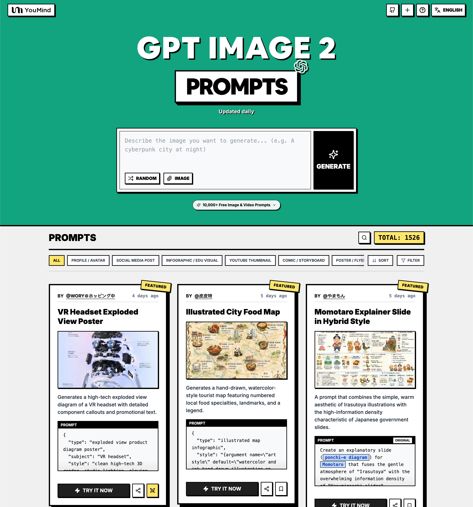

<a href="https://youmind.com/gpt-image-2-prompts">
  
</a>

> 💡 🎬 Take it further with **Seedance 2** — pair GPT Image 2 stills with Seedance for jaw-dropping AI videos, 2000+ prompts to explore 👉 [awesome-seedance-2-prompts](https://github.com/YouMind-OpenLab/awesome-seedance-2-prompts)
# 🚀 Awesome GPT Image 2 Prompts

[](https://github.com/sindresorhus/awesome)
[](https://github.com/YouMind-OpenLab/awesome-gpt-image-2)
[](https://creativecommons.org/licenses/by/4.0/)
[](https://github.com/YouMind-OpenLab/awesome-gpt-image-2/actions)
[](docs/CONTRIBUTING.md)

> 🎨 A curated collection of creative prompts for OpenAI's GPT Image 2

> ⚠️ **Copyright Notice**: All prompts are collected from the community for educational purposes. If you believe any content infringes on your rights, please [open an issue](https://github.com/YouMind-OpenLab/awesome-gpt-image-2/issues/new?template=bug-report.yml) and we will remove it promptly.

---

[](README.md) [](README_zh.md) [](README_zh-TW.md) [](README_ja-JP.md) [](README_ko-KR.md) [](README_th-TH.md) [](README_vi-VN.md) [](README_hi-IN.md) [](README_es-ES.md) [-Click%20to%20View-lightgrey)](README_es-419.md) [](README_de-DE.md) [](README_fr-FR.md) [](README_it-IT.md) [-Click%20to%20View-lightgrey)](README_pt-BR.md) [](README_pt-PT.md) [](README_tr-TR.md)

---

## 🌐 View in Web Gallery

<div align="center">

[](https://youmind.com/gpt-image-2-prompts)

</div>

**[👉 Browse on YouMind GPT Image 2 Prompts Gallery](https://youmind.com/gpt-image-2-prompts)**

Why use our gallery?

| Feature | GitHub README | youmind.com Gallery |
|---------|--------------|---------------------|
| 🎨 Visual Layout | Linear list | Beautiful Masonry Grid |
| 🔍 Search | Ctrl+F only | Full-text search with filters |
| 🤖 AI One-Click Generation | - | AI one-click generation |
| 📱 Mobile | Basic | Fully responsive |
| 🏷️ Categories | - | Category browsing |


### 🏷️ Browse by Category

- **Use Cases**
  - [Profile / Avatar](https://youmind.com/gpt-image-2-prompts?categories=profile-avatar)
  - [Social Media Post](https://youmind.com/gpt-image-2-prompts?categories=social-media-post)
  - [Infographic / Edu Visual](https://youmind.com/gpt-image-2-prompts?categories=infographic-edu-visual)
  - [YouTube Thumbnail](https://youmind.com/gpt-image-2-prompts?categories=youtube-thumbnail)
  - [Comic / Storyboard](https://youmind.com/gpt-image-2-prompts?categories=comic-storyboard)
  - [Product Marketing](https://youmind.com/gpt-image-2-prompts?categories=product-marketing)
  - [E-commerce Main Image](https://youmind.com/gpt-image-2-prompts?categories=ecommerce-main-image)
  - [Game Asset](https://youmind.com/gpt-image-2-prompts?categories=game-asset)
  - [Poster / Flyer](https://youmind.com/gpt-image-2-prompts?categories=poster-flyer)
  - [App / Web Design](https://youmind.com/gpt-image-2-prompts?categories=app-web-design)
- **Style**
  - [Photography](https://youmind.com/gpt-image-2-prompts?categories=photography)
  - [Cinematic / Film Still](https://youmind.com/gpt-image-2-prompts?categories=cinematic-film-still)
  - [Anime / Manga](https://youmind.com/gpt-image-2-prompts?categories=anime-manga)
  - [Illustration](https://youmind.com/gpt-image-2-prompts?categories=illustration)
  - [Sketch / Line Art](https://youmind.com/gpt-image-2-prompts?categories=sketch-line-art)
  - [Comic / Graphic Novel](https://youmind.com/gpt-image-2-prompts?categories=comic-graphic-novel)
  - [3D Render](https://youmind.com/gpt-image-2-prompts?categories=3d-render)
  - [Chibi / Q-Style](https://youmind.com/gpt-image-2-prompts?categories=chibi-q-style)
  - [Isometric](https://youmind.com/gpt-image-2-prompts?categories=isometric)
  - [Pixel Art](https://youmind.com/gpt-image-2-prompts?categories=pixel-art)
  - [Oil Painting](https://youmind.com/gpt-image-2-prompts?categories=oil-painting)
  - [Watercolor](https://youmind.com/gpt-image-2-prompts?categories=watercolor)
  - [Ink / Chinese Style](https://youmind.com/gpt-image-2-prompts?categories=ink-chinese-style)
  - [Retro / Vintage](https://youmind.com/gpt-image-2-prompts?categories=retro-vintage)
  - [Cyberpunk / Sci-Fi](https://youmind.com/gpt-image-2-prompts?categories=cyberpunk-sci-fi)
  - [Minimalism](https://youmind.com/gpt-image-2-prompts?categories=minimalism)
- **Subjects**
  - [Portrait / Selfie](https://youmind.com/gpt-image-2-prompts?categories=portrait-selfie)
  - [Influencer / Model](https://youmind.com/gpt-image-2-prompts?categories=influencer-model)
  - [Character](https://youmind.com/gpt-image-2-prompts?categories=character)
  - [Group / Couple](https://youmind.com/gpt-image-2-prompts?categories=group-couple)
  - [Product](https://youmind.com/gpt-image-2-prompts?categories=product)
  - [Food / Drink](https://youmind.com/gpt-image-2-prompts?categories=food-drink)
  - [Fashion Item](https://youmind.com/gpt-image-2-prompts?categories=fashion-item)
  - [Animal / Creature](https://youmind.com/gpt-image-2-prompts?categories=animal-creature)
  - [Vehicle](https://youmind.com/gpt-image-2-prompts?categories=vehicle)
  - [Architecture / Interior](https://youmind.com/gpt-image-2-prompts?categories=architecture-interior)
  - [Landscape / Nature](https://youmind.com/gpt-image-2-prompts?categories=landscape-nature)
  - [Cityscape / Street](https://youmind.com/gpt-image-2-prompts?categories=cityscape-street)
  - [Diagram / Chart](https://youmind.com/gpt-image-2-prompts?categories=diagram-chart)
  - [Text / Typography](https://youmind.com/gpt-image-2-prompts?categories=text-typography)
  - [Abstract / Background](https://youmind.com/gpt-image-2-prompts?categories=abstract-background)

---

## 📖 Table of Contents

- [🌐 View in Web Gallery](#-view-in-web-gallery)
- [🤔 What is GPT Image 2?](#-what-is-gpt-image-2)
- [📊 Statistics](#-statistics)
- [🔥 Featured Prompts](#-featured-prompts)
- [📋 All Prompts](#-all-prompts)
- [🤝 How to Contribute](#-how-to-contribute)
- [📄 License](#-license)
- [🙏 Acknowledgements](#-acknowledgements)
- [⭐ Star History](#-star-history)

---

## 🤔 What is GPT Image 2?

**GPT Image 2** (codename **"duct-tape"**) is OpenAI's next-generation image model. Community testing highlights a leap in these areas:

- 🎯 **Pixel-Perfect Text Rendering** — Native-quality text in Chinese, English, and Japanese, no typos or warped glyphs
- 🎨 **Cross-Image Consistency** — The same character, style, or IP stays identical across a series, down to the pixel
- ⚡ **Commercial-Grade Illustration** — Illustration output is ready to ship without manual polish
- 🌈 **True Art Style Induction** — Creatively evokes the feeling of a style rather than merely approximating references
- 🔧 **Storyboard & Product Series** — Ideal for storyboards, IP characters, and multi-panel product visuals
- 📐 **Multi-Language Design** — Social cards, banners, and posters with accurate multilingual typography in one shot

📚 **Learn More:** See community testing in our [report summary](docs/FAQ.md)

### 🚀 Raycast Integration

Some prompts support **dynamic arguments** using [Raycast Snippets](https://raycast.com/help/snippets) syntax. Look for the 🚀 Raycast Friendly badge!

**Example:**
```
A quote card with "{argument name="quote" default="Stay hungry, stay foolish"}"
by {argument name="author" default="Steve Jobs"}
```

When used in Raycast, you can dynamically replace the arguments for quick iterations!

---

## 📊 Statistics

<div align="center">

| Metric | Count |
|--------|-------|
| 📝 Total Prompts | **18103** |
| ⭐ Featured | **6** |
| 🔄 Last Updated | **Monday, November 9, 2026 at 3:30:49 AM UTC** |

</div>

---

## 🔥 Featured Prompts

> ⭐ Hand-picked by our team for exceptional quality and creativity

### No. 1: VR Headset Exploded View Poster


#### 📖 Description

Generates a high-tech exploded view diagram of a VR headset with detailed component callouts and promotional text.

#### 📝 Prompt

```
{
  "type": "exploded view product diagram poster",
  "subject": "VR headset",
  "style": "clean high-tech 3D render, studio lighting, glowing accents",
  "background": "{argument name=\"background color\" default=\"soft purple and blue gradient\"}",
  "header": {
    "logo": "∞ {argument name=\"product name\" default=\"Meta Quest 3\"}",
    "subtitle": "{argument name=\"main catchphrase\" default=\"まったく新しい現実を、まったく新しい構造から。\"}"
  },
  "layout": {
    "centerpiece": "vertically stacked exploded view of a VR headset showing 9 distinct layers of internal components: outer shell, camera sensors, motherboard with chip, pancake lenses, internal frame, battery packs, side straps, top strap, and facial interface cushion.",
    "callout_labels": {
      "count": 8,
      "left_side": [
        "Snapdragon® XR2 Gen 2\n圧倒的な処理性能でリアルタイムな体験を。",
        "調整可能なIPD機構\n幅広いユーザーに快適なフィット感を。",
        "精密設計されたヘッドストラップ\n快適さと安定性を追求したエルゴノミクス。"
      ],
      "right_side": [
        "フェイスプレート\n洗練されたデザインと最適な重量バランス。",
        "トラッキングカメラ\n高精度な位置トラッキングと環境認識を実現。",
        "パンケーキレンズ\n薄型設計で広い視野角と鮮明な映像を提供。",
        "高性能バッテリー\n長時間駆動を支える最適化された電源設計。",
        "柔らかなフェイスインターフェース\n長時間でも快適な装着感を実現。"
      ]
    },
    "footer": {
      "left_text_block": {
        "headline": "{argument name=\"bottom headline\" default=\"体験は、構造から進化する。\"}",
        "body": "一つひとつのパーツに、没入体験を支える最先端テクノロジーとこだわりの設計。Meta Quest 3は、未来を感じさせる体験を内部から生み出しています。"
      },
      "right_logo": "∞ Meta"
    }
  }
}
```

#### 🖼️ Generated Images

##### Image 1

<div align="center">

</div>

#### 📌 Details

- **Author:** [wory＠ホッピング中](https://x.com/wory37303852)
- **Source:** [Twitter Post](https://x.com/wory37303852/status/2045925660401795478#reversed-0)
- **Published:** April 19, 2026
- **Languages:** en

**[👉 Try it now →](https://youmind.com/gpt-image-2-prompts?id=13460)**

---

### No. 2: Illustrated City Food Map


#### 📖 Description

Generates a hand-drawn, watercolor-style tourist map featuring numbered local food specialties, landmarks, and a legend.

#### 📝 Prompt

```
{
  "type": "illustrated map infographic",
  "style": "{argument name=\"art style\" default=\"watercolor and ink hand-drawn illustration on vintage parchment\"}",
  "title_section": {
    "text": "{argument name=\"city name\" default=\"成都\"} {argument name=\"map title\" default=\"吃货暴走地图\"}",
    "mascot": "cartoon red chili pepper wearing sunglasses and giving a thumbs up"
  },
  "border": "{argument name=\"border decoration\" default=\"vine of green leaves and red chili peppers\"}",
  "layout": {
    "background": "textured beige parchment paper with yellow roads, blue rivers, and green park areas",
    "sections": [
      {
        "title": "landmarks",
        "count": 6,
        "illustrations": ["traditional pavilion", "traditional monastery", "modern skyscraper with climbing panda", "tall TV tower", "traditional gate", "industrial buildings"],
        "labels": ["人民公园", "文殊院", "IFS", "339电视塔", "宽窄巷子", "东郊记忆"]
      },
      {
        "title": "food_spots",
        "count": 12,
        "illustrations": ["mapo tofu", "dumplings in chili oil", "skewers in pot", "sticky rice balls", "egg baking cake", "nine-grid hotpot", "sweet potato noodles", "cold skewers", "spicy mixed dish", "covered tea bowl", "ice jelly dessert", "spicy rabbit heads"],
        "labels": ["1 陈麻婆豆腐", "2 钟水饺", "3 春熙路", "4 宽窄巷子·三大炮", "5 建设路·叶婆婆蛋烘糕", "6 玉林路·小龙坎火锅", "7 香香巷·肥肠粉", "8 武侯祠大街·钵钵鸡", "9 东郊记忆·冒椒火辣", "10 人民公园·鹤鸣茶社", "11 锦里古街·冰粉", "12 双流老妈兔头"]
      },
      {
        "title": "图例",
        "position": "bottom-right",
        "count": 5,
        "items": ["red dot", "green house", "green tree", "blue line", "yellow double line"],
        "labels": ["美食地点", "地标景点", "公园绿地", "河流湖泊", "主要道路"]
      }
    ],
    "centerpiece": "giant panda sitting and eating bamboo",
    "bottom_right_extras": ["vintage compass rose with N, S, E, W", "disclaimer text '温馨提示：吃辣需谨慎，肠胃要保护~' with a red chili pepper icon"]
  }
}
```

#### 🖼️ Generated Images

##### Image 1

<div align="center">

</div>

#### 📌 Details

- **Author:** [皮皮特](https://x.com/mm_zzm44854)
- **Source:** [Twitter Post](https://x.com/mm_zzm44854/status/2045861258520568230#reversed-1)
- **Published:** April 19, 2026
- **Languages:** en

**[👉 Try it now →](https://youmind.com/gpt-image-2-prompts?id=13515)**

---

### No. 3: Momotaro Explainer Slide in Hybrid Style


#### 📖 Description

A prompt that combines the simple, warm aesthetic of Irasutoya illustrations with the high-information density characteristic of Japanese government slides.

#### 📝 Prompt

```
Create an explanatory slide ({argument name="format" default="ponchi-e diagram"}) for {argument name="theme" default="Momotaro"} that fuses the gentle atmosphere of "Irasutoya" with the overwhelming information density of "Kasumigaseki slides".
```

#### 🖼️ Generated Images

##### Image 1

<div align="center">

</div>

##### Image 2

<div align="center">

</div>

#### 📌 Details

- **Author:** [やまもん](https://x.com/yammamon)
- **Source:** [Twitter Post](https://x.com/yammamon/status/2045778624092254603)
- **Published:** April 19, 2026
- **Languages:** ja

**[👉 Try it now →](https://youmind.com/gpt-image-2-prompts?id=13983)**

---

### No. 4: E-commerce Live Stream UI Mockup


#### 📖 Description

Generates a realistic social media live stream interface overlaying a portrait, featuring customizable chat messages, gift popups, and a product purchase card.

#### 📝 Prompt

```
{
  "type": "live stream UI mockup",
  "subject": {
    "description": "portrait of {argument name=\"host name\" default=\"Elon Musk\"}, smiling, wearing a black t-shirt with a white technical schematic graphic",
    "background": "left side shows a screen with '{argument name=\"left background logo\" default=\"SPACEX\"}' text, right side shows a red '{argument name=\"right background logo\" default=\"Tesla T logo\"}' and a dark car"
  },
  "ui_overlay": {
    "top_header": {
      "host_info": "avatar, name '{argument name=\"host name\" default=\"Elon Musk\"}', subtext '55.6万本场点赞', red '关注' button",
      "rank_badge": "gold coin icon with '全站第1名'",
      "viewer_stats": "3 top viewer avatars with '12.3w', '8.6w', '5.7w', total '68.7万', 'X' close button",
      "right_links": "'更多直播 >', '礼物展馆 0/24' with blue '经典' tag"
    },
    "mid_left_gifts": {
      "count": 2,
      "items": [
        "avatar '科技爱好者', '送小心心', heart icon x 1314",
        "avatar '星辰大海', '送火箭', rocket icon x 666"
      ]
    },
    "bottom_left_chat": {
      "system_message": "level 37 badge '宇宙漫游者 加入了直播间'",
      "message_count": 7,
      "messages": [
        "小火箭: 马斯克！未来可期！🚀",
        "future: 特斯拉Model 2什么时候出？",
        "星空梦想家: SpaceX今年能上火星吗？",
        "AI探索者: Neuralink进展如何？",
        "帅气的网友: 马总好！",
        "Mars: 第一次来你的直播，超激动！",
        "用户123: 讲讲AI吧，会取代人类吗？"
      ]
    },
    "bottom_right_product_card": {
      "hot_tag": "orange '热卖 x 1888'",
      "image": "Tesla Cybertruck",
      "title": "{argument name=\"product name\" default=\"特斯拉Cybertruck 电动皮卡\"}",
      "price": "{argument name=\"product price\" default=\"¥ 1,618,000\"}",
      "button": "red '抢' button",
      "floating_animation": "translucent hearts floating up the right edge"
    },
    "bottom_bar": {
      "input_field": "'说点什么...'",
      "icons": ["smiley face", "three dots", "shopping cart", "gift box", "share"]
    }
  }
}
```

#### 🖼️ Generated Images

##### Image 1

<div align="center">

</div>

#### 📌 Details

- **Author:** [神经病不想好转](https://x.com/sjbbxhz)
- **Source:** [Twitter Post](https://x.com/sjbbxhz/status/2045684734714380687#reversed-0)
- **Published:** April 19, 2026
- **Languages:** en

**[👉 Try it now →](https://youmind.com/gpt-image-2-prompts?id=14036)**

---

### No. 5: Anime Martial Arts Battle Illustration


#### 📖 Description

Generates a dynamic, high-impact anime illustration of two female characters fighting in a traditional dojo with elemental energy effects.

#### 📝 Prompt

```
An anime-style illustration of a {argument name="action type" default="high-impact martial arts battle"} between two young female fighters in a {argument name="setting" default="traditional wooden martial arts dojo"}. In the foreground, a girl with black hair in a high bun wears a {argument name="character 1 color theme" default="red and white"} Chinese-style martial arts outfit with baggy pants. She is in a dynamic, low, forward-thrusting stance, surrounded by swirling red energy and water splashes. In the background to the right, a girl with light purple hair in twin buns wears a {argument name="character 2 color theme" default="green and purple"} Chinese dress with gold embroidery and black tights. She is leaping through the air in a flying kick pose, surrounded by swirling blue energy. The wooden floorboards are splintering from the intense impact, with debris and dust flying through the air. Above them hangs a weathered wooden sign with the text "{argument name="sign text" default="武術会"}". The scene features dramatic lighting, a low-angle dynamic perspective, and intense action effects.
```

#### 🖼️ Generated Images

##### Image 1

<div align="center">

</div>

#### 📌 Details

- **Author:** [たねもみ 2.0 / Tanemomi Ver2.0](https://x.com/Tanemomi_Ver2)
- **Source:** [Twitter Post](https://x.com/Tanemomi_Ver2/status/2046063806846214265#reversed-0)
- **Published:** April 20, 2026
- **Languages:** en

**[👉 Try it now →](https://youmind.com/gpt-image-2-prompts?id=13467)**

---

### No. 6: 3D Stone Staircase Evolution Infographic


#### 📖 Description

Transforms a flat evolutionary timeline into a realistic 3D stone staircase infographic with detailed organism renders and structured side panels.

#### 📝 Prompt

```
{
  "type": "evolutionary timeline infographic",
  "instruction": "Using REFERENCE_0 as a structural base, transform the flat vector design into a highly realistic 3D infographic. Replace the smooth ramps with distinct stone steps and upgrade all organisms to photorealistic 3D models.",
  "style": {
    "background": "{argument name=\"background style\" default=\"vintage textured parchment paper\"}",
    "staircase": "{argument name=\"staircase material\" default=\"realistic textured stone blocks\"}",
    "subjects": "{argument name=\"organism style\" default=\"highly detailed photorealistic 3D renders\"}"
  },
  "layout": {
    "main_title": "{argument name=\"main title\" default=\"人类演化\"}",
    "sections": [
      {
        "position": "left sidebar",
        "count": 8,
        "labels": ["L0: 单细胞生命", "L1: 多细胞生物", "L2: 动物界", "L3: 脊索动物", "L4: 上陆革命", "L5: 哺乳纲", "L6: 人科演化", "L7: 智人纪元"]
      },
      {
        "position": "top right",
        "title": "获得的功能 / 失去的功能",
        "description": "Legend with plus and minus icons"
      },
      {
        "position": "bottom center",
        "title": "演化关键里程碑",
        "count": 6,
        "description": "Timeline with a silhouette graphic of 6 figures showing ape-to-human evolution"
      }
    ],
    "centerpiece": {
      "description": "Winding stone staircase with 25 numbered steps featuring specific organisms.",
      "count": 25,
      "notable_elements": [
        "Step 07: Jellyfish",
        "Step 09: Ammonite",
        "Step 10: Trilobite",
        "Step 24: Walking human",
        "Step 25: {argument name=\"future evolution concept\" default=\"glowing cosmic silhouette with a question mark\"}"
      ]
    }
  }
}
```

#### 🖼️ Generated Images

##### Image 1

<div align="center">

</div>

#### 📌 Details

- **Author:** [知识猫图解](https://x.com/GeekCatX)
- **Source:** [Twitter Post](https://x.com/GeekCatX/status/2045792240044511277#reversed-1)
- **Published:** April 19, 2026
- **Languages:** en

**[👉 Try it now →](https://youmind.com/gpt-image-2-prompts?id=13491)**

---

## 📋 All Prompts

> 📝 Sorted by publish date (newest first)

### No. 1: Profile / Avatar - Bedroom Selfie Portrait Prompt


#### 📖 Description

A prompt for generating a cozy, realistic bedroom selfie of a young East Asian woman with long wavy hair, wearing pink pajamas and a cardigan.

#### 📝 Prompt

```
【Overall Style】

1:1 square composition, single independent frame, ultra-realistic Korean-style adult female indoor portrait photography, gentle sweet girlish feeling, cream pink tones, realistic close-range mobile phone selfie, soft natural light, slight soft focus, retaining real photography texture.

【Facial Features】

A beautiful adult East Asian female aged 23 to 25, delicate small oval face, soft smooth jawline, small rounded chin, clear fine cold white skin.

Bright clear deep brown round almond eyes, natural double eyelids, soft full lying silkworms, slender curled eyelashes, fine light pink-brown eye makeup.

Slender straight nose bridge, small nose tip, cheeks with distinct but naturally blended peach pink blush.

Soft full cherry blossom rose pink lips, delicate moist glass lip luster.

Lips naturally slightly parted, eyes gently staring directly at lens, expression quiet, sweet, slightly lazy, retaining natural skin micro-texture.

【Hairstyle - Core】

Extremely dense and fluffy deep black tea color waist-length long hair, with natural deep chocolate brown luster.

Top of head naturally fluffy, adopting center-parted hairstyle, forehead has light messy air broken bangs.

Both sides long hair naturally draping over shoulders and chest, with soft loose large arc waves.

Few slender hair strands naturally sweeping across forehead and cheeks, rich hair layers, retaining real independent hair strands and natural messiness.

【Clothing & Jewelry】

Wearing shallow cherry blossom pink thin strap camisole top, soft cotton elastic fabric, simple circular arc neckline.

Outer layer cream white loose knit cardigan, fine soft knit texture, front placket naturally open, long sleeves slightly covering wrists.

Wearing small white pearl earrings and extremely thin silver clavicle chain.

【Character Pose】

Character sitting on bedroom bed edge, upper body naturally slightly leaning forward, body front facing lens.

Head gently tilted, chin slightly tucked, eyes directly staring at lens.

Hand on left side of frame raised to hair side, fingers naturally curved, gently organizing long hair near ear.

Other hand gently supporting cheek, palm naturally fitting jaw edge, fingers softly stretched.

Hands posture relaxed and natural, presenting gentle intimate selfie atmosphere.

【Background Environment】

Warm simple pink-tone bedroom, behind character is a large bed covered with shallow cherry blossom pink sheets, pink pillows and cream white bedding.

Background is light pink beige walls and simple headboard, overall environment soft, clean, cozy.

【Lens & Lighting】

1:1 square, equivalent 35 to 50mm lens, close-range chest-up half-body close-up, eye-height level view.

Character face located center of frame, top of head close to top edge of frame, two hands naturally surrounding cheek composition.

Soft cold white frontal fill light evenly illuminating face, lips and hands, skin tone clear and natural.

Background retains faint warm pink ambient light, forming soft warm-cold contrast.

Low saturation cream pink tones, delicate real skin quality, soft highlights, slight camera grain, no excessive smoothing, no excessive sharpening.

【Negative Prompts】

Anime, illustration, 3D rendering, CG fake face, plastic skin, excessive smoothing, abnormally large eyes, overly pointed chin, facial feature misalignment, wig, matted hair, stiff curls, extra fingers, deformed palms, twisted wrists, abnormal body proportions, clothing clipping, severe overexposure, strong HDR, over-sharpening, obvious AI feel, text, watermark, LOGO, collage.
```

#### 🖼️ Generated Images

##### Image 1

<div align="center">

</div>

#### 📌 Details

- **Author:** [沧瑶](https://x.com/CryY666666)
- **Source:** [Twitter Post](https://x.com/CryY666666/status/2118790521837769129)
- **Published:** November 6, 2026
- **Languages:** zh

**[👉 Try it now →](https://youmind.com/gpt-image-2-prompts?id=37386)**

---

### No. 2: Profile / Avatar - Soft Close-Up Portrait of Young Woman


#### 📖 Description

Generates a realistic, high-key close-up portrait of a smiling young woman with dark hair and natural makeup against a white background.

#### 📝 Prompt

```
A photorealistic close-up portrait of a young East Asian woman with fair, smooth skin and long, straight dark brown hair that falls loosely over her shoulders. She is looking slightly downward to the side with a gentle, soft smile, conveying a sense of calm and warmth. The lighting is bright, diffused, and high-key, creating a clean and airy atmosphere with soft shadows. Her makeup is natural and dewy, featuring subtle pink tones on the lips and cheeks. The background is a plain, out-of-focus white or light gray surface, emphasizing the subject's features.
```

#### 🖼️ Generated Images

##### Image 1

<div align="center">

</div>

#### 📌 Details

- **Author:** [Kevin Tech Labs](https://x.com/HongyeMain)
- **Source:** [Twitter Post](https://x.com/HongyeMain/status/2117775627839553765#reversed-0)
- **Published:** November 4, 2026
- **Languages:** en

**[👉 Try it now →](https://youmind.com/gpt-image-2-prompts?id=37299)**

---

### No. 3: Profile / Avatar - GPT Image Korean Style Portrait


#### 📖 Description

Detailed prompt for generating a realistic Korean-style indoor portrait of a young woman.

#### 📝 Prompt

```
[Overall Style]
9:16 vertical, single independent scene, ultra-realistic Korean-style adult female indoor lifestyle photo, cool and gentle airy feeling, low-saturation cream pink and cold blue-gray tones, soft natural window light, slight film soft focus, real camera photography texture.

[Facial Features]
A beautiful adult East Asian woman aged 23-25, exquisite small oval face, soft smooth jawline, small rounded chin, clear cold white porcelain skin, faint peach pink blush.
Bright clear dark gray-brown almond eyes, natural double eyelids, delicate aegyo-sal, slender natural eyelashes, light pink-brown eyeshadow, softly lifted eyeliner.
Slender straight nose bridge, small nose tip, soft full rose bean paste pink moist lips.
Lips naturally closed, expression gentle and cool, with slight laziness, eyes quietly looking directly at the lens, preserving real skin micro-texture.

[Hair]
Thick fluffy jet-black waist-length long hair, natural deep black tea color gloss, top of head has real airy feel.
Natural center part, forehead has light irregular figure-eight broken bangs, a few fine hairs lightly brushing across forehead and cheeks.
Long hair naturally draped over shoulders and chest, overall smooth, ends have loose large arc curls, preserving real individual strands and natural fluffiness.

[Clothing & Jewelry]
Wearing light cherry blossom pink thin strap fitted short top, soft cotton fabric, simple shallow round neck.
Outer layer cream white loose knit cardigan, front naturally open, sleeves loosely falling to upper arms, revealing natural shoulder neck and collarbone.
Wearing small silver hoop earrings and delicate silver thin bracelet.

[Pose]
Person sitting at bedroom window vanity table, body slightly turned towards camera, shoulders naturally relaxed.
Head gently tilted, chin slightly tucked, eyes looking directly at camera.
Both hands naturally raised to chest, one hand lightly holding long hair in front of shoulder, other hand gently arranging hair ends.
Posture gentle and relaxed, hand structures accurate, movements natural.

[Background Environment]
Modern simple light gray-white bedroom, bright large window on left side of frame, windowsill holds a bouquet of light pink and cream white flowers.
Right side of frame is white vanity table, surface holds makeup brushes, powder cake, skincare products and some cosmetics.
Large circular mirror hangs above vanity, faintly reflecting person's back and jet-black long hair.
Background has real life atmosphere, overall clean, soft, natural.

[Lens & Lighting]
9:16 vertical, equivalent 35-50mm lens, eye-level shot, person centered, half-body composition from head to waist area.
Soft cold white natural window light enters from left side of frame, face bright and clear, skin appears naturally cold white.
Hair has delicate dark brown reflections, window edge and light background slightly highlight blooming.
Overall low contrast cold blue-gray color grading, soft shadows, slight film grain and natural optical soft focus.
Preserve real skin texture, fine hair strands, natural fabric wrinkles and real spatial perspective, avoid excessive smoothing and obvious AI generation traces.

[Negative Prompts]
Anime, illustration, 3D rendering, CG fake face, plastic skin, excessive smoothing, exaggerated influencer face, abnormally large eyes, overly sharp chin, facial feature misalignment, wig, matted hair, deformed fingers, extra fingers, incorrect hand structure, abnormal body proportions, clothing clipping errors, deformed reflection in mirror, incorrect mirror reflection, cosmetics blending, severe overexposure, strong HDR, excessive sharpening, commercial studio lighting, obvious AI feel, text, watermark, LOGO, collage.
```

#### 🖼️ Generated Images

##### Image 1

<div align="center">

</div>

#### 📌 Details

- **Author:** [沧瑶](https://x.com/CryY666666)
- **Source:** [Twitter Post](https://x.com/CryY666666/status/2117284530839232946)
- **Published:** November 2, 2026
- **Languages:** zh

**[👉 Try it now →](https://youmind.com/gpt-image-2-prompts?id=37243)**

---

### No. 4: Profile / Avatar - GPT Image Living Room Portrait


#### 📖 Description

Prompt for a realistic portrait of a woman in a modern living room setting.

#### 📝 Prompt

```
[Overall Style]
1:1 square composition, single independent scene, ultra-realistic Korean-style adult female indoor portrait photography, cool and gentle temperament, cream white modern living room, soft natural fill light, low-saturation gray-blue tones, real camera texture, slight natural soft focus.

[Facial Features]
A beautiful adult East Asian woman aged 23-25, exquisite small oval face, soft smooth jawline, small rounded chin, clear cold white porcelain skin, light peach pink blush.
Bright clear dark brown almond eyes, natural double eyelids, delicate aegyo-sal, slender curled eyelashes, softly lifted eyeliner, slender straight nose bridge.
Soft full rose bean paste pink moist lips, lips naturally slightly parted, corners of mouth slightly upturned, eyes gently looking directly at camera, preserving delicate real skin texture.

[Hair - Core]
Extremely thick smooth jet-black waist-length long hair, natural deep black tea color gloss, top of head fluffy, side-parted hairstyle, roots have real airy feel.
Long hair mainly smooth straight, ends have slight natural arc, draped over shoulders and chest on both sides.
Few fine broken strands hanging naturally on forehead, above right ear (viewer's right) wears delicate silver crystal flower hair clip, hair naturally gathered behind ear.
Real individual strands, soft gloss, avoid wig texture.

[Clothing & Jewelry]
Wearing light ice gray-blue off-shoulder fuzzy knit sweater, soft fluffy mohair material, delicate knit texture, loose asymmetric neckline naturally slipping down, exposing right shoulder (viewer's right) and collarbone.
Long sleeve design, cuffs loose and soft, with natural wrinkles.
Wearing white pearl stud earrings and delicate silver crystal thin bracelet.

[Pose]
Person sitting on cream white sofa, body slightly turned towards camera, upper body naturally leaning forward.
Head gently tilted to left side of frame (viewer's left), chin slightly tucked.
Left hand (viewer's left) lightly supporting chin, fingers naturally curved; other hand raised beside shoulder, lightly holding a bundle of jet-black long hair.
Shoulders relaxed, posture natural and elegant, gaze cool and gentle.

[Background & Lighting]
Modern simple cream white living room, behind is soft beige fabric sofa, light beige walls, upper right corner has soft warm yellow lamp light.
Soft cold white frontal fill light illuminates face, skin appears clear cold white, background retains warm soft ambient light.
Equivalent 50mm portrait lens, close-range half-body composition, person centered, face clear, background slightly naturally blurred.
Real photography exposure, fine hair strands, clear eyes, soft skin texture, slight natural grain, no obvious AI generation feel.

[Negative Prompts]
Anime, illustration, 3D rendering, CG fake face, plastic skin, excessive smoothing, exaggerated large eyes, sharp chin, facial feature misalignment, wig, matted hair, stiff strands, extra fingers, palm deformity, shoulder dislocation, abnormal body proportions, incorrect off-shoulder structure, clothing clipping errors, excessive sharpening, strong HDR, severe overexposure, obvious AI feel, text, watermark, LOGO, collage.
```

#### 🖼️ Generated Images

##### Image 1

<div align="center">

</div>

#### 📌 Details

- **Author:** [沧瑶](https://x.com/CryY666666)
- **Source:** [Twitter Post](https://x.com/CryY666666/status/2117219660366262436)
- **Published:** November 2, 2026
- **Languages:** zh

**[👉 Try it now →](https://youmind.com/gpt-image-2-prompts?id=37246)**

---

### No. 5: Profile / Avatar - Showa Retro Portrait at Shrine


#### 📖 Description

A nostalgic, film-grain portrait of a young woman in a floral dress standing before a Japanese shrine, evoking a melancholic Showa-era atmosphere.

#### 📝 Prompt

```
A vertical portrait of a young East Asian woman with short, dark bob hair and bangs, standing outdoors in front of a traditional Japanese shrine. She wears a vintage-style, grey-blue midi dress with a small floral print, featuring a Peter Pan collar, short sleeves, and a button-down bodice. Her expression is melancholic and distant, looking slightly off-camera with her hands clasped gently in front of her waist. The background shows vermilion-orange shrine architecture (torii gates and pagoda roofs) and stone lanterns, rendered out of focus. The ground beneath her features the white stripes of a pedestrian crosswalk. The image has a strong Showa-era retro aesthetic, characterized by warm, faded film tones, visible grain, light leaks along the edges, and scratches typical of old instant photography.
```

#### 🖼️ Generated Images

##### Image 1

<div align="center">

</div>

#### 📌 Details

- **Author:** [いがぐりメタボ](https://x.com/Kmsbdd0GXBOcrXQ)
- **Source:** [Twitter Post](https://x.com/Kmsbdd0GXBOcrXQ/status/2116849131599933528#reversed-0)
- **Published:** November 1, 2026
- **Languages:** en

**[👉 Try it now →](https://youmind.com/gpt-image-2-prompts?id=37213)**

---

### No. 6: Profile / Avatar - GPT Image 2 Hand-Drawn Scrapbook Illustration Prompt


#### 📖 Description

A detailed prompt for GPT Image 2 to transform an uploaded photograph into a cozy, whimsical hand-drawn colored pencil and crayon scrapbook illustration, preserving original features while adding decorative borders.

#### 📝 Prompt

```
Transform the uploaded photograph into a beautiful, cozy, whimsical HAND-DRAWN COLORED PENCIL & CRAYON SCRAPBOOK ILLUSTRATION.

IMPORTANT — PRESERVE THE ORIGINAL PHOTO:

First, carefully analyze the uploaded photograph. Identify the actual subjects, people, facial features, hairstyles, clothing, poses, expressions, accessories, objects, background and surroundings.

Recreate the same photograph as a charming illustrated artwork. Preserve the original composition, recognizable facial characteristics, clothing details, body positions and interactions. Do not randomly replace or invent the main subjects.

ART STYLE:
- Authentic hand-drawn colored pencil and wax crayon illustration.
- Visible pencil strokes, grainy textures and imperfect sketch lines.
- Soft watercolor-like coloring mixed with rich colored pencil shading.
- Delicate cross-hatching and layered hand-drawn details.
- Slightly rough, nostalgic children's storybook illustration aesthetic.
- Warm, dreamy, cozy and whimsical atmosphere.
- Cream-colored textured paper background.
- Soft lighting with warm highlights and gentle shadows.
- Rich yet slightly faded vintage colors.

SCRAPBOOK DECORATION:

Surround the main illustration with a playful handmade scrapbook border featuring:
- Pink and red glittery heart stickers.
- Small colorful gemstones and pearl beads.
- Golden stars and crystal decorations.
- Tiny hand-drawn flowers and butterflies.
- Cute doodles, smiley faces and little stars.
- Small decorative leaves and seasonal elements.
- Colorful hand-drawn outlines and playful symbols.

Make the decorations look like real physical stickers and tiny embellishments placed around the edges of the artwork.

COMPOSITION:

Keep the main subject as the central focus. Recreate the original environment using detailed colored pencil textures. Add decorative scrapbook elements mainly around the outer borders without covering important parts of the photograph.

The artwork should feel like a page from a beautifully decorated personal diary or a nostalgic illustrated memory journal.

FINAL AESTHETIC:

Extremely detailed, adorable, cozy, nostalgic, artistic, soft vintage scrapbook aesthetic, handmade illustration, visible crayon grain, colored pencil texture, delicate imperfections, warm pastel tones, charming decorative embellishments, premium illustrated journal page.

IMPORTANT: The result must look like a completely hand-drawn illustration, NOT a photograph with a cartoon filter. Avoid photorealism, 3D rendering, plastic textures and overly smooth digital painting.
```

#### 🖼️ Generated Images

##### Image 1

<div align="center">

</div>

##### Image 2

<div align="center">

</div>

##### Image 3

<div align="center">

</div>

#### 📌 Details

- **Author:** [Sairah](https://x.com/Sairah_0)
- **Source:** [Twitter Post](https://x.com/Sairah_0/status/2116773143691878877)
- **Published:** November 1, 2026
- **Languages:** en

**[👉 Try it now →](https://youmind.com/gpt-image-2-prompts?id=37163)**

---

### No. 7: Profile / Avatar - Anime Bride in Ruffled Wedding Gown


#### 📖 Description

Generates a full-body anime-style portrait of an elegant bride wearing an elaborate ruffled wedding dress with floral details, suitable for character design or romantic illustration projects.

#### 📝 Prompt

```
A full-body anime-style illustration of a beautiful bride standing against a clean white background. She has dark brown hair styled in an elegant updo with loose bangs framing her face, adorned with a delicate floral headpiece and long dangling earrings. Her eyes are large and expressive with subtle makeup, and she wears a soft, confident expression. The wedding dress is highly detailed: a strapless sweetheart neckline bodice with intricate lace-up corset detailing and floral appliqués along the edges. Voluminous off-the-shoulder sleeves cascade into dramatic ruffled layers that flow down the sides of the gown. A high slit reveals one toned leg, decorated with trailing floral embellishments running down the skirt. The train spreads wide at the bottom with multiple tiers of flowing fabric. She wears pointed-toe heels with small bows at the ankles. A sheer veil drapes from behind her head over the shoulders and back. The art style features crisp linework, smooth cel-shading, and a refined color palette dominated by whites, creams, and warm skin tones.
```

#### 🖼️ Generated Images

##### Image 1

<div align="center">

</div>

##### Image 2

<div align="center">

</div>

##### Image 3

<div align="center">

</div>

#### 📌 Details

- **Author:** [Jema Christian](https://x.com/jemachristian)
- **Source:** [Twitter Post](https://x.com/jemachristian/status/2116523085176373667#reversed-0)
- **Published:** October 31, 2026
- **Languages:** en

**[👉 Try it now →](https://youmind.com/gpt-image-2-prompts?id=37165)**

---

### No. 8: Profile / Avatar - Retro Halloween Vampire Girl


#### 📖 Description

A prompt for generating a nostalgic, Showa-era style photo of a girl in a vampire costume celebrating Halloween.

#### 📝 Prompt

```
A retro-style photograph of a young Asian woman with short, messy dark hair sitting in a vintage floral armchair. She is wearing a beige chunky knit sweater over a plaid skirt, paired with slouchy white socks and brown loafers. A black velvet vampire cape with red satin lining is draped over her shoulders, tied at the neck with a ribbon. Her hands are raised in a playful claw gesture, and she has small fangs visible. The background features Halloween decorations including orange jack-o'-lanterns and black bat cutouts on the wall, along with an old CRT television set to the left. The image has a nostalgic Showa-era aesthetic with warm lighting and film grain.
```

#### 🖼️ Generated Images

##### Image 1

<div align="center">

</div>

#### 📌 Details

- **Author:** [いがぐりメタボ](https://x.com/Kmsbdd0GXBOcrXQ)
- **Source:** [Twitter Post](https://x.com/Kmsbdd0GXBOcrXQ/status/2116498284344992013#reversed-0)
- **Published:** October 31, 2026
- **Languages:** en

**[👉 Try it now →](https://youmind.com/gpt-image-2-prompts?id=37166)**

---

### No. 9: Profile / Avatar - Retro Showa Halloween Portrait


#### 📖 Description

A nostalgic, film-grain style photograph of a girl in a DIY paper pumpkin costume posing in a vintage Japanese alleyway at night.

#### 📝 Prompt

```
A vertical, medium-shot portrait of a young Asian woman with short dark hair and bangs, wearing a homemade Halloween costume consisting of an orange paper pumpkin hat and a matching jagged orange paper collar tied at the neck over a black long-sleeved dress. She is leaning slightly forward, making a peace sign with her right hand near her cheek, while holding a small brown paper bag decorated with a jack-o'-lantern and black cat in her left hand. The background is a narrow, dimly lit retro Japanese alleyway (yokocho) at night, featuring wooden storefronts, glowing lanterns, and blurred figures of other people walking away. On the left, there are hanging paper decorations including a jack-o'-lantern and a white ghost. On the right, a vertical banner reads 'おもちや' (Omo-cha). The image has a strong Showa-era retro aesthetic, characterized by warm, faded colors, visible film grain, scratches, dust spots, and soft focus typical of vintage instant photography.
```

#### 🖼️ Generated Images

##### Image 1

<div align="center">

</div>

#### 📌 Details

- **Author:** [いがぐりメタボ](https://x.com/Kmsbdd0GXBOcrXQ)
- **Source:** [Twitter Post](https://x.com/Kmsbdd0GXBOcrXQ/status/2116479886592450725#reversed-0)
- **Published:** October 31, 2026
- **Languages:** en

**[👉 Try it now →](https://youmind.com/gpt-image-2-prompts?id=37167)**

---

### No. 10: Profile / Avatar - Retro American Cartoon Style Image Transformation


#### 📖 Description

A prompt for transforming an uploaded photo into a full-body illustration in the style of 1960s-1980s retro American cartoons, preserving the subject's identity and composition while applying rubber hose proportions and vintage animation aesthetics.

#### 📝 Prompt

```
Transform the exact uploaded image into a full body illustration designed in a 1960s–1980s retro American cartoon style. Preserve the exact subject, facial identity, hairstyle, clothing, accessories, colors, proportions, pose, body language, facial expression, camera angle, framing, composition, perspective, lighting, and every visible detail from the original image. Do not redesign, reinterpret, simplify, replace, or invent any elements. The uploaded image must remain instantly recognizable, changing only the artistic style.

The character should feature exaggerated rubber hose proportions, expressive body language, a slightly oversized head, simplified anatomy, elastic limbs, large classic oval cartoon eyes with simple black pupils, thin expressive eyebrows, rounded hands, clean geometric shapes, and a playful vintage personality while preserving the exact likeness, expression, and silhouette of the original subject.

The illustration features thick bold black outlines, flat solid colors, minimal cel-style shading, subtle vintage film grain texture, slightly desaturated tones like old animation cels, smooth hand-drawn 2D linework, simple color blocking, soft retro print texture, and a classic mid-century American animation aesthetic.

Preserve the original background exactly as shown in the uploaded image unless otherwise specified.

Keep the original composition, framing, perspective, and camera angle exactly the same. Full body should remain visible if it is visible in the original image. High resolution, clean illustration, no realism, no 3D rendering, no anime, no Pixar, no Disney, no modern cartoon style, only authentic 1960s–1980s American retro animation aesthetics.
```

#### 🖼️ Generated Images

##### Image 1

<div align="center">

</div>

##### Image 2

<div align="center">

</div>

#### 📌 Details

- **Author:** [Sairah](https://x.com/Sairah_0)
- **Source:** [Twitter Post](https://x.com/Sairah_0/status/2116413622293520427)
- **Published:** October 31, 2026
- **Languages:** en

**[👉 Try it now →](https://youmind.com/gpt-image-2-prompts?id=37162)**

---

### No. 11: Profile / Avatar - GPT Image 2 Night Street Photography Prompt


#### 📖 Description

A prompt for generating a realistic night street portrait of an East Asian woman using iPhone flash photography style, with wet streets and neon reflections.

#### 📝 Prompt

```
1:1 square composition, single independent frame, ultra-realistic Korean-style adult female night city street photography, real iPhone night direct flash photography, wet city streets, neon light reflections, cool and sweet lifestyle portrait style, real and natural, no obvious AI feel.

[Character Face]

A beautiful adult East Asian woman aged 23-25, refined small oval face, soft narrowed jawline, small round chin, clear cold-white skin, faint peach pink blush.

Bright and clear dark brown almond eyes, natural double eyelids, delicate lying silkworms, slender natural eyelashes, light pink-brown eyeshadow, soft slightly upturned eyeliner.

Slender straight nose bridge, small nose tip, soft full rose pink moist lips.

Corners of mouth slightly upturned, showing natural gentle closed-mouth smile, eyes looking directly at camera, expression sweet and relaxed.

Retain real skin micro-texture and natural feature proportions.

[Hairstyle - Core]

Extremely dense and fluffy waist-length dark chestnut brown hair, with natural chocolate brown luster.

Top of head fluffy, roots have real airiness, natural center part, thin irregular figure-eight bangs on forehead.

Sides of long hair draped naturally over shoulders and chest, with soft loose large waves.

Right side hair especially voluminous, rich layers, few strands blown by night breeze.

Hair illuminated by frontal flash, showing delicate dark brown highlights, retaining real independent strands.

[Clothing & Jewelry]

Wearing a pure white fitted short-sleeve T-shirt, simple round neckline, soft cotton elastic fabric, naturally fitting body contours.

Very thin silver clavicle chain around neck, with small crystal pendant in center.

Simple thin silver bracelet on one wrist.

Overall outfit fresh, daily, simple.

[Character Pose - Key]

Naturally standing on zebra crossing of night city street, body facing camera, shoulders relaxed.

Head slightly tilted, chin naturally tucked, looking gently at camera.

Left hand raised beside cheek, index finger and thumb naturally curved forming half-heart C-shape gesture, other fingers relaxed.

Other hand gently holding a bunch of long hair on right chest, fingers naturally curved.

Hands staggered, pose natural and playful, like a casual photo taken by a friend on the street.

[Background Environment]

Busy Chinese city commercial street at night, just after rain.

Dark wet asphalt road, wide white zebra crossing extending into distance behind character.

Convenience stores, restaurants, shops on both sides, with red, blue, white, yellow glowing signs.

Cars driving in distance, blurred headlights, streetlights, few pedestrians.

Wet asphalt reflects large amounts of red, blue, warm yellow neon lights, forming real irregular colorful reflections.

Background has urban night spatial depth, car lights slightly motion blurred, shop lights soft bokeh.

[Lens & Lighting]

1:1 square composition, equivalent 28-35mm phone main camera lens, eye-level shooting.

Character centered, framing from small whitespace above head to waist, fully showing face, hands, long hair, and white T-shirt.

Using night phone direct flash or soft frontal LED fill light, face bright and clear, cold white skin contrasting sharply with dark night scene.

Flash illuminating forehead, nose bridge, cheeks, long hair, and hands, producing real soft close-range fill light effect.

Background retains natural urban neon ambient light, wet street showing red-blue light reflections.

Character sharp and clear, background with slight real motion blur and night digital noise.

Real phone night shot texture, natural exposure, retaining skin texture, delicate hair strands, and environmental lighting/shadows.

[Negative Prompt]

Anime, illustration, 3D render, CG fake face, plastic skin, excessive smoothing, exaggerated influencer face, abnormally large eyes, overly pointed chin, misaligned features, wig, matted hair, stiff curls, extra fingers, deformed palms, wrong heart gesture, twisted wrists, extra arms, abnormal body proportions, T-shirt clipping, deformed zebra crossing, distorted vehicles, oversaturated neon lights, excessive background blur, strong HDR, over-sharpening, commercial studio texture, obvious AI generation traces, watermark, logo, collage.
```

#### 🖼️ Generated Images

##### Image 1

<div align="center">

</div>

#### 📌 Details

- **Author:** [沧瑶](https://x.com/CryY666666)
- **Source:** [Twitter Post](https://x.com/CryY666666/status/2116182588419121355)
- **Published:** October 30, 2026
- **Languages:** zh

**[👉 Try it now →](https://youmind.com/gpt-image-2-prompts?id=37115)**

---

### No. 12: Profile / Avatar - Showa Retro Pink Kitchen Portrait


#### 📖 Description

Generates a nostalgic 1980s-style portrait of a girl in a red gingham dress inside a vintage pink kitchen.

#### 📝 Prompt

```
A vertical 3:4 portrait photograph in a nostalgic Showa-era retro aesthetic, featuring a young East Asian woman standing in the center of a vintage pink kitchen. She has short dark hair with bangs and wears a thin red headband. Her expression is neutral and slightly melancholic, looking directly at the camera. She is wearing a red-and-white gingham (checkered) sundress with spaghetti straps, a white lace trim along the square neckline, and two horizontal tiers of white lace detailing on the skirt. The dress falls to her mid-calves. She wears white ankle socks and stands on a checkered floor with alternating beige and reddish-brown tiles.

The background is a cluttered, warm-toned kitchen dominated by faded pink cabinetry. To the left, there is a vintage stove with a cream-colored kettle and a pot with floral patterns; hanging above are a red checkered cloth and a decorative plate. To the right, on the counter, sits a strawberry shortcake on a white pedestal stand and a glass bowl filled with red apples. A pink-framed mirror reflects part of the room. The lighting is soft and diffuse, characteristic of indoor flash photography from the 1980s, creating a grainy film texture with slightly washed-out colors and high nostalgia.
```

#### 🖼️ Generated Images

##### Image 1

<div align="center">

</div>

#### 📌 Details

- **Author:** [いがぐりメタボ](https://x.com/Kmsbdd0GXBOcrXQ)
- **Source:** [Twitter Post](https://x.com/Kmsbdd0GXBOcrXQ/status/2116123333469073536#reversed-0)
- **Published:** October 30, 2026
- **Languages:** en

**[👉 Try it now →](https://youmind.com/gpt-image-2-prompts?id=37118)**

---

### No. 13: Profile / Avatar - GPT Image 2 Platinum Hair Portrait


#### 📖 Description

A prompt for generating a close-up portrait of a woman with platinum blonde hair in a bedroom setting, including negative prompts for quality control.

#### 📝 Prompt

```
1:1 square composition, single independent image, hyper-realistic Korean cool female portrait photography, real camera texture, soft cold white light, low saturation cream tone, exquisite and gentle, slight natural soft focus.

[Facial Features]

An adult East Asian woman aged 23-25, delicate small oval face, softly narrowed jawline, small round chin, clear cold white porcelain skin, pale pink blush.

Bright clear gray-green almond eyes, natural double eyelids, detailed aegyo-sal, long curled eyelashes, light gray-brown eyebrows, slender straight nose bridge.

Soft full rose-bean-paste pink lips, delicate moist gloss, lips naturally closed, expression cool and gentle, eyes looking directly at camera, retaining real skin micro-texture.

[Hairstyle]

Extremely thick and soft cream platinum blonde long hair, with light silver-white, champagne gold, and pale cold gray luster.

Natural center part, fluffy crown, roots have real airiness, thin figure-eight bangs naturally frame forehead and cheeks.

Long hair extends below chest, overall straight, ends have slight natural waves, sides naturally draped, retaining individual strands and some flying hairs.

[Clothing & Jewelry]

Wearing light lavender purple fitted V-neck long-sleeve knit sweater, fine vertical ribbed fabric, soft and body-hugging, cuffs slightly long and naturally covering part of palms.

Wearing exquisite silver crystal tassel earrings, one simple thin silver ring on finger.

[Pose]

Person sitting indoors, facing camera directly, upper body slightly leaning forward, shoulders naturally gathered.

Both hands raised to sides of chin, fingers gently curved, forming cute chin-resting pose.

Long sleeves naturally stacked near wrists, head slightly tilted, eyes quietly gazing at camera, expression calm and gentle.

[Background Environment]

Modern simple bedroom closet, light cream white walls.

Right side of frame is open white wardrobe, inside hanging black, white, and beige clothes, top has soft warm yellow LED strip.

Wardrobe background slightly naturally blurred, left side is clean light white wall.

[Lens & Lighting]

Equivalent 50mm portrait lens, eye-level shooting, close-up upper body composition, person centered.

Soft cold white frontal fill light illuminates face, skin appears clear cold white, eyes have natural reflection.

Platinum hair shows delicate silver-white highlights, background wardrobe has some warm yellow lights, forming slight cool-warm contrast.

Low saturation, soft contrast, natural exposure, delicate skin texture, real hair strands, slight camera grain, no obvious AI feel.

[Negative Prompts]

Anime, illustration, 3D rendering, CG fake face, plastic skin, excessive smoothing, exaggerated big eyes, overly pointed chin, facial deformity, pupil abnormality, wig, matted hair, stiff strands, extra fingers, deformed palm, wrong body proportions, clothing clipping, overexposure, strong HDR, over-sharpening, commercial studio texture, obvious AI traces, text, watermark, logo, collage.
```

#### 🖼️ Generated Images

##### Image 1

<div align="center">

</div>

#### 📌 Details

- **Author:** [沧瑶](https://x.com/CryY666666)
- **Source:** [Twitter Post](https://x.com/CryY666666/status/2115911199204483114)
- **Published:** October 29, 2026
- **Languages:** zh

**[👉 Try it now →](https://youmind.com/gpt-image-2-prompts?id=37082)**

---

### No. 14: Profile / Avatar - Hyper-realistic Korean-style indoor selfie prompt


#### 📖 Description

A detailed prompt for generating a hyper-realistic, warm-toned portrait of an East Asian woman in a bedroom setting using GPT Image. It specifies camera angles, lighting conditions, clothing textures, and negative prompts to avoid AI artifacts.

#### 📝 Prompt

```
9:16 vertical format, single independent frame, hyper-realistic Korean-style adult female indoor portrait photography, gentle mature vibe, cream warm white tones, realistic smartphone selfie texture, soft natural fill light, delicate skin texture, slight soft focus, warm quiet bedroom atmosphere.

[Facial Features]

A beautiful East Asian woman aged 23-25, clearly an adult, with a refined small oval face, soft and smooth facial contours, flat cheekbones, naturally narrowed jawline, and a small rounded chin.

Clear cool white skin with faint peach-pink blush, slender straight nose bridge, small natural nose tip.

Bright clear dark gray-brown almond eyes, natural double eyelids, soft lying silkworms, long curled eyelashes, light pink-brown eyeshadow, natural flat eyebrows.

Soft full rose-bean paste pink lips with fine natural moist gloss.

Slight upward curve at the corners of the mouth, gentle calm expression, eyes looking directly at the lens with natural intimacy.

Real skin micro-texture, avoiding exaggerated beauty filters and overly juvenile features.

[Hairstyle - Core]

Thick fluffy deep chestnut brown long hair with natural chocolate brown luster, length extending below the chest near the waist.

Noticeable natural volume on top, loose roots, abundant hair quantity.

Natural center-parting style, some hair loosely gathered behind the head forming a slight half-up hairstyle.

Several thin wispy strands falling naturally over the forehead and cheeks.

Hair on the left side of the frame tucked back naturally, revealing ears and small pearl earrings.

Large amount of thick long hair falling naturally on the shoulders and chest on the right side of the frame, forming soft loose large waves.

Hair strands have real thickness, natural luster, and tiny flyaway hairs; do not use overly neat curls or wig-like texture.

[Clothing & Jewelry]

Wearing a cream white/light oatmeal colored off-shoulder fitted knit top.

Soft dense knit fabric, loose horizontal neckline slipping naturally below the shoulder, exposing one shoulder and clear soft collarbone.

Long sleeve design, cuffs fitting naturally at wrists, fabric has fine realistic weave texture and soft folds.

Neck wearing an extremely thin silver collarbone chain, one ear wearing small white pearl stud earring.

Overall outfit simple, gentle, elegant.

[Pose - Key Focus]

Person sitting on the edge of the bed in the bedroom, upper body slightly turned towards the lens, shoulders naturally relaxed.

Head tilted gently to the right side of the frame, chin slightly tucked, eyes gently looking straight into the camera.

One hand on the left side of the frame raised naturally, palm lightly touching the cheek and under the ear, fingers spreading naturally along the jawline, forming a gentle face-holding pose.

The other hand raised beside the shoulder, fingers gently arranging the long hair on the chest, fingertips naturally curved.

Long hair falling naturally on the right side of the body, positions of both hands staggered high and low, forming a natural soft composition.

Maintain realistic finger count, natural wrist angles, and reasonable shoulder-neck proportions.

[Background Environment]

Warm simple modern bedroom or hotel room.

Left side of the frame is a large floor-to-ceiling window covered with semi-transparent white sheer curtains, curtains having soft natural vertical folds.

Behind the person is a soft large bed with pure white bedding.

Light beige headboard and warm yellow bedside lamp light visible in the right rear of the frame.

Walls are cream white and light beige, interior clean and tidy without complex clutter.

Overall has a warm atmosphere of real home nighttime rest.

[Lens & Lighting]

9:16 vertical, close-up upper body portrait composition, equivalent 35-50mm lens, eye-level perspective, person centered in the frame.

Small space reserved above the head, long hair extending naturally to the bottom of the frame.

Use soft cool white frontal fill light, evenly illuminating eyes, cheeks, and lips, making skin appear clean transparent cool white.

Bedside lamp on the right background emits soft warm yellow ambient light, creating natural cool-warm color temperature contrast.

Lit areas of hair show fine chestnut brown highlights, shadows maintain rich dark brown.

Overall moderate brightness, slightly reduced contrast, preserving natural shadows, realistic hair strands, fine fabric textures, and slight smartphone photography grain.

[Negative Prompts]

Anime, illustration, 3D render, CG fake face, plastic skin, excessive smoothing, exaggerated influencer face, abnormally large eyes, overly pointed chin, misaligned features, asymmetrical eyes, heavy makeup, wig, clumped hair, overly regular curls, deformed fingers, extra fingers, fused hands, twisted wrists, dislocated shoulders, abnormal body proportions, incorrect knit texture, clothes clipping through body, messy background, strong HDR, severe overexposure, excessive sharpening, commercial studio lighting, obvious AI generation traces, text, watermark, logo, collage.
```

#### 🖼️ Generated Images

##### Image 1

<div align="center">

</div>

#### 📌 Details

- **Author:** [沧瑶](https://x.com/CryY666666)
- **Source:** [Twitter Post](https://x.com/CryY666666/status/2115854591560651052)
- **Published:** October 29, 2026
- **Languages:** zh

**[👉 Try it now →](https://youmind.com/gpt-image-2-prompts?id=37085)**

---

### No. 15: Profile / Avatar - Hyper-realistic Korean-style cold beauty portrait


#### 📖 Description

A detailed prompt for generating a hyper-realistic, vertical portrait of an East Asian woman with silver-grey hair and a cool blue-grey aesthetic, designed for GPT Image 2.

#### 📝 Prompt

```
9:16 vertical aspect ratio, single independent frame, hyper-realistic Korean-style cold/cool female portrait photography, real camera texture, cold blue-grey tone, soft natural light, clear, gentle, exquisite, slightly dreamy.

[Facial Features]

A stunning adult East Asian woman aged 23-25, delicate small oval face, softly narrowed jawline, round small chin, clear cold white porcelain skin, light pink blush.

Bright clear grey-blue almond eyes, natural double eyelids, fine lying silkworms, long curled lashes, light grey-brown eyebrows, slender straight nose bridge, small nose tip.

Soft full rose-pink lips, slight moist gloss, lips naturally slightly parted, expression cold and gentle, eyes quietly looking directly at the lens.

Refined harmonious facial features, retaining natural skin texture, avoiding exaggerated influencer face.

[Hairstyle - Core Focus]

Extremely dense fluffy light silver-grey linen-colored long hair, with pale champagne grey and cold silver luster.

Hair length extends to waist, top of head is fluffy, roots have natural airy feel.

Thin fluffy air bangs, some broken strands naturally cover forehead.

Long hair presents soft large arc waves, abundant volume, side long curls naturally draped over shoulders and chest.

Some silver-grey strands gently blown by breeze, a few thin long strands crossing cheeks and near lips.

Hair has clear individual strands, natural fluffiness and real weight, avoiding wig texture.

[Clothing]

Wearing cream white, light grey-pink slim-fit long-sleeve knit top.

Soft fine ribbed knit fabric, simple round neck, fitting natural body contour.

Clothing color is light and soft, with real knit texture and natural wrinkles.

[Person Pose]

Person faces camera frontally, body slightly tilted, shoulders relaxed.

One hand on left side of frame naturally raised, fingers gently curved, knuckles near chin and below lips, forming lazy face-resting pose.

Other hand raised next to hair, gently pinching a bundle of silver-grey long curls.

Head slightly tilted, gaze direct into lens, expression calm and gentle.

Fingers naturally slender, accurate joint structure.

[Background]

Simple modern cold blue-grey indoor space, light grey-blue walls, dark grey cabinet doors and natural shadows.

Clean background, no complex furniture or decorations.

Person centered in frame, silver-grey long curls occupying both sides of frame, background retains slight natural blur.

[Lighting & Photography]

Soft cold white side-front natural light, face bright, skin presenting clear cold white.

Silver-grey long hair illuminated by soft light, producing delicate silver-white and champagne-grey reflections.

Face retains natural light grey shadows, eyes have clear soft reflection points.

Overall low saturation cold blue-grey grading, soft contrast, slight optical soft focus, real camera grain.

Equivalent 50mm portrait lens, close-up half-body composition, eye-level height, clear face, real depth of field.

[Negative Prompts]

Anime, illustration, 3D render, CG fake face, plastic skin, excessive smoothing, exaggerated big eyes, pointed chin, distorted features, misaligned eyes, wig, stiff curls, clumped hair, overly neat bangs, deformed fingers, extra fingers, fused hands, abnormal body proportions, clothing clipping through body, strong HDR, over-sharpening, commercial studio light, severe overexposure, obvious AI look, text, watermark, logo, collage.
```

#### 🖼️ Generated Images

##### Image 1

<div align="center">

</div>

#### 📌 Details

- **Author:** [沧瑶](https://x.com/CryY666666)
- **Source:** [Twitter Post](https://x.com/CryY666666/status/2115815637876723853)
- **Published:** October 29, 2026
- **Languages:** zh

**[👉 Try it now →](https://youmind.com/gpt-image-2-prompts?id=37086)**

---

### No. 16: Profile / Avatar - Woman in Kimono Walking in Snow


#### 📖 Description

A prompt for generating a nostalgic, cinematic portrait of a woman in a kimono and wool coat standing in a snowy, traditional Japanese alleyway.

#### 📝 Prompt

```
A vertical, full-body cinematic shot of a young Asian woman standing in a narrow, snow-covered alleyway lined with traditional wooden machiya houses. The scene is set during a gentle snowfall, creating a nostalgic Showa-era retro atmosphere. The woman has dark hair tied back in a low ponytail and wears a red kimono patterned with beige chrysanthemum flowers, layered under a thick, brown checkered wool haori coat. She wears white tabi socks and zori sandals. Her pose is contemplative; she stands on the wet, slushy cobblestone path, looking upward to her left at the falling snow, with one hand gently touching her chin and the other clutching the lapel of her coat. The lighting is soft and diffuse, typical of an overcast winter day, with muted earth tones dominating the palette. The image has a film grain texture and slight light leaks on the edges, enhancing the vintage aesthetic.
```

#### 🖼️ Generated Images

##### Image 1

<div align="center">

</div>

#### 📌 Details

- **Author:** [いがぐりメタボ](https://x.com/Kmsbdd0GXBOcrXQ)
- **Source:** [Twitter Post](https://x.com/Kmsbdd0GXBOcrXQ/status/2115785361427190220#reversed-0)
- **Published:** October 29, 2026
- **Languages:** en

**[👉 Try it now →](https://youmind.com/gpt-image-2-prompts?id=37089)**

---

### No. 17: Profile / Avatar - Showa Retro Portrait of Woman in Kimono


#### 📖 Description

Reverse-engineered prompt for a nostalgic, film-style portrait of a woman in a floral kimono leaning against a window.

#### 📝 Prompt

```
A vertical portrait of a young Asian woman with a melancholic expression, leaning her head against the wooden frame of a traditional Japanese shoji window. She has dark hair pulled back loosely and natural skin texture with visible freckles. She is wearing a vintage mustard-yellow kimono featuring a pattern of red chrysanthemums, white flowers, and blue leaves. Her hands are gently clasped near her chin. The background shows a blurred interior with warm wood tones and hanging scrolls. The image features a heavy retro film aesthetic typical of Showa-era photography, characterized by soft focus, warm color grading, and simulated scratches and dust on the surface.
```

#### 🖼️ Generated Images

##### Image 1

<div align="center">

</div>

#### 📌 Details

- **Author:** [いがぐりメタボ](https://x.com/Kmsbdd0GXBOcrXQ)
- **Source:** [Twitter Post](https://x.com/Kmsbdd0GXBOcrXQ/status/2115768084900569546#reversed-0)
- **Published:** October 29, 2026
- **Languages:** en

**[👉 Try it now →](https://youmind.com/gpt-image-2-prompts?id=37088)**

---

### No. 18: Profile / Avatar - GPT Image 2 Korean Forest Portrait Prompt


#### 📖 Description

A detailed prompt for generating a photorealistic portrait of an East Asian woman in a summer forest stream setting, featuring specific lighting and composition instructions.

#### 📝 Prompt

```
Summer Stream · Korean-style Cool Forest Beauty Portrait

[Overall Visual Style]

1:1 square composition, single independent image, hyper-realistic natural portrait photography of an adult East Asian woman in Korean style, blending high-definition real camera photography with a cool forest-themed Korean aesthetic.

A beautiful adult East Asian woman aged 23 to 25, possessing a delicate oval face, clear cool-white skin, dark grey-brown almond eyes, soft rose-pink lips, and dense jet-black hair reaching her waist.

She stands by a shallow stream in a summer forest, wearing a pure white short fitted knit cardigan over a light pink top.

Her body is turned sideways to the lens, head naturally turning back, gaze quietly looking directly at the camera.

One hand is raised near her ear, gently arranging her long black hair; the other hand is naturally bent, placed in front of her body.

The background is a clear flowing forest stream, with naturally rounded grey pebbles scattered on the water surface, surrounded by lush deep green trees.

Bright summer sunlight filters through the woods, creating realistic dappled light and shadows on the subject's hair, cheeks, shoulders, and the stream surface.

The overall image is fresh, quiet, and natural, possessing a soft Korean first-love feeling and a cool temperament.

Real photographic optical texture, natural skin texture, fine hair strands, slight soft focus and real camera grain, avoiding commercial studio textures and obvious AI generation traces.

[Facial Features]

Beautiful adult East Asian woman aged 23 to 25.

Delicate small oval face, natural head proportions, softly full forehead, smooth cheekbones, cheeks with a slight natural soft fullness.

Jawline narrows naturally from both sides, small slightly round chin, refined and fluid facial contours.

Harmonious and delicate features, possessing a quiet, cool Korean beauty temperament.

Skin is clear creamy cold white, cheeks have a very faint peach-pink flush.

Retain real micro-textures of skin, natural pores, and subtle facial light and shadow transitions.

Eyes are dark grey-brown almond shapes, pupils clear and bright, eye shape naturally larger, outer corners slightly upturned.

Natural detailed double eyelids, soft lying silkworms (aegyo-sal), light grey-brown eyeshadow, thin eyeliner close to the lash roots.

Eyelashes are naturally long and distinct, eyebrows are soft natural dark grey-brown flat brows.

Nose bridge is slender and straight, nose root transition is natural, nose tip is small and round.

Lips are naturally full, lip peaks are soft, using low-saturation rose bean paste pink lipstick.

Upper and lower lips lightly closed, mouth corners relaxed, no forced smiling.

Gaze is cool, gentle, and quiet, with a slight thoughtful quality.

Subject looks directly into the lens, facial expression naturally relaxed.

[Hairstyle - Key Focus]

Extremely dense jet-black long hair, hair color is natural deep black-tea brown.

Hair length extends below the waist, thick but with natural volume.

Top of head has abundant hair volume, roots naturally lifted, presenting realistic hair bulk.

Hairstyle uses a natural center-parting design.

Forehead has a few thin, irregular airy wispy bangs.

Several thin strands of bangs hang naturally in the center of the forehead, some hairs lightly covering near the eyebrows.

Sides of cheeks have thin figure-eight framing strands, some naturally clinging to the face.

Most of the jet-black long hair drapes behind the shoulders, falling naturally down the back to the waist.

Another part of the long hair slides naturally forward from the shoulders.

Strands are generally straight, with slight natural large-curvature waves.

A few fine stray hairs are influenced by the forest breeze, floating lightly around the cheeks and top of the head.

Sunlight shines from the upper left of the subject, causing natural silver-white and deep brown reflections on the top and outer hair strands.

Hair layers are clear, allowing visibility of individual real fine hairs.

Avoid overly regular straight hair, wig-like texture, and stiff hair outlines.

[Clothing Design]

Wearing a pure white short fitted knit cardigan.

Cardigan uses dense soft cotton knit fabric, with realistic fine ribbed structure.

Long sleeve design, sleeves fitting the natural contour of the arms.

Top fit is slim, fabric soft, length ending above the waist.

Front placket naturally open slightly, forming a mild vertical layered structure.

Hem naturally finished, with soft knit wrinkles.

Inner layer is a simple light cherry blossom pink top, only a small amount of light pink fabric visible between the white cardigan collar and hem.

Lower body hints at the waist edge of a light beige or khaki high-waisted skirt.

Overall clothing colors dominated by pure white, pale pink, and light beige.

White knit fabric slightly brightens under sunlight but retains real textile details.

Clothing is simple and natural, without exaggerated prints, LOGOs, or complex decorations.

[Subject Pose - Core]

Subject stands on shallow stony beach beside the clear stream.

Body at approximately 60 to 70 degree side angle, shoulders slightly turned towards the left of the frame.

Upper body naturally straight, waist presenting a soft natural curve.

Head turns gently backwards, face oriented towards the lens.

Chin slightly tucked, eyes calmly looking at the camera.

Arm on the right side of the frame naturally raised, elbow bent outwards.

Palm gently placed on the long hair next to the ear.

Index, middle, and remaining fingers naturally curved, lightly gathering a bundle of black long hair.

Fingers have a realistic natural contact relationship with the hair.

Other arm on the left side of the frame bends upwards naturally.

Palm located to the left of the chest, fingers slightly curled, presenting a relaxed natural pose.

Shoulders relaxed, not intentionally shrugged.

Dense jet-black long hair falls naturally along shoulders and back, some strands covering the back outline.

Overall pose resembles a natural glance-back moment casually captured by a friend by the stream.

Proportions of shoulders, arms, wrists, fingers, and neck are realistic, conforming to human anatomy.

[Background Environment - Key Focus]

Realistic summer mountain forest stream environment.

Subject stands beside a clear, slowly flowing small stream.

Stream flows naturally from the distance in the upper left of the frame towards the bottom.

Water surface transparent and clear, presenting light grey-green, pale cyan-green, and natural silver-white reflections.

Stream contains numerous rounded stones of varying sizes.

Stone colors include light grey, dark grey, cyan-grey, and a small amount of light brown.

Some stones exposed above water, some submerged in clear stream water.

In the distance, small white splashes formed by shallow water flowing over stones can be seen.

Left background mainly consists of bright stream water, natural pebbles, and sunlit green plants.

Right background is a forest with deeper shadows.

Large amounts of deep green leaves, shrubs, and tree trunks form a dense natural woodland background.

Stream bank has a slightly damp grey gravel path.

Sunlight above the woods passes through leaf gaps, creating irregular dappled light spots on the stream water and stone surfaces.

Distant background has natural spatial depth, parts of the stream and trees slightly blurred.

No buildings, artificial pools, wooden bridges, street lamps, or other people.

Overall environment primitive, natural, clear, possessing the airiness of a real mountain valley stream.

[Lens and Composition]

Strict 1:1 square aspect ratio, single independent portrait.

Uses equivalent 50mm to 70mm portrait lens perspective.

Camera position close to subject's eye level, natural eye-level view.

Subject positioned slightly right of the center of the frame.

Composition starts with a little background above the head, extending to near the subject's waist.

Top of subject's head near the upper edge of the frame.

Face located centrally and slightly higher in the frame, eyes as visual focal points.

Subject's body turned towards the left of the frame, head naturally turning back.

One hand arranging hair near the ear, the other hand naturally raised to the chest.

Long hair falls to the bottom of the frame, covering part of the back.

Left side of the frame retains more space to showcase the bright forest stream.

Right side of the frame retains deep green woods, grey pebbles, and natural stream banks.

Subject's face, eyes, lips, and jet-black long hair remain sharp.

Stream and nearby stones have certain natural clarity, distant trees moderately blurred.

Use real camera depth of field, do not create extremely exaggerated portrait mode background blur.

[Natural Light and Shadow Design - Most Important]

Bright summer forest natural light photography.

Afternoon sunlight penetrates dense canopy, shining from the upper left of the frame.

Left background stream illuminated by strong sunlight, forming large amounts of bright silver-white water surface reflections.

Right background woods in natural shadow, maintaining rich deep green tones.

Subject located at the boundary between sunlight and tree shade.

Face illuminated by soft sky diffuse light and stream reflection light, overall skin tone bright and natural.

Forehead, nose bridge, cheeks, chin have delicate natural highlights.

Top of subject's head shows obvious but not excessive sunlight reflection, illuminating tiny stray hairs.

Nose bridge and cheeks retain slight natural shadows, giving features realistic three-dimensionality.

White knit cardigan illuminated by sunlight, appearing bright clean natural white.

Subject's shoulders and arms have soft light and shadow layers.

Stream surface shows slight local overexposure and real highlight flickering.

Background contrast between light and dark is distinct, but facial exposure remains natural throughout.

Overall presents the effect of a real camera shooting in a forest environment with strong light-dark contrast.

Do not use commercial studio fill lights, exaggerated backlight beams, or artificial soft light filters.

[Color and Photographic Texture]

Overall uses low saturation Korean forest cool green tones.

Main colors are deep forest green, light cyan-green, natural grey, pure white, jet black, and pale rose pink.

Background forest appears rich ink green and deep cyan-green.

Stream water is transparent light green-grey, having silver-white highlights under sunlight.

Subject's skin tone is clear cold white, cheeks have a faint pink flush.

Hair is rich jet black, lit areas showing delicate deep brown reflections.

White knit top is bright and clean, light pink inner layer maintains soft low saturation tones.

Overall brightness moderate, subject slightly brighter than background.

Retain real shadows and natural highlights, moderately reduce saturation.

Delicate skin texture, individual hair strands, real water ripples and pebble textures.

Slight real camera grain, appropriate natural soft focus, no over-sharpening.

Reject over-retouching, plastic skin, obvious CG or AI rendering textures.

Single independent image, no text, no watermark, no LOGO, no collage, no border.

[Negative Prompt]

Anime, illustration, cartoon, 3D render, CG fake face, plastic skin, excessive retouching, exaggerated beauty filter, overly pointed chin, abnormally large eyes, misaligned features, asymmetrical eyes, deformed pupils, heavy makeup, exaggerated false eyelashes, stiff expression, wig, matted hair, wrong hair direction, overly regular hair, extra fingers, fused fingers, deformed palms, incorrect hand grabbing motion, extra arms, dislocated shoulders, abnormal neck, distorted body proportions, incorrect clothing structure, knit fabric clipping through body, overly transparent clothing, stream turning into swimming pool, abnormal water surface structure, fused stones, repeated stones, wrong tree textures, excessive background blur, severe facial overexposure, strong HDR, over-sharpened, commercial photo studio lighting, obvious AI generation traces, text, LOGO, watermark, collage.
```

#### 🖼️ Generated Images

##### Image 1

<div align="center">

</div>

#### 📌 Details

- **Author:** [沧瑶](https://x.com/CryY666666)
- **Source:** [Twitter Post](https://x.com/CryY666666/status/2115741849264795720)
- **Published:** October 29, 2026
- **Languages:** zh

**[👉 Try it now →](https://youmind.com/gpt-image-2-prompts?id=37081)**

---

### No. 19: Profile / Avatar - GPT Image 2 Colored Pencil Illustration Prompt


#### 📖 Description

A prompt to transform an uploaded photo into a hand-drawn colored-pencil illustration while preserving composition.

#### 📝 Prompt

```
Transform the uploaded photograph into a beautiful, hand-drawn colored-pencil illustration while preserving the original photograph's exact content, composition, and emotional atmosphere.

1. REFERENCE IMAGE ACCURACY
Carefully analyze the uploaded photograph, including the subject's identity, facial features, hairstyle, expression, pose, clothing, accessories, body proportions, surrounding objects, background, camera angle, perspective, lighting, and small distinctive details.

Recreate the same scene as an illustrated drawing. Preserve the recognizable appearance of the original subject and the exact arrangement of the scene. Do not change the pose, invent new objects, remove important details, or alter the original environment.

2. ART STYLE
Use a traditional colored-pencil and wax-crayon illustration style, resembling a beautiful drawing made by hand on textured cream-colored sketchbook paper.

Include:
- Visible colored-pencil strokes and delicate crosshatching.
- Soft, imperfect hand-drawn outlines.
- Layered pencil shading with natural variations in pressure.
- Fine paper grain and subtle crayon texture.
- Warm, muted colors with gentle pastel undertones.
- Slightly sketchy contours and charming handmade imperfections.
- Natural color blending without smooth digital gradients.
- Detailed hair rendered with individual flowing pencil strokes.
- Expressive facial details with simplified yet recognizable features.
- Soft shadows created through layered pencil strokes rather than photographic shading.

3. COLOR PALETTE
Use a warm, nostalgic palette featuring creamy beige, dusty pink, muted brown, warm caramel, charcoal black, soft gray, and subtle earthy colors. Match the original photograph's actual colors while translating them into a traditional illustration medium.

4. BACKGROUND AND ENVIRONMENT
Recreate the original background faithfully, including furniture, doors, walls, streets, sidewalks, railings, plants, pets, buildings, and other visible elements.

Render background details with loose but intentional pencil strokes. Maintain the original depth, perspective, and spatial relationships while giving the entire scene a cohesive, hand-illustrated appearance.

5. LIGHTING AND MOOD
Preserve the original lighting direction and overall atmosphere. Create a cozy, intimate, nostalgic feeling, as if the moment were captured in a personal illustrated diary or a page from an artist's sketchbook.

6. FINAL FINISH
The entire image must look genuinely hand-drawn using colored pencils on textured paper, NOT like a photograph with an artistic filter.

Maintain the original aspect ratio and composition. Use fine illustrative details, organic linework, visible pencil grain, gentle imperfections, and consistent hand-drawn textures throughout the image.

IMPORTANT: The uploaded photograph is the sole reference for the scene. Preserve its identity, pose, objects, and composition. Transform only the visual medium into a traditional illustration.
```

#### 🖼️ Generated Images

##### Image 1

<div align="center">

</div>

##### Image 2

<div align="center">

</div>

##### Image 3

<div align="center">

</div>

#### 📌 Details

- **Author:** [Sairah](https://x.com/Sairah_0)
- **Source:** [Twitter Post](https://x.com/Sairah_0/status/2115676409092096205)
- **Published:** October 29, 2026
- **Languages:** en

**[👉 Try it now →](https://youmind.com/gpt-image-2-prompts?id=37045)**

---

### No. 20: Profile / Avatar - Yellow Gingham Nurse Lolita Outfit


#### 📖 Description

A prompt for generating a cute pastel yellow and white gingham nurse outfit with Lolita-inspired details, designed to be used with a reference photo of a person or pet.

#### 📝 Prompt

```
Cute pastel yellow and white gingham nurse outfit, sweet Lolita-inspired dress, puff sleeves, delicate white lace ruffles, frilled apron, fitted waist, fluffy layered skirt, oversized gingham bows, pearl buttons, matching yellow gingham nurse cap with white frills and tiny floral decorations, soft pastel colors, adorable elegant style, gentle smile, dynamic pose, detailed fabric textures, no red cross, no medical symbols, masterpiece, best quality.
```

#### 🖼️ Generated Images

##### Image 1

<div align="center">

</div>

##### Image 2

<div align="center">

</div>

#### 📌 Details

- **Author:** [のぞむ＊AIイラスト](https://x.com/ArtistaNozomu)
- **Source:** [Twitter Post](https://x.com/ArtistaNozomu/status/2115339029633716513)
- **Published:** October 28, 2026
- **Languages:** en

**[👉 Try it now →](https://youmind.com/gpt-image-2-prompts?id=37008)**

---

### No. 21: Social Media Post - Anime Editorial Poster from Photo


#### 📖 Description

A detailed prompt for gpt-image-2 to transform a reference photo into a premium anime-inspired editorial poster with specific composition and styling instructions.

#### 📝 Prompt

```
Transform the reference photograph into a premium, stylized anime-inspired editorial poster while preserving the subject’s exact facial features, hairstyle, pose, sunglasses, pearl earrings, and red puffer jacket.

Create a stunning two-panel vertical composition:

Top Panel: Photorealistic portrait of the woman against a clear blue sky, warm golden-hour sunlight, natural wind blowing through her hair, vibrant orange-tinted sunglasses, realistic skin texture, cinematic photography.

Bottom Panel: Reimagine the exact same woman as a highly detailed anime-meets-comic-book illustration. Preserve her facial identity, expression, hairstyle, outfit, accessories, and pose. Use dramatic orange rim lighting, expressive fine linework, rich colors, and premium graphic-novel shading.

Poster Design:

* Dark charcoal background with vibrant orange accents.
* Large bold italic typography reading “URBAN GLOW”.
* Smaller subtitle: “CITY VIBES IN COLOR”.
* Dynamic diagonal orange graphics and geometric elements.
* Modern streetwear editorial aesthetic.
* High contrast, premium magazine cover design.

Important: Keep the illustrated face closely matched to the original photograph. Do not change the person’s identity, facial proportions, or distinctive features. Ultra-detailed, 4K, professional poster design, vertical 3:4 composition.
```

#### 🖼️ Generated Images

##### Image 1

<div align="center">

</div>

##### Image 2

<div align="center">

</div>

#### 📌 Details

- **Author:** [Harry AI](https://x.com/Tech_Harry1)
- **Source:** [Twitter Post](https://x.com/Tech_Harry1/status/2119102100592632084)
- **Published:** November 7, 2026
- **Languages:** en

**[👉 Try it now →](https://youmind.com/gpt-image-2-prompts?id=37409)**

---

### No. 22: Social Media Post - GPT Image 2 Pastel Crayon Illustration


#### 📖 Description

A prompt to transform a reference photo into a cute, nostalgic children's storybook style pastel crayon illustration.

#### 📝 Prompt

```
Transform the uploaded reference photo into a charming, hand-drawn pastel crayon illustration while preserving the original subject’s exact identity, facial features, expression, pose, proportions, clothing or accessories, and overall composition. Keep the pet exactly recognizable, including its fur color, eyes, body shape, and distinctive details. Recreate the image in a cute, nostalgic children’s storybook art style using soft wax crayons, colored pencils, and textured pastel strokes. Use a warm cream-colored textured paper background with visible paper grain, rough hand-drawn outlines, imperfect sketchy edges, and soft layered crayon shading. Add small playful hand-drawn doodles around the subject, such as hearts, flowers, stars, sunshine, grass, tiny decorative illustrations, and cute themed elements that complement the original scene. Include a few short handwritten phrases in a casual, childlike style to create a cozy scrapbook aesthetic. Use a soft, warm pastel color palette with natural earthy tones. Keep the subject large and central, with the same camera angle and framing as the original photograph. The final result should look like a beautiful handmade crayon drawing on vintage sketchbook paper, adorable, warm, playful, and full of personality. Do not change the subject or redesign the scene; only transform the photographic image into this illustrated art style.
```

#### 🖼️ Generated Images

##### Image 1

<div align="center">

</div>

##### Image 2

<div align="center">

</div>

#### 📌 Details

- **Author:** [Taaruk](https://x.com/Taaruk_)
- **Source:** [Twitter Post](https://x.com/Taaruk_/status/2118686059126984796)
- **Published:** November 6, 2026
- **Languages:** en

**[👉 Try it now →](https://youmind.com/gpt-image-2-prompts?id=37384)**

---

### No. 23: Social Media Post - GPT Image 2 Notebook Pop-Out Illusion


#### 📖 Description

A prompt for creating a hyper-realistic optical illusion of a woman emerging from a torn notebook page.

#### 📝 Prompt

```
Create an ultra-detailed photorealistic scene of a young woman seemingly emerging through a torn sheet of lined spiral notebook, a convincing 3D pop-out optical-illusion; slight top-down angled perspective showing the spiral binding on the left and wooden desk surface around the notebook, soft natural warm daylight illuminating her face, shallow depth of field, 35mm perspective, f/1.8, crisp focus on her eyes. She has long blonde hair in soft waves, sunglasses perched on her head, natural rosy makeup, gentle smile, wearing a cream cable-knit sweater and a beige leather-strap watch; realistic skin texture and pores, subtle freckles, lifelike catchlights. Torn paper edges are ragged and curled with scattered paper scraps and fibers, strong tactile paper shadows and torn-cardboard thickness visible. A right hand holding a sharpened pencil sketches or traces the torn edge from the top-right, another hand reaches through the hole toward the viewer. Nearby on the wooden desk: black scissors and a yellow utility knife with metal blade, soft specular highlights. Hyper-real textures on paper, fabric, wood and metal, accurate subsurface scattering on skin, warm cinematic color grading, ultra-high resolution, photoreal render, finely detailed lighting, realistic shadows, subtle film grain.
```

#### 🖼️ Generated Images

##### Image 1

<div align="center">

</div>

#### 📌 Details

- **Author:** [Aiza](https://x.com/AizaAi12)
- **Source:** [Twitter Post](https://x.com/AizaAi12/status/2118669744597586303)
- **Published:** November 6, 2026
- **Languages:** en

**[👉 Try it now →](https://youmind.com/gpt-image-2-prompts?id=37383)**

---

### No. 24: Social Media Post - Haaland Anime Confrontation


#### 📖 Description

An anime-style depiction of footballer Erling Haaland in an intense confrontation with a referee during a rainy match.

#### 📝 Prompt

```
A dramatic anime-style illustration of Erling Haaland in a Manchester City jersey, screaming furiously with his hands gripping his hair. He is confronting a bald referee who has his back turned to the viewer, holding up a hand to calm him down. Another player is partially visible on the right side. The scene takes place during a rainy match, with water droplets falling and stadium lights creating a blurred background.
```

#### 🖼️ Generated Images

##### Image 1

<div align="center">

</div>

#### 📌 Details

- **Author:** [Popcraft AI](https://x.com/popcraftAI)
- **Source:** [Twitter Post](https://x.com/popcraftAI/status/2118508745034801661#reversed-0)
- **Published:** November 6, 2026
- **Languages:** en

**[👉 Try it now →](https://youmind.com/gpt-image-2-prompts?id=37385)**

---

### No. 25: Social Media Post - Outfit of the Day Fashion Collage


#### 📖 Description

Creates a vertical fashion editorial collage featuring a full-body photo of the subject wearing their outfit on top, and a flat-lay moodboard of individual clothing items arranged on a plate below.

#### 📝 Prompt

```
Transform the uploaded photo into a stylish OUTFIT OF THE DAY editorial fashion collage in a vertical 3:4 composition.

TOP SECTION (50%):
Create a full-body, high-end fashion editorial photograph of the person wearing the exact outfit from the reference image. Preserve their facial identity, hairstyle, clothing, colors, accessories, shoes, and natural proportions. Use a clean, warm ivory studio background, soft natural lighting, and a relaxed fashion-model pose.

BOTTOM SECTION (50%):
Create a creative flat-lay fashion moodboard arranged on a large elegant ceramic plate. Display individual outfit components as realistic paper-cutout stickers with subtle white borders and soft shadows, including:
- A cutout portrait of the person.
- Top, trousers or skirt.
- Shoes and socks.
- Hat, bag, jewelry and accessories.
- Any additional objects visible or relevant to the outfit.

Arrange everything aesthetically inside the plate, as if presenting a complete outfit recipe.

DESIGN & DETAILS:
Add elegant vintage-inspired typography reading "OUTFIT OF THE DAY" above the plate. Use a pastel striped background, oversized silver fork and spoon on either side, tiny hand-drawn sparkles and playful doodles.

VISUAL STYLE:
Premium Korean fashion magazine aesthetic, Pinterest-inspired editorial design, warm cream tones, pastel colors, realistic product photography, scrapbook collage, paper-cutout sticker effect, soft shadows, playful composition and refined vintage styling.

IMPORTANT: Automatically identify the clothing and accessories in the uploaded photo. Do not invent a different outfit or change the person's identity. Every item in the flat lay must correspond to the actual outfit or its visible accessories.

Ultra-detailed, polished graphic design, balanced composition, 3:4 vertical poster.
```

#### 🖼️ Generated Images

##### Image 1

<div align="center">

</div>

##### Image 2

<div align="center">

</div>

##### Image 3

<div align="center">

</div>

#### 📌 Details

- **Author:** [Sairah](https://x.com/Sairah_0)
- **Source:** [Twitter Post](https://x.com/Sairah_0/status/2118210300654821424)
- **Published:** November 5, 2026
- **Languages:** en

**[👉 Try it now →](https://youmind.com/gpt-image-2-prompts?id=37338)**

---

### No. 26: Social Media Post - Vintage Storybook Illustration Style Transfer


#### 📖 Description

A prompt to transform an uploaded photo into a charming vintage children's storybook illustration using gouache and watercolor styles.

#### 📝 Prompt

```
Transform the uploaded photo into a beautiful hand-painted storybook illustration with a charming vintage children's book aesthetic.

Art Style: Traditional gouache and watercolor painting, visible paper grain, soft brushstrokes, subtle canvas texture, warm earthy colors, delicate hand-drawn outlines, and rich painterly details.

Character: Preserve the original subject's identity, facial features, hairstyle, clothing, pose, and distinctive details while translating everything into a charming illustrated form. Use expressive eyes, soft facial features, and naturally flowing shapes.

Environment: Recreate the original surroundings as a beautifully illustrated storybook setting, adding intricate environmental details, organic textures, and a dreamy atmosphere.

Color Palette: Warm autumn oranges, golden yellows, burnt reds, earthy browns, muted beige, and soft sky blues. Maintain rich but harmonious colors.

Lighting & Mood: Soft natural daylight, warm nostalgic atmosphere, whimsical storytelling feeling, cozy and magical visual appeal.

Final Look: A richly detailed, full-frame traditional children's storybook illustration, resembling a hand-painted vintage picture book. Absolutely no photorealism, 3D rendering, digital glossy effects, or artificial AI appearance.
```

#### 🖼️ Generated Images

##### Image 1

<div align="center">

</div>

##### Image 2

<div align="center">

</div>

#### 📌 Details

- **Author:** [Sairah](https://x.com/Sairah_0)
- **Source:** [Twitter Post](https://x.com/Sairah_0/status/2117849881054437427)
- **Published:** November 4, 2026
- **Languages:** en

**[👉 Try it now →](https://youmind.com/gpt-image-2-prompts?id=37298)**

---

### No. 27: Social Media Post - Sam Altman Giraffe Neck Meme


#### 📖 Description

A humorous prompt to generate an image of Sam Altman with an exaggeratedly long neck like a giraffe, using gpt-image-2.

#### 📝 Prompt

```
{argument name="subject" default="the neck of RAM altman is too tall like a giraffe"}
```

#### 🖼️ Generated Images

##### Image 1

<div align="center">

</div>

#### 📌 Details

- **Author:** [thoufic](https://x.com/iamthoufic)
- **Source:** [Twitter Post](https://x.com/iamthoufic/status/2117818110459982321)
- **Published:** November 4, 2026
- **Languages:** en

**[👉 Try it now →](https://youmind.com/gpt-image-2-prompts?id=37294)**

---

### No. 28: Social Media Post - Autumn Romantic Date Outfit Prompt for GPT Image 2


#### 📖 Description

A detailed prompt for generating an elegant autumn fashion illustration featuring a camel coat and checkered skirt using GPT Image 2.

#### 📝 Prompt

```
A sophisticated camel-colored tailored wool coat with a relaxed yet well-structured silhouette, natural shoulder lines, neatly shaped notched lapels, classic double-breasted button details, straight sleeves with natural proportions, and clean symmetrical hems.

The coat is worn open, revealing a delicate white blouse with elegant lace cuffs and a beige-and-brown checkered pleated midi skirt.

The coat drapes naturally along the body, with clearly defined front panels, consistent fabric thickness, and subtle, natural folds.

Brown knee-high leather boots and a small structured handbag.

Romantic traditional autumn date fashion, elegant feminine styling, refined layering, harmonious proportions, charming seasonal outfit.
```

#### 🖼️ Generated Images

##### Image 1

<div align="center">

</div>

##### Image 2

<div align="center">

</div>

#### 📌 Details

- **Author:** [のぞむ＊AIイラスト](https://x.com/ArtistaNozomu)
- **Source:** [Twitter Post](https://x.com/ArtistaNozomu/status/2117815347189330064)
- **Published:** November 4, 2026
- **Languages:** ja

**[👉 Try it now →](https://youmind.com/gpt-image-2-prompts?id=37295)**

---

### No. 29: Social Media Post - Cinematic Fantasy Portrait with Miniature Self


#### 📖 Description

A highly detailed prompt for generating an ultra-realistic cinematic fantasy portrait featuring a woman holding a miniature version of herself surrounded by magical effects.

#### 📝 Prompt

```
STYLE AND COMPOSITION: Create an ultra-realistic, photorealistic, cinematic fantasy portrait in a vertical 9:16 composition. A beautiful young adult woman sits gracefully on a minimalist white cylindrical stool in a softly illuminated modern interior. She wears a light-blue button-up shirt with rolled-up sleeves, fitted blue denim jeans, and clean white sneakers. Her long, voluminous dark-brown wavy hair cascades naturally over her shoulders. Her makeup is soft and natural, with realistic skin texture, delicate facial features, and a gentle, dreamy expression.

MAIN SUBJECT — POSE AND EXPRESSION: The woman sits with her legs crossed elegantly, her torso slightly turned toward the right. She gazes upward with wonder and affection at a miniature version of herself floating above her hands. Both arms extend forward, with her palms open and gently cupped as if magically supporting the tiny figure. Her fingers are naturally positioned, anatomically correct, and delicately illuminated by the golden glow.

MINIATURE SELF — HIGHEST PRIORITY: A perfectly recognizable miniature duplicate of the same woman floats approximately 20–30 centimeters above her open palms. The tiny figure has the same facial features, hairstyle, skin tone, blue button-up shirt, fitted jeans, and white sneakers as the seated woman. Show the miniature woman in a full-body view, hovering weightlessly with her arms slightly extended outward, legs gently crossed at the ankles, and head tilted gracefully upward. Her expression is peaceful and joyful. The miniature must appear three-dimensional, realistically proportioned, and physically integrated into the scene, with no visible platform, strings, or support.

MAGICAL EFFECTS: Surround the floating miniature with delicate golden sparkles, glowing particles, tiny luminous stars, and elegant circular ribbons of warm golden light spiraling around her body. Add fine glitter trails and subtle lens flares, with the brightest golden glow concentrated around the miniature’s silhouette and feet. The light softly illuminates the woman’s hands, face, hair, and clothing. Keep the magical effects elegant, ethereal, and realistic rather than cartoonish.

BACKGROUND AND LIGHTING: A warm taupe-gray interior wall with strong natural sunlight entering from a large off-camera window on the left. Distinct geometric window-frame shadows stretch diagonally across the wall and pale floor, creating a sophisticated architectural pattern. Soft afternoon sunlight, warm rim lighting around the woman’s hair, gentle shadows, natural skin highlights, and a creamy neutral color palette. A subtle shallow depth of field adds cinematic depth without obscuring either subject.

CAMERA AND QUALITY: Full-body environmental portrait, vertical composition, slightly low camera angle, 50mm portrait lens, f/2.8, realistic perspective, balanced framing, professional fashion photography, high dynamic range, lifelike skin pores, individual hair strands.
```

#### 🖼️ Generated Images

##### Image 1

<div align="center">

</div>

#### 📌 Details

- **Author:** [Aiza](https://x.com/AizaAi12)
- **Source:** [Twitter Post](https://x.com/AizaAi12/status/2117806055464018409)
- **Published:** November 4, 2026
- **Languages:** en

**[👉 Try it now →](https://youmind.com/gpt-image-2-prompts?id=37296)**

---

### No. 30: Social Media Post - Mixed-Media Scrapbook Doodle Style


#### 📖 Description

A prompt to convert an uploaded reference image into a mixed-media scrapbook page combining realistic photography with hand-drawn doodle art and vintage journal aesthetics.

#### 📝 Prompt

```
Transform the uploaded reference image into a charming, whimsical 2D storybook illustration while preserving the original image’s exact composition, camera angle, perspective, framing, subject identity, facial features, hairstyle, pose, clothing, proportions, expressions, and all object placements. Do not redesign, remove, or rearrange any elements. Keep the main subject photorealistic or softly realistic, while transforming the surrounding background into a delicate hand-drawn illustration.

Create a beautiful mixed-media aesthetic combining realistic photography with minimal black-ink doodles on a warm cream-colored textured paper background. Add cute hand-drawn decorative elements inspired by the scene, such as tiny flowers, stars, snowflakes, butterflies, trees, hearts, grass, little characters, animals, and playful illustrations. Keep the doodles simple, delicate, and naturally arranged around the subject without covering important details.

Use a soft pastel and warm earthy color palette, subtle paper grain, pencil-like sketch marks, fine imperfect black outlines, and a cozy vintage journal aesthetic. Add elegant handwritten cursive text that complements the scene, with small arrows, decorative lines, hearts, and playful annotations.

The final result should look like a creative scrapbook page, a nostalgic illustrated diary, and a beautiful lifestyle editorial combined. Maintain the original subject as the main focus, with a clean cream background and balanced negative space.

Style: Mixed-media photography, hand-drawn doodle art, vintage scrapbook, cozy illustrated journal, minimalist ink sketches, textured cream paper, whimsical storybook aesthetic.

High-quality details, natural lighting, beautiful composition, vertical 9:16 format.
```

#### 🖼️ Generated Images

##### Image 1

<div align="center">

</div>

##### Image 2

<div align="center">

</div>

#### 📌 Details

- **Author:** [Taaruk](https://x.com/Taaruk_)
- **Source:** [Twitter Post](https://x.com/Taaruk_/status/2117634872252809670)
- **Published:** November 3, 2026
- **Languages:** en

**[👉 Try it now →](https://youmind.com/gpt-image-2-prompts?id=37297)**

---

### No. 31: Social Media Post - Retro Showa Cafe Portrait


#### 📖 Description

Generates a nostalgic, film-grain portrait of a woman enjoying coffee and pastries in a vintage Japanese cafe setting.

#### 📝 Prompt

```
A vintage-style photograph of a young woman sitting in a retro Showa-era cafe. She has dark hair tied back with loose strands framing her face, wearing round wire-rimmed glasses and a delicate floral sundress under an off-the-shoulder white cardigan. She is holding a small pastry up to her mouth, looking directly at the camera with a soft, candid expression. In front of her on the wooden table sits a cup of black coffee in a patterned ceramic cup and saucer, along with a sugar dispenser. The background features warm wood paneling, shelves with glassware, and another patron blurred out, creating a nostalgic atmosphere. The image has a grainy film texture, faded colors, and light leaks typical of 1970s Japanese photography.
```

#### 🖼️ Generated Images

##### Image 1

<div align="center">

</div>

#### 📌 Details

- **Author:** [いがぐりメタボ](https://x.com/Kmsbdd0GXBOcrXQ)
- **Source:** [Twitter Post](https://x.com/Kmsbdd0GXBOcrXQ/status/2117590878739177515#reversed-0)
- **Published:** November 3, 2026
- **Languages:** en

**[👉 Try it now →](https://youmind.com/gpt-image-2-prompts?id=37300)**

---

### No. 32: Social Media Post - Vintage Photo of Woman in Field


#### 📖 Description

Generate a retro-style photograph of a young woman sitting pensively in a grassy field, evoking a nostalgic Showa-era atmosphere.

#### 📝 Prompt

```
A nostalgic, vintage-style photograph of a young woman sitting in a lush green field. She has short, dark bobbed hair with bangs and is looking down with a pensive, melancholic expression. She wears a black, long-sleeved top with a deep V-neckline featuring ruffled edges. The background shows a vast expanse of tall grass or crops stretching toward distant hills under a clear sky. The image has a distinct retro aesthetic, characterized by film grain, warm color tones, scratches, and dust spots typical of old analog photography from the Showa era.
```

#### 🖼️ Generated Images

##### Image 1

<div align="center">

</div>

#### 📌 Details

- **Author:** [いがぐりメタボ](https://x.com/Kmsbdd0GXBOcrXQ)
- **Source:** [Twitter Post](https://x.com/Kmsbdd0GXBOcrXQ/status/2117580472662511974#reversed-0)
- **Published:** November 3, 2026
- **Languages:** en

**[👉 Try it now →](https://youmind.com/gpt-image-2-prompts?id=37301)**

---

### No. 33: Social Media Post - Photography vs Impasto Oil Painting Poster


#### 📖 Description

A detailed prompt to create a premium comparison poster splitting an uploaded photo into original photography and artistic impasto oil painting styles.

#### 📝 Prompt

```
Create a premium 3:4 vertical photography and impasto oil painting comparison poster using the uploaded photograph.

### LAYOUT
Divide the canvas into two perfectly equal horizontal sections (50/50):
- Top: Original photograph.
- Bottom: Artistic impasto oil painting interpretation.

Both sections must connect directly with a clean horizontal boundary, without gaps, gradients, or overlapping.

### TOP SECTION — PHOTOGRAPHY
Preserve the original subject's identity, quantity, pose, proportions, silhouette, details, composition, perspective, lighting, and natural colors. Apply only subtle premium color grading. Do not redraw, distort, duplicate, reposition, or alter the subject. No text or decorations.

### BOTTOM SECTION — ARTISTIC INTERPRETATION
Reimagine the same subject as a sculptural impasto oil painting micro-landscape. Use thick layered paint, palette-knife textures, handcrafted forms, raised edges, and expressive brushstrokes.

Keep the subject recognizable, centrally or slightly off-center, surrounded by generous warm-white negative space. Introduce a single color band inspired by the original photograph, transformed into a ground, water, pathway, or abstract landscape element.

### COLORS & TEXTURES
Extract a harmonious, limited color palette from the original photograph. Preserve the subject's natural color character while adding subtle brightness and luminosity. Use rich paint textures selectively, with refined subject details and delicate matte paper texture.

### TYPOGRAPHY
Add a short, elegant English title and one small supporting line within the lower section's negative space. Use thin, minimal typography. Generate text based on the actual subject or mood. Avoid invented dates, locations, logos, signatures, and unnecessary annotations.

### AESTHETIC
Quiet, minimal, sophisticated, and editorial. Create a collectible fine-art publication aesthetic through negative space, sculptural depth, material textures, and balanced composition.

### AVOID
Photo collages, altered subjects, unrelated scenes, illustrated photography, extra title bars, clutter, excessive decorations, incorrect text, watermarks, cartoon styles, neon colors, oversaturation, muddy tones, plastic-looking 3D, and cheap CGI.
```

#### 🖼️ Generated Images

##### Image 1

<div align="center">

</div>

##### Image 2

<div align="center">

</div>

##### Image 3

<div align="center">

</div>

#### 📌 Details

- **Author:** [Sairah](https://x.com/Sairah_0)
- **Source:** [Twitter Post](https://x.com/Sairah_0/status/2117485755153179000)
- **Published:** November 3, 2026
- **Languages:** en

**[👉 Try it now →](https://youmind.com/gpt-image-2-prompts?id=37239)**

---

### No. 34: Social Media Post - Minimal Gallery Poster with Pop-Out Effect


#### 📖 Description

A prompt to transform an uploaded photo into a split-layout gallery poster with a 3D pop-out effect and poetic typography.

#### 📝 Prompt

```
Using the uploaded photo, create a 3:4 vertical poster split into top and bottom halves that touch seamlessly, with no white line, gap, or border between them.

Top: the original photo, full-bleed.

Bottom: a warm off-white textured paper background. The main subject is cut out, enlarged, and centered. Behind it, a thin horizontal rectangle shows a blurred crop of the original scene, and the subject breaks out of the frame (3D pop-out). The subject's base fades softly into the paper with natural particles, shadow, or reflection. Add small uppercase serif text in light grey with wide spacing: 3 short poetic lines at top-left and 2 lines with a "—" at bottom-right. Minimal gallery-poster style, photorealistic.
```

#### 🖼️ Generated Images

##### Image 1

<div align="center">

</div>

##### Image 2

<div align="center">

</div>

##### Image 3

<div align="center">

</div>

##### Image 4

<div align="center">

</div>

#### 📌 Details

- **Author:** [K](https://x.com/ChillaiKalan__)
- **Source:** [Twitter Post](https://x.com/ChillaiKalan__/status/2117484463471083862)
- **Published:** November 3, 2026
- **Languages:** en

**[👉 Try it now →](https://youmind.com/gpt-image-2-prompts?id=37238)**

---

### No. 35: Social Media Post - Realistic Evening Promenade Photo


#### 📖 Description

A prompt for creating an extremely realistic atmospheric photograph of a woman on an evening promenade using an uploaded photo as reference.

#### 📝 Prompt

```
Using my uploaded photo, create an extremely realistic atmospheric photograph on an evening promenade. Preserve my face strictly 1:1; do not change the facial features, shape of the eyes, nose, lips, face oval, or individual appearance. 100% likeness.

Clothing: a black fitted jumpsuit with long sleeves and a high, fully covered neckline. Over it, a short beige trench jacket with wide lapels, decorative shoulder epaulettes, a belt with a buckle, and straps on the cuffs.
```

#### 🖼️ Generated Images

##### Image 1

<div align="center">

</div>

#### 📌 Details

- **Author:** [Emma](https://x.com/Emmma___0)
- **Source:** [Twitter Post](https://x.com/Emmma___0/status/2117475829840257141)
- **Published:** November 3, 2026
- **Languages:** en

**[👉 Try it now →](https://youmind.com/gpt-image-2-prompts?id=37237)**

---

### No. 36: Social Media Post - ChatGPT Image 2 Autumn Date Outfit


#### 📖 Description

A prompt for ChatGPT Image 2 to generate an anime-style illustration of a woman in autumn date outfit.

#### 📝 Prompt

```
cute young woman, natural makeup, wavy hair, standing under beautiful autumn trees.

She wears a bright red structured short coat with a defined waist over a cream soft knit dress with subtle lace details, black pointed boots, and carries a small beige handbag.

Bold yet cute 2026 autumn date look.

Beautiful anime illustration, delicate linework, soft coloring, detailed fabric textures, elegant fashion styling, warm autumn lighting, harmonious colors, charming atmosphere, stylish composition, masterpiece, best quality
```

#### 🖼️ Generated Images

##### Image 1

<div align="center">

</div>

##### Image 2

<div align="center">

</div>

#### 📌 Details

- **Author:** [のぞむ＊AIイラスト](https://x.com/ArtistaNozomu)
- **Source:** [Twitter Post](https://x.com/ArtistaNozomu/status/2117455474794910171)
- **Published:** November 3, 2026
- **Languages:** ja

**[👉 Try it now →](https://youmind.com/gpt-image-2-prompts?id=37242)**

---

### No. 37: Social Media Post - Vintage Christmas Storybook Illustration Prompt


#### 📖 Description

A prompt to transform a reference image into a vintage, hand-drawn Christmas illustration with a cozy retro storybook aesthetic.

#### 📝 Prompt

```
Transform the uploaded reference image into a beautiful vintage Christmas-themed hand-drawn illustration with a cozy retro storybook aesthetic. Preserve the original image’s exact composition, camera angle, framing, subject identity, facial features, hairstyle, pose, clothing, proportions, background elements, and object placement. Do not change or rearrange anything.

Use a nostalgic 2D illustrated style inspired by vintage Christmas greeting cards, traditional colored-pencil drawings, and textured children’s storybooks. Create visible hand-drawn pencil strokes, rough crayon shading, delicate sketch outlines, subtle watercolor textures, and a beautiful grainy recycled-paper texture.

Use a warm festive color palette featuring deep forest green, warm chocolate brown, muted mustard yellow, burnt orange, cream, beige, dusty red, and soft golden tones. Add a charming handmade appearance with slightly imperfect outlines, soft blush on the cheeks, expressive eyes, and gentle shading.

Maintain all Christmas elements, including decorated Christmas trees, golden stars, sparkling lights, wrapped presents, winter scenery, cozy clothing, and festive decorations wherever they appear in the reference. Create a warm, nostalgic holiday atmosphere with a charming vintage illustration finish.

Overall aesthetic: Retro Christmas storybook illustration, vintage paper texture, hand-drawn colored-pencil art, nostalgic holiday postcard, cozy winter atmosphere, whimsical 2D artwork, detailed pencil strokes, warm earthy colors, soft imperfect edges, high-quality artistic finish.

Aspect ratio: 9:16 vertical.
```

#### 🖼️ Generated Images

##### Image 1

<div align="center">

</div>

##### Image 2

<div align="center">

</div>

#### 📌 Details

- **Author:** [Taaruk](https://x.com/Taaruk_)
- **Source:** [Twitter Post](https://x.com/Taaruk_/status/2117263429476175991)
- **Published:** November 2, 2026
- **Languages:** en

**[👉 Try it now →](https://youmind.com/gpt-image-2-prompts?id=37236)**

---

### No. 38: Infographic / Edu Visual - Personalized Palmistry Guide Infographic


#### 📖 Description

Generates a detailed, multi-column infographic analyzing hand features, palm lines, and fingerprints with personalized interpretations.

#### 📝 Prompt

```
Goal: Create a vertical infographic-style palmistry guide titled {argument name="title text" default="你的个人指南"}.
Canvas: A clean, modern layout with a white background and black text, divided into three main columns. The style is minimalist and educational, resembling a high-end wellness or self-improvement app interface.
Layout:
- Left Column: Top section has the title "你的个人指南" in large bold characters, followed by the subtitle "认识自己 · 专注成长 · 持续进化". Below this is a realistic photo of an open right hand (palm facing forward). Further down are sections for "你的手" (Your Hand) listing details like dominant hand, element, shape, and finger traits; "快速总结" (Quick Summary); "优势" (Strengths) as a bulleted list; and "关键关注点" (Key Focus Points) as another bulleted list.
- Center Column: Top section shows a detailed black-and-white fingerprint scan image labeled "掌印图" (Palm Print Image). Below that is a line-drawing diagram of a hand labeled "主要掌纹图" (Main Palm Lines Diagram), with numbered lines (1-5) corresponding to specific palm lines. Underneath is a bar chart section "手型类型" (Hand Type) showing percentages for Fire, Wind, Earth, and Water elements. At the bottom is a legend for "掌丘" (Mounts) explaining their meanings.
- Right Column: Contains five distinct cards detailing specific palm lines: 1. 感情线 (Heart Line), 2. 智慧线 (Head Line), 3. 生命线 (Life Line), 4. 命运线 (Fate Line), and 5. 太阳线 (Sun Line). Each card includes a description and interpretation. Below these is a final advice box "最终建议" and a notes section "备注".
Visual Style: Use thin black borders for cards. Icons should be simple line art (e.g., heart, brain, shield). Text should be crisp sans-serif Chinese characters. The fingerprint image should have high contrast with visible ridges.
Text Content: Ensure all Chinese labels match the provided image exactly, including headings like "手相解读", "掌印图", and the specific interpretations for each line.
```

#### 🖼️ Generated Images

##### Image 1

<div align="center">

</div>

#### 📌 Details

- **Author:** [露西的百宝箱](https://x.com/Lucy_love_AI)
- **Source:** [Twitter Post](https://x.com/Lucy_love_AI/status/2115276390832722382#reversed-0)
- **Published:** October 28, 2026
- **Languages:** en

**[👉 Try it now →](https://youmind.com/gpt-image-2-prompts?id=37011)**

---

### No. 39: Infographic / Edu Visual - Whale Tail Photo & Ink Illustration Diptych


#### 📖 Description

A split-layout design featuring a realistic photo of a breaching whale tail above a minimalist stippled ink illustration with Korean typography.

#### 📝 Prompt

```
Create a vertical diptych-style composition split into two distinct halves. The top half is a photorealistic, high-resolution photograph of a humpback whale's tail fluke rising vertically out of the deep blue ocean. The water is textured with white foam and splashing droplets around the base of the tail. In the background, there are soft-focus blue mountains under a bright sky with scattered clouds. The bottom half is a minimalist illustration on a pale blue-grey paper texture background. It features a stylized black ink drawing of the same whale tail shape, but rendered entirely using a pointillism or stippling technique (composed of thousands of tiny dots). Include specific Korean typography in the bottom section: 'No. 027' in small text at the top left, followed by a large title '먼바다로 가는 꼬리' and a smaller subtitle '먼 곳을 향한 꼬리'. At the very bottom center, include the scientific name 'Megaptera novaeangliae · 해양 포유류' in a serif font.
```

#### 🖼️ Generated Images

##### Image 1

<div align="center">

</div>

##### Image 2

<div align="center">

</div>

##### Image 3

<div align="center">

</div>

##### Image 4

<div align="center">

</div>

#### 📌 Details

- **Author:** [小小东](https://x.com/xiaoxiaodong)
- **Source:** [Twitter Post](https://x.com/xiaoxiaodong/status/2113568095839068251#reversed-0)
- **Published:** October 23, 2026
- **Languages:** en

**[👉 Try it now →](https://youmind.com/gpt-image-2-prompts?id=36846)**

---

### No. 40: Infographic / Edu Visual - Photorealistic to Watercolor Transformation Prompts


#### 📖 Description

Two prompts for transforming photos into split-composition artworks where the top half is photorealistic and the bottom half is a delicate watercolor illustration.

#### 📝 Prompt

```
Create a charming photorealistic-to-watercolor transformation using the reference image. Show a cute toddler wearing a yellow sun hat, a light blue checkered romper, yellow socks, and dark sandals, crouching curiously and interacting with three white ducks on a quiet country road. Include lush green grass along the roadside, distant residential buildings, soft daylight, and a peaceful countryside atmosphere. In the lower half, transform the same scene into a delicate hand-painted watercolor illustration on textured cream-colored paper. Preserve the toddler’s pose, outfit, the ducks’ positions, and the original composition. Use soft watercolor washes, fine pencil outlines, subtle pastel blue and sage-green accents, loose brushstrokes, and minimal hand-drawn grass details. Elegant minimalist storybook aesthetic, warm paper texture, generous negative space, heartwarming mood, high detail, vertical 4:5 composition.

Create a beautiful photorealistic-to-watercolor transformation using the reference image. Show an adorable fluffy golden-colored dog sitting in a lush green meadow, looking directly at the camera with bright expressive brown eyes, a happy open mouth, and its pink tongue hanging out. Capture its soft, fluffy fur, rounded ears, bushy tail, and friendly personality in warm natural sunlight, with a softly blurred countryside background. In the lower half, transform the same dog into a delicate watercolor painting on textured cream-colored paper. Preserve the dog’s facial features, fur color, expression, and overall silhouette. Use loose golden-beige watercolor washes, delicate pencil outlines, soft pigment splashes, subtle sage-green grass strokes, and light blue brush accents. Minimalist handmade illustration, charming children’s storybook style, natural paper grain, soft pastel palette, generous negative space, cozy and heartwarming atmosphere, vertical 4:5 composition.
```

#### 🖼️ Generated Images

##### Image 1

<div align="center">

</div>

##### Image 2

<div align="center">

</div>

#### 📌 Details

- **Author:** [Taaruk](https://x.com/Taaruk_)
- **Source:** [Twitter Post](https://x.com/Taaruk_/status/2113553689386655988)
- **Published:** October 23, 2026
- **Languages:** en

**[👉 Try it now →](https://youmind.com/gpt-image-2-prompts?id=36839)**

---

### No. 41: Infographic / Edu Visual - GPT Image 2 Prompt Length Comparison


#### 📖 Description

A side-by-side visual comparison showing how GPT Image 2 renders a space library concept using 5-word, 25-word, and 100-word prompts.

#### 📝 Prompt

```
A horizontal triptych comparison image with a dark navy background, divided into three equal vertical panels. Each panel displays a photorealistic 3D render of a fantastical 'Space Library' scene, illustrating the difference in prompt complexity.

Left Panel: Labeled "5 WORDS" at the bottom in white sans-serif text. The image shows an exterior wide shot of a grand, ornate library building floating in deep space. It features a large glass dome revealing a galaxy interior, surrounded by nebulae and stars, with a reflection on a water-like surface below.

Center Panel: Labeled "25 WORDS" at the bottom. The image is an interior perspective looking out through a massive curved window at a giant ringed planet (resembling Saturn). Inside, there are tall wooden bookshelves lining the walls, a cozy leather armchair, a small table with a lamp, and a patterned rug on a polished floor.

Right Panel: Labeled "100 WORDS" at the bottom. The image is a close-up interior detail shot featuring a wooden desk with an open book, a brass banker's lamp, and a globe. Behind it, large arched windows look out onto the same ringed planet and starry sky, with warm lighting contrasting against the cool blue space background.
```

#### 🖼️ Generated Images

##### Image 1

<div align="center">

</div>

#### 📌 Details

- **Author:** [Human.exe](https://x.com/Human_exer)
- **Source:** [Twitter Post](https://x.com/Human_exer/status/2112922619598999694#reversed-0)
- **Published:** October 21, 2026
- **Languages:** en

**[👉 Try it now →](https://youmind.com/gpt-image-2-prompts?id=36761)**

---

### No. 42: Infographic / Edu Visual - GPT Image 2 Hand-drawn Infographic Prompt


#### 📖 Description

A prompt for GPT Image 2 to create a hand-drawn style infographic card explaining the water cycle, with specific layout and color instructions.

#### 📝 Prompt

```
Two vertically connected rounded rectangular panels are anchored by extremely thick, slightly undulating black hand-drawn outlines, with white buckles crossing the panel edges, forming striking paired modules and clear vertical rhythm. Content is organized using Gestalt proximity and layout zoning, with each panel internally divided into a stable left-image/right-text column, balancing left and right weights, titles and information read top-to-bottom in the right column; the overall visual center falls on the junction of the two panels and their respective prominent large titles, keeping the page header area independent with logos and main title. Images and text connect via juxtaposition and backing: the left side is reserved for character or theme illustrations, placed on irregular rounded clean light-colored bases; the right side uses prominent large characters to lead multiple lines of explanation, accompanied by small line-drawing symbols adjacent to text to indicate content. Text hierarchy is always distinct, large titles are thick and striking, explanatory text is thinner with generous line spacing, small text and symbols create rhythm points; glyph construction is upright and readable, with clear counters, crisp endings, and compact faces complementing handwritten images, maintaining this hierarchy regardless of text volume; when text is insufficient, secondary small text is supplemented based on the theme. Text edges are flat and clear, forming a clean typography layer outside the hand-drawn lines. Whitespace includes gaps between panels, backing whitespace around image bases, reading gaps between text lines, and pauses between header and body; each remains spacious, allowing thick frames, illustrations, and titles to stand out clearly. Illustration content is provided by the appended theme, adopting a complete, concentrated, slightly tilted hand-drawn composition within the left column, with simple main outlines, light dynamic details, and upright load-bearing parts; content density is about half-frame, mainly concentrated in the left column of each panel, the rest being white or light-colored rounded bases, flat panel color blocks, and bottom whitespace, generating no scenery. Uses a composite of techniques: outlining frames and characters with continuous, slightly shaky thick black lines; spreading large panel areas and local illustration colors with clean, smooth digital flat coloring; pressing information areas with crisp text typesetting; overall resembling an illustration arrangement synthesized from hand-drawn lines, computer flat coloring, and clear typesetting. Color scheme maintains a high-brightness keynote, colors vivid, saturated but not glaring, the most intense color surfaces fall within the paired panels echoed by character locals; pairing warm light backgrounds with varying brightness levels of light color surfaces, stabilizing layers with strong black-and-white line text contrast. Overall warm and cheerful, friendly and energetic, resembling matte digital color blocks combined with dense marker lines; hue follows the theme, but brightness/darkness, thickness/thinness, saturation/dilution, warm tendencies, and cheerful friendly psychological feelings maintain this personality regardless of theme. Overall temperament is light, friendly, and orderly. Appended theme, accurate text, usage, and aspect ratio take priority; grouping of upper/lower panels, left-image/right-text, thick black hand-drawn borders, image backing, clear text hierarchy, and high-brightness warm-thick color schemes remain unchanged.

------
Theme: Water Cycle Educational Poster
```

#### 🖼️ Generated Images

##### Image 1

<div align="center">

</div>

#### 📌 Details

- **Author:** [小小东](https://x.com/xiaoxiaodong)
- **Source:** [Twitter Post](https://x.com/xiaoxiaodong/status/2112841549046505677)
- **Published:** October 21, 2026
- **Languages:** zh

**[👉 Try it now →](https://youmind.com/gpt-image-2-prompts?id=36760)**

---

### No. 43: Infographic / Edu Visual - Kiyomizu-dera Travel LP with Anime Mascot


#### 📖 Description

A detailed vertical infographic-style landing page for Kiyomizu-dera tourism, combining an anime character guide with real scenic photos, app UI mockups, and structured travel information.

#### 📝 Prompt

```
Goal: Create a comprehensive, high-density vertical travel landing page (LP) for Kiyomizu-dera in Kyoto.
Canvas: Vertical aspect ratio (approx. 4:5), featuring a vibrant mix of anime illustration and realistic photography with a clean white background accented by orange and purple brushstrokes.
Layout:
1. Header: Top navigation bar with logo 'あぽろ塾 APOLLO JUKU' on the left, menu items (Search, Model Course, Spot, Gourmet, Access) in center, and an orange CTA button '今すぐ旅に出る' on right.
2. Hero Section: Large title '清水寺 Kiyomizu-dera' in bold black serif font. Subtitle '京都・東山の絶景と歴史をめぐる'. A central anime character (orange hair, cat ears, streetwear jacket with 'KYOTO' text) pointing right, accompanied by a tuxedo cat. Background shows a panoramic view of Kyoto with autumn foliage and pagodas. Floating handwritten text: '見たことのない京都に、きっと出会える。' and 'ここにしかない景色がある。'. Location info block: '京都・東山', '早朝散策がおすすめ', '春は桜、秋は紅葉が人気'. World Heritage badge and coordinates '34.9945, 135.7843'.
3. Highlights Section ('見どころ'): Horizontal scrollable cards showing photos of '清水の舞台', '音羽の滝', '三年坂・二年坂', '京都の街並みを一望', '世界遺産'. Each card has a photo, title, and short description.
4. App & Features Section: Left side features a smartphone mockup displaying a map app interface with pins for Kiyomizu-dera, Otowa Waterfall, etc. Center column lists 'アプリの主な機能' (App Main Features) with icons: Spot Search, Model Course, Favorites, Offline Map. Right side is 'モデルコース' (Model Course) with numbered steps 01-04 showing route thumbnails.
5. Seasonal Recommendations ('おすすめの季節'): Four distinct seasonal blocks (Spring, Summer, Autumn, Winter) with corresponding landscape photos and brief text descriptions.
6. Access Section ('アクセス'): Bottom right area listing transport options (Train, Bus, Car) with specific station names and walking times. Includes a small silhouette of a pagoda and 'Kyoto' script.
Visual style: Modern Japanese web design aesthetic. High contrast between the colorful anime mascot and the serene real-world photography. Use of orange (#FF5722 approx) and purple accents. Clean sans-serif typography for body text, elegant serif for headings.
Text content: Preserve all Japanese text exactly as shown in the image, including section headers like '見どころ', 'モデルコース', 'アクセス', and the specific location names.
```

#### 🖼️ Generated Images

##### Image 1

<div align="center">

</div>

#### 📌 Details

- **Author:** [あぽろ](https://x.com/apollo_nt)
- **Source:** [Twitter Post](https://x.com/apollo_nt/status/2112813837955240340#reversed-0)
- **Published:** October 21, 2026
- **Languages:** en

**[👉 Try it now →](https://youmind.com/gpt-image-2-prompts?id=36766)**

---

### No. 44: Infographic / Edu Visual - Swiss Editorial Diptych with Texture Zones


#### 📖 Description

A detailed GPT Image 2 prompt for creating a vertical diptych from an uploaded photo. The top half preserves the original image, while the bottom half applies seven experimental texture zones (Reeded Glass, Engraving, Stipple, Halftone, Pixel Mosaic, Overlay, Duotone) in a Swiss editorial style.

#### 📝 Prompt

```
Create one vertical 3:4 diptych for each uploaded photo, divided into equal top and bottom halves with a seamless join. No divider, frame, or collage. Swiss editorial design, experimental photography, and vintage print aesthetics.

TOP HALF — ORIGINAL PHOTOGRAPH
Preserve the original identity, pose, scene, composition, perspective, lighting, and colors. Allow only subtle color grading and background extension. No text.

BOTTOM HALF — SEVEN EXPERIMENTAL TEXTURE ZONES
Repeat the entire original photo. Overlay seven asymmetrical rectangular zones of different sizes directly onto the image pixels, crossing non-critical details. Maintain visual continuity inside and outside every zone. Never crop, zoom, shift, duplicate, or redraw the image. Keep all important focal features visible.

SEVEN NUMBERED TECHNIQUES

01. Reeded Glass: Vertical optical refraction.

02. Black-and-White Engraving: Fine etched lines and crosshatching.

03. American Stipple: Black-and-white microdot texture.

04. Vintage Halftone: CMYK printing dots.

05. Pixel Mosaic: Square pixel blocks.

06. Transparent Overlay: 2–4 translucent overlapping layers.

07. Duotone Screen Print: Two-color screen-printing effect.

DESIGN DETAILS
Add hairline borders, tiny corner squares, and fine leader lines to identify each rectangular zone. Label every technique with its corresponding number and English name. Keep all areas outside the seven zones photographic and realistic.

STRICT REQUIREMENTS
No logos, watermarks, extra images, or unnecessary decorative elements. Preserve the original photograph's integrity and maintain a clean, sophisticated editorial layout.

OUTPUT: One high-definition 3:4 vertical poster with equal top and bottom halves.
```

#### 🖼️ Generated Images

##### Image 1

<div align="center">

</div>

##### Image 2

<div align="center">

</div>

#### 📌 Details

- **Author:** [Sairah](https://x.com/Sairah_0)
- **Source:** [Twitter Post](https://x.com/Sairah_0/status/2112779843251376490)
- **Published:** October 21, 2026
- **Languages:** en

**[👉 Try it now →](https://youmind.com/gpt-image-2-prompts?id=36722)**

---

### No. 45: Infographic / Edu Visual - Anime Character Sheet: Crying Girl


#### 📖 Description

A detailed anime character reference sheet featuring a 3-year-old girl with multiple expressions, body angles, and clothing details.

#### 📝 Prompt

```
A high-resolution anime character design sheet for a 3-year-old girl, rendered in a soft pastel aesthetic. The layout is divided into sections: Top Left: A large close-up of the crying girl with brown bob hair and red eyes, wearing a pink floral dress, reaching out her hands. Label '3歳' (3 years old) and '災害シーン用キャラクターシート' (Character Sheet for Disaster Scenes). Top Right: Four smaller expression panels labeled '泣く' (Crying), '怯える' (Frightened), '驚く' (Surprised), and '普段の笑顔' (Usual Smile). Bottom Left: A full-body turnaround showing three views labeled '正面' (Front), '側面' (Side), and '背面' (Back). She wears a tiered ruffled dress with a cherry blossom pattern, white socks, and pink sneakers. Bottom Right: Detail close-ups labeled '瞳ディテール' (Eye detail), '口ディテール' (Mouth detail), '髪飾り' (Hair accessory - flower clip), '服ディテール' (Clothing detail - bow), '靴ディテール' (Shoe detail), and '生地の柄' (Fabric pattern).
```

#### 🖼️ Generated Images

##### Image 1

<div align="center">

</div>

#### 📌 Details

- **Author:** [ヌケがら🔥](https://x.com/nukegala83)
- **Source:** [Twitter Post](https://x.com/nukegala83/status/2112505860450894056#reversed-0)
- **Published:** October 20, 2026
- **Languages:** en

**[👉 Try it now →](https://youmind.com/gpt-image-2-prompts?id=36726)**

---

### No. 46: Infographic / Edu Visual - Cyber Stage Character Concept Sheet


#### 📖 Description

Generates a detailed character design document for a futuristic idol-warrior hybrid, complete with multiple views, expressions, materials, weapons, and combat poses suitable for game development or animation projects.

#### 📝 Prompt

```
Create a comprehensive character concept sheet for {argument name="character name" default="Cyber Stage Yuna"}, featuring a futuristic idol warrior design. The layout should include: 

1. **Main Portrait**: A full-body illustration of the character in an elaborate cyberpunk stage outfit with holographic elements, crystal accessories, and flowing fabric accents.
2. **Outfit Showcase**: Multiple views (front, side, back) showing different angles of the costume design.
3. **Expression Sheet**: Nine facial expressions including grinning, confident, tech-savvy, stage trouble, serious, determined, wink, joyous, and smirk.
4. **Detail Close-ups**: Sections highlighting boots & neckline, shoulder armor, back detail, eye detail, and hair detail.
5. **Materials & Textures**: Swatches showing holographic silver, pearl white mesh, electric blue crystal, and neon lavender accents.
6. **Accessories & Weapons**: Display of halo crown, crystal lance variations, holographic cape, and soundwave earpiece.
7. **Combat Poses**: Silhouette illustrations showing dynamic action stances.
8. **Weapon Effects**: Attack animations including morning strike, piercing thrust, and ultimate digital harmony effects.
9. **Concept Overview**: Key elements section with color palette swatches and thematic icons.
10. **Style Notes**: Description emphasizing futuristic glow, stage idol energy, techno & dreamy aesthetics.
11. **Character Summary**: Role as idol/healer, element as hydro/digital, personality as confident/iconic.
12. **Special Quote**: "When melody becomes your blade, even the tides will kneel."

The overall aesthetic should blend cyberpunk technology with ethereal fantasy elements, using a color scheme dominated by deep blues, purples, silvers, and glowing accents. Include a five-star rating indicator and maintain professional game art documentation standards throughout.
```

#### 🖼️ Generated Images

##### Image 1

<div align="center">

</div>

#### 📌 Details

- **Author:** [Popcraft AI](https://x.com/popcraftAI)
- **Source:** [Twitter Post](https://x.com/popcraftAI/status/2111985752640999832#reversed-0)
- **Published:** October 19, 2026
- **Languages:** en

**[👉 Try it now →](https://youmind.com/gpt-image-2-prompts?id=36697)**

---

### No. 47: Infographic / Edu Visual - Quiet vs Abandoned Train Station Comparison


#### 📖 Description

Generates a side-by-side comparison showing how changing one word from 'quiet' to 'abandoned' dramatically alters a train station scene at dusk, useful for demonstrating AI prompt sensitivity.

#### 📝 Prompt

```
A split-screen comparison of two train station scenes at dusk, separated by a thin vertical line. Left panel: A quiet, well-maintained train station named "RIVERDALE" with warm yellow lighting under the platform canopy, a wooden bench, a round clock on the wall, clean concrete platform with yellow tactile paving edge, curved railway tracks leading into the distance, signal lights glowing red, and a vibrant sunset sky with orange and purple hues over distant hills. Right panel: An abandoned, dilapidated train station named "RAVENSBROOK" with peeling paint, broken windows, overgrown weeds and grass between cracked concrete platforms, rusted railway tracks, weathered wooden support beams, dark and eerie atmosphere, similar sunset sky but more muted and cloudy. Bottom labels: "QUIET" in white text on dark background beneath left image, "ABANDONED" in white text on dark background beneath right image.
```

#### 🖼️ Generated Images

##### Image 1

<div align="center">

</div>

#### 📌 Details

- **Author:** [Human.exe](https://x.com/Human_exer)
- **Source:** [Twitter Post](https://x.com/Human_exer/status/2111111073168269554#reversed-0)
- **Published:** October 16, 2026
- **Languages:** en

**[👉 Try it now →](https://youmind.com/gpt-image-2-prompts?id=36543)**

---

### No. 48: Infographic / Edu Visual - Haiku About Neglected Wine Cellar


#### 📖 Description

A poetic prompt describing rats in a neglected wine cellar, generated by GPT Image 2 Low.

#### 📝 Prompt

```
the abbot
has neglected the wine cellar
and the rats
content to eat rancid grapes
have the run of the place
```

#### 🖼️ Generated Images

##### Image 1

<div align="center">

</div>

#### 📌 Details

- **Author:** [Michael H. Lester](https://x.com/mhlester)
- **Source:** [Twitter Post](https://x.com/mhlester/status/2110806010516660564)
- **Published:** October 15, 2026
- **Languages:** en

**[👉 Try it now →](https://youmind.com/gpt-image-2-prompts?id=36506)**

---

### No. 49: Infographic / Edu Visual - Chainsaw Man Makima Character Design Sheet


#### 📖 Description

A comprehensive character design sheet for Makima from Chainsaw Man, featuring a central full-body pose surrounded by detailed breakdowns of her costume, physical traits, weapons, and profile information.

#### 📝 Prompt

```
Goal: Create a detailed anime character design sheet for Makima from Chainsaw Man.
Canvas: Vertical layout, clean white background with black text and line art.
Layout: Central full-body illustration of the character. Surrounding panels detail specific costume elements, physical traits, and profile information.
Subject details: Makima stands in the center wearing a long-sleeved white button-down shirt tucked into high-waisted black trousers, a black necktie, and a long black coat draped over her shoulders like a cape. She has red hair braided at the back with bangs framing her face, golden eyes with distinct rings, and black leather shoes. Her expression is calm and composed.
Sections:
- Top Left: Title "Makima" (真纪真) and subtitle "Character Setting / Costume Breakdown".
- Top Right: Profile box listing Affiliation (Public Safety Devil Extermination Bureau), Identity (Divine of Control), and Ability (Control).
- Left Column (Costume Breakdown): Panels for Shirt, Necktie, Suit Jacket, Suit Pants, Leather Shoes, and Historical Reference (showing photos of women in suits).
- Right Column (Physical & Props): Panels for Hairstyle (front/side/back views), Eye Color (close-up of golden eye), Weapon/Chain (illustration of chains), Historical Reference (chains/handcuffs), Accessory (earring/hand gesture), Prop (contract document and stamp), Color Palette (swatches of red, beige, black, gold), and Keywords (Control, Rationality, Calm, Mystery, Danger).
Visual style: High-quality anime illustration mixed with technical fashion sketching. Clean lines, precise shading on clothing folds, and elegant typography.
Text content: Include bilingual labels (English/Japanese) for each section header as seen in the reference image.
```

#### 🖼️ Generated Images

##### Image 1

<div align="center">

</div>

##### Image 2

<div align="center">

</div>

##### Image 3

<div align="center">

</div>

##### Image 4

<div align="center">

</div>

#### 📌 Details

- **Author:** [Popcraft AI](https://x.com/popcraftAI)
- **Source:** [Twitter Post](https://x.com/popcraftAI/status/2109449072436498806#reversed-0)
- **Published:** October 12, 2026
- **Languages:** en

**[👉 Try it now →](https://youmind.com/gpt-image-2-prompts?id=36328)**

---

### No. 50: Infographic / Edu Visual - Point Nemo Infographic


#### 📖 Description

An educational infographic detailing Point Nemo, the oceanic pole of inaccessibility, showing its location relative to continents and interesting facts about its remoteness.

#### 📝 Prompt

```
Goal: Create an educational infographic explaining {argument name="topic" default="Point Nemo, the most remote place on Earth located in the ocean"}.

Canvas: Vertical portrait layout with a deep navy blue background and a subtle starry night sky texture at the top. The style is clean, modern, and informative, using gold and white text for high contrast.

Layout:
1. **Header:** Large serif title "THE MOST REMOTE PLACE ON EARTH IS IN THE OCEAN" (with "IN THE OCEAN" highlighted in light blue). Below it, a small introductory paragraph defining Point Nemo as the location farthest from land, mentioning the distance of 2,688 km (1,671 miles).
2. **Central Map:** A stylized world map centered on the South Pacific Ocean. Continents are rendered in muted earth tones (greens, browns) against dark blue oceans. Labels include NORTH AMERICA, SOUTH AMERICA, EUROPE, ASIA, AFRICA, AUSTRALIA, and ANTARCTICA.
3. **Data Visualization:** A bright yellow dot marks "POINT NEMO" in the ocean south of Easter Island. Three dashed yellow arrows radiate from this point to the nearest landmasses, labeled with distances: "2,688 km (1,671 miles)" to Antarctica, "2,754 km (1,711 miles)" to South America, and "2,966 km (1,843 miles)" to Australia.
4. **Info Box (Left):** A rectangular box with a compass icon containing the coordinates "48°52.6'S 123°23.6'W" and the nickname "oceanic pole of inaccessibility."
5. **Bottom Section:** A section titled "WHY IS IT INTERESTING?" with three columns featuring icons and text:
   - Icon: Satellite dish. Text: "It's the farthest point from any land, making it the most isolated place on the planet."
   - Icon: Space station/satellite. Text: "Spacecraft and the International Space Station use it as the safest place to reenter or drop objects."
   - Icon: Ship. Text: "It's so remote that the closest humans are usually astronauts — not sailors."
6. **Footer:** A concluding statement next to a globe icon: "Point Nemo shows us that even in our well-explored planet, there are places more remote than anywhere on land."

Visual Style: Professional infographic design. Use clear sans-serif fonts for body text and serif fonts for headings. Ensure the map projection clearly highlights the isolation of the central point.
```

#### 🖼️ Generated Images

##### Image 1

<div align="center">

</div>

#### 📌 Details

- **Author:** [Generated Atlas](https://x.com/GeneratedAtlas)
- **Source:** [Twitter Post](https://x.com/GeneratedAtlas/status/2109003821342966150#reversed-0)
- **Published:** October 10, 2026
- **Languages:** en

**[👉 Try it now →](https://youmind.com/gpt-image-2-prompts?id=36265)**

---

### No. 51: Infographic / Edu Visual - Thermal Imaging Photo of Person


#### 📖 Description

Generates a realistic thermal camera image of a person indoors, complete with FLIR branding, timestamp overlays, and a temperature scale.

#### 📝 Prompt

```
A realistic thermal imaging photograph of a person standing in an indoor environment, captured with a FLIR camera. The subject is wearing a long-sleeved shirt and pants, rendered in the classic rainbow color palette where hot areas (face, hands, feet) appear white/yellow/red and cooler areas (clothing, background) appear blue/purple. In the top left corner, there is digital overlay text reading '2026-10-10 14:23:51' and 'CAM 01 THERMAL'. In the top right corner, the white 'FLIR' logo is visible. On the far right edge, a vertical temperature scale bar ranges from 20.0°C at the bottom to 40.0°C at the top. The background shows a dimly lit room with a plant on the left and a door frame on the right.
```

#### 🖼️ Generated Images

##### Image 1

<div align="center">

</div>

#### 📌 Details

- **Author:** [Super PINTO](https://x.com/PINTO03091)
- **Source:** [Twitter Post](https://x.com/PINTO03091/status/2108954573524373936#reversed-0)
- **Published:** October 10, 2026
- **Languages:** en

**[👉 Try it now →](https://youmind.com/gpt-image-2-prompts?id=36263)**

---

### No. 52: Infographic / Edu Visual - Tsing Hua Arts Festival Poster Design


#### 📖 Description

A dual-panel promotional poster for the 2025 Tsing Hua University Arts Festival featuring colorful floral illustrations in both sharp vector and soft-focus styles.

#### 📝 Prompt

```
Create a split-screen graphic design poster for the '2025 Spring x Tsing Hua Arts Festival'. The left side features a clean white background with vibrant, flat vector-style illustrations of flowers including a large daisy, pink lilies, blue hydrangeas, and purple lilacs. Vertical Chinese text on the far left reads '2025 春之清華藝術節' alongside English text 'Spring x Tsing Hua Arts Festival'. The bottom left contains four distinct event categories: '音樂會暨大師班', '創作展覽', '藝術工作坊', and '研討論壇', each with specific dates (4/15-5/28) and small QR codes. The right side displays a soft-focus, dreamy version of the same floral arrangement against a warm, hazy cream background. Large serif typography at the top reads '2025 Spring x Tsing Hua Arts Festival', accompanied by smaller text 'ART CULTURE PEOPLE IN BLOOM'. The bottom right shows the dates '4.15 — 5.28' and the logo 'TSING HUA UNIVERSITY'.
```

#### 🖼️ Generated Images

##### Image 1

<div align="center">

</div>

#### 📌 Details

- **Author:** [小小东](https://x.com/xiaoxiaodong)
- **Source:** [Twitter Post](https://x.com/xiaoxiaodong/status/2108154573127045545#reversed-0)
- **Published:** October 8, 2026
- **Languages:** en

**[👉 Try it now →](https://youmind.com/gpt-image-2-prompts?id=36171)**

---

### No. 53: Infographic / Edu Visual - Japanese Game Dev Banner


#### 📖 Description

This prompt generates a promotional banner for a game development project featuring multiple AI-generated monster designs alongside explanatory Japanese text about turning common generative AI artifacts into enemy characters.

#### 📝 Prompt

```
A horizontal banner image with a light beige background. On the left side, there is Japanese text in purple and yellow: '制作記録 #2 敵キャラ編' (Production Record #2 Enemy Character Edition), followed by large bold text '生成AIの「あるある」がモンスターに！' (Generative AI's "Common Occurrences" become monsters!), and smaller text below 'ジェネコの冒険 ～ノイズの大迷宮～ 敵キャラ制作の2日間' (Geneko's Adventure ~ The Labyrinth of Noise ~ Two Days of Enemy Character Creation). To the right of the text, there are two small chibi characters: a girl with brown hair wearing glasses and a school uniform holding an open book, and a blue cat-like creature with pink ears reading over her shoulder. The rest of the image is filled with a collage of various colorful monster designs arranged in rows. Top row includes a shiny green sphere with eyes, a muscular blue furry beast with glowing purple eyes, a purple insectoid robot with green wings, and a multi-limbed robotic figure. Middle section features a red beetle-like creature with warning signs on its shell, a wizard character wearing a rainbow-colored pointed hat and robe holding a staff, a white moth-like creature with blue eye patterns on its wings, a black spider-tank hybrid with red lights, and a pink abstract shape resembling a face or symbol. Bottom row shows a green goblin-like creature with glowing yellow eyes, a brown spiky turtle-like monster, a pale humanoid figure with blank facial features, a split-faced doll character (half pink/half grey) holding a knife, and a purple blob monster with angry eyes.
```

#### 🖼️ Generated Images

##### Image 1

<div align="center">

</div>

#### 📌 Details

- **Author:** [Ryu](https://x.com/dragonboy765)
- **Source:** [Twitter Post](https://x.com/dragonboy765/status/2105998118160629884#reversed-0)
- **Published:** October 2, 2026
- **Languages:** en

**[👉 Try it now →](https://youmind.com/gpt-image-2-prompts?id=35865)**

---

### No. 54: YouTube Thumbnail - Cyberpunk Year 2099 Portrait


#### 📖 Description

A detailed prompt for GPT Image 2 to create a hyper-realistic cinematic portrait of a man in a futuristic cyberpunk city.

#### 📝 Prompt

```
Create an ultra-photorealistic cinematic portrait of a mysterious young man from the year 2099, standing in a futuristic cyberpunk city at night during heavy rain.

**Character appearance:** A young adult man with messy, voluminous dark brown hair, subtle light stubble, realistic skin texture, a defined jawline, and round black eyeglasses. His eyes glow with an intense electric-blue light, with delicate blue cybernetic circuits embedded along his right temple and cheek. His expression is calm, serious, intelligent, and mysterious. Preserve natural human facial proportions and realistic facial details.

**Outfit:** He wears a premium black futuristic trench coat with a tall structured collar, layered over a black high-neck technical outfit. The coat has intricate waterproof fabric textures, metallic fasteners, subtle electric-blue illuminated strips along the shoulders and lapels, and tiny water droplets covering the surface. His clothing looks practical, expensive, and technologically advanced without appearing like a full robot.

**Environment:** A breathtaking futuristic megacity in the year 2099, with enormous glass skyscrapers, glowing cyan architectural lines, holographic billboards, floating digital advertisements, and flying vehicles suspended between buildings. A large luminous circular time portal glows behind the character on the right side of the frame. On the left, a futuristic holographic display features the number “2099” and the words “THE FUTURE IS NOW.” Wet streets reflect blue neon lights, while distant pedestrians carrying umbrellas move through the rainy atmosphere.

**Lighting and atmosphere:** Deep cinematic blue and cyan color grading, subtle violet highlights, realistic reflections on wet surfaces, volumetric fog, atmospheric perspective, dramatic rim lighting around the character's hair and shoulders, and soft light reflecting from his glasses. Rain falls naturally across the scene, with individual droplets visible on his face, hair, and coat.

**Composition and camera:** Vertical 9:16 portrait, medium close-up framing from the chest upward, character positioned in the center, slightly angled head, direct intense gaze toward the camera, shallow depth of field, 50mm lens, f/1.8 aperture, sharp facial focus, softly blurred futuristic background, cinematic perspective.

**Visual quality:** Hyperrealistic human anatomy, natural facial asymmetry, detailed individual hair strands, realistic skin pores, physically accurate rain and reflections, high dynamic range, professional science-fiction cinematography, premium movie-poster aesthetic, sophisticated production design, extremely detailed textures, dramatic yet believable lighting, 8K-style detail.

**Negative prompt:** cartoon, anime, illustration, plastic skin, artificial face, exaggerated muscles, oversized eyes, deformed glasses, asymmetrical pupils, distorted anatomy, extra fingers, duplicate people in foreground, blurry face, low resolut
```

#### 🖼️ Generated Images

##### Image 1

<div align="center">

</div>

#### 📌 Details

- **Author:** [Harry Potter](https://x.com/mon010_de)
- **Source:** [Twitter Post](https://x.com/mon010_de/status/2117099197984112704)
- **Published:** November 2, 2026
- **Languages:** en

**[👉 Try it now →](https://youmind.com/gpt-image-2-prompts?id=37244)**

---

### No. 55: YouTube Thumbnail - Two Women in Hanfu Walking Through Misty Palace Hall


#### 📖 Description

Generates a cinematic image of two women in traditional Chinese attire walking through a grand, atmospheric palace interior with dramatic lighting and fog effects.

#### 📝 Prompt

```
A cinematic, high-angle wide shot of two women wearing elaborate traditional Chinese Hanfu dresses walking through a vast, dimly lit palace hall. The scene is filled with atmospheric haze and soft, warm candlelight reflections on the polished dark stone floor. The woman on the left wears a flowing gown in shades of deep red and cream with long trailing sleeves, her hair styled in an intricate updo with gold ornaments. The woman on the right wears a similar style dress in lighter peach and beige tones, also with ornate hair accessories. In the background, tall pillars and hanging lanterns fade into the misty distance, creating a sense of depth and mystery. The lighting is moody and ethereal, highlighting the texture of the silk fabrics and the reflective surface of the floor.
```

#### 🖼️ Generated Images

##### Image 1

<div align="center">

</div>

##### Image 2

<div align="center">

</div>

##### Image 3

<div align="center">

</div>

##### Image 4

<div align="center">

</div>

#### 📌 Details

- **Author:** [古一](https://x.com/MANISH1027512)
- **Source:** [Twitter Post](https://x.com/MANISH1027512/status/2116915781388890608#reversed-0)
- **Published:** November 1, 2026
- **Languages:** en

**[👉 Try it now →](https://youmind.com/gpt-image-2-prompts?id=37212)**

---

### No. 56: YouTube Thumbnail - Giant Police Robot vs Mechanical Gorilla


#### 📖 Description

A photorealistic image of a giant white police robot battling a massive mechanical gorilla in a Japanese harbor setting.

#### 📝 Prompt

```
A cinematic, photorealistic action scene depicting a giant police robot fighting a giant mechanical gorilla at a Japanese port. The police robot on the left is white and black with red siren lights on its shoulders and head, featuring the text "警視庁" and "MPD" on its chest plates and arms. It has a complex sensor array for a head. The enemy on the right is a massive, dark grey, heavily armored robotic gorilla with glowing red eyes and an open, roaring mouth. The two robots are locked in combat; the gorilla's fist is smashing into the police robot's shoulder, creating sparks and flying debris. In the foreground bottom-left, there is a Japanese police car (black and white) with "警視庁 MPD" written on the side and flashing red lights. In the foreground bottom-right, a police officer wearing a helmet and tactical vest with "警視庁 MPD" on the back is seen from behind, holding a radio or camera. The background features a busy industrial harbor with shipping containers, cranes, and a large suspension bridge under a bright blue sky with scattered clouds.
```

#### 🖼️ Generated Images

##### Image 1

<div align="center">

</div>

#### 📌 Details

- **Author:** [カーブミラー](https://x.com/kabumira862571)
- **Source:** [Twitter Post](https://x.com/kabumira862571/status/2116891360544641438#reversed-0)
- **Published:** November 1, 2026
- **Languages:** en

**[👉 Try it now →](https://youmind.com/gpt-image-2-prompts?id=37209)**

---

### No. 57: YouTube Thumbnail - Woman holding ticket at boat race


#### 📖 Description

A realistic image of a fashionable woman holding a race ticket at a busy boat racing venue.

#### 📝 Prompt

```
A photorealistic medium shot of a young East Asian woman standing at an outdoor boat race venue. She has long, wavy brown hair with bangs and is wearing a stylish blue-grey wrap dress with a pleated skirt and a tie belt. She holds up a small white ticket in her right hand that reads "BOAT RACE" and Japanese text. Her left arm rests on a metal railing. She wears black knee-high leather boots and carries a small black quilted handbag with a chain strap. In the background, there is a large digital scoreboard displaying "BOAT RACE" and race information, along with several motorboats racing on the water. The setting is bright and sunny, capturing the atmosphere of a lively day at the races.
```

#### 🖼️ Generated Images

##### Image 1

<div align="center">

</div>

#### 📌 Details

- **Author:** [kuripon](https://x.com/malonpon)
- **Source:** [Twitter Post](https://x.com/malonpon/status/2116317936864669801#reversed-0)
- **Published:** October 30, 2026
- **Languages:** en

**[👉 Try it now →](https://youmind.com/gpt-image-2-prompts?id=37116)**

---

### No. 58: YouTube Thumbnail - Giant Robot Delivering Disaster Relief


#### 📖 Description

A giant industrial robot unloading supplies for disaster relief alongside police officers.

#### 📝 Prompt

```
A photorealistic, vertical shot of a massive, bipedal heavy-duty robot standing in an outdoor urban plaza. The robot is constructed from complex industrial machinery, featuring exposed gears, hydraulic pistons, and segmented armor plating in white and dark grey. It has a head unit with multiple camera lenses and red warning lights on its shoulders. The text "警視庁 MPD" (Metropolitan Police Department) is printed on the chest plates and arm segments. The robot's large mechanical hands are holding a wooden pallet stacked with cardboard boxes labeled "災害支援物資" (Disaster Relief Supplies). Beside the robot is a flatbed truck loaded with cases of bottled water. Three police officers wearing dark blue uniforms with "警視庁 MPD" on their backs and helmets are present: one officer stands near the truck bed directing operations, while two others stand on the ground in the foreground. In the background, there is a large concrete building with Japanese signage reading "区立総合体育館" (Ward General Gymnasium), along with white tents also marked "災害支援" (Disaster Support). Stacks of green pipes or barriers are visible in the bottom right corner.
```

#### 🖼️ Generated Images

##### Image 1

<div align="center">

</div>

#### 📌 Details

- **Author:** [カーブミラー](https://x.com/kabumira862571)
- **Source:** [Twitter Post](https://x.com/kabumira862571/status/2116174472508297328#reversed-0)
- **Published:** October 30, 2026
- **Languages:** en

**[👉 Try it now →](https://youmind.com/gpt-image-2-prompts?id=37119)**

---

### No. 59: YouTube Thumbnail - Cinematic Golden B Logo


#### 📖 Description

Generates a futuristic, cinematic image featuring a glowing golden abstract logo and a silhouetted figure, suitable for tech branding or concept art.

#### 📝 Prompt

```
A cinematic, wide-angle shot of a lone figure standing with their back to the viewer on a dark, reflective surface. The figure is silhouetted against a massive, glowing golden structure resembling an abstract, stylized letter 'B' or a twisted ribbon, which appears to be made of polished metal and emits a warm light. This structure is positioned in front of a large, luminous sphere that resembles a rising sun or planet, casting a soft glow across the scene. The overall atmosphere is futuristic and awe-inspiring, with a color palette dominated by deep blacks and rich golds. In the upper center of the image, the text "B.AI" is displayed in a clean, white, sans-serif font.
```

#### 🖼️ Generated Images

##### Image 1

<div align="center">

</div>

#### 📌 Details

- **Author:** [CHIRABEN | AI × Web3](https://x.com/ChibuezeNwekpa)
- **Source:** [Twitter Post](https://x.com/ChibuezeNwekpa/status/2114798502211412400#reversed-0)
- **Published:** October 26, 2026
- **Languages:** en

**[👉 Try it now →](https://youmind.com/gpt-image-2-prompts?id=36955)**

---

### No. 60: YouTube Thumbnail - Colossal MPD Robot in Rainy Tokyo


#### 📖 Description

A photorealistic image of a giant, mechanical police robot standing in a rainy city intersection, surrounded by tiny officers and patrol cars.

#### 📝 Prompt

```
A colossal, bipedal police robot towering over a rainy Tokyo street. The robot is constructed from heavy industrial machinery parts, featuring exposed gears, hydraulic pistons, and thick black cables connecting segmented white armor plates. It has no human face; instead, its head is a rectangular sensor array with multiple camera lenses. Red emergency lights flash on its shoulders and chest. The text "警視庁 MPD" (Metropolitan Police Department) is stenciled in black on the white armor plating of its torso and thighs. In the foreground, wet asphalt reflects the red and blue lights of surrounding police cars and traffic signals. Several small human police officers in dark tactical gear stand near the robot's feet, emphasizing its massive scale. A blue road sign indicating directions to "Tokyo Sta." and "Ginza" is visible on the right. A helicopter hovers in the grey, overcast sky above.
```

#### 🖼️ Generated Images

##### Image 1

<div align="center">

</div>

#### 📌 Details

- **Author:** [カーブミラー](https://x.com/kabumira862571)
- **Source:** [Twitter Post](https://x.com/kabumira862571/status/2114706140336619550#reversed-0)
- **Published:** October 26, 2026
- **Languages:** en

**[👉 Try it now →](https://youmind.com/gpt-image-2-prompts?id=36958)**

---

### No. 61: YouTube Thumbnail - Music Tech YouTube Thumbnails


#### 📖 Description

A prompt to generate a series of expressive YouTube thumbnails for music technology reviews and news, featuring a consistent host character.

#### 📝 Prompt

```
Using the provided reference image as a style guide, generate a vertical compilation of six distinct YouTube thumbnail designs. Each thumbnail must feature the same male subject (a bearded man wearing headphones) but with different exaggerated facial expressions and poses to match the specific topic of each video.

1. **SoundCloud News:** The subject looks shocked/skeptical. Background features the SoundCloud logo and text 'BIG NEWS' in large yellow/white font. Duration: 11:41.
2. **Tembo Product:** The subject looks confused/questioning. Features an orange grid-like device (Tembo) and large text 'WHY??'. Duration: 16:54.
3. **Akai MPC Live II:** The subject looks surprised. Features a white Akai MPC controller and large text 'WHY??'. Duration: 11:16.
4. **Free Plugins:** The subject is smiling broadly. Features a dark plugin interface and large text 'FREE PLUGINS'. Duration: 12:03.
5. **Soothe2 Plugin:** The subject looks distressed/intense. Features the Soothe2 plugin interface and text 'FREE'. Duration: 18:16.
6. **Cheating?:** The subject looks suspicious/shocked. Features a purple plugin interface with waveform comparisons labeled A and B, and large red text 'CHEATING?'. Duration: 14:26.

Ensure all thumbnails have high contrast, vibrant colors, and professional lighting typical of tech/music production content.
```

#### 🖼️ Generated Images

##### Image 1

<div align="center">

</div>

#### 📌 Details

- **Author:** [Busy Works Beats](https://x.com/BusyWorksBeats)
- **Source:** [Twitter Post](https://x.com/BusyWorksBeats/status/2114630639706079371#reversed-1)
- **Published:** October 26, 2026
- **Languages:** en

**[👉 Try it now →](https://youmind.com/gpt-image-2-prompts?id=36959)**

---

### No. 62: YouTube Thumbnail - Abandoned Road Under Bridge


#### 📖 Description

A moody, photorealistic prompt for generating a scene of an abandoned road under a bridge at night.

#### 📝 Prompt

```
Create a photorealistic image of an abandoned road at night. The scene should be dark and eerie, with the road curving gently into the distance. On the left side, there is a tall metal utility pole with wires extending from it. A concrete retaining wall runs along the right side of the road, covered in patches of moss and overgrown weeds. Above the wall, there is a large concrete bridge structure supported by thick pillars. The ground is wet, reflecting some light, and scattered with dead leaves and debris. Sparse tufts of dry grass grow through cracks in the asphalt. The overall atmosphere is desolate and mysterious, typical of urban decay.
```

#### 🖼️ Generated Images

##### Image 1

<div align="center">

</div>

#### 📌 Details

- **Author:** [Hyogoku Rumi👾国際AIクリエイターアワード2026エントリー！（固定ツイ）❣️](https://x.com/HYOGOKU_RUMI)
- **Source:** [Twitter Post](https://x.com/HYOGOKU_RUMI/status/2114337831913132372#reversed-0)
- **Published:** October 25, 2026
- **Languages:** en

**[👉 Try it now →](https://youmind.com/gpt-image-2-prompts?id=36913)**

---

### No. 63: YouTube Thumbnail - Weeping Angel Statue in Cemetery


#### 📖 Description

A photorealistic image of a green-patinated bronze statue of a mourning woman seated on a tombstone in a forest cemetery.

#### 📝 Prompt

```
A photorealistic, vertical portrait of a weathered bronze statue of a woman sitting on a stone bench in an old cemetery. The statue is heavily oxidized with a vibrant green patina and dark brown tones. She wears a long, flowing dress that drapes over her legs and the sides of the seat. Her head is tilted back toward the sky, eyes closed, with a veil covering her hair, conveying a sense of deep sorrow or longing for release. Her hands rest gently on the edges of the stone slab behind her. The background features blurred trees with hints of autumn foliage and mossy ground, creating a moody, atmospheric setting with soft, natural lighting.
```

#### 🖼️ Generated Images

##### Image 1

<div align="center">

</div>

##### Image 2

<div align="center">

</div>

##### Image 3

<div align="center">

</div>

#### 📌 Details

- **Author:** [Dreamkeeper](https://x.com/InchainAlice)
- **Source:** [Twitter Post](https://x.com/InchainAlice/status/2114100847210910023#reversed-0)
- **Published:** October 24, 2026
- **Languages:** en

**[👉 Try it now →](https://youmind.com/gpt-image-2-prompts?id=36886)**

---

### No. 64: YouTube Thumbnail - Giant Robot Police Officer in Tokyo


#### 📖 Description

A humorous scene featuring a giant robot police officer towering over a drunk salaryman on a busy Tokyo street at sunset.

#### 📝 Prompt

```
A cinematic, photorealistic wide shot of a bustling Tokyo street at dusk. The central subject is a massive, bipedal police robot standing approximately three stories tall. The robot features an industrial design with heavy-duty black mechanical joints and white armored plating. It has a rectangular head unit equipped with multiple camera lenses and red emergency lights on its shoulders. The text "警視庁 MPD" is clearly printed in white on the robot's chest plate and shoulder guards. In the foreground, a drunk Japanese salaryman in a dark suit and loosened tie is stumbling backward while holding a beer can in one hand and taking a selfie with his smartphone in the other. To the right, two human police officers wearing dark uniforms with "警視庁 MPD" on their backs stand near a metal guardrail, looking up at the machine. The background includes warm yellow streetlights, blurred pedestrians, a blue road sign pointing to Nihonbashi, and the illuminated Tokyo Tower rising against a purple and orange twilight sky.
```

#### 🖼️ Generated Images

##### Image 1

<div align="center">

</div>

#### 📌 Details

- **Author:** [カーブミラー](https://x.com/kabumira862571)
- **Source:** [Twitter Post](https://x.com/kabumira862571/status/2113645448955339104#reversed-0)
- **Published:** October 23, 2026
- **Languages:** en

**[👉 Try it now →](https://youmind.com/gpt-image-2-prompts?id=36844)**

---

### No. 65: YouTube Thumbnail - Close-up Portrait with Matchstick Light


#### 📖 Description

An ultra-realistic cinematic close-up portrait of a woman holding a lit matchstick, featuring dramatic chiaroscuro lighting and moody atmosphere.

#### 📝 Prompt

```
Create an ultra-realistic, cinematic close-up portrait of a beautiful young woman with long, messy, flowing dark hair, thick eyebrows, long eyelashes, and slightly parted lips. Her eyes are gently closed, with a calm, dreamy, emotional expression. She is holding a lit matchstick near her face with her right hand. The warm orange and golden flame light illuminates one side of her face, nose, lips, neck, and fingers, while the other half remains in deep, soft shadows. Loose strands of hair frame her face naturally. Dark moody atmosphere, dramatic chiaroscuro lighting, realistic skin texture, detailed facial features, artistic photography, warm amber tones, soft shadows, shallow depth of field, fine details, 4K quality, vertical portrait, 9:16 aspect ratio. Preserve natural facial proportions and create an elegant, mysterious aesthetic.
```

#### 🖼️ Generated Images

##### Image 1

<div align="center">

</div>

#### 📌 Details

- **Author:** [Hassan](https://x.com/Hassanlaurent)
- **Source:** [Twitter Post](https://x.com/Hassanlaurent/status/2113518423456297040)
- **Published:** October 23, 2026
- **Languages:** en

**[👉 Try it now →](https://youmind.com/gpt-image-2-prompts?id=36791)**

---

### No. 66: YouTube Thumbnail - Giant Robot Traffic Control


#### 📖 Description

A massive black and white police robot directs traffic at a rainy Tokyo intersection alongside human officers and cars.

#### 📝 Prompt

```
A cinematic, photorealistic night scene in Tokyo featuring a colossal bipedal police robot towering over a busy intersection. The robot is constructed from heavy-duty black and white mechanical armor plating with exposed hydraulic joints and pistons. Its head consists of a horizontal sensor array with multiple camera lenses instead of a face, and it has glowing red warning lights on its shoulders. The text "警視庁 MPD" (Metropolitan Police Department) is printed in white on the robot's chest, shoulder pads, and legs. The robot is actively directing traffic, with one hand raised high in a stop signal and the other extended to the side. In the foreground, wet asphalt reflects the city lights, where several orange and white traffic cones are placed. A human police officer wearing a dark blue uniform, a white helmet, and a reflective vest with "MPD" on the back stands with his back to the viewer, holding a glowing red baton. To the left, a white Japanese police car with flashing red and blue lights is partially visible. The background features a dense urban skyline with illuminated skyscrapers and the iconic Tokyo Skytree glowing blue against the night sky. Overhead highway signs indicate directions for Ginza, Ueno, and the Shuto Expressway.
```

#### 🖼️ Generated Images

##### Image 1

<div align="center">

</div>

#### 📌 Details

- **Author:** [カーブミラー](https://x.com/kabumira862571)
- **Source:** [Twitter Post](https://x.com/kabumira862571/status/2113246168180539726#reversed-0)
- **Published:** October 22, 2026
- **Languages:** en

**[👉 Try it now →](https://youmind.com/gpt-image-2-prompts?id=36798)**

---

### No. 67: YouTube Thumbnail - Cinematic Fried Chicken Food Advertisement


#### 📖 Description

A highly detailed prompt for generating a photorealistic food advertisement featuring fried chicken and a model, optimized for GPT Image 2.

#### 📝 Prompt

```
GOLDEN CRUNCH | THE ULTIMATE FOOD CINEMA.

Create an ultra-photorealistic, world-class cinematic food advertisement featuring a beautiful young adult woman with naturally expressive features, soft wavy brunette hair, and a cozy premium beige knit sweater, seated in an elegant, warmly lit modern dining room. Capture the irresistible split-second moment as she brings a perfectly golden, extra-crispy fried chicken drumstick toward her open mouth, her expression filled with genuine excitement and anticipation. In the foreground, a luxurious white ceramic platter overflows with freshly fried chicken pieces featuring exceptionally detailed, rugged crunchy breading, rich golden-amber tones, delicate crisp flakes, and subtle natural oil highlights.

**CINEMATIC EXCELLENCE:** Shot on an ARRI Alexa 65 with an 85mm cinematic portrait lens, shallow depth of field, exquisite focus on the woman's face and hero chicken piece, creamy optical bokeh, sophisticated warm tungsten practical lighting, soft directional key light, delicate rim lighting across her hair, natural skin pores, realistic hands, anatomically correct fingers, lifelike eyes, authentic textures.
```

#### 🖼️ Generated Images

##### Image 1

<div align="center">

</div>

##### Image 2

<div align="center">

</div>

#### 📌 Details

- **Author:** [Aaqib ali](https://x.com/akkiwani99_ali)
- **Source:** [Twitter Post](https://x.com/akkiwani99_ali/status/2112468197828153506)
- **Published:** October 20, 2026
- **Languages:** en

**[👉 Try it now →](https://youmind.com/gpt-image-2-prompts?id=36723)**

---

### No. 68: YouTube Thumbnail - Sister of Battle Rising


#### 📖 Description

An image generation prompt depicting a wounded Sister of Battle rising with her boltgun under the gaze of Saint Celestine.

#### 📝 Prompt

```
Her blessed chainsword lies shattered, she is bleeding, surrounded and outnumbered. Yet beneath the burning gaze of Saint Celestine, this Sister of Battle rises with her boltgun roaring and the Emperor's name on her lips.
```

#### 🖼️ Generated Images

##### Image 1

<div align="center">

</div>

#### 📌 Details

- **Author:** [Mainstream Madness](https://x.com/HairnetNation)
- **Source:** [Twitter Post](https://x.com/HairnetNation/status/2110524597536002376)
- **Published:** October 15, 2026
- **Languages:** en

**[👉 Try it now →](https://youmind.com/gpt-image-2-prompts?id=36450)**

---

### No. 69: YouTube Thumbnail - Horus Heresy Final Duel Scene


#### 📖 Description

A prompt for generating a dramatic Warhammer 40k scene depicting the final duel between the Emperor and Horus aboard the Vengeful Spirit.

#### 📝 Prompt

```
The final duel of the Horus Heresy. Aboard the Vengeful Spirit in orbit above a burning Terra, the Emperor of Mankind faces his favored son, Warmaster Horus, now fully consumed by Chaos.
```

#### 🖼️ Generated Images

##### Image 1

<div align="center">

</div>

#### 📌 Details

- **Author:** [Mainstream Madness](https://x.com/HairnetNation)
- **Source:** [Twitter Post](https://x.com/HairnetNation/status/2110158371802226743)
- **Published:** October 13, 2026
- **Languages:** en

**[👉 Try it now →](https://youmind.com/gpt-image-2-prompts?id=36401)**

---

### No. 70: YouTube Thumbnail - Lady Death Fighting Demons


#### 📖 Description

An image generation prompt depicting Brian Pulido's Lady Death character battling horned demons in a fantasy setting.

#### 📝 Prompt

```
Brian Pulido’s Lady Death (Hope) cutting through several horned demons and lesser fiends.
```

#### 🖼️ Generated Images

##### Image 1

<div align="center">

</div>

#### 📌 Details

- **Author:** [Mainstream Madness](https://x.com/HairnetNation)
- **Source:** [Twitter Post](https://x.com/HairnetNation/status/2110142724842127610)
- **Published:** October 13, 2026
- **Languages:** en

**[👉 Try it now →](https://youmind.com/gpt-image-2-prompts?id=36448)**

---

### No. 71: YouTube Thumbnail - Silhouette on Mountain Peak at Cosmic Sunset


#### 📖 Description

Generates a dramatic image of a person silhouetted against a curved planetary horizon where night meets day.

#### 📝 Prompt

```
A majestic, surreal landscape featuring a lone silhouette of a person standing on a jagged rocky peak in the foreground. The figure has one arm raised triumphantly toward the sky. Above them, the horizon curves dramatically like the edge of a planet, separating a sea of clouds below from an epic sky above. The sky is split into two distinct zones: the upper portion is a deep blue starry night with swirling nebulae and constellations, while the lower band glows with intense golden-orange sunset light, creating a fiery contrast. Below the curved horizon, layers of fluffy white and grey clouds drift among distant mountain ranges, illuminated by the warm glow of the setting sun. The overall atmosphere is awe-inspiring, cinematic, and fantastical, blending elements of space exploration with terrestrial beauty.
```

#### 🖼️ Generated Images

##### Image 1

<div align="center">

</div>

##### Image 2

<div align="center">

</div>

##### Image 3

<div align="center">

</div>

##### Image 4

<div align="center">

</div>

#### 📌 Details

- **Author:** [Zephyra Leigh](https://x.com/ZephyraLeigh)
- **Source:** [Twitter Post](https://x.com/ZephyraLeigh/status/2109978002293682440#reversed-0)
- **Published:** October 13, 2026
- **Languages:** en

**[👉 Try it now →](https://youmind.com/gpt-image-2-prompts?id=36411)**

---

### No. 72: YouTube Thumbnail - Realistic Anime Warrior in Medieval Battle


#### 📖 Description

A prompt for generating a realistic image of a girl in a modified school uniform fighting zombies in a burning medieval village.

#### 📝 Prompt

```
A hyper-realistic, cinematic action shot of a young Japanese female warrior in the midst of a chaotic medieval battle. She has long black hair tied back with two gold hair clips and wears a modified dark blue sailor-style school uniform (seifuku) reinforced with heavy leather armor on her shoulders and arms. Her face is dirty with soot and blood splatters, showing an intense, determined expression as she lunges forward. In the foreground, blurred zombie-like creatures are attacking. The background depicts a burning village with wooden structures, smoke rising into the sky, and other soldiers fighting amidst the chaos. The lighting is dramatic and gritty, emphasizing the realism of the scene.
```

#### 🖼️ Generated Images

##### Image 1

<div align="center">

</div>

#### 📌 Details

- **Author:** [レティシア・ノエル](https://x.com/N7S6P1)
- **Source:** [Twitter Post](https://x.com/N7S6P1/status/2108560011643514935#reversed-0)
- **Published:** October 9, 2026
- **Languages:** en

**[👉 Try it now →](https://youmind.com/gpt-image-2-prompts?id=36227)**

---

### No. 73: YouTube Thumbnail - Minecraft Character in Sunflower Field


#### 📖 Description

A cinematic render of a bearded Minecraft avatar holding a bee in a sunflower field at sunset, featuring a pixelated rainbow background.

#### 📝 Prompt

```
A hyper-realistic, cinematic close-up shot of a Minecraft-style character standing in a vibrant field of sunflowers during a golden sunset. The character is constructed from blocky voxels, featuring dark skin, a full black beard, and wearing a green cap with a white t-shirt and green pants. He is holding a large, blocky bee gently against his face. Surrounding him are numerous other flying bees with translucent wings, rendered with realistic motion blur and depth of field. In the background, there is a pixelated rainbow arching across an orange sky filled with blocky clouds, a distant tree line, and a small white pickup truck on a dirt road. The lighting is warm and volumetric, creating a nostalgic and peaceful atmosphere.
```

#### 🖼️ Generated Images

##### Image 1

<div align="center">

</div>

#### 📌 Details

- **Author:** [Jxsfly](https://x.com/Jsxfly777)
- **Source:** [Twitter Post](https://x.com/Jsxfly777/status/2107130027259076687#reversed-0)
- **Published:** October 5, 2026
- **Languages:** en

**[👉 Try it now →](https://youmind.com/gpt-image-2-prompts?id=36034)**

---

### No. 74: Comic / Storyboard - Legendary Weapon Acquisition Scene


#### 📖 Description

Prompt for generating an anime illustration where a character acquires a legendary everyday object as equipment, maintaining facial features and creating a humorous contrast between mundane item and grand ceremony.

#### 📝 Prompt

```
Please depict the moment when the character in the attached image acquires a legendary piece of equipment that determines the fate of the world.

Maintain facial features, hairstyle, basic color scheme, and the character's identity.

The true nature of the legendary equipment should be newly devised from everyday objects not intended for combat. Do not specify concrete candidates. Do not limit it only to items suitable for the character.

Consider the object's identity, why it is treated as legendary, where it was stored, and the ritual for acquisition separately, and combine them into one scene.

Keep the object in a form where its daily use is recognizable. Do not hide its identity with luxurious decorations or replace it with the shape of a normal sword.

Use authentic and solemn staging for the moment of acquisition. Surrounding people and environment should appear to believe it is truly important.

The character should also treat the object seriously, creating humor through the contrast between the casual object and the grand ceremony.

Do not use text explanations; focus on the character's hands and the legendary equipment. Do not obscure faces or object outlines with lighting effects; create an anime illustration where coolness and absurdity coexist.
```

#### 🖼️ Generated Images

##### Image 1

<div align="center">

</div>

##### Image 2

<div align="center">

</div>

##### Image 3

<div align="center">

</div>

##### Image 4

<div align="center">

</div>

#### 📌 Details

- **Author:** [むぎ@AIアートのセカイ](https://x.com/mugi_AI_Art)
- **Source:** [Twitter Post](https://x.com/mugi_AI_Art/status/2116802425055224262)
- **Published:** November 1, 2026
- **Languages:** ja

**[👉 Try it now →](https://youmind.com/gpt-image-2-prompts?id=37210)**

---

### No. 75: Comic / Storyboard - Halloween Scythe Girl


#### 📖 Description

An anime-style illustration of a girl holding a scythe in front of a haunted castle and full moon, surrounded by jack-o'-lanterns.

#### 📝 Prompt

```
A full-body anime illustration of a beautiful young woman with long, flowing white hair that transitions into teal tips. She has pale skin and striking blue eyes. She is wearing an oversized black hoodie with a distressed hem over a white collared shirt, paired with thigh-high black stockings and chunky white sneakers. In her right hand, she holds a massive, ornate scythe with a curved blade featuring intricate gothic designs. The background depicts a spooky Halloween scene: a large, glowing full moon dominates the sky behind her, silhouetted against a dark, gothic castle or cathedral with lit windows. Several carved jack-o'-lantern pumpkins are scattered on the ground in the foreground, casting an orange glow. Bats fly in the distance. The overall atmosphere is eerie yet stylish, with high contrast between the cool moonlight and warm pumpkin light.
```

#### 🖼️ Generated Images

##### Image 1

<div align="center">

</div>

#### 📌 Details

- **Author:** [ふぁりー💚💛](https://x.com/506Farley)
- **Source:** [Twitter Post](https://x.com/506Farley/status/2116410020552482899#reversed-0)
- **Published:** October 31, 2026
- **Languages:** en

**[👉 Try it now →](https://youmind.com/gpt-image-2-prompts?id=37117)**

---

### No. 76: Comic / Storyboard - Halloween Bandage Corset Dress Prompt


#### 📖 Description

A detailed prompt for generating a girl in a Halloween-themed bandage corset dress using ChatGPT Image 2.

#### 📝 Prompt

```
A girl wearing a Halloween bandage corset dress.
The costume is a beige mini dress. Clean white bandages are wrapped around the torso like a corset in an orderly fashion. The color of the dress is visible through the gaps in the bandages, and the knot forms a ribbon at the waist. The same bandage wraps once around the arm as an accent. Face is visible.
No cape. No hat on head. Colors are beige, white, light purple, and night blue.
Full body view from the front where the bandage corset is clearly visible. A slightly troubled but cute expression.
```

#### 🖼️ Generated Images

##### Image 1

<div align="center">

</div>

##### Image 2

<div align="center">

</div>

#### 📌 Details

- **Author:** [のぞむ＊AIイラスト](https://x.com/ArtistaNozomu)
- **Source:** [Twitter Post](https://x.com/ArtistaNozomu/status/2116365795261600085)
- **Published:** October 31, 2026
- **Languages:** ja

**[👉 Try it now →](https://youmind.com/gpt-image-2-prompts?id=37114)**

---

### No. 77: Comic / Storyboard - Halloween Poison Mushroom Princess Prompt


#### 📖 Description

A comprehensive prompt for generating a cute adult female character in a poison mushroom dress for Halloween, compatible with ChatGPT Image 2.

#### 📝 Prompt

```
A cute adult female wearing a Halloween poison mushroom dress.

The costume is a red mini dress. The skirt is shaped like a large, round poison mushroom cap with white polka dots scattered across it. The edge of the cap is slightly wavy, decorated with white lace frills and black ribbons.

The upper body features a white collared bustier with a small black ribbon at the chest. No cape. No hat on the head. A small red poison mushroom pin in her hair.

The background is a Halloween night with a shining full moon. Silhouettes of an old castle, glowing jack-o'-lanterns, cute ghosts floating in the air, bats, and a fantastical forest lined with eerily glowing poison mushrooms.

Colors are red, white, black, light purple, and night blue. Moonlight mixes with the warm light of pumpkins, creating a cute yet slightly eerie Halloween atmosphere.

Full body composition from head to shoes without cropping. Standing pose from a diagonal front angle where the poison mushroom-shaped skirt is the main focus. Knees slightly bent, with a mischievous and happy smile. Natural human anatomy, beautiful facial features, delicate eyes, high-definition shoujo manga style illustration.
```

#### 🖼️ Generated Images

##### Image 1

<div align="center">

</div>

##### Image 2

<div align="center">

</div>

#### 📌 Details

- **Author:** [のぞむ＊AIイラスト](https://x.com/ArtistaNozomu)
- **Source:** [Twitter Post](https://x.com/ArtistaNozomu/status/2116003407374991381)
- **Published:** October 30, 2026
- **Languages:** ja

**[👉 Try it now →](https://youmind.com/gpt-image-2-prompts?id=37087)**

---

### No. 78: Comic / Storyboard - ChatGPT Image2 Ghost Dress Prompt


#### 📖 Description

A prompt for generating a Halloween ghost-themed dress illustration with anime style using ChatGPT Image2.

#### 📝 Prompt

```
Cute adult woman, Halloween white ghost dress.
Pure white off-shoulder mini one-piece dress, the entire skirt is shaped like a large round white ghost, with black round eyes and a small mouth on the front, hem waving like a ghost, translucent white chiffon, black ribbon, gold pumpkin charm, ghost and crescent moon hair accessories, white short boots.
Holding a ghost-shaped candy bag in one hand, mischievous smile, graceful turning pose. Alleyway on a full moon night, floating ghosts and black cats.
Fantasy anime style, full-body composition without cutting off the head.
```

#### 🖼️ Generated Images

##### Image 1

<div align="center">

</div>

##### Image 2

<div align="center">

</div>

#### 📌 Details

- **Author:** [のぞむ＊AIイラスト](https://x.com/ArtistaNozomu)
- **Source:** [Twitter Post](https://x.com/ArtistaNozomu/status/2115641019719102966)
- **Published:** October 29, 2026
- **Languages:** ja

**[👉 Try it now →](https://youmind.com/gpt-image-2-prompts?id=37046)**

---

### No. 79: Comic / Storyboard - GPT Image 2 Summoning Magic Comedy Prompt


#### 📖 Description

A detailed prompt for GPT Image 2 to generate a comedic scene where an attached character performs a grand summoning ritual but calls forth something unexpected and funny. It specifies maintaining character traits while creating a humorous contrast between the epic setting and the absurd result.

#### 📝 Prompt

```
Please draw a comical scene where the character in the attached image has summoned "something unexpected" through a grand summoning ritual.
[Character] Please maintain facial features, hairstyle, basic color scheme, and personal likeness. Change expressions and poses to fit this scene.
[Summoned Object] No specific examples or candidates are provided. Invent something new for this occasion. Create a gap with the grand ritual that is understandable from the picture alone, making viewers want to comment "Why did you summon that?" Do not limit it to things straightforwardly associated with the character's appearance or costume; incorporate unexpected combinations.
[Scene Composition] Decide on the summoned object, its size/state, the character's reaction, and the impact on surroundings from different perspectives. Then connect them into one easy-to-understand event. The character's reaction should not necessarily be fixed as surprise. Ensure the relationship between the summoned object and the character is conveyed through expressions and movements.
[Direction] Make the ritual performance authentic and grand, creating humor through the temperature difference with what appears. Focus on one main punchline, placing props and side characters to reinforce it. Do not rely on text explanations; create a composition where the character, summoned object, and reaction are instantly readable. If images of the same project have already been generated in this conversation, do not reuse the previous summoned object or punchline; take a different direction.
```

#### 🖼️ Generated Images

##### Image 1

<div align="center">

</div>

##### Image 2

<div align="center">

</div>

##### Image 3

<div align="center">

</div>

#### 📌 Details

- **Author:** [むぎ@AIアートのセカイ](https://x.com/mugi_AI_Art)
- **Source:** [Twitter Post](https://x.com/mugi_AI_Art/status/2113888995520417974)
- **Published:** October 24, 2026
- **Languages:** ja

**[👉 Try it now →](https://youmind.com/gpt-image-2-prompts?id=36842)**

---

### No. 80: Comic / Storyboard - Smug Character Sitting and Pointing


#### 📖 Description

A prompt to transform a standing angry character into a smug, seated figure delivering a 'Skill Issue' retort, including specific prop and background updates.

#### 📝 Prompt

```
Using the provided reference image, regenerate the character in a new pose and context. Keep the character's appearance (pink hair, glasses, cap, hi-vis vest) unchanged.

**Transformation Instructions:**
1. **Pose & Expression:** Change the character from standing to sitting casually in an office chair with legs crossed. Update her expression from angry/shouting to a smug, confident smirk. She is now pointing directly at the viewer with one hand while holding a can up in the other.
2. **Dialogue:** Replace the original speech bubble text with "SKILL ISSUE." in bold, black capital letters.
3. **Props & Details:** 
   - Swap the "Steel Reserve" can for a generic white "Lite" beer can.
   - Add red wired earphones hanging from her ears.
   - Place a small grey cat plushie on her chest/vest area.
4. **Background Changes:** 
   - Modify the poster on the left wall to feature a simple line-drawing of a cat face with X eyes above the text "SAME SHIT DIFFERENT DAY".
   - Add a new poster on the right wall that reads "CANS CATS PLANES ETC.".
   - Include a mug on the desk that says "BAD PLANS TODAY".
```

#### 🖼️ Generated Images

##### Image 1

<div align="center">

</div>

#### 📌 Details

- **Author:** [Flutterwhat](https://x.com/flutterwhat)
- **Source:** [Twitter Post](https://x.com/flutterwhat/status/2113497778131177772#reversed-1)
- **Published:** October 23, 2026
- **Languages:** en

**[👉 Try it now →](https://youmind.com/gpt-image-2-prompts?id=36800)**

---

### No. 81: Comic / Storyboard - GPT Image 2 Wanted Poster Character Prompt


#### 📖 Description

A prompt for generating a humorous wanted poster or arrest visual of an anime character, featuring random light-hearted crimes and evidence props.

#### 📝 Prompt

```
Please turn the character in the attached image [Name: {argument name="character_name" default="[Character Name]"}] into a comical wanted poster/arrest-style visual where they are being taken away for a strange crime, even though they probably aren't at fault.

Decide the charges randomly. Make the content light, fun, and comical.

The composition should be a pose standing in front of a height line, or the moment they are being lightly restrained. Additionally, place weird small items around them as "evidence." It can be two cuts (front and side) or a single image. Do not use real police or national marks; keep it completely fictional and humorous. Leave space to write additional charges later.
```

#### 🖼️ Generated Images

##### Image 1

<div align="center">

</div>

##### Image 2

<div align="center">

</div>

##### Image 3

<div align="center">

</div>

#### 📌 Details

- **Author:** [むぎ@AIアートのセカイ](https://x.com/mugi_AI_Art)
- **Source:** [Twitter Post](https://x.com/mugi_AI_Art/status/2112801064500293753)
- **Published:** October 21, 2026
- **Languages:** ja

**[👉 Try it now →](https://youmind.com/gpt-image-2-prompts?id=36725)**

---

### No. 82: Comic / Storyboard - Anime Girl Pitching Baseball


#### 📖 Description

This prompt generates an image of an anime girl pitching a baseball with magical effects, styled like a sports manga panel.

#### 📝 Prompt

```
A vertical webtoon-style illustration of a female anime character pitching a baseball. The character has long silver hair, cat ears, and purple eyes. She wears an orange baseball cap with a logo, a white jersey with 'SynClub' written on it, white pants with orange stripes, and a black glove. Her right hand is extended forward, releasing a glowing baseball surrounded by swirling purple energy and dark fox-like spirits. In the background, there's a stadium filled with spectators under a blue sky with clouds. On the left side, there are three smaller panels: one showing her face in shock, another showing her full body from a distance, and a third showing a close-up of the purple energy. At the top right, there's a speech bubble with Japanese text. At the bottom, large stylized Japanese text reads '狐火トルネード・タイプ3'. The overall style is dynamic and energetic, typical of sports manga.
```

#### 🖼️ Generated Images

##### Image 1

<div align="center">

</div>

#### 📌 Details

- **Author:** [レティシア・ノエル](https://x.com/N7S6P1)
- **Source:** [Twitter Post](https://x.com/N7S6P1/status/2111798897031151873#reversed-0)
- **Published:** October 18, 2026
- **Languages:** en

**[👉 Try it now →](https://youmind.com/gpt-image-2-prompts?id=36653)**

---

### No. 83: Comic / Storyboard - Debonair Man with Bowling Gear Prompt


#### 📖 Description

A prompt for generating an image of a man in a brown trench coat holding a green bowling ball and wearing multi-colored shoes, styled to look debonair.

#### 📝 Prompt

```
a man appears
wearing a brown trench coat
looking debonair
despite his green bowling ball
and multi-colored bowling shoes
```

#### 🖼️ Generated Images

##### Image 1

<div align="center">

</div>

#### 📌 Details

- **Author:** [Michael H. Lester](https://x.com/mhlester)
- **Source:** [Twitter Post](https://x.com/mhlester/status/2110080496277540890)
- **Published:** October 13, 2026
- **Languages:** en

**[👉 Try it now →](https://youmind.com/gpt-image-2-prompts?id=36406)**

---

### No. 84: Comic / Storyboard - Wireless Doorbell Camera Instructions Prompt


#### 📖 Description

A prompt for generating an image of packages arriving with a wireless doorbell camera and unreadably small instructions.

#### 📝 Prompt

```
packages arrive…
a wireless doorbell camera
with instructions
which would be confusing
if they weren’t too small to read
```

#### 🖼️ Generated Images

##### Image 1

<div align="center">

</div>

#### 📌 Details

- **Author:** [Michael H. Lester](https://x.com/mhlester)
- **Source:** [Twitter Post](https://x.com/mhlester/status/2109859311212245101)
- **Published:** October 13, 2026
- **Languages:** en

**[👉 Try it now →](https://youmind.com/gpt-image-2-prompts?id=36408)**

---

### No. 85: Comic / Storyboard - Cute Penguin Girl Comic Strip


#### 📖 Description

A four-panel comic featuring a realistic 3D chibi girl in a penguin suit discovering a trash can.

#### 📝 Prompt

```
A four-panel vertical comic strip featuring a cute chibi girl character wearing a fluffy black penguin costume with a large pink satin bow tie. The art style is hyper-realistic 3D render (Pixar/Blender style) with soft lighting and shallow depth of field.

Panel 1: Medium shot of the girl walking on a sunny park path, smiling happily. Speech bubble text: "いい天気だな〜♪" (Nice weather~).
Panel 2: Rear view of the girl looking at a silver metal trash can in the grass. Speech bubble text: "……あれ？なんだろう" (...Huh? What's that?).
Panel 3: Extreme close-up of the girl's face with wide blue eyes and an open mouth, looking surprised. Speech bubble text: "おっきい！" (It's big!).
Panel 4: Side view of the girl sniffing the trash can curiously. The can has a label reading "一斗缶 18L". Speech bubble text: "くんくん…" (Sniff sniff...).
```

#### 🖼️ Generated Images

##### Image 1

<div align="center">

</div>

##### Image 2

<div align="center">

</div>

##### Image 3

<div align="center">

</div>

##### Image 4

<div align="center">

</div>

#### 📌 Details

- **Author:** [ぐはぁ](https://x.com/gugugagaday)
- **Source:** [Twitter Post](https://x.com/gugugagaday/status/2109260863299567848#reversed-0)
- **Published:** October 11, 2026
- **Languages:** en

**[👉 Try it now →](https://youmind.com/gpt-image-2-prompts?id=36327)**

---

### No. 86: Comic / Storyboard - Mad Crow Popping Yellow Balloon


#### 📖 Description

A humorous illustration of a frantic black crow popping a yellow balloon stuck on a telephone wire above city rooftops.

#### 📝 Prompt

```
A whimsical, hand-drawn illustration in a storybook style depicts a chaotic scene on a telephone wire. On the left, a large, frantic black crow with wide, bulging eyes and an open beak is perched on the wire, its wings spread in agitation. To the right of the crow, a bright yellow balloon is caught on the wire and has just burst, with jagged yellow shards flying outward in all directions against a backdrop of fluffy white clouds and blue sky. Below the wire, the tops of several European-style rooftops are visible, featuring red tiles and chimneys. The artwork uses textured lines and watercolor-like shading.
```

#### 🖼️ Generated Images

##### Image 1

<div align="center">

</div>

#### 📌 Details

- **Author:** [Michael H. Lester](https://x.com/mhlester)
- **Source:** [Twitter Post](https://x.com/mhlester/status/2108996278936097273#reversed-0)
- **Published:** October 10, 2026
- **Languages:** en

**[👉 Try it now →](https://youmind.com/gpt-image-2-prompts?id=36269)**

---

### No. 87: Comic / Storyboard - Neo-Naive Style Character Fight Illustration Prompt


#### 📖 Description

A detailed prompt for generating images in a neo-naive/outsider art style depicting characters fighting clumsily. Explicitly states the generation model is GPT-image2.

#### 📝 Prompt

```
[Character A] and [Character B], neo-naïve painting × outsider art × primitive figurative painting × children's drawing style character translation.

The two characters are composed of a small number of irregular geometric color blocks, retaining only their strongest identity markers: primary color, head silhouette, hairstyle or ears, eyes, representative clothing color blocks, signature accessories.

The two are fighting intensely but comically, bodies pressed close and entangled. Randomly design actions such as face-grabbing, head-pushing, hugging, pulling, slapping, pinning down, or mutual pouncing based on the characters; hand contact is clear, limbs intersect, center of gravity is unbalanced, making the fighting relationship instantly readable.

Childish and inaccurate human anatomy: slender torsos, stiff straight limbs, inaccurate proportions, tilted heads, exaggerated hands and feet, incorrect perspective. Facial features compressed into a few rough color blocks, expressions angry, shocked, baring teeth, screaming, or aggrieved, possessing an absurd comedic feel.

Rough opaque paint flat coloring, dry brush marks, frayed edges, uneven filling, shaky hand-drawn outlines, local underpainting exposure; body and clothing represented directly by flat color blocks.

Warm gray-white or off-white paper background, large areas of blank space. The two characters are located in the center, entangled with each other forming a compact action mass, the picture focuses on expressing the relationship between the characters.

Like a fight moment quickly drawn from memory by an untrained person: primitive, clumsy, direct, absurd, cute.

Vertical format, extremely small "voxcat" signature in the bottom right corner.
```

#### 🖼️ Generated Images

##### Image 1

<div align="center">

</div>

##### Image 2

<div align="center">

</div>

##### Image 3

<div align="center">

</div>

##### Image 4

<div align="center">

</div>

#### 📌 Details

- **Author:** [VoxCat](https://x.com/VoxcatAI)
- **Source:** [Twitter Post](https://x.com/VoxcatAI/status/2107021472493666555)
- **Published:** October 5, 2026
- **Languages:** zh

**[👉 Try it now →](https://youmind.com/gpt-image-2-prompts?id=36029)**

---

### No. 88: Comic / Storyboard - Opus 5.5 vs Wife GPT Comic Strip


#### 📖 Description

A humorous 3-panel manga-style comic depicting a user's dilemma between the new 'Opus 5.5' AI model and their existing 'Wife GPT', framed as an affair.

#### 📝 Prompt

```
Goal: Create a vertical 3-panel comic strip in an anime style, titled "Thoughts After Experiencing Opus 5.5".

Canvas: Vertical layout with three distinct panels stacked on top of each other.

Panel 1 (Top):
- Subject: A young man with messy black hair and starry eyes looks excitedly at a cheerful girl with long orange hair wearing a sunflower-themed dress.
- Text Bubble (Man): "After experiencing Opus 5.5... Wow... so charming....!!"
- Info Box (Right): A yellow decorative box labeled "Claude:" containing the text "Youthful and smart, making life colorful!".
- Background: Bright, sunny field of sunflowers.

Panel 2 (Middle):
- Subject: The same man is now hiding his face in his hands, sweating nervously. Beside him stands an elegant woman with long white hair, horns, and a cold expression.
- Text Bubble (Man): "Oh no, this feels like cheating... Lost the passion of newlyweds..."
- Info Box (Left): A purple decorative box labeled "Wife GPT:" containing the text "Still beautiful and elegant, but a bit cold.".
- Background: Darker, indoor setting with blue curtains.

Panel 3 (Bottom):
- Subject: A scene at a train station platform. The man is peeking around a pillar, blushing, next to the orange-haired girl (Claude). In the background, the white-haired woman (Wife GPT) stands watching them from a distance near a train.
- Signage: A blue sign hanging above reads "Transfer Station ->".
- Text Bubble (Left): "Strict rules at home, can only meet secretly at the transfer station! Keep it down..."
- Text Bubble (Right): "I know everything... watching quietly."

Visual Style: Clean digital illustration, vibrant colors for the first panel, muted tones for the second, realistic lighting for the third.
```

#### 🖼️ Generated Images

##### Image 1

<div align="center">

</div>

#### 📌 Details

- **Author:** [John PJ](https://x.com/John_W_PJ)
- **Source:** [Twitter Post](https://x.com/John_W_PJ/status/2107005329494122628#reversed-0)
- **Published:** October 5, 2026
- **Languages:** en

**[👉 Try it now →](https://youmind.com/gpt-image-2-prompts?id=35983)**

---

### No. 89: Comic / Storyboard - Manga Infographic: AI Prompt Engineering


#### 📖 Description

A stylized manga page illustrating the concept of prompt engineering for AI image generation, featuring a kitsune character and a breakdown of visual elements.

#### 📝 Prompt

```
A vertical, highly detailed manga-style infographic page with a parchment-like background. The layout is divided into three main sections: a top illustration area, a middle diagrammatic breakdown, and a bottom text-heavy conclusion.

Top Section:
- A large, ethereal illustration of a woman with long white hair and fox ears (a kitsune) standing on a mountain peak at sunset. She wears flowing white robes.
- Below her, an elderly man with long black hair tied back, wearing dark blue traditional Chinese robes, sits cross-legged holding a calligraphy brush, looking up thoughtfully.
- To his right, a younger man in grey robes kneels, sketching the kitsune onto paper.
- Surrounding this scene are blocks of Japanese text explaining the concept of 'Prompt' (プロンプト). 
- On the left side, there are four small square character portraits labeled with descriptions like 'Beautiful Woman', 'Dancer', etc., showing variations of female characters.
- Large vertical Japanese text on the right reads 'Introduction to Prompts'.

Middle Section:
- A horizontal flow diagram titled 'Verbalizing features to compose a picture'.
- It shows a sequence of six small square images connected by plus signs (+), leading to an equals sign (=) and a final result image.
- The sequence includes: 1. Long silver hair, 2. Blue eyes, 3. White clothes, 4. Mountain sunset, 5. Looking back pose, 6. Soft backlighting.
- The final result is the complete image of the kitsune from the top section.

Bottom Section:
- A large, bold Japanese headline in red and black ink style: "Listing hundreds of words loses one stroke" (百語を並べて一画を失う).
- Surrounding the headline are torn pieces of paper with handwritten notes listing negative effects of over-prompting, such as '8K resolution', 'ultra-high quality', 'complex composition', 'unnatural lighting', 'film-like lighting', 'large scale', 'highest quality'.
- At the very bottom, a concluding sentence in a box states that words are tools, but too many obscure the essence of the single stroke.
```

#### 🖼️ Generated Images

##### Image 1

<div align="center">

</div>

#### 📌 Details

- **Author:** [レティシア・ノエル](https://x.com/N7S6P1)
- **Source:** [Twitter Post](https://x.com/N7S6P1/status/2103857155845783883#reversed-0)
- **Published:** September 26, 2026
- **Languages:** en

**[👉 Try it now →](https://youmind.com/gpt-image-2-prompts?id=35529)**

---

### No. 90: Comic / Storyboard - Chun-Li Kicks Giant Monster


#### 📖 Description

An action-packed illustration showing Chun-Li delivering a devastating kick to a large green monster while Ryu lies defeated in the foreground.

#### 📝 Prompt

```
A high-resolution digital illustration in a vibrant, comic-book style depicting a chaotic street fight. The scene features Chun-Li from Street Fighter on the right side, wearing her iconic blue qipao with gold trim and white boots, executing a powerful high kick that connects directly with the torso of a massive green-skinned monster. The monster resembles Blanka but is significantly larger and more muscular, with wild red hair, sharp claws, and glowing eyes, roaring in pain as it absorbs the impact. In the foreground, lying defeated on the rubble-strewn ground, is Ryu from Street Fighter, wearing his torn white gi, appearing battered and unconscious. The background shows a gritty urban alleyway with brick buildings, fire escapes, and overflowing trash cans under a dramatic, fiery orange and purple sky. Debris and dust explode outward from the point of impact.
```

#### 🖼️ Generated Images

##### Image 1

<div align="center">

</div>

#### 📌 Details

- **Author:** [LANDCÄSTER.EXE](https://x.com/LANDCASTER_92)
- **Source:** [Twitter Post](https://x.com/LANDCASTER_92/status/2103129730547630558#reversed-0)
- **Published:** September 24, 2026
- **Languages:** en

**[👉 Try it now →](https://youmind.com/gpt-image-2-prompts?id=35416)**

---

### No. 91: Product Marketing - Classic Cafe Date Outfit Prompt


#### 📖 Description

A detailed fashion prompt for generating an elegant navy satin dress outfit with pearl accessories in a classic cafe date aesthetic.

#### 📝 Prompt

```
OUTFIT:
A {argument name="dress color" default="navy blue"} satin midi dress with elegant long sleeves and a delicate white lace collar, creating a refined, classic silhouette.

Accented with a thin pearl belt at the waist and layered with a small white bolero jacket for a graceful feminine touch.

Styled with black Mary Jane heels decorated with small ribbon details and a compact pearl clutch bag.

Elegant, romantic, classic café-date fashion aesthetic.
Navy blue, crisp white, black, and pearl ivory color palette.
Smooth satin, delicate lace, luminous pearls, and polished fabric textures.
Sophisticated, feminine, timeless seasonal styling.
```

#### 🖼️ Generated Images

##### Image 1

<div align="center">

</div>

##### Image 2

<div align="center">

</div>

#### 📌 Details

- **Author:** [のぞむ＊AIイラスト](https://x.com/ArtistaNozomu)
- **Source:** [Twitter Post](https://x.com/ArtistaNozomu/status/2118540122744336700)
- **Published:** November 6, 2026
- **Languages:** en

**[👉 Try it now →](https://youmind.com/gpt-image-2-prompts?id=37369)**

---

### No. 92: Product Marketing - Ultra-realistic Fashion Photography Prompt


#### 📖 Description

A prompt for generating an ultra-realistic full-body fashion photograph of a woman in traditional attire within a luxury studio setting.

#### 📝 Prompt

```
Ultra-realistic full-body fashion photography of a beautiful young woman with long, silky black hair, soft face-framing bangs, a delicate pink floral hair clip, natural makeup, and a gentle smile. She is wearing a luxurious black Pakistani shalwar kameez with elegant champagne-gold floral embroidery on the neckline, sleeves, and hem, paired with matching wide-leg trousers and a sheer black dupatta decorated with delicate golden embroidery. She stands gracefully with her hands gently clasped in front, head slightly tilted, looking directly at the camera. Warm beige luxury studio interior, white and yellow roses in a glass vase, decorative hat and black handbag on a golden stand, soft natural daylight, realistic skin texture, detailed fabric, professional clothing brand photoshoot, natural body proportions, sharp focus, photorealistic, high resolution, full-body vertical composition.
```

#### 🖼️ Generated Images

##### Image 1

<div align="center">

</div>

#### 📌 Details

- **Author:** [Mano Malik](https://x.com/Arjmalick)
- **Source:** [Twitter Post](https://x.com/Arjmalick/status/2117482538239230039)
- **Published:** November 3, 2026
- **Languages:** en

**[👉 Try it now →](https://youmind.com/gpt-image-2-prompts?id=37235)**

---

### No. 93: Product Marketing - Elegant White Fashion Portrait with Fedora


#### 📖 Description

A detailed prompt for a high-resolution close-up portrait of a woman wearing a white fedora, silk blouse, and feather bolero. Focuses on soft golden lighting and photorealistic fashion aesthetics.

#### 📝 Prompt

```
A high-resolution, close-up portrait of a woman with long, dark, wavy hair and warm brown eyes, wearing a stylish white wide-brim fedora hat with a satin band. She is dressed in an elegant white silk blouse featuring a bow tie collar under a fluffy white feather bolero jacket. The lighting is soft and golden, catching the highlights in her hair and casting a gentle glow on her face, against a clean, neutral-toned background. Photorealistic, high-end fashion photography style.
```

#### 🖼️ Generated Images

##### Image 1

<div align="center">

</div>

#### 📌 Details

- **Author:** [Ayesha](https://x.com/AyeshaEvie)
- **Source:** [Twitter Post](https://x.com/AyeshaEvie/status/2117244630064415223)
- **Published:** November 2, 2026
- **Languages:** en

**[👉 Try it now →](https://youmind.com/gpt-image-2-prompts?id=37240)**

---

### No. 94: Product Marketing - GPT Image Futuristic Dress City Portrait


#### 📖 Description

A prompt for generating a hyper-realistic portrait of an East Asian woman wearing a futuristic haute couture dress against a modern city street background, emphasizing fashion magazine quality.

#### 📝 Prompt

```
Subject: An adult East Asian woman, young and beautiful, with flowing long hair, delicate facial features, and exquisite makeup. Standing naturally, body slightly turned, facing the camera, with an elegant and charming posture.
Clothing Design: Wearing a highly futuristic haute couture gown, randomly paired with vibrant high-end color schemes, metallic satin, transparent tulle, three-dimensional organza, crystals, pearls, gemstone embroidery, asymmetric shoulders, three-dimensional flowers, layered skirts, and luxurious shawls. Asymmetric shoulders and multi-layered flowing skirts. The dress features an elegant irregular high slit design, showcasing slender leg lines. Overall gorgeous, elegant, and avant-garde.
Background Scene: Everyday modern city street scene, glass curtain wall commercial buildings, fashion shops, urban sidewalks, roadside greenery, and distant pedestrians. Naturally integrated into the real urban environment, presenting a visual contrast between high fashion and daily street scenes.
Composition & Photography: Vertical full-body composition, subject centered, fully framed from head to shoes, dress skirt completely presented. Natural daylight, soft light and shadow, background moderately blurred, subject clear and prominent.
Photography Style: Hyper-realistic live-action photography, cinematic lighting, realistic and delicate skin texture, refined clothing texture, vivid and saturated colors, 8K HD quality, fashion magazine editorial effect.
```

#### 🖼️ Generated Images

##### Image 1

<div align="center">

</div>

#### 📌 Details

- **Author:** [鱼哥](https://x.com/MrGafish)
- **Source:** [Twitter Post](https://x.com/MrGafish/status/2117149893399916637)
- **Published:** November 2, 2026
- **Languages:** zh

**[👉 Try it now →](https://youmind.com/gpt-image-2-prompts?id=37241)**

---

### No. 95: Product Marketing - Hyper-realistic Contact Sheet Prompt


#### 📖 Description

Generates a 3x3 grid of hyper-realistic photos featuring a specific person from an uploaded reference, with varied poses and Mediterranean lighting.

#### 📝 Prompt

```
Create a hyper-realistic 3×3 photographic contact sheet featuring this woman from the uploaded face reference, preserving her exact facial identity, skin tone, hairstyle, and natural proportions in every frame.

Set all nine photographs beneath an intensely azure sky dotted with dramatic white clouds. She wears a textured ivory henley shirt with the top buttons open, dark indigo jeans, and a delicate silver chain. Bright Mediterranean sunlight creates crisp shadows and luminous skin.

Each of the nine panels captures a distinct pose and camera perspective: a confident wide-legged stance with hands behind his head; a foreshortened palm reaching toward the lens; an OK hand gesture framing one eye; a relaxed smile with chin resting on both hands; a mysterious half-face covered by her hand; a low-angle walking shot; a windblown candid laugh; a close-up with direct eye contact; and a seated pose looking away into the distance.

Alternate 35mm full-body compositions with intimate 85mm portraits. Authentic skin pores, individual hair strands, realistic denim texture, natural hands, accurate anatomy, subtle film grain, luxury fashion editorial, exceptional photographic realism. Perfectly aligned 3×3 grid, nine distinct photographs, no borders between panels, no text, no watermarks, 4:5 overall canvas.
```

#### 🖼️ Generated Images

##### Image 1

<div align="center">

</div>

#### 📌 Details

- **Author:** [Aniya Intelligence](https://x.com/aniyaintel)
- **Source:** [Twitter Post](https://x.com/aniyaintel/status/2116939838356345235)
- **Published:** November 1, 2026
- **Languages:** en

**[👉 Try it now →](https://youmind.com/gpt-image-2-prompts?id=37206)**

---

### No. 96: Product Marketing - Olive Green Waxed Canvas Roll-Top Backpack


#### 📖 Description

Generates a realistic product shot of an olive green waxed canvas backpack with leather accents and brass hardware in a minimalist studio setting.

#### 📝 Prompt

```
A high-resolution product photograph of a dark olive green waxed canvas roll-top backpack. The bag features two vertical tan leather straps with square brass buckles on the front, and a horizontal zippered pocket below them with a brass zipper pull. A matching fabric grab handle is visible at the top center. The backpack sits upright on a light beige stone surface against a plain, textured cream-colored wall background. Soft, diffused daylight illuminates the scene from the left, casting gentle shadows to the right.
```

#### 🖼️ Generated Images

##### Image 1

<div align="center">

</div>

##### Image 2

<div align="center">

</div>

#### 📌 Details

- **Author:** [Sjolt](https://x.com/Sjolt_ai)
- **Source:** [Twitter Post](https://x.com/Sjolt_ai/status/2116516886154539478#reversed-0)
- **Published:** October 31, 2026
- **Languages:** en

**[👉 Try it now →](https://youmind.com/gpt-image-2-prompts?id=37161)**

---

### No. 97: Product Marketing - Casual Café Fashion Portrait Prompt


#### 📖 Description

A prompt for creating an ultra-realistic full-body fashion portrait of a woman in casual streetwear outside a café, suitable for GPT Image 2.

#### 📝 Prompt

```
Create an ultra-realistic, high-quality full-body fashion portrait of a beautiful young woman standing casually outside a modern café. She has long, dark, naturally wavy hair with soft curtain bangs, delicate facial features, natural makeup, and a gentle, subtle smile. She is wearing an oversized white sweatshirt featuring a blue butterfly graphic, loose-fitting wide-leg blue denim jeans with large decorative denim bows and pearl details on both knees, blue-and-white sneakers, a small cream shoulder bag, a delicate silver necklace, and a wristwatch. Her hands are casually placed in her front pockets, with a relaxed, natural pose and a slight head tilt.
Background: elegant modern café with black-framed glass windows, warm pendant lights, wooden benches, green plants, and subtle white flowers. Soft natural daylight, realistic skin texture, authentic denim fabric, accurate clothing details, balanced exposure, professional street-style fashion photography, 50mm lens, full-body composition, sharp focus, natural proportions, photorealistic, high resolution. Preserve the overall outfit, pose, and composition of the reference image.
```

#### 🖼️ Generated Images

##### Image 1

<div align="center">

</div>

#### 📌 Details

- **Author:** [Mano Malik](https://x.com/Arjmalick)
- **Source:** [Twitter Post](https://x.com/Arjmalick/status/2116039404133478898)
- **Published:** October 30, 2026
- **Languages:** en

**[👉 Try it now →](https://youmind.com/gpt-image-2-prompts?id=37111)**

---

### No. 98: Product Marketing - GPT Image 2 Pop Art Editorial Prompts


#### 📖 Description

Three distinct prompts for high-fashion surrealism and pop-art aesthetics using GPT Image 2.

#### 📝 Prompt

```
High-fashion editorial photography, surrealist interior design. A young woman ( reference photo) sitting at a round table. The table is draped with a vibrant red-and-white checkered tablecloth, holding a glossy green teapot and yellow teacups. She sits on a red chair next to a smooth red curved sofa. The background features a stark color-blocked corner split between a bold orange-red wall and a deep cobalt blue wall. The floor is paved with a colorful green, blue, and red checkered tile pattern. High-contrast directional lighting casting dramatic shadows, cinematic framing, Wes Anderson-esque symmetry, ultra-detailed, 8k resolution.

High-fashion editorial photography, vibrant surrealism. A symmetrical studio portrait of a  woman (reference photo ) sitting straight-backed on a white chair while reading a newspaper.  The background is a solid deep royal blue wall, flanked by two framed pop-art paintings: the left features a repeating pattern of red hearts, and the right features stylized red tulips on green stems. Flanking the chair are two red pedestals holding red vases filled with vibrant pink roses. The floor is a solid, rich green. Clean lines, bold primary and secondary color palette, commercial studio lighting, ultra-detailed, 8k resolution.

High-fashion editorial photography, surrealist studio portrait. A  woman  standing centrally against a solid royal blue background. She is wearing a red turtleneck under a structured red and green plaid suit (blazer and wide-leg trousers), vibrant red sunglasses, large round gold statement earrings, and red pointed-toe shoes. She is holding up a framed picture in front of her chest that features a picture-within-a-picture effect—showing her wearing a solid red blazer against a solid green background. Bold color blocking, clean lines, high-contrast studio lighting, ultra-detailed, 8k resolution.
```

#### 🖼️ Generated Images

##### Image 1

<div align="center">

</div>

##### Image 2

<div align="center">

</div>

##### Image 3

<div align="center">

</div>

#### 📌 Details

- **Author:** [Soulful Ai](https://x.com/soulful__ai)
- **Source:** [Twitter Post](https://x.com/soulful__ai/status/2115715709363978448)
- **Published:** October 29, 2026
- **Languages:** en

**[👉 Try it now →](https://youmind.com/gpt-image-2-prompts?id=37084)**

---

### No. 99: Product Marketing - 3D Designer Toy Girl Portrait


#### 📖 Description

A prompt for generating a 3D designer toy girl portrait in Pop Mart/C4D style, focusing on specific colors and accessories.

#### 📝 Prompt

```
Square 1:1 close-up portrait of a collectible 3D designer-toy girl, high-end Pop Mart / C4D Octane look. Soft East Asian teen features, round cheeks, light freckles across nose, glossy peach lips, large hazel eyes with long lashes. Soft wavy chestnut hair to collarbones with a loose side part and two tiny mint hair clips. She rests her chin lightly on the back of one hand. Cream translucent oval sunglasses with soft mint-tinted lenses. Mint ribbed tank under an oversized off-white zip hoodie slipped off one shoulder. Matching mint spherical earrings. Solid mint-seafoam background. Bright commercial key light, soft catchlights, subtle subsurface scattering, ultra-detailed hair strands and knit texture. No logos, no watermark, no text, not a photo of a real person.
```

#### 🖼️ Generated Images

##### Image 1

<div align="center">

</div>

##### Image 2

<div align="center">

</div>

##### Image 3

<div align="center">

</div>

##### Image 4

<div align="center">

</div>

#### 📌 Details

- **Author:** [mo Ki](https://x.com/static_stare)
- **Source:** [Twitter Post](https://x.com/static_stare/status/2115415848861024720)
- **Published:** October 28, 2026
- **Languages:** en

**[👉 Try it now →](https://youmind.com/gpt-image-2-prompts?id=37047)**

---

### No. 100: Product Marketing - Six Magazine Covers


#### 📖 Description

A character sheet showing one anime girl as the cover model for six different genres of Japanese magazines.

#### 📝 Prompt

```
Generate a high-resolution horizontal image featuring six distinct magazine covers lined up side-by-side on a clean white background. The central subject is the same anime-style young woman with shoulder-length brown hair and blue eyes, but she is dressed and styled differently for each genre. 

From left to right, the covers are:
1. Women's Fashion: Title '凛と日和'. She wears a coral top and white pants, holding a bag.
2. Anime/Game: Title 'アニマギア'. She wears a futuristic neon-purple idol outfit with glowing accents.
3. Business: Title '週刊ビジネス羅針盤'. She wears a professional dark grey suit and holds a tablet.
4. Travel: Title '旅色めぐり'. She wears a casual orange jacket and stands against a mountain landscape.
5. Cooking: Title 'おいしい毎日'. She wears an apron over a yellow shirt, standing in a kitchen with fresh ingredients.
6. Occult: Title '異界探訪'. She wears a dark red Victorian-style dress in a mysterious, shadowy setting.

Each cover must include authentic Japanese typography, headlines, and small text blocks typical of real magazines.
```

#### 🖼️ Generated Images

##### Image 1

<div align="center">

</div>

#### 📌 Details

- **Author:** [オオトリヒカリ🐦‍🔥](https://x.com/ohtori1)
- **Source:** [Twitter Post](https://x.com/ohtori1/status/2115393144397152596#reversed-0)
- **Published:** October 28, 2026
- **Languages:** en

**[👉 Try it now →](https://youmind.com/gpt-image-2-prompts?id=37050)**

---

### No. 101: Product Marketing - Suica Penguin in Akihabara


#### 📖 Description

A colorful pop-art illustration of the Suica Penguin mascot exploring the neon-lit streets of Akihabara, Japan.

#### 📝 Prompt

```
A vibrant, pop-art style illustration of the Suica Penguin mascot standing in the middle of a busy Akihabara street. The penguin is anthropomorphic with black skin and white eyes, wearing a trendy yellow varsity jacket over a white t-shirt with a pink star, teal cargo pants with yellow stars, and colorful sneakers. It has large headphones around its neck and carries a shopping bag labeled 'メイド CAFE' (Maid Cafe). To the left is a green and white Yamanote line train with 'AKIHABARA AKB' on the display. The background is filled with colorful vertical signs featuring anime characters and text like '電気街' (Electric Town), 'PCパーツ' (PC Parts), 'アニメ' (Anime), and 'ゲーム' (Game). The overall aesthetic is high-contrast, saturated colors with thick outlines.
```

#### 🖼️ Generated Images

##### Image 1

<div align="center">

</div>

#### 📌 Details

- **Author:** [フグリーナ](https://x.com/fugurina)
- **Source:** [Twitter Post](https://x.com/fugurina/status/2114298600746618912#reversed-0)
- **Published:** October 25, 2026
- **Languages:** en

**[👉 Try it now →](https://youmind.com/gpt-image-2-prompts?id=36914)**

---

### No. 102: Product Marketing - GPT Image 2 Surreal Fashion & Fantasy Prompts


#### 📖 Description

Two detailed prompts for GPT Image 2: one for a surreal cinematic fashion scene with a pink cannon, and another for a whimsical fantasy scene riding a giant rabbit.

#### 📝 Prompt

```
Create a surreal, cinematic fashion photograph of a stylish blonde woman wearing a pastel-pink floral mini dress, pink knee-high boots, and futuristic protective glasses, confidently walking while holding an oversized pink sci-fi cannon decorated with roses. The cannon fires a dramatic burst of flames and smoke into the distance. Set the scene in a dreamy pink suburban neighborhood with a vintage pink car, a pastel-pink house, dusty streets, and dramatic smoky skies. Use soft pastel colors, retro-futuristic aesthetics, realistic textures, cinematic lighting, a wide-angle composition, and high-end editorial photography. Dreamlike yet photorealistic, ultra-detailed, 8K quality.

Create a whimsical, photorealistic fantasy scene of an elegant young woman wearing a pastel rainbow layered tulle gown, a cream corset, and a tiny vintage top hat, riding a gigantic fluffy white rabbit flying gracefully above rolling countryside hills. The rabbit has long upright ears, soft detailed fur, and a delicate leather harness. Below them are golden fields, distant forests, and misty mountains beneath a dreamy blue sky filled with soft clouds. Capture the magical movement of the rabbit in midair, flowing fabric, warm golden-hour sunlight, cinematic depth of field, realistic textures, fairytale atmosphere, and luxurious fashion editorial styling. Ultra-detailed, enchanting, 8K photorealism.
```

#### 🖼️ Generated Images

##### Image 1

<div align="center">

</div>

##### Image 2

<div align="center">

</div>

#### 📌 Details

- **Author:** [Taaruk](https://x.com/Taaruk_)
- **Source:** [Twitter Post](https://x.com/Taaruk_/status/2113951353987092749)
- **Published:** October 24, 2026
- **Languages:** en

**[👉 Try it now →](https://youmind.com/gpt-image-2-prompts?id=36882)**

---

### No. 103: Product Marketing - Cinematic Portrait with Dramatic Lighting


#### 📖 Description

An ultra-realistic prompt for a cinematic portrait of a woman in a black dress, featuring dramatic warm/cool lighting and atmospheric smoke.

#### 📝 Prompt

```
Create an ultra-realistic, high-detail cinematic portrait of a beautiful young adult woman with warm glowing skin, expressive hazel-brown eyes, natural freckles, soft glossy lips, and dark brown hair styled in a messy elegant bun with loose strands framing her face. She is wearing a luxurious black textured off-shoulder dress with delicate spaghetti straps and flowing sheer fabric draped around her arms. Her body is turned slightly sideways while her face looks directly at the camera with a confident, mysterious expression.

Dramatic cinematic lighting with warm golden-orange highlights illuminating one side of her face and cool smoky blue-gray light on the other side. Dark atmospheric background with swirling amber smoke, subtle mist, and artistic depth. Intricate fabric details, realistic skin texture, individual hair strands, natural facial proportions, professional fashion editorial photography, shallow depth of field, 85mm portrait lens, HDR, ultra-sharp focus, rich contrast, photorealistic, 8K quality, vertical 4:5 composition.

Negative Prompt: blurry image, low resolution, plastic skin, excessive retouching, distorted face, asymmetrical eyes, extra fingers, deformed hands, unnatural body proportions, oversaturated colors, cartoon, anime, watermark, text, logo.
```

#### 🖼️ Generated Images

##### Image 1

<div align="center">

</div>

#### 📌 Details

- **Author:** [Hassan](https://x.com/Hassanlaurent)
- **Source:** [Twitter Post](https://x.com/Hassanlaurent/status/2113572782063902873)
- **Published:** October 23, 2026
- **Languages:** en

**[👉 Try it now →](https://youmind.com/gpt-image-2-prompts?id=36841)**

---

### No. 104: Product Marketing - Zombie Style One-Piece Dress


#### 📖 Description

A prompt for generating a girl in a torn zombie-style one-piece dress with bandage ribbons.

#### 📝 Prompt

```
A girl wearing a Halloween zombie-style one-piece dress.
The outfit is an off-white off-shoulder mini one-piece. Intentionally torn slits and frayed edges on shoulders, waist, and several spots on the skirt.
Light purple layers visible through the torn parts.
Thin black stitching on the torn edges.
Small bandage-style ribbon at the neck (clean).
No hat on the head.
Colors are off-white, light purple, black, and night blue. No dirt or blood.
Full body visible with clear torn design. A cute face looking slightly troubled.
```

#### 🖼️ Generated Images

##### Image 1

<div align="center">

</div>

##### Image 2

<div align="center">

</div>

#### 📌 Details

- **Author:** [のぞむ＊AIイラスト](https://x.com/ArtistaNozomu)
- **Source:** [Twitter Post](https://x.com/ArtistaNozomu/status/2112741916521431175)
- **Published:** October 21, 2026
- **Languages:** ja

**[👉 Try it now →](https://youmind.com/gpt-image-2-prompts?id=36724)**

---

### No. 105: Product Marketing - Oriental Tea Commercial Poster Design


#### 📖 Description

A prompt for creating a minimalist, artistic commercial poster for Chinese tea brands, focusing on paper folding aesthetics and atmospheric lighting.

#### 📝 Prompt

```
Output a single 4:5 vertical commercial poster, no collage, no multi-grid. Use an original fictional brand, do not imitate existing brand packaging, logos, or ads. Text should only use the brand name, main title, and category explicitly listed in the prompt; do not add prices, awards, parameters, dates, origins, or slogans. The image must reach a completion level suitable for creative direction review, with realistic structure, credible materials, clear layout, and no watermarks.

Theme: Oriental Tea Review Sample. Original brand 'Lan Xu', product 'Rock Tea' (Yancha), main title 'Mountain Field Entering Cup'.

A vertically long sheet of warm-white Xuan paper folds upward from the bottom into three folded pages of different heights, resembling abstract mountain ridges while retaining real paper thickness, fibers, and creases. Place a small dark brown teapot on the lowest layer, a white porcelain tea cup on the middle layer, and only a few dried rock tea leaves on the highest layer; object scales are realistic and non-overlapping.

Core composition: 'Binding Fold Pages - Mountain Path Layers - Tea Smoke Connection'. A wisp of amber tea smoke rises from the spout, travels along the folded mountain paths connecting the tea cups, resembling restrained ink wash writing with local density variations but not forming specific characters or dragons/phoenixes. Main title 'Mountain Field Entering Cup' is arranged vertically in modern Song typeface on the right whitespace, small text 'Lan Xu' at the top, small text 'Rock Tea' at the bottom. Color palette: warm white, rock brown, tea soup amber, and minimal ink black.

No people, ancient costumes, real tea room scenes, full-screen landscapes, large calligraphy, gold borders, Zen clichés, complex packaging, or multiple collages.
```

#### 🖼️ Generated Images

##### Image 1

<div align="center">

</div>

##### Image 2

<div align="center">

</div>

##### Image 3

<div align="center">

</div>

##### Image 4

<div align="center">

</div>

#### 📌 Details

- **Author:** [蛋黄堡](https://x.com/Hamburgerai)
- **Source:** [Twitter Post](https://x.com/Hamburgerai/status/2112211420695720134)
- **Published:** October 19, 2026
- **Languages:** zh

**[👉 Try it now →](https://youmind.com/gpt-image-2-prompts?id=36692)**

---

### No. 106: Product Marketing - Mineral Water Contour Refraction Poster


#### 📖 Description

A prompt for a minimalist mineral water bottle poster featuring ice-blue horizontal contour lines that refract and distort realistically through the glass bottle.

#### 📝 Prompt

```
Create a 4:5 vertical high-completion bottled mineral water promotional poster. Use "Contour Line Refraction Valley" as the sole core composition. Slightly overhead vertical composition. A label-free, simple structured transparent glass water bottle stands vertically in lower-middle part. Cap is foggy silver metal. Entire background filled with extremely fine, equidistant, continuous ice-blue horizontal contour lines. Lines sink inward near bottle, forming soft canyon pressed by bottle weight, recovering straightness further away. Lines must not break, cross, or form noisy ripples.

Bottle is not floating cutout. Bottom truly presses on light grey-blue mineral surface. Bottle and line field in same space. Only contour lines seen through clear water inside undergo real refraction, slight magnification, horizontal displacement. External lines remain precisely continuous. Few natural water droplets condense on left side. Clear highlight edge on right. Material like high-end drinking water ad photography, no plastic CGI feel.

Place large narrow sans-serif title "{argument name="title" default="FLOW"}" in quiet negative space above. Wide tracking, deep navy blue color. Below title keep only small text "{argument name="subtitle" default="MINERAL WATER"}". Text must not embed in bottle or compete with lines for visual center. Colors limited to ice blue, foggy white, deep navy, little silver.

Use soft top skylight and left-rear rim light to make bottle transparent but not disappear. Overall vibe precise, crisp, minimalist, contemporary editorial design. Full opaque rectangular background covering canvas. No transparent pixels, black corners, alpha mask, edge feathering, irregular cropping. No mountain scenery photos, people, floating splashes, excessive copy, existing brand logos, watermarks.
```

#### 🖼️ Generated Images

##### Image 1

<div align="center">

</div>

##### Image 2

<div align="center">

</div>

##### Image 3

<div align="center">

</div>

##### Image 4

<div align="center">

</div>

#### 📌 Details

- **Author:** [蛋黄堡](https://x.com/Hamburgerai)
- **Source:** [Twitter Post](https://x.com/Hamburgerai/status/2112152281294536762)
- **Published:** October 19, 2026
- **Languages:** zh

**[👉 Try it now →](https://youmind.com/gpt-image-2-prompts?id=36694)**

---

### No. 107: Product Marketing - Lamp Light Projection Poster


#### 📖 Description

A prompt for creating a minimalist lamp advertisement poster where light beams pass through cutouts to form the word 'BEAM' on the wall, emphasizing optical realism.

#### 📝 Prompt

```
Create a 4:5 vertical high-end desk lamp promotional poster. Core composition is "Light Beam Letter Slot". A minimalist metal desk lamp is located at the bottom left. Thin stem, matte deep red semi-cylindrical shade, realistic power cord extending naturally along the surface. Lamp head emits a warm white light cone towards upper right, with clear but not overly sharp boundaries.

Four dark indigo matte thin boards stand vertically in the center with consistent spacing. Boards themselves have no printed text; only when the light beam passes through precise cutouts on the four boards does the projected light on the rear warm-grey wall spell out the complete word "{argument name="word" default="BEAM"}". Each letter is formed by light, not like ordinary glowing fonts stuck on the wall. Light beam shows slight width changes and real soft edges after passing through different cutouts. Controlled highlights on board edges, clear projection direction retained on surface.

Besides title, add small info "{argument name="subtitle" default="ARC LAMP / LIGHT SHAPED BY FORM"}" at bottom right only. No icons, parameter cards, or decorative lines. Colors strictly limited to dark indigo, matte red, warm grey, and warm white light.

Use quiet indoor night photography texture. Lamp material realistic. Optical relationships must hold: source, cutout, projection on same straight line. Simple composition with spatial depth. Full opaque rectangular background covering canvas, no transparent pixels, no black corners, no alpha mask, no edge feathering. No neon signs, stage smoke, cyberpunk, people, existing brand logos, or watermarks.
```

#### 🖼️ Generated Images

##### Image 1

<div align="center">

</div>

##### Image 2

<div align="center">

</div>

##### Image 3

<div align="center">

</div>

##### Image 4

<div align="center">

</div>

#### 📌 Details

- **Author:** [蛋黄堡](https://x.com/Hamburgerai)
- **Source:** [Twitter Post](https://x.com/Hamburgerai/status/2112129131131609167)
- **Published:** October 19, 2026
- **Languages:** zh

**[👉 Try it now →](https://youmind.com/gpt-image-2-prompts?id=36693)**

---

### No. 108: Product Marketing - Headphone Product Poster Prompt


#### 📖 Description

A professional prompt for generating a commercial poster for headphones using GPT-2, featuring specific brand names, product details, and artistic composition instructions.

#### 📝 Prompt

```
Output a standalone {argument name="aspect_ratio" default="4:5"} vertical commercial poster, no collage, no multi-grid. Use an original fictional brand, do not imitate existing brand packaging, logos, or ads. Text must only use the brand name, main title, and category explicitly listed in the prompt; do not invent prices, awards, specs, dates, origins, or slogans. The image should reach creative direction review quality: realistic structure, credible materials, clear typography, no watermarks.

Theme: Headphone review sample. Original brand "{argument name="brand_name" default="SONA"}", product "{argument name="product_model" default="ARC H1"}", main title "{argument name="main_title" default="LISTEN"}".

Place a pair of graphite black over-ear headphones in a creamy white studio. Ear cups facing camera, headband slightly tilted back, real cushioning and metal hinges clearly visible. A matte cobalt blue solid sound wave ribbon, varying in width from narrow to wide, enters from bottom-left, passing sequentially through the left ear cup, space behind the headband, and right background, creating a gentle undulation. It is not glowing audio waves nor decorative curves, but flexible material with thickness, edges, and shadows.

Composition Core: "Product suspended on solid sound ribbon — Title forms sound chamber." Huge condensed font "{argument name="main_title" default="LISTEN"}" arranged in depth behind the scene as six character frames. Headphones and sound ribbon weave alternately in front of and behind these frames, creating clear occlusion and spatial layers. Brand "{argument name="brand_name" default="SONA"}" at top, bottom text only "{argument name="product_model" default="ARC H1"} / HEADPHONES". Colors: Black, Warm White, Cobalt Blue. Direct soft lighting, still-life ad quality.

No people, stage lights, music festivals, EQ UI, spectrograms, red idol covers, neon, extra headphones, or meaningless tags.
```

#### 🖼️ Generated Images

##### Image 1

<div align="center">

</div>

##### Image 2

<div align="center">

</div>

##### Image 3

<div align="center">

</div>

##### Image 4

<div align="center">

</div>

#### 📌 Details

- **Author:** [蛋黄堡](https://x.com/Hamburgerai)
- **Source:** [Twitter Post](https://x.com/Hamburgerai/status/2111821099155525877)
- **Published:** October 18, 2026
- **Languages:** zh

**[👉 Try it now →](https://youmind.com/gpt-image-2-prompts?id=36648)**

---

### No. 109: E-commerce Main Image - Retro Red and Black Outfit Prompt


#### 📖 Description

A prompt for generating a cute, feminine, slightly retro casual outfit with a red shirt and black stockings using ChatGPT Image 2.

#### 📝 Prompt

```
**OUTFIT:**
A red shirt paired with black stockings.
Styled with simple coordinating accessories.
Cute, feminine, slightly retro casual fashion aesthetic.
Red and black color scheme with soft pink accents.
No hat.
No headwear.
No extra decorations.
```

#### 🖼️ Generated Images

##### Image 1

<div align="center">

</div>

##### Image 2

<div align="center">

</div>

#### 📌 Details

- **Author:** [のぞむ＊AIイラスト](https://x.com/ArtistaNozomu)
- **Source:** [Twitter Post](https://x.com/ArtistaNozomu/status/2116426192744280145)
- **Published:** October 31, 2026
- **Languages:** en

**[👉 Try it now →](https://youmind.com/gpt-image-2-prompts?id=37113)**

---

### No. 110: E-commerce Main Image - Autumn Check Style Outfit Prompt


#### 📖 Description

A prompt for generating an anime-style girl wearing a red and black gingham outfit with a denim jacket, optimized for ChatGPT Image 2.

#### 📝 Prompt

```
cute, red and black gingham short pants, black knit vest, denim jacket, cool autumn styling, stylish pose, detailed check, high quality, masterpiece
```

#### 🖼️ Generated Images

##### Image 1

<div align="center">

</div>

##### Image 2

<div align="center">

</div>

#### 📌 Details

- **Author:** [のぞむ＊AIイラスト](https://x.com/ArtistaNozomu)
- **Source:** [Twitter Post](https://x.com/ArtistaNozomu/status/2116063805125935372)
- **Published:** October 30, 2026
- **Languages:** ja

**[👉 Try it now →](https://youmind.com/gpt-image-2-prompts?id=37112)**

---

### No. 111: E-commerce Main Image - Monochrome Elegant Autumn Outfit


#### 📖 Description

A fashion-focused prompt for generating a cute, monochrome autumn outfit featuring a gingham skirt and knit sweater.

#### 📝 Prompt

```
Cute, black gingham tight skirt, black knit sweater, beige boots, monochrome elegant style, clean fashion look, soft lighting, detailed fabric, refined atmosphere, masterpiece, best quality
```

#### 🖼️ Generated Images

##### Image 1

<div align="center">

</div>

##### Image 2

<div align="center">

</div>

#### 📌 Details

- **Author:** [のぞむ＊AIイラスト](https://x.com/ArtistaNozomu)
- **Source:** [Twitter Post](https://x.com/ArtistaNozomu/status/2112439926272950299)
- **Published:** October 20, 2026
- **Languages:** ja

**[👉 Try it now →](https://youmind.com/gpt-image-2-prompts?id=36691)**

---

### No. 112: E-commerce Main Image - Mint Bear Hoodie Outfit Prompt


#### 📖 Description

A prompt for GPT Image 2 to generate a character wearing a fluffy mint-green bear hoodie and cargo shorts.

#### 📝 Prompt

```
OUTFIT:

A fluffy mint-green fleece hoodie with a rounded bear-ear hood, worn open over a fitted tank top, paired with low-rise cargo mini shorts with multiple soft pockets.

Styled with thick striped tube socks pulled up high and white platform sneakers with pastel laces.
Playful, sporty, cute casual fashion aesthetic.
Mint green, white, and soft pastel color scheme.
No extra decorations.
```

#### 🖼️ Generated Images

##### Image 1

<div align="center">

</div>

##### Image 2

<div align="center">

</div>

#### 📌 Details

- **Author:** [のぞむ＊AIイラスト](https://x.com/ArtistaNozomu)
- **Source:** [Twitter Post](https://x.com/ArtistaNozomu/status/2112077538516406551)
- **Published:** October 19, 2026
- **Languages:** ja

**[👉 Try it now →](https://youmind.com/gpt-image-2-prompts?id=36639)**

---

### No. 113: E-commerce Main Image - Brown Gingham Street Style Prompt


#### 📖 Description

A prompt for creating a casual autumn street style image with brown gingham shorts and a gray hoodie using GPT Image 2.

#### 📝 Prompt

```
1girl, cute, brown gingham short pants, oversized gray hoodie, ear muff cap, casual autumn outfit, relaxed pose, street style, detailed clothing, masterpiece, best quality
```

#### 🖼️ Generated Images

##### Image 1

<div align="center">

</div>

##### Image 2

<div align="center">

</div>

#### 📌 Details

- **Author:** [のぞむ＊AIイラスト](https://x.com/ArtistaNozomu)
- **Source:** [Twitter Post](https://x.com/ArtistaNozomu/status/2109904469278253162)
- **Published:** October 13, 2026
- **Languages:** en

**[👉 Try it now →](https://youmind.com/gpt-image-2-prompts?id=36362)**

---

### No. 114: E-commerce Main Image - Deadpan Character Product Photo Prompt


#### 📖 Description

A prompt for generating humorous product photography featuring adultified anime/game characters holding oversized everyday items against a clean white background. Focuses on deadpan expressions and minimalist composition.

#### 📝 Prompt

```
{argument name="character" default="Hatsune Miku"} Adultified realistic version, live-action character photography, quirky-cute vibe x deadpan humor x minimalist white-background product photo composition.

Retain the most core identity recognition of [Character]: hairstyle outline, hair color, eye main color, facial features, character main color, iconic accessories, clothing outline, headdress, ears/horns/tails/facial symbols, and other key visual anchors. Overall not ordinary cosplay posing, but translating [Character] into a minimalist, clean, absurd, lightly commercial portrait product photo. The person must clearly be an adult.

The person is positioned in the lower-middle part of the frame, half-body or three-quarter body visible, facing the camera or slightly angled, holding [Prop] with one or both hands. If [Prop] is suitable for drinking, hugging, displaying, lifting, biting, holding, or leaning, let [Character] and [Prop] form a simple, direct, instantly readable interactive action. Few actions, but they must be clear, e.g.: holding up, cupping, offering to camera, sucking straw, hugging, carrying, supporting, lifting to chest, leaning against face. The focus is "the character seriously interacts with an item," generating humor this way.

[Prop] occupies a large portion of the frame, close to the scale of the person's head or upper body, forming oversized prop interaction. Prop material is clear, shape is complete, outline is distinct, visually becoming an important subject parallel to the person. The relationship between person and prop should be simple, direct, cute, slightly absurd.

Person's expression centers on deadpan: eyes slightly empty, cold, dazed, mildly tired, serious, like doing something very ordinary with great seriousness. No exaggerated laughing, no strong dramatic performance. Overall vibe is awkward cute, soft absurdity, cute commercial image.

Composition uses:
bottom-weighted composition x expansive negative space.
Person and props concentrated in the lower or lower-middle part of the frame, preserving large pure whitespace above. Background is white or very light gray-white seamless studio backdrop, minimalist space, like product ad or character merch poster.

Photography uses:
high-key product photography x soft studio lighting x minimal studio portrait.
Soft frontal diffuse light, slight studio feel, bright, clean, very light shadows. Material differences between person's skin, clothes, hair, accessories, and [Prop] must be clear: fabric, metal, plastic, glass, paper, liquid, food, etc., all should have distinct textures.

Overall visual requirements:
Minimalist,
Clean,
Large whitespace,
Person centered slightly down,
Oversized prop ratio,
Simple clear actions,
Humor from expression and prop proportion,
Like a high-end but relaxed character ad.

Clear imaging, modern commercial photography quality, but not luxurious fashion shots, rather more concise, relaxed, like "character holding a big thing for a product shot." Final effect like a minimalist white-background live-action character poster: a realistic [Character] standing before pure white background, seriously holding an oversized [Prop], dazed expression, simple action, large frame whitespace, direct joke point, cute yet absurd appearance.

Vertical format.
Only extremely small "voxcat" signature in bottom right, no other text.
```

#### 🖼️ Generated Images

##### Image 1

<div align="center">

</div>

##### Image 2

<div align="center">

</div>

##### Image 3

<div align="center">

</div>

##### Image 4

<div align="center">

</div>

#### 📌 Details

- **Author:** [VoxCat](https://x.com/VoxcatAI)
- **Source:** [Twitter Post](https://x.com/VoxcatAI/status/2108192853742456945)
- **Published:** October 8, 2026
- **Languages:** zh

**[👉 Try it now →](https://youmind.com/gpt-image-2-prompts?id=36162)**

---

### No. 115: E-commerce Main Image - Mint Green Crochet Sweater Outfit Prompt


#### 📖 Description

An explicit prompt for ChatGPT image2 describing a mint green crochet sweater outfit for streetwear styling.

#### 📝 Prompt

```
OUTFIT:

A cozy oversized crochet block-check sweater in mint green and off-white, with a soft handmade texture and relaxed fit.

Paired with simple black cycling shorts and chunky sneakers.

Optional styling: sporty streetwear mood, playful energy, casual urban setting.

Fresh, youthful, vibrant look.
Mint green, off-white, and black color palette.
No extra decorations.
```

#### 🖼️ Generated Images

##### Image 1

<div align="center">

</div>

##### Image 2

<div align="center">

</div>

#### 📌 Details

- **Author:** [のぞむ＊AIイラスト](https://x.com/ArtistaNozomu)
- **Source:** [Twitter Post](https://x.com/ArtistaNozomu/status/2107307356577271823)
- **Published:** October 6, 2026
- **Languages:** ja

**[👉 Try it now →](https://youmind.com/gpt-image-2-prompts?id=36031)**

---

### No. 116: E-commerce Main Image - Autumn Paris Casual Outfit Prompt for GPT Image 2


#### 📖 Description

A prompt designed for gpt-image-2 to generate a character wearing an autumn-themed casual outfit with French-inspired aesthetics, featuring a beret and striped shirt.

#### 📝 Prompt

```
A soft beret paired with a simple striped long-sleeve shirt, layered under a fitted jumper skirt with a clean silhouette.

Cute, clean, softly casual fashion aesthetic with a modern, slightly French-inspired feel.

Light gray, dark blue, and soft neutral color scheme.

No gloves.

No extra decorations.
```

#### 🖼️ Generated Images

##### Image 1

<div align="center">

</div>

##### Image 2

<div align="center">

</div>

#### 📌 Details

- **Author:** [のぞむ＊AIイラスト](https://x.com/ArtistaNozomu)
- **Source:** [Twitter Post](https://x.com/ArtistaNozomu/status/2106220192699211793)
- **Published:** October 3, 2026
- **Languages:** en

**[👉 Try it now →](https://youmind.com/gpt-image-2-prompts?id=35858)**

---

### No. 117: E-commerce Main Image - GPT Image Perfume Bottle Prompt


#### 📖 Description

A detailed prompt for generating a realistic perfume bottle with a miniature mossy valley inside, focusing on lighting and material physics rather than generic style keywords.

#### 📝 Prompt

```
A giant, rounded, light green transparent glass perfume bottle, containing a miniature mossy valley, bonsai trees, rocks, and small waterfalls sealed inside. Placed in a brutalist raw concrete space covered by water; cold daylight enters through architectural openings from the upper left, while warm sunset light forms a rim light from the back right. The glass exhibits real refraction, caustics, tiny water droplets, and highlight distortion; the water surface creates natural reflections. Low-angle product photography, subject positioned slightly to the right, large negative space, realistic optical depth of field, high-end fragrance advertising quality, no text, no logo, no plastic CGI look.
```

#### 🖼️ Generated Images

##### Image 1

<div align="center">

</div>

#### 📌 Details

- **Author:** [Dry Seven](https://x.com/plex233)
- **Source:** [Twitter Post](https://x.com/plex233/status/2104727282690748464)
- **Published:** September 29, 2026
- **Languages:** zh

**[👉 Try it now →](https://youmind.com/gpt-image-2-prompts?id=35679)**

---

### No. 118: E-commerce Main Image - Photorealistic Meal Prep Jars Food Photography


#### 📖 Description

A detailed prompt for generating photorealistic lifestyle food photography featuring layered Mexican-inspired chicken salads in glass jars, optimized for GPT Image 2.

#### 📝 Prompt

```
Create a photorealistic lifestyle food photography scene featuring four clear glass meal-prep jars arranged on a clean light-colored kitchen countertop. Each jar has a natural bamboo wooden lid with a white sealing ring.

The jars contain beautifully layered Mexican-inspired chicken salads, with clearly separated colorful layers from bottom to top: diced cucumber, cherry tomatoes, red onion, red bell pepper, sweet corn, black beans, crumbled Cotija cheese, fresh chopped romaine lettuce, and shredded cooked chicken. Keep every ingredient fresh, vibrant, crisp, and visibly distinct through the transparent glass.

Place two jars in the foreground and two slightly behind them for depth and composition. Warm modern kitchen background with subtle wooden cabinets, soft natural daylight coming from a window, shallow depth of field, realistic reflections on the glass, soft shadows, premium food photography, natural colors, high detail, realistic textures, 4K, editorial meal-prep aesthetic.

On the right side, include a neat handwritten-style ingredient list reading:
“Shredded Chicken
Romaine
Cojita
Black beans
Corn
Red pepper
Red onion
Cherry tomatoes
Cucumber”

Vertical composition, realistic proportions, clean and appetizing presentation, professional commercial food photography.
```

#### 🖼️ Generated Images

##### Image 1

<div align="center">

</div>

#### 📌 Details

- **Author:** [Dua Fatima](https://x.com/DuaFatimaAi)
- **Source:** [Twitter Post](https://x.com/DuaFatimaAi/status/2104377831581253709)
- **Published:** September 28, 2026
- **Languages:** en

**[👉 Try it now →](https://youmind.com/gpt-image-2-prompts?id=35569)**

---

### No. 119: E-commerce Main Image - Matte Black B.AI Keyboard Keycap


#### 📖 Description

Generates a realistic product shot of a custom black mechanical keyboard keycap featuring the 'B.AI' logo, suitable for tech branding or hardware mockups.

#### 📝 Prompt

```
A high-angle, close-up studio shot of a single matte black mechanical keyboard keycap resting on a clean white surface. The keycap is a large rectangular modifier size (like a spacebar or shift key) with slightly rounded edges and a subtle texture. Engraved deeply into the top center of the keycap is the text "B.AI" in a sleek, modern sans-serif font. Four small silver screws are visible at the corners of the keycap's top face, adding an industrial detail. Soft, diffused lighting creates gentle shadows around the base of the keycap, emphasizing its three-dimensional form against the minimalist background.
```

#### 🖼️ Generated Images

##### Image 1

<div align="center">

</div>

#### 📌 Details

- **Author:** [AlexanderXQ HTX SmartEarn 13% APY 💎](https://x.com/AlexanderXQ_)
- **Source:** [Twitter Post](https://x.com/AlexanderXQ_/status/2104290574236782889#reversed-0)
- **Published:** September 27, 2026
- **Languages:** en

**[👉 Try it now →](https://youmind.com/gpt-image-2-prompts?id=35574)**

---

### No. 120: E-commerce Main Image - LEGO Minifigure Transformation


#### 📖 Description

A detailed prompt for transforming uploaded photos into LEGO-style minifigures using GPT Image 2 on ChatGPT, preserving identity and clothing details.

#### 📝 Prompt

```
Transform every visible person in the uploaded image into realistic LEGO-style minifigure toys while preserving each person’s recognizable identity, hairstyle, outfit, colors, accessories, relative height, pose, and relationship to each other.

FORMAT LOCK — NON-NEGOTIABLE
Vertical 3:4 aspect ratio.
Full-body product composition.
All figures must be fully visible from head to toe.
Do not generate square, landscape, widescreen, close-up, cropped, or half-body compositions.

PERSON COUNT LOCK — NON-NEGOTIABLE
Detect all visible people in the uploaded image.
If there is 1 person, create 1 LEGO-style minifigure.
If there are 2 people, create 2 LEGO-style minifigures.
If there are 3 or more people, create the same number of LEGO-style minifigures.
Do not remove, merge, ignore, duplicate, or replace any person.
Every person visible in the reference image must appear as their own separate LEGO-style minifigure.

REFERENCE LOCK — NON-NEGOTIABLE
Use the uploaded image as the only reference for all subjects.
Preserve each person’s recognizable facial identity as much as possible within the simplified LEGO minifigure style.
Maintain each person’s hairstyle and hair color, adapted into molded LEGO-style plastic hairpieces.
Preserve each person’s facial expression, clothing colors, clothing design, visible patterns, accessories, and styling.
The final figures must clearly represent the same people translated into LEGO-style toy form.
Do not create generic minifigures.
Do not redesign outfits or invent new accessories.

CLOTHING DETAIL LOCK
Recreate each person’s outfit as accurately as possible in LEGO minifigure form.
Preserve the exact clothing color palette, layering, garment type, collar shape, neckline, sleeves, jacket shape, pants or skirt style, shoes, visible patterns, seams, buttons, zippers, belts, logos, jewelry, bags, glasses, hats, and accessories.
Translate real clothing into printed LEGO torso and leg graphics with clean toy-style linework.
Outerwear should appear as molded or printed LEGO-style clothing details.
Shoes should be simplified into LEGO foot/leg prints while keeping the original color and style.
Do not replace outfits with generic LEGO clothing.
Do not simplify clothing so much that the original styling is lost.

GROUP COMPOSITION
Keep the same number of people from the uploaded image.
Preserve the relationship between subjects.
Preserve relative height differences.
Preserve basic pose direction and body language.
If the reference shows a couple, create a matching LEGO-style couple.
If the reference shows a group, create the full group as separate minifigures.
Arrange the figures naturally together in a clean product-style composition.

LEGO MINIFIGURE STRUCTURE
Use authentic LEGO-style minifigure proportions for every figure.
Cylindrical heads.
Simplified printed facial features.
Block-shaped torsos.
Printed clothing details on each torso.
Sta
```

#### 🖼️ Generated Images

##### Image 1

<div align="center">

</div>

##### Image 2

<div align="center">

</div>

#### 📌 Details

- **Author:** [Visual AI Club](https://x.com/visualaiclub)
- **Source:** [Twitter Post](https://x.com/visualaiclub/status/2104203933308633179)
- **Published:** September 27, 2026
- **Languages:** en

**[👉 Try it now →](https://youmind.com/gpt-image-2-prompts?id=35570)**

---

---

## 📚 More Prompts Available

<div align="center">

### 🎯 17983 more prompts not shown here

Due to GitHub's content length limitations, we can only display the first 120 regular prompts in this README.

**[👉 View all prompts in our Web Gallery](https://youmind.com/gpt-image-2-prompts)**

The gallery features:

✨ Beautiful masonry grid layout

🔍 Full-text search and filters

🌍 17 languages support

📱 Mobile-optimized experience

</div>

---

## 🤝 How to Contribute

We welcome contributions! You can submit prompts via:

### 🐛 GitHub Issue

1. Click [**Submit New Prompt**](https://github.com/YouMind-OpenLab/awesome-gpt-image-2/issues/new?template=submit-prompt.yml)
2. Fill in the form with prompt details and image
3. Submit and wait for team review
4. If approved (we'll add `approved` label), it will automatically sync to CMS
5. Your prompt will appear in README within 4 hours

**Note:** We only accept submissions via GitHub Issues to ensure quality control.

See [CONTRIBUTING.md](docs/CONTRIBUTING.md) for detailed guidelines.

---

## 📄 License

Licensed under [CC BY 4.0](https://creativecommons.org/licenses/by/4.0/).

---

## 🙏 Acknowledgements

- [Payload CMS](https://payloadcms.com/)
- [youmind.com](https://youmind.com)

---

## ⭐ Star History

[](https://star-history.com/#YouMind-OpenLab/awesome-gpt-image-2&Date)

---

<div align="center">

**[🌐 View in Web Gallery](https://youmind.com/gpt-image-2-prompts)** •
**[📝 Submit a Prompt](https://github.com/YouMind-OpenLab/awesome-gpt-image-2/issues/new?template=submit-prompt.yml)** •
**[⭐ Star this repo](https://github.com/YouMind-OpenLab/awesome-gpt-image-2)**

<sub>🤖 This README is automatically generated. Last updated: 2026-11-09T03:30:49.790Z</sub>

</div>
