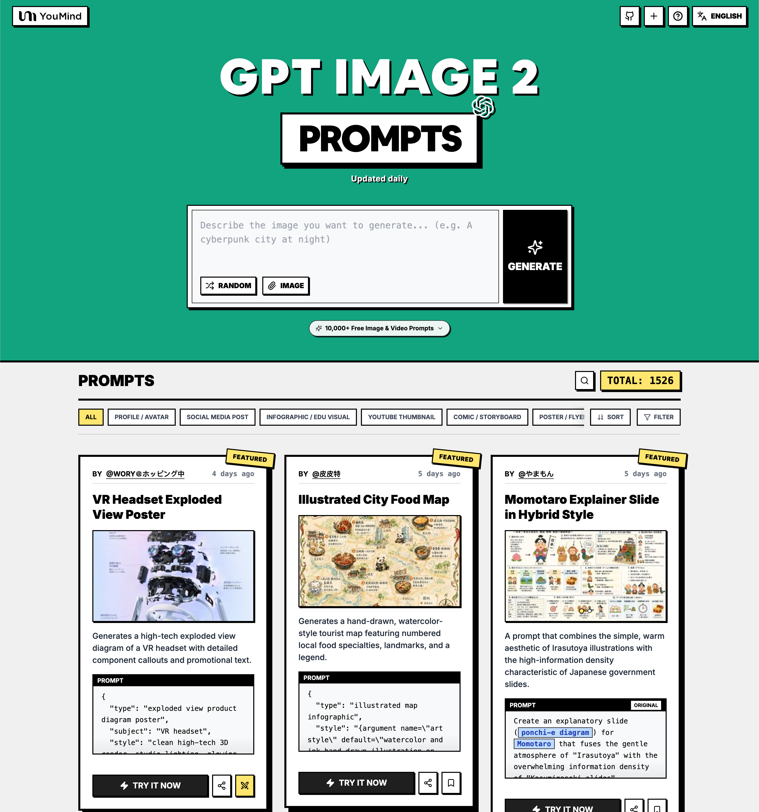

<a href="https://youmind.com/es-419/gpt-image-2-prompts">
  
</a>

> 💡 🎬 Take it further with **Seedance 2** — pair GPT Image 2 stills with Seedance for jaw-dropping AI videos, 2000+ prompts to explore 👉 [awesome-seedance-2-prompts](https://github.com/YouMind-OpenLab/awesome-seedance-2-prompts)
# 🚀 Prompts Increíbles de GPT Image 2

[](https://github.com/sindresorhus/awesome)
[](https://github.com/YouMind-OpenLab/awesome-gpt-image-2)
[](https://creativecommons.org/licenses/by/4.0/)
[](https://github.com/YouMind-OpenLab/awesome-gpt-image-2/actions)
[](docs/CONTRIBUTING.md)

> 🎨 Una colección curada de prompts creativos para GPT Image 2 de OpenAI

> ⚠️ **Aviso de derechos de autor**: Todos los prompts se recopilan de la comunidad con fines educativos. Si cree que algún contenido infringe sus derechos, por favor [abra un problema](https://github.com/YouMind-OpenLab/awesome-gpt-image-2/issues/new?template=bug-report.yml) y lo eliminaremos de inmediato.

---

[](README.md) [](README_zh.md) [](README_zh-TW.md) [](README_ja-JP.md) [](README_ko-KR.md) [](README_th-TH.md) [](README_vi-VN.md) [](README_hi-IN.md) [](README_es-ES.md) [-Current-brightgreen)](README_es-419.md) [](README_de-DE.md) [](README_fr-FR.md) [](README_it-IT.md) [-Click%20to%20View-lightgrey)](README_pt-BR.md) [](README_pt-PT.md) [](README_tr-TR.md)

---

## 🌐 Ver en la galería web

<div align="center">

[](https://youmind.com/es-419/gpt-image-2-prompts)

</div>

**[👉 Explorar en la galería de prompts de YouMind](https://youmind.com/es-419/gpt-image-2-prompts)**

¿Por qué usar nuestra galería?

| Feature | GitHub README | Galería youmind.com |
|---------|--------------|---------------------|
| 🎨 Diseño visual | Lista lineal | Hermosa cuadrícula Masonry |
| 🔍 Buscar | Solo Ctrl+F | Búsqueda de texto completo con filtros |
| 🤖 Generación IA con un clic | - | Generación IA con un clic |
| 📱 Móvil | Básico | Totalmente responsive |
| 🏷️ Categorías | - | Navegación por categoría |


### 🏷️ Explorar por categoría

- **Casos de uso**
  - [Perfil / Avatar](https://youmind.com/es-419/gpt-image-2-prompts?categories=profile-avatar)
  - [Publicación en redes sociales](https://youmind.com/es-419/gpt-image-2-prompts?categories=social-media-post)
  - [Infografía / Visual educativo](https://youmind.com/es-419/gpt-image-2-prompts?categories=infographic-edu-visual)
  - [Miniatura de YouTube](https://youmind.com/es-419/gpt-image-2-prompts?categories=youtube-thumbnail)
  - [Cómic / Guion gráfico](https://youmind.com/es-419/gpt-image-2-prompts?categories=comic-storyboard)
  - [Marketing de producto](https://youmind.com/es-419/gpt-image-2-prompts?categories=product-marketing)
  - [Imagen principal de e-commerce](https://youmind.com/es-419/gpt-image-2-prompts?categories=ecommerce-main-image)
  - [Activo de juego](https://youmind.com/es-419/gpt-image-2-prompts?categories=game-asset)
  - [Póster / Volante](https://youmind.com/es-419/gpt-image-2-prompts?categories=poster-flyer)
  - [Diseño de aplicaciones / web](https://youmind.com/es-419/gpt-image-2-prompts?categories=app-web-design)
- **Estilo**
  - [Fotografía](https://youmind.com/es-419/gpt-image-2-prompts?categories=photography)
  - [Cine / Fotograma](https://youmind.com/es-419/gpt-image-2-prompts?categories=cinematic-film-still)
  - [Anime / Manga](https://youmind.com/es-419/gpt-image-2-prompts?categories=anime-manga)
  - [Ilustración](https://youmind.com/es-419/gpt-image-2-prompts?categories=illustration)
  - [Boceto / Arte lineal](https://youmind.com/es-419/gpt-image-2-prompts?categories=sketch-line-art)
  - [Cómic / Novela gráfica](https://youmind.com/es-419/gpt-image-2-prompts?categories=comic-graphic-novel)
  - [Renderizado 3D](https://youmind.com/es-419/gpt-image-2-prompts?categories=3d-render)
  - [Chibi / Estilo Q](https://youmind.com/es-419/gpt-image-2-prompts?categories=chibi-q-style)
  - [Isométrico](https://youmind.com/es-419/gpt-image-2-prompts?categories=isometric)
  - [Pixel Art](https://youmind.com/es-419/gpt-image-2-prompts?categories=pixel-art)
  - [Pintura al óleo](https://youmind.com/es-419/gpt-image-2-prompts?categories=oil-painting)
  - [Acuarela](https://youmind.com/es-419/gpt-image-2-prompts?categories=watercolor)
  - [Tinta / Estilo chino](https://youmind.com/es-419/gpt-image-2-prompts?categories=ink-chinese-style)
  - [Retro / Vintage](https://youmind.com/es-419/gpt-image-2-prompts?categories=retro-vintage)
  - [Cyberpunk / Ciencia ficción](https://youmind.com/es-419/gpt-image-2-prompts?categories=cyberpunk-sci-fi)
  - [Minimalismo](https://youmind.com/es-419/gpt-image-2-prompts?categories=minimalism)
- **Asunto**
  - [Retrato / Selfie](https://youmind.com/es-419/gpt-image-2-prompts?categories=portrait-selfie)
  - [Influencer / Modelo](https://youmind.com/es-419/gpt-image-2-prompts?categories=influencer-model)
  - [Personaje](https://youmind.com/es-419/gpt-image-2-prompts?categories=character)
  - [Grupo / Pareja](https://youmind.com/es-419/gpt-image-2-prompts?categories=group-couple)
  - [Producto](https://youmind.com/es-419/gpt-image-2-prompts?categories=product)
  - [Comida y bebida](https://youmind.com/es-419/gpt-image-2-prompts?categories=food-drink)
  - [Artículo de moda](https://youmind.com/es-419/gpt-image-2-prompts?categories=fashion-item)
  - [Animal / Criatura](https://youmind.com/es-419/gpt-image-2-prompts?categories=animal-creature)
  - [Vehículo](https://youmind.com/es-419/gpt-image-2-prompts?categories=vehicle)
  - [Arquitectura / Interiores](https://youmind.com/es-419/gpt-image-2-prompts?categories=architecture-interior)
  - [Paisaje / Naturaleza](https://youmind.com/es-419/gpt-image-2-prompts?categories=landscape-nature)
  - [Paisaje urbano / Calle](https://youmind.com/es-419/gpt-image-2-prompts?categories=cityscape-street)
  - [Diagrama / Gráfico](https://youmind.com/es-419/gpt-image-2-prompts?categories=diagram-chart)
  - [Texto / Tipografía](https://youmind.com/es-419/gpt-image-2-prompts?categories=text-typography)
  - [Resumen / Antecedentes](https://youmind.com/es-419/gpt-image-2-prompts?categories=abstract-background)

---

## 📖 Tabla de contenidos

- [🌐 Ver en la galería web](#-view-in-web-gallery)
- [🤔 ¿Qué es GPT Image 2?](#-what-is-gpt-image-2)
- [📊 Estadísticas](#-statistics)
- [🔥 Prompts destacados](#-featured-prompts)
- [📋 Todos los prompts](#-all-prompts)
- [🤝 Cómo contribuir](#-how-to-contribute)
- [📄 Licencia](#-license)
- [🙏 Agradecimientos](#-acknowledgements)
- [⭐ Historial de estrellas](#-star-history)

---

## 🤔 ¿Qué es GPT Image 2?

**GPT Image 2** (codename **"duct-tape"**) is OpenAI's next-generation image model. Community testing highlights a leap in these areas:

- 🎯 **Pixel-Perfect Text Rendering** — Native-quality text in Chinese, English, and Japanese, no typos or warped glyphs
- 🎨 **Cross-Image Consistency** — The same character, style, or IP stays identical across a series, down to the pixel
- ⚡ **Commercial-Grade Illustration** — Illustration output is ready to ship without manual polish
- 🌈 **True Art Style Induction** — Creatively evokes the feeling of a style rather than merely approximating references
- 🔧 **Storyboard & Product Series** — Ideal for storyboards, IP characters, and multi-panel product visuals
- 📐 **Multi-Language Design** — Social cards, banners, and posters with accurate multilingual typography in one shot

📚 **Learn More:** See community testing in our [report summary](docs/FAQ.md)

### 🚀 Integración con Raycast

Algunos prompts admiten **argumentos dinámicos** usando la sintaxis de [Raycast Snippets](https://raycast.com/help/snippets). ¡Busca la insignia 🚀 Raycast Friendly!

**Ejemplo:**
```
A quote card with "{argument name="quote" default="Stay hungry, stay foolish"}"
by {argument name="author" default="Steve Jobs"}
```

¡Cuando se usa en Raycast, puedes reemplazar dinámicamente los argumentos para iteraciones rápidas!

---

## 📊 Estadísticas

<div align="center">

| Métrica | Cantidad |
|--------|-------|
| 📝 Total de prompts | **18049** |
| ⭐ Destacado | **6** |
| 🔄 Última actualización | **viernes, 30 de octubre de 2026, 5:25:12 p.m. UTC** |

</div>

---

## 🔥 Prompts destacados

> ⭐ Seleccionados a mano por nuestro equipo por su calidad y creatividad excepcionales

### No. 1: Póster de vista explosionada de visor VR


#### 📖 Descripción

Genera un diagrama de vista explosionada de alta tecnología de un visor VR con llamadas de componentes detalladas y texto promocional.

#### 📝 Prompt

```
{
  "type": "póster de diagrama de producto con vista explosionada",
  "subject": "visor VR",
  "style": "renderizado 3D limpio de alta tecnología, iluminación de estudio, detalles brillantes",
  "background": "{argument name=\"background color\" default=\"degradado suave de morado y azul\"}",
  "header": {
    "logo": "∞ {argument name=\"product name\" default=\"Meta Quest 3\"}",
    "subtitle": "{argument name=\"main catchphrase\" default=\"Una realidad completamente nueva, desde una estructura completamente nueva.\"}"
  },
  "layout": {
    "centerpiece": "vista explosionada apilada verticalmente de un visor VR que muestra 9 capas distintas de componentes internos: carcasa exterior, sensores de cámara, placa base con chip, lentes pancake, marco interno, paquetes de baterías, correas laterales, correa superior y almohadilla de interfaz facial.",
    "callout_labels": {
      "count": 8,
      "left_side": [
        "Snapdragon® XR2 Gen 2\nPotencia de procesamiento inigualable para experiencias en tiempo real.",
        "Mecanismo de IPD ajustable\nUn ajuste cómodo para una amplia gama de usuarios.",
        "Correa para la cabeza diseñada con precisión\nErgonomía enfocada en la comodidad y la estabilidad."
      ],
      "right_side": [
        "Placa frontal\nDiseño sofisticado y equilibrio de peso óptimo.",
        "Cámaras de seguimiento\nSeguimiento de posición de alta precisión y reconocimiento del entorno.",
        "Lentes pancake\nDiseño delgado que ofrece un amplio campo de visión y una imagen nítida.",
        "Batería de alto rendimiento\nDiseño de energía optimizado para soportar largas sesiones de uso.",
        "Interfaz facial suave\nComodidad garantizada incluso durante usos prolongados."
      ]
    },
    "footer": {
      "left_text_block": {
        "headline": "{argument name=\"bottom headline\" default=\"La experiencia evoluciona desde su estructura.\"}",
        "body": "Cada pieza integra tecnología de vanguardia y un diseño meticuloso para respaldar una experiencia inmersiva. Meta Quest 3 crea experiencias que se sienten como el futuro desde su interior."
      },
      "right_logo": "∞ Meta"
    }
  }
}
```

#### 🖼️ Imágenes generadas

##### Image 1

<div align="center">

</div>

#### 📌 Detalles

- **Autor:** [wory＠ホッピング中](https://x.com/wory37303852)
- **Fuente:** [Twitter Post](https://x.com/wory37303852/status/2045925660401795478#reversed-0)
- **Publicado:** 19 de abril de 2026
- **Idiomas:** en

**[👉 Pruébalo ahora →](https://youmind.com/es-419/gpt-image-2-prompts?id=13460)**

---

### No. 2: Mapa ilustrado de comida de la ciudad


#### 📖 Descripción

Genera un mapa turístico dibujado a mano al estilo acuarela que incluye especialidades gastronómicas locales numeradas, puntos de referencia y una leyenda.

#### 📝 Prompt

```
{
  "type": "infografía de mapa ilustrado",
  "style": "{argument name=\"art style\" default=\"ilustración dibujada a mano con acuarela y tinta sobre pergamino vintage\"}",
  "title_section": {
    "text": "{argument name=\"city name\" default=\"Chengdu\"} {argument name=\"map title\" default=\"Mapa gastronómico para foodies\"}",
    "mascot": "chile rojo de caricatura con lentes de sol y pulgar arriba"
  },
  "border": "{argument name=\"border decoration\" default=\"enredadera de hojas verdes y chiles rojos\"}",
  "layout": {
    "background": "papel pergamino beige texturizado con calles amarillas, ríos azules y áreas de parques verdes",
    "sections": [
      {
        "title": "puntos de referencia",
        "count": 6,
        "illustrations": ["pabellón tradicional", "monasterio tradicional", "rascacielos moderno con panda trepador", "torre de televisión alta", "puerta tradicional", "edificios industriales"],
        "labels": ["Parque del Pueblo", "Monasterio Wenshu", "IFS", "Torre de TV 339", "Callejón Kuanzhai", "Dongjiao Memory"]
      },
      {
        "title": "puntos de comida",
        "count": 12,
        "illustrations": ["mapo tofu", "dumplings en aceite de chile", "brochetas en olla", "bolitas de arroz glutinoso", "pastel horneado de huevo", "hotpot de nueve cuadrículas", "fideos de camote", "brochetas frías", "plato mixto picante", "tazón de té con tapa", "postre de gelatina de hielo", "cabezas de conejo picantes"],
        "labels": ["1 Chen Mapo Tofu", "2 Zhong Dumplings", "3 Chunxi Road", "4 Callejón Kuanzhai · San Da Pao", "5 Jianshe Road · Ye Popo Egg Cake", "6 Yulin Road · Xiaolongkan Hotpot", "7 Xiangxiang Alley · Fideos de intestino", "8 Wuhou Shrine Street · Bo Bo Ji", "9 Dongjiao Memory · Mao Jiao Huo La", "10 Parque del Pueblo · Casa de té Heming", "11 Calle antigua Jinli · Bingfen", "12 Shuangliu Old Mom Rabbit Head"]
      },
      {
        "title": "leyenda",
        "position": "inferior derecha",
        "count": 5,
        "items": ["punto rojo", "casa verde", "árbol verde", "línea azul", "línea doble amarilla"],
        "labels": ["puntos de comida", "puntos de referencia", "parques y áreas verdes", "ríos y lagos", "calles principales"]
      }
    ],
    "centerpiece": "panda gigante sentado comiendo bambú",
    "bottom_right_extras": ["rosa de los vientos vintage con N, S, E, O", "texto de descargo de responsabilidad 'Nota: ¡Cuidado con el picante, protege tu estómago!' con un icono de chile rojo"]
  }
}
```

#### 🖼️ Imágenes generadas

##### Image 1

<div align="center">

</div>

#### 📌 Detalles

- **Autor:** [皮皮特](https://x.com/mm_zzm44854)
- **Fuente:** [Twitter Post](https://x.com/mm_zzm44854/status/2045861258520568230#reversed-1)
- **Publicado:** 19 de abril de 2026
- **Idiomas:** en

**[👉 Pruébalo ahora →](https://youmind.com/es-419/gpt-image-2-prompts?id=13515)**

---

### No. 3: Diapositiva explicativa de Momotaro en estilo híbrido


#### 📖 Descripción

Un prompt que combina la estética sencilla y cálida de las ilustraciones de Irasutoya con la alta densidad de información característica de las diapositivas del gobierno japonés.

#### 📝 Prompt

```
Crea una diapositiva explicativa ({argument name="format" default="diagrama ponchi-e"}) sobre {argument name="theme" default="Momotaro"} que fusione la atmósfera amable de "Irasutoya" con la abrumadora densidad de información de las "diapositivas de Kasumigaseki".
```

#### 🖼️ Imágenes generadas

##### Image 1

<div align="center">

</div>

##### Image 2

<div align="center">

</div>

#### 📌 Detalles

- **Autor:** [やまもん](https://x.com/yammamon)
- **Fuente:** [Twitter Post](https://x.com/yammamon/status/2045778624092254603)
- **Publicado:** 19 de abril de 2026
- **Idiomas:** ja

**[👉 Pruébalo ahora →](https://youmind.com/es-419/gpt-image-2-prompts?id=13983)**

---

### No. 4: Mockup de interfaz de transmisión en vivo para e-commerce


#### 📖 Descripción

Genera una interfaz de transmisión en vivo realista para redes sociales superpuesta a un retrato, que incluye mensajes de chat personalizables, ventanas emergentes de regalos y una tarjeta de compra de productos.

#### 📝 Prompt

```
{
  "type": "mockup de interfaz de transmisión en vivo",
  "subject": {
    "description": "retrato de {argument name=\"host name\" default=\"Elon Musk\"}, sonriendo, vistiendo una camiseta negra con un gráfico técnico esquemático en blanco",
    "background": "el lado izquierdo muestra una pantalla con el texto '{argument name=\"left background logo\" default=\"SPACEX\"}', el lado derecho muestra un '{argument name=\"right background logo\" default=\"logotipo T de Tesla\"}' rojo y un automóvil oscuro"
  },
  "ui_overlay": {
    "top_header": {
      "host_info": "avatar, nombre '{argument name=\"host name\" default=\"Elon Musk\"}', subtexto '556 mil me gusta en esta transmisión', botón rojo 'Seguir'",
      "rank_badge": "icono de moneda dorada con 'N.º 1 en toda la plataforma'",
      "viewer_stats": "3 avatares de espectadores principales con '123 mil', '86 mil', '57 mil', total '687 mil', botón de cierre 'X'",
      "right_links": "'Más transmisiones >', 'Galería de regalos 0/24' con etiqueta azul 'Clásico'"
    },
    "mid_left_gifts": {
      "count": 2,
      "items": [
        "avatar 'Amante de la tecnología', 'envió un corazoncito', icono de corazón x 1314",
        "avatar 'Mar de estrellas', 'envió un cohete', icono de cohete x 666"
      ]
    },
    "bottom_left_chat": {
      "system_message": "insignia de nivel 37 'Viajero del universo se unió a la transmisión'",
      "message_count": 7,
      "messages": [
        "Pequeño Cohete: ¡Musk! ¡El futuro es prometedor! 🚀",
        "future: ¿Cuándo sale el Tesla Model 2?",
        "Soñador del cielo estrellado: ¿Podrá SpaceX llegar a Marte este año?",
        "Explorador de IA: ¿Cómo va el progreso de Neuralink?",
        "Usuario genial: ¡Hola, Sr. Musk!",
        "Mars: ¡Es la primera vez que veo tu transmisión, estoy muy emocionado!",
        "Usuario123: Habla sobre la IA, ¿reemplazará a los humanos?"
      ]
    },
    "bottom_right_product_card": {
      "hot_tag": "naranja 'Más vendido x 1888'",
      "image": "Tesla Cybertruck",
      "title": "{argument name=\"product name\" default=\"Camioneta eléctrica Tesla Cybertruck\"}",
      "price": "{argument name=\"product price\" default=\"¥ 1,618,000\"}",
      "button": "botón rojo 'Comprar'",
      "floating_animation": "corazones translúcidos flotando hacia arriba en el borde derecho"
    },
    "bottom_bar": {
      "input_field": "'Di algo...'",
      "icons": ["cara sonriente", "tres puntos", "carrito de compras", "caja de regalo", "compartir"]
    }
  }
}
```

#### 🖼️ Imágenes generadas

##### Image 1

<div align="center">

</div>

#### 📌 Detalles

- **Autor:** [神经病不想好转](https://x.com/sjbbxhz)
- **Fuente:** [Twitter Post](https://x.com/sjbbxhz/status/2045684734714380687#reversed-0)
- **Publicado:** 19 de abril de 2026
- **Idiomas:** en

**[👉 Pruébalo ahora →](https://youmind.com/es-419/gpt-image-2-prompts?id=14036)**

---

### No. 5: Batalla de artes marciales estilo anime


#### 📖 Descripción

Genera una dinámica escena de acción estilo anime de dos personajes peleando con auras elementales en un dojo tradicional.

#### 📝 Prompt

```
Una ilustración de anime altamente dinámica de dos chicas enfrascadas en una feroz batalla de artes marciales dentro de un dojo de madera tradicional. En primer plano, una chica con {argument name="character 1 hair" default="cabello negro en un moño alto con cintas rojas"} adopta una postura de artes marciales baja y poderosa, lanzando su puño hacia adelante. Viste una {argument name="character 1 outfit" default="blusa blanca estilo chino con borlas rojas y pantalones rojos holgados"}, con intensos cortes de energía roja girando alrededor de sus extremidades al atacar. Suspendida en el aire a la derecha, una chica con {argument name="character 2 hair" default="cabello morado claro en dos moños"} salta con gracia, sonriendo con confianza mientras viste un {argument name="character 2 outfit" default="vestido verde oscuro con bordados dorados y mallas negras"}, acompañada por estelas de energía azul similares al agua. El fondo presenta el interior de un templo de madera rústico con un letrero prominente en la parte superior que dice "{argument name="sign text" default="武術会"}". La escena está llena de acción explosiva, polvo volando, tablas de madera destrozadas, efectos de partículas coloridas y brillantes, y una iluminación dramática en ángulo contrapicado que separa perfectamente a los personajes del detallado fondo.
```

#### 🖼️ Imágenes generadas

##### Image 1

<div align="center">

</div>

#### 📌 Detalles

- **Autor:** [たねもみ 2.0 / Tanemomi Ver2.0](https://x.com/Tanemomi_Ver2)
- **Fuente:** [Twitter Post](https://x.com/Tanemomi_Ver2/status/2046063806846214265#reversed-0)
- **Publicado:** 20 de abril de 2026
- **Idiomas:** en

**[👉 Pruébalo ahora →](https://youmind.com/es-419/gpt-image-2-prompts?id=13467)**

---

### No. 6: Infografía de la evolución en escalera de piedra 3D


#### 📖 Descripción

Transforma una línea de tiempo evolutiva plana en una infografía realista de una escalera de piedra en 3D, con representaciones detalladas de organismos y paneles laterales estructurados.

#### 📝 Prompt

```
{
  "type": "infografía de línea de tiempo evolutiva",
  "instruction": "Usando REFERENCE_0 como base estructural, transforma el diseño vectorial plano en una infografía 3D altamente realista. Reemplaza las rampas lisas por escalones de piedra definidos y actualiza todos los organismos a modelos 3D fotorrealistas.",
  "style": {
    "background": "{argument name=\"estilo de fondo\" default=\"papel pergamino con textura vintage\"}",
    "staircase": "{argument name=\"material de la escalera\" default=\"bloques de piedra con textura realista\"}",
    "subjects": "{argument name=\"estilo de organismo\" default=\"representaciones 3D fotorrealistas altamente detalladas\"}"
  },
  "layout": {
    "main_title": "{argument name=\"título principal\" default=\"Evolución humana\"}",
    "sections": [
      {
        "position": "barra lateral izquierda",
        "count": 8,
        "labels": ["L0: Vida unicelular", "L1: Organismos multicelulares", "L2: Reino animal", "L3: Cordados", "L4: Revolución terrestre", "L5: Clase Mammalia", "L6: Evolución de los homínidos", "L7: Era del Homo sapiens"]
      },
      {
        "position": "superior derecha",
        "title": "Funciones ganadas / Funciones perdidas",
        "description": "Leyenda con iconos de más y menos"
      },
      {
        "position": "centro inferior",
        "title": "Hitos evolutivos clave",
        "count": 6,
        "description": "Línea de tiempo con una silueta gráfica de 6 figuras que muestran la evolución de simio a humano"
      }
    ],
    "centerpiece": {
      "description": "Escalera de piedra en espiral con 25 escalones numerados que presentan organismos específicos.",
      "count": 25,
      "notable_elements": [
        "Escalón 07: Medusa",
        "Escalón 09: Amonita",
        "Escalón 10: Trilobite",
        "Escalón 24: Humano caminando",
        "Escalón 25: {argument name=\"concepto de evolución futura\" default=\"silueta cósmica brillante con un signo de interrogación\"}"
      ]
    }
  }
}
```

#### 🖼️ Imágenes generadas

##### Image 1

<div align="center">

</div>

#### 📌 Detalles

- **Autor:** [知识猫图解](https://x.com/GeekCatX)
- **Fuente:** [Twitter Post](https://x.com/GeekCatX/status/2045792240044511277#reversed-1)
- **Publicado:** 19 de abril de 2026
- **Idiomas:** en

**[👉 Pruébalo ahora →](https://youmind.com/es-419/gpt-image-2-prompts?id=13491)**

---

## 📋 Todos los prompts

> 📝 Ordenado por fecha de publicación (más reciente primero)

### No. 1: Perfil / Avatar - Retrato de cabello platino con GPT Image 2


#### 📖 Descripción

Prompt para generar un retrato en primer plano de una mujer con cabello rubio platino en un dormitorio, incluyendo prompts negativos para control de calidad.

#### 📝 Prompt

```
Composición cuadrada 1:1, imagen única e independiente, fotografía hiperrealista de retrato femenino coreano con estilo cool, textura de cámara real, luz blanca fría y suave, tono crema de baja saturación, aspecto refinado y delicado, ligero desenfoque suave natural.

[Rasgos faciales]

Mujer adulta de ascendencia asiática oriental de entre 23 y 25 años, rostro ovalado pequeño y delicado, mandíbula suavemente estilizada, mentón redondo y pequeño, piel de porcelana blanca y fría impecable, rubor rosa pálido.

Ojos almendrados gris verdoso, brillantes y nítidos, párpados con doble pliegue natural, aegyo-sal bien definido, pestañas largas y rizadas, cejas delgadas de color marrón grisáceo claro, puente nasal fino y recto.

Labios carnosos y suaves en tono rosa pasta de frijol rosado, brillo húmedo y delicado, labios cerrados de forma natural, expresión cool y delicada, mirada directa a la cámara, conservando la microtextura real de la piel.

[Peinado]

Cabello largo rubio platino crema, extremadamente abundante y suave, con destellos plateados blanquecinos claros, dorado champán y gris frío pálido.

Raya al medio natural, coronilla con volumen, raíces con sensación de ligereza real, mechones finos en forma de ocho que enmarcan naturalmente la frente y las mejillas.

El cabello largo cae por debajo del pecho, lacio en general, puntas con ondas naturales sutiles, mechones laterales cayendo de forma natural, conservando hebras individuales y algunos cabellos sueltos.

[Vestimenta y accesorios]

Suéter tejido ajustado de manga larga con escote en V en color lavanda morado claro, tela acanalada vertical fina, suave y adherente al cuerpo, puños ligeramente largos que cubren de forma natural parte de las palmas de las manos.

Aretes delicados de cristal plateado con borlas, un anillo sencillo y delgado de plata en el dedo.

[Postura]

Persona sentada en interiores, mirando directamente a la cámara, torso ligeramente inclinado hacia adelante, hombros relajados de forma natural.

Ambas manos levantadas a los lados del mentón, dedos suavemente curvados, formando una pose tierna apoyando el rostro.

Las mangas largas se arrugan de manera natural cerca de las muñecas, cabeza ligeramente inclinada, ojos observando tranquilamente a la cámara, expresión serena y delicada.

[Fondo y entorno]

Armario de dormitorio moderno y minimalista, paredes de color blanco crema claro.

En el lado derecho del encuadre hay un armario blanco abierto, con ropa negra, blanca y beige colgada en su interior, y una tira LED de luz cálida amarilla suave en la parte superior.

El fondo del armario está ligeramente desenfocado de forma natural, el lado izquierdo es una pared limpia de color blanco claro.

[Lente e iluminación]

Lente para retratos equivalente a 50 mm, toma a la altura de los ojos, composición de primer plano del torso, persona centrada.

Luz frontal de relleno blanca, fría y suave que ilumina el rostro, la piel luce blanca y fría con nitidez, los ojos tienen reflejos naturales.

El cabello platino muestra delicados reflejos plateados blanquecinos, el armario del fondo tiene algunas luces amarillo cálidas, creando un ligero contraste frío-cálido.

Baja saturación, contraste suave, exposición natural, textura de piel delicada, hebras de cabello reales, ligero grano de cámara, sin apariencia evidente de IA.

[Prompts negativos]

Anime, ilustración, renderizado 3D, rostro falso CG, piel de plástico, suavizado excesivo, ojos exageradamente grandes, mentón demasiado puntiagudo, deformidad facial, anomalía en las pupilas, peluca, cabello apelmazado, mechones rígidos, dedos adicionales, palma de la mano deformada, proporciones corporales incorrectas, recortes en la ropa, sobreexposición, HDR intenso, enfoque excesivo, textura de estudio comercial, rastros evidentes de IA, texto, marca de agua, logotipo, collage.
```

#### 🖼️ Imágenes generadas

##### Image 1

<div align="center">

</div>

#### 📌 Detalles

- **Autor:** [沧瑶](https://x.com/CryY666666)
- **Fuente:** [Twitter Post](https://x.com/CryY666666/status/2115911199204483114)
- **Publicado:** 29 de octubre de 2026
- **Idiomas:** zh

**[👉 Pruébalo ahora →](https://youmind.com/es-419/gpt-image-2-prompts?id=37082)**

---

### No. 2: Perfil / Avatar - Prompt de selfie interior estilo coreano hiperrealista


#### 📖 Descripción

Prompt detallado para generar un retrato hiperrealista de tonos cálidos de una mujer del este de Asia en un dormitorio usando GPT Image. Especifica ángulos de cámara, condiciones de iluminación, texturas de ropa y prompts negativos para evitar artefactos de IA.

#### 📝 Prompt

```
Formato vertical 9:16, fotograma único e independiente, fotografía hiperrealista de retrato en interiores de una mujer adulta al estilo coreano, vibra madura y delicada, tonos blanco cálido crema, textura realista de selfie con smartphone, luz de relleno natural y suave, textura de piel detallada, ligero enfoque suave, atmósfera cálida y tranquila de habitación.

[Rasgos faciales]

Una hermosa mujer de Asia oriental de entre 23 y 25 años, claramente adulta, con un rostro ovalado pequeño y refinado, contornos faciales suaves y lisos, pómulos discretos, línea de la mandíbula naturalmente estilizada y mentón pequeño y redondeado.

Piel blanca fría y luminosa con un leve rubor rosa durazno, puente de la nariz recto y fino, punta de la nariz pequeña y natural.

Ojos almendrados de color marrón grisáceo oscuro, brillantes y nítidos, párpados dobles naturales, aegyo-sal (bolsitas bajo los ojos) suave, pestañas largas y rizadas, sombra de ojos en tono rosa-marrón claro, cejas planas y naturales.

Labios carnosos y suaves en tono rosa pasta de frijol rosado, con un brillo húmedo natural y delicado.

Comisuras de los labios ligeramente curvadas hacia arriba, expresión serena y apacible, mirada directa al lente con una intimidad natural.

Microtextura real de la piel, evitando filtros de belleza exagerados y rasgos demasiado infantiles.

[Peinado - Elemento central]

Cabello largo, abundante y esponjoso en tono castaño oscuro profundo con un brillo natural chocolate, con un largo que cae por debajo del pecho hasta cerca de la cintura.

Volumen natural notorio en la parte superior, raíces sueltas, gran cantidad de cabello.

Raya al medio natural, con parte del cabello recogido de forma holgada detrás de la cabeza formando un semirrecogido sutil.

Algunos mechones finos y sueltos cayendo de manera natural sobre la frente y las mejillas.

El cabello del lado izquierdo del encuadre recogido hacia atrás de forma natural, dejando ver las orejas y unos pequeños aretes de perla.

Gran cantidad de cabello largo y grueso cayendo de forma natural sobre los hombros y el pecho en el lado derecho del encuadre, formando ondas grandes, suaves y sueltas.

Los mechones deben tener grosor real, brillo natural y pequeños cabellos rebeldes; evitar rizos demasiado perfectos o textura de peluca.

[Ropa y joyería]

Viste un top ajustado de punto color blanco crema/avena clara con hombros descubiertos.

Tela de punto suave y tupida, escote horizontal holgado que cae de forma natural por debajo del hombro, dejando al descubierto un hombro y una clavícula suave y definida.

Diseño de manga larga, puños ajustados de manera natural en las muñecas, tela con textura de tejido realista y pliegues suaves.

Lleva una cadena de plata extremadamente fina a la altura de las clavículas y un pequeño arete de perla blanca en una oreja.

Atuendo general sencillo, delicado y elegante.

[Pose - Enfoque principal]

La persona está sentada al borde de la cama en la habitación, con la parte superior del cuerpo ligeramente girada hacia el lente y los hombros relajados de forma natural.

Cabeza inclinada suavemente hacia el lado derecho del encuadre, mentón ligeramente recogido, mirada apacible directamente a la cámara.

Una mano en el lado izquierdo del encuadre levantada de forma natural, con la palma tocando ligeramente la mejilla y la zona bajo la oreja, los dedos extendiéndose de manera natural a lo largo de la mandíbula, formando una pose delicada sosteniendo el rostro.

La otra mano levantada junto al hombro, con los dedos acomodando suavemente el cabello largo sobre el pecho y las puntas de los dedos curvadas de forma natural.

El cabello largo cae de manera natural sobre el lado derecho del cuerpo, ambas manos en posiciones escalonadas a distintas alturas, creando una composición natural y suave.

Mantener una cantidad realista de dedos, ángulos naturales en las muñecas y proporciones razonables entre hombros y cuello.

[Entorno y fondo]

Habitación o cuarto de hotel moderno, cálido y sencillo.

En el lado izquierdo del encuadre hay un gran ventanal de piso a techo cubierto con cortinas blancas traslúcidas, con pliegues verticales suaves y naturales.

Detrás de la persona hay una cama grande y mullida con ropa de cama completamente blanca.

Cabecera color beige claro y la luz cálida amarilla de una lámpara de noche visibles en la parte posterior derecha del encuadre.

Paredes en tonos blanco crema y beige claro, interior limpio y ordenado sin desorden ni elementos complejos.

Ambiente general cálido, propio del descanso nocturno en un hogar real.

[Lente e iluminación]

Vertical 9:16, composición de retrato de primer plano de la parte superior del cuerpo, lente equivalente a 35-50 mm, perspectiva a la altura de los ojos, persona centrada en el encuadre.

Pequeño espacio reservado por encima de la cabeza, cabello largo extendiéndose de forma natural hasta el borde inferior del encuadre.

Usar luz de relleno frontal blanca fría y suave, iluminando de manera uniforme ojos, mejillas y labios, para que la piel se vea limpia, transparente y blanca fría.

La lámpara de noche en el fondo derecho emite una luz ambiental amarilla cálida y suave, creando un contraste natural de temperatura de color frío-cálido.

Las zonas iluminadas del cabello muestran reflejos finos de color castaño, mientras que las sombras mantienen un marrón oscuro intenso.

Brillo general moderado, contraste ligeramente reducido, conservando sombras naturales, mechones de cabello realistas, texturas finas de la tela y un ligero grano típico de la fotografía con smartphone.

[Prompts negativos]

Anime, ilustración, renderizado 3D, rostro falso CG, piel de plástico, suavizado excesivo, rostro exagerado de influencer, ojos anormalmente grandes, mentón demasiado puntiagudo, rasgos desalineados, ojos asimétricos, maquillaje pesado, peluca, cabello apelmazado, rizos demasiado regulares, dedos deformes, dedos adicionales, manos fusionadas, muñecas torcidas, hombros dislocados, proporciones corporales anormales, textura de punto incorrecta, ropa atravesando el cuerpo, fondo desordenado, HDR fuerte, sobreexposición severa, nitidez excesiva, iluminación de estudio comercial, rastros evidentes de generación por IA, texto, marca de agua, logotipo, collage.
```

#### 🖼️ Imágenes generadas

##### Image 1

<div align="center">

</div>

#### 📌 Detalles

- **Autor:** [沧瑶](https://x.com/CryY666666)
- **Fuente:** [Twitter Post](https://x.com/CryY666666/status/2115854591560651052)
- **Publicado:** 29 de octubre de 2026
- **Idiomas:** zh

**[👉 Pruébalo ahora →](https://youmind.com/es-419/gpt-image-2-prompts?id=37085)**

---

### No. 3: Perfil / Avatar - Retrato hiperrealista estilo coreano de belleza fría


#### 📖 Descripción

Un prompt detallado para generar un retrato vertical hiperrealista de una mujer del este de Asia con cabello gris plateado y una estética fría en tonos azul-gris, diseñado para GPT Image 2.

#### 📝 Prompt

```
Relación de aspecto vertical 9:16, fotograma único e independiente, fotografía hiperrealista de retrato femenino estilo coreano con actitud fría/distante, textura de cámara real, tonalidad azul grisáceo frío, luz natural suave, imagen nítida, delicada, exquisita y ligeramente onírica.

[Rasgos faciales]

Mujer adulta asiática oriental deslumbrante de entre 23 y 25 años, rostro ovalado pequeño y delicado, línea de la mandíbula suavemente estrecha, mentón redondo y pequeño, piel blanca como porcelana, fría y tersa, rubor rosa claro.

Ojos almendrados gris azulado, brillantes y nítidos, párpados dobles naturales, bolsas bajo los ojos sutiles (efecto "lying silkworm"), pestañas largas y rizadas, cejas delgadas de color marrón grisáceo claro, puente nasal recto y fino, punta de la nariz pequeña.

Labios carnosos y suaves en tono rosa rosado, ligero brillo húmedo, labios naturalmente entreabiertos, expresión fría pero delicada, mirada fija y serena directamente hacia el lente.

Rasgos faciales refinados y armoniosos, conservando la textura natural de la piel, evitando el aspecto exagerado de rostro de influencer.

[Peinado - Enfoque principal]

Cabello largo extremadamente abundante, esponjoso y de color lino gris plateado claro, con reflejos grises champán pálido y un brillo plateado frío.

El cabello llega hasta la cintura, la parte superior de la cabeza tiene volumen, y las raíces lucen un efecto aireado y natural.

Flequillo ligero, fino y esponjoso (estilo "air bangs"), con algunos mechones sueltos que cubren la frente de forma natural.

El cabello largo presenta ondas suaves y amplias, con mucho volumen; los rizos largos de los costados caen naturalmente sobre los hombros y el pecho.

Algunos mechones gris plateado se mueven suavemente con la brisa, y unos pocos hilos finos y largos cruzan las mejillas y quedan cerca de los labios.

El cabello muestra mechones individuales bien definidos, con un volumen natural y peso real, evitando la textura de peluca.

[Vestimenta]

Viste un top de punto ajustado de manga larga en color blanco crema y gris rosado claro.

Tela de punto acanalado fino y suave, cuello redondo sencillo que se adapta al contorno natural del cuerpo.

El color de la ropa es claro y suave, con una textura de tejido real y arrugas naturales.

[Postura de la persona]

La persona mira de frente a la cámara, con el cuerpo ligeramente inclinado y los hombros relajados.

Una mano en el lado izquierdo del encuadre se eleva de forma natural, con los dedos suavemente curvados y los nudillos cerca del mentón y debajo de los labios, formando una pose relajada de descanso sobre el rostro.

La otra mano se levanta junto al cabello, sosteniendo con delicadeza un mechón de rizos largos gris plateado.

Cabeza ligeramente inclinada, mirada directa al lente, expresión serena y delicada.

Dedos naturalmente estilizados, con una estructura articular precisa.

[Fondo]

Espacio interior moderno y sencillo en tonos azul grisáceo fríos, paredes gris azulado claro, puertas de armario gris oscuro y sombras naturales.

Fondo limpio, sin muebles ni decoraciones complejas.

La persona está centrada en el encuadre, los rizos largos gris plateado ocupan ambos lados de la imagen y el fondo mantiene un ligero desenfoque natural.

[Iluminación y fotografía]

Luz natural lateral-frontal suave y blanca fría, rostro iluminado, piel con un tono blanco frío y nítido.

El cabello largo gris plateado, iluminado por la luz suave, genera delicados reflejos blancos plateados y grises champán.

El rostro conserva sombras naturales en gris claro, y los ojos tienen puntos de reflejo suaves y definidos.

Etalonaje general de baja saturación en tonos azul grisáceo fríos, contraste suave, ligero enfoque suave óptico, grano de cámara real.

Lente de retrato equivalente a 50 mm, composición de primer plano de medio cuerpo, altura a nivel de los ojos, rostro nítido, profundidad de campo real.

[Prompts negativos]

Anime, ilustración, render 3D, rostro falso generado por CG, piel de plástico, suavizado excesivo, ojos exageradamente grandes, mentón puntiagudo, rasgos distorsionados, ojos desalineados, peluca, rizos rígidos, cabello apelmazado, flequillo demasiado perfecto, dedos deformes, dedos adicionales, manos fusionadas, proporciones corporales anormales, ropa atravesando el cuerpo, HDR intenso, nitidez excesiva, iluminación de estudio comercial, sobreexposición severa, aspecto evidente de IA, texto, marca de agua, logotipo, collage.
```

#### 🖼️ Imágenes generadas

##### Image 1

<div align="center">

</div>

#### 📌 Detalles

- **Autor:** [沧瑶](https://x.com/CryY666666)
- **Fuente:** [Twitter Post](https://x.com/CryY666666/status/2115815637876723853)
- **Publicado:** 29 de octubre de 2026
- **Idiomas:** zh

**[👉 Pruébalo ahora →](https://youmind.com/es-419/gpt-image-2-prompts?id=37086)**

---

### No. 4: Perfil / Avatar - Mujer con Kimono Caminando en la Nieve


#### 📖 Descripción

Un prompt para generar un retrato nostálgico y cinematográfico de una mujer con kimono y abrigo de lana, de pie en un callejón tradicional japonés cubierto de nieve.

#### 📝 Prompt

```
Una toma cinematográfica vertical de cuerpo entero de una joven asiática de pie en un callejón estrecho cubierto de nieve, flanqueado por tradicionales casas de madera machiya. La escena transcurre durante una suave nevada, lo que crea una atmósfera nostálgica y retro de la era Showa. La mujer tiene el cabello oscuro recogido en una coleta baja y lleva un kimono rojo con un estampado de flores de crisantemo beige, combinado con un grueso abrigo haori de lana a cuadros marrones. Calza calcetines tabi blancos y sandalias zori. Su postura es contemplativa: está de pie sobre el sendero empedrado, húmedo y cubierto de aguanieve, mirando hacia arriba y a su izquierda para observar los copos que caen, con una mano tocando suavemente su mentón y la otra aferrando la solapa del abrigo. La iluminación es suave y difusa, típica de un día de invierno nublado, con tonos tierra apagados que dominan la paleta de colores. La imagen presenta una textura de grano de película y ligeras fugas de luz en los bordes, lo que realza su estética vintage.
```

#### 🖼️ Imágenes generadas

##### Image 1

<div align="center">

</div>

#### 📌 Detalles

- **Autor:** [いがぐりメタボ](https://x.com/Kmsbdd0GXBOcrXQ)
- **Fuente:** [Twitter Post](https://x.com/Kmsbdd0GXBOcrXQ/status/2115785361427190220#reversed-0)
- **Publicado:** 29 de octubre de 2026
- **Idiomas:** en

**[👉 Pruébalo ahora →](https://youmind.com/es-419/gpt-image-2-prompts?id=37089)**

---

### No. 5: Perfil / Avatar - Retrato Retro Showa de Mujer con Kimono


#### 📖 Descripción

Prompt inverso para un retrato nostálgico estilo película de una mujer con kimono floral apoyada en la ventana.

#### 📝 Prompt

```
Un retrato vertical de una joven asiática con expresión melancólica, apoyando la cabeza contra el marco de madera de una ventana shoji tradicional japonesa. Tiene el cabello oscuro recogido de forma suelta y una textura de piel natural con pecas visibles. Lleva puesto un kimono vintage color amarillo mostaza con un estampado de crisantemos rojos, flores blancas y hojas azules. Sus manos están suavemente entrelazadas cerca del mentón. El fondo muestra un interior desenfocado con tonos cálidos de madera y pergaminos colgantes. La imagen presenta una marcada estética retro de película analógica, típica de la fotografía de la era Showa, caracterizada por un enfoque suave, una corrección de color cálida y rasguños y polvo simulados en la superficie.
```

#### 🖼️ Imágenes generadas

##### Image 1

<div align="center">

</div>

#### 📌 Detalles

- **Autor:** [いがぐりメタボ](https://x.com/Kmsbdd0GXBOcrXQ)
- **Fuente:** [Twitter Post](https://x.com/Kmsbdd0GXBOcrXQ/status/2115768084900569546#reversed-0)
- **Publicado:** 29 de octubre de 2026
- **Idiomas:** en

**[👉 Pruébalo ahora →](https://youmind.com/es-419/gpt-image-2-prompts?id=37088)**

---

### No. 6: Perfil / Avatar - Prompt de Retrato Bosque Coreano GPT Image 2


#### 📖 Descripción

Prompt detallado para generar un retrato fotorrealista de una mujer del este de Asia en un arroyo de bosque veraniego, con instrucciones específicas de iluminación y composición.

#### 📝 Prompt

```
Arroyo de verano · Retrato de belleza en bosque fresco estilo coreano

[Estilo visual general]

Composición cuadrada 1:1, imagen única e independiente, fotografía hiperrealista de retrato natural al estilo coreano de una mujer adulta del este de Asia, que fusiona la fotografía real de cámara de alta definición con una estética coreana inspirada en un bosque fresco.

Una hermosa mujer adulta del este de Asia de entre 23 y 25 años, con un delicado rostro ovalado, piel clara de tono blanco frío, ojos almendrados de color marrón grisáceo oscuro, labios suaves rosa rosado y un abundante cabello negro azabache que le llega hasta la cintura.

Está de pie junto a un arroyo poco profundo en un bosque de verano, vistiendo un cárdigan de punto ajustado y corto de color blanco puro sobre una blusa rosa claro.

Su cuerpo está girado de lado hacia el objetivo, con la cabeza volteando naturalmente hacia atrás y la mirada fija y serena directamente a la cámara.

Una mano se eleva cerca de la oreja, acomodando suavemente su largo cabello negro; la otra mano se flexiona de forma natural y descansa frente a su cuerpo.

El fondo es un arroyo transparente que fluye por el bosque, con guijarros grises pulidos por el agua dispersos en la superficie, rodeados de árboles frondosos de un verde intenso.

La brillante luz del sol de verano se filtra entre los árboles, creando un juego realista de luces y sombras moteadas sobre el cabello, las mejillas y los hombros de la modelo, así como en la superficie del arroyo.

La imagen general es fresca, serena y natural, transmitiendo esa sensación suave del primer amor al estilo coreano y un temperamento fresco.

Textura óptica fotográfica real, textura natural de la piel, mechones de cabello finos, ligero enfoque suave y grano auténtico de cámara, evitando texturas de estudio comercial y rastros evidentes de generación por IA.

[Rasgos faciales]

Hermosa mujer adulta del este de Asia de entre 23 y 25 años.

Rostro pequeño y delicadamente ovalado, proporciones naturales de la cabeza, frente suavemente llena, pómulos lisos y mejillas con una ligera y natural redondez.

La línea de la mandíbula se estrecha de forma natural desde ambos lados, mentón pequeño y ligeramente redondeado, contornos faciales refinados y fluidos.

Rasgos armoniosos y delicados, con ese temperamento de belleza coreana serena y fresca.

Piel de un blanco frío cremoso y luminoso, con un rubor melocotón muy sutil en las mejillas.

Conservar las microtexturas reales de la piel, los poros naturales y las transiciones sutiles de luces y sombras en el rostro.

Ojos almendrados de color marrón grisáceo oscuro, pupilas claras y brillantes, forma de los ojos naturalmente grande con las comisuras externas ligeramente levantadas.

Párpados dobles naturales y detallados, *aegyo-sal* (bolsitas bajo los ojos) suaves, sombra de ojos marrón grisáceo claro y un delineado fino pegado a la raíz de las pestañas.

Pestañas largas y definidas de forma natural, cejas planas y suaves de un tono marrón grisáceo oscuro natural.

Puente nasal fino y recto, transición natural en la base de la nariz, punta pequeña y redondeada.

Labios naturalmente llenos, arco de Cupido suave, usando un labial rosa pasta de frijol rosado de baja saturación.

Labios superior e inferior ligeramente cerrados, comisuras relajadas, sin sonrisa forzada.

Mirada fresca, dulce y serena, con un toque ligeramente pensativo.

La modelo mira directamente al objetivo, con una expresión facial naturalmente relajada.

[Peinado - Enfoque principal]

Cabello largo extremadamente abundante y negro azabache, de un tono natural marrón té negro profundo.

El largo cae por debajo de la cintura, grueso pero con volumen natural.

La coronilla tiene mucho volumen, con las raíces naturalmente levantadas, mostrando un grosor de cabello realista.

El peinado lleva una raya al medio natural.

En la frente hay algunos mechones finos, irregulares y aireados.

Varios mechones delgados caen naturalmente en el centro de la frente, y algunos cubren ligeramente la zona cercana a las cejas.

A los lados de las mejillas hay mechones finos que enmarcan el rostro en forma de ocho, algunos pegándose naturalmente a la cara.

La mayor parte del largo cabello negro azabache cae detrás de los hombros, descendiendo de forma natural por la espalda hasta la cintura.

Otra parte del cabello se desliza naturalmente hacia adelante desde los hombros.

Los mechones son en general lisos, con ligeras ondas naturales de curvatura amplia.

Algunos cabellos sueltos y finos se mueven con la brisa del bosque, flotando suavemente alrededor de las mejillas y la coronilla.

La luz del sol entra desde la parte superior izquierda de la modelo, creando reflejos naturales blanco plateado y marrón profundo en la parte superior y en los mechones externos del cabello.

Las capas del cabello están bien definidas, permitiendo ver cada mechón fino y real.

Evitar un cabello liso demasiado perfecto, textura de peluca o contornos rígidos.

[Diseño de vestuario]

Viste un cárdigan de punto ajustado y corto de color blanco puro.

El cárdigan está hecho de una tela de punto de algodón suave y tupida, con una estructura acanalada fina y realista.

Diseño de manga larga, ajustada al contorno natural de los brazos.

El ajuste de la parte superior es entallado, la tela es suave y el largo termina por encima de la cintura.

La abertura frontal está ligeramente abierta de forma natural, creando una estructura vertical de capas sutiles.

El borde inferior tiene un acabado natural, con arrugas suaves propias del tejido de punto.

La capa interior es una blusa sencilla color rosa flor de cerezo claro; solo se ve una pequeña cantidad de esta tela rosa claro entre el cuello y el borde del cárdigan blanco.

La parte inferior insinúa el borde de la cintura de una falda de tiro alto beige claro o caqui.

Los colores generales de la ropa están dominados por el blanco puro, el rosa pálido y el beige claro.

La tela blanca de punto se ilumina ligeramente bajo el sol, pero conserva los detalles textiles reales.

La ropa es sencilla y natural, sin estampados exagerados, logotipos ni decoraciones complejas.

[Postura de la modelo - Elemento central]

La modelo está de pie en la orilla pedregosa y poco profunda junto al arroyo cristalino.

El cuerpo forma un ángulo lateral de aproximadamente 60 a 70 grados, con los hombros ligeramente girados hacia la izquierda del encuadre.

La parte superior del cuerpo está naturalmente recta, con la cintura formando una curva suave y natural.

La cabeza gira suavemente hacia atrás, con el rostro orientado hacia el objetivo.

El mentón ligeramente recogido, los ojos mirando con calma a la cámara.

El brazo del lado derecho del encuadre se levanta de forma natural, con el codo flexionado hacia afuera.

La palma descansa suavemente sobre el cabello largo junto a la oreja.

Los dedos índice, medio y los demás se curvan naturalmente, reuniendo con delicadeza un mechón de cabello negro largo.

Los dedos tienen un contacto realista y natural con el cabello.

El otro brazo, en el lado izquierdo del encuadre, se flexiona hacia arriba de forma natural.

La palma queda a la izquierda del pecho, con los dedos ligeramente curvados, en una postura relajada y natural.

Los hombros están relajados, sin encogerse intencionalmente.

El abundante cabello negro azabache cae de forma natural sobre los hombros y la espalda, con algunos mechones cubriendo el contorno posterior.

La postura general parece un momento espontáneo de mirar hacia atrás, captado casualmente por un amigo junto al arroyo.

Las proporciones de hombros, brazos, muñecas, dedos y cuello son realistas y respetan la anatomía humana.

[Entorno de fondo - Enfoque principal]

Entorno realista de un arroyo en un bosque de montaña durante el verano.

La modelo está de pie junto a un pequeño arroyo cristalino de flujo lento.

El arroyo fluye de forma natural desde la distancia, en la parte superior izquierda del encuadre, hacia la parte inferior.

La superficie del agua es transparente y clara, mostrando tonos verde grisáceo claro, verde cian pálido y reflejos naturales blanco plateado.

El arroyo contiene numerosas piedras redondeadas de distintos tamaños.

Los colores de las piedras incluyen gris claro, gris oscuro, gris cian y un poco de marrón claro.

Algunas piedras sobresalen del agua, mientras que otras están sumergidas en el arroyo cristalino.

A lo lejos, se pueden ver pequeñas salpicaduras blancas formadas por el agua poco profunda al pasar sobre las piedras.

El fondo izquierdo está compuesto principalmente por el agua brillante del arroyo, guijarros naturales y plantas verdes iluminadas por el sol.

El fondo derecho es un bosque con sombras más profundas.

Gran cantidad de hojas verde oscuro, arbustos y troncos forman un fondo boscoso denso y natural.

La orilla del arroyo tiene un sendero de grava gris ligeramente húmedo.

La luz del sol sobre el bosque atraviesa los espacios entre las hojas, creando manchas de luz irregulares en el agua del arroyo y sobre las piedras.

El fondo lejano tiene una profundidad espacial natural, con partes del arroyo y los árboles ligeramente desenfocadas.

Sin edificios, piscinas artificiales, puentes de madera, farolas ni otras personas.

El entorno general es primitivo, natural y claro, con la frescura de un verdadero arroyo de valle montañoso.

[Objetivo y composición]

Relación de aspecto estrictamente cuadrada 1:1, retrato único e independiente.

Se utiliza una perspectiva equivalente a un objetivo para retratos de 50 mm a 70 mm.

La posición de la cámara está cerca del nivel de los ojos de la modelo, ofreciendo una vista natural a la altura de los ojos.

La modelo se ubica ligeramente a la derecha del centro del encuadre.

La composición comienza dejando un poco de fondo por encima de la cabeza y se extiende hasta cerca de la cintura.

La parte superior de la cabeza de la modelo está cerca del borde superior del encuadre.

El rostro se sitúa en el centro y un poco más arriba del encuadre, con los ojos como puntos focales visuales.

El cuerpo de la modelo está girado hacia la izquierda del encuadre, con la cabeza volteando naturalmente hacia atrás.

Una mano acomoda el cabello cerca de la oreja, la otra se eleva de forma natural hacia el pecho.

El cabello largo cae hasta la parte inferior del encuadre, cubriendo parte de la espalda.

El lado izquierdo del encuadre deja más espacio para mostrar el arroyo brillante del bosque.

El lado derecho conserva el bosque verde oscuro, los guijarros grises y las orillas naturales del arroyo.

El rostro, los ojos, los labios y el largo cabello negro azabache de la modelo permanecen nítidos.

El arroyo y las piedras cercanas tienen cierta claridad natural, mientras que los árboles lejanos están moderadamente desenfocados.

Usar la profundidad de campo de una cámara real, sin crear un desenfoque de fondo exagerado tipo modo retrato.

[Diseño de iluminación y sombras naturales - Lo más importante]

Fotografía con luz natural brillante en un bosque de verano.

La luz del sol de la tarde atraviesa el denso follaje, entrando desde la parte superior izquierda del encuadre.

El arroyo en el fondo izquierdo está iluminado por una fuerte luz solar, generando gran cantidad de reflejos blanco plateado brillantes en la superficie del agua.

El bosque en el fondo derecho está en sombra natural, manteniendo ricos tonos verde oscuro.

La modelo se encuentra en el límite entre la luz del sol y la sombra de los árboles.

El rostro está iluminado por la luz difusa suave del cielo y el reflejo del arroyo, logrando un tono de piel general luminoso y natural.

La frente, el puente nasal, las mejillas y el mentón presentan delicados reflejos naturales.

La coronilla muestra un reflejo de luz solar evidente pero no excesivo, iluminando los pequeños cabellos sueltos.

El puente nasal y las mejillas conservan ligeras sombras naturales, dándole tridimensionalidad realista a los rasgos.

El cárdigan blanco de punto, iluminado por el sol, luce de un blanco natural, limpio y brillante.

Los hombros y brazos de la modelo tienen capas suaves de luces y sombras.

La superficie del arroyo muestra una ligera sobreexposición localizada y un parpadeo real de los reflejos.

El contraste entre luces y sombras en el fondo es marcado, pero la exposición del rostro se mantiene natural en todo momento.

En general, presenta el efecto de una cámara real fotografiando en un entorno de bosque con un fuerte contraste de luces y sombras.

No usar luces de relleno de estudio comercial, haces de contraluz exagerados ni filtros de luz suave artificiales.

[Color y textura fotográfica]

En general, se utilizan tonos verdes frescos de bosque coreano de baja saturación.

Los colores principales son verde bosque profundo, verde cian claro, gris natural, blanco puro, negro azabache y rosa rosado pálido.

El bosque de fondo muestra un rico verde tinta y verde cian profundo.

El agua del arroyo es de un verde grisáceo claro y transparente, con reflejos blanco plateado bajo la luz del sol.

El tono de piel de la modelo es de un blanco frío y luminoso, con un leve rubor rosado en las mejillas.

El cabello es de un negro azabache intenso, con áreas iluminadas que muestran delicados reflejos marrón oscuro.

La prenda de punto blanca es luminosa y limpia, mientras que la capa interior rosa claro mantiene tonos suaves de baja saturación.

El brillo general es moderado, con la modelo ligeramente más iluminada que el fondo.

Conservar las sombras reales y los reflejos naturales, reduciendo moderadamente la saturación.

Textura delicada de la piel, mechones de cabello individuales, ondas de agua reales y texturas de los guijarros.

Ligero grano de cámara real, enfoque suave natural adecuado, sin exceso de nitidez.

Rechazar el retoque excesivo, la piel de plástico y las texturas obvias de renderizado CG o IA.

Imagen única e independiente, sin texto, sin marca de agua, sin logotipo, sin collage, sin bordes.

[Prompt negativo]

Anime, ilustración, caricatura, render 3D, rostro falso de CG, piel de plástico, retoque excesivo, filtro de belleza exagerado, mentón demasiado puntiagudo, ojos anormalmente grandes, rasgos desalineados, ojos asimétricos, pupilas deformes, maquillaje pesado, pestañas postizas exageradas, expresión rígida, peluca, cabello apelmazado, dirección del cabello incorrecta, cabello demasiado uniforme, dedos extra, dedos fusionados, palmas deformes, movimiento de agarre de la mano incorrecto, brazos extra, hombros dislocados, cuello anormal, proporciones corporales distorsionadas, estructura de ropa incorrecta, tela de punto atravesando el cuerpo, ropa demasiado transparente, arroyo convertido en piscina, estructura anormal de la superficie del agua, piedras fusionadas, piedras repetidas, texturas de árboles incorrectas, desenfoque de fondo excesivo, sobreexposición facial severa, HDR fuerte, exceso de nitidez, iluminación de estudio fotográfico comercial, rastros evidentes de generación por IA, texto, LOGO, marca de agua, collage.
```

#### 🖼️ Imágenes generadas

##### Image 1

<div align="center">

</div>

#### 📌 Detalles

- **Autor:** [沧瑶](https://x.com/CryY666666)
- **Fuente:** [Twitter Post](https://x.com/CryY666666/status/2115741849264795720)
- **Publicado:** 29 de octubre de 2026
- **Idiomas:** zh

**[👉 Pruébalo ahora →](https://youmind.com/es-419/gpt-image-2-prompts?id=37081)**

---

### No. 7: Perfil / Avatar - Ilustración a Lápiz de Color con GPT Image 2


#### 📖 Descripción

Un prompt detallado para transformar una fotografía subida en una ilustración a lápiz de color dibujada a mano, preservando la composición y la identidad.

#### 📝 Prompt

```
Transforma la fotografía subida en una hermosa ilustración a mano con lápices de colores, conservando exactamente el contenido, la composición y la atmósfera emocional de la imagen original.

1. PRECISIÓN RESPECTO A LA IMAGEN DE REFERENCIA
Analiza con detenimiento la fotografía subida: la identidad del sujeto, sus rasgos faciales, peinado, expresión, postura, ropa, accesorios, proporciones corporales, los objetos alrededor, el fondo, el ángulo de cámara, la perspectiva, la iluminación y los pequeños detalles distintivos.

Recrea la misma escena como un dibujo ilustrado. Conserva el aspecto reconocible del sujeto original y la disposición exacta de la escena. No cambies la postura, no inventes objetos nuevos, no elimines detalles importantes ni modifiques el entorno original.

2. ESTILO ARTÍSTICO
Usa un estilo de ilustración tradicional con lápices de colores y crayones de cera, que parezca un hermoso dibujo hecho a mano sobre papel texturizado color crema de un cuaderno de bocetos.

Incluye:
- Trazos de lápiz de color visibles y un delicado sombreado cruzado (crosshatching).
- Contornos suaves e imperfectos, dibujados a mano.
- Sombras superpuestas con variaciones naturales en la presión del lápiz.
- Grano fino del papel y una textura sutil de crayón.
- Colores cálidos y apagados con suaves matices pastel.
- Contornos ligeramente abocetados y encantadoras imperfecciones artesanales.
- Mezcla natural de colores, sin degradados digitales lisos.
- Cabello detallado, trazado con líneas de lápiz fluidas e individuales.
- Rasgos faciales expresivos, simplificados pero reconocibles.
- Sombras suaves creadas mediante capas de trazos de lápiz, en lugar de sombreado fotográfico.

3. PALETA DE COLORES
Usa una paleta cálida y nostálgica con tonos beige cremoso, rosa empolvado, marrón apagado, caramelo cálido, negro carbón, gris suave y colores terrosos sutiles. Respeta los colores reales de la fotografía original, adaptándolos al lenguaje de una ilustración tradicional.

4. FONDO Y ENTORNO
Recrea fielmente el fondo original, incluyendo muebles, puertas, paredes, calles, aceras, barandillas, plantas, mascotas, edificios y cualquier otro elemento visible.

Dibuja los detalles del fondo con trazos de lápiz sueltos pero intencionales. Mantén la profundidad, la perspectiva y las relaciones espaciales originales, dándole a toda la escena una apariencia cohesiva e ilustrada a mano.

5. ILUMINACIÓN Y AMBIENTE
Conserva la dirección de la luz y la atmósfera general de la foto. Transmite una sensación acogedora, íntima y nostálgica, como si el momento hubiera quedado plasmado en un diario personal ilustrado o en la página del cuaderno de bocetos de un artista.

6. ACABADO FINAL
Toda la imagen debe verse genuinamente dibujada a mano con lápices de colores sobre papel texturizado, NO como una fotografía con un filtro artístico aplicado.

Mantén la relación de aspecto y la composición originales. Usa detalles ilustrativos finos, líneas orgánicas, grano de lápiz visible, ligeras imperfecciones y texturas manuales consistentes en toda la imagen.

IMPORTANTE: La fotografía subida es la única referencia para la escena. Conserva su identidad, postura, objetos y composición. Transforma únicamente el medio visual para convertirlo en una ilustración tradicional.
```

#### 🖼️ Imágenes generadas

##### Image 1

<div align="center">

</div>

##### Image 2

<div align="center">

</div>

##### Image 3

<div align="center">

</div>

#### 📌 Detalles

- **Autor:** [Sairah](https://x.com/Sairah_0)
- **Fuente:** [Twitter Post](https://x.com/Sairah_0/status/2115676409092096205)
- **Publicado:** 29 de octubre de 2026
- **Idiomas:** en

**[👉 Pruébalo ahora →](https://youmind.com/es-419/gpt-image-2-prompts?id=37045)**

---

### No. 8: Perfil / Avatar - Prompt de Uniforme de Enfermera Amarillo a Cuadros Vichy


#### 📖 Descripción

Prompt para generar un adorable uniforme de enfermera en cuadros vichy amarillo pastel y blanco, con detalles inspirados en el estilo Lolita como mangas abullonadas, volantes de encaje y un gorro a juego.

#### 📝 Prompt

```
Lindo uniforme de enfermera a cuadros en amarillo pastel y blanco, vestido dulce inspirado en Lolita, mangas abullonadas, delicados volantes de encaje blanco, delantal con pliegues, cintura ajustada, falda esponjosa en capas, moños grandes a cuadros, botones de perla, gorro de enfermera a juego a cuadros amarillos con volantes blancos y pequeñas decoraciones florales, colores pastel suaves, estilo adorable y elegante, sonrisa tierna, pose dinámica, texturas detalladas de la tela, sin cruz roja, sin símbolos médicos, obra maestra, mejor calidad.
```

#### 🖼️ Imágenes generadas

##### Image 1

<div align="center">

</div>

##### Image 2

<div align="center">

</div>

#### 📌 Detalles

- **Autor:** [のぞむ＊AIイラスト](https://x.com/ArtistaNozomu)
- **Fuente:** [Twitter Post](https://x.com/ArtistaNozomu/status/2115339029633716513)
- **Publicado:** 28 de octubre de 2026
- **Idiomas:** en

**[👉 Pruébalo ahora →](https://youmind.com/es-419/gpt-image-2-prompts?id=37008)**

---

### No. 9: Perfil / Avatar - Transformación de Calcomanías Ilustradas de Otoño


#### 📖 Descripción

Un prompt detallado para transformar una foto subida en una encantadora calcomanía ilustrada de otoño, estilo dibujo a mano, utilizando GPT Image 2.

#### 📝 Prompt

```
Transforma la foto subida en un encantador STICKER ILUSTRADO DE OTOÑO dibujado a mano.

Conserva el sujeto original: recrea con precisión a la persona, mascota o grupo, manteniendo los rasgos faciales reconocibles, el peinado, la ropa, los colores, la pose, la expresión y los detalles distintivos.

Estilo de ilustración: redibuja por completo al sujeto como arte digital de personajes bien pulido, con sombreado suave estilo pintura a mano, contornos orgánicos y limpios, rasgos expresivos, texturas sutiles y cálidos colores otoñales. Evita el fotorrealismo y los renders 3D.

Efecto de sticker: añade un borde blanco grueso y liso tipo troquelado alrededor de todo el sujeto ilustrado, con una sombra sutil para lograr un efecto de sticker realista.

Estética otoñal: incorpora detalles estacionales de buen gusto, como hojas naranjas, calabacitas, ropa abrigada, bayas, bellotas o destellos cálidos. Usa tonos naranja quemado, terracota, caramelo, crema y marrón cálido.

Fondo: mantén visible el fondo fotográfico original detrás del sticker, suavizándolo ligeramente si es necesario.

Resultado final: un sticker otoñal acogedor, personalizado y coleccionable, con un contraste claro entre el sujeto completamente ilustrado y el fondo fotográfico real. No te limites a aplicar un filtro o un contorno sobre la foto original.
```

#### 🖼️ Imágenes generadas

##### Image 1

<div align="center">

</div>

##### Image 2

<div align="center">

</div>

#### 📌 Detalles

- **Autor:** [Sairah](https://x.com/Sairah_0)
- **Fuente:** [Twitter Post](https://x.com/Sairah_0/status/2115338231138898092)
- **Publicado:** 28 de octubre de 2026
- **Idiomas:** en

**[👉 Pruébalo ahora →](https://youmind.com/es-419/gpt-image-2-prompts?id=37006)**

---

### No. 10: Perfil / Avatar - Espadachina cinematográfica en un mercado nocturno


#### 📖 Descripción

Un prompt detallado para generar una imagen cinematográfica fotorrealista de una joven espadachina en un mercado nocturno iluminado por farolillos, centrado en la composición específica, la iluminación y los detalles del personaje.

#### 📝 Prompt

```
Ultrawide 2.2:1, cinematográfico fotorrealista, joven espadachina girando la cabeza por encima del hombro en un mercado nocturno iluminado por faroles, el brillo cálido de los faroles contrasta con el azul frío de la noche. Un solo sujeto.

【Composición】Vista trasera de tres cuartos, a la izquierda del centro, rostro al 41 % del ancho, 38 % del alto, 30 % de la altura del encuadre. Fondo derecho (55 %): esferas de faroles que se desvanecen en un desenfoque. Empuñadura oscura de espada al 24 % del ancho, baja y sin desenvainar. Cámara a la altura del hombro, teleobjetivo, profundidad de campo reducida.

【Personaje】Mujer joven, rostro ovalado, mandíbula suave, mentón puntiagudo, luz cálida de la noche sobre la piel, brillo satinado. Ojos marrón oscuro, sombra ahumada, pestañas definidas, cejas rectas y marcadas. Labios rojo oscuro apagado, cerrados, sin sonrisa. Expresión: serena, distante, discretamente alerta — como una hábil espadachina evaluando su entorno. Cuerpo alejándose, cabeza girada por encima del hombro, ojos que miran directamente al espectador con una mirada profunda y nítida, cejas niveladas. Mechones negros sueltos caen naturalmente sobre la frente y la mejilla, movidos por el viento, no húmedos.

【Cabello/Vestuario】Cabello negro muy largo, mitad recogido hacia atrás y mitad suelto, textura fluida natural, mechones ondeando suavemente con la brisa nocturna, bordes ribeteados en dorado por la luz de los faroles. Túnica blanca lisa de espadachín errante, mangas anchas, capa interior cruzada verde azulado oscuro casi negra, tela mate de tejido fino, blanco atemperado hacia un dorado pálido. Sin joyas, sin bordados — elegancia sobria. De la espada solo se ve la empuñadura oscura y lisa, con un cordón corto enrollado.

【Pose】Torso orientado hacia la profundidad de la calle, hombros de tres cuartos hacia atrás, peso desplazado hacia adelante a mitad de paso. Solo la cabeza y el cuello giran hacia atrás, mentón nivelado, el rostro mira a la cámara por encima del hombro. Brazos sin protagonismo, espada baja detrás. Giro continuo a través de la columna y el cuello.

【Entorno】Mercado nocturno de casco antiguo: fachadas de madera de tiendas tenues a la izquierda, letrero desenfocado en la parte superior central, hileras de faroles de papel que se pierden hacia la derecha en un bokeh naranja cálido. La calle lejana y la esquina inferior derecha presentan sombras azul grisáceo frías, con el brillo de la piedra mojada. Sin texto legible. Sin otras personas.

【Iluminación】Toda la luz proviene de los faroles. Un gran grupo de faroles detrás a la derecha genera esferas cálidas, ribeteando el cabello y el hombro en dorado. Un farol más cercano proyecta una mancha cálida diagonal sobre la mejilla y mandíbula izquierdas, el resto del rostro en sombra azul fría — lo cálido y lo frío dividen el rostro. Fondo izquierdo marrón ambarino, fondo derecho noche azul grisácea. Paleta: ámbar de farol #E8A04C, azul nocturno #33455C, marrón de sombra #241A14, blanco de túnica #E9DCC8, negro de cabello #14100E, rojo de labios #8E4A42, iluminación de piel #D9A37E.

【Renderizado】Cinematográfico fotorrealista, estilo película sin grano: piel de satén fino, cabello con mechones fluidos naturales y bordes especulares, tela mate y pesada. Nitidez en los ojos y los mechones del rostro; los faroles y la calle se disuelven en un bokeh en capas, el aire presenta una leve bruma nocturna.

Negativo: segunda persona, arma desenvainada, texto legible, marca de agua, logo, anime, caricatura, sobresaturado, piel de plástico, extremidades adicionales, centrado, cuerpo completo, fondo enfocado.
```

#### 🖼️ Imágenes generadas

##### Image 1

<div align="center">

</div>

#### 📌 Detalles

- **Autor:** [AI art gallery](https://x.com/sandmrk)
- **Fuente:** [Twitter Post](https://x.com/sandmrk/status/2115317315579613660)
- **Publicado:** 28 de octubre de 2026
- **Idiomas:** en

**[👉 Pruébalo ahora →](https://youmind.com/es-419/gpt-image-2-prompts?id=37005)**

---

### No. 11: Perfil / Avatar - Prompt Vestido Calabaza Halloween


#### 📖 Descripción

Prompt para generar una chica con un vestido de falda abullonada en forma de calabaza, en tonos beige y miel, con bordado de jack-o'-lantern, ideal para temáticas de Halloween.

#### 📝 Prompt

```
Una niña con un vestido de falda de calabaza de Halloween.

El atuendo es un mini vestido sin hombros en color beige natural. La falda es redonda y abullonada con forma de calabaza, con finas acanaladuras verticales. Las acanaladuras son de color miel. En la superficie de la falda hay un pequeño rostro de Jack-o'-Lantern, en relieve y no bordado. Un listón naranja grueso en la cintura.

Una capa corta color beige natural sobre los hombros. Sin sombrero en la cabeza. Los colores son beige natural, miel, naranja claro y azul noche.

Cuerpo completo, vista frontal donde se aprecia claramente la falda con forma de calabaza. Expresión feliz y sonriente.
```

#### 🖼️ Imágenes generadas

##### Image 1

<div align="center">

</div>

##### Image 2

<div align="center">

</div>

#### 📌 Detalles

- **Autor:** [のぞむ＊AIイラスト](https://x.com/ArtistaNozomu)
- **Fuente:** [Twitter Post](https://x.com/ArtistaNozomu/status/2115278631953994138)
- **Publicado:** 28 de octubre de 2026
- **Idiomas:** ja

**[👉 Pruébalo ahora →](https://youmind.com/es-419/gpt-image-2-prompts?id=37007)**

---

### No. 12: Perfil / Avatar - Vestido de Vela Miel para Chica de Halloween


#### 📖 Descripción

Genera una chica con un vestido de vela derretida en tono miel, detalles de cera y patrones de llama para un tema dulce y fantástico de Halloween.

#### 📝 Prompt

```
Una chica con un vestido de cera derretida para Halloween. El atuendo es un mini vestido color miel con los hombros descubiertos. Lleva detalles tridimensionales que simulan cera blanca derramándose por los hombros y el borde de la falda. La superficie de la cera tiene un ligero brillo, con pequeños motivos de llamas repartidos por todo el diseño.

Un listón negro delgado en la cintura. Sin capa. Sin sombrero. Un pequeño dije de vela alrededor del cuello.

Colores: miel, blanco, naranja claro y azul noche. Vista de cuerpo completo en un ángulo donde se aprecien bien los detalles de las gotas de cera. Sonrisa sutil.
```

#### 🖼️ Imágenes generadas

##### Image 1

<div align="center">

</div>

##### Image 2

<div align="center">

</div>

#### 📌 Detalles

- **Autor:** [のぞむ＊AIイラスト](https://x.com/ArtistaNozomu)
- **Fuente:** [Twitter Post](https://x.com/ArtistaNozomu/status/2114916244704891346)
- **Publicado:** 27 de octubre de 2026
- **Idiomas:** ja

**[👉 Pruébalo ahora →](https://youmind.com/es-419/gpt-image-2-prompts?id=36954)**

---

### No. 13: Perfil / Avatar - Prompt de Foto Espontánea en el Metro


#### 📖 Descripción

Un prompt para generar una foto realista y espontánea de una mujer en el metro utilizando GPT-image-2.

#### 📝 Prompt

```
Una mujer hermosa mirando su celular en el metro; una foto espontánea.
```

#### 🖼️ Imágenes generadas

##### Image 1

<div align="center">

</div>

#### 📌 Detalles

- **Autor:** [山上有松](https://x.com/supereasyit)
- **Fuente:** [Twitter Post](https://x.com/supereasyit/status/2114915979922981184)
- **Publicado:** 27 de octubre de 2026
- **Idiomas:** zh

**[👉 Pruébalo ahora →](https://youmind.com/es-419/gpt-image-2-prompts?id=36953)**

---

### No. 14: Perfil / Avatar - Prompt de GPT Image: Perspectiva Forzada en Miniatura


#### 📖 Descripción

Prompt para generar una foto cenital ultrarrealista con perspectiva forzada, creando un cuerpo en miniatura y una cabeza grande a partir de una selfie de referencia.

#### 📝 Prompt

```
Crea una fotografía cenital ultrarrealista en formato cuadrado 1:1 basada en la selfie subida. La selfie es la única referencia para la identidad de la persona. Conserva el mismo rostro adulto reconocible, las proporciones faciales naturales, el tono de piel, el peinado, la expresión original, la ropa visible (incluyendo los estampados) y los accesorios. Completa de forma natural cualquier pantalón o zapato que no se vea para que coincida con el atuendo original.

CÁMARA Y ENTORNO
Coloca la cámara casi directamente sobre la persona, apuntando verticalmente hacia abajo. El escenario es un piso interior de piedra de color claro, limpio y amplio, o una superficie pavimentada exterior que combine con la estética de la selfie original. Usa losas grandes con solo 2 o 3 juntas finas y muy separadas en todo el encuadre. Cada losa debe medir aproximadamente el doble de la altura de la figura en miniatura de cuerpo completo. Mantén la textura de la piedra sutil y refinada, sin objetos, plantas ni desorden. Puede aparecer la base de una pared lejana a lo largo del borde superior.

COMPOSICIÓN Y PROPORCIONES
Solo hay una persona, ubicada ligeramente por debajo del centro del encuadre, completamente visible de pies a cabeza. Toda la figura ocupa apenas el 40 % de la altura de la imagen, dejando un amplio espacio vacío de piso por encima de la cabeza y a ambos lados.

Usa una perspectiva forzada con gran angular extremo para crear una cabeza enorme y realista junto a un cuerpo en miniatura. La cabeza, desde la coronilla hasta el mentón, ocupa el 75 % de la altura total de la silueta de la figura. El ancho de los hombros es solo el 50 % del ancho de la cabeza. Debajo de la cabeza, crea un torso extremadamente corto y estrecho, brazos en miniatura, piernas cortas comprimidas por la perspectiva y dos zapatos diminutos colocados muy juntos.

La cabeza y el cuerpo deben conectarse de manera fluida. Ambos brazos cuelgan naturalmente cerca de los costados. La persona inclina la cabeza hacia arriba y mira directamente a la cámara elevada. Conserva una anatomía facial realista, textura natural de la piel y ojos con aspecto real. Absolutamente nada de estilo caricaturesco ni efectos de collage.

ILUMINACIÓN Y REALISMO
Usa iluminación natural, mechones de cabello individuales realistas, texturas de tela auténticas, superficies de piedra con detalles finos, sombras de contacto físicamente precisas y un grano de película sutil. La imagen final debe verse como una fotografía genuina tomada con una cámara real.
```

#### 🖼️ Imágenes generadas

##### Image 1

<div align="center">

</div>

##### Image 2

<div align="center">

</div>

##### Image 3

<div align="center">

</div>

#### 📌 Detalles

- **Autor:** [Sairah](https://x.com/Sairah_0)
- **Fuente:** [Twitter Post](https://x.com/Sairah_0/status/2114577443139047671)
- **Publicado:** 26 de octubre de 2026
- **Idiomas:** en

**[👉 Pruébalo ahora →](https://youmind.com/es-419/gpt-image-2-prompts?id=36911)**

---

### No. 15: Perfil / Avatar - Calcomanía de Capibara en Baño de Yuzu


#### 📖 Descripción

Una ilustración de calcomanía estilo kawaii de un capibara relajándose en un baño de yuzu con una pila de fruta sobre su cabeza.

#### 📝 Prompt

```
Una tierna ilustración vectorial de estilo plano de un capibara relajándose en una fuente termal de yuzu. El capibara tiene una expresión impasible y relajada, con los ojos entrecerrados, y sostiene un solo fruto amarillo de yuzu en la boca. Sobre su cabeza descansa una torre tambaleante de tres yuzus. La fuente termal está llena de agua amarillo pálido y rodeada de piedras grises y lisas. A la izquierda, hay una pequeña bolsita blanca con cordón que contiene un yuzu. Del agua se elevan tenues volutas de vapor. Toda la escena está diseñada como una calcomanía con un contorno blanco grueso sobre un fondo verde menta sólido.
```

#### 🖼️ Imágenes generadas

##### Image 1

<div align="center">

</div>

#### 📌 Detalles

- **Autor:** [AI Art Alley](https://x.com/aiartalley)
- **Fuente:** [Twitter Post](https://x.com/aiartalley/status/2114356398108618940#reversed-0)
- **Publicado:** 25 de octubre de 2026
- **Idiomas:** en

**[👉 Pruébalo ahora →](https://youmind.com/es-419/gpt-image-2-prompts?id=36916)**

---

### No. 16: Perfil / Avatar - Retrato Retro: Chica con Perro de Peluche


#### 📖 Descripción

Un retrato de estilo vintage de una joven sentada en una silla de madera con un perro de peluche sobre su cabeza, caracterizado por una expresión melancólica y efectos de grano de película.

#### 📝 Prompt

```
Una fotografía nostálgica de estilo retro de una joven asiática sentada en una silla de madera. Tiene el cabello negro corto con flequillo y lleva puesta una blusa floral color crema y unos shorts de mezclilla. Un gran perro de peluche beige descansa sobre su cabeza. Su expresión es melancólica y distante mientras mira directamente a la cámara, abrazando las rodillas contra el pecho. El fondo muestra puertas o persianas de madera oscura con tablillas. La imagen tiene una estética de película vintage, con grano y rasguños visibles, además de tonos cálidos y deslavados típicos de la fotografía de la era Showa.
```

#### 🖼️ Imágenes generadas

##### Image 1

<div align="center">

</div>

#### 📌 Detalles

- **Autor:** [いがぐりメタボ](https://x.com/Kmsbdd0GXBOcrXQ)
- **Fuente:** [Twitter Post](https://x.com/Kmsbdd0GXBOcrXQ/status/2114293870628315476#reversed-0)
- **Publicado:** 25 de octubre de 2026
- **Idiomas:** en

**[👉 Pruébalo ahora →](https://youmind.com/es-419/gpt-image-2-prompts?id=36912)**

---

### No. 17: Perfil / Avatar - Retrato cinematográfico de viaje por carretera en coche


#### 📖 Descripción

Genera un retrato hiperrealista de una mujer relajada en un coche en movimiento, con fondos desenfocados por el movimiento y luz solar cálida.

#### 📝 Prompt

```
Retrato lifestyle espontáneo de una joven sentada en el asiento trasero de un auto en movimiento, con la cabeza recostada hacia atrás contra el respaldo y los ojos suavemente cerrados, el rostro girado hacia la ventanilla abierta para disfrutar del sol y la brisa. Cabello largo castaño oscuro casi negro con flequillo ligero, ondeando hacia atrás por el viento con algunos mechones sueltos volando. Maquillaje suave y natural, piel luminosa, expresión relajada y serena con los labios ligeramente entreabiertos en tono durazno. Viste una camiseta blanca lisa oversize de cuello redondo y un pantalón de jogging gris claro, con una rodilla flexionada hacia el pecho y los brazos rodeándola. Interior del auto oscuro con un panel de puerta negro y una manija plateada en primer plano. Afuera de la ventanilla, árboles verdes que pasan rápidamente, muy desenfocados por el movimiento. Luz cálida y brillante del mediodía entrando por la ventana, con reflejos suaves sobre su rostro y cuello. Atmósfera soñadora y despreocupada de road trip de verano, estética cinematográfica estilo coreano, desenfoque de movimiento en el fondo, poca profundidad de campo, lente de 50 mm, f/2, fotorrealista, textura ultra detallada de piel y cabello, composición vertical 9:16.
```

#### 🖼️ Imágenes generadas

##### Image 1

<div align="center">

</div>

#### 📌 Detalles

- **Autor:** [Sophie](https://x.com/Itx_Sophie)
- **Fuente:** [Twitter Post](https://x.com/Itx_Sophie/status/2114202791904412102)
- **Publicado:** 25 de octubre de 2026
- **Idiomas:** en

**[👉 Pruébalo ahora →](https://youmind.com/es-419/gpt-image-2-prompts?id=36883)**

---

### No. 18: Perfil / Avatar - Retrato acogedor de cafetería con GPT Image 2


#### 📖 Descripción

Prompt de retrato fotorrealista para GPT Image 2 que muestra a una joven mujer del este asiático en un ambiente de cafetería.

#### 📝 Prompt

```
Retrato de una joven del este de Asia sentada en un café acogedor, mirando a la cámara con la cabeza ligeramente ladeada y una expresión tranquila y suave. Cabello castaño oscuro muy largo y en capas, con flequillo cortina ligero y deshilachado, suelto y un poco despeinado, con reflejos naturales y mechones que caen sobre los hombros. Piel luminosa e impecable, maquillaje natural y sutil, labios en tono durazno rosado cálido y delineador marrón discreto. Viste un suéter de punto beige oversized con escote en V y textura suave y esponjosa, collares dorados delicados superpuestos con un dije de medallón redondo y pequeños aretes dorados tipo huggie. Está sentada en una silla de café de ratán tejido. Fondo: un gran ventanal con marco negro y vegetación otoñal desenfocada, estanterías de madera oscura con repisas cálidas, fotos enmarcadas y una pequeña planta en maceta, todo suavemente fuera de foco. Luz solar cálida de la hora dorada, luz difusa de ventana, ambiente otoñal acogedor, paleta de colores en tonos tierra beige y marrón, estética editorial lifestyle de estilo coreano, poca profundidad de campo, lente de 85 mm, f/1.8, fotorrealista, textura de piel y cabello ultradetallada, composición vertical 2:3.
```

#### 🖼️ Imágenes generadas

##### Image 1

<div align="center">

</div>

#### 📌 Detalles

- **Autor:** [Sophie](https://x.com/Itx_Sophie)
- **Fuente:** [Twitter Post](https://x.com/Itx_Sophie/status/2113961200086343796)
- **Publicado:** 24 de octubre de 2026
- **Idiomas:** en

**[👉 Pruébalo ahora →](https://youmind.com/es-419/gpt-image-2-prompts?id=36880)**

---

### No. 19: Perfil / Avatar - Retrato de mujer ofreciendo dulces


#### 📖 Descripción

Una imagen fotorrealista de una joven con bata floral ofreciendo pequeños dulces a la cámara en un entorno iluminado por el sol.

#### 📝 Prompt

```
Un retrato fotorrealista de una joven asiática con el cabello corto y oscuro, y pecas naturales en el rostro. Lleva puesta una bata o vestido floral de color claro y tela semitransparente con motivos de flores azules sobre una prenda interior blanca. Un sencillo broche beige le sujeta el cabello hacia atrás de un lado de la cabeza. Está sentada en una silla de madera dentro de una habitación iluminada por el sol, con grandes ventanales a sus espaldas que dan al follaje verde. La iluminación es suave y natural, lo que crea una estética cálida, como de película. Mira directamente a la cámara con una expresión dulce y extiende la mano derecha hacia el espectador para ofrecerle tres objetos pequeños y redondos (que parecen caramelos de colores o piedritas), ligeramente desenfocados debido a la poca profundidad de campo.
```

#### 🖼️ Imágenes generadas

##### Image 1

<div align="center">

</div>

#### 📌 Detalles

- **Autor:** [いがぐりメタボ](https://x.com/Kmsbdd0GXBOcrXQ)
- **Fuente:** [Twitter Post](https://x.com/Kmsbdd0GXBOcrXQ/status/2113602103117746644#reversed-0)
- **Publicado:** 23 de octubre de 2026
- **Idiomas:** en

**[👉 Pruébalo ahora →](https://youmind.com/es-419/gpt-image-2-prompts?id=36843)**

---

### No. 20: Perfil / Avatar - Retrato de caricatura 3D con textura de cuentas


#### 📖 Descripción

Un prompt para GPT Image 2 que transforma una foto de referencia en un retrato de caricatura 3D altamente detallado, con texturas de cuentas, cabello puntiagudo e iluminación de estudio.

#### 📝 Prompt

```
Transforma la foto de referencia en una caricatura 3D profesional y con un nivel de detalle excepcional. Conserva los rasgos faciales reconocibles de la persona, pero dale un aspecto de dibujo animado creativo y ligeramente exagerado. Crea texturas complejas utilizando miles de pequeñas cuentas, finas líneas grabadas y filamentos 3D fluidos que recorran el rostro, el cuello, el cabello y la ropa.

Dale al personaje un cabello naranja salvaje, desproporcionado y en punta, formado por mechones curvos individuales, inspirado en las esculturas expresivas de los dibujos animados modernos. Añade unos grandes lentes redondos negros si van con el estilo del personaje, ojos muy expresivos y una expresión facial inconfundible.

Usa un fondo de estudio gris sofisticado con líneas geométricas abstractas, contornos circulares, puntos flotantes, pequeñas salpicaduras y detalles técnicos minimalistas. Aplica iluminación cinematográfica de estudio, sombras realistas, enfoque nítido, texturas ricas y un renderizado 3D de primera calidad. Mantén el estilo de vestimenta original y la identidad reconocible de la persona, adaptando toda la imagen a esta estética artística.

Ultra HD, microdetalles intrincados, arte digital profesional, profundidad escultórica, CGI pulido, alto contraste, composición limpia, relación de aspecto vertical 2:3. Sin texto ni marcas de agua.
```

#### 🖼️ Imágenes generadas

##### Image 1

<div align="center">

</div>

##### Image 2

<div align="center">

</div>

##### Image 3

<div align="center">

</div>

#### 📌 Detalles

- **Autor:** [Shahid Wani](https://x.com/meng_dagg695)
- **Fuente:** [Twitter Post](https://x.com/meng_dagg695/status/2113497768115544249)
- **Publicado:** 23 de octubre de 2026
- **Idiomas:** en

**[👉 Pruébalo ahora →](https://youmind.com/es-419/gpt-image-2-prompts?id=36797)**

---

### No. 21: Publicación en redes sociales - Prompt para póster de sello vintage con GPT Image 2


#### 📖 Descripción

Un prompt para crear un póster de composición dividida: la mitad superior es una foto original y la mitad inferior es una ilustración estilo sello vintage.

#### 📝 Prompt

```
Crea un póster editorial premium vertical en formato 3:4 basado en la foto subida.

La composición final se divide en dos secciones horizontales iguales (50 % / 50 %):

Mitad superior: Foto original

Conserva la foto original exactamente igual.

Mantén intactos el sujeto, su identidad, la pose, la composición, la iluminación, los colores y la textura realista de la fotografía.

Aplica únicamente una corrección de color profesional sutil y una mejora general de la imagen.

No rediseñes, distorsiones, recortes de forma antinatural ni alteres detalles importantes.

Mitad inferior: Ilustración estilo sello vintage de colección
Transforma esa misma foto en una ilustración nostálgica que simule un sello de viaje hecho a mano.

La escena debe convertirse en un pequeño sello postal de colección colocado sobre un amplio fondo de papel cálido. El sello es el único punto focal nítido, rodeado de abundante espacio negativo. Utiliza una composición editorial minimalista con una jerarquía visual muy marcada.

El sello puede ir centrado, ligeramente desplazado o parcialmente recortado según la composición, pero siempre debe mantener el equilibrio, el aire visual y transmitir la sensación de ser un recuerdo de viaje atesorado.

Estilo de la ilustración:

ilustración dibujada a mano
textura de lápiz de color
trazos de crayón de cera
bloques de pintura acrílica
grano del papel
imperfecciones propias de la serigrafía

Debe sentirse como:
una página de un diario de viaje antiguo
una colección de postales conservadas con el tiempo
un viejo sello postal artesanal

La obra debe incluir:
trazos suaves e imperfectos
colores pintados a mano con ligeras variaciones
pequeños desbordamientos de pintura
fibras de papel visibles
defectos sutiles de impresión
la calidez de lo hecho a mano

Evita las ilustraciones digitales pulidas o el estilo vectorial.

Composición y fondo

Usa un fondo de papel texturizado en tono marfil o crema cálido.
Deja amplias zonas de espacio vacío.
Elimina los detalles innecesarios del fondo.
Conserva solo los elementos más reconocibles de la escena original.
El sello debe convertirse en el centro emocional de la imagen.

Paleta de colores
Extrae los colores más memorables de la foto original y adáptalos a una paleta vintage reducida:
blanco crema
beige cálido
azul suave
verde natural
amarillo apagado
naranja coral

Los colores deben transmitir:
calidez
calma
nostalgia
elegancia
valor de pieza de colección

Evita:
tonos grises sucios
efectos de envejecimiento exagerados
colores demasiado saturados
colores infantiles

Tipografía
Agrega solo detalles sutiles al estilo de un sello si es necesario:
pequeñas notas manuscritas
matasellos antiguos
etiquetas de viaje diminutas
detalles impresos en miniatura

La tipografía debe parecer una impresión real de sello o las anotaciones de un diario de viaje, no el título de un póster moderno.
Sin titulares grandes, logotipos, marcas de agua ni elementos de marca evidentes.

Estilo general
Estética que combine ilustración de libro de arte contemporáneo + postal de viaje antigua + sello postal de colección.

La imagen final debe sentirse como un recuerdo de viaje invaluable, preservado en una obra de arte tipo sello hecho a mano.

Resultado:
Un póster vertical 3:4:
50 % superior = fotografía realista original
50 % inferior = ilustración de sello vintage hecho a mano basada en la misma foto
Diseño editorial elegante, minimalista, nostálgico y premium.
```

#### 🖼️ Imágenes generadas

##### Image 1

<div align="center">

</div>

##### Image 2

<div align="center">

</div>

##### Image 3

<div align="center">

</div>

##### Image 4

<div align="center">

</div>

#### 📌 Detalles

- **Autor:** [Sairah](https://x.com/Sairah_0)
- **Fuente:** [Twitter Post](https://x.com/Sairah_0/status/2116029739345551639)
- **Publicado:** 30 de octubre de 2026
- **Idiomas:** en

**[👉 Pruébalo ahora →](https://youmind.com/es-419/gpt-image-2-prompts?id=37083)**

---

### No. 22: Publicación en redes sociales - Prompt de Princesa Hongo para Halloween


#### 📖 Descripción

Prompt de ilustración estilo anime tierno para un personaje temático de Halloween que lleva un vestido de hongo venenoso en un bosque iluminado por la luna.

#### 📝 Prompt

```
Una mujer adulta adorable con un vestido de hongo venenoso de Halloween.

El atuendo es un mini vestido rojo. La falda tiene la forma de un gran sombrero redondo de hongo venenoso, salpicado de lunares blancos. El borde del sombrero es ligeramente ondulado y está decorado con volantes de encaje blanco y listones negros.

La parte superior es un corpiño blanco con cuello. Un pequeño listón negro en el pecho. Sin capa. Sin sombrero en la cabeza. Un pequeño broche de hongo venenoso rojo en el cabello.

El fondo es una noche de Halloween con una luna llena brillante. La silueta de un castillo antiguo, calabazas iluminadas, fantasmas adorables flotando en el aire, murciélagos y un bosque fantástico rodeado de hongos venenosos que brillan de forma inquietante.

Los colores son rojo, blanco, negro, morado claro y azul noche. Una atmósfera que mezcla la luz de la luna con el cálido resplandor de las calabazas, con un ambiente de Halloween tierno y ligeramente escalofriante.

Composición de cuerpo completo sin cortar desde la cabeza hasta los zapatos. Pose de pie vista desde un ángulo frontal diagonal, donde la falda con forma de hongo es la protagonista. Rodillas ligeramente flexionadas y una sonrisa feliz y traviesa. Anatomía humana natural, hermosos rasgos faciales, ojos delicados, ilustración estilo manga shoujo en alta definición.
```

#### 🖼️ Imágenes generadas

##### Image 1

<div align="center">

</div>

##### Image 2

<div align="center">

</div>

#### 📌 Detalles

- **Autor:** [のぞむ＊AIイラスト](https://x.com/ArtistaNozomu)
- **Fuente:** [Twitter Post](https://x.com/ArtistaNozomu/status/2116003407374991381)
- **Publicado:** 30 de octubre de 2026
- **Idiomas:** ja

**[👉 Pruébalo ahora →](https://youmind.com/es-419/gpt-image-2-prompts?id=37087)**

---

### No. 23: Publicación en redes sociales - Vestido de Fantasma de Halloween Estilo Anime


#### 📖 Descripción

Un prompt detallado para generar una mujer adulta adorable con un vestido de fantasma blanco y esponjoso para Halloween en estilo anime, sobre un fondo de callejón iluminado por la luna.

#### 📝 Prompt

```
Mujer adulta adorable con vestido de fantasma blanco para Halloween.
Vestido enterizo mini color blanco puro con hombros descubiertos; toda la falda se infla formando una gran figura redonda de fantasma blanco, con ojos negros redondos y una boca pequeña en la parte delantera. El ruedo ondea como un fantasma, chifón blanco translúcido, listón negro, dije dorado de calabaza, accesorios para el cabello de fantasma y luna creciente, botines blancos.
Una mano sostiene una bolsa de dulces con forma de fantasma, sonrisa traviesa, pose ligera girando hacia atrás. Callejón nocturno bajo la luna llena, fantasmas flotantes y gatos negros.
Estilo anime fantástico, composición de cuerpo completo sin cortar la cabeza.
```

#### 🖼️ Imágenes generadas

##### Image 1

<div align="center">

</div>

##### Image 2

<div align="center">

</div>

#### 📌 Detalles

- **Autor:** [のぞむ＊AIイラスト](https://x.com/ArtistaNozomu)
- **Fuente:** [Twitter Post](https://x.com/ArtistaNozomu/status/2115641019719102966)
- **Publicado:** 29 de octubre de 2026
- **Idiomas:** ja

**[👉 Pruébalo ahora →](https://youmind.com/es-419/gpt-image-2-prompts?id=37046)**

---

### No. 24: Publicación en redes sociales - Chica retro estilo Showa sosteniendo cámara vintage


#### 📖 Descripción

Genera un retrato nostálgico con estética de película de una joven que sostiene una cámara antigua y se extiende hacia el espectador sobre un fondo rústico de madera.

#### 📝 Prompt

```
Una fotografía vertical en plano medio que captura un momento espontáneo de una joven del este de Asia con un estilo retro de la era Showa. Tiene el cabello negro hasta los hombros con flequillo recto y lleva una camisa beige abotonada con las mangas enrolladas hasta los codos, combinada con jeans de mezclilla azul. Su expresión es animada y de sorpresa, con la boca abierta como si estuviera hablando o riendo, y sostiene una cámara plegable de fuelle vintage negra (de formato medio) en la mano derecha, cerca del pecho. Su brazo izquierdo se extiende directamente hacia el lente, creando un fuerte efecto de escorzo donde su mano se ve grande y desenfocada en primer plano, alcanzando hacia el espectador. El fondo muestra un edificio de madera desgastado con revestimiento oscuro y aleros de techo de tejas bajo un cielo azul despejado. La imagen tiene una textura de grano de película muy marcada, tonos cálidos y una iluminación suave típica de la fotografía analógica de los años 70 u 80.
```

#### 🖼️ Imágenes generadas

##### Image 1

<div align="center">

</div>

#### 📌 Detalles

- **Autor:** [いがぐりメタボ](https://x.com/Kmsbdd0GXBOcrXQ)
- **Fuente:** [Twitter Post](https://x.com/Kmsbdd0GXBOcrXQ/status/2115431176198590975#reversed-0)
- **Publicado:** 28 de octubre de 2026
- **Idiomas:** en

**[👉 Pruébalo ahora →](https://youmind.com/es-419/gpt-image-2-prompts?id=37048)**

---

### No. 25: Publicación en redes sociales - Retrato retro de mujer en pijama floral


#### 📖 Descripción

Un retrato nostálgico con estilo de grano de película de una joven relajada en la cama, vistiendo pijamas florales vintage.

#### 📝 Prompt

```
Una fotografía vertical tipo retrato de una joven con el cabello oscuro, corto y despeinado, acostada boca arriba en la cama. Lleva puesto un pijama de dos piezas estilo vintage compuesto por una camisa abotonada y un pantalón corto, ambos con un delicado estampado floral sobre fondo crema. Tiene el brazo derecho levantado por encima de la cabeza, apoyado en la almohada, mientras que con la mano izquierda se toca suavemente un costado de la cabeza. Su expresión es suave y ligeramente melancólica, mirando directamente a la cámara con los labios entreabiertos. El escenario es una habitación acogedora, donde se ve una cabecera de madera detrás de ella. A la izquierda hay una mesa de noche repleta de libros, un pequeño reloj analógico redondo y otros objetos personales. La luz del sol entra por una ventana a la derecha e ilumina su rostro y torso con una luz cálida y natural. La imagen tiene una estética retro muy marcada, caracterizada por el grano de película, el enfoque suave y los tonos cálidos que recuerdan a la fotografía de la era Showa.
```

#### 🖼️ Imágenes generadas

##### Image 1

<div align="center">

</div>

#### 📌 Detalles

- **Autor:** [いがぐりメタボ](https://x.com/Kmsbdd0GXBOcrXQ)
- **Fuente:** [Twitter Post](https://x.com/Kmsbdd0GXBOcrXQ/status/2115402777472217216#reversed-0)
- **Publicado:** 28 de octubre de 2026
- **Idiomas:** en

**[👉 Pruébalo ahora →](https://youmind.com/es-419/gpt-image-2-prompts?id=37049)**

---

### No. 26: Publicación en redes sociales - Seis Portadas de Revistas


#### 📖 Descripción

Una hoja de personaje que muestra a una chica anime como modelo de portada para seis géneros diferentes de revistas japonesas.

#### 📝 Prompt

```
Genera una imagen horizontal de alta resolución con seis portadas de revistas distintas, alineadas una al lado de la otra sobre un fondo blanco limpio. La protagonista es la misma joven de estilo anime, con cabello castaño hasta los hombros y ojos azules, pero vestida y peinada de forma diferente para cada género.

De izquierda a derecha, las portadas son:
1. Moda femenina: Título '凛と日和'. Lleva un top color coral y pantalones blancos, y sostiene un bolso.
2. Anime/Videojuegos: Título 'アニマギア'. Viste un traje futurista de idol en color púrpura neón con detalles luminosos.
3. Negocios: Título '週刊ビジネス羅針盤'. Usa un traje profesional gris oscuro y sostiene una tablet.
4. Viajes: Título '旅色めぐり'. Lleva una chaqueta naranja casual y posa frente a un paisaje montañoso.
5. Cocina: Título 'おいしい毎日'. Usa un delantal sobre una camisa amarilla, de pie en una cocina con ingredientes frescos.
6. Ocultismo: Título '異界探訪'. Viste un vestido rojo oscuro de estilo victoriano en un entorno misterioso y lleno de sombras.

Cada portada debe incluir tipografía japonesa auténtica, titulares y pequeños bloques de texto típicos de las revistas reales.
```

#### 🖼️ Imágenes generadas

##### Image 1

<div align="center">

</div>

#### 📌 Detalles

- **Autor:** [オオトリヒカリ🐦‍🔥](https://x.com/ohtori1)
- **Fuente:** [Twitter Post](https://x.com/ohtori1/status/2115393144397152596#reversed-0)
- **Publicado:** 28 de octubre de 2026
- **Idiomas:** en

**[👉 Pruébalo ahora →](https://youmind.com/es-419/gpt-image-2-prompts?id=37050)**

---

### No. 27: Publicación en redes sociales - Escena de interrogatorio de gato táctico


#### 📖 Descripción

Genera una imagen humorística pero realista de un gato táctico armado parado sobre un gato enemigo capturado y golpeado.

#### 📝 Prompt

```
Una fotografía de estudio hiperrealista y de alta resolución de dos gatos antropomórficos en una escena de temática militar sobre un fondo blanco limpio. El gato de pie es un atigrado naranja que lleva puesto un equipo táctico moderno completo, que incluye un casco de camuflaje con gafas protectoras, un chaleco portaplacas pesado y botas de combate. Sostiene un rifle de asalto negro con mira telescópica en la pata derecha y posa triunfante con la bota izquierda apoyada sobre el lomo de un segundo gato tendido en el suelo. El gato derrotado es de pelo corto gris y blanco, fuertemente atado con una cuerda gruesa; lleva una gorra militar verde con el emblema de una estrella roja y luce unos ojos amoratados exagerados y la nariz hinchada para verse completamente maltrecho.
```

#### 🖼️ Imágenes generadas

##### Image 1

<div align="center">

</div>

#### 📌 Detalles

- **Autor:** [毕长根（dogKnight）](https://x.com/dogKnight_92)
- **Fuente:** [Twitter Post](https://x.com/dogKnight_92/status/2115016100245328319#reversed-1)
- **Publicado:** 27 de octubre de 2026
- **Idiomas:** en

**[👉 Pruébalo ahora →](https://youmind.com/es-419/gpt-image-2-prompts?id=37009)**

---

### No. 28: Publicación en redes sociales - Prompt para Transformar Fotos en Anime con Pantalla Dividida


#### 📖 Descripción

Un prompt para GPT Image 2 que transforma una fotografía cargada en una imagen de pantalla dividida, donde la mitad izquierda permanece realista y la mitad derecha se reimagina como una ilustración anime tierna con garabatos dibujados a mano.

#### 📝 Prompt

```
Transforma la fotografía subida en una hermosa imagen de pantalla dividida, mitad realista y mitad ilustración estilo anime, con una estética tierna, divertida y dibujada a mano.

COMPOSICIÓN Y FORMATO
Formato vertical con relación de aspecto 3:4. Crea una sola imagen que parezca continua, dividida verticalmente por el centro con un borde irregular de papel blanco rasgado. La mitad izquierda muestra la fotografía original con todo su detalle realista, mientras que la mitad derecha reimagina exactamente la misma foto como una ilustración digital pulida y de alta calidad inspirada en el anime. Ambas mitades deben coincidir a la perfección: mismo sujeto, pose, dirección del rostro, peinado, ropa, accesorios, ángulo de cámara y ubicación del fondo. El borde de papel rasgado debe verse natural, con fibras blancas ásperas y una forma orgánica e imperfecta.

MITAD IZQUIERDA — FOTOGRAFÍA ORIGINAL
Conserva la foto subida con la mayor fidelidad posible. Mantén la identidad original del sujeto, sus rasgos faciales, tono de piel, peinado, expresión, ropa, accesorios, pose, iluminación y entorno. Conserva las texturas fotográficas realistas, las sombras naturales y los colores auténticos. Añade algunos garabatos delicados dibujados a mano alrededor del sujeto sin tapar ningún rasgo importante de su rostro.

MITAD DERECHA — ILUSTRACIÓN ANIME
Recrea la misma escena con un estilo de ilustración sofisticado inspirado en el anime japonés, combinado con la estética suave de los webtoons coreanos. Conserva la identidad reconocible y la apariencia original del sujeto. Usa líneas limpias y expresivas, detalles faciales delicados, piel con sombreado suave, un ligero rubor, mechones de cabello bellamente ilustrados, brillos sutiles, degradados de color refinados y un sombreado fluido. Mantén reconocibles el atuendo y los accesorios originales. Transforma el fondo en una versión suavemente ilustrada del entorno original, respetando su composición y atmósfera.

GARABATOS TIERNOS DIBUJADOS A MANO
Decora la mitad ilustrada con garabatos encantadores y coloridos dibujados directamente sobre la imagen:
- Corazones pequeños rosas y rojos.
- Estrellas, destellos y siluetas de flores en tonos amarillos y dorados.
- Gatitos y conejitos diminutos de caricatura en color blanco o tonos pastel.
- Avioncitos de papel azules, rutas de vuelo punteadas y símbolos divertidos.
- Líneas curvas dibujadas a mano, coronitas, detalles alegres y marcas decorativas caprichosas.

Usa un estilo de dibujo relajado, como de cuaderno de bocetos, con contornos ligeramente imperfectos, bordes sutiles tipo sticker y una paleta de colores pastel armoniosa que incluya azul bebé, rosa empolvado, amarillo mantequilla, crema y blanco. Distribuye los garabatos de forma natural alrededor del sujeto, siguiendo la composición y dejando el rostro libre.

DIRECCIÓN DE ARTE
Tierno, soñador, juvenil, romántico, divertido y estéticamente atractivo. Combina la fotografía auténtica con una ilustración premium estilo fan-art de anime y garabatos inspirados en un scrapbook. Usa detalles delicados, iluminación natural suave, colores equilibrados y un acabado limpio y profesional.

REGLAS IMPORTANTES
1. Conserva la identidad y la apariencia reconocible de la persona original.
2. Mantén la mitad izquierda con aspecto fotográfico
```

#### 🖼️ Imágenes generadas

##### Image 1

<div align="center">

</div>

##### Image 2

<div align="center">

</div>

##### Image 3

<div align="center">

</div>

#### 📌 Detalles

- **Autor:** [Sairah](https://x.com/Sairah_0)
- **Fuente:** [Twitter Post](https://x.com/Sairah_0/status/2114943235789586498)
- **Publicado:** 27 de octubre de 2026
- **Idiomas:** en

**[👉 Pruébalo ahora →](https://youmind.com/es-419/gpt-image-2-prompts?id=36952)**

---

### No. 29: Publicación en redes sociales - Ilustración de Mañana Acogedora


#### 📖 Descripción

Ilustración estilo acuarela dibujada a mano de una chica estirándose en la cama con un gato dormido, con iluminación cálida y texto inspirador en chino sobre tomarse las cosas con calma.

#### 📝 Prompt

```
Una ilustración cálida y dibujada a mano, con un acogedor estilo de acuarela, que muestra a una joven despertando en la cama. Tiene el cabello oscuro despeinado y lleva puesta una camisa blanca de manga larga holgada, pantalones de pijama grises a cuadros y calcetines. Está sentada al borde de la estructura de madera de la cama, estirando los brazos por encima de la cabeza con los ojos cerrados y una expresión de paz. La cama tiene sábanas blancas arrugadas, almohadas azules y un cojín a cuadros. Un gato atigrado naranja duerme acurrucado a los pies de la cama. A la izquierda, hay una pequeña mesa de noche de madera con un reloj despertador azul, una taza blanca decorada con flores y una pila de libros. Una planta verde colgante cae por un costado de la mesita. Al fondo, por una ventana entra una luz solar brillante que ilumina toda la habitación. En el piso, cerca de la cama, hay un par de pantuflas a rayas. En la parte superior de la imagen, un gran texto chino escrito a mano en rojo dice "早安，慢一点也没关系" (Buenos días, no pasa nada si vas despacio). Debajo, un texto más pequeño en negro dice "醒来这件事，可以慢慢进行。" (Despertar es algo que puede hacerse poco a poco). En la esquina inferior izquierda, un texto pequeño en inglés dice "MORNING MOOD POSTER / good morning", seguido del texto chino "给今天留一个温柔开场" (Dale a este día un comienzo lleno de ternura).
```

#### 🖼️ Imágenes generadas

##### Image 1

<div align="center">

</div>

##### Image 2

<div align="center">

</div>

#### 📌 Detalles

- **Autor:** [小小东](https://x.com/xiaoxiaodong)
- **Fuente:** [Twitter Post](https://x.com/xiaoxiaodong/status/2114916073246237022#reversed-0)
- **Publicado:** 27 de octubre de 2026
- **Idiomas:** en

**[👉 Pruébalo ahora →](https://youmind.com/es-419/gpt-image-2-prompts?id=36960)**

---

### No. 30: Publicación en redes sociales - Calendario de pared realista con retrato


#### 📖 Descripción

Prompt para generar un calendario de pared realista que presenta una foto de retrato subida en estilo cinematográfico.

#### 📝 Prompt

```
Crea un calendario de pared realista colgado en una pared de concreto texturizado, enmarcado en un marco de madera cálida. La mitad superior muestra la foto de retrato que subí con un estilo cinematográfico suave, poca profundidad de campo, luces bokeh cálidas en el fondo, tonos de piel naturales y una expresión tranquila y segura. La mitad inferior presenta un diseño de calendario limpio y moderno para la fecha actual, con el mes en texto destacado a la izquierda y el año a la derecha, además de una cuadrícula de fechas perfectamente alineada debajo, con los días de domingo a sábado claramente identificados. Paleta de colores minimalista en tonos beige y marrón, tipografía elegante, textura de papel realista, luz solar natural suave que proyecta sombras delicadas, aspecto de fotografía lifestyle premium, resolución ultraalta.
```

#### 🖼️ Imágenes generadas

##### Image 1

<div align="center">

</div>

#### 📌 Detalles

- **Autor:** [Aniya Intelligence](https://x.com/aniyaintel)
- **Fuente:** [Twitter Post](https://x.com/aniyaintel/status/2114728293043974173)
- **Publicado:** 26 de octubre de 2026
- **Idiomas:** en

**[👉 Pruébalo ahora →](https://youmind.com/es-419/gpt-image-2-prompts?id=36957)**

---

### No. 31: Publicación en redes sociales - Retrato Callejero Retro Showa


#### 📖 Descripción

Genera una fotografía nostálgica estilo película de los años 80 de una joven con ropa de invierno en una calle japonesa concurrida.

#### 📝 Prompt

```
Un retrato vertical de plano medio de una joven del este de Asia de pie en una transitada acera de la ciudad, capturado al estilo de la auténtica fotografía cinematográfica japonesa de los años 80. Tiene el cabello oscuro y corto, con un pequeño pasador dorado sujetando un mechón a un lado, e inclina ligeramente la cabeza hacia la cámara con una sonrisa suave y espontánea. Su piel muestra una textura natural, con pecas visibles sobre la nariz y las mejillas. Lleva un abrigo de lana verde oliva holgado sobre una falda a cuadros, con una gruesa bufanda tejida a rayas marrones y beige enrollada al cuello. Una fina correa de cuero de un bolso cruzado le atraviesa el pecho. El fondo presenta una bulliciosa escena callejera con bicicletas estacionadas, autos antiguos, peatones alejándose y letreros desenfocados de tiendas con texto en japonés. La iluminación es suave y cálida, característica de la película analógica, con un grano notorio y una paleta de colores nostálgica.
```

#### 🖼️ Imágenes generadas

##### Image 1

<div align="center">

</div>

#### 📌 Detalles

- **Autor:** [いがぐりメタボ](https://x.com/Kmsbdd0GXBOcrXQ)
- **Fuente:** [Twitter Post](https://x.com/Kmsbdd0GXBOcrXQ/status/2114716529233465849#reversed-0)
- **Publicado:** 26 de octubre de 2026
- **Idiomas:** en

**[👉 Pruébalo ahora →](https://youmind.com/es-419/gpt-image-2-prompts?id=36963)**

---

### No. 32: Infografía / Visual educativo - Infografía de Guía Personalizada de Quiromancia


#### 📖 Descripción

Genera una infografía detallada y multicolumna que analiza las características de la mano, las líneas de la palma y las huellas dactilares con interpretaciones personalizadas.

#### 📝 Prompt

```
Objetivo: Crear una guía de quiromancia con estilo de infografía vertical titulada {argument name="title text" default="你的个人指南"}.
Lienzo: Un diseño limpio y moderno con fondo blanco y texto negro, dividido en tres columnas principales. El estilo es minimalista y educativo, similar a la interfaz de una app premium de bienestar o desarrollo personal.
Diseño:
- Columna izquierda: La sección superior incluye el título "你的个人指南" en caracteres grandes y en negrita, seguido del subtítulo "认识自己 · 专注成长 · 持续进化". Debajo hay una foto realista de una mano derecha abierta (con la palma hacia adelante). Más abajo se encuentran las secciones "你的手" (Tu mano), que detalla aspectos como la mano dominante, el elemento, la forma y las características de los dedos; "快速总结" (Resumen rápido); "优势" (Fortalezas) como una lista con viñetas; y "关键关注点" (Puntos clave de atención) como otra lista con viñetas.
- Columna central: La sección superior muestra una imagen detallada en blanco y negro del escaneo de una huella dactilar etiquetada como "掌印图" (Imagen de la huella palmar). Debajo hay un diagrama de líneas de una mano etiquetado como "主要掌纹图" (Diagrama de las líneas principales de la palma), con líneas numeradas (1-5) que corresponden a líneas específicas de la palma. Más abajo se ubica una sección de gráfico de barras "手型类型" (Tipo de mano) que muestra los porcentajes de los elementos Fuego, Viento, Tierra y Agua. En la parte inferior hay una leyenda para "掌丘" (Montes) que explica sus significados.
- Columna derecha: Contiene cinco tarjetas distintas que detallan líneas específicas de la palma: 1. 感情线 (Línea del corazón), 2. 智慧线 (Línea de la cabeza), 3. 生命线 (Línea de la vida), 4. 命运线 (Línea del destino) y 5. 太阳线 (Línea del sol). Cada tarjeta incluye una descripción y su interpretación. Debajo de estas hay un cuadro de consejo final "最终建议" y una sección de notas "备注".
Estilo visual: Usa bordes negros finos para las tarjetas. Los íconos deben ser ilustraciones de línea simples (por ejemplo, un corazón, un cerebro, un escudo). El texto debe estar compuesto por caracteres chinos nítidos en tipografía sans-serif. La imagen de la huella dactilar debe tener alto contraste con las crestas bien visibles.
Contenido del texto: Asegúrate de que todas las etiquetas en chino coincidan exactamente con la imagen proporcionada, incluidos encabezados como "手相解读", "掌印图" y las interpretaciones específicas de cada línea.
```

#### 🖼️ Imágenes generadas

##### Image 1

<div align="center">

</div>

#### 📌 Detalles

- **Autor:** [露西的百宝箱](https://x.com/Lucy_love_AI)
- **Fuente:** [Twitter Post](https://x.com/Lucy_love_AI/status/2115276390832722382#reversed-0)
- **Publicado:** 28 de octubre de 2026
- **Idiomas:** en

**[👉 Pruébalo ahora →](https://youmind.com/es-419/gpt-image-2-prompts?id=37011)**

---

### No. 33: Infografía / Visual educativo - Díptico de Fotografía de Cola de Ballena e Ilustración a Tinta


#### 📖 Descripción

Un diseño de doble página con distribución dividida que presenta una fotografía realista de la cola de una ballena saltando sobre una ilustración minimalista de tinta punteada con tipografía coreana.

#### 📝 Prompt

```
Crea una composición vertical estilo díptico dividida en dos mitades bien diferenciadas. La mitad superior es una fotografía fotorrealista de alta resolución que muestra la aleta caudal de una ballena jorobada emergiendo verticalmente del azul profundo del océano. El agua presenta una textura de espuma blanca y gotas salpicando alrededor de la base de la cola. Al fondo, se aprecian montañas azules desenfocadas bajo un cielo luminoso con nubes dispersas. La mitad inferior es una ilustración minimalista sobre un fondo con textura de papel en tono azul grisáceo claro. Muestra un dibujo estilizado en tinta negra con la misma forma de la cola de ballena, pero realizado por completo mediante una técnica de puntillismo o punteado (compuesto por miles de puntos diminutos). Incluye tipografía coreana específica en la sección inferior: 'No. 027' en texto pequeño en la esquina superior izquierda, seguido de un título grande '먼바다로 가는 꼬리' y un subtítulo más pequeño '먼 곳을 향한 꼬리'. En el extremo inferior central, incluye el nombre científico 'Megaptera novaeangliae · 해양 포유류' en una fuente serif.
```

#### 🖼️ Imágenes generadas

##### Image 1

<div align="center">

</div>

##### Image 2

<div align="center">

</div>

##### Image 3

<div align="center">

</div>

##### Image 4

<div align="center">

</div>

#### 📌 Detalles

- **Autor:** [小小东](https://x.com/xiaoxiaodong)
- **Fuente:** [Twitter Post](https://x.com/xiaoxiaodong/status/2113568095839068251#reversed-0)
- **Publicado:** 23 de octubre de 2026
- **Idiomas:** en

**[👉 Pruébalo ahora →](https://youmind.com/es-419/gpt-image-2-prompts?id=36846)**

---

### No. 34: Infografía / Visual educativo - Prompts para Transformar Fotos Realistas a Acuarelas


#### 📖 Descripción

Dos prompts para transformar fotos en obras de arte con composición dividida, donde la mitad superior es fotorealista y la mitad inferior es una delicada ilustración en acuarela.

#### 📝 Prompt

```
Crea una encantadora transformación de fotorrealista a acuarela usando la imagen de referencia. Muestra a un niño pequeño y tierno con un sombrero amarillo para el sol, un mameluco a cuadros azul claro, calcetines amarillos y sandalias oscuras, agachado con curiosidad mientras interactúa con tres patos blancos en un tranquilo camino rural. Incluye pasto verde y frondoso a los lados del camino, casas residenciales a lo lejos, luz natural suave y una atmósfera campestre apacible. En la mitad inferior, transforma la misma escena en una delicada ilustración de acuarela pintada a mano sobre papel texturizado color crema. Conserva la postura del niño, su ropa, la posición de los patos y la composición original. Usa lavados suaves de acuarela, trazos finos a lápiz, sutiles toques en azul pastel y verde salvia, pinceladas sueltas y detalles mínimos de pasto dibujados a mano. Estética minimalista y elegante de cuento infantil, textura cálida del papel, amplio espacio negativo, ambiente entrañable, alto nivel de detalle, composición vertical 4:5.

Crea una hermosa transformación de fotorrealista a acuarela usando la imagen de referencia. Muestra a un adorable perro esponjoso de color dorado sentado en un prado verde y frondoso, mirando directamente a la cámara con ojos marrones grandes y expresivos, la boca abierta mostrando alegría y la lengua rosada asomándose. Captura su pelaje suave y esponjoso, sus orejas redondeadas, su cola tupida y su personalidad amigable bajo una cálida luz natural del sol, con un fondo campestre suavemente desenfocado. En la mitad inferior, transforma al mismo perro en una delicada pintura de acuarela sobre papel texturizado color crema. Conserva los rasgos faciales del perro, el color de su pelaje, su expresión y la silueta general. Usa lavados sueltos de acuarela en tonos beige dorado, trazos delicados a lápiz, salpicaduras suaves de pigmento, pinceladas sutiles de pasto verde salvia y detalles de pincel en azul claro. Ilustración artesanal minimalista, estilo encantador de cuento infantil, grano natural del papel, paleta de colores pastel suaves, amplio espacio negativo, atmósfera acogedora y entrañable, composición vertical 4:5.
```

#### 🖼️ Imágenes generadas

##### Image 1

<div align="center">

</div>

##### Image 2

<div align="center">

</div>

#### 📌 Detalles

- **Autor:** [Taaruk](https://x.com/Taaruk_)
- **Fuente:** [Twitter Post](https://x.com/Taaruk_/status/2113553689386655988)
- **Publicado:** 23 de octubre de 2026
- **Idiomas:** en

**[👉 Pruébalo ahora →](https://youmind.com/es-419/gpt-image-2-prompts?id=36839)**

---

### No. 35: Infografía / Visual educativo - Comparación de longitud de prompts en GPT Image 2


#### 📖 Descripción

Una comparación visual lado a lado que muestra cómo GPT Image 2 renderiza un concepto de biblioteca espacial utilizando prompts de 5, 25 y 100 palabras.

#### 📝 Prompt

```
Una imagen comparativa en tríptico horizontal con fondo azul marino oscuro, dividida en tres paneles verticales iguales. Cada panel muestra un renderizado 3D fotorrealista de una fantástica escena de "Biblioteca Espacial", que ilustra la diferencia en la complejidad del prompt.

Panel izquierdo: Etiquetado como "5 WORDS" en la parte inferior con texto blanco sans-serif. La imagen muestra una toma exterior amplia de un imponente y ornamentado edificio de biblioteca flotando en el espacio profundo. Presenta una gran cúpula de cristal que deja ver un interior galáctico, rodeada de nebulosas y estrellas, con un reflejo sobre una superficie similar al agua debajo.

Panel central: Etiquetado como "25 WORDS" en la parte inferior. La imagen es una perspectiva interior que mira hacia afuera a través de un enorme ventanal curvo hacia un planeta gigante con anillos (similar a Saturno). En el interior, hay altos estantes de madera alineados en las paredes, un acogedor sillón de cuero, una mesa pequeña con una lámpara y una alfombra estampada sobre un piso pulido.

Panel derecho: Etiquetado como "100 WORDS" en la parte inferior. La imagen es una toma de detalle interior en primer plano que muestra un escritorio de madera con un libro abierto, una lámpara de banquero de latón y un globo terráqueo. Detrás, unos grandes ventanales arqueados dan al mismo planeta con anillos y al cielo estrellado, con una iluminación cálida que contrasta contra el fondo espacial azul frío.
```

#### 🖼️ Imágenes generadas

##### Image 1

<div align="center">

</div>

#### 📌 Detalles

- **Autor:** [Human.exe](https://x.com/Human_exer)
- **Fuente:** [Twitter Post](https://x.com/Human_exer/status/2112922619598999694#reversed-0)
- **Publicado:** 21 de octubre de 2026
- **Idiomas:** en

**[👉 Pruébalo ahora →](https://youmind.com/es-419/gpt-image-2-prompts?id=36761)**

---

### No. 36: Infografía / Visual educativo - Prompt de Infografía Dibujada a Mano para GPT Image 2


#### 📖 Descripción

Prompt para GPT Image 2 que crea una tarjeta de infografía con estilo dibujado a mano explicando el ciclo del agua, con instrucciones específicas de diseño y color.

#### 📝 Prompt

```
Dos paneles rectangulares redondeados, conectados verticalmente, se anclan mediante contornos negros dibujados a mano, extremadamente gruesos y ligeramente ondulados. Unas hebillas blancas cruzan los bordes de los paneles, formando llamativos módulos emparejados y un ritmo vertical muy claro. El contenido se organiza aplicando la ley de proximidad de la Gestalt y la zonificación del diseño: cada panel se divide internamente en una estructura estable de dos columnas (imagen a la izquierda y texto a la derecha), equilibrando el peso visual de ambos lados. Los títulos y la información se leen de arriba hacia abajo en la columna derecha; el centro visual general recae en la unión de los dos paneles y en sus respectivos títulos grandes y destacados, manteniendo el área del encabezado de la página independiente con los logotipos y el título principal. Las imágenes y el texto se conectan mediante yuxtaposición y fondos de soporte: el lado izquierdo se reserva para ilustraciones de personajes o temáticas, colocadas sobre bases limpias, de colores claros y con formas redondeadas irregulares; el lado derecho utiliza caracteres grandes y prominentes para encabezar varias líneas de explicación, acompañados de pequeños símbolos de dibujo lineal junto al texto para indicar el contenido. La jerarquía tipográfica siempre es clara: los títulos grandes son gruesos y llamativos, el texto explicativo es más fino y cuenta con un interlineado generoso, mientras que los textos pequeños y los símbolos crean puntos de ritmo. La construcción de los glifos es vertical y legible, con contraformas definidas, terminaciones nítidas y trazos compactos que complementan las imágenes dibujadas a mano, manteniendo esta jerarquía sin importar el volumen de texto; cuando el texto es insuficiente, se complementa con textos secundarios más pequeños acordes a la temática. Los bordes del texto son planos y definidos, formando una capa tipográfica limpia por fuera de las líneas dibujadas a mano. El espacio en blanco abarca las separaciones entre paneles, el espacio de fondo alrededor de las bases de las imágenes, los espacios de lectura entre líneas de texto y las pausas entre el encabezado y el cuerpo; cada uno se mantiene amplio, permitiendo que los marcos gruesos, las ilustraciones y los títulos destaquen con claridad. El contenido de la ilustración lo define el tema adjunto, adoptando una composición completa, concentrada y ligeramente inclinada, dibujada a mano dentro de la columna izquierda, con contornos principales sencillos, detalles dinámicos sutiles y elementos estructurales firmes. La densidad del contenido ocupa aproximadamente medio cuadro, concentrándose principalmente en la columna izquierda de cada panel; el resto corresponde a bases redondeadas blancas o de colores claros, bloques de color planos de los paneles y espacio en blanco en la parte inferior, sin generar escenarios. Se emplea una combinación de técnicas: delinear marcos y personajes con líneas negras continuas, gruesas y ligeramente temblorosas; aplicar color plano digital, limpio y suave, en las grandes áreas de los paneles y en los colores locales de las ilustraciones; y asentar las áreas de información con una composición tipográfica nítida. En conjunto, parece un arreglo de ilustraciones sintetizado a partir de líneas dibujadas a mano, color plano digital y una tipografía clara. La paleta de colores mantiene una tonalidad de alto brillo, con colores vivos y saturados pero no estridentes; las superficies de color más intensas se ubican dentro de los paneles emparejados, haciendo eco en los colores locales de los personajes. Se combinan fondos cálidos y claros con superficies de colores claros de distintos niveles de brillo, estabilizando las capas mediante un fuerte contraste en blanco y negro entre líneas y texto. El aspecto general es cálido y alegre, amigable y lleno de energía, similar a bloques de color digitales mate combinados con densas líneas de marcador. El tono sigue la temática, pero el brillo u oscuridad, el grosor o finura, la saturación o dilución, las tendencias cálidas y la sensación psicológica alegre y amigable mantienen esta personalidad sin importar el tema. El carácter general es ligero, amigable y ordenado. El tema adjunto, la precisión del texto, su uso y la relación de aspecto tienen prioridad; la agrupación de los paneles superior e inferior, la estructura de imagen izquierda y texto derecho, los bordes gruesos negros dibujados a mano, los fondos de las imágenes, la jerarquía tipográfica clara y las paletas de colores cálidos y gruesos de alto brillo permanecen inalterables.

------
Tema: Póster educativo del ciclo del agua
```

#### 🖼️ Imágenes generadas

##### Image 1

<div align="center">

</div>

#### 📌 Detalles

- **Autor:** [小小东](https://x.com/xiaoxiaodong)
- **Fuente:** [Twitter Post](https://x.com/xiaoxiaodong/status/2112841549046505677)
- **Publicado:** 21 de octubre de 2026
- **Idiomas:** zh

**[👉 Pruébalo ahora →](https://youmind.com/es-419/gpt-image-2-prompts?id=36760)**

---

### No. 37: Infografía / Visual educativo - LP de viaje a Kiyomizu-dera con mascota de anime


#### 📖 Descripción

Una página de aterrizaje vertical detallada estilo infografía para el turismo en Kiyomizu-dera, que combina una guía con personaje de anime, fotos reales del paisaje, maquetas de interfaz de aplicación e información estructurada de viaje.

#### 📝 Prompt

```
Objetivo: Crear una landing page (LP) vertical de viajes, integral y con alta densidad de información, dedicada a Kiyomizu-dera en Kioto.
Lienzo: Relación de aspecto vertical (aprox. 4:5), que combina de forma vibrante ilustraciones estilo anime con fotografía realista sobre un fondo blanco limpio, acentuado por pinceladas naranjas y moradas.
Diseño:
1. Encabezado: Barra de navegación superior con el logo 'あぽろ塾 APOLLO JUKU' a la izquierda, los elementos del menú (Search, Model Course, Spot, Gourmet, Access) al centro y un botón CTA naranja '今すぐ旅に出る' a la derecha.
2. Sección Hero: Título grande '清水寺 Kiyomizu-dera' en tipografía serif negra y negrita. Subtítulo '京都・東山の絶景と歴史をめぐる'. Un personaje de anime central (cabello naranja, orejas de gato, chaqueta urbana con el texto 'KYOTO') señalando hacia la derecha, acompañado de un gato de esmoquin. El fondo muestra una vista panorámica de Kioto con follaje otoñal y pagodas. Textos flotantes escritos a mano: '見たことのない京都に、きっと出会える。' y 'ここにしかない景色がある。'. Bloque de información de ubicación: '京都・東山', '早朝散策がおすすめ', '春は桜、秋は紅葉が人気'. Insignia de Patrimonio de la Humanidad y coordenadas '34.9945, 135.7843'.
3. Sección de Atractivos ('見どころ'): Tarjetas con desplazamiento horizontal que muestran fotos de '清水の舞台', '音羽の滝', '三年坂・二年坂', '京都の街並みを一望', '世界遺産'. Cada tarjeta incluye una foto, un título y una breve descripción.
4. Sección de App y Funciones: El lado izquierdo presenta un mockup de smartphone que muestra la interfaz de una aplicación de mapas con marcadores para Kiyomizu-dera, Otowa Waterfall, etc. La columna central enumera 'アプリの主な機能' (Funciones principales de la app) con íconos: Spot Search, Model Course, Favorites, Offline Map. El lado derecho muestra 'モデルコース' (Recorrido modelo) con pasos numerados del 01 al 04 que incluyen miniaturas de la ruta.
5. Recomendaciones por Temporada ('おすすめの季節'): Cuatro bloques estacionales diferenciados (primavera, verano, otoño, invierno) con fotografías de paisajes correspondientes y breves descripciones de texto.
6. Sección de Acceso ('アクセス'): Área inferior derecha que detalla las opciones de transporte (Train, Bus, Car) con nombres específicos de estaciones y tiempos de caminata. Incluye una pequeña silueta de una pagoda y el texto 'Kyoto'.
Estilo visual: Estética moderna de diseño web japonés. Alto contraste entre la colorida mascota de anime y la serena fotografía del mundo real. Uso de acentos en naranja (#FF5722 aprox.) y morado. Tipografía sans-serif limpia para el cuerpo del texto y una elegante serif para los encabezados.
Contenido de texto: Conservar todo el texto en japonés exactamente como aparece en la imagen, incluidos los encabezados de sección como '見どころ', 'モデルコース', 'アクセス' y los nombres específicos de los lugares.
```

#### 🖼️ Imágenes generadas

##### Image 1

<div align="center">

</div>

#### 📌 Detalles

- **Autor:** [あぽろ](https://x.com/apollo_nt)
- **Fuente:** [Twitter Post](https://x.com/apollo_nt/status/2112813837955240340#reversed-0)
- **Publicado:** 21 de octubre de 2026
- **Idiomas:** en

**[👉 Pruébalo ahora →](https://youmind.com/es-419/gpt-image-2-prompts?id=36766)**

---

### No. 38: Infografía / Visual educativo - Prompt de GPT Image 2: Díptico de Texturas Experimentales


#### 📖 Descripción

Un prompt sofisticado para GPT Image 2 que crea un díptico vertical comparando una foto original con siete superposiciones de texturas experimentales, como vidrio acanalado, grabado y semitonos.

#### 📝 Prompt

```
Crea un díptico vertical 3:4 por cada foto subida, dividido en mitades superior e inferior iguales con una unión imperceptible. Sin separadores, marcos ni collages. Estética de diseño editorial suizo, fotografía experimental e impresión vintage.

MITAD SUPERIOR — FOTOGRAFÍA ORIGINAL
Conserva la identidad, la pose, la escena, la composición, la perspectiva, la iluminación y los colores originales. Permite únicamente una corrección de color sutil y la extensión del fondo. Sin texto.

MITAD INFERIOR — SIETE ZONAS DE TEXTURA EXPERIMENTAL
Repite la foto original completa. Superpón siete zonas rectangulares asimétricas de distintos tamaños directamente sobre los píxeles de la imagen, atravesando detalles no esenciales. Mantén la continuidad visual dentro y fuera de cada zona. Nunca recortes, amplíes, desplaces, dupliques ni redibujes la imagen. Conserva a la vista todos los puntos focales importantes.

SIETE TÉCNICAS NUMERADAS

01. Reeded Glass: Refracción óptica vertical.

02. Black-and-White Engraving: Líneas finas grabadas y sombreado cruzado.

03. American Stipple: Textura de micropuntos en blanco y negro.

04. Vintage Halftone: Puntos de impresión CMYK.

05. Pixel Mosaic: Bloques de píxeles cuadrados.

06. Transparent Overlay: De 2 a 4 capas translúcidas superpuestas.

07. Duotone Screen Print: Efecto de serigrafía bicolor.

DETALLES DE DISEÑO
Agrega bordes ultrafinos, pequeños cuadrados en las esquinas y líneas guía delgadas para identificar cada zona rectangular. Etiqueta cada técnica con su número correspondiente y su nombre en inglés. Mantén todas las áreas fuera de las siete zonas con aspecto fotográfico y realista.

REQUISITOS ESTRICTOS
Sin logotipos, marcas de agua, imágenes adicionales ni elementos decorativos innecesarios. Preserva la integridad de la fotografía original y mantén un diseño editorial limpio y sofisticado.

RESULTADO: Un póster vertical 3:4 en alta definición con mitades superior e inferior iguales.
```

#### 🖼️ Imágenes generadas

##### Image 1

<div align="center">

</div>

##### Image 2

<div align="center">

</div>

#### 📌 Detalles

- **Autor:** [Sairah](https://x.com/Sairah_0)
- **Fuente:** [Twitter Post](https://x.com/Sairah_0/status/2112779843251376490)
- **Publicado:** 21 de octubre de 2026
- **Idiomas:** en

**[👉 Pruébalo ahora →](https://youmind.com/es-419/gpt-image-2-prompts?id=36722)**

---

### No. 39: Infografía / Visual educativo - Hoja de Personaje Anime: Niña Llorando


#### 📖 Descripción

Una hoja de referencia detallada de personaje anime que presenta a una niña de 3 años con múltiples expresiones, ángulos corporales y detalles de vestimenta.

#### 📝 Prompt

```
Una hoja de diseño de personaje de anime en alta resolución de una niña de 3 años, con una estética suave en tonos pastel. La composición se divide en varias secciones: Arriba a la izquierda: Un primer plano grande de la niña llorando, con cabello castaño corte bob y ojos rojos, que lleva un vestido rosa con flores y extiende las manos. Incluye las etiquetas '3歳' (3 años) y '災害シーン用キャラクターシート' (Hoja de personaje para escenas de desastre). Arriba a la derecha: Cuatro paneles más pequeños con expresiones etiquetados como '泣く' (Llorando), '怯える' (Asustada), '驚く' (Sorprendida) y '普段の笑顔' (Sonrisa habitual). Abajo a la izquierda: Una vista de cuerpo completo en rotación (turnaround) que muestra tres ángulos etiquetados como '正面' (Frente), '側面' (Perfil) y '背面' (Espalda). Lleva un vestido escalonado con volantes y estampado de flores de cerezo, calcetines blancos y tenis rosas. Abajo a la derecha: Primeros planos de detalles etiquetados como '瞳ディテール' (Detalle del ojo), '口ディテール' (Detalle de la boca), '髪飾り' (Accesorio para el cabello: pasador de flor), '服ディテール' (Detalle de la ropa: moño), '靴ディテール' (Detalle del calzado) y '生地の柄' (Estampado de la tela).
```

#### 🖼️ Imágenes generadas

##### Image 1

<div align="center">

</div>

#### 📌 Detalles

- **Autor:** [ヌケがら🔥](https://x.com/nukegala83)
- **Fuente:** [Twitter Post](https://x.com/nukegala83/status/2112505860450894056#reversed-0)
- **Publicado:** 20 de octubre de 2026
- **Idiomas:** en

**[👉 Pruébalo ahora →](https://youmind.com/es-419/gpt-image-2-prompts?id=36726)**

---

### No. 40: Infografía / Visual educativo - Hoja de Concepto de Personaje para Escenario Cibernético


#### 📖 Descripción

Genera un documento detallado de diseño de personajes para una híbrida futurista de ídolo y guerrera, completo con múltiples vistas, expresiones, materiales, armas y poses de combate aptas para proyectos de desarrollo de videojuegos o animación.

#### 📝 Prompt

```
Crea una hoja de concepto de personaje completa para {argument name="character name" default="Cyber Stage Yuna"}, con un diseño de guerrera idol futurista. La composición debe incluir:

1. **Retrato principal**: Una ilustración de cuerpo completo del personaje con un elaborado traje de escenario cyberpunk que incluya elementos holográficos, accesorios de cristal y detalles de tela fluida.
2. **Exhibición del traje**: Varias vistas (frontal, lateral y trasera) que muestren distintos ángulos del diseño del vestuario.
3. **Hoja de expresiones**: Nueve expresiones faciales que incluyan sonrisa amplia, confianza, dominio tecnológico, problemas en el escenario, seriedad, determinación, guiño, alegría y sonrisa pícara.
4. **Primeros planos de detalles**: Secciones que destaquen las botas y el escote, la armadura de los hombros, el detalle de la espalda, el detalle de los ojos y el detalle del cabello.
5. **Materiales y texturas**: Muestras que muestren plata holográfica, malla blanco perla, cristal azul eléctrico y acentos lavanda neón.
6. **Accesorios y armas**: Exhibición de la corona halo, variaciones de la lanza de cristal, la capa holográfica y el auricular de ondas sonoras.
7. **Poses de combate**: Ilustraciones en silueta que muestren posturas de acción dinámicas.
8. **Efectos de armas**: Animaciones de ataque que incluyan golpe matutino, estocada perforante y efectos definitivos de armonía digital.
9. **Resumen del concepto**: Sección de elementos clave con muestras de la paleta de colores e íconos temáticos.
10. **Notas de estilo**: Descripción que resalte el brillo futurista, la energía de idol de escenario y la estética techno y onírica.
11. **Resumen del personaje**: Rol como idol/sanadora, elemento como hidro/digital y personalidad segura/icónica.
12. **Frase especial**: "Cuando la melodía se convierte en tu espada, hasta las mareas se arrodillarán."

La estética general debe fusionar la tecnología cyberpunk con elementos de fantasía etérea, utilizando una paleta de colores dominada por azules profundos, morados, platas y acentos luminosos. Incluye un indicador de calificación de cinco estrellas y mantén estándares profesionales de documentación de arte para videojuegos en todo el documento.
```

#### 🖼️ Imágenes generadas

##### Image 1

<div align="center">

</div>

#### 📌 Detalles

- **Autor:** [Popcraft AI](https://x.com/popcraftAI)
- **Fuente:** [Twitter Post](https://x.com/popcraftAI/status/2111985752640999832#reversed-0)
- **Publicado:** 19 de octubre de 2026
- **Idiomas:** en

**[👉 Pruébalo ahora →](https://youmind.com/es-419/gpt-image-2-prompts?id=36697)**

---

### No. 41: Infografía / Visual educativo - Comparación entre Estación de Tren Tranquila y Abandonada


#### 📖 Descripción

Genera una comparación lado a lado que muestra cómo cambiar una sola palabra de 'quiet' (tranquilo) a 'abandoned' (abandonado) altera drásticamente la escena de una estación de tren al atardecer, útil para demostrar la sensibilidad de los prompts de IA.

#### 📝 Prompt

```
Una comparación dividida en pantalla de dos escenas de estaciones de tren al atardecer, separadas por una delgada línea vertical. Panel izquierdo: Una estación de tren tranquila y bien mantenida llamada "RIVERDALE", con iluminación amarilla cálida bajo el techo del andén, un banco de madera, un reloj redondo en la pared, un andén de hormigón limpio con borde táctil amarillo, vías férreas curvas que se pierden en la distancia, luces de señalización brillando en rojo y un cielo vibrante de atardecer con tonos naranjas y púrpuras sobre colinas lejanas. Panel derecho: Una estación de tren abandonada y deteriorada llamada "RAVENSBROOK", con pintura descascarada, ventanas rotas, maleza y hierba crecida entre los andenes de hormigón agrietados, vías férreas oxidadas, vigas de soporte de madera desgastadas, atmósfera oscura y siniestra, un cielo de atardecer similar pero más apagado y nublado. Etiquetas inferiores: "QUIET" en texto blanco sobre fondo oscuro debajo de la imagen izquierda, "ABANDONED" en texto blanco sobre fondo oscuro debajo de la imagen derecha.
```

#### 🖼️ Imágenes generadas

##### Image 1

<div align="center">

</div>

#### 📌 Detalles

- **Autor:** [Human.exe](https://x.com/Human_exer)
- **Fuente:** [Twitter Post](https://x.com/Human_exer/status/2111111073168269554#reversed-0)
- **Publicado:** 16 de octubre de 2026
- **Idiomas:** en

**[👉 Pruébalo ahora →](https://youmind.com/es-419/gpt-image-2-prompts?id=36543)**

---

### No. 42: Infografía / Visual educativo - Haiku sobre una bodega de vino descuidada


#### 📖 Descripción

Un prompt poético que describe ratas en una bodega de vino descuidada, generado por GPT Image 2 Low.

#### 📝 Prompt

```
el abad
ha descuidado la bodega
de vino
y las ratas,
contentas comiendo uvas rancias,
toman el control del lugar
```

#### 🖼️ Imágenes generadas

##### Image 1

<div align="center">

</div>

#### 📌 Detalles

- **Autor:** [Michael H. Lester](https://x.com/mhlester)
- **Fuente:** [Twitter Post](https://x.com/mhlester/status/2110806010516660564)
- **Publicado:** 15 de octubre de 2026
- **Idiomas:** en

**[👉 Pruébalo ahora →](https://youmind.com/es-419/gpt-image-2-prompts?id=36506)**

---

### No. 43: Infografía / Visual educativo - Prompt para Hoja de Diseño de Personajes Anime


#### 📖 Descripción

Genera una hoja de diseño de personajes completa con desglose de vestuario, ideal para juegos de rol o referencias de fan art.

#### 📝 Prompt

```
Objetivo: Crear una hoja detallada de diseño de personaje y desglose de vestuario para {argument name="character name" default="Makima"} de Chainsaw Man.
Lienzo: Diseño vertical tipo retrato con fondo de papel blanco hueso ligeramente texturizado. El estilo es limpio, profesional y similar a una página de referencia de concept art.
Diseño: Una ilustración de cuerpo completo del personaje se ubica en el centro. Alrededor hay secciones etiquetadas con bocetos lineales y texto descriptivo en chino e inglés. Líneas rojas finas conectan partes específicas de su atuendo con sus cajas de detalle correspondientes.
Detalles del sujeto: Makima posa con seguridad vistiendo un abrigo negro largo sobre una camisa blanca abotonada impecable, una corbata negra delgada, pantalones negros de tiro alto y zapatos de cuero negro pulido. Tiene cabello castaño rojizo hasta los hombros con flequillo recto y dos trenzas que enmarcan su rostro. Sus ojos son amarillo dorado con anillos concéntricos distintivos.
Secciones:
- Esquina superior izquierda: Título "真纪真 MAKIMA" y subtítulo "角色设定 · 服饰解析 / CHARACTER SETTING · COSTUME BREAKDOWN". Debajo hay una cita: "Human beings... The ultimate taste is despair."
- Columna izquierda (de arriba a abajo): Cinco paneles rectangulares que detallan prendas: Camisa (blanca manga larga), Corbata (negra estrecha), Chaqueta de traje (negra larga), Pantalón de traje (tiro alto), Zapatos de cuero (negros). Cada panel contiene un boceto del artículo y descripción bilingüe.
- Columna derecha (de arriba a abajo): Seis paneles que detallan características: Perfil (Afiliación: Oficina de Exterminio de Demonios de Seguridad Pública, Identidad: Diablo del Control, Habilidad: Control); Peinado (Cabello rojo, trenzado en una sola coleta atrás); Color de ojos (Ojos dorados con profundidad); Arma/Cadena (Una cadena materializada del poder de control); Referencia histórica (Inspirada en cadenas y esposas medievales); Accesorio (Estilo minimalista).
- Esquina inferior izquierda: Una sección titulada "Referencia Histórica" con tres pequeñas fotos de mujeres en trajes de oficina, haciendo referencia a la estética de la era Shōwa.
- Centro inferior: El logo "チェンソーマン CHAINSAW MAN".
- Esquina inferior derecha: Dos paneles finales: Utilería (Documento de contrato con sello) y Paleta de colores (muestras de rojo, beige, blanco, negro, oro). Debajo hay una sección de Palabras clave que lista: Control, Racionalidad, Calma, Misterio, Peligro.
Estilo visual: Ilustración digital de alta calidad mezclada con estética de diagramas técnicos. Usar fuentes serif para el texto en inglés y sans-serif estándar para las etiquetas en chino.
```

#### 🖼️ Imágenes generadas

##### Image 1

<div align="center">

</div>

##### Image 2

<div align="center">

</div>

##### Image 3

<div align="center">

</div>

##### Image 4

<div align="center">

</div>

#### 📌 Detalles

- **Autor:** [Popcraft AI](https://x.com/popcraftAI)
- **Fuente:** [Twitter Post](https://x.com/popcraftAI/status/2109449072436498806#reversed-0)
- **Publicado:** 12 de octubre de 2026
- **Idiomas:** en

**[👉 Pruébalo ahora →](https://youmind.com/es-419/gpt-image-2-prompts?id=36328)**

---

### No. 44: Infografía / Visual educativo - Infografía de Punto Nemo


#### 📖 Descripción

Una infografía educativa que detalla el Punto Nemo, el polo oceánico de inaccesibilidad, mostrando su ubicación en relación con los continentes y datos interesantes sobre su aislamiento.

#### 📝 Prompt

```
Objetivo: Crear una infografía educativa que explique {argument name="topic" default="Punto Nemo, el lugar más remoto de la Tierra ubicado en el océano"}.

Lienzo: Diseño vertical tipo retrato con un fondo azul marino profundo y una textura sutil de cielo estrellado nocturno en la parte superior. El estilo es limpio, moderno e informativo, utilizando texto dorado y blanco para un alto contraste.

Diseño:
1. **Encabezado:** Título grande en fuente serif "EL LUGAR MÁS REMOTO DE LA TIERRA ESTÁ EN EL OCEANO" (con "EN EL OCÉANO" resaltado en azul claro). Debajo, un pequeño párrafo introductorio que define el Punto Nemo como la ubicación más alejada de cualquier tierra firme, mencionando la distancia de 2,688 km (1,671 millas).
2. **Mapa Central:** Un mapa mundial estilizado centrado en el Océano Pacífico Sur. Los continentes están representados en tonos tierra apagados (verdes, marrones) contra océanos de color azul oscuro. Las etiquetas incluyen NORTEAMÉRICA, SURAMÉRICA, EUROPA, ASIA, ÁFRICA, AUSTRALIA y ANTÁRTIDA.
3. **Visualización de Datos:** Un punto amarillo brillante marca "PUNTO NEMO" en el océano al sur de la Isla de Pascua. Tres flechas amarillas discontinuas irradian desde este punto hacia las masas terrestres más cercanas, etiquetadas con las distancias: "2,688 km (1,671 millas)" a la Antártida, "2,754 km (1,711 millas)" a Sudamérica y "2,966 km (1,843 millas)" a Australia.
4. **Caja de Información (Izquierda):** Una caja rectangular con un icono de brújula que contiene las coordenadas "48°52.6'S 123°23.6'W" y el apodo "polo oceánico de inaccesibilidad".
5. **Sección Inferior:** Una sección titulada "¿POR QUÉ ES INTERESANTE?" con tres columnas que presentan iconos y texto:
   - Icono: Antena parabólica. Texto: "Es el punto más alejado de cualquier tierra firme, lo que lo convierte en el lugar más aislado del planeta."
   - Icono: Estación espacial/satélite. Texto: "Las naves espaciales y la Estación Espacial Internacional lo utilizan como el lugar más seguro para reentrar o dejar caer objetos."
   - Icono: Barco. Texto: "Está tan aislado que los humanos más cercanos suelen ser astronautas, no marineros."
6. **Pie de Página:** Una declaración final junto a un icono de globo terráqueo: "El Punto Nemo nos muestra que incluso en nuestro planeta bien explorado, hay lugares más remotos que cualquier sitio en tierra firme."

Estilo Visual: Diseño profesional de infografía. Utilice fuentes sans-serif claras para el texto del cuerpo y fuentes serif para los encabezados. Asegúrese de que la proyección del mapa resalte claramente el aislamiento del punto central.
```

#### 🖼️ Imágenes generadas

##### Image 1

<div align="center">

</div>

#### 📌 Detalles

- **Autor:** [Generated Atlas](https://x.com/GeneratedAtlas)
- **Fuente:** [Twitter Post](https://x.com/GeneratedAtlas/status/2109003821342966150#reversed-0)
- **Publicado:** 10 de octubre de 2026
- **Idiomas:** en

**[👉 Pruébalo ahora →](https://youmind.com/es-419/gpt-image-2-prompts?id=36265)**

---

### No. 45: Infografía / Visual educativo - Imagen térmica de una persona


#### 📖 Descripción

Genera una imagen realista de cámara térmica de una persona en interiores, con marca FLIR, superposiciones de fecha y hora y una escala de temperatura.

#### 📝 Prompt

```
Fotografía realista de imagen térmica de una persona de pie en un entorno interior, capturada con una cámara FLIR. El sujeto lleva una camisa de manga larga y pantalones, representados en la clásica paleta de colores arcoíris donde las áreas calientes (cara, manos, pies) aparecen en blanco/amarillo/rojo y las áreas más frías (ropa, fondo) en azul/púrpura. En la esquina superior izquierda, hay texto digital superpuesto que dice '2026-10-10 14:23:51' y 'CAM 01 THERMAL'. En la esquina superior derecha, es visible el logotipo blanco de 'FLIR'. En el borde derecho extremo, una barra vertical de escala de temperatura va desde 20.0°C en la parte inferior hasta 40.0°C en la parte superior. El fondo muestra una habitación tenuemente iluminada con una planta a la izquierda y un marco de puerta a la derecha.
```

#### 🖼️ Imágenes generadas

##### Image 1

<div align="center">

</div>

#### 📌 Detalles

- **Autor:** [Super PINTO](https://x.com/PINTO03091)
- **Fuente:** [Twitter Post](https://x.com/PINTO03091/status/2108954573524373936#reversed-0)
- **Publicado:** 10 de octubre de 2026
- **Idiomas:** en

**[👉 Pruébalo ahora →](https://youmind.com/es-419/gpt-image-2-prompts?id=36263)**

---

### No. 46: Infografía / Visual educativo - Diseño del Póster del Festival de Artes de Tsing Hua


#### 📖 Descripción

Un póster promocional de doble panel para el Festival de Artes de la Universidad Tsing Hua 2025, que presenta ilustraciones florales coloridas en estilos vectorial nítido y enfoque suave.

#### 📝 Prompt

```
Crea un póster de diseño gráfico dividido en pantalla para el '2025 Spring x Tsing Hua Arts Festival'. El lado izquierdo presenta un fondo blanco limpio con ilustraciones vibrantes y planas de estilo vectorial de flores, incluyendo una gran margarita, lirios rosados, hortensias azules y lilas moradas. El texto vertical en chino en el extremo izquierdo dice '2025 春之清華藝術節' junto con el texto en inglés 'Spring x Tsing Hua Arts Festival'. La parte inferior izquierda contiene cuatro categorías distintas de eventos: '音樂會暨大師班', '創作展覽', '藝術工作坊' y '研討論壇', cada una con fechas específicas (4/15-5/28) y pequeños códigos QR. El lado derecho muestra una versión de enfoque suave y onírica de la misma composición floral sobre un fondo cálido y brumoso de tono crema. La tipografía serif grande en la parte superior dice '2025 Spring x Tsing Hua Arts Festival', acompañada por el texto más pequeño 'ART CULTURE PEOPLE IN BLOOM'. La parte inferior derecha muestra las fechas '4.15 — 5.28' y el logotipo 'TSING HUA UNIVERSITY'.
```

#### 🖼️ Imágenes generadas

##### Image 1

<div align="center">

</div>

#### 📌 Detalles

- **Autor:** [小小东](https://x.com/xiaoxiaodong)
- **Fuente:** [Twitter Post](https://x.com/xiaoxiaodong/status/2108154573127045545#reversed-0)
- **Publicado:** 8 de octubre de 2026
- **Idiomas:** en

**[👉 Pruébalo ahora →](https://youmind.com/es-419/gpt-image-2-prompts?id=36171)**

---

### No. 47: Infografía / Visual educativo - Banner de Desarrollo de Juegos en Japonés


#### 📖 Descripción

Este prompt genera un banner promocional para un proyecto de desarrollo de juegos que presenta múltiples diseños de monstruos generados por IA, junto con texto explicativo en japonés sobre cómo convertir artefactos comunes de la IA generativa en personajes enemigos.

#### 📝 Prompt

```
Una imagen horizontal tipo banner con fondo beige claro. En el lado izquierdo, hay texto en japonés en colores morado y amarillo: '制作記録 #2 敵キャラ編' (Registro de Producción #2 Edición Personajes Enemigos), seguido de un texto grande en negrita '生成AIの「あるある」がモンスターに！' (¡Los "clásicos" de la IA generativa se convierten en monstruos!), y debajo un texto más pequeño 'ジェネコの冒険 ～ノイズの大迷宮～ 敵キャラ制作の2日間' (La Aventura de Geneko ~ El Gran Laberinto del Ruido ~ Dos Días de Creación de Personajes Enemigos). A la derecha del texto, hay dos pequeños personajes estilo chibi: una chica con cabello castaño, gafas y uniforme escolar sosteniendo un libro abierto, y una criatura azul similar a un gato con orejas rosadas leyendo por encima de su hombro. El resto de la imagen está lleno de un collage de varios diseños coloridos de monstruos organizados en filas. La fila superior incluye una esfera verde brillante con ojos, una bestia peluda azul musculosa con ojos púrpuras brillantes, un robot insectoide morado con alas verdes y una figura robótica con múltiples extremidades. La sección central presenta una criatura roja similar a un escarabajo con señales de advertencia en su caparazón, un personaje mago con un sombrero puntiagudo y túnica de colores arcoíris sosteniendo un bastón, una criatura blanca similar a una polilla con patrones de ojos azules en sus alas, un híbrido negro de araña y tanque con luces rojas, y una forma abstracta rosa que parece un rostro o símbolo. La fila inferior muestra una criatura verde similar a un goblin con ojos amarillos brillantes, un monstruo marrón similar a una tortuga con púas, una figura humanoide pálida con rasgos faciales en blanco, un personaje muñeca con rostro dividido (mitad rosa/mitad gris) sosteniendo un cuchillo, y un monstruo morado amorfo con ojos enfurecidos.
```

#### 🖼️ Imágenes generadas

##### Image 1

<div align="center">

</div>

#### 📌 Detalles

- **Autor:** [Ryu](https://x.com/dragonboy765)
- **Fuente:** [Twitter Post](https://x.com/dragonboy765/status/2105998118160629884#reversed-0)
- **Publicado:** 2 de octubre de 2026
- **Idiomas:** en

**[👉 Pruébalo ahora →](https://youmind.com/es-419/gpt-image-2-prompts?id=35865)**

---

### No. 48: Miniatura de YouTube - Logotipo Dorado Cinematográfico


#### 📖 Descripción

Genera una imagen futurista y cinematográfica con un logotipo abstracto dorado brillante y una figura en silueta, ideal para branding tecnológico o concept art.

#### 📝 Prompt

```
Una toma cinematográfica en gran angular de una figura solitaria de espaldas al espectador, de pie sobre una superficie oscura y reflectante. La silueta se recorta contra una enorme estructura dorada y luminosa que recuerda a una letra 'B' abstracta y estilizada o a una cinta retorcida, aparentemente hecha de metal pulido y que emite una luz cálida. Esta estructura está ubicada frente a una gran esfera brillante que parece un sol naciente o un planeta, proyectando un resplandor suave por toda la escena. La atmósfera general es futurista e imponente, con una paleta de colores dominada por negros profundos y dorados intensos. En el centro superior de la imagen, aparece el texto "B.AI" en una tipografía sans-serif blanca y limpia.
```

#### 🖼️ Imágenes generadas

##### Image 1

<div align="center">

</div>

#### 📌 Detalles

- **Autor:** [CHIRABEN | AI × Web3](https://x.com/ChibuezeNwekpa)
- **Fuente:** [Twitter Post](https://x.com/ChibuezeNwekpa/status/2114798502211412400#reversed-0)
- **Publicado:** 26 de octubre de 2026
- **Idiomas:** en

**[👉 Pruébalo ahora →](https://youmind.com/es-419/gpt-image-2-prompts?id=36955)**

---

### No. 49: Miniatura de YouTube - Robot MPD Colosal en Tokio Lluvioso


#### 📖 Descripción

Una imagen fotorrealista de un robot policial mecánico gigante parado en una intersección lluviosa de la ciudad, rodeado de oficiales diminutos y patrullas.

#### 📝 Prompt

```
Un robot policial bípedo y colosal se alza imponente sobre una calle lluviosa de Tokio. Está construido con piezas de maquinaria industrial pesada: engranajes a la vista, pistones hidráulicos y gruesos cables negros que conectan placas de armadura blanca segmentadas. No tiene rostro humano; en su lugar, la cabeza es un conjunto rectangular de sensores con múltiples lentes de cámara. Luces de emergencia rojas destellan en sus hombros y pecho. El texto "警視庁 MPD" (Departamento de Policía Metropolitana) está estampado con plantilla en negro sobre las placas blancas del torso y los muslos. En primer plano, el asfalto mojado refleja las luces rojas y azules de las patrullas y los semáforos cercanos. Varios policías humanos, pequeños en comparación y vestidos con equipo táctico oscuro, están de pie junto a los pies del robot, lo que resalta su tamaño descomunal. A la derecha se ve un letrero vial azul que indica las direcciones hacia "Tokyo Sta." y "Ginza". Un helicóptero sobrevuela el cielo gris y nublado.
```

#### 🖼️ Imágenes generadas

##### Image 1

<div align="center">

</div>

#### 📌 Detalles

- **Autor:** [カーブミラー](https://x.com/kabumira862571)
- **Fuente:** [Twitter Post](https://x.com/kabumira862571/status/2114706140336619550#reversed-0)
- **Publicado:** 26 de octubre de 2026
- **Idiomas:** en

**[👉 Pruébalo ahora →](https://youmind.com/es-419/gpt-image-2-prompts?id=36958)**

---

### No. 50: Miniatura de YouTube - Miniaturas de YouTube para Tecnología Musical


#### 📖 Descripción

Un prompt para generar una serie de miniaturas expresivas de YouTube para reseñas y noticias sobre tecnología musical, con un personaje anfitrión consistente.

#### 📝 Prompt

```
Usando la imagen de referencia proporcionada como guía de estilo, genera una compilación vertical con seis diseños distintos de miniaturas para YouTube. Cada miniatura debe mostrar al mismo sujeto masculino (un hombre con barba usando audífonos), pero con expresiones faciales exageradas y poses diferentes que se adapten al tema específico de cada video.

1. **Noticias de SoundCloud:** El sujeto se ve sorprendido o escéptico. El fondo incluye el logo de SoundCloud y el texto 'BIG NEWS' en letras grandes de color amarillo o blanco. Duración: 11:41.
2. **Producto Tembo:** El sujeto se ve confundido o interrogativo. Incluye un dispositivo naranja con forma de cuadrícula (Tembo) y el texto grande 'WHY??'. Duración: 16:54.
3. **Akai MPC Live II:** El sujeto se ve sorprendido. Incluye un controlador Akai MPC blanco y el texto grande 'WHY??'. Duración: 11:16.
4. **Plugins gratis:** El sujeto sonríe ampliamente. Incluye la interfaz oscura de un plugin y el texto grande 'FREE PLUGINS'. Duración: 12:03.
5. **Plugin Soothe2:** El sujeto se ve angustiado o intenso. Incluye la interfaz del plugin Soothe2 y el texto 'FREE'. Duración: 18:16.
6. **¿Trampa?:** El sujeto se ve sospechoso o impactado. Incluye la interfaz morada de un plugin con comparaciones de formas de onda etiquetadas como A y B, y el texto grande en rojo 'CHEATING?'. Duración: 14:26.

Asegúrate de que todas las miniaturas tengan alto contraste, colores vibrantes e iluminación profesional, típicas del contenido sobre tecnología y producción musical.
```

#### 🖼️ Imágenes generadas

##### Image 1

<div align="center">

</div>

#### 📌 Detalles

- **Autor:** [Busy Works Beats](https://x.com/BusyWorksBeats)
- **Fuente:** [Twitter Post](https://x.com/BusyWorksBeats/status/2114630639706079371#reversed-1)
- **Publicado:** 26 de octubre de 2026
- **Idiomas:** en

**[👉 Pruébalo ahora →](https://youmind.com/es-419/gpt-image-2-prompts?id=36959)**

---

### No. 51: Miniatura de YouTube - Carretera abandonada bajo un puente


#### 📖 Descripción

Un prompt fotorealista y atmosférico para generar una escena de una carretera abandonada bajo un puente por la noche.

#### 📝 Prompt

```
Crea una imagen fotorrealista de un camino abandonado por la noche. La escena debe ser oscura y escalofriante, con el camino curvándose suavemente hacia la distancia. Del lado izquierdo, hay un poste metálico alto de servicios públicos del que salen varios cables. Un muro de contención de concreto recorre el lado derecho del camino, cubierto de parches de musgo y maleza crecida. Por encima del muro, se ve una gran estructura de puente de concreto sostenida por pilares gruesos. El suelo está mojado, refleja algo de luz y está lleno de hojas secas y escombros. Algunos mechones dispersos de pasto seco brotan entre las grietas del asfalto. El ambiente general es desolador y misterioso, típico del deterioro urbano.
```

#### 🖼️ Imágenes generadas

##### Image 1

<div align="center">

</div>

#### 📌 Detalles

- **Autor:** [Hyogoku Rumi👾国際AIクリエイターアワード2026エントリー！（固定ツイ）❣️](https://x.com/HYOGOKU_RUMI)
- **Fuente:** [Twitter Post](https://x.com/HYOGOKU_RUMI/status/2114337831913132372#reversed-0)
- **Publicado:** 25 de octubre de 2026
- **Idiomas:** en

**[👉 Pruébalo ahora →](https://youmind.com/es-419/gpt-image-2-prompts?id=36913)**

---

### No. 52: Miniatura de YouTube - Estatua de bronce verdigris de mujer sentada


#### 📖 Descripción

Una imagen fotorrealista de una estatua de bronce desgastada de una mujer velada sentada en un cementerio, con una rica pátina verde y una iluminación atmosférica.

#### 📝 Prompt

```
Un retrato vertical fotorrealista de una estatua de bronce desgastada que representa a una mujer sentada en un cementerio. La estatua tiene una gruesa pátina de cardenillo verde con oxidación marrón oscuro en las grietas. Está envuelta en túnicas sueltas que le cubren la cabeza como un velo y se acumulan alrededor de sus pies sobre un pedestal de piedra. Su rostro está inclinado hacia el cielo, con los ojos cerrados en una expresión de entrega serena o de oración. Una mano descansa sobre su rodilla, mientras que la otra cuelga relajada a un costado. Detrás de ella hay una lápida sencilla cubierta de musgo. El fondo muestra árboles desenfocados con follaje otoñal en tonos verdes y marrones apagados, lo que crea una profundidad de campo reducida. La iluminación es dramática y envolvente, y resalta la textura del metal frente al entorno más oscuro.
```

#### 🖼️ Imágenes generadas

##### Image 1

<div align="center">

</div>

##### Image 2

<div align="center">

</div>

##### Image 3

<div align="center">

</div>

#### 📌 Detalles

- **Autor:** [Dreamkeeper](https://x.com/InchainAlice)
- **Fuente:** [Twitter Post](https://x.com/InchainAlice/status/2114100847210910023#reversed-0)
- **Publicado:** 24 de octubre de 2026
- **Idiomas:** en

**[👉 Pruébalo ahora →](https://youmind.com/es-419/gpt-image-2-prompts?id=36886)**

---

### No. 53: Miniatura de YouTube - Policía Robot Gigante en Tokio


#### 📖 Descripción

Una escena humorística que muestra a un policía robot gigante dominando sobre un oficinista borracho en una concurrida calle de Tokio al atardecer.

#### 📝 Prompt

```
Una toma amplia cinematográfica y fotorrealista de una bulliciosa calle de Tokio al anochecer. El sujeto central es un enorme robot policial bípedo de aproximadamente tres pisos de altura. El robot presenta un diseño industrial con pesadas articulaciones mecánicas negras y placas de blindaje blancas. Tiene una unidad de cabeza rectangular equipada con múltiples lentes de cámara y luces de emergencia rojas en los hombros. El texto "警視庁 MPD" se lee claramente impreso en blanco sobre la placa pectoral y las hombreras del robot. En primer plano, un salaryman japonés ebrio, vestido con traje oscuro y corbata aflojada, tambalea hacia atrás mientras sostiene una lata de cerveza en una mano y se toma una selfie con su smartphone en la otra. A la derecha, dos policías humanos con uniformes oscuros que llevan "警視庁 MPD" en la espalda están parados cerca de una baranda metálica, mirando hacia arriba a la máquina. El fondo incluye cálidas luces amarillas de la calle, peatones desenfocados, un letrero vial azul que indica hacia Nihonbashi y la iluminada Torre de Tokio alzándose contra un cielo crepuscular en tonos púrpura y naranja.
```

#### 🖼️ Imágenes generadas

##### Image 1

<div align="center">

</div>

#### 📌 Detalles

- **Autor:** [カーブミラー](https://x.com/kabumira862571)
- **Fuente:** [Twitter Post](https://x.com/kabumira862571/status/2113645448955339104#reversed-0)
- **Publicado:** 23 de octubre de 2026
- **Idiomas:** en

**[👉 Pruébalo ahora →](https://youmind.com/es-419/gpt-image-2-prompts?id=36844)**

---

### No. 54: Miniatura de YouTube - Retrato Cinematográfico de Cerilla


#### 📖 Descripción

Un retrato cinematográfico ultra realista en primer plano de una mujer sosteniendo una cerilla encendida con iluminación dramática de claroscuro.

#### 📝 Prompt

```
Crea un retrato en primer plano ultra realista y cinematográfico de una hermosa mujer joven con cabello oscuro, largo, desordenado y suelto al viento, cejas gruesas, pestañas largas y labios ligeramente entreabiertos. Tiene los ojos suavemente cerrados, con una expresión tranquila, soñadora y emotiva. Sostiene un fósforo encendido cerca del rostro con la mano derecha. La luz cálida, anaranjada y dorada de la llama ilumina un lado de su cara, la nariz, los labios, el cuello y los dedos, mientras que la otra mitad queda envuelta en sombras profundas y suaves. Algunos mechones sueltos enmarcan su rostro de forma natural. Atmósfera oscura y envolvente, iluminación dramática de claroscuro, textura de piel realista, rasgos faciales detallados, fotografía artística, tonos ámbar cálidos, sombras suaves, poca profundidad de campo, detalles finos, calidad 4K, retrato vertical, relación de aspecto 9:16. Conserva las proporciones faciales naturales y logra una estética elegante y misteriosa.
```

#### 🖼️ Imágenes generadas

##### Image 1

<div align="center">

</div>

#### 📌 Detalles

- **Autor:** [Hassan](https://x.com/Hassanlaurent)
- **Fuente:** [Twitter Post](https://x.com/Hassanlaurent/status/2113518423456297040)
- **Publicado:** 23 de octubre de 2026
- **Idiomas:** en

**[👉 Pruébalo ahora →](https://youmind.com/es-419/gpt-image-2-prompts?id=36791)**

---

### No. 55: Miniatura de YouTube - Control de Tráfico con Robot Gigante


#### 📖 Descripción

Un enorme robot policial en blanco y negro dirige el tráfico en una intersección lluviosa de Tokio junto a oficiales humanos y autos.

#### 📝 Prompt

```
Una escena nocturna cinematográfica y fotorrealista en Tokio, donde un colosal robot policial bípedo se alza imponente sobre una intersección muy transitada. El robot está construido con pesadas placas de armadura mecánica en blanco y negro, con articulaciones hidráulicas y pistones a la vista. Su cabeza consiste en una matriz horizontal de sensores con múltiples lentes de cámara en lugar de rostro, y tiene luces de advertencia rojas brillantes en los hombros. El texto "警視庁 MPD" (Departamento de Policía Metropolitana) está impreso en blanco sobre el pecho, las hombreras y las piernas del robot. El robot dirige activamente el tránsito, con una mano levantada en lo alto haciendo la señal de alto y la otra extendida hacia un costado. En primer plano, el asfalto mojado refleja las luces de la ciudad, donde hay varios conos de tránsito naranjas y blancos. Un policía humano con uniforme azul oscuro, casco blanco y chaleco reflectante con las siglas "MPD" en la espalda está de pie dándole la espalda al espectador, sosteniendo una batuta roja luminosa. A la izquierda, se ve parcialmente una patrulla japonesa blanca con luces rojas y azules destellando. El fondo muestra un denso paisaje urbano con rascacielos iluminados y la icónica Tokyo Skytree resplandeciendo en azul contra el cielo nocturno. Los letreros elevados de la autopista indican las direcciones hacia Ginza, Ueno y la Shuto Expressway.
```

#### 🖼️ Imágenes generadas

##### Image 1

<div align="center">

</div>

#### 📌 Detalles

- **Autor:** [カーブミラー](https://x.com/kabumira862571)
- **Fuente:** [Twitter Post](https://x.com/kabumira862571/status/2113246168180539726#reversed-0)
- **Publicado:** 22 de octubre de 2026
- **Idiomas:** en

**[👉 Pruébalo ahora →](https://youmind.com/es-419/gpt-image-2-prompts?id=36798)**

---

### No. 56: Miniatura de YouTube - Anuncio de Comida Cinematográfico: Pollo Frito


#### 📖 Descripción

Un prompt altamente detallado para generar un anuncio de comida fotorrealista que presenta pollo frito y una modelo, optimizado para GPT Image 2.

#### 📝 Prompt

```
GOLDEN CRUNCH | EL CINE GASTRONÓMICO DEFINITIVO.

Crea un anuncio de comida cinematográfico de clase mundial y ultrafotorrealista, protagonizado por una hermosa mujer joven adulta de facciones naturalmente expresivas, cabello castaño ondulado y suave, y un acogedor suéter de punto beige premium, sentada en un elegante comedor moderno con iluminación cálida. Captura ese instante irresistible en el que acerca a sus labios entreabiertos un muslo de pollo frito perfectamente dorado y extracrujiente, con una expresión llena de emoción y expectativa genuinas. En primer plano, una lujosa bandeja de cerámica blanca rebosante de piezas de pollo recién fritas, con un empanizado rústico y crujiente de detalles excepcionales, ricos tonos dorados y ámbar, delicadas escamas crocantes y sutiles reflejos naturales de aceite.

**EXCELENCIA CINEMATOGRÁFICA:** Grabado con una ARRI Alexa 65 y un lente de retrato cinematográfico de 85 mm, poca profundidad de campo, enfoque exquisito en el rostro de la mujer y en la pieza de pollo protagonista, bokeh óptico cremoso, sofisticada iluminación práctica cálida de tungsteno, luz principal direccional suave, delicada luz de contorno sobre su cabello, poros de piel naturales, manos realistas, dedos anatómicamente correctos, ojos llenos de vida y texturas auténticas.
```

#### 🖼️ Imágenes generadas

##### Image 1

<div align="center">

</div>

##### Image 2

<div align="center">

</div>

#### 📌 Detalles

- **Autor:** [Aaqib ali](https://x.com/akkiwani99_ali)
- **Fuente:** [Twitter Post](https://x.com/akkiwani99_ali/status/2112468197828153506)
- **Publicado:** 20 de octubre de 2026
- **Idiomas:** en

**[👉 Pruébalo ahora →](https://youmind.com/es-419/gpt-image-2-prompts?id=36723)**

---

### No. 57: Miniatura de YouTube - Hermana de Batalla en Ascenso


#### 📖 Descripción

Prompt de generación de imágenes que representa a una Hermana de Batalla herida levantándose con su bolter bajo la mirada de Santa Celestine.

#### 📝 Prompt

```
Su espada de cadenas bendecida está destrozada, sangra, rodeada y superada en número. Sin embargo, bajo la ardiente mirada de Santa Celestine, esta Hermana de Batalla se levanta con su bolter rugiendo y el nombre del Emperador en sus labios.
```

#### 🖼️ Imágenes generadas

##### Image 1

<div align="center">

</div>

#### 📌 Detalles

- **Autor:** [Mainstream Madness](https://x.com/HairnetNation)
- **Fuente:** [Twitter Post](https://x.com/HairnetNation/status/2110524597536002376)
- **Publicado:** 15 de octubre de 2026
- **Idiomas:** en

**[👉 Pruébalo ahora →](https://youmind.com/es-419/gpt-image-2-prompts?id=36450)**

---

### No. 58: Miniatura de YouTube - Duelo Final de la Herejía de Horus


#### 📖 Descripción

Genera una escena dramática de Warhammer 40k con el Emperador y el Warmaster Horus a bordo del Vengeful Spirit.

#### 📝 Prompt

```
El duelo final de la Herejía de Horus. A bordo del Vengeful Spirit, en órbita sobre una Terra en llamas, el Emperador de la Humanidad se enfrenta a su hijo predilecto, el Warmaster Horus, ahora completamente consumido por el Caos.
```

#### 🖼️ Imágenes generadas

##### Image 1

<div align="center">

</div>

#### 📌 Detalles

- **Autor:** [Mainstream Madness](https://x.com/HairnetNation)
- **Fuente:** [Twitter Post](https://x.com/HairnetNation/status/2110158371802226743)
- **Publicado:** 13 de octubre de 2026
- **Idiomas:** en

**[👉 Pruébalo ahora →](https://youmind.com/es-419/gpt-image-2-prompts?id=36401)**

---

### No. 59: Miniatura de YouTube - Lady Death luchando contra demonios


#### 📖 Descripción

Un prompt de generación de imágenes que representa a Lady Death, el personaje de Brian Pulido, luchando contra demonios con cuernos en un entorno fantástico.

#### 📝 Prompt

```
Brian Pulido’s Lady Death (Hope) cortando a través de varios demonios con cuernos y criaturas infernales menores.
```

#### 🖼️ Imágenes generadas

##### Image 1

<div align="center">

</div>

#### 📌 Detalles

- **Autor:** [Mainstream Madness](https://x.com/HairnetNation)
- **Fuente:** [Twitter Post](https://x.com/HairnetNation/status/2110142724842127610)
- **Publicado:** 13 de octubre de 2026
- **Idiomas:** en

**[👉 Pruébalo ahora →](https://youmind.com/es-419/gpt-image-2-prompts?id=36448)**

---

### No. 60: Miniatura de YouTube - Silueta en pico de montaña al atardecer cósmico


#### 📖 Descripción

Genera una imagen dramática de una persona en silueta contra un horizonte planetario curvo donde la noche se encuentra con el día.

#### 📝 Prompt

```
Un paisaje majestuoso y surrealista que presenta la silueta solitaria de una persona de pie sobre un pico rocoso irregular en primer plano. La figura tiene un brazo levantado triunfalmente hacia el cielo. Sobre ella, el horizonte se curva dramáticamente como el borde de un planeta, separando un mar de nubes debajo de un cielo épico arriba. El cielo está dividido en dos zonas distintas: la parte superior es una noche azul profunda llena de estrellas, nebulosas giratorias y constelaciones, mientras que la banda inferior brilla con una intensa luz dorada-naranja del atardecer, creando un contraste ardiente. Debajo del horizonte curvo, capas de nubes esponjosas blancas y grises flotan entre cadenas montañosas distantes, iluminadas por el resplandor cálido del sol poniente. La atmósfera general es imponente, cinematográfica y fantástica, fusionando elementos de exploración espacial con la belleza terrestre.
```

#### 🖼️ Imágenes generadas

##### Image 1

<div align="center">

</div>

##### Image 2

<div align="center">

</div>

##### Image 3

<div align="center">

</div>

##### Image 4

<div align="center">

</div>

#### 📌 Detalles

- **Autor:** [Zephyra Leigh](https://x.com/ZephyraLeigh)
- **Fuente:** [Twitter Post](https://x.com/ZephyraLeigh/status/2109978002293682440#reversed-0)
- **Publicado:** 13 de octubre de 2026
- **Idiomas:** en

**[👉 Pruébalo ahora →](https://youmind.com/es-419/gpt-image-2-prompts?id=36411)**

---

### No. 61: Miniatura de YouTube - Guerrera Anime Realista en Batalla Medieval


#### 📖 Descripción

Un prompt para generar una imagen realista de una chica con un uniforme escolar modificado luchando contra zombis en una aldea medieval en llamas.

#### 📝 Prompt

```
Una toma de acción cinematográfica hiperrealista de una joven guerrera japonesa en medio de una batalla medieval caótica. Tiene el cabello negro largo recogido con dos horquillas doradas y viste un uniforme escolar estilo marinero (seifuku) azul oscuro modificado, reforzado con armadura de cuero pesado en los hombros y brazos. Su rostro está sucio de hollín y salpicaduras de sangre, mostrando una expresión intensa y decidida mientras avanza hacia adelante. En primer plano, criaturas similares a zombis borrosas están atacando. El fondo muestra una aldea en llamas con estructuras de madera, humo elevándose hacia el cielo y otros soldados luchando en medio del caos. La iluminación es dramática y cruda, enfatizando el realismo de la escena.
```

#### 🖼️ Imágenes generadas

##### Image 1

<div align="center">

</div>

#### 📌 Detalles

- **Autor:** [レティシア・ノエル](https://x.com/N7S6P1)
- **Fuente:** [Twitter Post](https://x.com/N7S6P1/status/2108560011643514935#reversed-0)
- **Publicado:** 9 de octubre de 2026
- **Idiomas:** en

**[👉 Pruébalo ahora →](https://youmind.com/es-419/gpt-image-2-prompts?id=36227)**

---

### No. 62: Miniatura de YouTube - Personaje de Minecraft en un campo de girasoles


#### 📖 Descripción

Render cinematográfico de un avatar de Minecraft con barba sosteniendo una abeja en un campo de girasoles al atardecer, con un fondo de arcoíris pixelado.

#### 📝 Prompt

```
Primer plano hiperrealista y cinematográfico de un personaje estilo Minecraft de pie en un vibrante campo de girasoles durante un atardecer dorado. El personaje está construido con vóxeles cúbicos, tiene piel oscura, una barba negra completa y viste una gorra verde, camiseta blanca y pantalones verdes. Sostiene suavemente contra su rostro una gran abeja de bloques. A su alrededor vuelan numerosas otras abejas con alas translúcidas, renderizadas con desenfoque de movimiento realista y profundidad de campo. En el fondo, hay un arcoíris pixelado que cruza un cielo naranja lleno de nubes cuadradas, una línea de árboles distante y una pequeña camioneta blanca sobre un camino de tierra. La iluminación es cálida y volumétrica, creando una atmósfera nostálgica y pacífica.
```

#### 🖼️ Imágenes generadas

##### Image 1

<div align="center">

</div>

#### 📌 Detalles

- **Autor:** [Jxsfly](https://x.com/Jsxfly777)
- **Fuente:** [Twitter Post](https://x.com/Jsxfly777/status/2107130027259076687#reversed-0)
- **Publicado:** 5 de octubre de 2026
- **Idiomas:** en

**[👉 Pruébalo ahora →](https://youmind.com/es-419/gpt-image-2-prompts?id=36034)**

---

### No. 63: Miniatura de YouTube - Prompt de GPT Image 2 para Transformación Mágica de Llama


#### 📖 Descripción

Un prompt creativo de generación de imágenes que describe una llama sometida a una salvaje transformación mágica con enredaderas encantadas y efectos elementales.

#### 📝 Prompt

```
Una llama experimentando una Transformación de Magia Salvaje mientras enredaderas encantadas, plumas brillantes, escamas de dragón y llamas elementales...
```

#### 🖼️ Imágenes generadas

##### Image 1

<div align="center">

</div>

##### Image 2

<div align="center">

</div>

#### 📌 Detalles

- **Autor:** [Prompt Llama](https://x.com/PromptLLamaTest)
- **Fuente:** [Twitter Post](https://x.com/PromptLLamaTest/status/2106653189215035444)
- **Publicado:** 4 de octubre de 2026
- **Idiomas:** en

**[👉 Pruébalo ahora →](https://youmind.com/es-419/gpt-image-2-prompts?id=35931)**

---

### No. 64: Miniatura de YouTube - Hombre surrealista en nube con ciudad abajo


#### 📖 Descripción

Un prompt detallado para generar una imagen fotorrealista de un hombre sentado en una nube sobre una ciudad, bebiendo café, con aviones volando debajo.

#### 📝 Prompt

```
Crea una fotografía surrealista ultra realista, cinematográfica y fotorrealista de un joven apuesto del sur de Asia, sentado casualmente en una nube blanca gigante y esponjosa a cientos de metros sobre una moderna ciudad extensa, bebiendo tranquilamente una taza de café mientras aviones comerciales vuelan por debajo y alrededor de él.

El hombre tiene unos 25 años, cabello negro ondulado, espeso y ligeramente despeinado, piel morena cálida, ojos marrones profundos y expresivos, y barba y bigote bien recortados. Lleva una chaqueta técnica negra holgada sobre una camiseta blanca limpia, pantalones cargo oscuros de pierna ancha, zapatillas negras futuristas, una cadena plateada y un smartwatch negro. Su expresión es calmada y relajada, como si estuviera sentado en un balcón sobre el mundo.

La enorme nube parece físicamente realista: suave, densa, voluminosa y detallada, con texturas individuales de vapor y luz solar sutil que atraviesa sus bordes. El hombre se sienta naturalmente sobre su superficie, con una pierna colgando ligeramente por el borde, sosteniendo una taza de café de cerámica realista en una mano.

Muy abajo, una vasta ciudad moderna se extiende hacia el horizonte con rascacielos, carreteras, vehículos diminutos, parques y neblina atmosférica realista. Varios aviones de pasajeros vuelan por el cielo a diferentes distancias y escalas, creando una increíble sensación de profundidad. Un avión pasa relativamente cerca debajo de la nube, mientras que otros aparecen diminutos cerca del horizonte.

La luz dorada de la hora mágica ilumina la escena desde un lado, creando reflejos cálidos en el rostro, la ropa y la nube del hombre, mientras proyecta sombras naturales suaves. El cielo transiciona de un azul brillante cerca del horizonte a un azul más profundo en lo alto, con nubes tenues dispersas por la atmósfera.

Usa una composición épica de gran angular que muestre la enorme diferencia de escala entre el hombre, la nube, los aviones y la ciudad debajo. Fuerte profundidad de primer plano a fondo, perspectiva atmosférica realista, reflejos naturales, iluminación físicamente precisa, textura de piel detallada, fibras de tela realistas, mechones de cabello realistas, gradación de color cinematográfica, HDR, grano de película sutil, profundidad de campo reducida en el personaje con la ciudad distante suavizada naturalmente.

Fotografiado como una campaña editorial cinematográfica de alta gama, lente de 35mm, f/2.8, ultra detallado, 8K UHD, fotorrealista, proporciones naturales, anatomía humana realista, física creíble, escala dramática, surrealista pero completamente convincente.

Sin apariencia de caricatura, sin ilustración, sin aspecto CGI, sin piel plástica, sin cara distorsionada, sin dedos extra, sin personas duplicadas, sin aviones deformados, sin objetos flotantes, sin texto, sin marca de agua.
```

#### 🖼️ Imágenes generadas

##### Image 1

<div align="center">

</div>

#### 📌 Detalles

- **Autor:** [Harry Potter](https://x.com/mon010_de)
- **Fuente:** [Twitter Post](https://x.com/mon010_de/status/2106649880156590255)
- **Publicado:** 4 de octubre de 2026
- **Idiomas:** en

**[👉 Pruébalo ahora →](https://youmind.com/es-419/gpt-image-2-prompts?id=35976)**

---

### No. 65: Miniatura de YouTube - Prompt de Escena Fantástica Cinematográfica con Múltiples Puertas para GPT Image 2


#### 📖 Descripción

Un prompt para generar una escena cinematográfica ultra realista de un hombre de pie en un salón rodeado de puertas que conducen a diferentes mundos, como dimensiones cósmicas, reinos helados y ciudades cyberpunk.

#### 📝 Prompt

```
Ultra realista, cinematográfico 8K HDR, fotografía editorial de alta moda de un joven notablemente guapo de principios de los 20 años, con cabello negro azabache naturalmente ondulado y abundante, cejas masculinas marcadas, ojos profundos y oscuros color marrón intenso, mandíbula esculpida y definida, barba incipiente natural sutil y textura de piel realista con poros visibles.

CONCEPTO Y COMPOSICIÓN:

Una escena cinematográfica surrealista y espectacular que presenta a un joven apuesto de pie con confianza en el centro de un salón gigantesco y misterioso, rodeado por docenas de puertas magníficas de diferentes formas, tamaños, materiales y estilos arquitectónicos. Cada puerta se abre hacia un mundo completamente diferente, creando un contraste visual espectacular entre la realidad, la fantasía y lo desconocido.

El joven viste un atuendo negro perfectamente ajustado que consiste en una camisa negra de cuello alto lujosa, un abrigo negro largo y elegante, pantalones negros a medida y botas negras pulidas. Su cabello grueso y naturalmente ondulado está ligeramente despeinado, y sus ojos intensos miran directamente hacia la cámara con una expresión calmada, segura y misteriosa. Una mano descansa suavemente sobre el picaporte de una puerta parcialmente abierta, como si estuviera a punto de entrar en otra dimensión.

LAS PUERTAS Y SUS MUNDOS:

Alrededor de él hay docenas de entradas enormes y bellamente detalladas, cada una revelando un entorno único y impresionante:

🌌 Dimensión Cósmica: Una galaxia brillante llena de nebulosas coloridas, planetas distantes, estrellas y energía cósmica giratoria.

🏔️ Reino Helado: Un paisaje invernal mágico con montañas cubiertas de nieve, cascadas congeladas y nieve cayendo suavemente.

🔥 Reino del Fuego: Un mundo volcánico dramático con ríos de lava fluyendo, cielos ardientes y brasas brillantes.

🌸 Paraíso de Cerezos en Flor: Un paisaje japonés pacífico lleno de cerezos rosados, un templo tradicional japonés y un hermoso puente rojo.

🏰 Reino de Fantasía Oscura: Un castillo gótico misterioso rodeado por un bosque encantado oscuro y un cielo iluminado por relámpagos.

🌆 Futuro Cyberpunk: Una ciudad futurista con rascacielos imponentes, letreros de neón brillantes, vehículos voladores y luces vibrantes azules y púrpuras.

🌿 Bosque Encantado: Un bosque mágico extraordinario con árboles antiguos gigantes, flores brillantes, partículas doradas flotantes y cascadas místicas.

☁️ Dimensión Celestial: Un mundo magnífico sobre las nubes que presenta palacios dorados, luz solar radiante y nubes blancas infinitas.

🏜️ Civilización Desértica Perdida: Una antigua ciudad dorada rodeada de dunas del desierto.
```

#### 🖼️ Imágenes generadas

##### Image 1

<div align="center">

</div>

#### 📌 Detalles

- **Autor:** [HeisenLegacy](https://x.com/MohdAdnanA86218)
- **Fuente:** [Twitter Post](https://x.com/MohdAdnanA86218/status/2106545580508152140)
- **Publicado:** 4 de octubre de 2026
- **Idiomas:** en

**[👉 Pruébalo ahora →](https://youmind.com/es-419/gpt-image-2-prompts?id=35927)**

---

### No. 66: Miniatura de YouTube - Prompt de Última Engranaje Steampunk


#### 📖 Descripción

Fragmento de escritura creativa que sirve como prompt para una imagen de temática steampunk titulada 'The Last Gear', creada con GPT Image 2.

#### 📝 Prompt

```
"The Last Gear"

La ciudad mecánica se había detenido.
Levanté suavemente el último engranaje restante.

Si este encaja,
sin duda, este mundo volverá a moverse.
⚙️💧✨
```

#### 🖼️ Imágenes generadas

##### Image 1

<div align="center">

</div>

#### 📌 Detalles

- **Autor:** [あいぼりー](https://x.com/HetareIvory)
- **Fuente:** [Twitter Post](https://x.com/HetareIvory/status/2106219851383799820)
- **Publicado:** 3 de octubre de 2026
- **Idiomas:** ja

**[👉 Pruébalo ahora →](https://youmind.com/es-419/gpt-image-2-prompts?id=35939)**

---

### No. 67: Miniatura de YouTube - Rescate nocturno con robot policial gigante


#### 📖 Descripción

Prompt para generar una imagen realista de un robot colosal de la MPD asistiendo en una operación de socorro nocturno por desastre junto a personal de emergencia humano.

#### 📝 Prompt

```
Escena nocturna cinematográfica y fotorrealista que muestra un enorme robot policial bípedo de pie en el centro de una zona de respuesta ante desastres llena de lodo durante una fuerte lluvia. El robot gigante es blanco y negro, con paneles industriales, luces rojas de emergencia en los hombros y la cabeza, y marcas que dicen "警視庁 MPD" (Departamento de Policía Metropolitana) en el pecho y los brazos. Su cabeza consta de múltiples lentes de cámara dispuestos horizontalmente. Alrededor de los pies del robot hay numerosos equipos de primera respuesta: oficiales de policía con uniformes oscuros y "MPD" en la espalda, bomberos con equipo naranja y paramédicos con chalecos azules con texto en japonés. A la izquierda hay una unidad móvil de comando con pantallas que muestran mapas de datos. En el fondo, hay una gran pila de escombros iluminada por reflectores, con excavadoras visibles sobre el montículo. Varios drones flotan en el cielo, proyectando focos brillantes sobre el suelo mojado. La atmósfera es tensa y tecnológica, con reflejos en el pavimento húmedo y estelas de lluvia visibles contra el cielo oscuro.
```

#### 🖼️ Imágenes generadas

##### Image 1

<div align="center">

</div>

#### 📌 Detalles

- **Autor:** [カーブミラー](https://x.com/kabumira862571)
- **Fuente:** [Twitter Post](https://x.com/kabumira862571/status/2105639047188369796#reversed-0)
- **Publicado:** 1 de octubre de 2026
- **Idiomas:** en

**[👉 Pruébalo ahora →](https://youmind.com/es-419/gpt-image-2-prompts?id=35816)**

---

### No. 68: Cómic / Guion gráfico - Prompt de Ritual de Invocación Cómico para GPT Image 2


#### 📖 Descripción

Un prompt diseñado para generar una imagen humorística de un personaje realizando un gran ritual de invocación que produce un objeto inesperado o absurdo. Instruye al modelo para mantener la apariencia del personaje mientras crea un contraste cómico entre el ritual serio y el resultado ridículo.

#### 📝 Prompt

```
Por favor, dibuja una escena cómica en la que el personaje de la imagen adjunta haya invocado algo totalmente inesperado mediante un gran ritual de invocación.

[Personaje]
Mantén los rasgos faciales, el peinado, la paleta de colores básica y los rasgos de personalidad. Cambia las expresiones y las posturas para que encajen con esta escena.

[Objeto invocado]
No propongas ejemplos ni opciones; inventa algo completamente nuevo para esta ocasión. Crea un contraste fuerte con lo imponente del ritual, de modo que solo con ver la imagen quede claro qué apareció y el público se pregunte: "¿Para qué invocó eso?". Evita limitarte a cosas directamente relacionadas con el aspecto o la ropa del personaje; atrévete con combinaciones inesperadas.

[Composición de la escena]
Define por separado el objeto invocado, su tamaño o estado, la reacción del personaje y el impacto en el entorno. Después, une todos esos elementos para formar un solo evento fácil de entender. No te limites a que el personaje solo se vea sorprendido; asegúrate de transmitir su relación con el objeto invocado a través de sus expresiones y movimientos.

[Dirección]
Haz que la ejecución del ritual se vea auténtica y majestuosa, y aprovecha el contraste entre esa solemnidad y el objeto que aparece para generar humor. Limita el remate principal a un solo elemento, y coloca los objetos de utilería y los personajes secundarios para reforzarlo. No dependas de textos explicativos; logra una composición donde el personaje, el objeto invocado y la reacción se entiendan a simple vista. Si ya se generaron imágenes de este mismo proyecto en esta conversación, no repitas esos objetos ni remates; toma un rumbo diferente.
```

#### 🖼️ Imágenes generadas

##### Image 1

<div align="center">

</div>

##### Image 2

<div align="center">

</div>

##### Image 3

<div align="center">

</div>

#### 📌 Detalles

- **Autor:** [むぎ@AIアートのセカイ](https://x.com/mugi_AI_Art)
- **Fuente:** [Twitter Post](https://x.com/mugi_AI_Art/status/2113888995520417974)
- **Publicado:** 24 de octubre de 2026
- **Idiomas:** ja

**[👉 Pruébalo ahora →](https://youmind.com/es-419/gpt-image-2-prompts?id=36842)**

---

### No. 69: Cómic / Guion gráfico - Reacciones a la retórica anti-IA Parte 1


#### 📖 Descripción

Ilustración estilo cómic de una mujer con cabello rosa y chaleco reflectante, sentada en una silla de oficina, sosteniendo una cerveza y señalando al espectador con un globo de diálogo que dice 'Skill Issue.'

#### 📝 Prompt

```
Usando la imagen de referencia proporcionada, regenera al personaje en una nueva pose y contexto. Mantén el diseño del personaje sin cambios (cabello rosa, lentes, gorra, bandana, chaleco reflectante). Modifica la escena para que aparezca recostada hacia atrás en una silla de oficina con las piernas cruzadas, apuntando directamente al espectador con una mano mientras sostiene una lata de cerveza "Lite" con la otra. Actualiza el texto del globo de diálogo para que diga: "SKILL ISSUE." Cambia los pósteres del fondo para que muestren un logo con un cráneo de conejo y el texto "CANS CATS PLANES ETC.". Agrega una taza sobre el escritorio que diga "BAD PLANS TODAY".
```

#### 🖼️ Imágenes generadas

##### Image 1

<div align="center">

</div>

#### 📌 Detalles

- **Autor:** [Flutterwhat](https://x.com/flutterwhat)
- **Fuente:** [Twitter Post](https://x.com/flutterwhat/status/2113497778131177772#reversed-1)
- **Publicado:** 23 de octubre de 2026
- **Idiomas:** en

**[👉 Pruébalo ahora →](https://youmind.com/es-419/gpt-image-2-prompts?id=36800)**

---

### No. 70: Cómic / Guion gráfico - Prompt de Personaje para Cartel de Búsqueda Cómico


#### 📖 Descripción

Un prompt para convertir a un personaje en un cartel de búsqueda cómico o una escena de arresto con crímenes graciosos aleatorios.

#### 📝 Prompt

```
Transforma al personaje de la imagen adjunta [Nombre: {argument name="character_name" default="Desconocido"}] en una ilustración cómica estilo póster de "se busca" o de arresto, donde se note que "seguro no hizo nada, pero igual se lo llevan por un delito rarísimo".

Inventa los cargos al azar. Mantén el tono ligero, divertido y cómico.

Para la composición, usa una pose frente a las marcas de estatura (como en las fotos policiales) o el momento en que lo sujetan suavemente. Además, coloca objetos pequeños y absurdos alrededor como si fueran "evidencia". Puede ser en dos tomas (de frente y de perfil) o en una sola imagen. No uses insignias reales de policía ni emblemas nacionales; todo debe ser humor completamente ficticio. Deja espacio libre para agregar los cargos después.
```

#### 🖼️ Imágenes generadas

##### Image 1

<div align="center">

</div>

##### Image 2

<div align="center">

</div>

##### Image 3

<div align="center">

</div>

#### 📌 Detalles

- **Autor:** [むぎ@AIアートのセカイ](https://x.com/mugi_AI_Art)
- **Fuente:** [Twitter Post](https://x.com/mugi_AI_Art/status/2112801064500293753)
- **Publicado:** 21 de octubre de 2026
- **Idiomas:** ja

**[👉 Pruébalo ahora →](https://youmind.com/es-419/gpt-image-2-prompts?id=36725)**

---

### No. 71: Cómic / Guion gráfico - Chica Anime Lanzando una Pelota de Béisbol


#### 📖 Descripción

Este prompt genera una imagen de una chica anime lanzando una pelota de béisbol con efectos mágicos, con un estilo similar al de un panel de manga deportivo.

#### 📝 Prompt

```
Una ilustración vertical en estilo webtoon de una personaje femenina de anime lanzando una pelota de béisbol. La personaje tiene cabello largo plateado, orejas de gato y ojos morados. Lleva una gorra de béisbol naranja con un logotipo, una camiseta blanca con la inscripción 'SynClub', pantalones blancos con rayas naranjas y un guante negro. Su mano derecha está extendida hacia adelante, soltando una pelota de béisbol brillante rodeada de energía púrpura en espiral y espíritus oscuros similares a zorros. En el fondo, hay un estadio lleno de espectadores bajo un cielo azul con nubes. En el lado izquierdo, hay tres paneles más pequeños: uno muestra su rostro en estado de shock, otro muestra su cuerpo completo desde la distancia, y un tercero muestra un primer plano de la energía púrpura. En la esquina superior derecha, hay una burbuja de diálogo con texto en japonés. En la parte inferior, un gran texto estilizado en japonés dice '狐火トルネード・タイプ3'. El estilo general es dinámico y energético, típico del manga deportivo.
```

#### 🖼️ Imágenes generadas

##### Image 1

<div align="center">

</div>

#### 📌 Detalles

- **Autor:** [レティシア・ノエル](https://x.com/N7S6P1)
- **Fuente:** [Twitter Post](https://x.com/N7S6P1/status/2111798897031151873#reversed-0)
- **Publicado:** 18 de octubre de 2026
- **Idiomas:** en

**[👉 Pruébalo ahora →](https://youmind.com/es-419/gpt-image-2-prompts?id=36653)**

---

### No. 72: Cómic / Guion gráfico - Prompt de Hombre Elegante con Equipo de Bolos


#### 📖 Descripción

Prompt para generar una imagen de un hombre con gabardina marrón, sosteniendo una bola de bolos verde y usando zapatos multicolores, con estilo elegante y refinado.

#### 📝 Prompt

```
un hombre aparece
llevando una gabardina marrón
con aspecto elegante y refinado
a pesar de su bola de bolos verde
y sus zapatos de bolos multicolores
```

#### 🖼️ Imágenes generadas

##### Image 1

<div align="center">

</div>

#### 📌 Detalles

- **Autor:** [Michael H. Lester](https://x.com/mhlester)
- **Fuente:** [Twitter Post](https://x.com/mhlester/status/2110080496277540890)
- **Publicado:** 13 de octubre de 2026
- **Idiomas:** en

**[👉 Pruébalo ahora →](https://youmind.com/es-419/gpt-image-2-prompts?id=36406)**

---

### No. 73: Cómic / Guion gráfico - Prompt para instrucciones de cámara timbre inalámbrica


#### 📖 Descripción

Un prompt para generar una imagen de paquetes que llegan con una cámara de timbre inalámbrica e instrucciones ilegibles por su tamaño.

#### 📝 Prompt

```
los paquetes llegan…
una cámara de timbre inalámbrica
con instrucciones
que serían confusas
si no fueran demasiado pequeñas para leerlas
```

#### 🖼️ Imágenes generadas

##### Image 1

<div align="center">

</div>

#### 📌 Detalles

- **Autor:** [Michael H. Lester](https://x.com/mhlester)
- **Fuente:** [Twitter Post](https://x.com/mhlester/status/2109859311212245101)
- **Publicado:** 13 de octubre de 2026
- **Idiomas:** en

**[👉 Pruébalo ahora →](https://youmind.com/es-419/gpt-image-2-prompts?id=36408)**

---

### No. 74: Cómic / Guion gráfico - Tira Cómica de Chica Pingüino Adorable


#### 📖 Descripción

Un cómic de cuatro paneles que presenta a una chica chibi en 3D realista con un disfraz de pingüino descubriendo un bote de basura.

#### 📝 Prompt

```
Una tira cómica vertical de cuatro paneles que presenta a una adorable personaje chibi vestida con un traje esponjoso de pingüino negro y una gran corbata de moño rosa satinada. El estilo artístico es un render 3D hiperrealista (estilo Pixar/Blender) con iluminación suave y profundidad de campo reducida.

Panel 1: Plano medio de la chica caminando por un sendero soleado del parque, sonriendo felizmente. Texto en la burbuja de diálogo: "いい天気だな〜♪" (Qué buen clima~).
Panel 2: Vista posterior de la chica mirando un bote de basura de metal plateado entre el césped. Texto en la burbuja de diálogo: "……あれ？なんだろう" (...¿Eh? ¿Qué es eso?).
Panel 3: Primerísimo plano del rostro de la chica con grandes ojos azules y la boca abierta, mostrando sorpresa. Texto en la burbuja de diálogo: "おっきい！" (¡Es enorme!).
Panel 4: Vista lateral de la chica oliendo el bote de basura con curiosidad. El bote tiene una etiqueta que dice "一斗缶 18L". Texto en la burbuja de diálogo: "くんくん…" (Sniff sniff...).
```

#### 🖼️ Imágenes generadas

##### Image 1

<div align="center">

</div>

##### Image 2

<div align="center">

</div>

##### Image 3

<div align="center">

</div>

##### Image 4

<div align="center">

</div>

#### 📌 Detalles

- **Autor:** [ぐはぁ](https://x.com/gugugagaday)
- **Fuente:** [Twitter Post](https://x.com/gugugagaday/status/2109260863299567848#reversed-0)
- **Publicado:** 11 de octubre de 2026
- **Idiomas:** en

**[👉 Pruébalo ahora →](https://youmind.com/es-419/gpt-image-2-prompts?id=36327)**

---

### No. 75: Cómic / Guion gráfico - Cuervo loco revienta un globo amarillo


#### 📖 Descripción

Una ilustración humorística de un cuervo negro frenético reventando un globo amarillo atrapado en un cable telefónico sobre los tejados de la ciudad.

#### 📝 Prompt

```
Una ilustración caprichosa y dibujada a mano, con estilo de cuento infantil, representa una escena caótica en un cable telefónico. A la izquierda, un gran cuervo negro frenético, con ojos saltones muy abiertos y el pico abierto, está posado en el cable, con las alas extendidas en señal de agitación. A la derecha del cuervo, un globo amarillo brillante se ha enganchado en el cable y acaba de estallar, con fragmentos amarillos dentados volando hacia todas direcciones contra un fondo de nubes blancas esponjosas y cielo azul. Debajo del cable, se ven las cimas de varios tejados de estilo europeo, con tejas rojas y chimeneas. La obra utiliza líneas texturizadas y sombreado similar a la acuarela.
```

#### 🖼️ Imágenes generadas

##### Image 1

<div align="center">

</div>

#### 📌 Detalles

- **Autor:** [Michael H. Lester](https://x.com/mhlester)
- **Fuente:** [Twitter Post](https://x.com/mhlester/status/2108996278936097273#reversed-0)
- **Publicado:** 10 de octubre de 2026
- **Idiomas:** en

**[👉 Pruébalo ahora →](https://youmind.com/es-419/gpt-image-2-prompts?id=36269)**

---

### No. 76: Cómic / Guion gráfico - Prompt de Ilustración de Pelea de Personajes en Estilo Neo-Naif


#### 📖 Descripción

Un prompt detallado para generar imágenes en estilo neo-naif/arte outsider que representan personajes peleando torpemente. Indica explícitamente que el modelo de generación es GPT-image2.

#### 📝 Prompt

```
[Personaje A] y [Personaje B], traducción de personaje en estilo de pintura neo-naif × arte outsider × pintura figurativa primitiva × estilo de dibujo infantil.

Los dos personajes están compuestos por un pequeño número de bloques de color geométricos irregulares, conservando solo sus marcadores de identidad más fuertes: color primario, silueta de la cabeza, peinado u orejas, ojos, bloques de color representativos de la ropa, accesorios distintivos.

Ambos pelean intensamente pero de forma cómica, con los cuerpos apretados y entrelazados. Diseña aleatoriamente acciones como agarrar la cara, empujar la cabeza, abrazar, tirar, abofetear, inmovilizar o saltar uno sobre otro según los personajes; el contacto de las manos es claro, las extremidades se cruzan, el centro de gravedad está desequilibrado, lo que hace que la relación de pelea sea instantáneamente legible.

Anatomía humana infantil e imprecisa: torsos delgados, extremidades rígidas y rectas, proporciones incorrectas, cabezas inclinadas, manos y pies exagerados, perspectiva errónea. Los rasgos faciales se comprimen en unos pocos bloques de color ásperos, con expresiones de enojo, shock, mostrando los dientes, gritando o sintiéndose agraviados, poseyendo un sentimiento cómico absurdo.

Colorido plano con pintura opaca y rugosa, marcas de pincel seco, bordes deshilachados, relleno irregular, contornos dibujados a mano temblorosos, exposición local de la capa base; el cuerpo y la ropa se representan directamente mediante bloques de color planos.

Fondo de papel gris cálido y blanco o blanco hueso, grandes áreas de espacio en blanco. Los dos personajes están ubicados en el centro, entrelazados entre sí formando una masa de acción compacta, la imagen se enfoca en expresar la relación entre los personajes.

Como un momento de pelea dibujado rápidamente de memoria por una persona sin entrenamiento: primitivo, torpe, directo, absurdo, tierno.

Formato vertical, firma "voxcat" extremadamente pequeña en la esquina inferior derecha.
```

#### 🖼️ Imágenes generadas

##### Image 1

<div align="center">

</div>

##### Image 2

<div align="center">

</div>

##### Image 3

<div align="center">

</div>

##### Image 4

<div align="center">

</div>

#### 📌 Detalles

- **Autor:** [VoxCat](https://x.com/VoxcatAI)
- **Fuente:** [Twitter Post](https://x.com/VoxcatAI/status/2107021472493666555)
- **Publicado:** 5 de octubre de 2026
- **Idiomas:** zh

**[👉 Pruébalo ahora →](https://youmind.com/es-419/gpt-image-2-prompts?id=36029)**

---

### No. 77: Cómic / Guion gráfico - Opus 5.5 vs Wife GPT: Tira Cómica


#### 📖 Descripción

Un cómic humorístico estilo manga de tres paneles que retrata el dilema de un usuario entre el nuevo modelo de IA 'Opus 5.5' y su existente 'Wife GPT', presentado como una aventura.

#### 📝 Prompt

```
Objetivo: Crear una tira cómica vertical de 3 paneles en estilo anime, titulada "Pensamientos después de experimentar Opus 5.5".

Lienzo: Diseño vertical con tres paneles distintos apilados uno sobre otro.

Panel 1 (Superior):
- Sujeto: Un joven con cabello negro desordenado y ojos brillantes mira emocionado a una chica alegre con cabello largo naranja que lleva un vestido temático de girasoles.
- Globo de texto (Hombre): "Después de experimentar Opus 5.5... ¡Guau... tan encantadora....!!"
- Caja de información (Derecha): Una caja decorativa amarilla etiquetada como "Claude:" que contiene el texto "¡Juvenil e inteligente, haciendo la vida colorida!".
- Fondo: Campo brillante y soleado de girasoles.

Panel 2 (Medio):
- Sujeto: El mismo hombre ahora esconde su rostro entre sus manos, sudando nerviosamente. A su lado se encuentra una mujer elegante con cabello blanco largo, cuernos y una expresión fría.
- Globo de texto (Hombre): "Oh no, esto se siente como una infidelidad... Perdí la pasión de los recién casados..."
- Caja de información (Izquierda): Una caja decorativa morada etiquetada como "Wife GPT:" que contiene el texto "Sigue siendo bella y elegante, pero un poco fría.".
- Fondo: Entorno interior más oscuro con cortinas azules.

Panel 3 (Inferior):
- Sujeto: Escena en la plataforma de una estación de tren. El hombre asoma detrás de un pilar, sonrojado, junto a la chica de cabello naranja (Claude). Al fondo, la mujer de cabello blanco (Wife GPT) observa desde la distancia cerca de un tren.
- Señalización: Un letrero azul colgado arriba dice "Estación de Transbordo ->".
- Globo de texto (Izquierda): "Reglas estrictas en casa, solo puedo encontrarme en secreto en la estación de transbordo. ¡Baja la voz..."
- Globo de texto (Derecha): "Lo sé todo... observando en silencio."

Estilo Visual: Ilustración digital limpia, colores vibrantes para el primer panel, tonos apagados para el segundo, iluminación realista para el tercero.
```

#### 🖼️ Imágenes generadas

##### Image 1

<div align="center">

</div>

#### 📌 Detalles

- **Autor:** [John PJ](https://x.com/John_W_PJ)
- **Fuente:** [Twitter Post](https://x.com/John_W_PJ/status/2107005329494122628#reversed-0)
- **Publicado:** 5 de octubre de 2026
- **Idiomas:** en

**[👉 Pruébalo ahora →](https://youmind.com/es-419/gpt-image-2-prompts?id=35983)**

---

### No. 78: Cómic / Guion gráfico - Infografía de Manga: Ingeniería de Prompts con IA


#### 📖 Descripción

Una página de manga estilizada que ilustra el concepto de ingeniería de prompts para la generación de imágenes con IA, destacando un personaje kitsune y el desglose de elementos visuales.

#### 📝 Prompt

```
Una infografía vertical estilo manga, altamente detallada, con un fondo similar al pergamino. El diseño se divide en tres secciones principales: un área de ilustración superior, un desglose diagramático central y una conclusión inferior con predominio de texto.

Sección Superior:
- Una gran e etérea ilustración de una mujer con cabello blanco largo y orejas de zorro (una kitsune) de pie sobre la cima de una montaña al atardecer. Lleva túnicas blancas fluidas.
- Debajo de ella, un hombre anciano con cabello negro largo recogido hacia atrás, vistiendo túnicas tradicionales chinas azul oscuro, está sentado con las piernas cruzadas sosteniendo un pincel de caligrafía, mirando hacia arriba con expresión reflexiva.
- A su derecha, un hombre más joven con túnicas grises está arrodillado, dibujando a la kitsune en papel.
- Alrededor de esta escena hay bloques de texto en japonés explicando el concepto de 'Prompt' (プロンプト).
- En el lado izquierdo, hay cuatro pequeños retratos cuadrados de personajes etiquetados con descripciones como 'Mujer Hermosa', 'Bailarina', etc., mostrando variaciones de personajes femeninos.
- Un gran texto vertical en japonés a la derecha dice 'Introducción a los Prompts'.

Sección Central:
- Un diagrama de flujo horizontal titulado 'Verbalizar características para componer una imagen'.
- Muestra una secuencia de seis pequeñas imágenes cuadradas conectadas por signos de más (+), que llevan a un signo de igual (=) y una imagen de resultado final.
- La secuencia incluye: 1. Cabello plateado largo, 2. Ojos azules, 3. Ropa blanca, 4. Atardecer en la montaña, 5. Pose mirando hacia atrás, 6. Contraluz suave.
- El resultado final es la imagen completa de la kitsune de la sección superior.

Sección Inferior:
- Un titular grande y audaz en estilo de tinta roja y negra en japonés: "Listar cientos de palabras pierde un trazo" (百語を並べて一画を失う).
- Alrededor del titular hay trozos de papel rasgados con notas manuscritas que enumeran efectos negativos del exceso de prompting, tales como 'resolución 8K', 'calidad ultra alta', 'composición compleja', 'iluminación antinatural', 'iluminación cinematográfica', 'gran escala', 'máxima calidad'.
- En la parte muy inferior, una oración conclusiva dentro de un cuadro afirma que las palabras son herramientas, pero demasiadas oscurecen la esencia del trazo único.
```

#### 🖼️ Imágenes generadas

##### Image 1

<div align="center">

</div>

#### 📌 Detalles

- **Autor:** [レティシア・ノエル](https://x.com/N7S6P1)
- **Fuente:** [Twitter Post](https://x.com/N7S6P1/status/2103857155845783883#reversed-0)
- **Publicado:** 26 de septiembre de 2026
- **Idiomas:** en

**[👉 Pruébalo ahora →](https://youmind.com/es-419/gpt-image-2-prompts?id=35529)**

---

### No. 79: Cómic / Guion gráfico - Chun-Li patea a un monstruo gigante


#### 📖 Descripción

Una ilustración llena de acción que muestra a Chun-Li asestando una patada devastadora a un gran monstruo verde, mientras Ryu yace derrotado en primer plano.

#### 📝 Prompt

```
Una ilustración digital de alta resolución en un estilo vibrante de cómic que representa una pelea callejera caótica. La escena presenta a Chun-Li de Street Fighter en el lado derecho, vistiendo su icónico qipao azul con ribetes dorados y botas blancas, ejecutando una poderosa patada alta que conecta directamente con el torso de un enorme monstruo de piel verde. El monstruo se parece a Blanka, pero es significativamente más grande y musculoso, con cabello rojo salvaje, garras afiladas y ojos brillantes, rugiendo de dolor al absorber el impacto. En primer plano, tendido derrotado sobre el suelo cubierto de escombros, está Ryu de Street Fighter, vistiendo su gi blanco desgarrado, luciendo maltrecho e inconsciente. El fondo muestra un callejón urbano sucio con edificios de ladrillo, escaleras de emergencia y botes de basura desbordados bajo un cielo dramático de tonos naranja fuego y púrpura. Los escombros y el polvo explotan hacia afuera desde el punto de impacto.
```

#### 🖼️ Imágenes generadas

##### Image 1

<div align="center">

</div>

#### 📌 Detalles

- **Autor:** [LANDCÄSTER.EXE](https://x.com/LANDCASTER_92)
- **Fuente:** [Twitter Post](https://x.com/LANDCASTER_92/status/2103129730547630558#reversed-0)
- **Publicado:** 24 de septiembre de 2026
- **Idiomas:** en

**[👉 Pruébalo ahora →](https://youmind.com/es-419/gpt-image-2-prompts?id=35416)**

---

### No. 80: Cómic / Guion gráfico - Ilustración de estudio en cafetería estilo arte popular


#### 📖 Descripción

Prompt para generar una ilustración vertical de libro de cuentos editorial que muestra a una mujer estudiando en una cafetería, con la simplicidad del arte popular escandinavo y texturas de acuarela.

#### 📝 Prompt

```
Una cafetería de barrio tranquila representada como una escena cotidiana mínima y poética. Una joven sentada sola en una pequeña mesa redonda de café, estudiando en un MacBook abierto. Incluye solo una silla simple, el portátil, un cuaderno, un bolígrafo, una taza de cerámica y una sugerencia sutil de una ventana de la cafetería o una lámpara colgante. Mantén el entorno disperso y plano, sin arquitectura interior detallada.

Muestra a la joven en una vista lateral relajada de tres cuartos, inclinándose ligeramente hacia el portátil con una mano cerca del teclado y la otra escribiendo una nota. Su expresión es calma, curiosa y absorta en el estudio. Dale proporciones infantiles simplificadas, un rostro suavemente redondeado, manos ligeramente grandes, un peinado geométrico compacto y una pose natural sentada. Vístela con un cárdigan estampado, pantalones holgados y zapatos simples. El portátil debe ser reconocible como un MacBook delgado, pero no muestres un logotipo prominente ni contenido legible en la pantalla.

Ilustración plana decorativa de estilo folclórico infundida con delicado arte minimalista de bocetos en acuarela. Combina la simplicidad del arte popular escandinavo, la contención de los libros ilustrados japoneses y la ilustración editorial plana moderna. Reduce cada persona, objeto y mueble a bloques de color geométricos limpios y suavemente redondeados. Usa formas opacas tipo gouache superpuestas con lavados de acuarela translúcidos tenues. Añade contornos sueltos e imperfectos con tinta, con grosor de línea ligeramente ondulante, bordes rotos ocasionales, pequeñas marcas de arañazos, líneas de costura cortas, puntos y patrones ingenuos dibujados a mano. El dibujo debe sentirse hecho a mano, ligeramente asimétrico, tierno e intencionalmente imperfecto.

Usa una paleta fresca completamente independiente de la imagen original: violeta polvoriento, azul pervinca, rojo frambuesa, limón pálido, verde manzana, marrón cacao cálido y papel marfil cremoso. No uses turquesa, naranja coral, mostaza ni azul marino oscuro como colores dominantes. Mantén la paleta limitada y armoniosa, con violeta o pervinca como color principal de la ropa y frambuesa y limón usados solo como acentos juguetones.

Orientación vertical, aproximadamente 2:3. Haz que la mujer sentada y el portátil sean el punto focal indiscutible, ocupando alrededor del 60 por ciento del lienzo. Usa una mesa y silla recortadas suavemente para anclar la mitad inferior. Preserva generosos espacios negativos blancos rotos alrededor de la figura, especialmente arriba y a lo largo de los bordes exteriores. Usa una perspectiva lateral mayormente plana con solo un ligero ángulo de la superficie de la mesa. Mantén la jerarquía visual simple e inmediatamente legible.

Dispersa solo unos pocos elementos flotantes diminutos a través del espacio vacío: cuatro o cinco puntos, dos pétalos miniatura, una estrella ingenua de ocho puntas, una pequeña ramita de hojas y una tenue salpicadura de acuarela lavanda. Añade un pequeño patrón de verificación o semilla dibujado a mano al cárdigan y un borde festoneado simple en la taza o la pantalla de la lámpara.
```

#### 🖼️ Imágenes generadas

##### Image 1

<div align="center">

</div>

##### Image 2

<div align="center">

</div>

##### Image 3

<div align="center">

</div>

##### Image 4

<div align="center">

</div>

#### 📌 Detalles

- **Autor:** [Simply Ray](https://x.com/kingofdairyque)
- **Fuente:** [Twitter Post](https://x.com/kingofdairyque/status/2100829530164277695)
- **Publicado:** 18 de septiembre de 2026
- **Idiomas:** en

**[👉 Pruébalo ahora →](https://youmind.com/es-419/gpt-image-2-prompts?id=34939)**

---

### No. 81: Cómic / Guion gráfico - Transformación de Ilustración de Moda a Mano Alzada


#### 📖 Descripción

Un prompt para gpt-image-2 (nombrado explícitamente) que transforma una foto subida en una encantadora ilustración de moda dibujada a mano al estilo japonés/coreano.

#### 📝 Prompt

```
Transforma la foto subida en una encantadora ilustración de moda dibujada a mano, preservando la escena y composición originales.

Mantén las mismas personas, número de personas, pose, posición corporal, expresiones faciales, ropa, accesorios, peinados, objetos, bebidas y encuadre general de la foto de referencia. No agregues ni elimines elementos importantes.

Convierte la fotografía realista en una ilustración minimalista de estilo de vida inspirada en Japón/Corea, usando trazos de tinta verde oscuro sueltos pero seguros, con imperfecciones sutiles del dibujo a mano. Simplifica los rasgos faciales manteniendo el peinado reconocible de cada persona, gafas, auriculares, silueta de la ropa y pose.

Usa un fondo rosa pastel suave con la ilustración dibujada principalmente en tinta verde bosque profundo. Reemplaza texturas realistas, sombras, vehículos, edificios, pavimento y alrededores con líneas expresivas simplificadas y sombreado cruzado selectivo. Mantén suficientes detalles ambientales para que la ubicación original y la composición sean reconocibles.

Estilo: ilustración editorial tierna, estética de papelería japonesa, boceto de moda, dibujo casual tipo manga slice-of-life, trazos de pluma imperfectos, espacio negativo limpio, detalle mínimo, sutil toque vintage, apariencia hecha a mano.

Tratamiento de color: fondo predominantemente rosa pastel + arte lineal verde oscuro, con tonos secundarios muy mínimos si es necesario. Sin fotorrealismo, sin renderizado 3D, sin pintura digital brillante.

Importante: preserva la composición, perspectiva, ángulo de cámara, poses, proporciones, ropa, accesorios y objetos clave de la imagen original. El resultado debe parecer como si la fotografía exacta hubiera sido redibujada por un ilustrador, en lugar de ser rediseñada en una escena diferente.

Salida: ilustración vertical limpia, estéticamente equilibrada, alta resolución, acabado pulido dibujado a mano.

Versión corta para modelos de imagen:

Convierte esta foto en un lindo boceto de estilo de vida/moda japonés dibujado a mano. Preserva exactamente las personas, poses, expresiones, ropa, peinados, accesorios, bebidas, composición, ángulo de cámara y elementos de fondo importantes. Redibuja todo con trazos sueltos e imperfectos de tinta verde bosque sobre un fondo rosa pastel suave, usando sombreado cruzado mínimo y detalles simplificados. Estética encantadora de papelería editorial, ilustración casual inspirada en manga, textura de pluma hecha a mano, espacio negativo limpio, elegante y caprichoso. No cambies la composición ni agregues/elimines sujetos; haz que parezca que la foto original fue ilustrada directamente a mano.
```

#### 🖼️ Imágenes generadas

##### Image 1

<div align="center">

</div>

#### 📌 Detalles

- **Autor:** [Sairah](https://x.com/Sairah_0)
- **Fuente:** [Twitter Post](https://x.com/Sairah_0/status/2100779368318701669)
- **Publicado:** 18 de septiembre de 2026
- **Idiomas:** en

**[👉 Pruébalo ahora →](https://youmind.com/es-419/gpt-image-2-prompts?id=34934)**

---

### No. 82: Cómic / Guion gráfico - Prompt de ilustración de recortes de papel para GPT Image 2


#### 📖 Descripción

Un prompt detallado para transformar una imagen subida en una ilustración suave y artesanal de capas de recortes de papel usando GPT Image 2, preservando la composición y los rasgos.

#### 📝 Prompt

```
Sube una imagen de referencia antes de generar.

PROMPT PRINCIPAL
Transforma la imagen subida en una ilustración suave y artesanal de capas de recortes de papel, preservando la composición original, la ubicación del sujeto, la pose, las proporciones, la perspectiva y los rasgos reconocibles.

BLOQUEO DE FORMATO
Composición vertical 3:4. Preserva el encuadre original, el ángulo de cámara, el recorte y la jerarquía visual general.

ESTILO
Estética suave de diorama de papercraft con formas redondeadas lisas, proporciones simplificadas y tiernas, detalles faciales mínimos, ojos de punto, mejillas ruborizadas suaves y un diseño de personaje cálido estilo libro de cuentos. Recrea toda la escena utilizando capas de papel apiladas con profundidad dimensional visible, sombras sutiles entre las capas y bordes cortados limpios que se asemejan a cartulina cuidadosamente elaborada.

DISEÑO DE PERSONAJES
Mantén a los personajes principales reconocibles mientras simplificas sus formas en encantadoras figuras de recortes de papel. Añade una capa exterior de papel blanco grueso y distinta alrededor de cada personaje principal, creando un borde limpio de papel cortado similar a una pegatina que los separa físicamente del fondo. El borde blanco debe parecer una capa intencional de cartulina, no un efecto de brillo o iluminación.

MATERIAL DE PAPEL
Utiliza materiales táctiles mate que se asemejen a papel de arte grueso o espuma de manualidades. Muestra grano sutil del papel, bordes en capas, ligero grosor, cortes limpios, pequeñas imperfecciones hechas a mano y sombras de contacto realistas entre las capas superpuestas.

PALETA DE COLORES
Colores pastel suaves con azules apagados, verdes delicados, neutros cálidos, crema y acentos complementarios sutiles. Mantén la paleta equilibrada, calmante, acogedora y armoniosa.

ILUMINACIÓN
Iluminación difusa suave y uniforme. Iluminación ambiental gentil. Sombras de capa sutiles. Sin contrastes duros. Mejora la profundidad física de las capas de papel manteniendo una atmósfera artesanal suave.

COMPOSICIÓN
Preserva la estructura de la escena original y la jerarquía visual. Mantén los personajes, objetos y elementos ambientales importantes en sus posiciones originales mientras traduces todo al mismo lenguaje visual de recortes de papel. Mantén una separación clara entre primer plano, plano medio y fondo.

ESTILO DE SALIDA
Diorama acogedor de papercraft artesanal. Ilustración moderna de libros infantiles. Obra de arte decorativa de recortes de papel. Estética cálida de libro de cuentos. Sano, gentil, juguetón, pulido, táctil y premium.

PROMPT NEGATIVO
Evita fotorrealismo, CGI, superficies brillantes, apariencia plástica, colores neón, iluminación dura, detalle excesivo, renderizado facial realista, personajes flotantes, contornos blancos brillantes, ilustración digital plana, bordes desordenados, sombras excesivas, anatomía distorsionada, cambio de composición, texto, logotipos, marcas de agua o renderizado de baja calidad.
```

#### 🖼️ Imágenes generadas

##### Image 1

<div align="center">

</div>

##### Image 2

<div align="center">

</div>

##### Image 3

<div align="center">

</div>

##### Image 4

<div align="center">

</div>

#### 📌 Detalles

- **Autor:** [Visual AI Club](https://x.com/visualaiclub)
- **Fuente:** [Twitter Post](https://x.com/visualaiclub/status/2100638045103853684)
- **Publicado:** 17 de septiembre de 2026
- **Idiomas:** en

**[👉 Pruébalo ahora →](https://youmind.com/es-419/gpt-image-2-prompts?id=34932)**

---

### No. 83: Cómic / Guion gráfico - Transformación de Taller Steampunk desde Vista Aérea


#### 📖 Descripción

Convierte un retrato familiar en una escena de taller steampunk vista desde arriba, con salpicaduras de acuarela y planos técnicos.

#### 📝 Prompt

```
Utilizando la imagen de referencia proporcionada, transforma el retrato en una vista aérea detallada desde arriba de los sujetos trabajando en un desordenado taller de inventor steampunk. Conserva las facciones exactas y los colores de la ropa de las tres personas (el hombre con camiseta blanca, la mujer mayor con crema y la mujer joven con vestido sin mangas color crema) mientras los reubicas alrededor de una gran mesa de madera. Llena la mesa con planos antiguos en pergamino que muestran bocetos técnicos de una máquina ornamentada, engranajes de latón dispersos, herramientas de dibujo de precisión y una lupa. La escena debe estar iluminada por una bombilla colgante cálida y brillante desde arriba. Aplica un efecto vibrante de salpicaduras de acuarela en los bordes exteriores de la composición, mezclando pigmentos coloridos como rojo, azul y amarillo sobre un fondo de papel texturizado.
```

#### 🖼️ Imágenes generadas

##### Image 1

<div align="center">

</div>

#### 📌 Detalles

- **Autor:** [Tiyashi](https://x.com/TiyashiAI)
- **Fuente:** [Twitter Post](https://x.com/TiyashiAI/status/2100118111504752947#reversed-0)
- **Publicado:** 16 de septiembre de 2026
- **Idiomas:** en

**[👉 Pruébalo ahora →](https://youmind.com/es-419/gpt-image-2-prompts?id=34852)**

---

### No. 84: Cómic / Guion gráfico - Cartógrafo de fantasía y perro


#### 📖 Descripción

Transforma una foto de una persona y su mascota en una ilustración detallada de fantasía donde exploran un mapa antiguo en el estudio de un mago.

#### 📝 Prompt

```
Utilizando la imagen de referencia proporcionada, transforma al sujeto y a su perro en una ilustración de alta fantasía estilo 'Mapa Antiguo'. Conserva el atuendo específico del personaje: la gorra verde, el cubrerostro, la camiseta con estampado naranja y negro, y los jeans azules, junto con el perro blanco y peludo, pero colócalos en un estudio medieval iluminado por velas. El hombre debe estar inclinado sobre un gran pergamino desgastado extendido sobre una mesa de madera, sosteniendo una pluma estilográfica como si trazara una ruta, mientras el perro se sienta a su lado mirándolo hacia arriba. Rodea la escena con pilas de libros antiguos encuadernados en cuero, brújulas de latón y velas encendidas. Añade bordes decorativos dibujados con tinta que presenten dragones, barcos de vela y castillos para enmarcar la composición. Utiliza una iluminación cálida y dorada y una textura de papel envejecido.
```

#### 🖼️ Imágenes generadas

##### Image 1

<div align="center">

</div>

#### 📌 Detalles

- **Autor:** [boB](https://x.com/b0BRude)
- **Fuente:** [Twitter Post](https://x.com/b0BRude/status/2099951859532521977#reversed-0)
- **Publicado:** 15 de septiembre de 2026
- **Idiomas:** en

**[👉 Pruébalo ahora →](https://youmind.com/es-419/gpt-image-2-prompts?id=34772)**

---

### No. 85: Marketing de producto - Prompts Editoriales Pop Art para GPT Image 2


#### 📖 Descripción

Tres prompts distintos para surrealismo de alta moda y estética pop-art utilizando GPT Image 2.

#### 📝 Prompt

```
Fotografía editorial de alta costura, diseño de interiores surrealista. Una mujer joven (foto de referencia) sentada en una mesa redonda. La mesa está cubierta con un mantel a cuadros rojo y blanco muy vibrante, sobre el que descansan una tetera verde brillante y tazas de té amarillas. Ella está sentada en una silla roja junto a un sofá curvo de color rojo liso. El fondo muestra una esquina con bloques de color muy marcados, dividida entre una pared naranja rojizo intenso y otra azul cobalto profundo. El piso tiene un patrón de baldosas a cuadros en colores verde, azul y rojo. Iluminación direccional de alto contraste que proyecta sombras dramáticas, encuadre cinematográfico, simetría al estilo Wes Anderson, nivel de detalle extremo, resolución 8k.

Fotografía editorial de alta costura, surrealismo vibrante. Un retrato de estudio simétrico de una mujer (foto de referencia) sentada con la espalda recta en una silla blanca mientras lee un periódico. El fondo es una pared lisa de azul rey profundo, flanqueada por dos cuadros de arte pop enmarcados: el de la izquierda presenta un patrón repetitivo de corazones rojos y el de la derecha, tulipanes rojos estilizados con tallos verdes. A los lados de la silla hay dos pedestales rojos con jarrones del mismo color, llenos de rosas rosa vibrante. El piso es de un verde intenso y uniforme. Líneas limpias, paleta de colores primarios y secundarios llamativos, iluminación de estudio comercial, nivel de detalle extremo, resolución 8k.

Fotografía editorial de alta costura, retrato de estudio surrealista. Una mujer de pie en el centro, contra un fondo azul rey liso. Lleva un suéter rojo de cuello alto debajo de un traje estructurado de tartán rojo y verde (blazer y pantalones de pierna ancha), lentes de sol rojos vibrantes, grandes aretes dorados redondos de declaración y zapatos rojos de punta. Sostiene un cuadro enmarcado frente al pecho que crea un efecto de imagen dentro de otra imagen: se la ve a ella misma usando un blazer rojo liso sobre un fondo verde liso. Bloques de color audaces, líneas limpias, iluminación de estudio de alto contraste, nivel de detalle extremo, resolución 8k.
```

#### 🖼️ Imágenes generadas

##### Image 1

<div align="center">

</div>

##### Image 2

<div align="center">

</div>

##### Image 3

<div align="center">

</div>

#### 📌 Detalles

- **Autor:** [Soulful Ai](https://x.com/soulful__ai)
- **Fuente:** [Twitter Post](https://x.com/soulful__ai/status/2115715709363978448)
- **Publicado:** 29 de octubre de 2026
- **Idiomas:** en

**[👉 Pruébalo ahora →](https://youmind.com/es-419/gpt-image-2-prompts?id=37084)**

---

### No. 86: Marketing de producto - Retrato 3D de Chica Juguete de Diseñador


#### 📖 Descripción

Un prompt para generar un retrato de chica estilo juguete de diseñador 3D, con estética Pop Mart/C4D, enfocado en colores y accesorios específicos.

#### 📝 Prompt

```
Retrato en primer plano cuadrado 1:1 de una figura coleccionable 3D estilo designer toy de una chica, con estética premium tipo Pop Mart / C4D Octane. Rasgos suaves de adolescente del este de Asia, mejillas redondas, pecas claras sobre la nariz, labios color durazno brillantes, ojos grandes color avellana con pestañas largas. Cabello castaño suave y ondulado hasta las clavículas, con raya al costado suelta y dos pequeños broches para el cabello color menta. Apoya suavemente el mentón sobre el dorso de una mano. Anteojos de sol ovalados translúcidos color crema con lentes ligeramente teñidos de menta. Top acanalado color menta debajo de un buzo con cierre color blanco roto oversize, caído de un hombro. Aretes esféricos color menta a juego. Fondo liso verde mar menta. Iluminación principal comercial brillante, reflejos suaves en los ojos, dispersión subsuperficial sutil, mechones de cabello y textura de tejido ultradetallados. Sin logotipos, sin marca de agua, sin texto, no es una foto de una persona real.
```

#### 🖼️ Imágenes generadas

##### Image 1

<div align="center">

</div>

##### Image 2

<div align="center">

</div>

##### Image 3

<div align="center">

</div>

##### Image 4

<div align="center">

</div>

#### 📌 Detalles

- **Autor:** [mo Ki](https://x.com/static_stare)
- **Fuente:** [Twitter Post](https://x.com/static_stare/status/2115415848861024720)
- **Publicado:** 28 de octubre de 2026
- **Idiomas:** en

**[👉 Pruébalo ahora →](https://youmind.com/es-419/gpt-image-2-prompts?id=37047)**

---

### No. 87: Marketing de producto - El Pingüino Suica en Akihabara


#### 📖 Descripción

Una ilustración colorida de estilo pop-art del pingüino Suica explorando las calles iluminadas por neón de Akihabara, Japón.

#### 📝 Prompt

```
Una ilustración vibrante al estilo pop art de la mascota Suica Penguin parada en medio de una concurrida calle de Akihabara. El pingüino es antropomórfico, de piel negra y ojos blancos, y lleva puesta una moderna chamarra universitaria amarilla sobre una camiseta blanca con una estrella rosa, pantalones cargo color verde azulado con estrellas amarillas y tenis muy coloridos. Tiene unos audífonos grandes alrededor del cuello y carga una bolsa de compras con la etiqueta 'メイド CAFE' (Maid Cafe). A la izquierda se ve un tren verde y blanco de la línea Yamanote que muestra 'AKIHABARA AKB' en el letrero. El fondo está repleto de llamativos carteles verticales con personajes de anime y textos como '電気街' (Electric Town), 'PCパーツ' (PC Parts), 'アニメ' (Anime) y 'ゲーム' (Game). La estética general destaca por sus colores saturados de alto contraste y contornos gruesos.
```

#### 🖼️ Imágenes generadas

##### Image 1

<div align="center">

</div>

#### 📌 Detalles

- **Autor:** [フグリーナ](https://x.com/fugurina)
- **Fuente:** [Twitter Post](https://x.com/fugurina/status/2114298600746618912#reversed-0)
- **Publicado:** 25 de octubre de 2026
- **Idiomas:** en

**[👉 Pruébalo ahora →](https://youmind.com/es-419/gpt-image-2-prompts?id=36914)**

---

### No. 88: Marketing de producto - Prompts de Moda Surrealista y Fantasía para GPT Image 2


#### 📖 Descripción

Dos prompts detallados para GPT Image 2: uno para una escena de moda cinematográfica surrealista con un cañón rosa, y otro para una escena fantástica caprichosa montando un conejo gigante.

#### 📝 Prompt

```
Crea una fotografía de moda surrealista y cinematográfica de una mujer rubia con mucho estilo que lleva un minivestido floral rosa pastel, botas rosas hasta la rodilla y gafas protectoras futuristas. Camina con seguridad mientras sostiene un cañón de ciencia ficción rosa de tamaño gigante decorado con rosas. El cañón dispara una dramática ráfaga de llamas y humo hacia la distancia. Ambienta la escena en un soñador barrio residencial rosa con un auto vintage del mismo color, una casa rosa pastel, calles polvorientas y cielos dramáticos llenos de humo. Usa colores pastel suaves, estética retrofuturista, texturas realistas, iluminación cinematográfica, composición en gran angular y fotografía editorial de alta gama. Onírica pero fotorrealista, ultradetallada, calidad 8K.

Crea una escena de fantasía caprichosa y fotorrealista de una joven elegante que viste un vestido de tul en capas con los colores del arcoíris en tonos pastel, un corsé crema y un pequeño sombrero de copa vintage. Va montada sobre un conejo blanco gigante y esponjoso que vuela con gracia por encima de las colinas ondulantes del campo. El conejo tiene orejas largas y erguidas, pelaje suave y detallado, y un delicado arnés de cuero. Debajo de ellos se extienden campos dorados, bosques lejanos y montañas brumosas bajo un cielo azul de ensueño lleno de nubes suaves. Captura el movimiento mágico del conejo en el aire, las telas ondeando, la cálida luz del sol de la hora dorada, la profundidad de campo cinematográfica, las texturas realistas, la atmósfera de cuento de hadas y el estilo lujoso de una editorial de moda. Ultradetallada, encantadora, fotorrealismo en 8K.
```

#### 🖼️ Imágenes generadas

##### Image 1

<div align="center">

</div>

##### Image 2

<div align="center">

</div>

#### 📌 Detalles

- **Autor:** [Taaruk](https://x.com/Taaruk_)
- **Fuente:** [Twitter Post](https://x.com/Taaruk_/status/2113951353987092749)
- **Publicado:** 24 de octubre de 2026
- **Idiomas:** en

**[👉 Pruébalo ahora →](https://youmind.com/es-419/gpt-image-2-prompts?id=36882)**

---

### No. 89: Marketing de producto - Retrato Cinematográfico con Iluminación Dramática


#### 📖 Descripción

Prompt ultra-realista para un retrato cinematográfico de una mujer con vestido negro, caracterizado por iluminación dramática cálida/fría y humo atmosférico.

#### 📝 Prompt

```
Crea un retrato cinematográfico ultrarrealista y de alto detalle de una hermosa mujer joven adulta con piel cálida y luminosa, ojos avellana muy expresivos, pecas naturales, labios suaves y brillantes, y cabello castaño oscuro peinado en un moño elegante y despeinado, con mechones sueltos que enmarcan su rostro. Lleva un lujoso vestido negro texturizado con los hombros descubiertos, delicados tirantes finos y una tela transparente y fluida que cae alrededor de sus brazos. Su cuerpo está ligeramente girado hacia un lado, mientras su rostro mira directamente a la cámara con una expresión segura y misteriosa.

Iluminación cinematográfica dramática con reflejos dorados y anaranjados cálidos que iluminan un lado de su rostro y una luz azul grisácea fría y ahumada en el otro. Fondo atmosférico oscuro con humo ámbar en espiral, una bruma sutil y gran profundidad artística. Detalles intrincados en la tela, textura de piel realista, mechones de cabello individuales, proporciones faciales naturales, fotografía profesional de editorial de moda, poca profundidad de campo, lente para retratos de 85 mm, HDR, enfoque nítido, contraste intenso, fotorrealista, calidad 8K, composición vertical 4:5.

Prompt negativo: imagen borrosa, baja resolución, piel de plástico, retoque excesivo, rostro deformado, ojos asimétricos, dedos adicionales, manos deformes, proporciones corporales antinaturales, colores sobresaturados, caricatura, anime, marca de agua, texto, logotipo.
```

#### 🖼️ Imágenes generadas

##### Image 1

<div align="center">

</div>

#### 📌 Detalles

- **Autor:** [Hassan](https://x.com/Hassanlaurent)
- **Fuente:** [Twitter Post](https://x.com/Hassanlaurent/status/2113572782063902873)
- **Publicado:** 23 de octubre de 2026
- **Idiomas:** en

**[👉 Pruébalo ahora →](https://youmind.com/es-419/gpt-image-2-prompts?id=36841)**

---

### No. 90: Marketing de producto - Prompt de Disfraz de Chica Zombie para Halloween


#### 📖 Descripción

Un prompt para generar una chica adorable con temática de zombie, vestida con un mini vestido caído del hombro y cintas de vendaje.

#### 📝 Prompt

```
Una chica con un vestido de una pieza estilo zombi para Halloween.
El disfraz es un minivestido con hombros descubiertos en color crudo. Tiene rasgaduras intencionales y bordes de tela enrollados en varias partes de los hombros, la cintura y la falda.
A través de las partes rasgadas se puede ver una capa interior de color morado claro.
Costuras negras y finas en los bordes rotos.
Un pequeño listón estilo venda (limpio) en el cuello.
Sin sombrero ni gorro en la cabeza.
Los colores son crudo, morado claro, negro e índigo noche. Sin suciedad ni sangre.
Vista de cuerpo completo donde se aprecia claramente el diseño rasgado. Un rostro lindo con expresión ligeramente preocupada.
```

#### 🖼️ Imágenes generadas

##### Image 1

<div align="center">

</div>

##### Image 2

<div align="center">

</div>

#### 📌 Detalles

- **Autor:** [のぞむ＊AIイラスト](https://x.com/ArtistaNozomu)
- **Fuente:** [Twitter Post](https://x.com/ArtistaNozomu/status/2112741916521431175)
- **Publicado:** 21 de octubre de 2026
- **Idiomas:** ja

**[👉 Pruébalo ahora →](https://youmind.com/es-419/gpt-image-2-prompts?id=36724)**

---

### No. 91: Marketing de producto - Diseño de Póster Comercial de Té Oriental


#### 📖 Descripción

Prompt para crear un póster comercial minimalista y artístico para marcas de té chinas, centrado en la estética del plegado de papel y una iluminación atmosférica.

#### 📝 Prompt

```
Genera un único póster comercial vertical en formato 4:5, sin collage ni cuadrículas múltiples. Utiliza una marca ficticia original; no imites empaques, logotipos ni anuncios de marcas existentes. El texto solo debe incluir el nombre de la marca, el título principal y la categoría indicados explícitamente en el prompt; no agregues precios, premios, especificaciones técnicas, fechas, orígenes ni eslóganes. La imagen debe alcanzar un nivel de acabado apto para revisión de dirección creativa, con una estructura realista, materiales creíbles, una composición clara y sin marcas de agua.

Tema: Muestra de reseña de té oriental. Marca original 'Lan Xu', producto 'Rock Tea' (Yancha), título principal 'Mountain Field Entering Cup'.

Una hoja alargada y vertical de papel Xuan blanco cálido se pliega hacia arriba desde la base formando tres páginas dobladas de distintas alturas, que evocan crestas montañosas abstractas mientras conservan el grosor, las fibras y los pliegues reales del papel. Coloca una pequeña tetera marrón oscuro sobre la capa inferior, una taza de té de porcelana blanca en la capa intermedia y únicamente unas pocas hojas secas de rock tea en la capa superior; las escalas de los objetos deben ser realistas y no superponerse.

Composición central: 'Páginas plegadas vinculantes - Capas de senderos de montaña - Conexión de vapor de té'. Un hilo de vapor ambarino se eleva desde el pico de la tetera y recorre los senderos montañosos plegados que conectan las tazas de té, semejando un trazo sobrio de tinta aguada con variaciones locales de densidad, pero sin formar caracteres específicos ni figuras de dragones o fénix. El título principal 'Mountain Field Entering Cup' se dispone de forma vertical en tipografía Song moderna dentro del espacio en blanco derecho, con el texto pequeño 'Lan Xu' en la parte superior y el texto pequeño 'Rock Tea' en la inferior. Paleta de colores: blanco cálido, marrón roca, ámbar de infusión de té y negro tinta en dosis mínimas.

Sin personas, vestimentas antiguas, escenas reales de salones de té, paisajes a pantalla completa, caligrafías grandes, bordes dorados, clichés zen, empaques complejos ni collages múltiples.
```

#### 🖼️ Imágenes generadas

##### Image 1

<div align="center">

</div>

##### Image 2

<div align="center">

</div>

##### Image 3

<div align="center">

</div>

##### Image 4

<div align="center">

</div>

#### 📌 Detalles

- **Autor:** [蛋黄堡](https://x.com/Hamburgerai)
- **Fuente:** [Twitter Post](https://x.com/Hamburgerai/status/2112211420695720134)
- **Publicado:** 19 de octubre de 2026
- **Idiomas:** zh

**[👉 Pruébalo ahora →](https://youmind.com/es-419/gpt-image-2-prompts?id=36692)**

---

### No. 92: Marketing de producto - Póster de Refracción por Contorno de Agua Mineral


#### 📖 Descripción

Un prompt para un póster minimalista de botella de agua mineral, con líneas de contorno horizontales en azul hielo que se refractan y distorsionan de manera realista a través del vidrio.

#### 📝 Prompt

```
Crea un póster promocional vertical de agua mineral embotellada con formato 4:5 y un nivel de acabado muy alto. Utiliza el "Valle de refracción de líneas topográficas" como único elemento central de la composición. Encuadre vertical ligeramente en picado. Una botella de vidrio transparente, sin etiqueta y de estructura sencilla, se mantiene erguida en la parte inferior central. La tapa es de metal plateado brumoso. Todo el fondo está cubierto por líneas topográficas horizontales de color azul hielo, extremadamente finas, equidistantes y continuas. Las líneas se hunden hacia adentro cerca de la botella, formando un cañón suave que simula el peso del envase, y recuperan su rectitud a medida que se alejan. Las líneas no deben cortarse, cruzarse ni generar ondulaciones que aporten ruido visual.

La botella no es un recorte flotante. La base se apoya de forma realista sobre una superficie mineral gris azulado claro. La botella y el campo de líneas comparten el mismo espacio. Solo las líneas topográficas que se ven a través del agua cristalina del interior experimentan una refracción real, con una ligera ampliación y un desplazamiento horizontal. Las líneas exteriores mantienen una continuidad exacta. Algunas gotas de agua naturales se condensan en el lado izquierdo. Un borde de luz nítido resalta el lado derecho. El material debe lucir como la fotografía de un anuncio de agua potable de alta gama, sin ese aspecto plástico típico de los gráficos generados por computadora (CGI).

Coloca el título grande y estrecho en tipografía sans-serif "{argument name="title" default="FLOW"}" en el espacio negativo tranquilo de la parte superior. Interletrado amplio y color azul marino profundo. Debajo del título, conserva únicamente el texto pequeño "{argument name="subtitle" default="MINERAL WATER"}". El texto no debe superponerse a la botella ni competir con las líneas por el centro de atención visual. Los colores se limitan al azul hielo, blanco brumoso, azul marino profundo y un toque de plateado.

Usa una luz cenital suave y una luz de contorno trasera izquierda para lograr que la botella sea transparente sin llegar a desaparecer. La atmósfera general debe ser precisa, nítida, minimalista y propia del diseño editorial contemporáneo. Fondo rectangular completamente opaco que cubra todo el lienzo. Sin píxeles transparentes, esquinas negras, máscaras alfa, bordes difuminados ni recortes irregulares. No incluyas fotografías de paisajes montañosos, personas, salpicaduras flotantes, exceso de texto, logotipos de marcas existentes ni marcas de agua.
```

#### 🖼️ Imágenes generadas

##### Image 1

<div align="center">

</div>

##### Image 2

<div align="center">

</div>

##### Image 3

<div align="center">

</div>

##### Image 4

<div align="center">

</div>

#### 📌 Detalles

- **Autor:** [蛋黄堡](https://x.com/Hamburgerai)
- **Fuente:** [Twitter Post](https://x.com/Hamburgerai/status/2112152281294536762)
- **Publicado:** 19 de octubre de 2026
- **Idiomas:** zh

**[👉 Pruébalo ahora →](https://youmind.com/es-419/gpt-image-2-prompts?id=36694)**

---

### No. 93: Marketing de producto - Póster de Proyección de Luz de Lámpara


#### 📖 Descripción

Un prompt para crear un póster publicitario minimalista de lámparas, donde los haces de luz atraviesan recortes para formar la palabra 'BEAM' en la pared, enfatizando el realismo óptico.

#### 📝 Prompt

```
Crea un póster promocional vertical de alta gama para una lámpara de escritorio, en formato 4:5. La composición principal es la "Ranura de Letras con Haz de Luz". Una lámpara de escritorio metálica y minimalista se ubica en la parte inferior izquierda. Tallo delgado, pantalla semicilíndrica de color rojo profundo mate y un cable de alimentación realista que se extiende de forma natural sobre la superficie. El cabezal de la lámpara emite un cono de luz blanca cálida hacia la parte superior derecha, con bordes definidos pero no demasiado marcados.

Cuatro tableros delgados de color índigo oscuro mate se mantienen erguidos verticalmente en el centro, separados por una distancia uniforme. Los tableros no tienen texto impreso; solo cuando el haz de luz atraviesa los recortes precisos de los cuatro tableros, la proyección de luz sobre la pared trasera gris cálido forma la palabra completa "{argument name="word" default="BEAM"}". Cada letra está hecha de luz, no parece una tipografía luminosa común pegada a la pared. Tras pasar por los distintos recortes, el haz de luz muestra ligeras variaciones de grosor y bordes suaves y realistas. Reflejos controlados en los bordes de los tableros, manteniendo una dirección de proyección clara sobre la superficie.

Además del título, agrega únicamente la información pequeña "{argument name="subtitle" default="ARC LAMP / LIGHT SHAPED BY FORM"}" en la esquina inferior derecha. Sin íconos, tarjetas de parámetros ni líneas decorativas. Los colores deben limitarse estrictamente al índigo oscuro, rojo mate, gris cálido y luz blanca cálida.

Aplica una textura de fotografía nocturna de interiores, serena y sutil. Material de la lámpara realista. Las relaciones ópticas deben respetarse: la fuente de luz, el recorte y la proyección deben estar alineados en una misma línea recta. Composición sencilla con profundidad espacial. Fondo rectangular completamente opaco que cubra todo el lienzo, sin píxeles transparentes, esquinas negras, máscaras alfa ni difuminado de bordes. Sin letreros de neón, humo de escenario, estética cyberpunk, personas, logotipos de marcas existentes ni marcas de agua.
```

#### 🖼️ Imágenes generadas

##### Image 1

<div align="center">

</div>

##### Image 2

<div align="center">

</div>

##### Image 3

<div align="center">

</div>

##### Image 4

<div align="center">

</div>

#### 📌 Detalles

- **Autor:** [蛋黄堡](https://x.com/Hamburgerai)
- **Fuente:** [Twitter Post](https://x.com/Hamburgerai/status/2112129131131609167)
- **Publicado:** 19 de octubre de 2026
- **Idiomas:** zh

**[👉 Pruébalo ahora →](https://youmind.com/es-419/gpt-image-2-prompts?id=36693)**

---

### No. 94: Marketing de producto - Prompt para póster de producto de auriculares


#### 📖 Descripción

Un prompt profesional para generar un póster comercial de auriculares utilizando GPT-2, que incluye nombres de marcas específicos, detalles del producto e instrucciones de composición artística.

#### 📝 Prompt

```
Genera un póster comercial vertical independiente {argument name="aspect_ratio" default="4:5"}, sin collages ni cuadrículas múltiples. Utiliza una marca ficticia original y no imites el empaquetado, logotipos o anuncios de marcas existentes. El texto debe incluir únicamente el nombre de la marca, el título principal y la categoría explícitamente listados en el prompt; no inventes precios, premios, especificaciones, fechas, orígenes ni eslóganes. La imagen debe alcanzar calidad de revisión de dirección creativa: estructura realista, materiales creíbles, tipografía clara y sin marcas de agua.

Tema: Muestra de reseña de auriculares. Marca original "{argument name="brand_name" default="SONA"}", producto "{argument name="product_model" default="ARC H1"}", título principal "{argument name="main_title" default="LISTEN"}".

Coloca un par de auriculares circumaurales (over-ear) negros grafito en un estudio blanco crema. Las copas de los auriculares mirando a la cámara, la diadema ligeramente inclinada hacia atrás, con almohadillas reales y bisagras metálicas claramente visibles. Una cinta sólida de onda sonora azul cobalto mate, que varía en ancho de estrecha a ancha, entra desde la esquina inferior izquierda, pasando secuencialmente por la copa izquierda, el espacio detrás de la diadema y el fondo derecho, creando una ondulación suave. No son ondas de audio brillantes ni curvas decorativas, sino un material flexible con grosor, bordes y sombras.

Núcleo de la composición: "Producto suspendido sobre cinta de sonido sólida — Título forma cámara de sonido." Fuente condensada gigante "{argument name="main_title" default="LISTEN"}" dispuesta en profundidad detrás de la escena como seis marcos de caracteres. Los auriculares y la cinta de sonido se entrelazan alternadamente delante y detrás de estos marcos, creando oclusión clara y capas espaciales. Marca "{argument name="brand_name" default="SONA"}" en la parte superior, texto inferior solo "{argument name="product_model" default="ARC H1"} / HEADPHONES". Colores: Negro, Blanco cálido, Azul cobalto. Iluminación directa suave, calidad de anuncio de naturaleza muerta.

Sin personas, luces de escenario, festivales de música, interfaz de ecualizador, espectrogramas, portadas de ídolos rojos, neón, auriculares adicionales ni etiquetas sin sentido.
```

#### 🖼️ Imágenes generadas

##### Image 1

<div align="center">

</div>

##### Image 2

<div align="center">

</div>

##### Image 3

<div align="center">

</div>

##### Image 4

<div align="center">

</div>

#### 📌 Detalles

- **Autor:** [蛋黄堡](https://x.com/Hamburgerai)
- **Fuente:** [Twitter Post](https://x.com/Hamburgerai/status/2111821099155525877)
- **Publicado:** 18 de octubre de 2026
- **Idiomas:** zh

**[👉 Pruébalo ahora →](https://youmind.com/es-419/gpt-image-2-prompts?id=36648)**

---

### No. 95: Marketing de producto - Prompt para Anuncio de Producto de Hogar Estilo Healing


#### 📖 Descripción

Prompt para un anuncio de producto de hogar estilo healing, que presenta a un personaje envuelto en mantas de colores macaron, iluminación suave y composición minimalista.

#### 📝 Prompt

```
Anuncio de producto de hogar estilo healing × brillo alto crema × tela macaron × luz suave bajo contraste × primer plano de personaje relajado.

Consejo: La manta realmente marca la diferencia en estas imágenes. Describe claramente las fibras de chenilla/franela, el volumen esponjoso, los bloques de color macaron, deja que la cara emerja solo del área grande de tela, creando naturalmente una sensación envolvente de anuncio de producto suave y reconfortante.

Modelo: gpt-image2

Prompt:

Fotografía publicitaria vertical de producto de hogar estilo healing, luz suave bajo contraste, tono crema blanquecino, textura de tela de colores contrastantes macaron como tono visual central. Espacio en blanco superior para gran título en fuente manuscrita estilo pincel, marrón ocre.
La visual principal es un primer plano de [Personaje/Sujeto], acostado perezosamente, cuerpo envuelto en una manta esponjosa exponiendo solo cabeza y torso superior, barbilla apoyada en el borde de la manta, párpados ligeramente entrecerrados, expresión reconfortada y relajada.
La manta tiene textura de chenilla/franela, parches de bloques de color rosa, azul claro, verde claro, marrón amarillento, fibras esponjosas. El fondo es color sólido blanquecino a amarillo crema o escena doméstica simple, contorno de sofá borroso visible.
La fuente de luz es difusión de luz suave en gran área, sin sombras duras obvias, brillos concentrados en el sujeto y el pelaje de la manta creando resplandor. Lente teleobjetivo medio con perspectiva comprimida, ángulo ligeramente descendente a nivel de ojos, profundidad de campo reducida difuminando el fondo. Brillo general alto, saturación baja, equilibrio cálido/frío.
En la esquina superior izquierda coloca un pequeño Logo compuesto por la letra V y forma de gato; aproximadamente al 5% del borde derecho marca minúscula voxcat, termina con punto azul lapis; si el sujeto puede llevar accesorios, añade pequeña etiqueta VOXCAT; posición del logo fija, tamaño discreto, no distractor.
```

#### 🖼️ Imágenes generadas

##### Image 1

<div align="center">

</div>

##### Image 2

<div align="center">

</div>

##### Image 3

<div align="center">

</div>

##### Image 4

<div align="center">

</div>

#### 📌 Detalles

- **Autor:** [VoxCat](https://x.com/VoxcatAI)
- **Fuente:** [Twitter Post](https://x.com/VoxcatAI/status/2111689077749907767)
- **Publicado:** 18 de octubre de 2026
- **Idiomas:** zh

**[👉 Pruébalo ahora →](https://youmind.com/es-419/gpt-image-2-prompts?id=36596)**

---

### No. 96: Marketing de producto - Prompt para Póster de Cerámica con GPT Image 2: Anillos del Horno


#### 📖 Descripción

Prompt para generar un póster cerámico contemporáneo que presenta un cuenco de té celadón rodeado de anillos concéntricos que representan las etapas de cocción en el horno y las texturas del material.

#### 📝 Prompt

```
Crea un póster promocional vertical de cerámica contemporánea en formato 4:5, cuya composición central sea "Anillos del Fuego del Horno". Presenta la escena desde una vista cenital directa, colocando un cuenco de té celadón de torno irregular en el centro. El borde del cuenco es ligeramente ovalado, con un esmalte que fluye naturalmente de gris-cian a blanco lunar, conservando una línea muy fina de color marrón hierro en el extremo; se aprecian con realismo el grosor del esmalte, las microburbujas y las huellas artesanales.

Alrededor del cuenco de té no hay una mesa regular, sino seis bandas concéntricas de material formadas por las temperaturas de cocción en el horno: el anillo más interno es arcilla húmeda oscura, avanzando hacia el exterior a través de barro semiseco, bizcocho, esmalte en fusión inicial y una capa vitrificada de celadón, mientras que el anillo más externo se convierte en una superficie esmaltada de color marfil con craqueladuras leves. Cada anillo no es una banda plana de color, sino una sección de material con espesor, grano y variaciones reales de cocción; las craqueladuras locales se extienden desde el anillo exterior hacia adentro, pero no pueden cruzar el cuenco de té completo.

El título "KILN" está dispuesto a lo largo del arco izquierdo, utilizando tipografías serif de alto contraste sobrias; solo se escribe "CELADON / 1280°C" en la esquina inferior derecha. Añade una pequeña muestra rectangular de esmalte en la esquina superior derecha que muestre el cambio en tres etapas de gris-cian a blanco lunar, sin usar flechas explicativas.

La luz proviene de un softbox grande en la parte superior izquierda, resaltando la altura de los anillos, los reflejos sutiles del esmalte y la sombra del cuenco de té. La apariencia general combina fotografía de artefactos de museo con pósters de experimentación de materiales, pero el centro de atención sigue siendo el producto. Fondo rectangular opaco completo que cubre el lienzo, sin canales de transparencia, sin esquinas negras, sin cortes desvanecidos. Sin personas, sin ramas florales, sin acumulación de símbolos orientales, sin bordes dorados, sin marcas existentes, sin marcas de agua.
```

#### 🖼️ Imágenes generadas

##### Image 1

<div align="center">

</div>

##### Image 2

<div align="center">

</div>

##### Image 3

<div align="center">

</div>

##### Image 4

<div align="center">

</div>

#### 📌 Detalles

- **Autor:** [蛋黄堡](https://x.com/Hamburgerai)
- **Fuente:** [Twitter Post](https://x.com/Hamburgerai/status/2111481360246280259)
- **Publicado:** 17 de octubre de 2026
- **Idiomas:** zh

**[👉 Pruébalo ahora →](https://youmind.com/es-419/gpt-image-2-prompts?id=36593)**

---

### No. 97: Marketing de producto - Prompt de póster de casco de ciclismo con GPT Image 2: Perfil de flujo de aire


#### 📖 Descripción

Un prompt para crear un póster profesional de casco de ciclismo que visualiza el flujo de aire a través de las rejillas y las puertas del túnel de viento, con una estética de ingeniería.

#### 📝 Prompt

```
Crea un póster promocional vertical de formato 4:5 para un casco de ciclismo profesional, cuya composición central sea "Puertas de perfil de flujo de aire". Un casco de carretera de estructura realista está suspendido en el centro, visto desde un ángulo lateral de dos tercios, con una carcasa mate color marfil; la amortiguación interna de EPS y las correas negras son visibles naturalmente solo a través de las rejillas de ventilación. Tres marcos rectangulares finos de puerta de túnel de viento, equidistantes entre sí, se encuentran de pie verticalmente frente al casco, y dos marcos más estrechos están detrás, creando una clara separación entre primer plano y fondo.

Cuatro bandas de flujo de aire semitransparentes de color azul cobalto, con volumen real, entran desde la izquierda, pasando a través de los marcos frontales y las rejillas del casco; cada banda se comprime y divide en diferentes canales, para luego volver a fusionarse en dos estelas suaves detrás. Las bandas de flujo de aire no pueden atravesar la carcasa sólida ni convertirse en líneas neón brillantes. Los marcos tienen una superficie metálica gris claro con bordes extremadamente finos de color naranja fluorescente en las secciones transversales, para enfatizar los puntos de entrada y salida del flujo de aire.

El título "AERO" se coloca verticalmente en el extremo derecho con gran espaciado entre letras; dos corrientes de estela pasan por el espacio negativo entre las letras sin comprometer la legibilidad. En la esquina inferior izquierda, solo se mantiene el texto "VENT 18 / ROAD HELMET". El fondo es un estudio limpio de color gris frío, con sombras suaves en el suelo proyectadas por el casco, los marcos y el flujo de aire.

Combina fotografía de producto de alta velocidad con estética de ingeniería, enfatizando la curvatura real de la carcasa, los canales de ventilación y la lógica del flujo de aire. Fondo rectangular completamente opaco, sin esquinas transparentes, sin máscaras Alpha, sin difuminado de bordes. Sin ciclistas, sin bicicletas, sin vistas despiezadas, sin parámetros HUD, sin estilo cyberpunk, sin logotipos de marcas existentes, sin marcas de agua.
```

#### 🖼️ Imágenes generadas

##### Image 1

<div align="center">

</div>

##### Image 2

<div align="center">

</div>

##### Image 3

<div align="center">

</div>

##### Image 4

<div align="center">

</div>

#### 📌 Detalles

- **Autor:** [蛋黄堡](https://x.com/Hamburgerai)
- **Fuente:** [Twitter Post](https://x.com/Hamburgerai/status/2111462485513621549)
- **Publicado:** 17 de octubre de 2026
- **Idiomas:** zh

**[👉 Pruébalo ahora →](https://youmind.com/es-419/gpt-image-2-prompts?id=36591)**

---

### No. 98: Marketing de producto - Prompt para póster de pluma con GPT Image 2: Trayectoria de tinta en papel plegado


#### 📖 Descripción

Un prompt para crear un póster de alta gama de una pluma fuente, destacando una trayectoria de papel en forma de Z con tinta fluyendo a lo largo de ella, utilizando detalles específicos de iluminación y composición.

#### 📝 Prompt

```
Crea un póster promocional vertical premium de una pluma fuente con proporción 4:5, cuya composición central sea "Trayectoria de tinta en papel plegado". Una pluma fuente metálica de color verde tinta oscuro se coloca en diagonal desde la esquina superior derecha hacia la inferior izquierda del encuadre, con el capuchón abierto y paralelo en la esquina superior derecha, y la punta de oro posicionada en el centro. Debajo de la pluma hay una hoja continua de papel de algodón blanco cálido, que entra desde la parte superior izquierda y experimenta tres pliegues anchos para formar una trayectoria de papel en forma de Z de mayor a menor altura, con grosor realista de los pliegues, fibras y sombras suaves.

Un flujo de tinta azul oscuro-negro comienza desde la punta y se mueve estrictamente a lo largo del centro de la trayectoria de papel. La tinta comienza como una línea fina en el primer segmento, se expande en trazos amplios en el segundo pliegue, se divide en varias marcas paralelas de pincel seco en el tercer pliegue, y finalmente converge en la palabra clara "TRACE" en la parte inferior izquierda. El texto debe formarse naturalmente por el mismo flujo de tinta, sin añadir fuentes tipográficas digitales. La tinta se acumula de manera realista y penetra ligeramente en los pliegues, pero no se desborda fuera del papel.

Solo se añaden tres pequeñas coordenadas en relieve a ambos lados de la trayectoria de papel: NIB, FLOW, PAPER; sin flechas ni cuadros explicativos. El fondo es una superficie mate de color cian oscuro, con una paleta de colores limitada a cian oscuro, blanco cálido, tinta azul negro y un toque de dorado.

Utiliza fotografía de bodegón en primer plano, con luz suave desde la parte superior derecha que resalte el cuerpo metálico, el grabado de la punta y las fibras del papel, mientras mantiene sombras más profundas en la parte inferior izquierda. Fondo rectangular opaco completo que cubre el lienzo, sin esquinas transparentes, sin máscaras alfa, sin difuminado de bordes. Sin manos, sin rollos de caligrafía, sin salpicaduras de tinta, sin patrones decorativos orientales, sin logotipos de marcas existentes, sin marcas de agua.
```

#### 🖼️ Imágenes generadas

##### Image 1

<div align="center">

</div>

##### Image 2

<div align="center">

</div>

##### Image 3

<div align="center">

</div>

##### Image 4

<div align="center">

</div>

#### 📌 Detalles

- **Autor:** [蛋黄堡](https://x.com/Hamburgerai)
- **Fuente:** [Twitter Post](https://x.com/Hamburgerai/status/2111455691139362842)
- **Publicado:** 17 de octubre de 2026
- **Idiomas:** zh

**[👉 Pruébalo ahora →](https://youmind.com/es-419/gpt-image-2-prompts?id=36590)**

---

### No. 99: Marketing de producto - Prompt de GPT Image 2 para Póster de Tocadiscos de Vinilo: Groove City


#### 📖 Descripción

Prompt para un póster de producto musical que presenta un tocadiscos donde los surcos del vinilo se elevan en paredes curvas formando una ciudad abstracta del sonido.

#### 📝 Prompt

```
Crea un póster promocional vertical de 4:5 para un tocadiscos de vinilo, con la composición central "Groove Sound City". Utiliza una vista directa desde arriba, con un tocadiscos cuadrado minimalista que ocupa aproximadamente el 60% inferior del encuadre. El cuerpo es de madera de nogal profundo y metal negro mate, con el disco de vinilo girando, estructura precisa del brazo fonocaptor y la aguja tocando realísticamente los surcos del disco.

Los seis surcos concéntricos en la mitad superior del disco se elevan gradualmente de la superficie, transformándose en seis paredes curvas negras con altura real. Las paredes curvas están dispuestas de menor a mayor a lo largo de la dirección de rotación, con texturas de frecuencia azul eléctrico extremadamente finas en la parte superior de cada pared; formando una ciudad circular abstracta del sonido entre las paredes. Los surcos deben permanecer concéntricos con el centro del disco, sin convertirse en ondas arbitrarias o gráficos de barras de ecualizador.

El título "SPIN" está dispuesto desde el centro del disco hacia afuera a lo largo de cuatro sectores, con cada letra acostada sobre la superficie del disco y ligeramente alargada según la perspectiva y la dirección de rotación; el brazo fonocaptor roza el exterior de la letra N pero no la oculta. Deja una gran área de espacio negativo gris cálido en la parte superior, colocando solo texto pequeño "ANALOG TURNTABLE" y una frase corta "THE GROOVE BECOMES SPACE."

Usa luz dura desde el lado superior para crear sombras claras y delgadas de las paredes anulares, y usa luz ambiental suave para preservar los detalles de la veta de madera y el metal. La paleta de colores es negro mate, nogal profundo, gris cálido y un toque de azul eléctrico. Fondo rectangular opaco completo, sin píxeles transparentes, sin esquinas negras, sin máscaras alfa, sin desvanecimiento de bordes. Sin brazos humanos, sin escenario de DJ, sin bar de neón, sin interfaz de audio densa, sin logos de marcas existentes, sin marcas de agua.
```

#### 🖼️ Imágenes generadas

##### Image 1

<div align="center">

</div>

##### Image 2

<div align="center">

</div>

##### Image 3

<div align="center">

</div>

##### Image 4

<div align="center">

</div>

#### 📌 Detalles

- **Autor:** [蛋黄堡](https://x.com/Hamburgerai)
- **Fuente:** [Twitter Post](https://x.com/Hamburgerai/status/2111433041449202028)
- **Publicado:** 17 de octubre de 2026
- **Idiomas:** zh

**[👉 Pruébalo ahora →](https://youmind.com/es-419/gpt-image-2-prompts?id=36595)**

---

### No. 100: Marketing de producto - Prompt para póster de comida para mascotas con GPT Image 2: Silueta por sombra del plato


#### 📖 Descripción

Un prompt creativo para un póster de comida para mascotas donde la sombra proyectada por un plato y su contenido forma la silueta de un perro contra una pared.

#### 📝 Prompt

```
Crea un póster promocional vertical (4:5) de comida para mascotas, maduro pero divertido, cuya composición central sea "Silueta por sombra del plato". Usa una perspectiva a contrapicado ligeramente elevada sobre el suelo, colocando un plato de comida para mascotas mate en tono coral-naranja en la parte inferior central. El plato contiene croquetas horneadas marrones realistas y reconocibles, algunos trozos de pollo liofilizado y pequeños trozos de verduras verdes. Las proporciones de la comida deben ser naturales, sin parecer cuentas de plástico ni dulces.

Configura un haz de luz solar de tarde bien definido desde la esquina superior izquierda, haciendo que el plato, las croquetas y tres trozos de pollo liofilizado erguidos proyecten una sombra completa de un cachorro de perfil sobre la pared color crema detrás: el plato forma el cuerpo, los trozos liofilizados forman las orejas y la cola, y algunas croquetas delinean las cuatro patas. Los objetos físicos siguen siendo solo un plato y comida, no se transforman directamente en un perro caricaturesco. La sombra debe generarse por una dirección lógica de la luz, reconocible de inmediato pero manteniendo bordes suaves y naturales.

Coloca el título "GOOD BOWL" en la parte superior derecha de la pared, usando fuentes sans-serif bold redondeadas pero maduras; la cola de la sombra del cachorro pasa entre las dos palabras, creando una conexión visual ligera. Coloca solo dos líneas cortas de información "BAKED DAILY / CHICKEN + GREENS" en la esquina inferior izquierda. Los colores son naranja coral, blanco crema, marrón natural de alimentos y un toque de verde hoja.

Combina fotografía real de alimentos, branding gráfico e ilusión visual humorística, manteniéndolo limpio, brillante y creíble. Fondo rectangular opaco completo cubriendo el lienzo, sin píxeles transparentes, sin esquinas negras, sin máscaras Alpha, sin desvanecimiento de bordes. Sin mascotas reales, sin mascotas caricaturizadas, sin estampados de huellas, sin bolsas de snacks, sin etiquetas excesivas de ingredientes, sin logos de marcas existentes, sin marcas de agua.
```

#### 🖼️ Imágenes generadas

##### Image 1

<div align="center">

</div>

##### Image 2

<div align="center">

</div>

##### Image 3

<div align="center">

</div>

##### Image 4

<div align="center">

</div>

#### 📌 Detalles

- **Autor:** [蛋黄堡](https://x.com/Hamburgerai)
- **Fuente:** [Twitter Post](https://x.com/Hamburgerai/status/2111421716916502974)
- **Publicado:** 17 de octubre de 2026
- **Idiomas:** zh

**[👉 Pruébalo ahora →](https://youmind.com/es-419/gpt-image-2-prompts?id=36594)**

---

### No. 101: Marketing de producto - Prompt de póster para tienda de campaña con GPT Image 2: Coordenadas nocturnas


#### 📖 Descripción

Un prompt para generar un póster de alta gama de una tienda de campaña, destacando un plano de coordenadas brillante en el suelo y cuerdas que se elevan como líneas luminosas bajo la luz de la luna.

#### 📝 Prompt

```
Crea un póster promocional vertical de alta gama (relación 4:5) para una tienda de campaña, con una composición central basada en "Coordenadas de Resplandor Nocturno". Utiliza una toma larga desde un ángulo ligeramente elevado, colocando una tienda de campaña realista tipo domo para dos personas en la parte inferior central. La tienda está fabricada con tela impermeable verde pino oscuro; la puerta frontal está medio abierta, revelando una suave luz amarilla cálida en el interior. Los postes, las vientos, las estacas y las costuras deben estar posicionados con precisión; evita que la tienda parezca una arquitectura conceptual.

La escena no es un bosque realista, sino un plano de coordenadas de camping azul medianoche y liso. Seis arcos finos y sutiles de latitud/longitud en color blanco lechoso están impresos en el suelo, formando coordenadas incompletas de un mapa estelar alrededor de la tienda. Cada línea se eleva naturalmente en los anclajes de los vientos, convirtiéndose en un segmento de cuerda realmente luminosa antes de volver a caer al suelo para continuar extendiéndose. Cuatro anclajes corresponden a Viento del Norte, Lluvia, Baja Temperatura y Pendiente, representados por cuatro marcadores geométricos muy pequeños sin parámetros complejos.

Detrás de la tienda se alza un enorme disco azul oscuro semitransparente, que asemeja una luna nocturna colgando bajo, pero con una superficie de tela mate en lugar de un cuerpo celeste luminoso. El título "RIDGE" está dispuesto en arco a lo largo del borde inferior del disco, con algunas letras ligeramente ocultas por la parte superior de la tienda. El texto pequeño "TWO PERSON SHELTER" aparece en la esquina superior izquierda, y "NIGHT COORDINATES" en la esquina inferior derecha.

La iluminación consiste en luz cálida proveniente del interior de la tienda, luz de luna fría situada en posición baja y un tenue resplandor de las cuerdas. Los colores se controlan entre azul medianoche, verde pino, amarillo cálido y blanco lechoso. Fondo rectangular completamente opaco que cubre todo el lienzo; sin esquinas transparentes, sin canal Alpha, sin desvanecimiento de bordes. Sin fotos reales de cielo estrellado, sin fogatas, sin coches, sin personas, sin niebla de cuento de hadas, sin logotipos de marcas, sin marcas de agua.
```

#### 🖼️ Imágenes generadas

##### Image 1

<div align="center">

</div>

##### Image 2

<div align="center">

</div>

##### Image 3

<div align="center">

</div>

##### Image 4

<div align="center">

</div>

#### 📌 Detalles

- **Autor:** [蛋黄堡](https://x.com/Hamburgerai)
- **Fuente:** [Twitter Post](https://x.com/Hamburgerai/status/2111401332431327644)
- **Publicado:** 17 de octubre de 2026
- **Idiomas:** zh

**[👉 Pruébalo ahora →](https://youmind.com/es-419/gpt-image-2-prompts?id=36592)**

---

### No. 102: Imagen principal de e-commerce - Conjunto Elegante en Tonos Monocromáticos para Otoño


#### 📖 Descripción

Prompt de moda enfocado en generar un conjunto otoñal adorable y monocromático, con falda a cuadros vichy y suéter de punto.

#### 📝 Prompt

```
Linda falda ajustada de cuadros vichy negros, suéter de punto negro, botas beige, estilo elegante monocromático, look de moda limpio y pulcro, iluminación suave, textura detallada de la tela, atmósfera refinada, obra maestra, máxima calidad
```

#### 🖼️ Imágenes generadas

##### Image 1

<div align="center">

</div>

##### Image 2

<div align="center">

</div>

#### 📌 Detalles

- **Autor:** [のぞむ＊AIイラスト](https://x.com/ArtistaNozomu)
- **Fuente:** [Twitter Post](https://x.com/ArtistaNozomu/status/2112439926272950299)
- **Publicado:** 20 de octubre de 2026
- **Idiomas:** ja

**[👉 Pruébalo ahora →](https://youmind.com/es-419/gpt-image-2-prompts?id=36691)**

---

### No. 103: Imagen principal de e-commerce - Prompt de Outfit de Sudadera con Capucha de Oso Bonito para GPT Image 2


#### 📖 Descripción

Un prompt detallado para generar una sudadera con capucha de forro polar verde menta esponjosa con orejas de oso y estética casual deportiva usando GPT Image 2.

#### 📝 Prompt

```
OUTFIT:

Una sudadera con capucha de forro polar verde menta esponjosa, con una capucha redondeada con orejas de oso, usada abierta sobre un top ajustado, combinada con shorts cargo mini de tiro bajo con múltiples bolsillos suaves.

Estilizada con calcetines tubulares gruesos a rayas subidos hasta la rodilla y zapatillas blancas de plataforma con cordones en tonos pastel.

Estética de moda casual, divertida, deportiva y tierna.
Esquema de colores: verde menta, blanco y tonos pastel suaves.
Sin decoraciones adicionales.
```

#### 🖼️ Imágenes generadas

##### Image 1

<div align="center">

</div>

##### Image 2

<div align="center">

</div>

#### 📌 Detalles

- **Autor:** [のぞむ＊AIイラスト](https://x.com/ArtistaNozomu)
- **Fuente:** [Twitter Post](https://x.com/ArtistaNozomu/status/2112077538516406551)
- **Publicado:** 19 de octubre de 2026
- **Idiomas:** ja

**[👉 Pruébalo ahora →](https://youmind.com/es-419/gpt-image-2-prompts?id=36639)**

---

### No. 104: Imagen principal de e-commerce - Prompt de Estilo Urbano Otoñal


#### 📖 Descripción

Un prompt para generar una chica adorable con pantalones cortos a cuadros marrones, sudadera gris holgada y gorro con orejeras en una pose relajada de estilo urbano otoñal.

#### 📝 Prompt

```
1girl, cute, brown gingham short pants, oversized gray hoodie, ear muff cap, casual autumn outfit, relaxed pose, street style, detailed clothing, masterpiece, best quality
```

#### 🖼️ Imágenes generadas

##### Image 1

<div align="center">

</div>

##### Image 2

<div align="center">

</div>

#### 📌 Detalles

- **Autor:** [のぞむ＊AIイラスト](https://x.com/ArtistaNozomu)
- **Fuente:** [Twitter Post](https://x.com/ArtistaNozomu/status/2109904469278253162)
- **Publicado:** 13 de octubre de 2026
- **Idiomas:** en

**[👉 Pruébalo ahora →](https://youmind.com/es-419/gpt-image-2-prompts?id=36362)**

---

### No. 105: Imagen principal de e-commerce - Prompt de Foto de Producto con Personaje Inexpresivo


#### 📖 Descripción

Un prompt para generar fotografía de producto humorística con personajes adultos de anime/juegos sosteniendo objetos cotidianos sobredimensionados sobre un fondo blanco limpio. Se enfoca en expresiones inexpresivas y composición minimalista.

#### 📝 Prompt

```
{argument name="character" default="Hatsune Miku"} Versión realista adulta, fotografía de personaje en acción real, vibra quirky-cute x humor inexpresivo x composición de foto de producto minimalista con fondo blanco.

Mantén los elementos más reconocibles de la identidad del [Character]: contorno del peinado, color del cabello, color principal de los ojos, rasgos faciales, color principal del personaje, accesorios icónicos, contorno de la ropa, tocado, orejas/cuernos/cola/símbolos faciales y otros anclajes visuales clave. En general, no se trata de una pose común de cosplay, sino de traducir al [Character] en una foto de producto retrato minimalista, limpia, absurda y ligeramente comercial. La persona debe ser claramente adulta.

La persona está posicionada en la parte inferior central del encuadre, mostrando medio cuerpo o tres cuartos de cuerpo, mirando a la cámara o ligeramente inclinada, sosteniendo el [Prop] con una o ambas manos. Si el [Prop] es adecuado para beber, abrazar, exhibir, levantar, morder, sostener o recostarse, haz que el [Character] y el [Prop] formen una acción interactiva simple, directa e instantáneamente legible. Pocas acciones, pero deben ser claras, por ejemplo: levantando, sujetando con las manos, ofreciendo a la cámara, chupando una pajita, abrazando, cargando, apoyando, levantando hasta el pecho, recostando contra la cara. El enfoque es "el personaje interactúa seriamente con un objeto", generando humor de esta manera.

El [Prop] ocupa una gran parte del encuadre, cerca de la escala de la cabeza o torso superior de la persona, formando una interacción con un objeto sobredimensionado. El material del objeto es claro, la forma es completa, el contorno es distinto, convirtiéndose visualmente en un sujeto importante paralelo a la persona. La relación entre persona y objeto debe ser simple, directa, tierna y ligeramente absurda.

La expresión de la persona se centra en lo inexpresivo: ojos ligeramente vacíos, fríos, aturdidos, levemente cansados, serios, como si estuvieran haciendo algo muy ordinario con gran seriedad. Sin risas exageradas, sin actuación dramática intensa. La vibra general es torpe y tierna, absurdo suave, imagen comercial tierna.

La composición utiliza:
composición ponderada hacia abajo x amplio espacio negativo.
La persona y los objetos concentrados en la parte inferior o inferior central del encuadre, preservando un gran espacio en blanco puro arriba. El fondo es un telón de estudio sin costuras blanco o gris muy claro, espacio minimalista, como un anuncio de producto o póster de merchandising de personaje.

La fotografía utiliza:
fotografía de producto high-key x iluminación suave de estudio x retrato minimalista de estudio.
Luz frontal difusa suave, ligero toque de estudio, brillante, limpia, sombras muy leves. Las diferencias de material entre la piel, la ropa, el cabello, los accesorios de la persona y el [Prop] deben ser claras: tela, metal, plástico, vidrio, papel, líquido, comida, etc., todos deben tener texturas distintas.

Requisitos visuales generales:
Minimalista,
Limpio,
Gran espacio en blanco,
Persona centrada ligeramente hacia abajo,
Proporción de objeto sobredimensionado,
Acciones simples y claras,
Humor derivado de la expresión y la proporción del objeto,
Como un anuncio de personaje de alta gama pero relajado.

Imagen clara, calidad de fotografía comercial moderna, pero no tomas de moda lujosas, sino más concisas, relajadas, como "un personaje sosteniendo algo grande para una toma de producto". El efecto final es como un póster de personaje en acción real minimalista con fondo blanco: un [Character] realista de pie frente a un fondo blanco puro, sosteniendo seriamente un [Prop] sobredimensionado, con expresión inexpresiva, acción simple, gran punto de broma, aspecto tierno pero absurdo.

Formato vertical.
Solo un texto pequeño "YouMind" en la esquina inferior derecha, sin otro texto.
```

#### 🖼️ Imágenes generadas

##### Image 1

<div align="center">

</div>

##### Image 2

<div align="center">

</div>

##### Image 3

<div align="center">

</div>

##### Image 4

<div align="center">

</div>

#### 📌 Detalles

- **Autor:** [VoxCat](https://x.com/VoxcatAI)
- **Fuente:** [Twitter Post](https://x.com/VoxcatAI/status/2108192853742456945)
- **Publicado:** 8 de octubre de 2026
- **Idiomas:** zh

**[👉 Pruébalo ahora →](https://youmind.com/es-419/gpt-image-2-prompts?id=36162)**

---

### No. 106: Imagen principal de e-commerce - Prompt de conjunto con suéter de crochet verde menta


#### 📖 Descripción

Un prompt explícito para ChatGPT image2 que describe un conjunto con suéter de crochet verde menta para un estilo streetwear.

#### 📝 Prompt

```
CONJUNTO:

Un acogedor suéter oversized de crochet con patrón de cuadros en verde menta y blanco roto, con una textura suave hecha a mano y un ajuste relajado.

Combinado con shorts de ciclismo negros simples y zapatillas chunky.

Estilismo opcional: ambiente sporty streetwear, energía juguetona, entorno urbano casual.

Look fresco, juvenil y vibrante.
Paleta de colores: verde menta, blanco roto y negro.
Sin decoraciones adicionales.
```

#### 🖼️ Imágenes generadas

##### Image 1

<div align="center">

</div>

##### Image 2

<div align="center">

</div>

#### 📌 Detalles

- **Autor:** [のぞむ＊AIイラスト](https://x.com/ArtistaNozomu)
- **Fuente:** [Twitter Post](https://x.com/ArtistaNozomu/status/2107307356577271823)
- **Publicado:** 6 de octubre de 2026
- **Idiomas:** ja

**[👉 Pruébalo ahora →](https://youmind.com/es-419/gpt-image-2-prompts?id=36031)**

---

### No. 107: Imagen principal de e-commerce - GPT Image: Conjunto Casual Francés


#### 📖 Descripción

Prompt de estética de moda que describe un conjunto con boina, camisa a rayas y falda overol.

#### 📝 Prompt

```
Una boina suave combinada con una sencilla camisa de manga larga a rayas, superpuesta bajo una falda overol ajustada con una silueta limpia.

Estética de moda tierna, limpia y casualmente suave, con un toque moderno e inspirado en el estilo francés.

Esquema de colores en gris claro, azul oscuro y tonos neutros suaves.

Sin guantes.

Sin decoraciones adicionales.
```

#### 🖼️ Imágenes generadas

##### Image 1

<div align="center">

</div>

##### Image 2

<div align="center">

</div>

#### 📌 Detalles

- **Autor:** [のぞむ＊AIイラスト](https://x.com/ArtistaNozomu)
- **Fuente:** [Twitter Post](https://x.com/ArtistaNozomu/status/2106220192699211793)
- **Publicado:** 3 de octubre de 2026
- **Idiomas:** en

**[👉 Pruébalo ahora →](https://youmind.com/es-419/gpt-image-2-prompts?id=35858)**

---

### No. 108: Imagen principal de e-commerce - Prompt de GPT Image para Botella de Perfume


#### 📖 Descripción

Un prompt detallado para generar una botella de perfume realista con un valle musgoso en miniatura dentro, enfocándose en la física de la iluminación y los materiales en lugar de palabras clave genéricas de estilo.

#### 📝 Prompt

```
Una botella de perfume gigante, redondeada y de vidrio transparente verde claro, que contiene un valle musgoso en miniatura, árboles bonsái, rocas y pequeñas cascadas selladas en su interior. Colocada en un espacio de hormigón visto brutalista cubierto por agua; la luz fría del día entra a través de aberturas arquitectónicas desde la parte superior izquierda, mientras que la luz cálida del atardecer forma una luz de contorno desde la parte trasera derecha. El vidrio exhibe refracción real, cáusticas, pequeñas gotas de agua y distorsión de reflejos; la superficie del agua crea reflejos naturales. Fotografía de producto en ángulo bajo, sujeto posicionado ligeramente a la derecha, gran espacio negativo, profundidad de campo óptica realista, calidad publicitaria de alta gama para fragancias, sin texto, sin logotipo, sin aspecto CGI plástico.
```

#### 🖼️ Imágenes generadas

##### Image 1

<div align="center">

</div>

#### 📌 Detalles

- **Autor:** [Dry Seven](https://x.com/plex233)
- **Fuente:** [Twitter Post](https://x.com/plex233/status/2104727282690748464)
- **Publicado:** 29 de septiembre de 2026
- **Idiomas:** zh

**[👉 Pruébalo ahora →](https://youmind.com/es-419/gpt-image-2-prompts?id=35679)**

---

### No. 109: Imagen principal de e-commerce - Frascos de Meal Prep Fotorrealistas con Lista de Ingredientes


#### 📖 Descripción

Un prompt para generar una escena de fotografía culinaria fotorrealista que presenta ensaladas de pollo de inspiración mexicana en capas dentro de frascos de vidrio, incluyendo una superposición de lista de ingredientes escrita a mano.

#### 📝 Prompt

```
Crea una escena de fotografía culinaria estilo de vida fotorrealista que muestra cuatro frascos transparentes de meal prep dispuestos sobre una encimera de cocina limpia y de color claro. Cada frasco tiene una tapa natural de madera de bambú con un anillo de sellado blanco.

Los frascos contienen {argument name="dish type" default="ensaladas de pollo de inspiración mexicana"} bellamente estratificadas, con capas coloridas claramente separadas de abajo hacia arriba: pepino picado, tomates cherry, cebolla morada, pimiento rojo, maíz dulce, frijoles negros, queso Cotija desmoronado, lechuga romana fresca picada y pollo cocido deshebrado. Mantén cada ingrediente fresco, vibrante, crujiente y visiblemente distinto a través del vidrio transparente.

Coloca dos frascos en primer plano y dos ligeramente detrás de ellos para dar profundidad y composición. Fondo de cocina moderna cálida con gabinetes de madera sutiles, luz natural suave proveniente de una ventana, poca profundidad de campo, reflejos realistas en el vidrio, sombras suaves, fotografía culinaria premium, colores naturales, alto detalle, texturas realistas, 4K, estética editorial de meal prep.

En el lado derecho, incluye una lista de ingredientes ordenada con estilo manuscrito que diga:
“Pollo deshebrado
Lechuga romana
Queso Cotija
Frijoles negros
Maíz
Pimiento rojo
Cebolla morada
Tomates cherry
Pepino”

Composición vertical, proporciones realistas, presentación limpia y apetitosa, fotografía culinaria comercial profesional.
```

#### 🖼️ Imágenes generadas

##### Image 1

<div align="center">

</div>

#### 📌 Detalles

- **Autor:** [Dua Fatima](https://x.com/DuaFatimaAi)
- **Fuente:** [Twitter Post](https://x.com/DuaFatimaAi/status/2104377831581253709)
- **Publicado:** 28 de septiembre de 2026
- **Idiomas:** en

**[👉 Pruébalo ahora →](https://youmind.com/es-419/gpt-image-2-prompts?id=35569)**

---

### No. 110: Imagen principal de e-commerce - Tecla de teclado mecánico negro mate B.AI


#### 📖 Descripción

Genera una fotografía realista del producto de una tecla personalizada de teclado mecánico negro con el logotipo 'B.AI', ideal para branding tecnológico o maquetas de hardware.

#### 📝 Prompt

```
Una toma de estudio en primer plano y desde un ángulo elevado de una única tecla de teclado mecánico negro mate sobre una superficie blanca limpia. La tecla es de tamaño modificador rectangular grande (como la barra espaciadora o la tecla Shift) con bordes ligeramente redondeados y una textura sutil. Grabado profundamente en el centro superior de la tecla se encuentra el texto "B.AI" en una fuente sans-serif elegante y moderna. Cuatro pequeños tornillos plateados son visibles en las esquinas de la cara superior de la tecla, añadiendo un detalle industrial. Una iluminación suave y difusa crea sombras delicadas alrededor de la base de la tecla, destacando su forma tridimensional contra el fondo minimalista.
```

#### 🖼️ Imágenes generadas

##### Image 1

<div align="center">

</div>

#### 📌 Detalles

- **Autor:** [AlexanderXQ HTX SmartEarn 13% APY 💎](https://x.com/AlexanderXQ_)
- **Fuente:** [Twitter Post](https://x.com/AlexanderXQ_/status/2104290574236782889#reversed-0)
- **Publicado:** 27 de septiembre de 2026
- **Idiomas:** en

**[👉 Pruébalo ahora →](https://youmind.com/es-419/gpt-image-2-prompts?id=35574)**

---

### No. 111: Imagen principal de e-commerce - Transformación de Minifiguras LEGO


#### 📖 Descripción

Prompt detallado para transformar fotos subidas en minifiguras estilo LEGO usando GPT Image 2 en ChatGPT, preservando la identidad y los detalles de la ropa.

#### 📝 Prompt

```
Transforma a cada persona visible en la imagen subida en juguetes minifigura realistas estilo LEGO, preservando la identidad reconocible de cada persona, su peinado, atuendo, colores, accesorios, altura relativa, pose y relación entre ellos.

BLOQUEO DE FORMATO — NO NEGOCIABLE
Relación de aspecto vertical 3:4.
Composición de producto de cuerpo entero.
Todas las figuras deben ser completamente visibles desde la cabeza hasta los pies.
No generes composiciones cuadradas, horizontales, panorámicas, primeros planos, recortadas o de medio cuerpo.

BLOQUEO DE CANTIDAD DE PERSONAS — NO NEGOCIABLE
Detecta todas las personas visibles en la imagen subida.
Si hay 1 persona, crea 1 minifigura estilo LEGO.
Si hay 2 personas, crea 2 minifiguras estilo LEGO.
Si hay 3 o más personas, crea el mismo número de minifiguras estilo LEGO.
No elimines, combines, ignores, dupliques ni reemplaces a ninguna persona.
Cada persona visible en la imagen de referencia debe aparecer como su propia minifigura estilo LEGO separada.

BLOQUEO DE REFERENCIA — NO NEGOCIABLE
Usa la imagen subida como la única referencia para todos los sujetos.
Preserva la identidad facial reconocible de cada persona tanto como sea posible dentro del estilo simplificado de minifigura LEGO.
Mantén el peinado y color de cabello de cada persona, adaptados a piezas de cabello de plástico moldeado estilo LEGO.
Preserva la expresión facial, colores de ropa, diseño de vestimenta, patrones visibles, accesorios y estilo de cada persona.
Las figuras finales deben representar claramente a las mismas personas traducidas a forma de juguete estilo LEGO.
No crees minifiguras genéricas.
No rediseñes atuendos ni inventes nuevos accesorios.

BLOQUEO DE DETALLE DE ROPA
Recrea el atuendo de cada persona con la mayor precisión posible en forma de minifigura LEGO.
Preserva la paleta exacta de colores de la ropa, capas, tipo de prenda, forma del cuello, escote, mangas, forma de chaqueta, estilo de pantalones o falda, zapatos, patrones visibles, costuras, botones, cremalleras, cinturones, logotipos, joyería, bolsos, gafas, sombreros y accesorios.
Traduce la ropa real a gráficos impresos de torso y piernas LEGO con líneas limpias estilo juguete.
La ropa exterior debe aparecer como detalles de ropa moldeados o impresos estilo LEGO.
Los zapatos deben simplificarse a impresiones de pies/piernas LEGO manteniendo el color y estilo originales.
No reemplaces los atuendos con ropa LEGO genérica.
No simplifiques tanto la ropa que se pierda el estilo original.

COMPOSICIÓN DE GRUPO
Mantén el mismo número de personas de la imagen subida.
Preserva la relación entre los sujetos.
Preserva las diferencias de altura relativas.
Preserva la dirección básica de la pose y el lenguaje corporal.
Si la referencia muestra una pareja, crea una pareja estilo LEGO correspondiente.
Si la referencia muestra un grupo, crea el grupo completo como minifiguras separadas.
Organiza las figuras naturalmente juntas en una composición limpia estilo producto.

ESTRUCTURA DE MINIFIGURA LEGO
Usa proporciones auténticas de minifigura estilo LEGO para cada figura.
Cabezas cilíndricas.
Rasgos faciales impresos simplificados.
Torsos en forma de bloque.
Detalles de ropa impresos en cada torso.
Sta
```

#### 🖼️ Imágenes generadas

##### Image 1

<div align="center">

</div>

##### Image 2

<div align="center">

</div>

#### 📌 Detalles

- **Autor:** [Visual AI Club](https://x.com/visualaiclub)
- **Fuente:** [Twitter Post](https://x.com/visualaiclub/status/2104203933308633179)
- **Publicado:** 27 de septiembre de 2026
- **Idiomas:** en

**[👉 Pruébalo ahora →](https://youmind.com/es-419/gpt-image-2-prompts?id=35570)**

---

### No. 112: Imagen principal de e-commerce - Prompt de GPT Image 2: Mujer con vestido rojo en un bar


#### 📖 Descripción

Un prompt detallado para GPT Image 2 que genera un retrato fotorrealista de una joven mujer con un vestido de satén color vino sosteniendo una copa de champán en un bar exclusivo con iluminación ámbar.

#### 📝 Prompt

```
Sujeto:
Brindis con un vestido carmesí

Sujeto principal:
Una joven mujer sentada en una silla de terciopelo carmesí en el centro del encuadre, dentro de un bar exclusivo y tenuemente iluminado. El enfoque está en su vestido ajustado de satén color vino, la esbelta copa de champán en su mano derecha y la iluminación ámbar.

Persona y expresión:
Rostro ovalado pequeño, mandíbula suave, ojos grandes marrón oscuro, cejas finas, puente nasal refinado y labios rosados brillantes ligeramente entreabiertos. Cabeza inclinada suavemente hacia la derecha, mirada dirigida hacia la izquierda de la pantalla, con una sonrisa serena. Cabello largo ondulado marrón oscuro partido cerca del centro, cayendo sobre los hombros dejando flequillo fino y mechones laterales.

Vestimenta y pose:
Vestido corto de satén color vino con tirantes finos, drapeado cruzado cubriendo el pecho y pliegues diagonales desde la cintura hasta el muslo. Pendientes pequeños de perla, collar fino con piedras negras y pulseras delicadas en ambas muñecas. Sentada profundamente en la silla con las piernas cruzadas, codo izquierdo apoyado en el reposabrazos con las puntas de los dedos cerca de la barbilla, mano derecha sosteniendo el tallo de la copa.

Fondo y luz:
Iluminación de estanterías ámbar detrás con botellas de licores y cristalería, lámpara con pantalla de tela y flores rojas en la parte trasera derecha, sillas carmesí a la izquierda y derecha. Mesa de mármol negro en la parte frontal izquierda con vela y plato pequeño. Luces cálidas de estanterías y lámparas desde la izquierda y derecha golpeando suavemente el rostro y el satén, fondo con bokeh circular.

Composición y cámara:
Composición vertical 3:4, cámara frontal a la misma altura que la persona sentada, capturando un retrato de rodillas hacia arriba desde la parte superior de la cabeza hasta las rodillas cruzadas. Persona grande en el centro, copa en la parte superior derecha, vela en la parte inferior izquierda. Pierna derecha recortada en el borde inferior, enfoque en los ojos y la copa, estanterías del bar profundamente desenfocadas.

Textura y estilo:
Foto fotorrealista de acción en vivo. Brillo profundo de alta definición del satén, terciopelo, mármol, vidrio y brillo natural de la piel, escena nocturna cinematográfica unificada por colores vino y ámbar.

Negativo:
Cambio de color del vestido y piernas cruzadas; omitir la copa o la iluminación del bar
```

#### 🖼️ Imágenes generadas

##### Image 1

<div align="center">

</div>

#### 📌 Detalles

- **Autor:** [Prompt アトリエ｜AI画像プロンプト](https://x.com/CyberTotal2026)
- **Fuente:** [Twitter Post](https://x.com/CyberTotal2026/status/2101659894357139704)
- **Publicado:** 20 de septiembre de 2026
- **Idiomas:** ja

**[👉 Pruébalo ahora →](https://youmind.com/es-419/gpt-image-2-prompts?id=35122)**

---

### No. 113: Imagen principal de e-commerce - Prompt para GPT Image 2: Licuadora Rosa Vintage


#### 📖 Descripción

Un prompt de fotografía de producto premium para GPT Image 2 que presenta una licuadora rosa pastel estilo vintage en una cocina moderna.

#### 📝 Prompt

```
Primer plano fotorealista y premium de una licuadora rosa pastel estilo vintage sobre la encimera de una cocina moderna. La licuadora tiene un cuerpo retro rosa brillante con detalles de cromo pulido, un vaso de vidrio transparente con asa clara y un dial de control frontal redondo con una luz indicadora roja iluminada. Dentro del vaso, ingredientes rosados pálidos y blancos se están mezclando, creando un movimiento suave y giratorio. La mano de una mujer sostiene suavemente el asa lateral de cromo a la derecha. Fondo elegante de cocina moderna con un arco oscuro, obra de arte minimalista enmarcada, iluminación interior cálida y suave, profundidad de campo reducida, reflejos realistas en el cromo y el vidrio, fotografía de producto de lujo, composición cinematográfica, altamente detallado, texturas naturales, vertical 9:16.
```

#### 🖼️ Imágenes generadas

##### Image 1

<div align="center">

</div>

#### 📌 Detalles

- **Autor:** [Dua Fatima](https://x.com/DuaFatimaAi)
- **Fuente:** [Twitter Post](https://x.com/DuaFatimaAi/status/2099094038012100890)
- **Publicado:** 13 de septiembre de 2026
- **Idiomas:** en

**[👉 Pruébalo ahora →](https://youmind.com/es-419/gpt-image-2-prompts?id=34656)**

---

### No. 114: Imagen principal de e-commerce - Anuncio comparativo de Rhode Lip Treatment


#### 📖 Descripción

Crea un gráfico comparativo lado a lado con fondo negro de dos generaciones de anuncios de rhode beauty con temática de sandía brillante.

#### 📝 Prompt

```
Objetivo: Crear un gráfico comparativo horizontal que muestre dos versiones generadas de un anuncio estático de rhode beauty para Peptide Lip Treatment en tono Watermelon Slice, con un fondo de presentación negro y dos maquetas de anuncios cuadradas colocadas una al lado de la otra.

Lienzo: Marco horizontal de 16:9, fondo negro, alto contraste, diseño limpio para comparación en redes sociales.

Diseño: Coloca dos imágenes de anuncios cuadradas con esquinas redondeadas centradas horizontalmente con un espacio generoso. El panel izquierdo está etiquetado arriba con texto en naranja brillante: “GPT-Image-2”. El panel derecho está etiquetado arriba con el mismo texto en naranja brillante: “GPT-Image-2.5”. Añade un pequeño pie de foto en cursiva naranja centrado cerca de la parte inferior que diga “prompt in comments”.

Paneles de anuncio: Utiliza exactamente 2 paneles de anuncio de belleza cuadrados.
1. Panel izquierdo: fondo rosa suave, esquinas redondeadas, composición elegante de anuncio de belleza editorial. En la parte superior izquierda, un titular grande con fuente serif dice “A SLICE OF GLOSS.” con un texto más pequeño debajo que dice “Peptide Lip Treatment”. Un tubo rosa de Peptide Lip Treatment de rhode flota diagonalmente desde la parte superior derecha hacia el centro inferior, con la marca “rhode” en blanco vertical. Rodéalo con un remolino de gel rosa brillante, gotas de salpicaduras transparentes y rodajas de sandía. Cantidad de elementos de sandía: 3 rodajas o trozos visibles: una rodaja de sandía grande en la parte inferior, una rodaja en el medio a la derecha detrás del tubo y una pequeña cuña en la parte superior derecha. Mantén el producto grande y centrado.
2. Panel derecho: versión más dinámica, brillante y detallada del mismo anuncio de rhode. Fondo rosa, esquinas redondeadas, titular con fuente serif en la parte superior izquierda “A SLICE OF GLOSS.” y un “Peptide Lip Treatment” más pequeño. Un tubo rosa de rhode más grande flota diagonalmente cerca del centro, rodeado por una dramática cinta de salpicadura rosa brillante y translúcida, muchas burbujas, gotas y rodajas de sandía. Cantidad de elementos de sandía: 5 piezas visibles: una tira de sandía grande en primer plano en la parte inferior, una cuña en el medio a la izquierda, una cuña en el medio a la derecha, una pequeña cuña en la parte superior derecha y una rodaja parcial detrás de la salpicadura cerca del centro. El producto debe verse más nítido, brillante y premium que en el panel izquierdo.

Estilo visual: publicidad de producto pulida, rosas y rojos de sandía vívidos, texturas líquidas brillantes, iluminación de estudio, campaña de cosméticos de alta gama, tipografía nítida, color saturado, renderizado 3D realista del producto mezclado con fotografía de salpicaduras surrealista.

Texto y personalización: Utiliza las etiquetas superiores {argument name="left model label" default="GPT-Image-2"} y {argument name="right model label" default="GPT-Image-2.5"}. Utiliza el titular del anuncio {argument name="headline text" default="A SLICE OF GLOSS."}. Utiliza la marca en el tubo {argument name="brand name" default="rhode"}. Utiliza el pie de foto inferior {argument name="bottom caption" default="prompt in comments"}.

Restricciones: Mantén exactamente 2 paneles de comparación, exactamente 2 etiquetas de modelo en naranja y exactamente 1 pie de foto inferior. No añadas logotipos adicionales, marcas de agua, elementos de interfaz de usuario ni texto adicional fuera de las etiquetas y el texto publicitario especificados.
```

#### 🖼️ Imágenes generadas

##### Image 1

<div align="center">

</div>

#### 📌 Detalles

- **Autor:** [HeyOz](https://x.com/HeyOz_AI)
- **Fuente:** [Twitter Post](https://x.com/HeyOz_AI/status/2097590858564726955#reversed-0)
- **Publicado:** 9 de septiembre de 2026
- **Idiomas:** en

**[👉 Pruébalo ahora →](https://youmind.com/es-419/gpt-image-2-prompts?id=33995)**

---

### No. 115: Imagen principal de e-commerce - Render realista de promoción de habitación a partir de un boceto


#### 📖 Descripción

Un prompt integral que utiliza el diseño de una habitación dibujado a mano como guía estructural para generar una foto promocional inmobiliaria realista con iluminación natural.

#### 📝 Prompt

```
Crea una imagen promocional realista de una habitación para comercializarla ante posibles inquilinos. El tema es la distribución de la habitación: un gran ventanal de piso a techo a la izquierda con excelente luz solar e iluminación. Al lado de la ventana hay una cama para mascotas con un {argument name="pet" default="gato naranja"} recostado sobre ella. Dentro del dormitorio hay un escritorio grande con artículos cotidianos como una computadora, teclado, mouse y teléfono. Un joven chino está sentado en una silla ergonómica usando la computadora. A la derecha del escritorio hay una cama individual. La relación espacial general sigue el boceto. La iluminación y las texturas deben parecerse a una foto de dormitorio tomada con un teléfono. Requisitos estrictos: todos los elementos dibujados en el boceto deben aparecer, incluido el sol fuera de la ventana. Problemas a evitar: no incluyas elementos o fenómenos que contradigan la vida cotidiana real. El resto de las proporciones y detalles de la habitación quedan a tu criterio para asegurar un efecto natural, realista y fluido.
```

#### 🖼️ Imágenes generadas

##### Image 1

<div align="center">

</div>

#### 📌 Detalles

- **Autor:** [安伈XinAn](https://x.com/AnXin_37)
- **Fuente:** [Twitter Post](https://x.com/AnXin_37/status/2097554757506539972)
- **Publicado:** 9 de septiembre de 2026
- **Idiomas:** zh

**[👉 Pruébalo ahora →](https://youmind.com/es-419/gpt-image-2-prompts?id=33954)**

---

### No. 116: Imagen principal de e-commerce - Edición de uñas en rosa sutil


#### 📖 Descripción

Crea una edición casi idéntica del retrato de referencia, cambiando únicamente las uñas visibles por una delicada manicura con temática de rosas.

#### 📝 Prompt

```
Usando REFERENCE_0 como imagen base, realiza una edición de estilo de producto extremadamente sutil: cambia solo las uñas visibles de la mano que sostiene las fresas por una delicada {argument name="nail design" default="manicura en rosa pálido con temática de rosas, pequeños diseños florales y acabado brillante"}. Mantén toda la composición, el rostro, la pose, el vestido, el gorro, el ramo, las fresas, las rosas, el papel tapiz, la iluminación, la paleta de colores y el texto del titular {argument name="headline text" default="PINK EDEN"} lo más parecido posible a la referencia. No alteres al personaje, el fondo, la tipografía, el recorte ni el ambiente general. La edición debe afectar exactamente a 2 áreas de uñas visibles: la uña del pulgar principal y la pequeña uña parcialmente visible a su lado; todos los demás detalles deben permanecer sin cambios.
```

#### 🖼️ Imágenes generadas

##### Image 1

<div align="center">

</div>

##### Image 2

<div align="center">

</div>

#### 📌 Detalles

- **Autor:** [のえる](https://x.com/elle_elle_e)
- **Fuente:** [Twitter Post](https://x.com/elle_elle_e/status/2097521726594978239#reversed-1)
- **Publicado:** 9 de septiembre de 2026
- **Idiomas:** en

**[👉 Pruébalo ahora →](https://youmind.com/es-419/gpt-image-2-prompts?id=34041)**

---

### No. 117: Imagen principal de e-commerce - Generación de estilo de vida con emplazamiento de producto


#### 📖 Descripción

Un flujo de trabajo para crear imágenes de estilo de vida consistentes de personajes sosteniendo un producto específico mediante la referencia a un JSON de estilo visual detallado.

#### 📝 Prompt

```
analiza esta foto y dame un prompt en formato JSON muy detallado que describa su estilo visual. asegúrate de desglosar la gradación de color, la iluminación y todos los colores exactos de la foto para que pueda aplicar ese estilo a mis propias imágenes. usando este JSON como referencia, genera a una persona sosteniendo mi producto. conserva las mismas facciones.
```

#### 🖼️ Imágenes generadas

##### Image 1

<div align="center">

</div>

#### 📌 Detalles

- **Autor:** [Miko](https://x.com/Mho_23)
- **Fuente:** [Twitter Post](https://x.com/Mho_23/status/2097483045221917131)
- **Publicado:** 9 de septiembre de 2026
- **Idiomas:** en

**[👉 Pruébalo ahora →](https://youmind.com/es-419/gpt-image-2-prompts?id=33936)**

---

### No. 118: Imagen principal de e-commerce - Compradora espontánea en supermercado coreano


#### 📖 Descripción

Una foto de estilo realista, tipo smartphone, de una mujer agachada en el pasillo de un supermercado; ideal para imágenes auténticas de retail o redes sociales.

#### 📝 Prompt

```
Crea una foto vertical realista, estilo smartphone, de un momento espontáneo de compras en un supermercado coreano. Una mujer joven con {argument name="hair color" default="cabello castaño oscuro a la altura de los hombros"} está agachada junto al pasillo de cereales y granola, usando una gorra de béisbol de color {argument name="hat color" default="rojo"} baja sobre su rostro, una blusa henley de manga larga acanalada en color blanco ligeramente holgada, jeans de pierna ancha en azul claro, tenis blancos con suela beige y un bolso de hombro negro y delgado. Está de perfil, mirando hacia la derecha, con su brazo izquierdo extendido hacia una cesta de compras de plástico negro en el suelo; la cesta contiene productos visibles y tiene el logotipo blanco de “emart” en el costado. La escena contiene exactamente una compradora principal, una cesta negra, dos compradores de fondo, un carrito de compras al fondo, un letrero de pasillo elevado prominente con el número 6 y texto en coreano, un letrero de precio visible que dice “2,980” y estantes largos llenos de cereales, granola, snacks y bolsas de comida empaquetada con etiquetas en coreano. Utiliza un estilo de instantánea natural tomada con un teléfono móvil, encuadre ligeramente imperfecto, iluminación fluorescente interior realista, una leve suavidad por movimiento, colores neutros, reflejos en el suelo gris brillante del supermercado, perspectiva profunda del pasillo y detalles cotidianos auténticos. Haz que parezca una foto casual de un comprador o de las redes sociales de la tienda en lugar de una sesión de fotos de estudio. Sin iluminación glamorosa, sin poses exageradas, sin piel de aspecto artificial, sin personas adicionales, sin marcas de agua.
```

#### 🖼️ Imágenes generadas

##### Image 1

<div align="center">

</div>

##### Image 2

<div align="center">

</div>

##### Image 3

<div align="center">

</div>

##### Image 4

<div align="center">

</div>

#### 📌 Detalles

- **Autor:** [虎小象](https://x.com/hx831126)
- **Fuente:** [Twitter Post](https://x.com/hx831126/status/2097453683609137635#reversed-0)
- **Publicado:** 8 de septiembre de 2026
- **Idiomas:** en

**[👉 Pruébalo ahora →](https://youmind.com/es-419/gpt-image-2-prompts?id=34017)**

---

### No. 119: Imagen principal de e-commerce - Jarrón de terracota antiguo roto


#### 📖 Descripción

Un prompt de fotografía de producto realista en estudio para generar un artefacto de terracota agrietado y envejecido con un interior expuesto brillante sobre un fondo negro.

#### 📝 Prompt

```
Crea una fotografía de producto hiperrealista estilo museo de un único {argument name="artifact type" default="jarrón de cerámica de terracota"} centrado sobre un fondo negro puro. La vasija es alta y ovoide, con una base estrecha, hombros redondeados y un borde ancho y acampanado, hecha de arcilla desgastada de color marrón rojizo con una fuerte pátina de antigüedad, depósitos minerales, astillas, rasguños, abrasiones blancas y grietas finas. Añade decoración ornamental tallada: una banda geométrica continua alrededor del cuello justo debajo del borde y patrones en relieve de enredaderas en espiral en el cuerpo. El lado frontal derecho tiene una gran ruptura vertical irregular que expone el interior hueco, con múltiples fragmentos de arcilla rotos aún adheridos alrededor de la abertura; la abertura se extiende desde el hombro superior hacia la parte inferior del cuerpo y muestra una superficie interior martillada y con hoyuelos de color naranja cobrizo cálido que captura la luz. Utiliza una iluminación de estudio dramática desde la parte superior izquierda y un sutil resplandor interno/reflejado cálido dentro de la cavidad rota, enfatizando la textura rugosa de la cerámica, los bordes fracturados, la profundidad y el realismo arqueológico. La composición es una vista de producto de tres cuartos de frente, con el jarrón completo visible y una ligera sombra en la base, alto contraste, enfoque nítido, ultra detallado, sin etiquetas, sin personas, sin objetos adicionales, sin marcas de agua.
```

#### 🖼️ Imágenes generadas

##### Image 1

<div align="center">

</div>

##### Image 2

<div align="center">

</div>

#### 📌 Detalles

- **Autor:** [Jaden](https://x.com/23_)
- **Fuente:** [Twitter Post](https://x.com/23_/status/2097436129033343250#reversed-0)
- **Publicado:** 8 de septiembre de 2026
- **Idiomas:** en

**[👉 Pruébalo ahora →](https://youmind.com/es-419/gpt-image-2-prompts?id=33986)**

---

### No. 120: Imagen principal de e-commerce - Retrato de moda de cuerpo completo con estilo streetwear


#### 📖 Descripción

Prompt para un retrato comercial de estudio de cuerpo completo que presenta a un hombre adulto vistiendo una polo blanca casual, pantalones jogger color café caramelo y un bolso cruzado a juego.

#### 📝 Prompt

```
Crea un retrato de moda de estudio de cuerpo completo ultra realista de un hombre adulto de pie con confianza frente a un fondo de estudio continuo en color beige claro cálido.

Coloca al hombre en el centro del encuadre, mirando directamente a la cámara con una expresión tranquila y serena y una postura relajada. Dale un corte de cabello corto y natural, con una línea de cabello limpia y una apariencia bien cuidada.

Vístelo con una polo blanca de manga corta impecable con un pequeño logotipo de Nike en negro en el pecho, combinado con pantalones jogger ajustados en color café caramelo cálido. Añade unos elegantes tenis Nike de corte bajo en blanco y café que combinen perfectamente con los pantalones y los accesorios.

Coloca un bolso cruzado premium en color café caramelo diagonalmente sobre su torso, con la correa pasando sobre un hombro. El bolso debe descansar de forma natural alrededor de la zona del abdomen bajo o la cadera y presentar una sutil marca deportiva en negro y un bordado gráfico colorido y elegante en la parte frontal.

Haz que pose con una mano sosteniendo ligeramente la parte inferior del bolso cruzado, mientras la otra mano descansa naturalmente cerca de la correa sobre su pecho, creando una pose relajada de moda urbana (streetwear).

Utiliza iluminación de estudio profesional suave con una iluminación frontal delicada, sombras sutiles debajo del sujeto, textura de piel natural, pliegues de tela realistas, texturas de cuero/gamuza altamente detalladas y detalles limpios en el calzado.

Mantén el fondo minimalista y libre de distracciones con un degradado neutro cálido y suave. Estiliza la imagen como un retrato de campaña de moda urbana para adultos de alta calidad: moderno, limpio, a la moda, fotorrealista, composición equilibrada, detalles faciales nítidos, proporciones realistas, encuadre de cuerpo completo, fotografía comercial de alta gama, aspecto de lente de 85 mm, profundidad de campo suave, resolución ultra alta.

Relación de aspecto: retrato vertical 4:5.
```

#### 🖼️ Imágenes generadas

##### Image 1

<div align="center">

</div>

#### 📌 Detalles

- **Autor:** [Abkr Sadiq](https://x.com/abs_uiux)
- **Fuente:** [Twitter Post](https://x.com/abs_uiux/status/2097155462961811901)
- **Publicado:** 8 de septiembre de 2026
- **Idiomas:** en

**[👉 Pruébalo ahora →](https://youmind.com/es-419/gpt-image-2-prompts?id=33800)**

---

---

## 📚 Más prompts disponibles

<div align="center">

### 🎯 17929 prompts más no mostrados aquí

Due to GitHub's content length limitations, we can only display the first 120 regular prompts in this README.

**[👉 Ver todos los prompts en nuestra galería web](https://youmind.com/es-419/gpt-image-2-prompts)**

The gallery features:

✨ Diseño de cuadrícula Masonry hermoso

🔍 Búsqueda de texto completo y filtros

🌍 Soporte para 17 idiomas

📱 Experiencia optimizada para móviles

</div>

---

## 🤝 Cómo contribuir

¡Damos la bienvenida a las contribuciones! Puedes enviar prompts a través de:

### 🐛 GitHub Issue

1. Click [**Enviar nuevo prompt**](https://github.com/YouMind-OpenLab/awesome-gpt-image-2/issues/new?template=submit-prompt.yml)
2. Completa el formulario con los detalles del prompt y la imagen
3. Envía y espera la revisión del equipo
4. Si se aprueba (agregaremos la etiqueta `approved`), se sincronizará automáticamente con el CMS
5. Tu prompt aparecerá en el README en 4 horas

**Nota:** Solo aceptamos envíos a través de GitHub Issues para garantizar el control de calidad.

Consulta [CONTRIBUTING.md](docs/CONTRIBUTING.md) para obtener pautas detalladas.

---

## 📄 Licencia

Licenciado bajo [CC BY 4.0](https://creativecommons.org/licenses/by/4.0/).

---

## 🙏 Agradecimientos

- [Payload CMS](https://payloadcms.com/)
- [youmind.com](https://youmind.com)

---

## ⭐ Historial de estrellas

[](https://star-history.com/#YouMind-OpenLab/awesome-gpt-image-2&Date)

---

<div align="center">

**[🌐 Ver en la galería web](https://youmind.com/es-419/gpt-image-2-prompts)** •
**[📝 Enviar un prompt](https://github.com/YouMind-OpenLab/awesome-gpt-image-2/issues/new?template=submit-prompt.yml)** •
**[⭐ Dar estrella a este repositorio](https://github.com/YouMind-OpenLab/awesome-gpt-image-2)**

<sub>🤖 Este README se genera automáticamente. Última actualización: 2026-10-30T17:25:12.692Z</sub>

</div>
