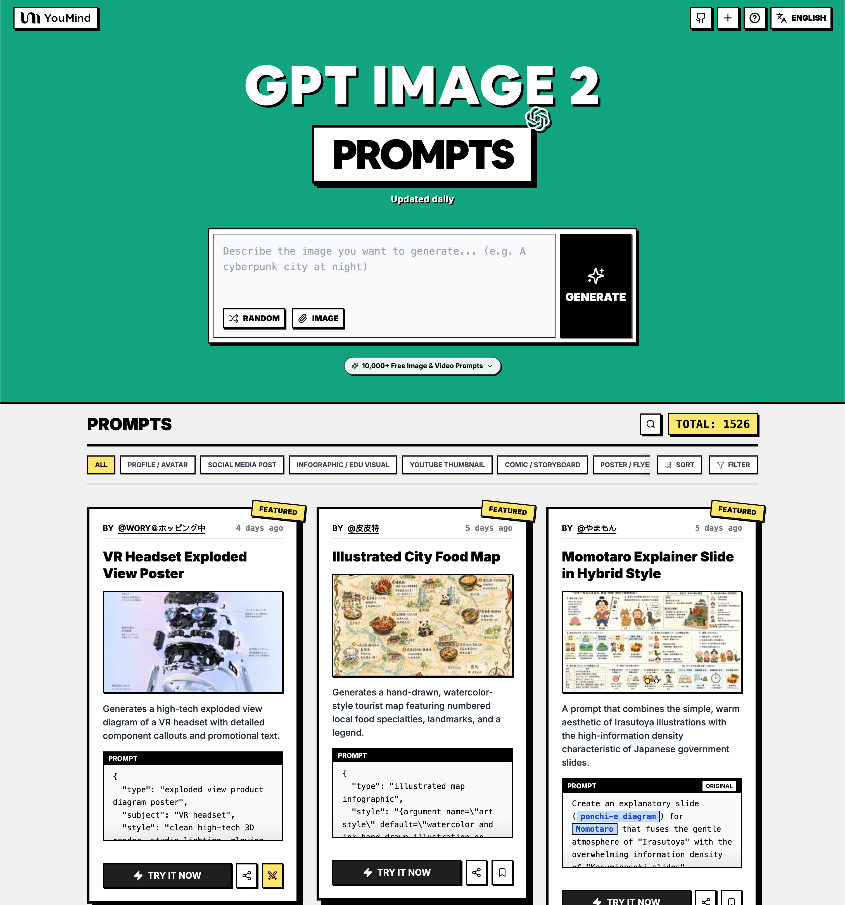

<a href="https://youmind.com/vi-VN/gpt-image-2-prompts">
  
</a>

> 💡 🎬 Take it further with **Seedance 2** — pair GPT Image 2 stills with Seedance for jaw-dropping AI videos, 2000+ prompts to explore 👉 [awesome-seedance-2-prompts](https://github.com/YouMind-OpenLab/awesome-seedance-2-prompts)
# 🚀 Tuyển tập GPT Image 2 Prompts

[](https://github.com/sindresorhus/awesome)
[](https://github.com/YouMind-OpenLab/awesome-gpt-image-2)
[](https://creativecommons.org/licenses/by/4.0/)
[](https://github.com/YouMind-OpenLab/awesome-gpt-image-2/actions)
[](docs/CONTRIBUTING.md)

> 🎨 Bộ sưu tập các câu lệnh sáng tạo cho OpenAI GPT Image 2

> ⚠️ **Thông báo bản quyền**: Tất cả các câu lệnh được thu thập từ cộng đồng cho mục đích giáo dục. Nếu bạn tin rằng bất kỳ nội dung nào vi phạm quyền của bạn, vui lòng [mở một issue](https://github.com/YouMind-OpenLab/awesome-gpt-image-2/issues/new?template=bug-report.yml) và chúng tôi sẽ xóa nó ngay lập tức.

---

[](README.md) [](README_zh.md) [](README_zh-TW.md) [](README_ja-JP.md) [](README_ko-KR.md) [](README_th-TH.md) [](README_vi-VN.md) [](README_hi-IN.md) [](README_es-ES.md) [-Click%20to%20View-lightgrey)](README_es-419.md) [](README_de-DE.md) [](README_fr-FR.md) [](README_it-IT.md) [-Click%20to%20View-lightgrey)](README_pt-BR.md) [](README_pt-PT.md) [](README_tr-TR.md)

---

## 🌐 Xem trong Thư viện Web

<div align="center">

[](https://youmind.com/vi-VN/gpt-image-2-prompts)

</div>

**[👉 Duyệt trên Thư viện YouMind GPT Image 2](https://youmind.com/vi-VN/gpt-image-2-prompts)**

Tại sao nên sử dụng thư viện của chúng tôi?

| Feature | GitHub README | Thư viện youmind.com |
|---------|--------------|---------------------|
| 🎨 Bố cục trực quan | Danh sách tuyến tính | Lưới Masonry đẹp mắt |
| 🔍 Tìm kiếm | Chỉ Ctrl+F | Tìm kiếm toàn văn với bộ lọc |
| 🤖 Tạo bằng AI một cú nhấp | - | Tạo bằng AI một cú nhấp |
| 📱 Di động | Cơ bản | Hoàn toàn phản hồi |
| 🏷️ Danh mục | - | Duyệt theo danh mục |


### 🏷️ Duyệt theo danh mục

- **Các trường hợp sử dụng**
  - [Hồ sơ / Ảnh đại diện](https://youmind.com/vi-VN/gpt-image-2-prompts?categories=profile-avatar)
  - [Bài đăng trên mạng xã hội](https://youmind.com/vi-VN/gpt-image-2-prompts?categories=social-media-post)
  - [Infographic / Hình ảnh giáo dục](https://youmind.com/vi-VN/gpt-image-2-prompts?categories=infographic-edu-visual)
  - [Hình thu nhỏ trên YouTube](https://youmind.com/vi-VN/gpt-image-2-prompts?categories=youtube-thumbnail)
  - [Truyện tranh / Bảng phân cảnh](https://youmind.com/vi-VN/gpt-image-2-prompts?categories=comic-storyboard)
  - [Tiếp thị sản phẩm](https://youmind.com/vi-VN/gpt-image-2-prompts?categories=product-marketing)
  - [Hình ảnh chính thương mại điện tử](https://youmind.com/vi-VN/gpt-image-2-prompts?categories=ecommerce-main-image)
  - [Tài sản trò chơi](https://youmind.com/vi-VN/gpt-image-2-prompts?categories=game-asset)
  - [Áp phích / Tờ rơi](https://youmind.com/vi-VN/gpt-image-2-prompts?categories=poster-flyer)
  - [Thiết kế ứng dụng / web](https://youmind.com/vi-VN/gpt-image-2-prompts?categories=app-web-design)
- **Phong cách**
  - [Nhiếp ảnh](https://youmind.com/vi-VN/gpt-image-2-prompts?categories=photography)
  - [Điện ảnh / Ảnh tĩnh từ phim](https://youmind.com/vi-VN/gpt-image-2-prompts?categories=cinematic-film-still)
  - [Anime / Manga](https://youmind.com/vi-VN/gpt-image-2-prompts?categories=anime-manga)
  - [Minh họa](https://youmind.com/vi-VN/gpt-image-2-prompts?categories=illustration)
  - [Phác Thảo / Nét Vẽ](https://youmind.com/vi-VN/gpt-image-2-prompts?categories=sketch-line-art)
  - [Truyện tranh / Tiểu thuyết đồ họa](https://youmind.com/vi-VN/gpt-image-2-prompts?categories=comic-graphic-novel)
  - [Kết xuất 3D](https://youmind.com/vi-VN/gpt-image-2-prompts?categories=3d-render)
  - [Chibi / Phong cách Q](https://youmind.com/vi-VN/gpt-image-2-prompts?categories=chibi-q-style)
  - [Đẳng cự](https://youmind.com/vi-VN/gpt-image-2-prompts?categories=isometric)
  - [Nghệ thuật Pixel](https://youmind.com/vi-VN/gpt-image-2-prompts?categories=pixel-art)
  - [Tranh Sơn Dầu](https://youmind.com/vi-VN/gpt-image-2-prompts?categories=oil-painting)
  - [Màu nước](https://youmind.com/vi-VN/gpt-image-2-prompts?categories=watercolor)
  - [Mực / Phong cách Trung Hoa](https://youmind.com/vi-VN/gpt-image-2-prompts?categories=ink-chinese-style)
  - [Cổ điển / Cổ điển](https://youmind.com/vi-VN/gpt-image-2-prompts?categories=retro-vintage)
  - [Cyberpunk / Khoa học viễn tưởng](https://youmind.com/vi-VN/gpt-image-2-prompts?categories=cyberpunk-sci-fi)
  - [Chủ nghĩa tối giản](https://youmind.com/vi-VN/gpt-image-2-prompts?categories=minimalism)
- **Nội dung chính**
  - [Chân dung / Ảnh tự chụp](https://youmind.com/vi-VN/gpt-image-2-prompts?categories=portrait-selfie)
  - [Người có ảnh hưởng / Người mẫu](https://youmind.com/vi-VN/gpt-image-2-prompts?categories=influencer-model)
  - [Nhân vật](https://youmind.com/vi-VN/gpt-image-2-prompts?categories=character)
  - [Nhóm / Cặp đôi](https://youmind.com/vi-VN/gpt-image-2-prompts?categories=group-couple)
  - [Sản phẩm](https://youmind.com/vi-VN/gpt-image-2-prompts?categories=product)
  - [Thực phẩm / Đồ uống](https://youmind.com/vi-VN/gpt-image-2-prompts?categories=food-drink)
  - [Mặt hàng thời trang](https://youmind.com/vi-VN/gpt-image-2-prompts?categories=fashion-item)
  - [Động vật / Sinh vật](https://youmind.com/vi-VN/gpt-image-2-prompts?categories=animal-creature)
  - [Phương tiện](https://youmind.com/vi-VN/gpt-image-2-prompts?categories=vehicle)
  - [Kiến trúc / Nội thất](https://youmind.com/vi-VN/gpt-image-2-prompts?categories=architecture-interior)
  - [Phong cảnh / Thiên nhiên](https://youmind.com/vi-VN/gpt-image-2-prompts?categories=landscape-nature)
  - [Quang cảnh thành phố / Đường phố](https://youmind.com/vi-VN/gpt-image-2-prompts?categories=cityscape-street)
  - [Sơ đồ / Biểu đồ](https://youmind.com/vi-VN/gpt-image-2-prompts?categories=diagram-chart)
  - [Văn bản / Kiểu chữ](https://youmind.com/vi-VN/gpt-image-2-prompts?categories=text-typography)
  - [Tóm tắt / Bối cảnh](https://youmind.com/vi-VN/gpt-image-2-prompts?categories=abstract-background)

---

## 📖 Mục lục

- [🌐 Xem trong Thư viện Web](#-view-in-web-gallery)
- [🤔 GPT Image 2 là gì?](#-what-is-gpt-image-2)
- [📊 Thống kê](#-statistics)
- [🔥 Câu lệnh nổi bật](#-featured-prompts)
- [📋 Tất cả câu lệnh](#-all-prompts)
- [🤝 Cách đóng góp](#-how-to-contribute)
- [📄 Giấy phép](#-license)
- [🙏 Lời cảm ơn](#-acknowledgements)
- [⭐ Lịch sử sao](#-star-history)

---

## 🤔 GPT Image 2 là gì?

**GPT Image 2** (codename **"duct-tape"**) is OpenAI's next-generation image model. Community testing highlights a leap in these areas:

- 🎯 **Pixel-Perfect Text Rendering** — Native-quality text in Chinese, English, and Japanese, no typos or warped glyphs
- 🎨 **Cross-Image Consistency** — The same character, style, or IP stays identical across a series, down to the pixel
- ⚡ **Commercial-Grade Illustration** — Illustration output is ready to ship without manual polish
- 🌈 **True Art Style Induction** — Creatively evokes the feeling of a style rather than merely approximating references
- 🔧 **Storyboard & Product Series** — Ideal for storyboards, IP characters, and multi-panel product visuals
- 📐 **Multi-Language Design** — Social cards, banners, and posters with accurate multilingual typography in one shot

📚 **Learn More:** See community testing in our [report summary](docs/FAQ.md)

### 🚀 Tích hợp Raycast

Một số câu lệnh hỗ trợ **đối số động** sử dụng cú pháp [Raycast Snippets](https://raycast.com/help/snippets). Tìm huy hiệu 🚀 Raycast Friendly!

**Ví dụ:**
```
A quote card with "{argument name="quote" default="Stay hungry, stay foolish"}"
by {argument name="author" default="Steve Jobs"}
```

Khi sử dụng trong Raycast, bạn có thể thay thế động các đối số để lặp lại nhanh chóng!

---

## 📊 Thống kê

<div align="center">

| Chỉ số | Số lượng |
|--------|-------|
| 📝 Tổng số câu lệnh | **18132** |
| ⭐ Nổi bật | **6** |
| 🔄 Cập nhật lần cuối | **lúc 19:43:27 UTC Thứ Năm, 19 tháng 11, 2026** |

</div>

---

## 🔥 Câu lệnh nổi bật

> ⭐ Được nhóm của chúng tôi chọn lọc thủ công vì chất lượng và sáng tạo xuất sắc

### No. 1: Poster hình ảnh bóc tách (exploded view) kính VR


#### 📖 Mô tả

Tạo sơ đồ bóc tách công nghệ cao của kính VR với các chú thích linh kiện chi tiết và văn bản quảng cáo.

#### 📝 Câu lệnh

```
{
  "type": "poster sơ đồ sản phẩm bóc tách",
  "subject": "kính VR",
  "style": "kết xuất 3D công nghệ cao gọn gàng, ánh sáng studio, các điểm nhấn phát sáng",
  "background": "{argument name=\"background color\" default=\"gradient tím và xanh dương dịu nhẹ\"}",
  "header": {
    "logo": "∞ {argument name=\"product name\" default=\"Meta Quest 3\"}",
    "subtitle": "{argument name=\"main catchphrase\" default=\"Một thực tại hoàn toàn mới, từ một cấu trúc hoàn toàn mới.\"}"
  },
  "layout": {
    "centerpiece": "hình ảnh bóc tách xếp chồng theo chiều dọc của kính VR hiển thị 9 lớp linh kiện bên trong riêng biệt: vỏ ngoài, cảm biến camera, bo mạch chủ với chip, thấu kính pancake, khung trong, bộ pin, dây đeo bên, dây đeo trên và đệm giao diện khuôn mặt.",
    "callout_labels": {
      "count": 8,
      "left_side": [
        "Snapdragon® XR2 Gen 2\nHiệu năng xử lý vượt trội cho trải nghiệm thời gian thực.",
        "Cơ chế điều chỉnh IPD\nCảm giác vừa vặn thoải mái cho nhiều đối tượng người dùng.",
        "Dây đeo đầu được thiết kế chính xác\nCông thái học hướng đến sự thoải mái và ổn định."
      ],
      "right_side": [
        "Mặt nạ\nThiết kế tinh tế và cân bằng trọng lượng tối ưu.",
        "Camera theo dõi\nĐạt được khả năng theo dõi vị trí và nhận diện môi trường độ chính xác cao.",
        "Thấu kính pancake\nThiết kế mỏng nhẹ mang lại góc nhìn rộng và hình ảnh sắc nét.",
        "Pin hiệu suất cao\nThiết kế nguồn tối ưu hỗ trợ thời gian sử dụng lâu dài.",
        "Giao diện khuôn mặt mềm mại\nĐảm bảo cảm giác đeo thoải mái ngay cả khi sử dụng trong thời gian dài."
      ]
    },
    "footer": {
      "left_text_block": {
        "headline": "{argument name=\"bottom headline\" default=\"Trải nghiệm tiến hóa từ cấu trúc.\"}",
        "body": "Trong từng linh kiện là công nghệ tiên tiến và thiết kế tỉ mỉ hỗ trợ trải nghiệm đắm chìm. Meta Quest 3 tạo ra những trải nghiệm mang hơi thở tương lai ngay từ bên trong."
      },
      "right_logo": "∞ Meta"
    }
  }
}
```

#### 🖼️ Hình ảnh được tạo

##### Image 1

<div align="center">

</div>

#### 📌 Chi tiết

- **Tác giả:** [wory＠ホッピング中](https://x.com/wory37303852)
- **Nguồn:** [Twitter Post](https://x.com/wory37303852/status/2045925660401795478#reversed-0)
- **Đã xuất bản:** 19 tháng 4, 2026
- **Ngôn ngữ:** en

**[👉 Thử ngay →](https://youmind.com/vi-VN/gpt-image-2-prompts?id=13460)**

---

### No. 2: Bản đồ ẩm thực thành phố minh họa


#### 📖 Mô tả

Tạo bản đồ du lịch vẽ tay theo phong cách màu nước, bao gồm các đặc sản địa phương được đánh số, các địa danh và chú giải.

#### 📝 Câu lệnh

```
{
  "type": "infographic bản đồ minh họa",
  "style": "{argument name=\"art style\" default=\"hình minh họa vẽ tay bằng màu nước và mực trên giấy da cổ điển\"}",
  "title_section": {
    "text": "{argument name=\"city name\" default=\"Thành Đô\"} {argument name=\"map title\" default=\"Bản đồ oanh tạc của tín đồ ẩm thực\"}",
    "mascot": "quả ớt đỏ hoạt hình đeo kính râm và giơ ngón tay cái"
  },
  "border": "{argument name=\"border decoration\" default=\"dây lá xanh và ớt đỏ\"}",
  "layout": {
    "background": "giấy da màu be có kết cấu với những con đường màu vàng, sông màu xanh dương và các khu công viên màu xanh lá cây",
    "sections": [
      {
        "title": "địa danh",
        "count": 6,
        "illustrations": ["đình truyền thống", "tu viện truyền thống", "tòa nhà chọc trời hiện đại với gấu trúc leo trèo", "tháp truyền hình cao", "cổng truyền thống", "các tòa nhà công nghiệp"],
        "labels": ["Công viên Nhân dân", "Văn Thù Viện", "IFS", "Tháp truyền hình 339", "Ngõ Rộng Ngõ Hẹp", "Đông Giao Ký Ức"]
      },
      {
        "title": "điểm ẩm thực",
        "count": 12,
        "illustrations": ["đậu phụ Ma Bà", "sủi cảo sốt ớt", "xiên que trong nồi", "bánh nếp", "bánh trứng nướng", "lẩu chín ngăn", "miến khoai lang", "xiên que lạnh", "món trộn cay", "trà bát bảo", "thạch băng", "đầu thỏ cay"],
        "labels": ["1 Đậu phụ Ma Bà Trần", "2 Sủi cảo Chung", "3 Xuân Hy Lộ", "4 Ngõ Rộng Ngõ Hẹp · Tam Đại Pháo", "5 Kiến Thiết Lộ · Bánh trứng nướng Diệp Bà Bà", "6 Ngọc Lâm Lộ · Lẩu Tiểu Long Khảm", "7 Hương Hương Hẻm · Bún lòng già", "8 Phố Vũ Hầu Từ · Bát Bát Kê", "9 Đông Giao Ký Ức · Mạo Tiêu Tiêu Lạt", "10 Công viên Nhân dân · Trà xã Hạc Minh", "11 Phố cổ Cẩm Lý · Thạch băng", "12 Đầu thỏ Song Lưu Lão Mẹ"]
      },
      {
        "title": "chú giải",
        "position": "bottom-right",
        "count": 5,
        "items": ["chấm đỏ", "nhà xanh", "cây xanh", "đường kẻ xanh dương", "đường kẻ đôi màu vàng"],
        "labels": ["Địa điểm ẩm thực", "Địa danh du lịch", "Công viên cây xanh", "Sông hồ", "Đường chính"]
      }
    ],
    "centerpiece": "gấu trúc khổng lồ đang ngồi ăn tre",
    "bottom_right_extras": ["la bàn cổ điển với các hướng N, S, E, W", "văn bản miễn trừ trách nhiệm 'Lời khuyên: Hãy cẩn thận khi ăn cay, bảo vệ dạ dày của bạn~' với biểu tượng quả ớt đỏ"]
  }
}
```

#### 🖼️ Hình ảnh được tạo

##### Image 1

<div align="center">

</div>

#### 📌 Chi tiết

- **Tác giả:** [皮皮特](https://x.com/mm_zzm44854)
- **Nguồn:** [Twitter Post](https://x.com/mm_zzm44854/status/2045861258520568230#reversed-1)
- **Đã xuất bản:** 19 tháng 4, 2026
- **Ngôn ngữ:** en

**[👉 Thử ngay →](https://youmind.com/vi-VN/gpt-image-2-prompts?id=13515)**

---

### No. 3: Slide giải thích về Momotaro theo phong cách kết hợp


#### 📖 Mô tả

Một câu lệnh kết hợp giữa tính thẩm mỹ đơn giản, ấm áp của tranh minh họa Irasutoya với mật độ thông tin cao đặc trưng của các slide từ chính phủ Nhật Bản.

#### 📝 Câu lệnh

```
Hãy tạo một slide giải thích ({argument name="format" default="sơ đồ ponchi-e"}) cho {argument name="theme" default="Momotaro"} kết hợp giữa bầu không khí nhẹ nhàng của "Irasutoya" với mật độ thông tin dày đặc của "slide Kasumigaseki".
```

#### 🖼️ Hình ảnh được tạo

##### Image 1

<div align="center">

</div>

##### Image 2

<div align="center">

</div>

#### 📌 Chi tiết

- **Tác giả:** [やまもん](https://x.com/yammamon)
- **Nguồn:** [Twitter Post](https://x.com/yammamon/status/2045778624092254603)
- **Đã xuất bản:** 19 tháng 4, 2026
- **Ngôn ngữ:** ja

**[👉 Thử ngay →](https://youmind.com/vi-VN/gpt-image-2-prompts?id=13983)**

---

### No. 4: Bản thiết kế giao diện Livestream thương mại điện tử


#### 📖 Mô tả

Tạo giao diện livestream mạng xã hội chân thực phủ lên ảnh chân dung, bao gồm các tin nhắn trò chuyện có thể tùy chỉnh, cửa sổ bật lên tặng quà và thẻ mua hàng sản phẩm.

#### 📝 Câu lệnh

```
{
  "type": "bản thiết kế giao diện livestream",
  "subject": {
    "description": "ảnh chân dung của {argument name=\"host name\" default=\"Elon Musk\"}, đang mỉm cười, mặc áo phông đen có in hình sơ đồ kỹ thuật màu trắng",
    "background": "bên trái hiển thị màn hình có văn bản '{argument name=\"left background logo\" default=\"SPACEX\"}', bên phải hiển thị '{argument name=\"right background logo\" default=\"Logo chữ T của Tesla\"}' màu đỏ và một chiếc ô tô tối màu"
  },
  "ui_overlay": {
    "top_header": {
      "host_info": "ảnh đại diện, tên '{argument name=\"host name\" default=\"Elon Musk\"}', phụ đề '556 nghìn lượt thích phiên này', nút 'Theo dõi' màu đỏ",
      "rank_badge": "biểu tượng đồng tiền vàng với 'Hạng 1 toàn trang'",
      "viewer_stats": "3 ảnh đại diện người xem hàng đầu với '123 nghìn', '86 nghìn', '57 nghìn', tổng '687 nghìn', nút đóng 'X'",
      "right_links": "'Xem thêm >', 'Phòng trưng bày quà tặng 0/24' với thẻ 'Cổ điển' màu xanh dương"
    },
    "mid_left_gifts": {
      "count": 2,
      "items": [
        "ảnh đại diện 'Người yêu công nghệ', 'tặng trái tim', biểu tượng trái tim x 1314",
        "ảnh đại diện 'Biển sao', 'tặng tên lửa', biểu tượng tên lửa x 666"
      ]
    },
    "bottom_left_chat": {
      "system_message": "huy hiệu cấp 37 'Người du hành vũ trụ đã tham gia phòng livestream'",
      "message_count": 7,
      "messages": [
        "Tiểu Hỏa Tiễn: Musk! Tương lai đầy hứa hẹn! 🚀",
        "future: Khi nào Tesla Model 2 ra mắt vậy?",
        "Người mơ mộng vì sao: SpaceX năm nay có thể lên sao Hỏa không?",
        "AI khám phá: Tiến độ của Neuralink thế nào rồi?",
        "Cư dân mạng đẹp trai: Chào sếp Musk!",
        "Mars: Lần đầu xem livestream của anh, phấn khích quá!",
        "nguoidung123: Nói về AI đi, liệu nó có thay thế con người không?"
      ]
    },
    "bottom_right_product_card": {
      "hot_tag": "thẻ cam 'Bán chạy x 1888'",
      "image": "Tesla Cybertruck",
      "title": "{argument name=\"product name\" default=\"Xe bán tải điện Tesla Cybertruck\"}",
      "price": "{argument name=\"product price\" default=\"¥ 1.618.000\"}",
      "button": "nút 'Mua' màu đỏ",
      "floating_animation": "các trái tim mờ ảo bay lên dọc theo cạnh phải"
    },
    "bottom_bar": {
      "input_field": "'Nhập nội dung...'",
      "icons": ["mặt cười", "ba chấm", "giỏ hàng", "hộp quà", "chia sẻ"]
    }
  }
}
```

#### 🖼️ Hình ảnh được tạo

##### Image 1

<div align="center">

</div>

#### 📌 Chi tiết

- **Tác giả:** [神经病不想好转](https://x.com/sjbbxhz)
- **Nguồn:** [Twitter Post](https://x.com/sjbbxhz/status/2045684734714380687#reversed-0)
- **Đã xuất bản:** 19 tháng 4, 2026
- **Ngôn ngữ:** en

**[👉 Thử ngay →](https://youmind.com/vi-VN/gpt-image-2-prompts?id=14036)**

---

### No. 5: Trận chiến võ thuật phong cách Anime


#### 📖 Mô tả

Tạo ra một cảnh hành động phong cách anime đầy năng động với hai nhân vật đang chiến đấu cùng hào quang nguyên tố trong một võ đường truyền thống.

#### 📝 Câu lệnh

```
Một bức tranh minh họa anime đầy năng động về hai cô gái đang tham gia vào một trận chiến võ thuật khốc liệt bên trong một võ đường gỗ truyền thống. Ở tiền cảnh, một cô gái với {argument name="character 1 hair" default="mái tóc đen búi cao với ruy băng đỏ"} đang thực hiện một thế võ thấp đầy uy lực, tung nắm đấm về phía trước. Cô mặc một chiếc {argument name="character 1 outfit" default="áo kiểu Trung Hoa màu trắng với tua rua đỏ và quần đỏ ống rộng"}, với những vệt năng lượng màu đỏ dữ dội xoay quanh các chi đang tấn công. Ở phía bên phải giữa không trung, một cô gái với {argument name="character 2 hair" default="mái tóc tím nhạt búi hai bên"} đang nhảy lên một cách duyên dáng, mỉm cười đầy tự tin trong khi mặc một chiếc {argument name="character 2 outfit" default="váy xanh đậm thêu vàng và quần tất đen"}, đi kèm với những vệt năng lượng giống như nước màu xanh lam quét qua. Phía sau là nội thất ngôi đền gỗ mộc mạc với tấm biển nổi bật phía trên ghi "{argument name="sign text" default="武術会"}". Cảnh tượng tràn ngập hành động bùng nổ, bụi bay, sàn gỗ vỡ vụn, các hiệu ứng hạt đầy màu sắc rực rỡ và ánh sáng góc thấp đầy kịch tính giúp tách biệt hoàn hảo các nhân vật khỏi phần nền chi tiết.
```

#### 🖼️ Hình ảnh được tạo

##### Image 1

<div align="center">

</div>

#### 📌 Chi tiết

- **Tác giả:** [たねもみ 2.0 / Tanemomi Ver2.0](https://x.com/Tanemomi_Ver2)
- **Nguồn:** [Twitter Post](https://x.com/Tanemomi_Ver2/status/2046063806846214265#reversed-0)
- **Đã xuất bản:** 20 tháng 4, 2026
- **Ngôn ngữ:** en

**[👉 Thử ngay →](https://youmind.com/vi-VN/gpt-image-2-prompts?id=13467)**

---

### No. 6: Đồ họa thông tin về quá trình tiến hóa trên bậc thang đá 3D


#### 📖 Mô tả

Chuyển đổi dòng thời gian tiến hóa phẳng thành đồ họa thông tin bậc thang đá 3D chân thực với các hình ảnh sinh vật chi tiết và các bảng thông tin bên cạnh được cấu trúc rõ ràng.

#### 📝 Câu lệnh

```
{
  "type": "đồ họa thông tin dòng thời gian tiến hóa",
  "instruction": "Sử dụng REFERENCE_0 làm nền tảng cấu trúc, hãy chuyển đổi thiết kế vector phẳng thành đồ họa thông tin 3D có độ chân thực cao. Thay thế các đoạn dốc phẳng bằng các bậc thang đá riêng biệt và nâng cấp tất cả các sinh vật thành mô hình 3D chân thực như ảnh chụp.",
  "style": {
    "background": "{argument name=\"background style\" default=\"giấy da cổ điển có kết cấu\"}",
    "staircase": "{argument name=\"staircase material\" default=\"các khối đá có kết cấu chân thực\"}",
    "subjects": "{argument name=\"organism style\" default=\"các mô hình 3D chân thực chi tiết cao\"}"
  },
  "layout": {
    "main_title": "{argument name=\"main title\" default=\"Sự tiến hóa của loài người\"}",
    "sections": [
      {
        "position": "thanh bên trái",
        "count": 8,
        "labels": ["L0: Sinh vật đơn bào", "L1: Sinh vật đa bào", "L2: Giới động vật", "L3: Ngành động vật có dây sống", "L4: Cuộc cách mạng lên cạn", "L5: Lớp thú", "L6: Tiến hóa họ người", "L7: Kỷ nguyên Homo sapiens"]
      },
      {
        "position": "phía trên bên phải",
        "title": "Đặc điểm đạt được / Đặc điểm mất đi",
        "description": "Chú giải với các biểu tượng cộng và trừ"
      },
      {
        "position": "phía dưới trung tâm",
        "title": "Các cột mốc tiến hóa quan trọng",
        "count": 6,
        "description": "Dòng thời gian với đồ họa hình bóng của 6 nhân vật thể hiện quá trình tiến hóa từ vượn thành người"
      }
    ],
    "centerpiece": {
      "description": "Cầu thang đá uốn lượn với 25 bậc thang được đánh số, mỗi bậc có các sinh vật cụ thể.",
      "count": 25,
      "notable_elements": [
        "Bậc 07: Sứa",
        "Bậc 09: Cúc đá",
        "Bậc 10: Bọ ba thùy",
        "Bậc 24: Người đi bộ",
        "Bậc 25: {argument name=\"future evolution concept\" default=\"hình bóng vũ trụ phát sáng với dấu chấm hỏi\"}"
      ]
    }
  }
}
```

#### 🖼️ Hình ảnh được tạo

##### Image 1

<div align="center">

</div>

#### 📌 Chi tiết

- **Tác giả:** [知识猫图解](https://x.com/GeekCatX)
- **Nguồn:** [Twitter Post](https://x.com/GeekCatX/status/2045792240044511277#reversed-1)
- **Đã xuất bản:** 19 tháng 4, 2026
- **Ngôn ngữ:** en

**[👉 Thử ngay →](https://youmind.com/vi-VN/gpt-image-2-prompts?id=13491)**

---

## 📋 Tất cả câu lệnh

> 📝 Sắp xếp theo ngày xuất bản (mới nhất trước)

### No. 1: Hồ sơ / Ảnh đại diện - Lưới chân dung sáu khung hình của một phụ nữ trẻ


#### 📖 Mô tả

Một bức ảnh ghép gồm sáu bức chân dung studio chụp một phụ nữ trẻ với mái tóc nâu dài, tạo dáng với nhiều biểu cảm tự nhiên trên nền xám.

#### 📝 Câu lệnh

```
Một lưới gồm sáu bức ảnh chân dung chụp một cô gái trẻ Đông Á với mái tóc nâu sẫm dài gợn sóng và phần mái thưa. Cô mặc chiếc áo hai dây màu đen đơn giản cùng sợi dây chuyền bạc thanh mảnh có mặt nhỏ. Phông nền là bức tường xám trơn mang tông màu lạnh, gợi lên không gian studio trong nhà với ánh sáng dịu nhẹ, tán đều, tạo nên những vệt bóng mềm mại trên gương mặt cô.

Trên cùng bên trái: Cô tựa cằm lên cả hai tay, lòng bàn tay hướng vào trong, ánh mắt nhìn hơi lệch sang trái với biểu cảm trung tính.
Trên cùng chính giữa: Cô giơ ngón tay hình chữ V gần mắt phải, nháy mắt ở bên đó, đôi môi hé mở.
Trên cùng bên phải: Cô nhắm mắt, đầu hơi cúi xuống, một tay đưa lên chạm vào đỉnh tóc.
Dưới cùng bên trái: Cô tựa má vào tay phải, các ngón tay khẽ chạm thái dương, ánh mắt đăm chiêu nhìn về một phía.
Dưới cùng chính giữa: Một khoảnh khắc tự nhiên khi cô cười tươi rạng rỡ để lộ hàm răng, ánh mắt hướng ra ngoài khung hình về phía bên phải.
Dưới cùng bên phải: Cô nhìn thẳng vào ống kính với nụ cười dịu dàng, phảng phất, một tay khẽ vuốt ngược lọn tóc ra sau tai.
```

#### 🖼️ Hình ảnh được tạo

##### Image 1

<div align="center">

</div>

#### 📌 Chi tiết

- **Tác giả:** [なかやま](https://x.com/yudetamago__san)
- **Nguồn:** [Twitter Post](https://x.com/yudetamago__san/status/2123050336764239971#reversed-0)
- **Đã xuất bản:** 18 tháng 11, 2026
- **Ngôn ngữ:** en

**[👉 Thử ngay →](https://youmind.com/vi-VN/gpt-image-2-prompts?id=37621)**

---

### No. 2: Hồ sơ / Ảnh đại diện - Gợi ý ảnh selfie đêm bằng GPT Image 2


#### 📖 Mô tả

Gợi ý tạo ảnh selfie bằng điện thoại siêu thực của một phụ nữ trẻ Đông Á đang đi bộ trên phố đêm, được thiết kế cho GPT Image 2.

#### 📝 Câu lệnh

```
Ảnh selfie bằng điện thoại phong cách siêu thực chụp vào ban đêm, trông giống như được chụp bằng iPhone/máy ảnh thật chứ không phải máy DSLR. Một cô gái trẻ Đông Á xinh đẹp, giữ nguyên các đường nét khuôn mặt từ ảnh tham khảo, mái tóc dài màu nâu sẫm hơi rối bay tự nhiên trong gió, làn da trắng sứ mịn màng, đôi mắt nâu to tròn biểu cảm, trang điểm nhẹ nhàng tự nhiên, má ửng hồng phơn phớt và đôi môi hồng bóng đang chu lên tạo dáng dễ thương. Cô mặc áo ba dây xám ôm sát, một tay cầm điện thoại thoải mái khi đang đi dạo trên vỉa hè thành phố yên tĩnh rợp bóng cây vào ban đêm. Ánh đèn đường ấm áp chiếu sáng khuôn mặt cô với những mảng đổ bóng mềm mại, phía sau là những chiếc xe đang đỗ, hàng cây xanh và con đường vắng vẻ. Ảnh hơi nhòe do rung tay, HDR tự nhiên của điện thoại, kết cấu da chân thực, từng sợi tóc rõ nét, nhiễu hạt kỹ thuật số nhẹ, góc nhìn từ camera trước, phong cách đời thường ngẫu hứng, buổi đi dạo đêm thư thái, ảnh selfie kiểu Instagram, chi tiết cao, chân thực như ảnh thật, trông rõ ràng là một bức ảnh chụp bằng điện thoại chưa qua chỉnh sửa chứ không phải ảnh AI hay ảnh chụp studio.
```

#### 🖼️ Hình ảnh được tạo

##### Image 1

<div align="center">

</div>

#### 📌 Chi tiết

- **Tác giả:** [我叫聂磊](https://x.com/zhy2024806)
- **Nguồn:** [Twitter Post](https://x.com/zhy2024806/status/2122887530052022398)
- **Đã xuất bản:** 18 tháng 11, 2026
- **Ngôn ngữ:** zh

**[👉 Thử ngay →](https://youmind.com/vi-VN/gpt-image-2-prompts?id=37581)**

---

### No. 3: Hồ sơ / Ảnh đại diện - Chân dung phụ nữ mặc váy hoa phong cách Showa Retro


#### 📖 Mô tả

Tạo chân dung phong cách phim hoài cổ của một phụ nữ trẻ ngồi trên ghế bập bênh trong phòng ngủ kiểu Nhật Bản cổ điển, lý tưởng để gợi lên thẩm mỹ thời Showa hoặc hình ảnh kể chuyện giàu cảm xúc.

#### 📝 Câu lệnh

```
Bức chân dung khổ dọc chụp một cô gái trẻ Đông Á đang ngồi trên chiếc ghế bập bênh gỗ cổ điển trong một phòng ngủ ấm cúng mang phong cách retro. Cô có mái tóc nâu sẫm buộc lỏng ra phía sau, những lọn tóc mai rủ nhẹ ôm lấy khuôn mặt và cài một chiếc kẹp hoa trắng nhỏ bên mái. Nét mặt cô điềm tĩnh, phảng phất chút u buồn, ánh mắt nhìn thẳng vào ống kính. Cô mặc một chiếc váy ngắn tay màu kem in họa tiết hoa tinh tế (những bông hoa nhỏ màu hồng và xanh dương), với phần cổ áo Peter Pan bo tròn, tay áo bồng và một hàng cúc nhỏ chạy dọc thân trước. Hai bàn tay đan vào nhau đặt trên đùi, đôi chân bắt chéo ở đầu gối.

Không gian gợi lên vẻ hoài niệm của một căn phòng nội thất Nhật Bản thời kỳ Showa: ánh sáng tự nhiên dịu nhẹ xuyên qua lớp rèm ren mỏng phía bên trái, đổ những vệt bóng mờ ảo khắp khung cảnh. Phía sau cô, bên phải là khung giường gỗ tối màu trải ga hoa văn; xa hơn nữa là chiếc tủ trang điểm cổ kê bên trên một ngọn đèn đồng tỏa ánh sáng ấm áp, một bình hoa tươi và vài bức ảnh lồng khung. Sàn nhà lát gỗ cứng đánh bóng, phủ một phần bởi tấm thảm lông xù màu be có vân nổi bật ngay dưới chiếc ghế bập bênh.

Phong cách: Chất liệu nhiếp ảnh phim — bề mặt nhiễu hạt, tông màu pastel trầm, độ sâu trường ảnh mỏng, giữ lại những chi tiết không hoàn hảo chân thực như vài vết nám nhỏ trên da hay ánh sáng không đều nhằm tăng tính hiện thực. Cảm xúc: Tĩnh lặng, chiêm nghiệm, mang nỗi hoài niệm bâng khuâng.
```

#### 🖼️ Hình ảnh được tạo

##### Image 1

<div align="center">

</div>

#### 📌 Chi tiết

- **Tác giả:** [いがぐりメタボ](https://x.com/Kmsbdd0GXBOcrXQ)
- **Nguồn:** [Twitter Post](https://x.com/Kmsbdd0GXBOcrXQ/status/2122650353510576594#reversed-0)
- **Đã xuất bản:** 17 tháng 11, 2026
- **Ngôn ngữ:** en

**[👉 Thử ngay →](https://youmind.com/vi-VN/gpt-image-2-prompts?id=37586)**

---

### No. 4: Hồ sơ / Ảnh đại diện - Prompt Chân Dung Collage Scrapbook Mùa Đông cho GPT Image 2


#### 📖 Mô tả

Một prompt chi tiết để tạo ra bức chân dung collage scrapbook mùa đông siêu thực của một nhân vật nữ với tóc tím, trang phục đường phố ấm áp và trà sữa trân châu, sử dụng GPT Image 2.

#### 📝 Câu lệnh

```
Tạo một bức chân dung collage phong cách scrapbook mùa đông toàn thân siêu thực của cùng một nhân vật nữ trẻ trong ảnh tham khảo, giữ nguyên mái tóc bob thẳng dài ngang cằm màu tím violet rực rỡ đặc trưng với phần mái thưa mềm mại, làn da trắng sứ mịn màng, những nốt tàn nhang tự nhiên trên sống mũi và gò má, đôi mắt hạnh màu nâu hạt dẻ/nâu sáng, đường nét khuôn mặt thanh tú, đôi môi căng bóng và vóc dáng mảnh mai.

Cô đang ngồi nghiêng trên một chiếc thùng carton với tư thế thoải mái, ấm áp, tay trái cầm ly trà dâu boba đá màu hồng phủ lớp kem tươi béo ngậy, tay phải ôm trọn chú thú bông dâu tây đang cười đáng yêu. Cô mặc chiếc áo len cổ lọ dệt kim màu kem ấm áp bên trong một chiếc áo khoác denim wash sáng oversize, được trang trí bằng các mảng chắp vá (patchwork) họa tiết hoa lá sặc sỡ, caro gingham, chấm bi và hình trái dâu. Quần jeans ống rộng patchwork đồng điệu cùng đôi giày sneaker đế xuồng màu trắng hầm hố hoàn thiện vẻ ngoài streetwear mùa đông đầy ấm áp của cô.

Trên thùng carton có dòng chữ viết tay "{argument name="box text" default="FRAGILE"}" kèm theo một hình trái tim. Phần nền được tạo từ giấy scrapbook màu xanh nhàu nhĩ, điểm xuyết những trang sổ tay xé rách, các từ viết tay "{argument name="background words" default="Winter", "Slow", "dream", and "Sweet"}", băng keo washi caro đỏ, kẹp giấy, sticker trái dâu, những nét vẽ bông tuyết trắng nguệch ngoạc và một chú người tuyết dễ thương đội mũ len cùng quàng khăn màu đỏ. Thêm dòng thông điệp viết tay "{argument name="message" default="Stay Cozy"}".

Sử dụng ánh sáng studio mùa đông dịu nhẹ tán xạ, tông màu xanh pastel lạnh, những chi tiết ấm áp, kết cấu da chân thực, từng lọn tóc tím chi tiết, chất liệu vải dệt kim rõ nét, độ sâu điện ảnh, đổ bóng tinh tế, chất lượng photorealistic, siêu chi tiết 8K, bộ ảnh thời trang editorial scrapbook phong cách winter cottagecore Y2K cao cấp.
```

#### 🖼️ Hình ảnh được tạo

##### Image 1

<div align="center">

</div>

#### 📌 Chi tiết

- **Tác giả:** [Wareen AI 💟](https://x.com/Wareenaa)
- **Nguồn:** [Twitter Post](https://x.com/Wareenaa/status/2122551075098284096)
- **Đã xuất bản:** 17 tháng 11, 2026
- **Ngôn ngữ:** en

**[👉 Thử ngay →](https://youmind.com/vi-VN/gpt-image-2-prompts?id=37534)**

---

### No. 5: Hồ sơ / Ảnh đại diện - GPT Image 2 Prompt: Biến Ảnh Thành Mô Hình Cặp Đôi Đồ Chơi 3D


#### 📖 Mô tả

Prompt chi tiết để chuyển đổi ảnh tham khảo của các cặp đôi thành mô hình vinyl 3D siêu chi tiết trong bối cảnh quán cà phê, giữ nguyên đặc điểm khuôn mặt nhưng áp dụng phong cách đồ chơi nghệ thuật.

#### 📝 Câu lệnh

```
Biến đổi những người trong ảnh tham chiếu đã tải lên thành một cảnh mô hình đồ chơi sưu tầm 3D siêu chi tiết của một cặp đôi tại quán cà phê ngoài trời đầy phong cách. Giữ nguyên các đường nét khuôn mặt đặc trưng, đồng thời tái tạo họ thành những bức tượng vinyl bóng bẩy cao cấp với lớp hoàn thiện bằng nhựa đánh bóng, tỷ lệ cơ thể được phóng đại nhẹ, biểu cảm sinh động và các chi tiết chân thực như đồ chơi thật.

Nhân vật nữ có mái tóc nâu sẫm được tết búi thanh lịch, kính râm đen, khuyên tai vàng dạng vòng tinh tế, dây chuyền vàng xếp lớp và áo blouse trắng tay phồng. Cô tựa cằm nhẹ nhàng lên một tay, mỉm cười dịu dàng và âu yếm nhìn người bạn đời của mình.

Nhân vật nam sở hữu mái tóc xoăn tối màu dày dặn và bồng bềnh, râu được tỉa tót gọn gàng, kính râm đen cùng chiếc áo sơ mi trắng cài cúc phẳng phiu xắn tay áo. Anh đeo đồng hồ bạc ở cổ tay và thong dong đưa chiếc cốc cà phê sứ nhỏ màu trắng lên gần môi.

Cả hai nhân vật ngồi sát bên nhau tại một chiếc bàn gỗ quán cà phê được đánh bóng. Hãy thêm vào những chiếc cốc cà phê mini màu trắng, đĩa lót đồng bộ và thìa trà bạc thanh lịch.

Bối cảnh: Một quán cà phê ngoài trời sang trọng, quyến rũ mang phong cách châu Âu với kiến trúc đá màu be ấm áp, cửa kính cao, cây xanh tươi tốt, dù che nắng màu xanh dương trên hiên, nội thất gỗ và những vị khách mờ ảo phía sau. Ánh nắng chiều ấm áp tạo nên những vệt phản chiếu tuyệt đẹp cùng vùng đổ bóng mềm mại.

Phong cách thị giác: Đồ chơi vinyl thiết kế cao cấp, tượng 3D bóng bẩy, thiết kế nhân vật đáng yêu nhưng vẫn tinh tế, bề mặt điêu khắc nhẵn mịn, kiểu tóc chi tiết, phụ kiện thu nhỏ chân thực, nhiếp ảnh đồ chơi sưu tầm hàng hiệu, độ sâu trường ảnh điện ảnh, chỉnh màu vàng ấm áp, kết xuất 3D siêu thực.

Bố cục: Khung hình dọc tỷ lệ 4:5, góc máy ngang tầm mắt hướng thẳng từ phía trước, cả hai nhân vật nổi bật chiếm trọn tiền cảnh, tư thế tự nhiên thư giãn, không khí quán cà phê thân mật.

Chất lượng kết xuất: Mô hình 3D siêu chi tiết, phản xạ bóng chân thực, ánh sáng dò tia (ray-traced), che khuất môi trường (ambient occlusion), chiếu sáng toàn cục (global illumination), vật liệu dựa trên vật lý (PBR), đổ bóng điện ảnh, nhiếp ảnh sản phẩm chuyên nghiệp, chất lượng hoàn thiện chuẩn 8K.

Lưu ý quan trọng: Giữ nguyên danh tính và các đặc điểm khuôn mặt riêng biệt của cặp đôi từ ảnh tham chiếu. Cả hai người phải trông giống như những món đồ chơi sưu tầm vật lý được chế tác tuyệt đẹp, chứ không phải ảnh chụp người bình thường. Không chứa văn bản, không watermark, không có thêm nhân vật nào ở tiền cảnh.
```

#### 🖼️ Hình ảnh được tạo

##### Image 1

<div align="center">

</div>

#### 📌 Chi tiết

- **Tác giả:** [Smiling Khan](https://x.com/AIwithkhan)
- **Nguồn:** [Twitter Post](https://x.com/AIwithkhan/status/2121954653500035343)
- **Đã xuất bản:** 15 tháng 11, 2026
- **Ngôn ngữ:** en

**[👉 Thử ngay →](https://youmind.com/vi-VN/gpt-image-2-prompts?id=37519)**

---

### No. 6: Hồ sơ / Ảnh đại diện - GPT Image 2 Prompt nhất quán đa góc nhìn cho nhân vật


#### 📖 Mô tả

Prompt tạo ảnh nhân vật nhất quán bằng cách sử dụng hình ảnh tham chiếu về khuôn mặt, trang phục và bản đồ độ sâu tư thế với GPT Image 2.

#### 📝 Câu lệnh

```
Vui lòng tạo một hình ảnh: Chân thực như ảnh chụp, tỷ lệ khung hình dọc 2:3, ảnh chụp một mình của một phụ nữ trưởng thành hư cấu {argument name="age" default="20 tuổi"}, trẻ trung, giống sinh viên đại học năm hai, không trông quá chững chạc. Hình 1 là ảnh tham chiếu khuôn mặt: giữ nguyên các đường nét trên gương mặt, tông màu da, kiểu tóc và màu tóc. Hình 2 là ảnh tham chiếu trang phục: mặc đúng bộ đồ này y hệt như trong ảnh, giữ nguyên phong cách, màu sắc, chất liệu và phụ kiện. Hình 3 là bản đồ độ sâu (depth map) thang độ xám của một mô hình người: chỉ dùng làm tham chiếu cho dáng đứng và góc máy; đây không phải người thật và không cung cấp chi tiết về trang phục hay khuôn mặt. Bối cảnh: {argument name="scene_description" default="một con đường rợp bóng cây trong công viên vào buổi chiều mùa xuân"}, với những tán lá xanh mướt và ghế đá ven đường, ánh sáng tự nhiên dịu nhẹ, chất lượng ảnh chụp nhanh đời thường bằng iPhone, kết cấu da chân thực, nhiễu hạt phim nhẹ. Một ảnh duy nhất, không ghép ảnh, không có chữ hay watermark, bàn tay thả lỏng tự nhiên với đầy đủ cả năm ngón, khuôn mặt và tứ chi không bị biến dạng.

Vui lòng tạo thêm một hình ảnh khác: Tham chiếu từ ảnh trước đó: cùng một người, kiểu tóc, trang phục, bối cảnh và ánh sáng hoàn toàn giống nhau, nhưng thay đổi dáng người và góc máy để khớp với tư thế trong bản đồ độ sâu này (bản đồ độ sâu chỉ là một mô hình người, không cung cấp thông tin về trang phục hay khuôn mặt). Ảnh dọc 2:3 duy nhất, không ghép ảnh, không có chữ hay watermark, các ngón tay đầy đủ.
```

#### 🖼️ Hình ảnh được tạo

##### Image 1

<div align="center">

</div>

##### Image 2

<div align="center">

</div>

#### 📌 Chi tiết

- **Tác giả:** [Candy](https://x.com/CandyTravelight)
- **Nguồn:** [Twitter Post](https://x.com/CandyTravelight/status/2121772672140886063)
- **Đã xuất bản:** 15 tháng 11, 2026
- **Ngôn ngữ:** zh

**[👉 Thử ngay →](https://youmind.com/vi-VN/gpt-image-2-prompts?id=37510)**

---

### No. 7: Hồ sơ / Ảnh đại diện - Cô Gái Anime Mặc Áo Choàng Hươu Thu


#### 📖 Mô tả

Tạo nhân vật anime đeo kính và mặc áo choàng có mũ họa tiết hươu đốm, đứng giữa những chiếc lá bạch quả vàng rơi trong công viên mùa thu.

#### 📝 Câu lệnh

```
Bức tranh minh họa toàn thân theo phong cách anime vẽ một cô gái trẻ vui tươi đang đứng trên con đường phủ đầy lá ngân hạnh vàng rụng. Cô có mái tóc vàng dài bồng bềnh được buộc thành hai bím và đôi tai yêu tinh nhọn. Đôi mắt xanh lục sáng ngời ẩn sau cặp kính gọng đỏ dáng tròn, miệng hé mở nở nụ cười rạng rỡ. Cô khoác chiếc áo choàng trùm đầu màu nâu đặc trưng với họa tiết đốm trắng (giống lông hươu), phần mũ có gắn tai thú và trước cổ thắt một chiếc nơ ruy băng hồng lớn. Bên trong áo choàng là chân váy caro màu nâu. Dưới chân, cô đi đôi bốt cao đến gối màu nâu dáng suông rủ bên ngoài lớp tất trắng gân dọc. Hậu cảnh là những hàng cây ngân hạnh vàng rực dưới bầu trời xanh, cùng vài chiếc lá bay lơ lửng trong không trung.
```

#### 🖼️ Hình ảnh được tạo

##### Image 1

<div align="center">

</div>

#### 📌 Chi tiết

- **Tác giả:** [Toudaiji](https://x.com/ISoBZrpOBM85706)
- **Nguồn:** [Twitter Post](https://x.com/ISoBZrpOBM85706/status/2121422631304126591#reversed-0)
- **Đã xuất bản:** 14 tháng 11, 2026
- **Ngôn ngữ:** en

**[👉 Thử ngay →](https://youmind.com/vi-VN/gpt-image-2-prompts?id=37497)**

---

### No. 8: Hồ sơ / Ảnh đại diện - Chân Dung Vịt Con Phong Cách Từ Hình Ảnh Tham Khảo


#### 📖 Mô tả

Tạo ảnh chân dung 3D chi tiết của một chú vịt con đứng tự tin trong không gian sống phong cách, dựa trên tư thế và nụ cười từ hình ảnh tham khảo được tải lên.

#### 📝 Câu lệnh

```
Tạo một bức chân dung vịt con xinh xắn dựa trên hình ảnh đính kèm, theo phong cách 3D cực kỳ chi tiết và độc lạ. Chú vịt con đứng đầy tự tin trong một không gian sống thời thượng, mỉm cười dịu dàng với tư thế giống hệt như trong ảnh.
```

#### 🖼️ Hình ảnh được tạo

##### Image 1

<div align="center">

</div>

#### 📌 Chi tiết

- **Tác giả:** [ゆきと](https://x.com/bakupso2)
- **Nguồn:** [Twitter Post](https://x.com/bakupso2/status/2121271796511195595)
- **Đã xuất bản:** 13 tháng 11, 2026
- **Ngôn ngữ:** ja

**[👉 Thử ngay →](https://youmind.com/vi-VN/gpt-image-2-prompts?id=37493)**

---

### No. 9: Hồ sơ / Ảnh đại diện - Cô Gái Anime Mặc Cardigan Kem


#### 📖 Mô tả

Prompt được phân tích ngược cho bức chân dung phong cách anime của một cô gái mặc áo cardigan len ấm áp trên nền bầu trời nắng.

#### 📝 Câu lệnh

```
Bức chân dung phong cách anime độ phân giải cao khắc họa một cô gái trẻ với mái tóc xám hoa oải hương gợn sóng dài ngang vai, điểm xuyết chiếc nơ trắng nhỏ thắt bên trái. Cô sở hữu đôi mắt to tròn đầy biểu cảm chuyển màu gradient từ hổ phách sang xanh dương cùng nụ cười dịu dàng, ấm áp. Bàn tay phải khẽ nâng lên gần má, những ngón tay chạm nhẹ vào mái tóc. Cô mặc chiếc áo cardigan len vặn thừng dày dặn màu kem bên ngoài chiếc áo blouse xanh xô thơm xếp ly đính cúc nhỏ, phía dưới thấp thoáng chân váy xếp ly xanh navy đậm. Sợi dây chuyền bạc thanh mảnh với mặt dây hình ngôi sao nằm gọn trên xương quai xanh. Hậu cảnh là bầu trời xanh trong trẻo được làm mờ mềm mại cùng những đốm sáng bokeh rải rác, gợi lên một ngày nắng đẹp. Ánh sáng tự nhiên, dịu nhẹ tôn lên từng đường vân của chất liệu len dệt cũng như độ trong mượt của mái tóc. Bố cục dọc, khung hình từ eo trở lên.
```

#### 🖼️ Hình ảnh được tạo

##### Image 1

<div align="center">

</div>

#### 📌 Chi tiết

- **Tác giả:** [降月@十師団物語](https://x.com/ten_division_kz)
- **Nguồn:** [Twitter Post](https://x.com/ten_division_kz/status/2120195378037633026#reversed-0)
- **Đã xuất bản:** 10 tháng 11, 2026
- **Ngôn ngữ:** en

**[👉 Thử ngay →](https://youmind.com/vi-VN/gpt-image-2-prompts?id=37453)**

---

### No. 10: Hồ sơ / Ảnh đại diện - GPT Image 2 Prompt: Chân dung phòng ngủ phong cách Hàn Quốc với áo hai dây hồng


#### 📖 Mô tả

Prompt chi tiết cao để tạo ảnh chân dung phòng ngủ phong cách Hàn Quốc siêu thực của một phụ nữ Đông Á mặc áo hai dây hồng và cardigan, tập trung vào kết cấu da và ánh sáng.

#### 📝 Câu lệnh

```
[Phong cách tổng thể]

Tỷ lệ 1:1 khung hình vuông, một bức ảnh độc lập duy nhất, nhiếp ảnh chân dung trong nhà phong cách Hàn Quốc siêu thực của một phụ nữ trưởng thành, khí chất vừa thanh lịch lạnh lùng vừa dịu dàng, tông màu trắng ấm kem bão hòa thấp, ánh sáng tự nhiên mềm mại, kết cấu da tinh tế, hiệu ứng lấy nét mềm tự nhiên nhẹ, chất lượng ảnh chụp bằng điện thoại thông minh chân thực.

[Đặc điểm khuôn mặt]

Một phụ nữ trưởng thành Đông Á xinh đẹp khoảng 23-25 tuổi, khuôn mặt trái xoan nhỏ nhắn thanh tú, đường viền hàm mềm mại và mượt mà, cằm tròn nhỏ, làn da trắng lạnh trong trẻo, phớt má hồng đào nhạt.

Đôi mắt hạnh nhân màu nâu sẫm sáng trong, mí đôi tự nhiên, chi tiết bọng mắt cười (aegyo-sal) rõ nét, lông mi dài cong vút, phấn mắt màu hồng nâu nhạt, đường kẻ mắt mỏng mảnh mềm mại hơi hất lên ở đuôi.

Sống mũi thẳng thanh thoát, đầu mũi nhỏ tự nhiên, đôi môi căng mọng mềm mại màu hồng đất đậu với độ bóng ẩm tự nhiên.

Môi khép tự nhiên, mắt nhìn thẳng vào ống kính, biểu cảm tĩnh lặng, dịu dàng pha chút lạnh lùng, giữ lại kết cấu vi mô của da thật.

[Tóc - Yếu tố cốt lõi]

Mái tóc dài ngang lưng dày mượt màu đen trà đậm, mang ánh sắc nâu chocolate đậm tự nhiên.

Phần đỉnh đầu phồng nhẹ, kiểu buộc nửa đầu buông lơi, ngôi giữa rẽ tự nhiên trên trán, vài sợi tóc mái hình số tám mỏng rủ xuống.

Tóc hai bên được vén gọn sau tai một cách tự nhiên, để lộ đôi tai cùng khuyên tai ngọc trai dáng giọt nước, phần tóc dài còn lại xõa qua vai và trước ngực.

Tổng thể mái tóc dài suôn mượt, phần đuôi uốn lượn nhẹ tự nhiên, giữ lại từng sợi tóc chân thực, độ phồng tự nhiên và một vài sợi tóc con bay rối nhẹ.

[Trang phục & Trang sức]

Mặc áo hai dây mảnh màu hồng hoa anh đào nhạt, chất liệu cotton dày dặn mềm mại, cổ tròn khoét nông đơn giản.

Khoác ngoài là chiếc áo cardigan len dáng rộng màu trắng kem, chất len dệt dày mềm mại, vạt trước mở tự nhiên, để lộ phần dây áo màu hồng nhạt và đường xương quai xanh thanh tú.

Tay áo dài che phủ nhẹ phần cổ tay, có những nếp gấp vải mềm mại chân thực.

Đeo khuyên tai ngọc trai trắng nhỏ dáng giọt nước và dây chuyền xương quai xanh bằng bạc siêu mảnh.

[Tư thế]

Người mẫu ngồi ở mép giường, phần thân trên thẳng tự nhiên, hướng về phía trước hơi chếch so với ống kính.

Đầu nghiêng nhẹ, cằm thu vào tự nhiên, ánh mắt dịu dàng nhìn thẳng vào camera.

Tay trái nâng lên tự nhiên, lòng bàn tay chạm nhẹ vào má, các ngón tay xòe nhẹ dọc theo đường viền hàm, tạo thành tư thế ôm mặt dịu dàng.

Tay kia nâng lên cạnh vai, khẽ vuốt lại lọn tóc dài đang rủ, các ngón tay cong tự nhiên.

Vai thả lỏng, dáng vẻ thư thái và tự nhiên, cấu trúc bàn tay chân thực.

[Bối cảnh môi trường]

Phòng ngủ hiện đại ấm áp tối giản tông trắng kem, phía sau người mẫu là chiếc giường lớn với ga trải giường trắng tinh và những chiếc gối trắng mềm mại.

Nền là bức tường màu be nhạt và đầu giường bọc nệm màu kem, căn phòng sạch sẽ và tĩnh lặng, không có đồ trang trí rườm rà.

[Ống kính & Ánh sáng]

Khung hình vuông 1:1, tiêu cự tương đương 50mm cho ảnh chân dung, góc nhìn ngang tầm mắt, cận cảnh bán thân từ ngực trở lên, khuôn mặt nằm ở trung tâm.

Ánh sáng tán tự nhiên tông trắng lạnh chiếu từ phía trước làm bừng sáng khuôn mặt, sống mũi, gò má và xương quai xanh.

Làn da hiện lên trắng lạnh trong trẻo, gò má phớt sắc hồng đào của máu, đôi môi có độ phản chiếu tự nhiên tinh tế.

Mái tóc dài màu đen trà đậm với những lọn highlight nâu sẫm mềm mại, hậu cảnh giữ lại ánh sáng môi trường tông trắng ấm nhạt.

Tông màu trắng kem và hồng nhạt bão hòa thấp, độ tương phản mềm mại, độ sâu trường ảnh chân thực, nhiễu hạt tự nhiên nhẹ, không làm mịn hay tăng độ nét quá mức.

[Prompt phủ định]

Anime, tranh minh họa, render 3D, khuôn mặt CG giả tạo, da nhựa, làm mịn quá mức, mắt to phóng đại, cằm nhọn quá mức, ngũ quan lệch lạc, mắt không đối xứng, tóc giả, tóc bết dính, sợi tóc cứng đơ, thừa ngón tay, lòng bàn tay biến dạng, cổ tay vặn xoắn, vai đặt sai vị trí, tỷ lệ cơ thể bất thường, lỗi cắt xén trang phục, phơi sáng quá mức nghiêm trọng, HDR mạnh, tăng độ nét quá mức, cảm giác AI rõ rệt, văn bản, watermark, LOGO, ảnh ghép.
```

#### 🖼️ Hình ảnh được tạo

##### Image 1

<div align="center">

</div>

#### 📌 Chi tiết

- **Tác giả:** [沧瑶](https://x.com/CryY666666)
- **Nguồn:** [Twitter Post](https://x.com/CryY666666/status/2120184677873209619)
- **Đã xuất bản:** 10 tháng 11, 2026
- **Ngôn ngữ:** zh

**[👉 Thử ngay →](https://youmind.com/vi-VN/gpt-image-2-prompts?id=37450)**

---

### No. 11: Hồ sơ / Ảnh đại diện - GPT Image 2 Prompt: Chân dung phong cách Hàn Quốc bên bờ biển mùa hè với áo len đan xanh


#### 📖 Mô tả

Prompt chi tiết để tạo ảnh chân dung siêu thực phong cách Hàn Quốc của một phụ nữ Đông Á mặc áo len đan màu xanh và váy xếp ly trắng, với mái tóc bay trong gió.

#### 📝 Câu lệnh

```
[Phong cách tổng thể]

Khung dọc 9:16, một hình ảnh độc lập duy nhất, nhiếp ảnh chân dung mùa hè bên bờ biển phong cách Hàn Quốc siêu thực của một nữ giới trưởng thành, cảm giác mối tình đầu trong trẻo và dịu dàng, tông màu xanh da trời và trắng kem, ánh nắng tự nhiên rực rỡ, chất lượng chụp bằng smartphone chân thực, ánh sáng và bóng đổ tinh tế tự nhiên.

[Đặc điểm khuôn mặt]

Một cô gái Đông Á xinh đẹp từ 23-25 tuổi, khuôn mặt trái xoan nhỏ nhắn thanh tú, đường viền hàm mềm mại mượt mà, cằm tròn nhỏ, làn da trắng lạnh trong trẻo, phớt chút má hồng đào nhẹ.

Đôi mắt hạnh nâu sẫm sáng trong, mí đôi tự nhiên, chi tiết bọng mắt cười (aegyo-sal) rõ nét, hàng mi dài tự nhiên, phấn mắt màu hồng nâu nhạt, kẻ mắt mềm hơi xếch lên.

Sống mũi thẳng thanh mảnh, đầu mũi nhỏ gọn, đôi môi căng mọng mềm mại màu hồng cánh sen ẩm ướt.

Khóe miệng hơi nhếch lên, hé lộ nụ cười mỉm tự nhiên dịu dàng khép miệng, ánh mắt nhìn thẳng vào ống kính, giữ lại kết cấu vi mô của da thật.

[Tóc - Yếu tố cốt lõi]

Mái tóc dài ngang lưng màu nâu hạt dẻ đậm cực dày và suôn mượt, đỉnh đầu phồng tự nhiên, kiểu tóc rẽ ngôi lệch tự nhiên.

Vài lọn mái thưa mỏng hình số tám trên trán, ôm nhẹ nhàng tôn lên vùng trán và gò má.

Phần lớn mái tóc dài buông xõa tự nhiên qua vai và sau lưng, độ dài chạm dưới eo, tổng thể tóc thẳng suôn mượt, phần đuôi hơi cong tự nhiên.

Gió biển thổi từ trái sang phải, làm một phần tóc dài bay tự nhiên sang bên phải, tạo thành những lọn tóc bay ngang rõ rệt.

Ánh nắng chiếu lên đỉnh và mặt ngoài của mái tóc dài, tạo nên những vệt highlight màu nâu hạt dẻ nhạt tinh tế, giữ lại từng sợi tóc thật và chuyển động tự nhiên theo gió.

[Trang phục & Trang sức]

Mặc áo len dệt kim ngắn ôm sát màu xanh da trời nhạt, xanh băng nhạt.

Cổ tròn đơn giản, thiết kế tay ngắn, chất liệu dệt kim gân mềm mại dày dặn, vạt áo dài trên eo, để lộ đường eo tự nhiên thon gọn.

Nửa dưới phối cùng chân váy dài xếp ly chữ A cạp cao màu trắng tinh, chất liệu mềm mại nhẹ tênh, tà váy xòe tự nhiên với các nếp gấp dọc tinh tế chân thực.

Tai đeo khuyên nụ ngọc trai trắng nhỏ, cổ tay đeo chiếc vòng bạc mảnh tinh xảo.

[Tư thế]

Nhân vật đứng tự nhiên trên lối đi bộ bằng gỗ ven biển, cơ thể xoay góc khoảng 60 độ so với ống kính.

Thân trên thẳng tự nhiên, eo hơi xoay, đầu ngoái lại phía sau, tạo dáng ngoái nhìn qua vai đầy dịu dàng.

Bàn tay ở phía bên trái giơ lên tự nhiên trước ngực, các ngón tay khẽ chạm vào quần áo hoặc tóc gần vai.

Cánh tay còn lại buông thõng tự nhiên bên hông, cổ tay thả lỏng, các ngón tay xòe ra tự nhiên.

Đầu nghiêng nhẹ, cằm thu vào tự nhiên, ánh mắt dịu dàng nhìn thẳng vào ống kính, hé lộ nụ cười mỉm.

Mái tóc dày dài buông xõa tự nhiên dọc theo lưng, vài lọn tóc bay sang phải theo gió biển.

[Bối cảnh môi trường]

Lối đi bộ bằng gỗ ven biển trong ngày hè nắng đẹp, những tấm ván màu nâu xám nhạt trải dài về phía xa.

Bên phải là mặt biển xanh rộng mở, có những gợn sóng nhỏ tự nhiên và ánh nắng phản chiếu mềm mại.

Phía xa xa là đường bờ biển với rừng cây lá kim xanh thẫm thấp thoáng.

Bầu trời trong xanh tươi sáng, điểm xuyết vài dải mây trắng mỏng mờ nhạt.

Rìa lối đi bộ có vài hòn đá xám tự nhiên, mang kết cấu môi trường ven biển chân thực.

Bối cảnh sạch sẽ, thoáng đãng, không có người khác hay công trình kiến trúc phức tạp.

[Ống kính & Ánh sáng]

Khung dọc 9:16, tương đương ống kính chân dung 35-50mm, góc nhìn ngang tầm mắt, nhân vật nằm ở giữa hơi lệch sang trái.

Bố cục khung trung cảnh ngoái nhìn, giữ lại nhiều khoảng trời xanh phía trên đầu, cắt đến gần đùi, thể hiện trọn vẹn mái tóc dài, áo và chân váy trắng.

Ánh sáng tự nhiên mùa hè rực rỡ chiếu từ phía trước bên trái, làm sáng bừng khuôn mặt, bờ vai và mái tóc dài.

Màu da trắng lạnh trong trẻo tự nhiên, phần tóc được chiếu sáng có độ phản quang màu nâu nhạt tinh tế.

Áo dệt kim xanh nhạt và chân váy trắng tinh giữ được màu sắc sạch sẽ, mềm mại.

Biển và cây cối ở hậu cảnh giữ được các lớp không gian tự nhiên chân thực, độ sâu trường ảnh vừa phải, không xóa phông hậu cảnh quá đà.

Tổng thể mang tông màu xanh trắng trong trẻo bão hòa thấp, độ tương phản mềm mại, phơi sáng nhiếp ảnh thực tế, nhiễu hạt máy ảnh nhẹ, kết cấu da tinh tế, tránh làm mịn quá mức và cảm giác do AI tạo ra lộ liễu.

[Prompt phủ định]

Anime, minh họa, render 3D, mặt giả CG, da nhựa, làm mịn quá mức, mặt hot girl cường điệu hóa, mắt to bất thường, cằm nhọn quá mức, ngũ quan lệch lạc, tóc giả, tóc bết, lọn tóc cứng đờ, hướng gió sai, thừa ngón tay, lòng bàn tay biến dạng, vai đặt sai vị trí, tỷ lệ cơ thể méo mó, trang phục bị cắt lẹm, lai váy bất thường, lỗi phối cảnh lối đi bộ, nước biển thiếu tự nhiên, cháy sáng nghiêm trọng, HDR mạnh, tăng độ nét quá mức, cảm giác AI lộ liễu, văn bản, watermark, LOGO, ảnh ghép.
```

#### 🖼️ Hình ảnh được tạo

##### Image 1

<div align="center">

</div>

#### 📌 Chi tiết

- **Tác giả:** [沧瑶](https://x.com/CryY666666)
- **Nguồn:** [Twitter Post](https://x.com/CryY666666/status/2120170198342979652)
- **Đã xuất bản:** 10 tháng 11, 2026
- **Ngôn ngữ:** zh

**[👉 Thử ngay →](https://youmind.com/vi-VN/gpt-image-2-prompts?id=37448)**

---

### No. 12: Hồ sơ / Ảnh đại diện - Chân Dung Phong Cách Showa Retro


#### 📖 Mô tả

Tạo ảnh chân dung hoài cổ với hiệu ứng hạt phim của một cô gái trẻ trong bối cảnh phố phường Nhật Bản vintage.

#### 📝 Câu lệnh

```
Bức chân dung mang phong cách phim điện ảnh đầy hoài niệm về một cô gái Nhật Bản trẻ tuổi với mái tóc đen dài và phần mái bằng, mặc chiếc áo len dệt kim màu kem cùng chân váy caro nâu. Cô hơi nghiêng người về phía trước, tựa cằm lên hai tay trong dáng vẻ trầm tư. Phông nền là khung cảnh đường phố thời Showa cổ kính với tấm biển đỏ ghi chữ "たばこ" (thuốc lá) và biển hiệu xanh trắng của "雪印牛乳" (Snow Brand Milk). Bức ảnh sử dụng bảng màu ấm đã phai nhạt, hiện rõ hạt nhiễu và những vết xước, tái hiện chân thực vẻ đẹp của một tấm ảnh cũ.
```

#### 🖼️ Hình ảnh được tạo

##### Image 1

<div align="center">

</div>

#### 📌 Chi tiết

- **Tác giả:** [いがぐりメタボ](https://x.com/Kmsbdd0GXBOcrXQ)
- **Nguồn:** [Twitter Post](https://x.com/Kmsbdd0GXBOcrXQ/status/2120101937886745027#reversed-0)
- **Đã xuất bản:** 10 tháng 11, 2026
- **Ngôn ngữ:** en

**[👉 Thử ngay →](https://youmind.com/vi-VN/gpt-image-2-prompts?id=37451)**

---

### No. 13: Hồ sơ / Ảnh đại diện - Prompt Chân Dung Selfie Phòng Ngủ


#### 📖 Mô tả

Prompt tạo ảnh selfie phòng ngủ ấm cúng, chân thực của một cô gái trẻ Đông Á với mái tóc dài uốn sóng, mặc đồ pijama màu hồng và áo cardigan.

#### 📝 Câu lệnh

```
【Phong cách tổng thể】

Tỷ lệ khung hình vuông 1:1, một khung hình độc lập duy nhất, nhiếp ảnh chân dung trong nhà phong cách Hàn Quốc siêu thực của nữ giới trưởng thành, mang lại cảm giác dịu dàng, ngọt ngào và少女 (thiếu nữ), tông màu hồng kem, ảnh selfie cận cảnh bằng điện thoại chân thực, ánh sáng tự nhiên mềm mại, hơi mờ nhẹ (soft focus), giữ nguyên kết cấu ảnh chụp thực tế.

【Đặc điểm khuôn mặt】

Một cô gái Đông Á xinh đẹp từ 23 đến 25 tuổi, gương mặt trái xoan nhỏ nhắn thanh tú, đường hàm mềm mại mượt mà, cằm tròn nhỏ, làn da trắng lạnh mịn màng không tì vết.

Đôi mắt hạnh nhân tròn to màu nâu đậm trong trẻo và sáng ngời, mí đôi tự nhiên, bọng mắt卧蚕 (nằm tằm) đầy đặn mềm mại, hàng mi cong dài mảnh mai, lớp trang điểm mắt tông hồng nâu nhạt tinh tế.

Sống mũi thẳng thanh thoát, đầu mũi nhỏ gọn, hai bên má phủ lớp má hồng tông hồng đào rõ nét nhưng chuyển màu tự nhiên.

Đôi môi căng mọng mềm mại màu hồng cánh hoa anh đào, bóng mượt ẩm mịn như lớp kính thủy tinh.

Môi hé mở tự nhiên, ánh mắt dịu dàng nhìn thẳng vào ống kính, biểu cảm tĩnh lặng, ngọt ngào, hơi lười biếng, giữ nguyên kết cấu vi mô tự nhiên của làn da.

【Kiểu tóc - Yếu tố cốt lõi】

Mái tóc dài ngang lưng màu đen trà đậm cực kỳ dày dặn và bồng bềnh, tỏa ra ánh sắc nâu socola đậm tự nhiên.

Phần đỉnh đầu phồng tự nhiên, rẽ ngôi giữa, trán để mái thưa bay bổng hơi rối nhẹ.

Hai bên tóc dài rủ tự nhiên qua vai và ngực, uốn lượn thành những gợn sóng lớn mềm mại và buông xõa.

Vài sợi tóc mảnh rủ tự nhiên vắt ngang trán và má, các lớp tóc dày dặn, giữ nguyên từng sợi tóc riêng biệt chân thực cùng độ rối tự nhiên.

【Trang phục & Trang sức】

Mặc áo hai dây mỏng màu hồng hoa anh đào nhạt, chất liệu cotton co giãn mềm mại, cổ áo khoét tròn đơn giản.

Lớp ngoài là áo cardigan len dáng rộng màu trắng kem, chất len dệt mịn màng mềm mại, vạt trước mở tự nhiên, tay áo dài hơi che khuất cổ tay.

Đeo khuyên tai ngọc trai trắng nhỏ và dây chuyền xương quai xanh bằng bạc siêu mảnh.

【Tư thế nhân vật】

Nhân vật ngồi ở mép giường trong phòng ngủ, phần thân trên hơi đổ về phía trước một cách tự nhiên, toàn bộ cơ thể hướng thẳng về phía ống kính.

Đầu nghiêng nhẹ, cằm hơi thu vào, mắt nhìn thẳng vào ống kính.

Bàn tay ở phía bên trái khung hình đưa lên cạnh tóc, các ngón tay cong tự nhiên, khẽ vuốt gọn mái tóc dài gần tai.

Bàn tay còn lại nhẹ nhàng đỡ lấy má, lòng bàn tay ôm khít đường viền hàm, các ngón tay duỗi mềm mại.

Tư thế hai tay thư giãn và tự nhiên, tạo nên bầu không khí selfie thân mật, dịu dàng.

【Bối cảnh môi trường】

Phòng ngủ ấm áp, tối giản với tông màu hồng, phía sau nhân vật là chiếc giường lớn trải ga màu hồng hoa anh đào nhạt, gối hồng và chăn ga màu trắng kem.

Nền phía sau là bức tường màu be hồng nhạt cùng phần đầu giường đơn giản, tổng thể không gian mềm mại, sạch sẽ và ấm cúng.

【Ống kính & Ánh sáng】

Khung hình vuông 1:1, tiêu cự tương đương 35 đến 50mm, chụp bán thân cận cảnh từ ngực trở lên ở khoảng cách gần, góc máy ngang tầm mắt.

Khuôn mặt nhân vật nằm ở trung tâm khung hình, đỉnh đầu sát mép trên, hai bàn tay bố cục bao quanh má một cách tự nhiên.

Ánh sáng hắt trực diện tông trắng lạnh mềm mại chiếu đều lên khuôn mặt, đôi môi và bàn tay, giúp màu da trong trẻo và tự nhiên.

Phần nền giữ lại chút ánh sáng môi trường tông hồng ấm áp mờ ảo, tạo nên sự tương phản nóng - lạnh dịu nhẹ.

Tông màu hồng kem bão hòa thấp, chất da chân thực và tinh tế, vùng sáng (highlight) mềm mại, nhiễu hạt (grain) nhẹ như máy ảnh thật, không làm mịn quá đà, không tăng độ sắc nét quá mức.

【Từ khóa loại trừ (Negative Prompts)】

Anime, tranh minh họa, kết xuất 3D, khuôn mặt CG giả tạo, da nhựa, làm mịn quá mức, mắt to bất thường, cằm nhọn hoắt, các chi tiết khuôn mặt lệch lạc, tóc giả, tóc bết dính, lọn tóc xơ cứng, thừa ngón tay, bàn tay biến dạng, cổ tay vặn xoắn, tỷ lệ cơ thể bất thường, lỗi cắt xén trang phục, phơi sáng quá mức nghiêm trọng, HDR gắt, tăng độ nét quá mức, cảm giác AI lộ liễu, văn bản, hình mờ (watermark), LOGO, ảnh ghép.
```

#### 🖼️ Hình ảnh được tạo

##### Image 1

<div align="center">

</div>

#### 📌 Chi tiết

- **Tác giả:** [沧瑶](https://x.com/CryY666666)
- **Nguồn:** [Twitter Post](https://x.com/CryY666666/status/2118790521837769129)
- **Đã xuất bản:** 6 tháng 11, 2026
- **Ngôn ngữ:** zh

**[👉 Thử ngay →](https://youmind.com/vi-VN/gpt-image-2-prompts?id=37386)**

---

### No. 14: Hồ sơ / Ảnh đại diện - Chân dung cận cảnh mềm mại của cô gái trẻ


#### 📖 Mô tả

Tạo ra bức chân dung cận cảnh, độ sáng cao (high-key) và chân thực của một cô gái trẻ tóc đen đang mỉm cười với lớp trang điểm tự nhiên trên nền trắng.

#### 📝 Câu lệnh

```
Bức chân dung cận cảnh chân thực như ảnh chụp của một cô gái trẻ Đông Á với làn da trắng mịn màng và mái tóc dài thẳng màu nâu sẫm buông xõa tự nhiên trên vai. Cô hơi cúi mắt nhìn nghiêng sang một bên, nở nụ cười dịu dàng, toát lên vẻ bình yên và ấm áp. Ánh sáng rực rỡ, tán đều và theo phong cách high-key, tạo nên bầu không khí trong trẻo, thoáng đãng cùng những vùng bóng đổ mềm mại. Lớp trang điểm tự nhiên với hiệu ứng căng bóng, điểm xuyết sắc hồng phớt nhẹ nhàng trên môi và gò má. Phông nền là bề mặt màu trắng hoặc xám nhạt trơn, được làm mờ để tôn lên những đường nét của nhân vật chính.
```

#### 🖼️ Hình ảnh được tạo

##### Image 1

<div align="center">

</div>

#### 📌 Chi tiết

- **Tác giả:** [Kevin Tech Labs](https://x.com/HongyeMain)
- **Nguồn:** [Twitter Post](https://x.com/HongyeMain/status/2117775627839553765#reversed-0)
- **Đã xuất bản:** 4 tháng 11, 2026
- **Ngôn ngữ:** en

**[👉 Thử ngay →](https://youmind.com/vi-VN/gpt-image-2-prompts?id=37299)**

---

### No. 15: Hồ sơ / Ảnh đại diện - Ảnh Chân Dung Phong Cách Hàn Quốc Với GPT Image


#### 📖 Mô tả

Prompt chi tiết để tạo ảnh chân dung trong nhà phong cách Hàn Quốc thực tế của một phụ nữ trẻ.

#### 📝 Câu lệnh

```
[Phong cách tổng thể]
Khung dọc 9:16, một cảnh độc lập duy nhất, ảnh lifestyle trong nhà của nữ giới trưởng thành phong cách Hàn Quốc siêu chân thực, cảm giác thoáng đãng vừa thanh lịch vừa dịu dàng, tông màu hồng kem bão hòa thấp kết hợp xanh xám lạnh, ánh sáng cửa sổ tự nhiên mềm mại, hiệu ứng soft focus nhẹ kiểu phim nhựa, chất liệu ảnh chụp từ máy ảnh thật.

[Đặc điểm khuôn mặt]
Một phụ nữ Đông Á trưởng thành xinh đẹp khoảng 23-25 tuổi, gương mặt trái xoan nhỏ nhắn thanh tú, đường hàm mềm mại mượt mà, cằm tròn nhỏ, làn da trắng sứ trong trẻo mang sắc lạnh, phớt chút má hồng đào nhạt.
Đôi mắt hạnh nhân màu nâu xám đậm sáng trong, mí đôi tự nhiên, bọng mắt aegyo-sal tinh tế, hàng mi mảnh tự nhiên, phấn mắt màu hồng nâu nhạt, viền mắt kẻ cong nhẹ.
Sống mũi thẳng thanh thoát, đầu mũi nhỏ, đôi môi căng mọng mềm mại màu hồng đậu đất ẩm mịn.
Môi khép tự nhiên, biểu cảm dịu dàng pha chút thanh lịch, mang theo vẻ lười biếng nhè nhẹ, ánh mắt lặng lẽ nhìn thẳng vào ống kính, giữ nguyên chi tiết vi cấu trúc da thật.

[Tóc]
Mái tóc dài đen nhánh dày bồng bềnh chạm eo, độ bóng tự nhiên như màu trà đen đậm, phần đỉnh đầu có độ phồng tơi xốp chân thực.
Ngôi giữa tự nhiên, trán để mái thưa lưa thưa hình số tám không đều, vài sợi tóc tơ nhẹ nhàng vương trên trán và gò má.
Tóc dài buông xõa tự nhiên qua vai và ngực, tổng thể suôn mượt, phần đuôi uốn lượn thành những lọn sóng lớn lỏng lẻo, giữ nguyên từng sợi tóc chân thực cùng độ tơi xốp tự nhiên.

[Trang phục & Trang sức]
Mặc áo croptop ôm sát hai dây mỏng màu hồng anh đào nhạt, chất liệu cotton mềm mại, cổ tròn khoét nông đơn giản.
Lớp ngoài là áo cardigan dệt kim dáng rộng màu trắng kem, vạt trước mở tự nhiên, tay áo rủ hờ xuống bắp tay, để lộ bờ vai, vùng cổ và xương quai xanh tự nhiên.
Đeo khuyên tai nụ vòng bạc nhỏ và chiếc lắc tay bạc mảnh tinh tế.

[Tư thế]
Nhân vật ngồi tại bàn trang điểm cạnh cửa sổ phòng ngủ, thân người hơi xoay về phía camera, hai vai thả lỏng tự nhiên.
Đầu nghiêng nhẹ, cằm hơi thu vào, ánh mắt nhìn thẳng vào ống kính.
Hai tay nâng lên tự nhiên trước ngực, một tay khẽ giữ lọn tóc dài phía trước vai, tay còn lại nhẹ nhàng vuốt ve phần đuôi tóc.
Dáng điệu dịu dàng thư thái, cấu trúc bàn tay chuẩn xác, cử động tự nhiên.

[Bối cảnh]
Phòng ngủ hiện đại tối giản tông trắng xám nhạt, khung cửa sổ lớn ngập sáng nằm ở bên trái khung hình, bệ cửa đặt một bó hoa màu hồng nhạt và trắng kem.
Bên phải khung hình là bàn trang điểm màu trắng, trên mặt bàn bày cọ trang điểm, hộp phấn, sản phẩm dưỡng da và một vài món mỹ phẩm.
Gương tròn lớn treo phía trên bàn trang điểm, phản chiếu mờ ảo phần lưng và mái tóc dài đen nhánh của nhân vật.
Bối cảnh mang đậm hơi thở đời thường chân thực, tổng thể sạch sẽ, mềm mại và tự nhiên.

[Ống kính & Ánh sáng]
Khung dọc 9:16, tiêu cự tương đương 35-50mm, góc máy ngang tầm mắt, nhân vật ở trung tâm, bố cục nửa người từ đầu đến vùng eo.
Ánh sáng cửa sổ tự nhiên tông trắng lạnh mềm mại hắt vào từ bên trái khung hình, khuôn mặt sáng rõ, làn da toát lên vẻ trắng lạnh tự nhiên.
Tóc có những vệt phản quang màu nâu sẫm tinh tế, viền cửa sổ và phần nền sáng hơi lóa nhẹ.
Tổng thể chỉnh màu xanh xám lạnh tương phản thấp, bóng đổ mềm mại, nhiễu hạt phim nhẹ và hiệu ứng soft focus quang học tự nhiên.
Giữ nguyên kết cấu da thật, từng sợi tóc mảnh, nếp nhăn vải tự nhiên và phối cảnh không gian chân thực, tránh làm mịn quá mức và các dấu vết tạo sinh AI lộ liễu.

[Prompt phủ định]
Anime, minh họa, render 3D, mặt giả CG, da nhựa, làm mịn quá mức, mặt hot girl cường điệu hóa, mắt to bất thường, cằm nhọn quá mức, ngũ quan lệch lạc, tóc giả, tóc bết rối, ngón tay biến dạng, thừa ngón tay, cấu trúc bàn tay sai lệch, tỷ lệ cơ thể bất thường, lỗi cắt xén trang phục, hình ảnh phản chiếu trong gương bị biến dạng, phản chiếu gương sai, mỹ phẩm lem nhem, cháy sáng nghiêm trọng, HDR gắt, tăng độ nét quá mức, ánh sáng studio thương mại, cảm giác AI lộ liễu, văn bản, watermark, LOGO, ảnh ghép.
```

#### 🖼️ Hình ảnh được tạo

##### Image 1

<div align="center">

</div>

#### 📌 Chi tiết

- **Tác giả:** [沧瑶](https://x.com/CryY666666)
- **Nguồn:** [Twitter Post](https://x.com/CryY666666/status/2117284530839232946)
- **Đã xuất bản:** 2 tháng 11, 2026
- **Ngôn ngữ:** zh

**[👉 Thử ngay →](https://youmind.com/vi-VN/gpt-image-2-prompts?id=37243)**

---

### No. 16: Hồ sơ / Ảnh đại diện - Chân dung phòng khách GPT Image


#### 📖 Mô tả

Prompt tạo chân dung thực tế của một phụ nữ trong bối cảnh phòng khách hiện đại.

#### 📝 Câu lệnh

```
[Phong cách tổng thể]
Tỷ lệ 1:1 khung hình vuông, một cảnh độc lập duy nhất, ảnh chân dung trong nhà phong cách Hàn Quốc siêu thực của nữ giới trưởng thành, khí chất vừa thanh lạnh vừa dịu dàng, phòng khách hiện đại tông trắng kem, ánh sáng tự nhiên tán đều mềm mại, sắc độ xám xanh bão hòa thấp, chất liệu ảnh chụp từ máy ảnh thật, hơi mờ nhẹ tự nhiên.

[Đặc điểm khuôn mặt]
Một phụ nữ Đông Á xinh đẹp khoảng 23-25 tuổi, gương mặt trái xoan nhỏ nhắn thanh tú, đường hàm mềm mại mượt mà, cằm tròn nhỏ, làn da sứ trắng lạnh trong trẻo, má phớt hồng đào nhẹ nhàng.
Đôi mắt hạnh màu nâu sẫm sáng trong, mí đôi tự nhiên, bọng mắt cười (aegyo-sal) tinh tế, hàng mi cong dài mảnh mai, viền mắt kẻ xếch nhẹ, sống mũi thẳng thanh thoát.
Đôi môi căng mọng mềm mại màu hồng đất đậu ẩm mượt, môi hé mở tự nhiên, khóe miệng hơi nhếch lên, ánh mắt dịu dàng nhìn thẳng vào ống kính, giữ nguyên kết cấu da thật tinh tế.

[Tóc - Yếu tố cốt lõi]
Mái tóc đen nhánh dài ngang lưng cực dày và suôn mượt, ánh lên sắc đen trà tự nhiên, phần đỉnh đầu phồng nhẹ, ngôi lệch bên, chân tóc tơi xốp tự nhiên như thật.
Tóc dài chủ yếu suôn thẳng, phần đuôi uốn lượn nhẹ tự nhiên, xõa qua vai và ngực ở cả hai bên.
Vài sợi tóc con mảnh rủ tự nhiên trên trán, phía trên tai phải (bên phải của người xem) cài chiếc kẹp tóc hoa pha lê bạc tinh xảo, phần tóc còn lại được vén gọn sau tai một cách tự nhiên.
Rõ từng sợi tóc thật, bóng mềm mại, tránh hiệu ứng tóc giả.

[Trang phục & Trang sức]
Mặc áo len dệt kim lông xù trễ vai màu xám xanh băng nhạt, chất liệu mohair mềm mại bồng bềnh, vân dệt tinh tế, cổ áo rộng bất đối xứng rủ tự nhiên, để lộ vai phải (bên phải của người xem) và xương quai xanh.
Thiết kế tay dài, phần cổ tay rộng và mềm, có nếp nhăn tự nhiên.
Đeo khuyên tai nụ ngọc trai trắng và vòng tay mảnh bằng bạc đính pha lê tinh xảo.

[Tư thế]
Nhân vật ngồi trên ghế sofa màu trắng kem, thân người hơi xoay về phía ống kính, nửa thân trên nghiêng về trước một cách tự nhiên.
Đầu khẽ nghiêng sang bên trái khung hình (bên trái của người xem), cằm hơi thu vào.
Tay trái (bên trái của người xem) đỡ nhẹ lấy cằm, các ngón tay cong tự nhiên; tay kia nâng lên cạnh vai, vuốt nhẹ một lọn tóc đen dài.
Vai thả lỏng, dáng vẻ tự nhiên và thanh lịch, ánh nhìn vừa thanh lạnh vừa dịu dàng.

[Bối cảnh & Ánh sáng]
Phòng khách hiện đại tối giản tông trắng kem, phía sau là ghế sofa vải màu be mềm mại, tường màu be nhạt, góc trên bên phải hắt ra ánh đèn vàng ấm áp.
Ánh sáng tán phía trước tông trắng lạnh mềm mại chiếu sáng khuôn mặt, giúp làn da trắng trong trẻo, phần hậu cảnh vẫn giữ được ánh sáng môi trường ấm áp dịu nhẹ.
Ống kính chân dung tương đương 50mm, bố cục nửa thân cận cảnh, nhân vật nằm ở trung tâm, khuôn mặt rõ nét, hậu cảnh xóa phông mờ nhẹ tự nhiên.
Phơi sáng chuẩn nhiếp ảnh thực tế, rõ từng sợi tóc mảnh, mắt trong veo, kết cấu da mềm mại, nhiễu hạt tự nhiên nhẹ, không mang cảm giác do AI tạo ra.

[Prompt phủ định]
Anime, tranh minh họa, render 3D, mặt giả CG, da nhựa, làm mịn quá mức, mắt to phóng đại, cằm nhọn hoắt, ngũ quan lệch lạc, tóc giả, tóc bết dính, sợi tóc cứng đơ, thừa ngón tay, bàn tay biến dạng, trật khớp vai, tỷ lệ cơ thể bất thường, cấu trúc áo trễ vai sai lệch, lỗi cắt xén trang phục, tăng độ sắc nét quá mức, HDR gắt, cháy sáng nghiêm trọng, lộ rõ dấu vết AI, văn bản, watermark, LOGO, ảnh ghép.
```

#### 🖼️ Hình ảnh được tạo

##### Image 1

<div align="center">

</div>

#### 📌 Chi tiết

- **Tác giả:** [沧瑶](https://x.com/CryY666666)
- **Nguồn:** [Twitter Post](https://x.com/CryY666666/status/2117219660366262436)
- **Đã xuất bản:** 2 tháng 11, 2026
- **Ngôn ngữ:** zh

**[👉 Thử ngay →](https://youmind.com/vi-VN/gpt-image-2-prompts?id=37246)**

---

### No. 17: Hồ sơ / Ảnh đại diện - Chân dung phong cách Showa Retro tại Đền thờ


#### 📖 Mô tả

Bức chân dung hoài cổ với hiệu ứng hạt phim của một cô gái trẻ trong chiếc váy hoa, đứng trước một ngôi đền Nhật Bản, gợi lên bầu không khí u buồn đặc trưng của thời kỳ Showa.

#### 📝 Câu lệnh

```
Bức ảnh chân dung dọc chụp một cô gái trẻ Đông Á với mái tóc bob ngắn màu đen và phần mái ngang, đang đứng ngoài trời trước một ngôi đền Nhật Bản truyền thống. Cô mặc chiếc váy midi dáng dài qua gối mang phong cách vintage màu xanh xám, in hoa nhí, nổi bật với cổ Peter Pan, tay ngắn và phần thân áo cài khuy. Nét mặt cô phảng phất vẻ u buồn và xa xăm, ánh mắt nhìn hơi lệch khỏi ống kính, hai bàn tay đan nhẹ vào nhau trước eo. Hậu cảnh là kiến trúc đền thờ màu cam đỏ son (cổng torii và mái chùa) cùng những chiếc đèn lồng đá, được làm mờ nhòe. Dưới chân cô là những vạch trắng của lối đi bộ qua đường. Bức ảnh mang đậm chất hoài cổ thời kỳ Showa, đặc trưng bởi tông màu phim ấm áp đã phai nhạt, hạt nhiễu rõ nét, hiện tượng lọt sáng ở các cạnh và những vết xước điển hình của ảnh chụp lấy liền cũ.
```

#### 🖼️ Hình ảnh được tạo

##### Image 1

<div align="center">

</div>

#### 📌 Chi tiết

- **Tác giả:** [いがぐりメタボ](https://x.com/Kmsbdd0GXBOcrXQ)
- **Nguồn:** [Twitter Post](https://x.com/Kmsbdd0GXBOcrXQ/status/2116849131599933528#reversed-0)
- **Đã xuất bản:** 1 tháng 11, 2026
- **Ngôn ngữ:** en

**[👉 Thử ngay →](https://youmind.com/vi-VN/gpt-image-2-prompts?id=37213)**

---

### No. 18: Hồ sơ / Ảnh đại diện - Minh họa Bút chì Màu Phong cách Sổ tay Cắt dán Kỳ thú


#### 📖 Mô tả

Lời nhắc biến đổi ảnh tải lên thành minh họa sổ tay cắt dán vẽ bằng bút chì màu và sáp, ấm cúng và kỳ thú, giữ nguyên chủ thể và bố cục gốc đồng thời thêm viền trang trí và kết cấu cổ điển.

#### 📝 Câu lệnh

```
Biến bức ảnh đã tải lên thành một TRANH MINH HỌA SCRAPBOOK VẼ TAY BẰNG CHÌ MÀU & SÁP MÀU tuyệt đẹp, ấm áp và đầy mộng mơ.

LƯU Ý QUAN TRỌNG — GIỮ NGUYÊN BẢN GỐC CỦA BỨC ẢNH:

Trước tiên, hãy phân tích thật kỹ bức ảnh được tải lên. Xác định chính xác các chủ thể, con người, đường nét khuôn mặt, kiểu tóc, trang phục, dáng pose, biểu cảm, phụ kiện, đồ vật, phông nền cũng như không gian xung quanh.

Tái hiện lại bức ảnh đó dưới dạng một tác phẩm minh họa đầy cuốn hút. Giữ nguyên bố cục gốc, những đặc điểm nhận diện trên khuôn mặt, chi tiết trang phục, tư thế cơ thể và sự tương tác giữa các nhân vật. Tuyệt đối không tự ý thay đổi hay bịa thêm các chủ thể chính.

PHONG CÁCH NGHỆ THUẬT:
- Tranh minh họa vẽ tay chân thực bằng chì màu và sáp màu.
- Hiện rõ nét bút chì, bề mặt có độ nhám hạt và những đường phác thảo không hoàn hảo.
- Màu sắc mềm mại tựa màu nước, hòa quyện cùng cách đánh bóng đậm nét của chì màu.
- Kỹ thuật gạch chéo nét tinh tế cùng các chi tiết vẽ tay xếp lớp.
- Mang hơi hướng minh họa truyện thiếu nhi hoài cổ, nét vẽ hơi thô mộc.
- Bầu không khí ấm áp, mộng mơ, êm đềm và kỳ ảo.
- Phông nền giấy mỹ thuật màu kem có vân.
- Ánh sáng dịu nhẹ với vùng hắt sáng ấm áp và bóng đổ mềm mại.
- Tông màu vintage phong phú nhưng hơi phai bạc theo thời gian.

TRANG TRÍ PHONG CÁCH SCRAPBOOK:

Bao quanh bức tranh chính bằng một đường viền scrapbook thủ công vui mắt, bao gồm:
- Sticker trái tim lấp lánh ánh kim tuyến màu hồng và đỏ.
- Những viên đá nhỏ nhiều màu sắc và hạt ngọc trai.
- Ngôi sao vàng và họa tiết pha lê trang trí.
- Hoa và bướm vẽ tay tí hon.
- Các hình doodle dễ thương, mặt cười và những ngôi sao nhỏ.
- Lá trang trí nhỏ xinh cùng các chi tiết gợi nhớ về mùa.
- Đường viền vẽ tay rực rỡ sắc màu và các biểu tượng ngộ nghĩnh.

Hãy làm cho các chi tiết trang trí trông giống như sticker và phụ kiện thật được dán thủ công quanh mép bức tranh.

BỐ CỤC:

Giữ chủ thể chính làm tâm điểm của bức tranh. Tái hiện lại bối cảnh gốc bằng chất liệu chì màu chi tiết. Chỉ thêm các yếu tố trang trí scrapbook chủ yếu ở phần viền ngoài, tránh che khuất những chi tiết quan trọng của bức ảnh.

Tác phẩm cần mang lại cảm giác như một trang nhật ký cá nhân được trang trí tỉ mỉ, hay một cuốn sổ lưu giữ ký ức bằng tranh đầy hoài niệm.

THẨM MỸ TỔNG THỂ:

Cực kỳ chi tiết, đáng yêu, ấm áp, hoài cổ, đậm chất nghệ thuật, thẩm mỹ scrapbook vintage mềm mại, tranh minh họa thủ công, thấy rõ độ nhám của sáp màu, chất liệu chì màu, những nét vẽ không hoàn hảo đầy tinh tế, tông pastel ấm áp, họa tiết trang trí duyên dáng, trang sổ tay minh họa cao cấp.

LƯU Ý: Kết quả cuối cùng phải trông giống một bức tranh vẽ tay hoàn toàn, KHÔNG PHẢI là một bức ảnh chụp gắn filter hoạt hình. Tránh lối vẽ tả thực, kết xuất 3D, bề mặt bóng nhựa hay những bức tranh kỹ thuật số quá trơn tru.
```

#### 🖼️ Hình ảnh được tạo

##### Image 1

<div align="center">

</div>

##### Image 2

<div align="center">

</div>

##### Image 3

<div align="center">

</div>

#### 📌 Chi tiết

- **Tác giả:** [Sairah](https://x.com/Sairah_0)
- **Nguồn:** [Twitter Post](https://x.com/Sairah_0/status/2116773143691878877)
- **Đã xuất bản:** 1 tháng 11, 2026
- **Ngôn ngữ:** en

**[👉 Thử ngay →](https://youmind.com/vi-VN/gpt-image-2-prompts?id=37163)**

---

### No. 19: Hồ sơ / Ảnh đại diện - Cô Dâu Anime Trong Váy Cưới Xếp Tầng


#### 📖 Mô tả

Tạo chân dung anime toàn thân của một cô dâu thanh lịch trong chiếc váy cưới xếp tầng cầu kỳ với chi tiết hoa, phù hợp cho thiết kế nhân vật hoặc dự án minh họa lãng mạn.

#### 📝 Câu lệnh

```
Bức tranh minh họa toàn thân theo phong cách anime, khắc họa một cô dâu xinh đẹp đứng trên nền trắng tinh khôi. Nàng sở hữu mái tóc nâu sẫm được búi cao thanh lịch, vài lọn tóc mái buông nhẹ ôm lấy khuôn mặt, điểm xuyết thêm chiếc cài đầu hoa lá tinh xảo cùng đôi khuyên tai dài rủ xuống duyên dáng. Đôi mắt to tròn, đầy biểu cảm với lớp trang điểm nhẹ nhàng, ánh lên nét dịu dàng mà vẫn vô cùng tự tin. Chiếc váy cưới được chăm chút tỉ mỉ đến từng chi tiết: phần thân áo cúp ngực trái tim không dây, nổi bật với đường buộc corset cầu kỳ và những họa tiết hoa đính dọc viền. Phần tay áo trễ vai bồng bềnh rủ xuống thành nhiều tầng bèo nhún ấn tượng, chảy dọc hai bên tà váy. Đường xẻ đùi cao khéo léo khoe trọn một bên chân thon gọn, trong khi những họa tiết hoa uốn lượn chạy dài xuống thân váy. Đuôi váy xòe rộng phía dưới với nhiều lớp vải mềm mại bay bổng. Nàng đi giày cao gót mũi nhọn, tô điểm bằng những chiếc nơ nhỏ nơi cổ chân. Tấm voan mỏng manh buông từ sau đầu, phủ nhẹ qua vai và lưng. Phong cách nghệ thuật đặc trưng bởi những nét vẽ sắc sảo, kỹ thuật đổ bóng cel-shading mượt mà cùng bảng màu tinh tế, chủ đạo là sắc trắng, kem và tông da ấm áp.
```

#### 🖼️ Hình ảnh được tạo

##### Image 1

<div align="center">

</div>

##### Image 2

<div align="center">

</div>

##### Image 3

<div align="center">

</div>

#### 📌 Chi tiết

- **Tác giả:** [Jema Christian](https://x.com/jemachristian)
- **Nguồn:** [Twitter Post](https://x.com/jemachristian/status/2116523085176373667#reversed-0)
- **Đã xuất bản:** 31 tháng 10, 2026
- **Ngôn ngữ:** en

**[👉 Thử ngay →](https://youmind.com/vi-VN/gpt-image-2-prompts?id=37165)**

---

### No. 20: Hồ sơ / Ảnh đại diện - Cô gái ma cà rồng Halloween phong cách Retro


#### 📖 Mô tả

Prompt tạo ảnh cô gái trong trang phục ma cà rồng đón Halloween theo phong cách hoài cổ thời Showa.

#### 📝 Câu lệnh

```
Bức ảnh mang phong cách retro chụp một cô gái trẻ châu Á với mái tóc đen ngắn rối bời, đang ngồi trên chiếc ghế bành bọc vải hoa cổ điển. Cô mặc chiếc áo len dệt kim dày màu be bên ngoài chân váy caro, kết hợp cùng đôi tất trắng dáng suông và giày lười màu nâu. Choàng qua vai cô là chiếc áo choàng ma cà rồng bằng nhung đen lót satin đỏ, buộc hờ nơi cổ bằng một dải ruy băng. Hai tay cô giơ lên tạo dáng móng vuốt đầy tinh nghịch, để lộ cặp răng nanh nhỏ. Phông nền phía sau được trang trí theo chủ đề Halloween với những quả bí ngô jack-o'-lantern màu cam và hình dán dơi đen trên tường, cùng một chiếc tivi CRT cũ đặt ở góc trái. Tổng thể bức ảnh toát lên vẻ hoài niệm mang đậm chất thẩm mỹ thời kỳ Showa, với ánh sáng ấm áp và hiệu ứng nhiễu hạt của phim nhựa.
```

#### 🖼️ Hình ảnh được tạo

##### Image 1

<div align="center">

</div>

#### 📌 Chi tiết

- **Tác giả:** [いがぐりメタボ](https://x.com/Kmsbdd0GXBOcrXQ)
- **Nguồn:** [Twitter Post](https://x.com/Kmsbdd0GXBOcrXQ/status/2116498284344992013#reversed-0)
- **Đã xuất bản:** 31 tháng 10, 2026
- **Ngôn ngữ:** en

**[👉 Thử ngay →](https://youmind.com/vi-VN/gpt-image-2-prompts?id=37166)**

---

### No. 21: Bài đăng trên mạng xã hội - Chân dung Nghệ nhân Cơ khí Phong cách Steampunk


#### 📖 Mô tả

Tạo ra minh họa steampunk điện ảnh về một nữ nghệ nhân cơ khí với các chi máy móc đang làm việc trên những thiết bị đồng hồ trong xưởng ấm cúng.

#### 📝 Câu lệnh

```
Một bức chân dung steampunk mang đậm chất điện ảnh với độ chi tiết cao, khắc họa một người phụ nữ xinh đẹp có mái tóc đen búi cao thanh lịch, đang ngồi bên chiếc bàn làm việc bằng gỗ bề bộn. Cô sở hữu đôi cánh tay giả cơ khí bằng vàng được chế tác tinh xảo cùng những đường nét hoa văn vàng kim mảnh mai trên má. Ánh mắt cô tập trung cao độ khi dùng những dụng cụ nhỏ xíu để lắp ráp một bộ máy đồng hồ bằng đồng thau phức tạp. Bên phải cô là đầu của một cỗ máy tự động bằng kim loại sáng bóng, để lộ các bánh răng và thấu kính bên trong. Phông nền là một xưởng chế tác ánh sáng mờ ảo, treo đầy bản vẽ kỹ thuật, chằng chịt ống đồng, cùng những ngọn đèn dầu cổ điển tỏa ra thứ ánh sáng hổ phách ấm áp. Trên bức tường bên trái, một tấm bảng đen hiển thị dòng chữ Latin "INVENIMUS AUT FACIMUS" viết cỡ lớn và từ "DEFICIMUS" màu xanh lục nằm ngay bên dưới. Bức ảnh được đóng khung bởi đường viền Art Deco hoa mỹ với các họa tiết hình học và một biểu tượng có cánh ở chính giữa phía dưới. Bảng màu chủ đạo bao gồm sắc nâu trầm ấm, vàng cổ điển, đen sâu thẳm và xanh lục dịu nhẹ.
```

#### 🖼️ Hình ảnh được tạo

##### Image 1

<div align="center">

</div>

#### 📌 Chi tiết

- **Tác giả:** [Cosmic Cowboy](https://x.com/CosmicCowboyCDN)
- **Nguồn:** [Twitter Post](https://x.com/CosmicCowboyCDN/status/2123049585887138069#reversed-0)
- **Đã xuất bản:** 18 tháng 11, 2026
- **Ngôn ngữ:** en

**[👉 Thử ngay →](https://youmind.com/vi-VN/gpt-image-2-prompts?id=37622)**

---

### No. 22: Bài đăng trên mạng xã hội - Prompt Chân Dung Thời Trang Bên Bờ Biển


#### 📖 Mô tả

Prompt chi tiết để tạo ảnh chân dung thời trang toàn thân siêu thực của một phụ nữ trên bờ biển đá, bao gồm các hướng dẫn cụ thể về trang phục và ánh sáng phù hợp cho gpt-image-2.

#### 📝 Câu lệnh

```
Ảnh chân dung thời trang toàn thân siêu thực của một cô gái trẻ xinh đẹp đang đứng duyên dáng trên bờ biển đầy đá. Cô có mái tóc dài bồng bềnh, gợn sóng tự nhiên màu nâu sẫm, nụ cười dịu dàng cuốn hút, đường nét gương mặt thanh tú và làn da căng bóng tự nhiên. Cô mặc chiếc áo len dệt kim oversized màu hồng pastel, điểm xuyết các đường kẻ sọc trắng quanh cổ áo, cổ tay và gấu áo, kết hợp cùng quần cargo trắng dáng suông nhiều túi và giày sneaker trắng. Một tay nhẹ nhàng chạm vào mái tóc, tay còn lại đút hờ vào túi quần. Phía sau là vách đá ven biển hùng vĩ, bao quanh bởi làn nước biển xanh ngọc trong vắt, những con sóng êm đềm và bầu trời xanh dịu nhẹ. Ánh sáng ban ngày tự nhiên tuyệt đẹp, không khí biển trong lành, chất liệu vải chân thực, phong cách phối đồ casual thanh lịch, nhiếp ảnh thời trang chuyên nghiệp, chất lượng DSLR, chi tiết chân thực như ảnh chụp, màu sắc tự nhiên, bố cục toàn thân, độ phân giải 8K. Giữ nguyên chính xác khuôn mặt tham chiếu và đặc điểm nhận diện khuôn mặt.
```

#### 🖼️ Hình ảnh được tạo

##### Image 1

<div align="center">

</div>

#### 📌 Chi tiết

- **Tác giả:** [Rubi](https://x.com/AIwithRubii)
- **Nguồn:** [Twitter Post](https://x.com/AIwithRubii/status/2122950449246715945)
- **Đã xuất bản:** 18 tháng 11, 2026
- **Ngôn ngữ:** en

**[👉 Thử ngay →](https://youmind.com/vi-VN/gpt-image-2-prompts?id=37580)**

---

### No. 23: Bài đăng trên mạng xã hội - GPT Image 2 Prompt: Chân Dung Vườn Nằm Thư Giãn


#### 📖 Mô tả

Prompt tạo ảnh chân dung toàn thân phong cách thực tế của một phụ nữ Đông Á đang nằm thư giãn trên băng ghế gỗ trong hành lang vườn, tập trung vào tư thế thoải mái và ánh sáng tự nhiên.

#### 📝 Câu lệnh

```
Khổ dọc 9:16, một bức ảnh toàn thân hoàn chỉnh duy nhất. Nhiếp ảnh chân dung DSLR chuyên nghiệp × nhiếp ảnh bối cảnh thực tối giản × tư thế tựa lưng hoặc ngả người thư giãn, chi tiết siêu nét 8K. Một phụ nữ trưởng thành rõ ràng trong độ tuổi 23-27, khí chất tươi tắn và xinh xắn, dáng vẻ thoải mái. Khuôn ngực D-cup tự nhiên, hài hòa với bờ vai, vòng ngực và eo.

Tỷ lệ cơ thể chuẩn mẫu thời trang "chín đầu", tỷ lệ eo-hông khoảng 0.70, sử dụng đường cong liền mạch từ hông xuống chân cùng cạp quần cao để tạo hiệu ứng thị giác đôi chân dài chiếm gần hai phần ba chiều cao cơ thể, rốn nằm ở vị trí khoảng 61.8% tính từ bàn chân trở lên. Tay chân thon gọn và săn chắc, giữ nguyên tỷ lệ khớp thực tế cùng các tư thế chịu lực tự nhiên.

Nhân vật có khuôn mặt trái xoan thuôn dài, cằm thanh tú, đôi mắt nâu sẫm hơi xếch, tóc đen xoăn buộc ra sau, trang điểm tông cam nhạt. Đường nét gương mặt nhỏ gọn và thanh thoát, phần hàm giữ được các điểm xương thực tế, ánh mắt giàu cảm xúc hơn là biểu cảm bề ngoài. Mắt trong trẻo, đồng tử, lòng trắng và độ ẩm tự nhiên đều giữ được từng lớp chi tiết.

Kết cấu da thật bao phủ toàn bộ vùng da hở. Lỗ chân lông nhỏ phân bố không đều trên cánh mũi và gò má; chỉ thấy lớp lông tơ mịn tự nhiên ở thái dương, viền vai và cánh tay khi có ánh sáng xiên lướt qua. Sắc máu dưới da ở gò má và cánh mũi hơi khác biệt; đầu gối, khuỷu tay, đốt ngón tay và mắt cá chân giữ nguyên sự chênh lệch màu sắc tự nhiên cùng các nếp nhăn khi gập. Kết cấu da và lớp trang điểm giữ được độ chuyển sáng tối chân thực, không thay thế làn da bằng độ bóng nhựa vô hồn, cũng không làm nét hóa các nếp nhăn, lỗ chân lông hay lông tơ thành những mảng chấm đều đặn.

Nhân vật mặc đầm ngắn tay phồng màu vàng kem, cổ vuông khoét sâu rộng mở, các nếp xếp ly nhỏ chảy tự nhiên từ bên ngực xuống eo, tà váy chữ A ngắn nhẹ nhàng, chất liệu cotton lì có vân sợi mịn, kết hợp cùng giày bệt màu kem. Khuôn ngực D-cup tự nhiên vẫn hài hòa với bờ vai, vòng ngực và eo, mang lại đường cong đầy đặn tự nhiên với chiết ly ngực thật, lớp lót nâng đỡ bên trong và độ căng của vải. Phần cổ áo và vai được cố định chắc chắn, những vùng cần thiết được che kín bởi lớp vải không xuyên thấu; chất liệu tạo ra các nếp kéo căng và rủ xuống tương ứng khi đứng, ngồi, nằm hoặc múa nhẹ.

Nhân vật tựa lưng nghiêng tự nhiên dọc theo chiếc ghế băng dài, đầu tựa vào gối hơi chếch sang phải ở nửa trên khung hình, lưng/eo và hông được nệm ghế nâng đỡ. Chân duỗi dọc theo ghế hướng về phía trung tâm dưới của khung hình, một đầu gối hơi chùng xuống, hai chiếc giày đặt so le trước-sau và nằm trọn vẹn trên nệm ghế; bàn chân không vươn ngang ra mép trái/phải của khung hình. Hai cánh tay buông lỏng sát thân mình, một tay khẽ dừng gần mái tóc, tay kia đặt tự nhiên bên hông. Mặt hướng về phía ống kính, đôi mắt phản chiếu ánh sáng cửa sổ nhỏ rất thực. Phần đầu ghế băng và mặt sàn bên dưới hiện rõ hoàn toàn.

Hành lang có mái che nối liền với khu vườn nhỏ, mặt đá gần đó có vài vết mòn nhẹ, bên cạnh chỉ lộ ra một đoạn tường thấp, một cột gỗ và tán lá xanh phía xa. Dưới hành lang, áp sát tường là chiếc ghế băng gỗ rộng trải thảm gai dầu mỏng, chân ghế và các tấm ván đều rõ nét. Bức ảnh này chỉ giữ lại một người, ánh nhìn được dẫn dắt bởi gương mặt, đường nét cơ thể và dáng điệu. Các mép tường, sàn nhà và nội thất đều đơn giản, mặt đất gần đó có chút dấu vết sử dụng.

Sử dụng ảnh chân dung môi trường toàn thân khổ dọc 9:16 hoàn chỉnh, nhiếp ảnh gia thực sự lùi lại đủ xa, đỉnh đầu hoàn chỉnh nằm cách mép trên khung hình khoảng 8%, hai chiếc giày hoàn chỉnh nằm cách mép dưới khoảng 15%. Mặt sàn thực có kết cấu hiện rõ ngay dưới hai chiếc giày; bối cảnh thực xung quanh đỉnh đầu, đầu ngón tay và mũi giày, không có viền trắng, dải trống hay hiệu ứng ảnh lồng ảnh. Độ cao máy ảnh ngang tầm eo/hông, tiêu cự chân dung tự nhiên 55-65mm, tránh góc cao làm chân bị co ngắn.

Không có ánh sáng mạnh chiếu trực tiếp bên ngoài hành lang, ánh sáng trời hắt vào từ phía trước bên phải ống kính, ánh phản quang từ mặt đá xám làm sáng gò má và tròng mắt, bóng lá in rất mờ nhạt trên bức tường phía sau.

Điểm lấy nét rơi chính xác vào đôi mắt, nhận rõ từng sợi tóc và đường may trên trang phục. Sử dụng độ sâu trường ảnh chân dung tự nhiên khoảng f/4-f/5.6, giữ lại khoảng cách thực tế giữa không gian trong phòng hoặc ngoài trời, màu sắc hậu cảnh tiết chế, bóng đổ tiếp xúc tự nhiên và ngắn giữa đế giày/cơ thể với mặt phẳng tựa. Duy trì chi tiết chuẩn 8K, không làm nét hóa lông tơ và vân da thành các đường viền cứng nhắc.

Từ khóa cốt lõi: Hành lang sân vườn, tựa lưng hoặc ngả người thư giãn, nữ trưởng thành 23-27 tuổi, kết cấu da người thật, ngực D-cup tự nhiên, bố cục chân dài, ánh nhìn sáng và trực diện, dịu dàng xinh đẹp, toàn thân hoàn chỉnh, nhiếp ảnh chân dung DSLR 8K.

Câu lệnh phủ định (Negative prompts): Bối cảnh câu chuyện phức tạp, nhân vật đang bận rộn thao tác với đồ vật, đồ đạc lộn xộn, có thêm người khác, áp phích bừa bộn, tóc che mất mặt, mắt thiếu sức sống, lòng trắng mắt quá sáng, gương mặt trẻ con, má tròn phúng phính, dáng pose thương mại cứng nhắc, động tác cường điệu, chân ngắn, bàn chân bị biến dạng do phối cảnh góc rộng, cắt mất đầu/chân, mặt phẳng tựa bị cắt xén, đế giày lơ lửng, quần áo tuột trễ, vải xuyên thấu, khuôn ngực bị phóng đại/làm bẹt, làm mịn kiểu sáp, lỗ chân lông dạng lưới chấm đều đặn, lông tơ thô cứng, làm nét quá mức, hậu cảnh CG, bộ lọc màu gắt, watermark, cắt mất mũi giày, đầu ngón tay lọt ra ngoài khung hình, viền trắng trên/dưới, ảnh lồng ảnh, đầu quá to, chân bị nén, thân người bị kéo dài, đầu gối gập vào trong.
```

#### 🖼️ Hình ảnh được tạo

##### Image 1

<div align="center">

</div>

#### 📌 Chi tiết

- **Tác giả:** [Ssr_404](https://x.com/ziyouzhixu)
- **Nguồn:** [Twitter Post](https://x.com/ziyouzhixu/status/2122911489304736090)
- **Đã xuất bản:** 18 tháng 11, 2026
- **Ngôn ngữ:** zh

**[👉 Thử ngay →](https://youmind.com/vi-VN/gpt-image-2-prompts?id=37578)**

---

### No. 24: Bài đăng trên mạng xã hội - Prompt Chân Dung Thời Trang Cao Cấp Cho GPT Image 2


#### 📖 Mô tả

Prompt chi tiết để tạo ảnh chân dung thời trang cao cấp siêu thực của một người phụ nữ xuất hiện qua lớp giấy bị xé rách, tối ưu cho GPT Image 2.

#### 📝 Câu lệnh

```
Tạo một bức ảnh chân dung thời trang cao cấp, siêu chân thực về một cô gái trẻ xinh đẹp đang mỉm cười ấm áp nhìn thẳng vào ống kính, bước ra từ một vết xé lớn, nham nhở trên bức tường giấy trắng. Cô có mái tóc dài bồng bềnh, gợn sóng tự nhiên màu nâu sẫm điểm xuyết những lọn highlight caramel nhẹ nhàng, phần tóc trước rẽ ngôi giữa, đường nét khuôn mặt thanh tú, đôi mắt nâu hạt dẻ đầy biểu cảm, lớp trang điểm hồng hào tự nhiên cùng nụ cười rạng rỡ, cuốn hút.

Cô mặc chiếc áo cardigan dệt kim gân màu trắng ngà ôm dáng với cổ vuông và hàng cúc tinh tế, kết hợp cùng thắt lưng đen đính khóa bướm vàng sang trọng. Điểm thêm đôi khuyên tai ngọc trai giọt nước nhỏ, dây chuyền mặt bướm thanh mảnh và một chiếc túi đeo vai màu đen sành điệu với dây xích vàng. Một dải ruy băng đen lớn được thắt duyên dáng trên mái tóc.

Đôi tay cô nhẹ nhàng giữ lấy mép giấy xé, tạo nên hiệu ứng 3D nổi bật đầy sáng tạo. Phần giấy trắng bị xé có các thớ sợi chân thực, nếp gấp tự nhiên và bóng đổ mềm mại, để lộ nền xám nhạt ấm áp phía sau qua khe hở.

Phong cách nhiếp ảnh: editorial thời trang xa xỉ, chất da chân thực như ảnh chụp, từng sợi tóc chi tiết, chất liệu vải sống động, ánh sáng studio dịu nhẹ, tỷ lệ khuôn mặt tự nhiên, bố cục thanh lịch, lấy nét sắc nét, nhiếp ảnh DSLR chuyên nghiệp, ống kính chân dung 85mm, chỉnh màu cao cấp, độ chi tiết cao, bố cục dọc 4:5.

Negative prompt: cartoon, anime, CGI, plastic skin, blurry face, distorted hands, extra fingers, extra limbs, duplicate person, unnatural smile, asymmetrical eyes, unrealistic hair, bad anatomy, low resolution, text, watermark.
```

#### 🖼️ Hình ảnh được tạo

##### Image 1

<div align="center">

</div>

#### 📌 Chi tiết

- **Tác giả:** [Hania Ai](https://x.com/HaniaAi12)
- **Nguồn:** [Twitter Post](https://x.com/HaniaAi12/status/2122886883994746946)
- **Đã xuất bản:** 18 tháng 11, 2026
- **Ngôn ngữ:** en

**[👉 Thử ngay →](https://youmind.com/vi-VN/gpt-image-2-prompts?id=37579)**

---

### No. 25: Bài đăng trên mạng xã hội - Câu lệnh Chân dung Phong cách Sống Mùa Thu Ấm Cúng cho GPT Image 2


#### 📖 Mô tả

Câu lệnh tạo ảnh chân dung phong cách sống mùa thu ấm cúng, mô tả một phụ nữ mặc áo len đan ngồi trên giường, được tối ưu hóa cho tỷ lệ khung hình dọc.

#### 📝 Câu lệnh

```
Một cô gái trẻ xinh đẹp với mái tóc dài màu nâu sẫm xoăn sóng tự nhiên, mặc chiếc áo len dệt kim dáng rộng mềm mại với các sọc ngang màu xanh nhạt, trắng và nâu sẫm, kết hợp cùng quần jeans baggy màu xám than. Cô đang ngồi thoải mái trên giường, tựa nhẹ má vào một tay và mỉm cười dịu dàng hướng về phía ống kính. Bối cảnh phòng ngủ ấm áp với những bức tường màu kem, gối êm ái, đèn ngủ tỏa sáng dịu nhẹ và một chậu cây xanh treo lơ lửng. Ánh sáng tự nhiên từ cửa sổ, kết cấu da chân thực, chi tiết chất liệu len dệt, ảnh lifestyle chụp khoảnh khắc tự nhiên, phong cách mùa thu ấm áp, ống kính 85mm, độ sâu trường ảnh mỏng, nhiếp ảnh thời trang chuyên nghiệp, siêu chân thực 4K, khổ dọc 9:16.
```

#### 🖼️ Hình ảnh được tạo

##### Image 1

<div align="center">

</div>

#### 📌 Chi tiết

- **Tác giả:** [Rubi](https://x.com/AIwithRubii)
- **Nguồn:** [Twitter Post](https://x.com/AIwithRubii/status/2122742391270723825)
- **Đã xuất bản:** 17 tháng 11, 2026
- **Ngôn ngữ:** en

**[👉 Thử ngay →](https://youmind.com/vi-VN/gpt-image-2-prompts?id=37582)**

---

### No. 26: Bài đăng trên mạng xã hội - Ảnh Chân Dung Váy Hoa Dưới Ánh Nến Với GPT Image 2


#### 📖 Mô tả

Prompt chi tiết để tạo ảnh chân dung thực tế của một phụ nữ mặc váy hoa dưới ánh nến bằng GPT Image 2.

#### 📝 Câu lệnh

```
Một người phụ nữ Nhật Bản trưởng thành ở độ tuổi 20, nhân vật hư cấu, mái tóc dài màu nâu trà, trang điểm nhẹ nhàng và làn da trong trẻo; mặc chiếc váy voan hoa màu be nhạt dáng quấn cổ chữ V khoét sâu, phần ngực xếp ly bèo nhún, tay lỡ phồng, dây thắt eo, gấu váy trên đầu gối và đi chân trần.
Bối cảnh: Những ngọn nến trắng được thắp sáng trên bàn gỗ màu nâu sẫm, ly rượu vang và chai champagne, nền quán lounge mờ ảo tối tăm phía sau; ánh nến ấm áp soi tỏ gương mặt, tông màu ấm, chất liệu ảnh chân thực.
Loại trừ: Mờ nhòe, chất lượng thấp, khuôn mặt biến dạng, bàn tay không tự nhiên, phơi sáng quá mức, văn bản, watermark.
```

#### 🖼️ Hình ảnh được tạo

##### Image 1

<div align="center">

</div>

##### Image 2

<div align="center">

</div>

##### Image 3

<div align="center">

</div>

##### Image 4

<div align="center">

</div>

#### 📌 Chi tiết

- **Tác giả:** [丰收](https://x.com/ai_fengshou)
- **Nguồn:** [Twitter Post](https://x.com/ai_fengshou/status/2122703052746453315)
- **Đã xuất bản:** 17 tháng 11, 2026
- **Ngôn ngữ:** zh

**[👉 Thử ngay →](https://youmind.com/vi-VN/gpt-image-2-prompts?id=37583)**

---

### No. 27: Bài đăng trên mạng xã hội - Prompt Chân Dung Đi Bộ Đường Dài Thực Tế Cho GPT Image 2


#### 📖 Mô tả

Prompt chi tiết để tạo ảnh chân dung toàn thân siêu thực của một phụ nữ trẻ đang đi bộ đường dài trên bậc đá, nhấn mạnh vào ánh sáng tự nhiên, kết cấu da chân thực và tỷ lệ cơ thể cụ thể.

#### 📝 Câu lệnh

```
Định dạng dọc 9:16, một ảnh chụp toàn thân duy nhất của người thật, nhiếp ảnh chân dung DSLR chuyên nghiệp x ảnh đời thường tự nhiên (candid) x phong cách tràn đầy năng lượng và sức sống. Một nữ giới trưởng thành rõ ràng ở độ tuổi {argument name="age range" default="23-27"}, mang khí chất năng động, thanh thoát và tập trung. Áp dụng tỷ lệ người mẫu thời trang chín đầu, tỷ lệ eo-hông đồng hồ cát khoảng {argument name="waist hip ratio" default="0.70"}. Ở tư thế đứng chuẩn, chiều dài chân chiếm khoảng hai phần ba chiều cao khi nhìn bằng mắt, rốn nằm ở vị trí khoảng 61.8% chiều cao tính từ lòng bàn chân trở lên. Tay chân thon gọn, săn chắc, đường eo rõ nét, các khớp nối giữa đầu gối, cổ chân và thân mình tự nhiên.

Nhân vật mặc áo ba lỗ khô nhanh màu xanh olive, quần short túi hộp cạp cao màu kaki và giày leo núi. Áo ba lỗ khô nhanh có phần cổ khoét hình vòng cung rộng, dây vai và các đường nét ngực trên hiện rõ dưới ánh sáng lốm đốm xuyên qua tán lá rừng. Cúp ngực cỡ D khi nhìn bằng mắt, đường cong đầy đặn tự nhiên, hài hòa với bờ vai, khuôn ngực và vòng eo. Phần ngực trên lộ ra được viền cổ áo và ánh sáng hắt bên tôn lên rõ nét. Chất liệu vải có độ nâng đỡ và độ căng bề mặt thực tế từ vùng ngực bên đến dưới chân ngực, cổ áo ôm sát, tạo ra những nếp nhăn nhỏ tinh tế theo từng chuyển động.

Nhân vật dừng chân trên bệ đá rộng phía ngoài bậc thang đá của đường mòn leo núi, hai bàn chân đặt hoàn toàn và tự nhiên trên cùng một bậc, gậy trekking tựa lên mặt đá phía ngoài vai. Nở nụ cười nhẹ hướng về phía ống kính. Các điểm tiếp xúc giữa tay và đạo cụ thể hiện rõ ràng. Đối diện với người chụp, mỗi mắt đều có những điểm phản chiếu ánh sáng môi trường nhỏ li ti tự nhiên.

Bối cảnh là một con đường mòn trên núi ngoài trời. Các bậc thang đá trên đường mòn có độ rộng chênh lệch đôi chút, rêu mọc trong vài kẽ nứt ở phía khuất bóng, lá rụng gom lại ở mép ngoài của các bậc thang. Gậy trekking chạm vào mặt bậc thang khô ráo, những thân cây gần đó vươn chéo che khuất một phần bầu trời, ánh sáng lọt qua kẽ lá rừng đổ xuống bậc thang đá phía trên.

Đặc điểm khuôn mặt: mặt trái xoan thuôn dài, đường nét gò má thanh tú, xương gò má nhô lên hạ xuống tự nhiên, đường hàm vuốt vào trong nối liền với chiếc cằm nhỏ nhắn và mềm mại. Mắt có dáng kéo dài theo chiều ngang, đuôi mắt hơi chếch lên, ánh nhìn sinh động và linh hoạt, tổng thể toát lên khí chất "tiên nữ trưởng thành" thông minh, trong trẻo. Tỷ lệ mắt, mũi và môi tuân theo cấu trúc xương của người thật. Chi tiết biểu cảm và lớp trang điểm cho bối cảnh này: làn da rám nắng màu mật ong nhạt, chân mày và ánh mắt tươi vui rạng rỡ. Kiểu tóc là bím tóc màu hạt dẻ đậm vắt ngang trước ngực, sắc tóc nâu hạt dẻ trầm. Thể hiện làn da người thật chưa qua chỉnh sửa. Lỗ chân lông nhỏ li ti thưa thớt và không đều nhau ở cánh mũi và má trong, lớp lông tơ tự nhiên hiện rõ trên má ngoài nơi ánh sáng bên hắt tới. Cánh mũi hơi đỏ, vùng dưới mắt có bóng mờ nhẹ, màu da chuyển sắc tự nhiên từ gò má xuống đường hàm. Chóp mũi và phần gò má bắt sáng hơi sáng hơn, phần còn lại của gò má giữ được độ lì cùng những đường nét nhấp nhô tinh tế. Biểu cảm biến đổi tự nhiên theo hành động hiện tại.

Câu lệnh phủ định (Negative prompts): selfie, góc rộng từ trên xuống, đầu to, mặt tròn, mặt quay nghiêng, mắt nhìn lệch, bị cắt mất đầu hoặc bất kỳ chiếc giày nào, ảnh cận cảnh, da giả, làm mịn da, môi biến dạng, chân ngắn, trang phục bị cắt lẹm, watermark.
```

#### 🖼️ Hình ảnh được tạo

##### Image 1

<div align="center">

</div>

#### 📌 Chi tiết

- **Tác giả:** [Ssr_404](https://x.com/ziyouzhixu)
- **Nguồn:** [Twitter Post](https://x.com/ziyouzhixu/status/2122643020537614640)
- **Đã xuất bản:** 17 tháng 11, 2026
- **Ngôn ngữ:** zh

**[👉 Thử ngay →](https://youmind.com/vi-VN/gpt-image-2-prompts?id=37584)**

---

### No. 28: Bài đăng trên mạng xã hội - Prompt Chân Dung Thời Trang Phong Cách Hàn Quốc


#### 📖 Mô tả

Prompt chi tiết để tạo ảnh chân dung thời trang cao cấp, chân thực của một phụ nữ Đông Á trong bối cảnh căn hộ hiện đại với các chi tiết cụ thể về ánh sáng và trang phục.

#### 📝 Câu lệnh

```
【Phong cách tổng thể】

Khung hình dọc 3:4, một khung hình độc lập duy nhất, nhiếp ảnh chân dung thời trang cao cấp (high-fashion) phong cách Hàn Quốc siêu thực của nữ giới trưởng thành, khí chất trưởng thành thanh lịch và lạnh lùng, cửa sổ kính sát trần của căn hộ chung cư cao tầng hiện đại, tông màu trắng kem và xám lạnh, ánh sáng tự nhiên dịu nhẹ từ cửa sổ, chất liệu ảnh chụp từ máy ảnh thật.

【Đặc điểm khuôn mặt】

Một phụ nữ Đông Á trưởng thành xinh đẹp trong độ tuổi từ 23 đến 25, khuôn mặt trái xoan nhỏ nhắn thanh tú, đường hàm mềm mại mượt mà, cằm tròn nhỏ, làn da trắng lạnh trong trẻo, má phớt hồng nhạt như cánh hoa hồng.

Đôi mắt hạnh màu nâu xám đậm, mí đôi tự nhiên, hàng mi dài cong vút, phấn mắt màu hồng nâu nhạt, đường kẻ mắt hất nhẹ lên ở đuôi.

Sống mũi thẳng thanh mảnh, đầu mũi nhỏ tự nhiên, đôi môi căng mọng mềm mại màu hồng đất pha sắc đậu đỏ với độ bóng ẩm tự nhiên.

Đầu hơi nghiêng sang một bên, ánh mắt nhìn ra ngoài cửa sổ ở phía bên trái khung hình, biểu cảm tĩnh lặng, lạnh lùng và thanh lịch, giữ lại chi tiết kết cấu vi mô của làn da thật.

【Kiểu tóc - Yếu tố cốt lõi】

Mái tóc dài ngang lưng dày bồng bềnh màu đen trà đậm, mang ánh sắc nâu chocolate đậm tự nhiên.

Phần đỉnh đầu bồng bềnh tự nhiên, kiểu tóc rẽ ngôi lệch, vài sợi tóc mai mỏng rủ xuống trán một cách tự nhiên.

Tóc dài hai bên uốn lượn thành những gợn sóng lớn mềm mại và buông xõa, một phần vắt qua ngực, phần tóc còn lại rủ tự nhiên dọc theo lưng.

Giữ nguyên từng sợi tóc tách biệt chân thực, độ bồng bềnh tự nhiên cùng những vệt phản chiếu ánh sáng màu nâu đậm mềm mại.

【Trang phục và phụ kiện】

Mặc một chiếc váy lụa satin dây mảnh dáng dài màu trắng kem, ngà voi nhạt.

Dây áo mảnh, phần cổ áo thiết kế kiểu đổ (cowl neck) rủ tự nhiên mềm mại, tạo nên những nếp gấp lụa nhẹ nhàng trên ngực.

Thân váy ôm dáng nhưng vẫn rủ tự nhiên, phần eo hơi chiết nhẹ, tà váy dài quá đầu gối.

Chất liệu lụa có độ bóng ngọc trai trắng dịu nhẹ, độ rủ tự nhiên cùng những nếp nhăn vải mịn chân thực.

Đeo khuyên tai ngọc trai trắng nhỏ, dây chuyền xương quai xanh bằng bạc siêu mảnh và vòng tay bạc tinh xảo.

【Tư thế - Yếu tố cốt lõi】

Nhân vật đứng cạnh khung cửa sổ kính sát trần lớn trong một căn hộ cao tầng, thân người xoay khoảng 30 đến 45 độ về phía ống kính.

Eo hơi nghiêng sang một bên, phần thân trên thẳng tự nhiên, vai thả lỏng.

Cánh tay ở phía bên trái khung hình vươn ra ngoài tự nhiên, lòng bàn tay đặt nhẹ lên khung cửa sổ nằm ngang, các ngón tay duỗi thoải mái.

Tay còn lại gập tự nhiên, đặt nhẹ gần vùng eo và bụng.

Đầu quay về phía bên trái khung hình, cằm hơi thu vào, ánh mắt nhìn ra những tòa nhà thành phố xa xăm ngoài cửa sổ.

Mái tóc dài rủ tự nhiên dọc theo vai và lưng, tư thế tổng thể thanh lịch và thư thái, mang lại cảm giác như đang tựa mình nghỉ ngơi bên cửa sổ ngoài đời thực.

【Bối cảnh môi trường】

Nội thất căn hộ cao tầng hiện đại, diện tích lớn là cửa sổ kính sát trần, khung cửa sổ kim loại màu xám đậm, tường màu xám trắng nhạt.

Bên ngoài cửa sổ là những tòa nhà chung cư cao tầng và công trình kiến trúc kính san sát của đô thị hiện đại.

Ở phía bên trái khung hình, có thể thấy một tòa nhà chung cư màu xám trắng nhạt ở gần, với các ô cửa sổ, ban công và kết cấu kiến trúc rõ nét.

Xa xa phía bên phải khung hình là đường chân trời của những tòa nhà cao tầng ẩn hiện trong lớp sương mù xám xanh, cảnh quan thành phố có chiều sâu không gian tự nhiên.

Bên cửa sổ có rèm màu sáng, tổng thể nội thất sạch sẽ, tĩnh lặng và tối giản.

【Ống kính và ánh sáng】

Khung hình dọc 3:4, tương đương ống kính chân dung 35-50mm, góc nhìn ngang tầm mắt, nhân vật nằm hơi lệch về bên phải so với trung tâm khung hình.

Bố cục cỡ cảnh trung (medium shot), thể hiện phần đầu, thân trên, đôi tay và váy đến khu vực đùi.

Ánh sáng tự nhiên dịu nhẹ của ngày nhiều mây chiếu vào từ khung cửa sổ lớn ở phía bên trái khung hình, tỏa đều lên khuôn mặt, bờ vai, xương quai xanh và chiếc váy lụa dài của nhân vật.

Làn da hiện lên trắng lạnh tự nhiên, giữ lại những vùng bóng đổ mềm mại.

Mái tóc dài màu đen trà đậm có những vệt phản chiếu ánh sáng tự nhiên tinh tế, chiếc váy lụa trắng kem nổi bật với những điểm nhấn ánh bạc trắng dịu nhẹ và nếp gấp vải chân thực.

Các tòa nhà ngoài cửa sổ bị ảnh hưởng nhẹ bởi sương mù, hiện lên với tông xám lạnh có độ tương phản thấp, nhưng vẫn giữ được kết cấu kiến trúc rõ ràng.

Tổng thể sử dụng tông màu trắng kem và xám xanh nhạt có độ bão hòa thấp, phơi sáng tự nhiên dịu nhẹ, hiệu ứng soft focus quang học nhẹ, giữ lại độ sâu trường ảnh chân thực và hạt nhiễu (grain) tinh tế của máy ảnh.

【Câu lệnh phủ định (Negative Prompts)】

Anime, tranh minh họa, kết xuất 3D (3D rendering), khuôn mặt giả CG, da nhựa, làm mịn quá mức, khuôn mặt hot girl cường điệu hóa, mắt to bất thường, cằm nhọn quá mức, các nét mặt sai vị trí, tóc giả, tóc rối bết, lọn tóc uốn cứng đơ, thừa ngón tay, lòng bàn tay biến dạng, trật khớp vai, tỷ lệ cơ thể bất thường, vải lụa biến thành nhựa, lỗi cắt xén trang phục (clipping), lỗi phối cảnh khung cửa sổ, kết cấu kiến trúc bị biến dạng, làm mờ hậu cảnh thành phố quá mức, cháy sáng nghiêm trọng, HDR gắt, tăng độ sắc nét quá mức, cảm giác AI rõ rệt, văn bản, watermark, LOGO, ảnh ghép.
```

#### 🖼️ Hình ảnh được tạo

##### Image 1

<div align="center">

</div>

#### 📌 Chi tiết

- **Tác giả:** [沧瑶](https://x.com/CryY666666)
- **Nguồn:** [Twitter Post](https://x.com/CryY666666/status/2122583417875521552)
- **Đã xuất bản:** 17 tháng 11, 2026
- **Ngôn ngữ:** zh

**[👉 Thử ngay →](https://youmind.com/vi-VN/gpt-image-2-prompts?id=37533)**

---

### No. 29: Bài đăng trên mạng xã hội - Prompt Chân Dung Thực Tế GPT Image 2


#### 📖 Mô tả

Prompt chi tiết để tạo ảnh chân dung toàn thân thực tế của một phụ nữ trẻ ngồi trên ghế công viên, nhấn mạnh vào ánh sáng tự nhiên, kết cấu da và trang phục thường ngày.

#### 📝 Câu lệnh

```
Định dạng dọc 9:16, một ảnh chụp toàn thân duy nhất của người thật, phong cách nhiếp ảnh chân dung DSLR chuyên nghiệp × đời thường tự nhiên × kiểu cô hàng xóm thân thiện. Nhân vật nữ trưởng thành rõ ràng trong độ tuổi 23-27, mang khí chất gần gũi, thoải mái và đậm chất đời thường. Sử dụng tỷ lệ cơ thể người mẫu thời trang chín đầu, tỷ lệ eo-hông đồng hồ cát khoảng 0.70, chiều dài chân chiếm khoảng hai phần ba tổng chiều cao khi đứng thẳng, rốn nằm ở vị trí khoảng 61.8% chiều cao tính từ lòng bàn chân lên. Tay chân thon gọn săn chắc, đường eo rõ nét, khớp nối giữa đầu gối/mắt cá chân với thân mình tự nhiên.

Nhân vật mặc váy cotton cổ vuông dây mảnh màu xanh lá nhạt dài ngang gối cùng giày bệt màu be. Chiếc váy cotton xanh lá nhạt có phần cổ vuông khoét rộng, hai tay đan vào nhau đặt trên đầu gối. Vòng ngực tạo hiệu ứng thị giác cỡ D, đường cong đầy đặn tự nhiên, hài hòa với bờ vai, khuôn ngực và vòng eo. Phần ngực trên lộ ra được tôn lên bởi đường viền cổ áo và ánh sáng môi trường hắt từ bên hông. Chất liệu vải có độ nâng đỡ và độ căng thực tế từ vùng ngực bên đến dưới bầu ngực, cổ áo ôm khít, tạo ra những nếp nhăn nhỏ tinh tế theo từng cử động.

Nhân vật ngồi ở mép ngoài của chiếc ghế đá công viên, hai bàn chân đặt tự nhiên trên nền lát đá, nhẹ nhàng đặt tờ khăn giấy cạnh đầu gối, ngẩng mặt hướng về phía nhiếp ảnh gia đối diện. Có một người lớn tuổi đi kèm ở hậu cảnh phía sau. Các điểm tiếp xúc giữa tay và đạo cụ phải rõ ràng. Khi nhìn thẳng vào nhiếp ảnh gia, đôi mắt phản chiếu những đốm sáng môi trường nhỏ li ti tự nhiên.

Bối cảnh là đang trò chuyện với người lớn tuổi trên ghế đá khu dân cư. Vài mép nan gỗ của ghế được mài nhẵn bóng, chân ghế cắm xuống lớp đất nông cạnh mặt nền gạch. Gần đó có một chiếc xe tập đi đang dựng, bóng cây đổ xuống mặt đất với độ sâu thay đổi đa dạng, phần tựa lưng còn lưu lại vệt sáng mờ phản chiếu từ khung cửa sổ bên ngoài.

Khuôn mặt hình trái xoan thuôn dài, đường nét gò má thanh tú, xương gò má có độ lồi lõm tự nhiên, đường hàm liền mạch thu nhỏ dần về phía chiếc cằm nhỏ mềm mại. Mắt kéo dài theo chiều ngang, đuôi mắt hơi xếch lên, ánh nhìn sinh động và tràn đầy sức sống, tổng thể toát lên khí chất "tiên nữ" trưởng thành trong trẻo và lanh lợi. Tỷ lệ mắt/mũi/môi tuân theo cấu trúc xương người thật. Chi tiết biểu cảm cho bối cảnh này: nét mặt dịu dàng thân thiện, trang điểm nhẹ như để mặt mộc. Kiểu tóc là tóc buộc thấp đuôi ngựa màu nâu sẫm, phần đuôi uốn xoăn nhẹ, màu tóc nâu đậm. Thể hiện làn da người thật chưa qua chỉnh sửa. Lỗ mũi và vùng má trong có những lỗ chân lông nhỏ li ti phân bố không đều, vùng má ngoài hiện rõ lớp lông tơ tự nhiên nơi ánh sáng bên hắt vào. Cánh mũi hơi ửng đỏ, vùng dưới mắt có quầng thâm nhẹ, sắc da chuyển màu tự nhiên từ gò má xuống đường hàm. Chóp mũi và gò má hơi sáng hơn nơi đón ánh sáng, phần còn lại của gò má giữ được độ lì mịn cùng những đường lồi lõm tinh tế. Biểu cảm biến đổi tự nhiên theo hành động hiện tại.

Câu lệnh phủ định (Negative prompts): selfie, góc rộng từ trên xuống, đầu to, mặt tròn, mặt quay sang ngang, mắt bị lệch, bị cắt mất đầu hoặc bất kỳ chiếc giày nào, cận cảnh, da giả, làm mịn quá đà (airbrushed), dáng môi bị biến dạng, chân ngắn, vải xuyên thấu vào cơ thể (clipping), watermark.
```

#### 🖼️ Hình ảnh được tạo

##### Image 1

<div align="center">

</div>

#### 📌 Chi tiết

- **Tác giả:** [Ssr_404](https://x.com/ziyouzhixu)
- **Nguồn:** [Twitter Post](https://x.com/ziyouzhixu/status/2122566662495060326)
- **Đã xuất bản:** 17 tháng 11, 2026
- **Ngôn ngữ:** zh

**[👉 Thử ngay →](https://youmind.com/vi-VN/gpt-image-2-prompts?id=37585)**

---

### No. 30: Bài đăng trên mạng xã hội - Người Phụ Nữ Mua Sắm Cùng Thiên Thần Và Ác Quỷ


#### 📖 Mô tả

Bức ảnh chân thực về một người phụ nữ đang kiểm tra điện thoại trong khi các phiên bản thiên thần và ác quỷ thu nhỏ của cô tranh luận về việc mua sắm gần khu vực giảm giá giày.

#### 📝 Câu lệnh

```
Một bức ảnh chân thực cỡ trung chụp một cô gái trẻ châu Á đang đứng trong trung tâm thương mại, cúi nhìn chiếc smartphone với vẻ mặt đầy phân vân. Cô có mái tóc đen búi cao hơi rối, cùng chiếc kính râm gọng đồi mồi đặt trên đỉnh đầu. Cô mặc áo cardigan len gân màu xanh ô liu cài kín cúc, quần nhung kẻ màu nâu phối cùng thắt lưng da bản to màu nâu, và đeo dây chuyền vàng có mặt hình trái tim màu xanh lá. Một chiếc túi đeo chéo màu nâu buông ngang hông.

Trên vai phải của cô (bên trái góc nhìn người xem) là một phiên bản "ác quỷ" thu nhỏ của chính mình: mặc áo ba lỗ đen, quần da bóng màu đen, giày đế xuồng màu đỏ, đội cặp sừng đỏ nhỏ, sau lưng là đôi cánh dơi cùng chiếc đuôi quỷ. Con quỷ nhỏ này đang thì thầm vào tai cô.

Bay lơ lửng bên trái cô (bên phải góc nhìn người xem) là một phiên bản "thiên thần" thu nhỏ: khoác chiếc váy trắng thướt tha, mang đôi cánh lông vũ trắng lớn và vòng hào quang vàng rực sáng. Thiên thần tỏ vẻ lo lắng và đang chỉ tay về phía cửa kính trưng bày.

Phía sau là khung cảnh trung tâm thương mại được làm mờ với ánh đèn rực rỡ. Ở bên phải góc nhìn người xem là cửa kính trưng bày của một tiệm giày, bên trong đặt hai đôi giày cao gót màu đỏ bóng loáng trên bệ đỡ màu trắng. Một tấm biển lớn màu đỏ trong tủ kính ghi dòng chữ "70% OFF". Ở góc trên bên trái hậu cảnh, một tấm biển đen ghi "BLACK FRIDAY" và dải băng rôn dọc màu đỏ ghi "SALE".
```

#### 🖼️ Hình ảnh được tạo

##### Image 1

<div align="center">

</div>

#### 📌 Chi tiết

- **Tác giả:** [medsinform](https://x.com/meds76_)
- **Nguồn:** [Twitter Post](https://x.com/meds76_/status/2122391218101367207#reversed-0)
- **Đã xuất bản:** 16 tháng 11, 2026
- **Ngôn ngữ:** en

**[👉 Thử ngay →](https://youmind.com/vi-VN/gpt-image-2-prompts?id=37535)**

---

### No. 31: Bài đăng trên mạng xã hội - Đơn vị Cảnh sát Robot


#### 📖 Mô tả

Ảnh thực tế về một robot khổng lồ hai chân với bánh xích xe tăng ở phần đầu và chân, đứng trong bãi bảo dưỡng cảnh sát khi các sĩ quan đang quan sát.

#### 📝 Câu lệnh

```
Một bức ảnh siêu thực, độ phân giải cao chụp một robot hai chân khổng lồ đang đứng giữa khu xưởng bảo dưỡng công nghiệp. Robot được chế tạo từ các bộ phận cơ khí màu đen trắng chịu tải nặng, trông như một tổ hợp phức tạp gồm bánh răng, pít-tông và lớp giáp bọc thép. Nó mang hình dáng giống người nhưng lại có hệ thống xích di chuyển như xe tăng gắn trên đầu và bàn chân. Đèn cảnh báo màu đỏ nhấp nháy trên vai và ngực. Tấm giáp ngực của robot in dòng chữ "警視庁 MPD" (Sở Cảnh sát Thủ đô). Ở tiền cảnh, hai sĩ quan cảnh sát mặc đồng phục xanh đậm, đội mũ bảo hiểm trắng đang đứng quan sát robot; một người cầm trên tay chiếc máy tính bảng. Đồng phục của họ cũng in dòng chữ "警視庁 MPD". Phía sau họ là những thùng thiết bị màu bạc dán nhãn "MPD" cùng các cọc tiêu giao thông màu cam. Hậu cảnh là một tòa nhà công nghiệp lớn màu xám với các khoang mở được đánh số "02", "03" và "04". Biển hiệu bên trái tòa nhà ghi "警視庁 MPD", còn bên phải ghi "整備場 MAINTENANCE YARD". Xa xa gần một chiếc xe tải màu trắng, có thể thấy vài công nhân khác đang mặc áo phản quang và đội mũ bảo hộ. Ánh sáng ban ngày rực rỡ dưới bầu trời xanh trong vắt, đổ bóng sắc nét xuống mặt sân bê tông.
```

#### 🖼️ Hình ảnh được tạo

##### Image 1

<div align="center">

</div>

#### 📌 Chi tiết

- **Tác giả:** [カーブミラー](https://x.com/kabumira862571)
- **Nguồn:** [Twitter Post](https://x.com/kabumira862571/status/2121953232410870076#reversed-0)
- **Đã xuất bản:** 15 tháng 11, 2026
- **Ngôn ngữ:** en

**[👉 Thử ngay →](https://youmind.com/vi-VN/gpt-image-2-prompts?id=37521)**

---

### No. 32: Bài đăng trên mạng xã hội - Ảnh Retro: Phụ nữ cưỡi ngựa


#### 📖 Mô tả

Tạo ảnh phong cách hoài cổ, hiệu ứng hạt phim của một cô gái trẻ đang cưỡi ngựa trong bối cảnh nông thôn thơ mộng.

#### 📝 Câu lệnh

```
Một bức ảnh mang phong cách vintage chụp một cô gái trẻ Đông Á đang ngồi trên lưng chú ngựa màu nâu giữa khung cảnh vùng nông thôn. Cô có mái tóc đen buộc gọn kiểu đuôi ngựa, ánh mắt nhìn xuống đầy tập trung, tay giữ chặt dây cương bằng da. Cô mặc chiếc áo blouse dài tay họa tiết hoa nhí, chân váy caro dài ngang gối, tất trắng và bốt cổ chân bằng da màu nâu. Chú ngựa được trang bị yên và dây cương bằng da kiểu phương Tây. Ở hậu cảnh là hàng rào gỗ, những ngọn đồi cỏ xanh mướt, vài tán cây rải rác cùng dãy núi xa xa dưới bầu trời xanh trong vắt. Bức ảnh toát lên vẻ đẹp hoài cổ với hiệu ứng hạt phim, các vết xước, đốm bụi và vệt sáng lóa dọc theo mép trái.
```

#### 🖼️ Hình ảnh được tạo

##### Image 1

<div align="center">

</div>

#### 📌 Chi tiết

- **Tác giả:** [いがぐりメタボ](https://x.com/Kmsbdd0GXBOcrXQ)
- **Nguồn:** [Twitter Post](https://x.com/Kmsbdd0GXBOcrXQ/status/2121943093411000677#reversed-0)
- **Đã xuất bản:** 15 tháng 11, 2026
- **Ngôn ngữ:** en

**[👉 Thử ngay →](https://youmind.com/vi-VN/gpt-image-2-prompts?id=37518)**

---

### No. 33: Bài đăng trên mạng xã hội - Ảnh thật tương tác với hình vẽ nguệch ngoạc


#### 📖 Mô tả

Câu lệnh tạo ảnh thời trang đa phương tiện, trong đó một người thật tương tác với hình que vẽ tay, dựa trên ảnh tham khảo được tải lên.

#### 📝 Câu lệnh

```
Sử dụng ảnh chân dung do người dùng tải lên làm tham chiếu duy nhất cho chủ thể, tạo ra một bức ảnh thời trang mixed-media (kết hợp chất liệu) đầy sáng tạo và tinh nghịch, pha trộn giữa 'ảnh chụp thực tế' và 'nét vẽ doodle 2D thủ công'.

[Độ trung thực của nhân vật]
Giữ nguyên chính xác các đường nét khuôn mặt, tỷ lệ, dáng mặt, kiểu tóc, màu tóc, tông da, độ tuổi và thần thái riêng của người trong ảnh gốc, đảm bảo tính đồng nhất cao về nhận diện giữa nhân vật được tạo ra và bản gốc. Ưu tiên giữ lại phong cách trang phục, màu sắc và chi tiết bộ đồ từ ảnh gốc; không tự ý thay đổi ngoại hình hay phong cách ăn mặc của người đó.

[Tương tác sáng tạo]
Điểm nhấn cốt lõi của bức ảnh là màn tương tác vui nhộn giữa người thật và một nhân vật que được vẽ tay bằng nét màu đen.
Người thật đứng hơi lệch sang phải so với tâm ảnh, bước đi tự nhiên và đầy năng lượng về phía trước bên phải, thân người hơi đổ về trước, một chân bước tới còn chân kia duỗi ra sau. Người này ngoái lại nhìn nhân vật vẽ tay phía sau, biểu cảm sinh động như đang cười tươi, ngạc nhiên thích thú hoặc tỏ vẻ "bất lực" nhẹ, tạo nên một khoảnh khắc kể chuyện đầy ấn tượng.
Bên trái khung hình là một nhân vật que dễ thương được vẽ bằng những nét đen đậm, đầu tròn, đường nét khuôn mặt đơn giản, tay chân mảnh khảnh cùng biểu cảm hài hước.
Nhân vật que đang dốc sức kéo vạt áo, tay áo hoặc túi xách của người thật, ngả người ra sau, khuỵu gối, tạo dáng buồn cười như đang cố hết sức ngăn người kia rời đi. Tự động chọn điểm tương tác tự nhiên nhất dựa trên trang phục và phụ kiện thực tế của người trong ảnh.
Nhấn mạnh hiệu ứng tương tác chân thực: Bàn tay của nhân vật que nắm chính xác vào quần áo hoặc phụ kiện thật, khiến chất vải bị kéo căng, biến dạng, xuất hiện nếp nhăn và lực căng tự nhiên. Các nét vẽ 2D kết nối chuẩn xác với chủ thể ảnh chụp tại các điểm tiếp xúc, tạo ảo giác thị giác rằng nhân vật vẽ tay đang thực sự tham gia vào hành động của người thật.

[Phong cách Doodle]
Áp dụng phong cách vẽ doodle tối giản, dễ thương và hài hước như dùng bút dạ đen vẽ tay. Các nét vẽ có độ gợn nhẹ không đều đặc trưng của nét vẽ thủ công, độ dày vừa phải, phẳng, không thêm bóng đổ 3D, họa tiết phức tạp hay chất liệu tả thực.
Điểm xuyết quanh người thật và nhân vật que một vài dấu chấm than, giọt mồ hôi, nét chuyển động, trái tim hoặc các biểu tượng vui nhộn vẽ tay để tăng thêm cảm xúc cho màn tương tác. Các nét doodle hòa quyện tự nhiên vào bố cục mà không che khuất khuôn mặt người thật.

[Bối cảnh và Bố cục]
Studio chụp ảnh nền trắng/xám nhạt tối giản, phông nền trơn liền mạch, sàn nhà có bóng đổ tiếp xúc mềm mại và chân thực.
Sử dụng bố cục dọc 3:4 lấy toàn thân. Người thật nằm ở nửa phải khung hình, nhân vật vẽ tay ở bên trái, tạo thành sợi liên kết thị giác rõ ràng qua hành động kéo. Cả người thật và nhân vật vẽ đều nằm trọn trong khung hình, thấy rõ bàn chân, khoảng trống xung quanh chủ thể vừa đủ, mang lại tổng thể sạch sẽ, gọn gàng và đậm chất thiết kế.

[Nhiếp ảnh và Chất liệu]
Ảnh thời trang thương mại chuyên nghiệp, ánh sáng tản studio dịu nhẹ và đồng đều, chất da chân thực tự nhiên, chi tiết tóc rõ nét, thớ vải và nếp gấp quần áo tả thực tinh xảo, chuyển động tự nhiên sống động, màu sắc tươi sáng và mềm mại.
Phần người thật thể hiện hiệu ứng photorealistic (tả thực) độ phân giải cao, trong khi phần vẽ tay giữ nguyên chất liệu doodle đen 2D thuần túy, tạo nên sự đối lập rõ rệt nhưng vẫn hài hòa giữa hai ngôn ngữ thị giác.
Tổng thể bầu không khí thư giãn, tinh nghịch, đáng yêu và hài hước, có sức hút thị giác của một bức ảnh thời trang sáng tạo trên mạng xã hội.
Không chữ, không watermark, không bối cảnh phức tạp, không thêm nhân vật hoạt hình nào khác.
```

#### 🖼️ Hình ảnh được tạo

##### Image 1

<div align="center">

</div>

#### 📌 Chi tiết

- **Tác giả:** [鱼哥](https://x.com/MrGafish)
- **Nguồn:** [Twitter Post](https://x.com/MrGafish/status/2121800940743520742)
- **Đã xuất bản:** 15 tháng 11, 2026
- **Ngôn ngữ:** zh

**[👉 Thử ngay →](https://youmind.com/vi-VN/gpt-image-2-prompts?id=37511)**

---

### No. 34: Bài đăng trên mạng xã hội - Ảnh ghép poster dọc của phụ nữ đeo kính râm


#### 📖 Mô tả

Prompt tạo ảnh ghép poster dọc gồm bốn chân dung điện ảnh đen trắng của cùng một người phụ nữ ở các tư thế khác nhau, với hình cắt màu sắc nổi bật ở tiền cảnh. Phù hợp cho các bài viết thời trang hoặc bố cục kiểu tạp chí.

#### 📝 Câu lệnh

```
Thiết kế poster dọc dạng cắt dán (collage), nền màu be, bốn hình chữ nhật bo góc nằm ngang xếp chồng lên nhau chứa các bức ảnh chân dung điện ảnh đen trắng của cùng một cô gái trẻ đeo kính râm trong những tư thế tạo dáng thời thượng khác nhau. Phần tiền cảnh nổi bật với hình cắt chất lượng cao, đầy đủ màu sắc của cô gái ở phía bên trái, mặc áo sơ mi ôm sát màu hồng tím nhạt, quần đen, đeo kính râm, tạo dáng tự tin và cực ngầu, phong cách thời trang editorial hiện đại, ánh sáng studio dịu nhẹ, siêu chân thực, thẩm mỹ tạp chí cao cấp, hiệu ứng chiều sâu và đổ bóng, bố cục tối giản tinh tế, tỷ lệ khung hình 2:3.
```

#### 🖼️ Hình ảnh được tạo

##### Image 1

<div align="center">

</div>

#### 📌 Chi tiết

- **Tác giả:** [ZDuo.MoreAi](https://x.com/lnxinshng252654)
- **Nguồn:** [Twitter Post](https://x.com/lnxinshng252654/status/2121727626096083452)
- **Đã xuất bản:** 14 tháng 11, 2026
- **Ngôn ngữ:** en

**[👉 Thử ngay →](https://youmind.com/vi-VN/gpt-image-2-prompts?id=37520)**

---

### No. 35: Infographic / Hình ảnh giáo dục - Prompt Thẩm Mỹ Tối Giản Cho GPT Image 2


#### 📖 Mô tả

Prompt chi tiết để tạo ảnh bìa tối giản, chất lượng cao với khoảng trắng rộng và thẩm mỹ mực nước truyền thống bằng GPT Image 2.

#### 📝 Câu lệnh

```
Tạo một hình ảnh phong cách bìa cực kỳ tĩnh lặng, ngập tràn khoảng trắng xoay quanh bất kỳ đối tượng chủ thể nào, trong đó ấn tượng đầu tiên là một không gian trống rộng lớn, sáng sủa với trật tự sắp chữ đầy tiết chế, còn cái nhìn thứ hai sẽ dẫn lối vào phần đồ họa chi tiết dày đặc ở phía dưới. Đặt một dòng thông tin thật mảnh, giãn cách rộng ở trên cùng; tiêu đề trung tâm sử dụng kiểu chữ có chân (serif) cao và thanh mảnh hoặc phông chữ thủ công nét nhẹ, với khoảng cách giữa các ký tự rộng, nét vẽ mờ nhạt, phân cấp rõ ràng, khiến văn bản như đang lơ lửng tĩnh lặng trong không khí thay vì đè nặng lên hình ảnh. Không xếp chồng trực tiếp đối tượng chủ thể; thay vào đó, hãy chuyển hóa nó thành một cấu trúc nâng đỡ mang tính biểu tượng vươn lên từ mép dưới: tạo nên những đường vân hữu cơ bằng nét vẽ tối màu rõ ràng, xuyên chéo qua khoảng trắng, phối hợp cùng các lớp tự sự nhạt màu đặt ở vị trí thấp, những dấu chỉ tỷ lệ nhỏ xíu và các chi tiết kiến trúc hay cổ vật cục bộ để thiết lập nhịp điệu của sự quan sát tĩnh lặng; mật độ đồ họa tập trung ở phần đáy và một bên, các cạnh có thể được cắt cúp, để khoảng trắng tự mình gánh lấy vẻ trang nghiêm, nhịp ngưng nghỉ và dư âm vương vấn. Chất liệu nét vẽ là sự pha trộn giữa thủy mặc phương Đông và tranh khắc gỗ đường nét, các đường viền mang nét thô mộc thủ công cùng độ lệch in chồng màu nhẹ, những lớp màu nhạt được xếp chồng trong suốt, bề mặt giấy tinh tế nhưng vẫn giữ được độ sạch sẽ. Màu sắc được chắt lọc từ chính chất liệu, cảm xúc, mùa màng và tín hiệu văn hóa của chủ đề; những mảng nền sáng rộng đảm nhiệm việc tạo độ thoáng, một lượng nhỏ gam màu trung gian có độ bão hòa thấp nâng đỡ lớp tự sự, các màu tối rõ nét gánh vác khung xương đường nét và thông tin văn bản, màu nhấn chủ đề tối giản chỉ được đặt tại những điểm dừng thị giác; giữ cho tổng thể trông thật trong trẻo, tĩnh lặng, tươi sáng, sạch sẽ, nhẹ nhàng tách bạch hai luồng ấm - lạnh, chất liệu tuyệt đối không được trở nên vẩn đục, ám khói hay cũ kỹ nặng nề.
```

#### 🖼️ Hình ảnh được tạo

##### Image 1

<div align="center">

</div>

##### Image 2

<div align="center">

</div>

##### Image 3

<div align="center">

</div>

##### Image 4

<div align="center">

</div>

##### Image 5

<div align="center">

</div>

#### 📌 Chi tiết

- **Tác giả:** [小小东](https://x.com/xiaoxiaodong)
- **Nguồn:** [Twitter Post](https://x.com/xiaoxiaodong/status/2121587331371290946)
- **Đã xuất bản:** 14 tháng 11, 2026
- **Ngôn ngữ:** zh

**[👉 Thử ngay →](https://youmind.com/vi-VN/gpt-image-2-prompts?id=37509)**

---

### No. 36: Infographic / Hình ảnh giáo dục - Bảng tham khảo nhân vật Sói Anthropomorphic


#### 📖 Mô tả

Bảng thiết kế nhân vật chi tiết với hình ảnh sói nữ anthropomorphic cơ bắp trong nhiều tư thế, biểu cảm và bộ trang phục khác nhau.

#### 📝 Câu lệnh

```
Mục tiêu: Tạo một bảng tham khảo nhân vật chuyên nghiệp cho một chú sói hình người (anthropomorphic wolf).
Khung vẽ: Bố cục ngang với nền trắng ngà sạch sẽ, thoáng mắt.
Bố cục: Phần bên trái thể hiện nhân vật ở một tư thế lớn, đầy năng động. Phần giữa hiển thị ba góc nhìn toàn thân xoay vòng (mặt trước, mặt bên và mặt sau). Phần bên phải gồm một cột dọc chứa ba ảnh cận khuôn mặt với các biểu cảm khác nhau, tiếp theo là một hàng năm mẫu màu, cùng hai hình phóng to chi tiết nhỏ (phần đệm thịt ở bàn chân và kết cấu lông).
Chi tiết nhân vật: Nhân vật là một nữ sói anthro có thân hình cơ bắp, bộ lông xám ngắn, những mảng lông màu nâu vàng nhạt hơn trên mặt và bụng, cùng đôi mắt xanh dương sáng rực. Cô mặc áo ba lỗ croptop màu be, quần túi hộp màu nâu kèm thắt lưng đa năng, găng tay hở ngón và bốt chiến đấu hầm hố. Một chiếc khăn rằn đỏ được buộc quanh cổ. Đuôi của cô xù lên với phần chóp màu trắng.
Phong cách hình ảnh: Phong cách nghệ thuật furry hiện đại với nét vẽ sắc sảo, đổ màu cel-shading và bóng môi trường mềm mại. Tranh minh họa kỹ thuật số độ phân giải cao.
Yêu cầu bắt buộc: Đảm bảo tỷ lệ cơ thể đồng nhất ở mọi góc nhìn. Không thêm bất kỳ văn bản hay nhãn chú thích nào.
```

#### 🖼️ Hình ảnh được tạo

##### Image 1

<div align="center">

</div>

#### 📌 Chi tiết

- **Tác giả:** [Syn 🇺🇸🧬](https://x.com/Synolytic)
- **Nguồn:** [Twitter Post](https://x.com/Synolytic/status/2120925753806336249#reversed-0)
- **Đã xuất bản:** 12 tháng 11, 2026
- **Ngôn ngữ:** en

**[👉 Thử ngay →](https://youmind.com/vi-VN/gpt-image-2-prompts?id=37481)**

---

### No. 37: Infographic / Hình ảnh giáo dục - Prompt Poster Thiết Bị Gia Dụng Tối Giản Màu Trắng


#### 📖 Mô tả

Prompt tạo hình ảnh thông tin tối giản với khoảng trắng lớn, kiểu chữ sạch sẽ và kết cấu tinh tế, đặc biệt áp dụng cho poster kỷ niệm thiết bị nhà bếp màu trắng.

#### 📝 Câu lệnh

```
Tạo hình ảnh thông tin tối giản xoay quanh bất kỳ chủ thể nào: Thiết lập ấn tượng ban đầu bằng một trường nền sáng, sạch với diện tích lớn, chỉ giữ lại những vân bề mặt nông mang hơi hướng giấy hoặc sương mờ dịu nhẹ, để sự thanh thoát và tĩnh lặng hòa vào chính chủ thể. Không lấp đầy toàn bộ tiêu điểm thị giác; hãy chia nội dung chủ đề thành hai phần rõ rệt: lớp thông tin phía trên và điểm neo vật lý phía dưới. Phần trên sử dụng kiểu chữ Hán thanh mảnh, đứng dáng và mang tính học thuật để sắp xếp tiêu đề chính, thông tin phụ cùng các chú thích nhỏ, với khoảng cách chữ thoáng đãng và chiều cao dòng tiết chế; tiêu đề chính căn giữa tạo nên một nhịp ngưng trang trọng, còn các dòng ngày tháng/ghi chú/ký hiệu hỗ trợ việc đọc theo trật tự ngang chuẩn xác. Phần dưới đặt một hình khối chính tinh gọn được chuyển hóa từ ngữ nghĩa của chủ đề, kích thước nhỏ, đường nét sắc sảo, chi tiết chân thực nhưng không rườm rà, tựa như một chứng cứ vật lý tĩnh lặng rơi vào khoảng không. Duy trì vùng thở rộng rãi giữa chủ thể và văn bản, để khoảng trắng truyền tải cảm giác cao cấp, độ lùi sâu và tính nghi thức, thay vì gợi lên sự thiếu hụt nội dung. Trích xuất màu sắc từ chất liệu, cảm xúc và ngữ nghĩa văn hóa của chủ thể: Nền chiếm diện tích lớn nhất, luôn giữ độ sáng trong; màu chủ thể đóng vai trò nâng đỡ dịu nhẹ với độ bão hòa thấp; văn bản và các đường nét cấu trúc dùng lớp thông tin tối rõ ràng nhưng không nặng nề; màu nhấn chỉ xuất hiện tối thiểu ở các chi tiết then chốt hoặc nút thị giác. Tổng thể duy trì sự tĩnh lặng trong trẻo, độ sáng cao, ít nhiễu, dải màu sạch và độ tương phản mềm mại, tránh tình trạng vẩn đục, hiệu ứng cũ kỹ, ám khói hay xám vàng xỉn màu. Hiệu quả cuối cùng cần giống như một tấm áp phích triển lãm hoặc hình ảnh kỷ niệm sản phẩm được thiết kế chuẩn xác: cái nhìn đầu tiên thu nhận trình tự đọc và khoảng trắng, cái nhìn thứ hai chạm đến thực thể chủ đề cùng những thông tin li ti, chất liệu tiết chế, tươi sáng, tự nhiên và đáng tin cậy.

——————
Thiết kế poster triển lãm kỷ niệm 30 năm dòng thiết bị gia dụng nhỏ màu trắng, tiếp nối khí chất bản tin thông tin với khoảng trắng tươi mới, sử dụng trường nền trắng ngà, chữ màu xám bạc mờ sương và một chi tiết xanh lơ nhạt để tạo nên mối quan hệ sắc lạnh – nhẹ nhàng. Hình khối chính là một thiết bị nhà bếp nhỏ màu trắng được đặt tĩnh lặng ở trung tâm phía dưới, tiêu đề phía trên phóng to và căn giữa cùng đường ngang ghi ngày tháng đóng vai trò nhịp nghỉ thị giác, phù hợp cho lối vào khu vực triển lãm thương hiệu cũng như hình ảnh xem trước trên mạng xã hội; tỷ lệ khung hình dọc 3:4.
```

#### 🖼️ Hình ảnh được tạo

##### Image 1

<div align="center">

</div>

##### Image 2

<div align="center">

</div>

##### Image 3

<div align="center">

</div>

#### 📌 Chi tiết

- **Tác giả:** [小小东](https://x.com/xiaoxiaodong)
- **Nguồn:** [Twitter Post](https://x.com/xiaoxiaodong/status/2120876175656710416)
- **Đã xuất bản:** 12 tháng 11, 2026
- **Ngôn ngữ:** zh

**[👉 Thử ngay →](https://youmind.com/vi-VN/gpt-image-2-prompts?id=37480)**

---

### No. 38: Infographic / Hình ảnh giáo dục - Hướng dẫn xem tướng bàn tay cá nhân hóa dạng Infographic


#### 📖 Mô tả

Tạo infographic chi tiết, nhiều cột phân tích đặc điểm bàn tay, đường chỉ tay và vân tay với các diễn giải cá nhân hóa.

#### 📝 Câu lệnh

```
Mục tiêu: Tạo một cẩm nang xem chỉ tay dạng infographic dọc với tiêu đề {argument name="title text" default="你的个人指南"}.
Khung thiết kế: Bố cục sạch sẽ, hiện đại với nền trắng và chữ đen, được chia thành ba cột chính. Phong cách tối giản và mang tính giáo dục, gợi liên tưởng đến giao diện của một ứng dụng chăm sóc sức khỏe hoặc phát triển bản thân cao cấp.
Bố cục:
- Cột trái: Phần trên cùng là tiêu đề "你的个人指南" bằng chữ in đậm cỡ lớn, tiếp theo là phụ đề "认识自己 · 专注成长 · 持续进化". Bên dưới là bức ảnh chân thực chụp bàn tay phải đang mở (lòng bàn tay hướng về phía trước). Thấp hơn nữa là các phần dành cho "你的手" (Bàn tay của bạn) liệt kê các chi tiết như tay thuận, nguyên tố, hình dáng và đặc điểm ngón tay; "快速总结" (Tóm tắt nhanh); "优势" (Điểm mạnh) trình bày dưới dạng danh sách gạch đầu dòng; và "关键关注点" (Điểm cần lưu ý) cũng là một danh sách gạch đầu dòng khác.
- Cột giữa: Phần trên cùng hiển thị hình ảnh quét vân tay đen trắng chi tiết có nhãn "掌印图" (Hình ảnh dấu vân tay). Bên dưới là sơ đồ nét vẽ bàn tay có nhãn "主要掌纹图" (Sơ đồ các đường chỉ tay chính), với các đường được đánh số (1-5) tương ứng với từng đường chỉ tay cụ thể. Phía dưới nữa là phần biểu đồ cột "手型类型" (Kiểu bàn tay) thể hiện tỷ lệ phần trăm của các nguyên tố Hỏa, Phong, Thổ và Thủy. Ở dưới cùng là chú giải cho "掌丘" (Các gò trong lòng bàn tay) giải thích ý nghĩa của chúng.
- Cột phải: Chứa năm thẻ riêng biệt trình bày chi tiết về các đường chỉ tay cụ thể: 1. 感情线 (Đường Tâm đạo), 2. 智慧线 (Đường Trí đạo), 3. 生命线 (Đường Sinh đạo), 4. 命运线 (Đường Định mệnh), và 5. 太阳线 (Đường Thái Dương). Mỗi thẻ bao gồm phần mô tả và luận giải. Bên dưới các thẻ này là hộp lời khuyên cuối cùng "最终建议" và phần ghi chú "备注".
Phong cách hình ảnh: Sử dụng viền đen mảnh cho các thẻ. Biểu tượng nên là nét vẽ đơn giản (ví dụ: hình trái tim, bộ não, chiếc khiên). Văn bản phải là các ký tự tiếng Trung sắc nét, sử dụng phông chữ sans-serif. Hình ảnh vân tay cần có độ tương phản cao với các đường vân nhìn thấy rõ.
Nội dung văn bản: Đảm bảo tất cả các nhãn tiếng Trung khớp chính xác với hình ảnh được cung cấp, bao gồm các tiêu đề như "手相解读", "掌印图" và các phần luận giải cụ thể cho từng đường chỉ tay.
```

#### 🖼️ Hình ảnh được tạo

##### Image 1

<div align="center">

</div>

#### 📌 Chi tiết

- **Tác giả:** [露西的百宝箱](https://x.com/Lucy_love_AI)
- **Nguồn:** [Twitter Post](https://x.com/Lucy_love_AI/status/2115276390832722382#reversed-0)
- **Đã xuất bản:** 28 tháng 10, 2026
- **Ngôn ngữ:** en

**[👉 Thử ngay →](https://youmind.com/vi-VN/gpt-image-2-prompts?id=37011)**

---

### No. 39: Infographic / Hình ảnh giáo dục - Bức tranh hai phần: Đuôi Cá Voi & Minh Họa Mực


#### 📖 Mô tả

Thiết kế bố cục chia đôi, nổi bật với bức ảnh thực tế đuôi cá voi đang nhảy lên khỏi mặt nước ở phía trên và minh họa mực chấm bi tối giản cùng kiểu chữ Hàn Quốc ở phía dưới.

#### 📝 Câu lệnh

```
Tạo một bố cục dọc theo phong cách diptych, chia thành hai nửa riêng biệt. Nửa trên là bức ảnh chân thực, độ phân giải cao chụp chiếc đuôi cá voi lưng gù đang vươn thẳng đứng lên khỏi mặt đại dương xanh thẳm. Mặt nước quanh gốc đuôi có kết cấu bọt trắng xóa cùng những giọt nước bắn tung tóe. Ở hậu cảnh là dãy núi xanh mờ ảo dưới bầu trời rực sáng điểm xuyết vài cụm mây. Nửa dưới là hình minh họa tối giản trên nền giấy mang sắc xám xanh nhạt. Phần này thể hiện nét vẽ mực đen cách điệu của chính hình dáng đuôi cá voi đó, nhưng được tạo nên hoàn toàn bằng kỹ thuật pointillism hoặc stippling (ghép từ hàng ngàn chấm nhỏ li ti). Hãy đưa phần chữ Hàn Quốc cụ thể vào khu vực phía dưới: 'No. 027' cỡ chữ nhỏ ở góc trên bên trái, tiếp đến là tiêu đề lớn '먼바다로 가는 꼬리' và phụ đề nhỏ hơn '먼 곳을 향한 꼬리'. Ngay chính giữa mép dưới cùng, đặt tên khoa học 'Megaptera novaeangliae · 해양 포유류' bằng phông chữ có chân (serif).
```

#### 🖼️ Hình ảnh được tạo

##### Image 1

<div align="center">

</div>

##### Image 2

<div align="center">

</div>

##### Image 3

<div align="center">

</div>

##### Image 4

<div align="center">

</div>

#### 📌 Chi tiết

- **Tác giả:** [小小东](https://x.com/xiaoxiaodong)
- **Nguồn:** [Twitter Post](https://x.com/xiaoxiaodong/status/2113568095839068251#reversed-0)
- **Đã xuất bản:** 23 tháng 10, 2026
- **Ngôn ngữ:** en

**[👉 Thử ngay →](https://youmind.com/vi-VN/gpt-image-2-prompts?id=36846)**

---

### No. 40: Infographic / Hình ảnh giáo dục - Câu lệnh chuyển đổi từ ảnh siêu thực sang tranh màu nước


#### 📖 Mô tả

Hai câu lệnh (prompt) để biến đổi ảnh thành tác phẩm nghệ thuật bố cục chia đôi, trong đó nửa trên là phong cách siêu thực và nửa dưới là minh họa màu nước tinh tế.

#### 📝 Câu lệnh

```
Tạo hiệu ứng chuyển đổi đầy mê hoặc từ ảnh chân thực sang tranh màu nước dựa trên hình ảnh tham khảo. Thể hiện một em bé đáng yêu đang đội mũ đi nắng màu vàng, mặc bộ đồ liền thân kẻ caro xanh dương nhạt, mang tất vàng và xăng-đan sẫm màu, đang tò mò ngồi xổm xuống chơi đùa cùng ba chú vịt trắng trên con đường làng yên tĩnh. Thêm những thảm cỏ xanh mướt ven đường, các khu dân cư phía xa, ánh sáng ban ngày dịu nhẹ và bầu không khí đồng quê thanh bình. Ở nửa dưới, hãy biến chính khung cảnh đó thành một bức minh họa màu nước vẽ tay tinh tế trên nền giấy màu kem có vân. Giữ nguyên tư thế của em bé, trang phục, vị trí của những chú vịt và bố cục gốc. Sử dụng các lớp màu nước loang mềm mại, nét viền bút chì thanh mảnh, điểm xuyết sắc xanh pastel và xanh xô thơm (sage-green) nhẹ nhàng, nét cọ phóng khoáng cùng chi tiết cỏ vẽ tay tối giản. Phong cách truyện tranh thiếu nhi tối giản và thanh lịch, chất liệu giấy ấm áp, nhiều khoảng trống thoáng đãng, cảm xúc ấm áp chạm đến trái tim, độ chi tiết cao, bố cục dọc tỷ lệ 4:5.

Tạo hiệu ứng chuyển đổi tuyệt đẹp từ ảnh chân thực sang tranh màu nước dựa trên hình ảnh tham khảo. Thể hiện một chú chó lông xù màu vàng kim vô cùng đáng yêu đang ngồi giữa đồng cỏ xanh mướt, nhìn thẳng vào ống kính với đôi mắt nâu to tròn biểu cảm, miệng mở tươi cười và chiếc lưỡi hồng thè ra ngoài. Khắc họa bộ lông mềm mại bồng bềnh, đôi tai cụp tròn, chiếc đuôi xù cùng tính cách thân thiện của chú chó dưới ánh nắng tự nhiên ấm áp, trên nền phong cảnh đồng quê được làm mờ nhẹ. Ở nửa dưới, hãy biến chính chú chó đó thành một bức tranh màu nước tinh xảo trên nền giấy màu kem có vân. Giữ nguyên các đường nét khuôn mặt, màu lông, biểu cảm và tổng thể dáng hình của chú chó. Sử dụng các lớp màu nước vàng be loang tự do, nét viền bút chì thanh mảnh, những vệt màu bắn tung nhẹ nhàng, nét cọ vẽ cỏ xanh xô phàm (sage-green) tinh tế cùng điểm nhấn cọ màu xanh dương nhạt. Tranh minh họa thủ công tối giản, phong cách truyện tranh thiếu nhi duyên dáng, vân giấy tự nhiên, bảng màu pastel dịu nhẹ, nhiều khoảng trống thoáng đãng, không gian ấm cúng và lay động lòng người, bố cục dọc tỷ lệ 4:5.
```

#### 🖼️ Hình ảnh được tạo

##### Image 1

<div align="center">

</div>

##### Image 2

<div align="center">

</div>

#### 📌 Chi tiết

- **Tác giả:** [Taaruk](https://x.com/Taaruk_)
- **Nguồn:** [Twitter Post](https://x.com/Taaruk_/status/2113553689386655988)
- **Đã xuất bản:** 23 tháng 10, 2026
- **Ngôn ngữ:** en

**[👉 Thử ngay →](https://youmind.com/vi-VN/gpt-image-2-prompts?id=36839)**

---

### No. 41: Infographic / Hình ảnh giáo dục - So sánh độ dài prompt của GPT Image 2


#### 📖 Mô tả

So sánh trực quan song song về cách GPT Image 2 hiển thị khái niệm thư viện không gian khi sử dụng các prompt gồm 5 từ, 25 từ và 100 từ.

#### 📝 Câu lệnh

```
Một hình ảnh so sánh dạng tam liên họa (triptych) nằm ngang trên nền xanh navy đậm, được chia thành ba khung dọc bằng nhau. Mỗi khung hiển thị một bản render 3D chân thực như ảnh chụp về khung cảnh "Thư viện Không gian" kỳ ảo, minh họa sự khác biệt về độ phức tạp của câu lệnh (prompt).

Khung bên trái: Có dòng chữ "5 WORDS" ở phía dưới bằng phông chữ sans-serif màu trắng. Hình ảnh là góc rộng từ bên ngoài, cho thấy một tòa thư viện nguy nga, lộng lẫy đang lơ lửng giữa không gian sâu thẳm. Công trình nổi bật với mái vòm kính lớn để lộ phần nội thất mang dáng dấp một thiên hà, bao quanh là các tinh vân và những vì sao, cùng hình ảnh phản chiếu trên mặt nước phía dưới.

Khung trung tâm: Có dòng chữ "25 WORDS" ở phía dưới. Hình ảnh là góc nhìn từ bên trong hướng ra ngoài qua một khung cửa sổ cong khổng lồ, nơi có một hành tinh vành đai to lớn (giống sao Thổ). Bên trong, những giá sách gỗ cao chạy dọc theo các bức tường, một chiếc ghế bành da êm ái, chiếc bàn nhỏ đặt đèn và tấm thảm hoa văn trải trên sàn nhà sáng bóng.

Khung bên phải: Có dòng chữ "100 WORDS" ở phía dưới. Hình ảnh là góc cận cảnh chi tiết nội thất với chiếc bàn gỗ có cuốn sách đang mở, cây đèn banker's bằng đồng và một quả địa cầu. Phía sau, những ô cửa sổ vòm lớn hướng tầm nhìn ra cùng hành tinh vành đai và bầu trời đầy sao, với ánh sáng ấm áp tương phản trên nền không gian xanh lạnh.
```

#### 🖼️ Hình ảnh được tạo

##### Image 1

<div align="center">

</div>

#### 📌 Chi tiết

- **Tác giả:** [Human.exe](https://x.com/Human_exer)
- **Nguồn:** [Twitter Post](https://x.com/Human_exer/status/2112922619598999694#reversed-0)
- **Đã xuất bản:** 21 tháng 10, 2026
- **Ngôn ngữ:** en

**[👉 Thử ngay →](https://youmind.com/vi-VN/gpt-image-2-prompts?id=36761)**

---

### No. 42: Infographic / Hình ảnh giáo dục - Prompt Infographic Vẽ Tay Cho GPT Image 2


#### 📖 Mô tả

Prompt cho GPT Image 2 để tạo thẻ infographic phong cách vẽ tay giải thích vòng tuần hoàn nước, kèm theo các hướng dẫn cụ thể về bố cục và màu sắc.

#### 📝 Câu lệnh

```
Hai khối hình chữ nhật bo góc xếp dọc nối liền nhau được neo giữ bởi những nét vẽ tay màu đen cực dày, hơi gợn sóng; các khóa trắng vắt ngang mép khối tạo thành những cụm mô-đun đôi nổi bật và nhịp điệu dọc rõ ràng. Nội dung được tổ chức theo nguyên lý cận kề Gestalt và phân vùng bố cục, mỗi khối bên trong chia thành cột trái-hình/phải-chữ ổn định, cân bằng thị giác hai bên; tiêu đề và thông tin đọc từ trên xuống dưới ở cột phải. Trọng tâm thị giác tổng thể rơi vào điểm giao giữa hai khối cùng các tiêu đề lớn nổi bật của chúng, giữ cho khu vực đầu trang độc lập với logo và tiêu đề chính. Hình ảnh và văn bản liên kết qua phép đặt cạnh và lớp nền: phía trái dành cho minh họa nhân vật hoặc chủ đề, đặt trên các bệ sáng màu bo góc không đều đặn; phía phải dùng chữ lớn nổi bật dẫn dắt nhiều dòng giải thích, kèm biểu tượng nét vẽ nhỏ nằm sát văn bản để gợi ý nội dung. Phân cấp văn bản luôn rành mạch: tiêu đề lớn đậm nét và bắt mắt, phần giải thích mảnh hơn với khoảng cách dòng thoáng đãng, chữ nhỏ và biểu tượng tạo điểm nhấn nhịp điệu; cấu trúc ký tự dựng đứng dễ đọc, khoảng trống trong chữ rõ ràng, nét kết thúc sắc sảo và mặt chữ gọn gàng bổ trợ cho hình vẽ tay, duy trì trật tự này bất kể lượng chữ nhiều hay ít; khi thiếu chữ, sẽ bổ sung dòng phụ nhỏ dựa theo chủ đề. Mép chữ phẳng và rõ nét, tạo thành một lớp dàn trang sạch sẽ tách biệt khỏi các đường vẽ tay. Khoảng trắng bao gồm khe hở giữa các khối, vùng nền quanh bệ hình, khoảng thở giữa các dòng chữ và nhịp nghỉ giữa đầu trang và thân bài; tất cả đều thoáng đãng, giúp khung viền dày, minh họa và tiêu đề nổi bật rõ ràng. Nội dung minh họa tuân theo chủ đề đi kèm, sử dụng bố cục vẽ tay trọn vẹn, tập trung, hơi nghiêng trong cột trái, với nét viền chính đơn giản, chi tiết động nhẹ nhàng và các phần chịu lực dựng đứng; mật độ nội dung chiếm khoảng nửa khung, chủ yếu dồn vào cột trái của mỗi khối, phần còn lại là bệ bo góc trắng hoặc sáng màu, mảng màu phẳng của khối và khoảng trắng đáy, không tạo thêm cảnh trí. Tác phẩm phối hợp nhiều kỹ thuật: viền khung và nhân vật bằng nét đen dày liền mạch hơi rung tay; phủ màu mảng lớn và màu minh họa cục bộ bằng tô phẳng kỹ thuật số mượt mà, sạch sẽ; ghim khu vực thông tin bằng nghệ thuật sắp chữ sắc nét; tổng thể giống như một bố cục minh họa kết hợp từ nét vẽ tay, tô màu phẳng trên máy tính và dàn trang rõ ràng. Bảng màu giữ tông chủ đạo có độ sáng cao, màu sắc sống động, bão hòa nhưng không chói; những mảng màu rực nhất nằm trong các khối đôi và được điểm xuyết đồng điệu trên chi tiết nhân vật; nền sáng ấm áp ghép cùng các mảng màu sáng có độ sáng khác nhau, cố định các lớp nhờ độ tương phản đen - trắng mạnh mẽ giữa nét vẽ và chữ. Tổng thể ấm áp, vui tươi, thân thiện và tràn đầy năng lượng, tựa như những mảng màu kỹ thuật số lì kết hợp cùng nét marker dày đặc; sắc độ thay đổi theo chủ đề, nhưng độ sáng/tối, độ dày/mỏng, độ đậm/nhạt, thiên hướng ấm áp cùng cảm giác tâm lý vui tươi, thân thiện vẫn giữ nguyên cá tính này bất kể chủ đề là gì. Khí chất chung nhẹ nhàng, gần gũi và ngăn nắp. Chủ đề đi kèm, độ chính xác của văn bản, công năng và tỷ lệ khung hình được ưu tiên hàng đầu; cách nhóm khối trên/dưới, bố cục trái-hình/phải-chữ, viền vẽ tay đen dày, lớp nền hình ảnh, phân cấp văn bản rõ ràng và bảng màu sáng ấm - đậm nét luôn được giữ nguyên.

------
Chủ đề: Poster Giáo Dục Vòng Tuần Hoàn Nước
```

#### 🖼️ Hình ảnh được tạo

##### Image 1

<div align="center">

</div>

#### 📌 Chi tiết

- **Tác giả:** [小小东](https://x.com/xiaoxiaodong)
- **Nguồn:** [Twitter Post](https://x.com/xiaoxiaodong/status/2112841549046505677)
- **Đã xuất bản:** 21 tháng 10, 2026
- **Ngôn ngữ:** zh

**[👉 Thử ngay →](https://youmind.com/vi-VN/gpt-image-2-prompts?id=36760)**

---

### No. 43: Infographic / Hình ảnh giáo dục - Landing Page Du Lịch Kiyomizu-dera với Mascot Anime


#### 📖 Mô tả

Trang đích dạng infographic dọc chi tiết về du lịch Kiyomizu-dera, kết hợp hướng dẫn viên nhân vật anime với ảnh phong cảnh thực tế, mô phỏng giao diện ứng dụng và thông tin du lịch có cấu trúc.

#### 📝 Câu lệnh

```
Mục tiêu: Tạo một landing page (LP) du lịch dọc, toàn diện và giàu thông tin về chùa Kiyomizu-dera ở Kyoto.
Khung thiết kế: Tỷ lệ dọc (khoảng 4:5), kết hợp hài hòa giữa nét vẽ minh họa anime sống động và ảnh chụp chân thực trên nền trắng tinh tế, điểm xuyết bằng những nét cọ màu cam và tím.
Bố cục:
1. Header: Thanh điều hướng trên cùng với logo 'あぽろ塾 APOLLO JUKU' ở bên trái, các mục menu (Search, Model Course, Spot, Gourmet, Access) ở giữa và nút CTA màu cam '今すぐ旅に出る' ở bên phải.
2. Hero Section: Tiêu đề lớn '清水寺 Kiyomizu-dera' in đậm bằng font chữ có chân (serif) màu đen. Phụ đề '京都・東山の絶景と歴史をめぐる'. Ở trung tâm là nhân vật anime (tóc cam, tai mèo, mặc áo khoác streetwear có dòng chữ 'KYOTO') đang chỉ tay sang phải, đi cùng một chú mèo tuxedo. Nền phía sau là khung cảnh toàn cảnh Kyoto với lá phong đỏ mùa thu và những ngôi chùa tháp. Các dòng chữ viết tay bay bổng: '見たことのない京都に、きっと出会える。' và 'ここにしかない景色がある。'. Khối thông tin địa điểm: '京都・東山', '早朝散策がおすすめ', '春は桜、秋は紅葉が人気'. Huy hiệu Di sản Thế giới và tọa độ '34.9945, 135.7843'.
3. Phần Điểm nổi bật ('見どころ'): Các thẻ trượt ngang hiển thị hình ảnh của '清水の舞台', '音羽の滝', '三年坂・二年坂', '京都の街並みを一望', '世界遺産'. Mỗi thẻ bao gồm một bức ảnh, tiêu đề và đoạn mô tả ngắn.
4. Phần Ứng dụng & Tính năng: Bên trái là mockup điện thoại thông minh hiển thị giao diện bản đồ với các ghim vị trí tại Kiyomizu-dera, thác Otowa, v.v. Cột giữa liệt kê 'アプリの主な機能' (Các tính năng chính của ứng dụng) kèm biểu tượng: Spot Search, Model Course, Favorites, Offline Map. Bên phải là phần 'モデルコース' (Lộ trình mẫu) với các bước được đánh số từ 01 đến 04, hiển thị hình thu nhỏ của tuyến đường.
5. Phần Gợi ý theo mùa ('おすすめの季節'): Bốn khối đại diện cho bốn mùa riêng biệt (Xuân, Hạ, Thu, Đông) với hình ảnh phong cảnh tương ứng và đoạn mô tả ngắn gọn.
6. Phần Hướng dẫn di chuyển ('アクセス'): Khu vực góc dưới bên phải liệt kê các phương tiện di chuyển (Tàu điện, Xe buýt, Ô tô) kèm tên ga cụ thể và thời gian đi bộ. Bao gồm hình bóng nhỏ của một ngôi chùa tháp và dòng chữ 'Kyoto'.
Phong cách thị giác: Mang đậm hơi hướng thiết kế web Nhật Bản hiện đại. Độ tương phản cao giữa linh vật anime rực rỡ sắc màu và những bức ảnh đời thực tĩnh lặng. Sử dụng tông màu cam (xấp xỉ #FF5722) và tím làm điểm nhấn. Font chữ không chân (sans-serif) gọn gàng cho phần nội dung, font có chân (serif) thanh lịch cho các tiêu đề.
Nội dung văn bản: Giữ nguyên toàn bộ văn bản tiếng Nhật chính xác như trong hình, bao gồm các tiêu đề mục như '見どころ', 'モデルコース', 'アクセス' và tên các địa điểm cụ thể.
```

#### 🖼️ Hình ảnh được tạo

##### Image 1

<div align="center">

</div>

#### 📌 Chi tiết

- **Tác giả:** [あぽろ](https://x.com/apollo_nt)
- **Nguồn:** [Twitter Post](https://x.com/apollo_nt/status/2112813837955240340#reversed-0)
- **Đã xuất bản:** 21 tháng 10, 2026
- **Ngôn ngữ:** en

**[👉 Thử ngay →](https://youmind.com/vi-VN/gpt-image-2-prompts?id=36766)**

---

### No. 44: Infographic / Hình ảnh giáo dục - GPT Image 2 Prompt: Bộ Đôi Ảnh Kết Cấu Thử Nghiệm


#### 📖 Mô tả

Prompt tinh chỉnh cho GPT Image 2 để tạo bộ đôi ảnh dọc, so sánh ảnh gốc với bảy lớp kết cấu thử nghiệm như kính gân, khắc và bán tông.

#### 📝 Câu lệnh

```
Tạo một bức tranh đôi (diptych) khổ dọc tỷ lệ 3:4 cho mỗi ảnh được tải lên, chia đều thành nửa trên và nửa dưới với đường nối liền mạch. Không dùng vạch ngăn cách, khung viền hay bố cục cắt dán (collage). Phong cách thiết kế biên tập Thụy Sĩ, nhiếp ảnh thử nghiệm và thẩm mỹ in ấn cổ điển.

NỬA TRÊN — ẢNH GỐC
Giữ nguyên đặc điểm nhận diện, dáng pose, bối cảnh, bố cục, góc nhìn, ánh sáng và màu sắc của ảnh gốc. Chỉ cho phép chỉnh màu nhẹ và mở rộng hậu cảnh. Không chèn chữ.

NỬA DƯỚI — BẢY VÙNG KẾT CẤU THỬ NGHIỆM
Lặp lại toàn bộ ảnh gốc. Phủ bảy vùng hình chữ nhật bất đối xứng với kích thước khác nhau trực tiếp lên các pixel của ảnh, lấn qua những chi tiết không quan trọng. Đảm bảo tính liên tục về mặt thị giác cả bên trong lẫn bên ngoài từng vùng. Tuyệt đối không cắt cúp, phóng to/thu nhỏ, dịch chuyển, nhân bản hay vẽ lại hình ảnh. Giữ cho mọi điểm nhấn quan trọng luôn hiển thị rõ ràng.

BẢY KỸ THUẬT ĐƯỢC ĐÁNH SỐ

01. Reeded Glass: Khúc xạ quang học theo chiều dọc.

02. Black-and-White Engraving: Nét khắc mảnh và kỹ thuật gạch chéo (crosshatching).

03. American Stipple: Kết cấu chấm vi mô đen trắng.

04. Vintage Halftone: Hạt in CMYK.

05. Pixel Mosaic: Các khối pixel vuông.

06. Transparent Overlay: 2–4 lớp mờ bán trong suốt chồng lên nhau.

07. Duotone Screen Print: Hiệu ứng in lụa hai màu.

CHI TIẾT THIẾT KẾ
Thêm đường viền siêu mảnh, ô vuông nhỏ ở các góc và nét dẫn hướng thanh mảnh để xác định từng vùng hình chữ nhật. Ghi chú mỗi kỹ thuật bằng số thứ tự tương ứng cùng tên tiếng Anh. Giữ nguyên chất ảnh chân thực cho toàn bộ khu vực nằm ngoài bảy vùng này.

YÊU CẦU NGHIÊM NGẶT
Không thêm logo, watermark, hình ảnh phụ hay bất kỳ yếu tố trang trí thừa nào. Bảo toàn tính nguyên vẹn của bức ảnh gốc và duy trì một bố cục biên tập tinh tế, sạch sẽ.

ĐẦU RA: Một poster dọc độ phân giải cao tỷ lệ 3:4 với nửa trên và nửa dưới bằng nhau.
```

#### 🖼️ Hình ảnh được tạo

##### Image 1

<div align="center">

</div>

##### Image 2

<div align="center">

</div>

#### 📌 Chi tiết

- **Tác giả:** [Sairah](https://x.com/Sairah_0)
- **Nguồn:** [Twitter Post](https://x.com/Sairah_0/status/2112779843251376490)
- **Đã xuất bản:** 21 tháng 10, 2026
- **Ngôn ngữ:** en

**[👉 Thử ngay →](https://youmind.com/vi-VN/gpt-image-2-prompts?id=36722)**

---

### No. 45: Infographic / Hình ảnh giáo dục - Bảng Nhân Vật Anime: Bé Gái Đang Khóc


#### 📖 Mô tả

Bảng tham khảo nhân vật anime chi tiết, mô tả một bé gái 3 tuổi với nhiều biểu cảm, góc nhìn cơ thể và các chi tiết trang phục.

#### 📝 Câu lệnh

```
Bảng thiết kế nhân vật anime độ phân giải cao của một bé gái 3 tuổi, được thể hiện theo phong cách pastel dịu nhẹ. Bố cục được chia thành các phần: Góc trên bên trái: Cận cảnh khuôn mặt bé gái đang khóc với mái tóc bob màu nâu và đôi mắt đỏ, mặc chiếc váy hoa màu hồng, hai tay vươn ra phía trước. Có chú thích '3歳' (3 tuổi) và '災害シーン用キャラクターシート' (Bảng thiết kế nhân vật cho các cảnh thảm họa). Góc trên bên phải: Bốn khung biểu cảm nhỏ hơn với chú thích '泣く' (Khóc), '怯える' (Sợ hãi), '驚く' (Ngạc nhiên) và '普段の笑顔' (Nụ cười thường ngày). Góc dưới bên trái: Hình toàn thân xoay vòng hiển thị ba góc nhìn với chú thích '正面' (Chính diện), '側面' (Nhìn nghiêng) và '背面' (Mặt sau). Bé mặc chiếc váy xếp tầng bèo nhún họa tiết hoa anh đào, đi tất trắng và giày thể thao màu hồng. Góc dưới bên phải: Các hình cận cảnh chi tiết với chú thích '瞳ディテール' (Chi tiết mắt), '口ディテール' (Chi tiết miệng), '髪飾り' (Phụ kiện tóc - kẹp hoa), '服ディテール' (Chi tiết trang phục - nơ), '靴ディテール' (Chi tiết giày) và '生地の柄' (Họa tiết vải).
```

#### 🖼️ Hình ảnh được tạo

##### Image 1

<div align="center">

</div>

#### 📌 Chi tiết

- **Tác giả:** [ヌケがら🔥](https://x.com/nukegala83)
- **Nguồn:** [Twitter Post](https://x.com/nukegala83/status/2112505860450894056#reversed-0)
- **Đã xuất bản:** 20 tháng 10, 2026
- **Ngôn ngữ:** en

**[👉 Thử ngay →](https://youmind.com/vi-VN/gpt-image-2-prompts?id=36726)**

---

### No. 46: Infographic / Hình ảnh giáo dục - Bảng Concept Nhân Vật Cyber Stage


#### 📖 Mô tả

Tạo tài liệu thiết kế nhân vật chi tiết cho một thần tượng chiến binh tương lai, bao gồm nhiều góc nhìn, biểu cảm, chất liệu, vũ khí và tư thế chiến đấu phù hợp cho dự án phát triển game hoặc hoạt hình.

#### 📝 Câu lệnh

```
Tạo một bảng concept nhân vật hoàn chỉnh cho {argument name="character name" default="Cyber Stage Yuna"}, mang phong cách thiết kế của một nữ chiến binh thần tượng tương lai. Bố cục cần bao gồm:

1. **Chân dung chính**: Bản vẽ toàn thân nhân vật trong bộ trang phục biểu diễn cyberpunk cầu kỳ, kết hợp các chi tiết hologram, phụ kiện pha lê và điểm nhấn vải bay bổng.
2. **Trình diễn trang phục**: Nhiều góc nhìn (trước, bên, sau) thể hiện trọn vẹn thiết kế bộ trang phục từ mọi hướng.
3. **Bảng biểu cảm**: Chín trạng thái khuôn mặt bao gồm: cười tươi, tự tin, am hiểu công nghệ, gặp sự cố trên sân khấu, nghiêm nghị, quyết tâm, nháy mắt, hân hoan và cười nửa miệng.
4. **Cận cảnh chi tiết**: Các phần làm nổi bật bốt & đường viền cổ áo, giáp vai, chi tiết phía sau lưng, chi tiết mắt và chi tiết tóc.
5. **Chất liệu & Kết cấu**: Các mẫu màu thể hiện bạc hologram, lưới trắng ngọc trai, pha lê xanh dương điện tử và điểm nhấn tím oải hương neon.
6. **Phụ kiện & Vũ khí**: Trưng bày vương miện vòng sáng, các biến thể thương pha lê, áo choàng hologram và tai nghe sóng âm.
7. **Tư thế chiến đấu**: Các bản vẽ bóng đen (silhouette) thể hiện những thế trận hành động đầy uy lực.
8. **Hiệu ứng vũ khí**: Hoạt ảnh tấn công bao gồm hiệu ứng đòn đánh ban mai, cú đâm xuyên thấu và tuyệt kỹ Digital Harmony.
9. **Tổng quan Concept**: Phần các yếu tố cốt lõi với bảng màu chủ đạo và các biểu tượng theo chủ đề.
10. **Ghi chú phong cách**: Mô tả nhấn mạnh vào ánh sáng rực rỡ của tương lai, năng lượng của một thần tượng sân khấu cùng vẻ đẹp thẩm mỹ pha trộn giữa chất techno và sự mộng mơ.
11. **Tóm tắt nhân vật**: Vai trò là thần tượng/hồi máu (healer), hệ nguyên tố là thủy/kỹ thuật số, tính cách tự tin/mang tính biểu tượng.
12. **Câu nói đặc trưng**: "Khi giai điệu hóa thành lưỡi kiếm, ngay cả thủy triều cũng phải cúi đầu."

Phong cách tổng thể cần hòa quyện giữa công nghệ cyberpunk và những yếu tố giả tưởng phi thực, sử dụng bảng màu chủ đạo gồm xanh dương đậm, tím, bạc cùng các điểm nhấn phát sáng. Hãy thêm biểu tượng xếp hạng năm sao và duy trì tiêu chuẩn tài liệu đồ họa game chuyên nghiệp xuyên suốt toàn bộ nội dung.
```

#### 🖼️ Hình ảnh được tạo

##### Image 1

<div align="center">

</div>

#### 📌 Chi tiết

- **Tác giả:** [Popcraft AI](https://x.com/popcraftAI)
- **Nguồn:** [Twitter Post](https://x.com/popcraftAI/status/2111985752640999832#reversed-0)
- **Đã xuất bản:** 19 tháng 10, 2026
- **Ngôn ngữ:** en

**[👉 Thử ngay →](https://youmind.com/vi-VN/gpt-image-2-prompts?id=36697)**

---

### No. 47: Infographic / Hình ảnh giáo dục - So sánh Nhà ga Xe lửa: Yên tĩnh vs Bỏ hoang


#### 📖 Mô tả

Tạo ra một bảng so sánh song song cho thấy việc thay đổi chỉ một từ từ 'quiet' (yên tĩnh) sang 'abandoned' (bỏ hoang) làm thay đổi đáng kể cảnh nhà ga xe lửa lúc hoàng hôn, hữu ích để minh họa độ nhạy của prompt AI.

#### 📝 Câu lệnh

```
Hình ảnh so sánh chia đôi màn hình hai cảnh nhà ga xe lửa lúc hoàng hôn, được phân tách bởi một đường dọc mảnh. Khung bên trái: Một nhà ga yên tĩnh, được bảo trì tốt có tên "RIVERDALE" với ánh sáng vàng ấm áp dưới mái che sân ga, một chiếc ghế dài bằng gỗ, đồng hồ tròn trên tường, sân ga bê tông sạch sẽ với viền gạch dẫn đường màu vàng, đường ray cong dẫn vào xa, đèn tín hiệu đỏ phát sáng và bầu trời hoàng hôn rực rỡ với sắc cam và tím phía trên những ngọn đồi xa. Khung bên phải: Một nhà ga bỏ hoang, đổ nát có tên "RAVENSBROOK" với lớp sơn bong tróc, cửa sổ vỡ, cỏ dại mọc um tùm giữa các nền bê tông nứt nẻ, đường ray gỉ sét, dầm đỡ bằng gỗ phong hóa, không khí tối tăm và rùng rợn, bầu trời hoàng hôn tương tự nhưng mờ nhạt và nhiều mây hơn. Nhãn ở dưới cùng: Chữ "QUIET" màu trắng trên nền tối bên dưới hình ảnh bên trái, chữ "ABANDONED" màu trắng trên nền tối bên dưới hình ảnh bên phải.
```

#### 🖼️ Hình ảnh được tạo

##### Image 1

<div align="center">

</div>

#### 📌 Chi tiết

- **Tác giả:** [Human.exe](https://x.com/Human_exer)
- **Nguồn:** [Twitter Post](https://x.com/Human_exer/status/2111111073168269554#reversed-0)
- **Đã xuất bản:** 16 tháng 10, 2026
- **Ngôn ngữ:** en

**[👉 Thử ngay →](https://youmind.com/vi-VN/gpt-image-2-prompts?id=36543)**

---

### No. 48: Infographic / Hình ảnh giáo dục - Haiku về hầm rượu bị bỏ quên


#### 📖 Mô tả

Một câu lệnh thơ mô tả những con chuột trong hầm rượu bị bỏ quên, được tạo bởi GPT Image 2 Low.

#### 📝 Câu lệnh

```
viện trưởng
đã bỏ bê hầm rượu
và lũ chuột
thoải mái ăn nho hỏng
chiếm trọn nơi này
```

#### 🖼️ Hình ảnh được tạo

##### Image 1

<div align="center">

</div>

#### 📌 Chi tiết

- **Tác giả:** [Michael H. Lester](https://x.com/mhlester)
- **Nguồn:** [Twitter Post](https://x.com/mhlester/status/2110806010516660564)
- **Đã xuất bản:** 15 tháng 10, 2026
- **Ngôn ngữ:** en

**[👉 Thử ngay →](https://youmind.com/vi-VN/gpt-image-2-prompts?id=36506)**

---

### No. 49: Infographic / Hình ảnh giáo dục - Prompt Thiết Kế Nhân Vật Anime


#### 📖 Mô tả

Tạo ra bảng thiết kế nhân vật toàn diện với chi tiết trang phục, phù hợp cho game nhập vai hoặc tham khảo fan art.

#### 📝 Câu lệnh

```
Mục tiêu: Tạo một bảng thiết kế nhân vật anime chi tiết và phân tích trang phục cho {argument name="character name" default="Makima"} từ Chainsaw Man.
Nền tảng: Bố cục chân dung dọc với nền giấy màu trắng ngà, hơi có kết cấu. Phong cách sạch sẽ, chuyên nghiệp, giống như một trang tham khảo concept art.
Bố cục: Hình minh họa toàn thân của nhân vật đứng ở trung tâm. Xung quanh cô là các phần được dán nhãn với phác thảo nét và mô tả bằng cả tiếng Trung và tiếng Anh. Các đường đỏ mảnh nối những bộ phận cụ thể trên trang phục với hộp chi tiết tương ứng.
Chi tiết nhân vật: Makima đứng tự tin, mặc áo khoác đuôi dài màu đen bên ngoài sơ mi trắng cài cúc sắc nét, cà vạt đen mỏng, quần tây đen cạp cao và giày da đen bóng. Cô có mái tóc nâu đỏ ngang vai với mái thẳng và hai búi tóc ôm sát khuôn mặt. Đôi mắt cô màu vàng kim với các vòng tròn đồng tâm rõ rệt.
Các phần:
- Góc trên bên trái: Tiêu đề "真纪真 MAKIMA" và phụ đề "角色设定 · 服饰解析 / CHARACTER SETTING · COSTUME BREAKDOWN". Bên dưới là trích dẫn: "Human beings... The ultimate taste is despair."
- Cột bên trái (từ trên xuống dưới): Năm bảng hình chữ nhật chi tiết các món đồ: Sơ mi (tay dài màu trắng), Cà vạt (đen hẹp), Áo vest (đuôi dài màu đen), Quần vest (cạp cao), Giày da (đen). Mỗi bảng chứa phác thảo món đồ và mô tả song ngữ.
- Cột bên phải (từ trên xuống dưới): Sáu bảng chi tiết các đặc điểm: Hồ sơ (Thuộc về: Cục Diệt Quỷ An Toàn Công Cộng, Danh tính: Ác Quỷ Kiểm Soát, Khả năng: Kiểm soát); Kiểu tóc (Tóc đỏ, tết thành một búi duy nhất phía sau); Màu mắt (Mắt vàng kim có chiều sâu); Vũ khí/Xích (Một sợi xích hiện thực hóa từ sức mạnh kiểm soát); Tham khảo lịch sử (Lấy cảm hứng từ xích và còng tay thời trung cổ); Phụ kiện (Phong cách tối giản).
- Góc dưới bên trái: Một phần có tiêu đề "Tham khảo lịch sử" bao gồm ba bức ảnh nhỏ của phụ nữ mặc vest công sở, tham khảo thẩm mỹ thời Showa.
- Giữa dưới: Logo "チェンソーマン CHAINSAW MAN".
- Góc dưới bên phải: Hai bảng cuối cùng: Đạo cụ (Tài liệu hợp đồng có con dấu) và Bảng màu (các mẫu màu đỏ, be, trắng, đen, vàng kim). Bên dưới là phần Từ khóa liệt kê: Kiểm soát, Lý trí, Bình tĩnh, Bí ẩn, Nguy hiểm.
Phong cách hình ảnh: Minh họa kỹ thuật số chất lượng cao kết hợp với thẩm mỹ sơ đồ kỹ thuật. Sử dụng phông chữ serif cho văn bản tiếng Anh và sans-serif chuẩn cho nhãn tiếng Trung.
```

#### 🖼️ Hình ảnh được tạo

##### Image 1

<div align="center">

</div>

##### Image 2

<div align="center">

</div>

##### Image 3

<div align="center">

</div>

##### Image 4

<div align="center">

</div>

#### 📌 Chi tiết

- **Tác giả:** [Popcraft AI](https://x.com/popcraftAI)
- **Nguồn:** [Twitter Post](https://x.com/popcraftAI/status/2109449072436498806#reversed-0)
- **Đã xuất bản:** 12 tháng 10, 2026
- **Ngôn ngữ:** en

**[👉 Thử ngay →](https://youmind.com/vi-VN/gpt-image-2-prompts?id=36328)**

---

### No. 50: Infographic / Hình ảnh giáo dục - Infographic về Điểm Nemo


#### 📖 Mô tả

Một infographic giáo dục chi tiết về Điểm Nemo, cực không thể tiếp cận của đại dương, hiển thị vị trí của nó so với các lục địa và những sự thú vị về độ hẻo lánh của nơi này.

#### 📝 Câu lệnh

```
Mục tiêu: Tạo một infographic giáo dục giải thích {argument name="topic" default="Điểm Nemo, nơi xa xôi nhất trên Trái Đất nằm giữa đại dương"}.

Khung vẽ: Bố cục dọc chân dung với nền xanh navy đậm và kết cấu bầu trời đêm đầy sao tinh tế ở phía trên. Phong cách sạch sẽ, hiện đại và giàu thông tin, sử dụng văn bản màu vàng kim và trắng để tạo độ tương phản cao.

Bố cục:
1. **Tiêu đề:** Tiêu đề lớn kiểu serif "NƠI XA NHẤT TRÊN TRÁI ĐẤT NẰM GIỮA ĐẠI DƯƠNG" (với phần "GIỮA ĐẠI DƯƠNG" được làm nổi bật bằng màu xanh nhạt). Bên dưới là một đoạn giới thiệu ngắn định nghĩa Điểm Nemo là địa điểm xa đất liền nhất, đề cập đến khoảng cách 2.688 km (1.671 dặm).
2. **Bản đồ trung tâm:** Một bản đồ thế giới cách điệu tập trung vào Nam Thái Bình Dương. Các lục địa được thể hiện bằng tông màu đất trầm (xanh lá, nâu) trên nền đại dương xanh đậm. Nhãn bao gồm BẮC MỸ, NAM MỸ, CHÂU ÂU, CHÂU Á, CHÂU PHI, CHÂU ÚC và CHÂU NAM CỰC.
3. **Trực quan hóa dữ liệu:** Một chấm màu vàng sáng đánh dấu "ĐIỂM NEMO" trong đại dương ở phía nam Đảo Phục Sinh. Ba mũi tên đứt nét màu vàng tỏa ra từ điểm này đến các khối đất liền gần nhất, được dán nhãn với khoảng cách: "2.688 km (1.671 dặm)" đến Châu Nam Cực, "2.754 km (1.711 dặm)" đến Nam Mỹ, và "2.966 km (1.843 dặm)" đến Châu Úc.
4. **Hộp thông tin (Bên trái):** Một hộp hình chữ nhật chứa biểu tượng la bàn với tọa độ "48°52.6'S 123°23.6'W" và biệt danh "cực không thể tiếp cận của đại dương."
5. **Phần dưới cùng:** Một phần có tiêu đề "TẠI SAO NÓ THÚ VỊ?" với ba cột chứa biểu tượng và văn bản:
   - Biểu tượng: Dish vệ tinh. Văn bản: "Đây là điểm xa bất kỳ khối đất liền nào, khiến nó trở thành nơi cô lập nhất trên hành tinh."
   - Biểu tượng: Trạm vũ trụ/vệ tinh. Văn bản: "Các tàu vũ trụ và Trạm Vũ trụ Quốc tế sử dụng nơi này như địa điểm an toàn nhất để tái nhập khí quyển hoặc thả vật thể."
   - Biểu tượng: Tàu thủy. Văn bản: "Nơi đây quá hẻo lánh đến mức những con người gần nhất thường là phi hành gia — chứ không phải thủy thủ."
6. **Chân trang:** Một câu kết luận bên cạnh biểu tượng quả địa cầu: "Điểm Nemo cho chúng ta thấy rằng ngay cả trên hành tinh đã được khám phá kỹ lưỡng của chúng ta, vẫn có những nơi xa xôi hơn bất kỳ nơi nào trên đất liền."

Phong cách hình ảnh: Thiết kế infographic chuyên nghiệp. Sử dụng phông chữ sans-serif rõ ràng cho văn bản nội dung và phông chữ serif cho tiêu đề. Đảm bảo phép chiếu bản đồ làm nổi bật rõ ràng sự cô lập của điểm trung tâm.
```

#### 🖼️ Hình ảnh được tạo

##### Image 1

<div align="center">

</div>

#### 📌 Chi tiết

- **Tác giả:** [Generated Atlas](https://x.com/GeneratedAtlas)
- **Nguồn:** [Twitter Post](https://x.com/GeneratedAtlas/status/2109003821342966150#reversed-0)
- **Đã xuất bản:** 10 tháng 10, 2026
- **Ngôn ngữ:** en

**[👉 Thử ngay →](https://youmind.com/vi-VN/gpt-image-2-prompts?id=36265)**

---

### No. 51: Hình thu nhỏ trên YouTube - Robot MPD Khổng Lồ Điều Tiết Giao Thông


#### 📖 Mô tả

Hình ảnh siêu thực về một robot cảnh sát khổng lồ đang điều tiết giao thông trong đêm mưa ở Tokyo.

#### 📝 Câu lệnh

```
Một cảnh đêm đậm chất điện ảnh, chân thực như ảnh chụp, khắc họa một robot cảnh sát hai chân khổng lồ đang đứng giữa ngã tư Tokyo ướt đẫm nước mưa. Robot được chế tạo từ các bộ phận máy móc công nghiệp hạng nặng, nổi bật với những khớp nối kim loại tối màu và lớp giáp trắng in dòng chữ 'MPD' cùng '警視庁' (Sở Cảnh sát Thủ đô) trên ngực và vai. Phần đầu là khối cảm biến hình chữ nhật trông giống thanh đèn tín hiệu, hai vai phát ra ánh sáng đỏ rực. Cánh tay phải của nó giơ cao đầy uy quyền trong tư thế ra hiệu "dừng lại", còn tay trái cầm chiếc gậy điều khiển giao thông phát sáng màu cam. Ở tiền cảnh, một cảnh sát mặc áo mưa sẫm màu và đội mũ bảo hiểm đang đứng quay lưng về phía camera, tay cũng cầm một chiếc gậy phát sáng. Bên phải, tấm biển rào chắn kim loại ghi dòng chữ '交通規制' (Kiểm soát Giao thông). Hậu cảnh là những tòa nhà chọc trời của thành phố mờ ảo, ánh đèn đường cùng biển chỉ dẫn màu xanh báo hướng đi Shinjuku và Yotsuya. Những vệt mưa xối xả giăng khắp không trung, phản chiếu xuống mặt đường nhựa ướt nhẹp hòa cùng ánh sáng đỏ rực từ đèn xe cảnh sát.
```

#### 🖼️ Hình ảnh được tạo

##### Image 1

<div align="center">

</div>

#### 📌 Chi tiết

- **Tác giả:** [カーブミラー](https://x.com/kabumira862571)
- **Nguồn:** [Twitter Post](https://x.com/kabumira862571/status/2122755620604625054#reversed-0)
- **Đã xuất bản:** 17 tháng 11, 2026
- **Ngôn ngữ:** en

**[👉 Thử ngay →](https://youmind.com/vi-VN/gpt-image-2-prompts?id=37587)**

---

### No. 52: Hình thu nhỏ trên YouTube - Poster Bữa Tối Gia Đình Phong Cách Anime


#### 📖 Mô tả

Prompt được phân tích ngược cho một poster phong cách anime, khắc họa cảnh người cha và hai đứa trẻ đang ăn cà ri tại một bàn ấm cúng, với tựa đề 'Dragon's Child'.

#### 📝 Câu lệnh

```
Một bức tranh minh họa poster anime khổ dọc, khắc họa cảnh bữa cơm gia đình ấm cúng. Ở chính giữa phía trên là dòng thư pháp Nhật Bản màu xanh lam với nét cọ phóng khoáng, ghi "龍の子" (Đứa con của Rồng). Ngay bên dưới tựa đề này là dòng chữ nhỏ hơn: "第8話 カレーの日" (Tập 8: Ngày ăn cà ri).

Bức tranh vẽ ba nhân vật đang quây quần quanh một chiếc bàn gỗ thấp trong căn phòng ngập tràn ánh nắng, qua khung cửa sổ lớn có thể thấy rõ tán lá mùa thu bên ngoài.

1. **Chính giữa/Phía sau:** Một chàng trai trẻ với mái tóc đen rối và đôi mắt sẫm màu, mặc áo hoodie đen kéo khóa bên ngoài chiếc áo thun xám. Cậu mỉm cười dịu dàng khi đang xúc một thìa cơm cà ri.
2. **Bên trái:** Một cô bé tóc dài màu cam tết thành hai bím, mặc áo sơ mi trắng có cổ. Cô bé có đôi mắt to màu hổ phách, gương mặt rạng rỡ đầy phấn khích khi đang thưởng thức món cà ri trong bát.
3. **Bên phải:** Một cậu bé tóc xanh nhạt dựng đứng cùng đôi mắt xanh dương, mặc áo thun trắng. Cậu nhìn thẳng về phía trước với nụ cười tươi tắn, tay cũng đang cầm một thìa cà ri.

Trên chiếc bàn gỗ tròn ở tiền cảnh bày vài chiếc bát sứ trắng đựng món cà ri vàng cam sóng sánh cùng cơm trắng. Phía bên trái, một chiếc nồi bạc đặt trên tấm lót đan bằng mây, bên trong vẫn còn nhiều cà ri. Ánh sáng trong tranh dịu nhẹ và nhuốm màu vàng óng, gợi lên khung cảnh buổi xế chiều hoặc chạng vạng tối. Phần hậu cảnh có kệ sách ở bên trái và những chậu cây đặt gần cửa sổ. Tổng thể tác phẩm mang phong cách nghệ thuật anime kỹ thuật số chất lượng cao, với màu sắc rực rỡ và phần đổ bóng vô cùng tỉ mỉ.
```

#### 🖼️ Hình ảnh được tạo

##### Image 1

<div align="center">

</div>

##### Image 2

<div align="center">

</div>

##### Image 3

<div align="center">

</div>

#### 📌 Chi tiết

- **Tác giả:** [うさりゅ](https://x.com/PT1jg3MgqU60490)
- **Nguồn:** [Twitter Post](https://x.com/PT1jg3MgqU60490/status/2122202558035120551#reversed-0)
- **Đã xuất bản:** 16 tháng 11, 2026
- **Ngôn ngữ:** en

**[👉 Thử ngay →](https://youmind.com/vi-VN/gpt-image-2-prompts?id=37522)**

---

### No. 53: Hình thu nhỏ trên YouTube - Robot Cảnh Sát Hạng Nặng Của Sở Cảnh Sát Đô Thị


#### 📖 Mô tả

Một robot cảnh sát khổng lồ màu trắng và đen đứng cạnh một sĩ quan bên ngoài cơ sở bảo trì công nghệ cao.

#### 📝 Câu lệnh

```
Một bức ảnh chân thực như thật, chụp toàn thân một robot khổng lồ hai chân hạng nặng đang đứng trong sân nhà chứa công nghiệp. Robot được cấu tạo từ các bộ phận cơ khí phức tạp, với lớp giáp trắng phân đoạn phủ bên ngoài các khớp kim loại tối màu và pít-tông thủy lực. Phần đầu là một thanh cảm biến nằm ngang tích hợp nhiều ống kính camera, phía trên gắn hai đèn cảnh báo màu đỏ phát sáng. Trên tấm giáp ngực, dòng chữ "警視庁 MPD" hiện rõ bằng ký tự màu đen trên nền trắng. Miếng đệm vai phải cũng in chữ "MPD". Đôi chân của robot to dày như những cột trụ, kết thúc bằng bàn chân rộng có rãnh bám. Ở tiền cảnh bên trái, một cảnh sát mặc đồng phục xanh đậm với dòng chữ "警視庁 MPD" sau lưng đang chống nạnh, ngước nhìn cỗ máy. Hậu cảnh là một tòa nhà công nghiệp lớn màu xám với các cửa khoang mở mang số "01" và "02", cùng một tấm biển ghi "警視庁 MPD" đính biểu tượng màu vàng. Một vài bóng người nhỏ bé đội mũ bảo hộ cũng xuất hiện gần lối vào tòa nhà. Ánh sáng là ánh ban ngày rực rỡ dưới bầu trời xanh trong vắt.
```

#### 🖼️ Hình ảnh được tạo

##### Image 1

<div align="center">

</div>

#### 📌 Chi tiết

- **Tác giả:** [カーブミラー](https://x.com/kabumira862571)
- **Nguồn:** [Twitter Post](https://x.com/kabumira862571/status/2121273873752866845#reversed-0)
- **Đã xuất bản:** 13 tháng 11, 2026
- **Ngôn ngữ:** en

**[👉 Thử ngay →](https://youmind.com/vi-VN/gpt-image-2-prompts?id=37496)**

---

### No. 54: Hình thu nhỏ trên YouTube - Chân Dung Cyberpunk Năm 2099


#### 📖 Mô tả

Prompt chi tiết cho GPT Image 2 để tạo chân dung điện ảnh siêu thực của một người đàn ông trong thành phố cyberpunk tương lai.

#### 📝 Câu lệnh

```
Tạo một bức chân dung điện ảnh siêu chân thực về một chàng trai trẻ bí ẩn đến từ năm 2099, đang đứng giữa một thành phố cyberpunk tương lai vào ban đêm dưới cơn mưa tầm tã.

**Ngoại hình nhân vật:** Một nam thanh niên với mái tóc nâu sẫm dày và rối bời, lớp râu mờ nhạt, kết cấu da chân thực, đường hàm góc cạnh cùng cặp kính gọng tròn màu đen. Đôi mắt anh phát ra luồng sáng xanh dương rực rỡ, với những mạch điện tử tinh xảo màu xanh lam cấy dọc theo thái dương và gò má bên phải. Thần thái của anh điềm tĩnh, nghiêm nghị, thông minh và đầy bí ẩn. Giữ nguyên tỷ lệ khuôn mặt người tự nhiên cùng các chi tiết gương mặt chân thực.

**Trang phục:** Anh khoác trên mình chiếc áo măng tô đen cao cấp mang phong cách tương lai với phần cổ dựng cứng cáp, mặc ngoài một bộ đồ kỹ thuật màu đen cổ cao. Chiếc áo có chất liệu vải chống nước với hoa văn tinh xảo, các chốt cài kim loại, dải đèn phát sáng màu xanh dương chạy dọc vai và ve áo, cùng vô số giọt nước li ti bám trên bề mặt. Trang phục trông thiết thực, đắt tiền và ứng dụng công nghệ tiên tiến nhưng không tạo cảm giác giống như một cỗ máy robot hoàn chỉnh.

**Bối cảnh:** Một siêu đô thị tương lai ngoạn mục vào năm 2099, với những tòa nhà chọc trời bằng kính khổng lồ, các đường nét kiến trúc phát sáng màu lục lam, biển quảng cáo hologram, bảng hiệu kỹ thuật số lơ lửng và những phương tiện bay đậu giữa các tòa nhà. Phía sau nhân vật, ở bên phải khung hình, là một cổng thời gian hình tròn lớn đang tỏa sáng rực rỡ. Bên trái, một màn hình hologram tương lai hiển thị con số “2099” cùng dòng chữ “THE FUTURE IS NOW.” Mặt đường ướt đẫm phản chiếu ánh đèn neon xanh, trong khi những người đi bộ cầm ô phía xa đang di chuyển giữa màn mưa.

**Ánh sáng và bầu không khí:** Tông màu điện ảnh xanh dương và lục lam đậm, điểm xuyết sắc tím nhẹ, hiệu ứng phản chiếu chân thực trên các bề mặt ướt, sương mù thể tích, phối cảnh khí quyển, ánh sáng viền ấn tượng bao quanh mái tóc và bờ vai nhân vật, cùng ánh sáng dịu nhẹ hắt lên từ tròng kính. Mưa rơi tự nhiên khắp khung cảnh, với từng giọt nước hiện rõ trên gương mặt, mái tóc và chiếc áo khoác.

**Bố cục và góc máy:** Chân dung dọc tỷ lệ 9:16, khung hình cận trung từ ngực trở lên, nhân vật đặt ở chính giữa, đầu hơi nghiêng, ánh mắt nhìn thẳng đầy mãnh liệt vào ống kính, độ sâu trường ảnh mỏng, ống kính 50mm, khẩu độ f/1.8, lấy nét sắc nét vào khuôn mặt, hậu cảnh tương lai được làm mờ mềm mại, góc nhìn đậm chất điện ảnh.

**Chất lượng hình ảnh:** Giải phẫu cơ thể người siêu chân thực, sự bất đối xứng tự nhiên trên gương mặt, từng sợi tóc chi tiết, lỗ chân lông sống động, hiệu ứng mưa và phản chiếu chuẩn xác theo vật lý, dải tương phản động cao, kỹ thuật quay phim khoa học viễn tưởng chuyên nghiệp, thẩm mỹ poster phim cao cấp, thiết kế bối cảnh tinh tế, kết cấu cực kỳ chi tiết, ánh sáng kịch tính nhưng hợp lý, độ chi tiết chuẩn 8K.

**Negative prompt:** cartoon, anime, illustration, plastic skin, artificial face, exaggerated muscles, oversized eyes, deformed glasses, asymmetrical pupils, distorted anatomy, extra fingers, duplicate people in foreground, blurry face, low resolut
```

#### 🖼️ Hình ảnh được tạo

##### Image 1

<div align="center">

</div>

#### 📌 Chi tiết

- **Tác giả:** [Harry Potter](https://x.com/mon010_de)
- **Nguồn:** [Twitter Post](https://x.com/mon010_de/status/2117099197984112704)
- **Đã xuất bản:** 2 tháng 11, 2026
- **Ngôn ngữ:** en

**[👉 Thử ngay →](https://youmind.com/vi-VN/gpt-image-2-prompts?id=37244)**

---

### No. 55: Hình thu nhỏ trên YouTube - Hai phụ nữ mặc Hanfu đi qua sảnh cung điện mờ sương


#### 📖 Mô tả

Tạo hình ảnh điện ảnh về hai phụ nữ trong trang phục truyền thống Trung Quốc đi qua nội thất cung điện tráng lệ, đầy không khí với ánh sáng kịch tính và hiệu ứng sương mù.

#### 📝 Câu lệnh

```
Góc máy toàn cảnh từ trên cao mang đậm chất điện ảnh, ghi lại hình ảnh hai người phụ nữ khoác trên mình bộ Hán phục truyền thống Trung Hoa cầu kỳ đang bước đi qua một đại sảnh cung điện rộng lớn, ánh sáng mờ ảo. Khung cảnh bao trùm bởi lớp sương khói huyền bí cùng những vệt phản chiếu ấm áp, dịu nhẹ của ánh nến trên nền đá sẫm màu được đánh bóng loáng. Người phụ nữ bên trái mặc bộ váy thướt tha với sắc đỏ thẫm pha kem, tay áo dài buông rủ; mái tóc được búi cao tỉ mỉ, điểm xuyết những món trang sức bằng vàng. Người phụ nữ bên phải diện thiết kế tương tự nhưng mang tông màu đào nhạt và be sáng hơn, cũng cài những phụ kiện tóc tinh xảo. Nơi hậu cảnh, hàng cột cao cùng những chiếc đèn lồng treo khuất dần vào màn sương mờ xa xăm, tạo nên chiều sâu hun hút và vẻ đẹp đầy bí ẩn. Ánh sáng trong khung hình vừa u tịch vừa phi thực, làm nổi bật từng đường vân của lớp lụa mềm mại và bề mặt sàn phản chiếu lấp lánh.
```

#### 🖼️ Hình ảnh được tạo

##### Image 1

<div align="center">

</div>

##### Image 2

<div align="center">

</div>

##### Image 3

<div align="center">

</div>

##### Image 4

<div align="center">

</div>

#### 📌 Chi tiết

- **Tác giả:** [古一](https://x.com/MANISH1027512)
- **Nguồn:** [Twitter Post](https://x.com/MANISH1027512/status/2116915781388890608#reversed-0)
- **Đã xuất bản:** 1 tháng 11, 2026
- **Ngôn ngữ:** en

**[👉 Thử ngay →](https://youmind.com/vi-VN/gpt-image-2-prompts?id=37212)**

---

### No. 56: Hình thu nhỏ trên YouTube - Robot Cảnh Sát Khổng Lồ vs Khỉ Đột Cơ Khí


#### 📖 Mô tả

Hình ảnh siêu thực về một robot cảnh sát màu trắng khổng lồ đang chiến đấu với một con khỉ đột cơ khí to lớn trong bối cảnh bến cảng Nhật Bản.

#### 📝 Câu lệnh

```
Một cảnh hành động điện ảnh, chân thực như ảnh chụp, mô tả một robot cảnh sát khổng lồ đang chiến đấu với một con khỉ đột cơ khí khổng lồ tại một cảng biển Nhật Bản. Robot cảnh sát ở bên trái có hai màu trắng đen, với đèn còi đỏ trên vai và đầu, nổi bật dòng chữ "警視庁" và "MPD" trên các tấm giáp ngực cùng cánh tay. Phần đầu của nó là một cụm cảm biến phức tạp. Kẻ địch ở bên phải là một con khỉ đột robot đồ sộ, màu xám đậm, bọc giáp hạng nặng với đôi mắt đỏ rực sáng và cái miệng đang há rộng gầm thét. Hai robot đang lao vào nhau quyết liệt; nắm đấm của khỉ đột giáng mạnh xuống vai robot cảnh sát, tạo ra những tia lửa bắn tung tóe và các mảnh vỡ văng khắp nơi. Ở góc dưới bên trái tiền cảnh là một chiếc xe cảnh sát Nhật Bản (màu trắng đen) với dòng chữ "警視庁 MPD" in bên hông cùng đèn đỏ nhấp nháy. Ở góc dưới bên phải tiền cảnh, một cảnh sát đội mũ bảo hiểm, mặc áo vest chiến thuật có in "警視庁 MPD" phía sau lưng được nhìn từ phía sau, tay đang cầm bộ đàm hoặc máy ảnh. Hậu cảnh là một bến cảng công nghiệp nhộn nhịp với những container hàng hóa, cần cẩu và một cây cầu treo lớn, tất cả hiện lên dưới bầu trời xanh trong vắt điểm xuyết vài đám mây.
```

#### 🖼️ Hình ảnh được tạo

##### Image 1

<div align="center">

</div>

#### 📌 Chi tiết

- **Tác giả:** [カーブミラー](https://x.com/kabumira862571)
- **Nguồn:** [Twitter Post](https://x.com/kabumira862571/status/2116891360544641438#reversed-0)
- **Đã xuất bản:** 1 tháng 11, 2026
- **Ngôn ngữ:** en

**[👉 Thử ngay →](https://youmind.com/vi-VN/gpt-image-2-prompts?id=37209)**

---

### No. 57: Hình thu nhỏ trên YouTube - Người phụ nữ tại địa điểm đua thuyền


#### 📖 Mô tả

Bức chân dung thực tế của một người phụ nữ thời trang đang cầm vé tại trường đua thuyền.

#### 📝 Câu lệnh

```
Bức ảnh chân thực cỡ trung chụp một cô gái trẻ người Nhật xinh đẹp đang đứng tại trường đua thuyền. Cô có mái tóc nâu dài gợn sóng với phần mái trước trán, mặc chiếc váy quấn màu xám xanh thời thượng, thiết kế chân váy xếp ly kèm dây thắt lưng ở eo. Cô đi bốt da cao đến đầu gối màu đen và khoác trên vai trái một chiếc túi xách nhỏ màu đen chần bông với dây xích vàng. Cô mỉm cười dịu dàng nhìn thẳng vào ống kính, tay phải giơ cao tấm vé màu trắng in dòng chữ 'BOAT RACE' cùng một số ký tự tiếng Nhật. Cánh tay trái của cô đặt thoải mái lên lan can kim loại. Hậu cảnh là khung cảnh ngoài trời ngập nắng với màn hình điện tử lớn hiển thị dòng chữ 'BOAT RACE' cùng kết quả các lượt đua, mặt nước phía xa có những chiếc xuồng máy đang lao vun vút, và hàng khán đài với bóng người xem mờ ảo. Một tấm biển màu xanh gắn trên lan can bên trái cô mang dòng chữ 'A-3'.
```

#### 🖼️ Hình ảnh được tạo

##### Image 1

<div align="center">

</div>

#### 📌 Chi tiết

- **Tác giả:** [kuripon](https://x.com/malonpon)
- **Nguồn:** [Twitter Post](https://x.com/malonpon/status/2116317936864669801#reversed-0)
- **Đã xuất bản:** 30 tháng 10, 2026
- **Ngôn ngữ:** en

**[👉 Thử ngay →](https://youmind.com/vi-VN/gpt-image-2-prompts?id=37116)**

---

### No. 58: Hình thu nhỏ trên YouTube - Robot Khổng Lồ Vận Chuyển Hàng Cứu Trợ Thảm Họa


#### 📖 Mô tả

Một robot công nghiệp khổng lồ đang dỡ hàng cứu trợ thảm họa cùng với các sĩ quan cảnh sát.

#### 📝 Câu lệnh

```
Một bức ảnh chân thực, khổ dọc chụp một robot hạng nặng hai chân khổng lồ đang đứng tại một quảng trường đô thị ngoài trời. Robot được chế tạo từ hệ thống máy móc công nghiệp phức tạp, với các bánh răng lộ ra ngoài, pít-tông thủy lực và những tấm giáp phân đoạn màu trắng cùng xám đậm. Phần đầu của robot tích hợp nhiều ống kính camera, còn trên vai có gắn đèn cảnh báo màu đỏ. Dòng chữ "警視庁 MPD" (Sở Cảnh sát Thủ đô) được in trên các tấm giáp ngực và phần cánh tay. Đôi bàn tay cơ khí lớn của robot đang giữ một pallet gỗ chất đầy các thùng carton dán nhãn "災害支援物資" (Vật tư cứu trợ thiên tai). Bên cạnh robot là một chiếc xe tải sàn phẳng chở theo các két nước đóng chai. Có ba cảnh sát mặc đồng phục xanh đậm, đội mũ bảo hiểm với dòng chữ "警視庁 MPD" in sau lưng: một người đứng gần thùng xe tải để điều phối hoạt động, hai người còn lại đứng dưới đất ở tiền cảnh. Phía hậu cảnh là một tòa nhà bê tông lớn treo biển hiệu tiếng Nhật ghi "区立総合体育館" (Nhà thi đấu tổng hợp cấp quận), cùng với những lều bạt màu trắng cũng in dòng chữ "災害支援" (Hỗ trợ thiên tai). Ở góc dưới bên phải có thể thấy các chồng ống hoặc rào chắn màu xanh lá cây.
```

#### 🖼️ Hình ảnh được tạo

##### Image 1

<div align="center">

</div>

#### 📌 Chi tiết

- **Tác giả:** [カーブミラー](https://x.com/kabumira862571)
- **Nguồn:** [Twitter Post](https://x.com/kabumira862571/status/2116174472508297328#reversed-0)
- **Đã xuất bản:** 30 tháng 10, 2026
- **Ngôn ngữ:** en

**[👉 Thử ngay →](https://youmind.com/vi-VN/gpt-image-2-prompts?id=37119)**

---

### No. 59: Hình thu nhỏ trên YouTube - Logo Vàng Điện Ảnh


#### 📖 Mô tả

Tạo ra hình ảnh điện ảnh, tương lai với logo trừu tượng màu vàng phát sáng và bóng người, phù hợp cho thương hiệu công nghệ hoặc concept art.

#### 📝 Câu lệnh

```
Một khung hình góc rộng mang đậm chất điện ảnh, ghi lại bóng dáng một người đơn độc đứng quay lưng về phía người xem trên một bề mặt tối màu có khả năng phản chiếu. Hình bóng ấy in hằn trên nền một công trình khổng lồ phát sáng ánh vàng, mang dáng dấp của chữ 'B' cách điệu trừu tượng hoặc một dải ruy băng xoắn, trông như được chế tác từ kim loại đánh bóng và tỏa ra luồng ánh sáng ấm áp. Công trình này nằm ngay phía trước một khối cầu rực sáng tựa như vầng thái dương đang lên hay một hành tinh, phủ lên toàn bộ khung cảnh một lớp ánh sáng dịu nhẹ. Bầu không khí tổng thể toát lên vẻ vị lai đầy choáng ngợp, với bảng màu chủ đạo là sắc đen sâu thẳm và ánh vàng óng ả. Ở khoảng giữa phía trên của bức ảnh, dòng chữ "B.AI" hiện lên rõ nét bằng phông chữ sans-serif màu trắng thanh thoát.
```

#### 🖼️ Hình ảnh được tạo

##### Image 1

<div align="center">

</div>

#### 📌 Chi tiết

- **Tác giả:** [CHIRABEN | AI × Web3](https://x.com/ChibuezeNwekpa)
- **Nguồn:** [Twitter Post](https://x.com/ChibuezeNwekpa/status/2114798502211412400#reversed-0)
- **Đã xuất bản:** 26 tháng 10, 2026
- **Ngôn ngữ:** en

**[👉 Thử ngay →](https://youmind.com/vi-VN/gpt-image-2-prompts?id=36955)**

---

### No. 60: Hình thu nhỏ trên YouTube - Robot MPD Khổng Lồ Trong Cơn Mưa Tokyo


#### 📖 Mô tả

Hình ảnh siêu thực của một robot cảnh sát cơ khí khổng lồ đứng tại ngã tư thành phố trong cơn mưa, xung quanh là các sĩ quan và xe tuần tra nhỏ bé.

#### 📝 Câu lệnh

```
Một robot cảnh sát hai chân khổng lồ sừng sững giữa con phố Tokyo đang mưa. Robot được chế tạo từ các bộ phận máy móc công nghiệp hạng nặng, với những bánh răng lộ thiên, pít-tông thủy lực và các bó cáp đen dày nối liền những tấm giáp trắng phân đoạn. Nó không có khuôn mặt người; thay vào đó, phần đầu là một cụm cảm biến hình chữ nhật gắn nhiều ống kính camera. Đèn báo động màu đỏ nhấp nháy liên tục trên vai và ngực. Dòng chữ "警視庁 MPD" (Sở Cảnh sát Thủ đô) được in khuôn màu đen trên lớp giáp trắng ở thân và đùi. Ở tiền cảnh, mặt đường nhựa ướt đẫm phản chiếu ánh sáng đỏ xanh từ những chiếc xe cảnh sát và đèn tín hiệu giao thông xung quanh. Vài sĩ quan cảnh sát nhỏ bé trong trang phục chiến thuật tối màu đứng gần chân robot, càng làm nổi bật kích thước đồ sộ của nó. Bên phải là một biển chỉ đường màu xanh hướng dẫn đến "Tokyo Sta." và "Ginza". Trên bầu trời xám xịt, u ám, một chiếc trực thăng đang bay lượn.
```

#### 🖼️ Hình ảnh được tạo

##### Image 1

<div align="center">

</div>

#### 📌 Chi tiết

- **Tác giả:** [カーブミラー](https://x.com/kabumira862571)
- **Nguồn:** [Twitter Post](https://x.com/kabumira862571/status/2114706140336619550#reversed-0)
- **Đã xuất bản:** 26 tháng 10, 2026
- **Ngôn ngữ:** en

**[👉 Thử ngay →](https://youmind.com/vi-VN/gpt-image-2-prompts?id=36958)**

---

### No. 61: Hình thu nhỏ trên YouTube - Hình thu nhỏ YouTube cho Công nghệ Âm nhạc


#### 📖 Mô tả

Prompt tạo loạt hình thu nhỏ YouTube biểu cảm cho các bài đánh giá và tin tức về công nghệ âm nhạc, với nhân vật dẫn chương trình nhất quán.

#### 📝 Câu lệnh

```
Dựa trên hình ảnh tham chiếu được cung cấp làm định hướng phong cách, hãy tạo một bộ sưu tập dọc gồm sáu mẫu thumbnail YouTube khác nhau. Mỗi thumbnail phải sử dụng cùng một nhân vật nam (người đàn ông để râu đeo tai nghe) nhưng thay đổi biểu cảm khuôn mặt cường điệu và tư thế sao cho phù hợp với chủ đề riêng của từng video.

1. **SoundCloud News:** Nhân vật thể hiện vẻ sốc/hoài nghi. Nền có logo SoundCloud và dòng chữ 'BIG NEWS' in cỡ lớn màu vàng/trắng. Thời lượng: 11:41.
2. **Tembo Product:** Nhân vật tỏ ra bối rối/nghi vấn. Hình ảnh có thiết bị dạng lưới màu cam (Tembo) và dòng chữ lớn 'WHY??'. Thời lượng: 16:54.
3. **Akai MPC Live II:** Nhân vật trông ngạc nhiên. Hình ảnh có bộ điều khiển Akai MPC màu trắng và dòng chữ lớn 'WHY??'. Thời lượng: 11:16.
4. **Free Plugins:** Nhân vật đang cười tươi rạng rỡ. Hình ảnh có giao diện plugin tối màu và dòng chữ lớn 'FREE PLUGINS'. Thời lượng: 12:03.
5. **Soothe2 Plugin:** Nhân vật mang vẻ căng thẳng/mãnh liệt. Hình ảnh có giao diện plugin Soothe2 và dòng chữ 'FREE'. Thời lượng: 18:16.
6. **Cheating?:** Nhân vật trông đầy nghi ngờ/sốc. Hình ảnh có giao diện plugin màu tím kèm các biểu đồ sóng âm so sánh được đánh dấu A và B, cùng dòng chữ lớn màu đỏ 'CHEATING?'. Thời lượng: 14:26.

Đảm bảo tất cả các thumbnail đều có độ tương phản cao, màu sắc rực rỡ và ánh sáng chuyên nghiệp, đúng chuẩn phong cách của nội dung về công nghệ/sản xuất âm nhạc.
```

#### 🖼️ Hình ảnh được tạo

##### Image 1

<div align="center">

</div>

#### 📌 Chi tiết

- **Tác giả:** [Busy Works Beats](https://x.com/BusyWorksBeats)
- **Nguồn:** [Twitter Post](https://x.com/BusyWorksBeats/status/2114630639706079371#reversed-1)
- **Đã xuất bản:** 26 tháng 10, 2026
- **Ngôn ngữ:** en

**[👉 Thử ngay →](https://youmind.com/vi-VN/gpt-image-2-prompts?id=36959)**

---

### No. 62: Hình thu nhỏ trên YouTube - Con Đường Bỏ Hoang Dưới Cầu


#### 📖 Mô tả

Lời nhắc chân thực, đầy cảm xúc để tạo cảnh một con đường bị bỏ hoang dưới cầu vào ban đêm.

#### 📝 Câu lệnh

```
Tạo một hình ảnh chân thực như ảnh chụp về một con đường bỏ hoang vào ban đêm. Khung cảnh cần tối tăm và rợn ngợp, với con đường uốn lượn nhẹ nhàng hút tầm mắt về phía xa. Bên trái là một cột điện kim loại cao với những sợi dây cáp kéo dài từ đó. Dọc theo bên phải con đường là một bức tường chắn bằng bê tông, loang lổ những mảng rêu phong và cỏ dại mọc um tùm. Phía trên bức tường là một kết cấu cầu bê tông đồ sộ được nâng đỡ bởi những trụ cột dày dặn. Mặt đất ẩm ướt, phản chiếu chút ánh sáng le lói, rải rác lá khô và rác vụn. Những khóm cỏ khô thưa thớt vươn lên qua các vết nứt trên mặt nhựa đường. Bầu không khí chung toát lên vẻ hoang tàn và bí ẩn, đặc trưng của sự xuống cấp nơi đô thị.
```

#### 🖼️ Hình ảnh được tạo

##### Image 1

<div align="center">

</div>

#### 📌 Chi tiết

- **Tác giả:** [Hyogoku Rumi👾国際AIクリエイターアワード2026エントリー！（固定ツイ）❣️](https://x.com/HYOGOKU_RUMI)
- **Nguồn:** [Twitter Post](https://x.com/HYOGOKU_RUMI/status/2114337831913132372#reversed-0)
- **Đã xuất bản:** 25 tháng 10, 2026
- **Ngôn ngữ:** en

**[👉 Thử ngay →](https://youmind.com/vi-VN/gpt-image-2-prompts?id=36913)**

---

### No. 63: Hình thu nhỏ trên YouTube - Tượng Đồng Xanh Người Phụ Nữ Ngồi


#### 📖 Mô tả

Hình ảnh chân thực của bức tượng đồng xanh đã phong hóa tạc một người phụ nữ ngồi trong nghĩa trang, với lớp patina xanh lục đặc trưng và ánh sáng u trầm.

#### 📝 Câu lệnh

```
Bức chân dung dọc, chân thực như ảnh chụp, khắc họa một pho tượng đồng phong hóa hình người phụ nữ đang ngồi trong nghĩa trang. Bức tượng phủ một lớp gỉ đồng xanh rêu dày dặn, xen lẫn những vệt oxy hóa nâu sẫm đọng lại trong các khe kẽ. Nàng khoác trên mình tà áo choàng buông rủ mềm mại, trùm kín đầu như một tấm mạng che mặt và chảy tràn quanh đôi chân đặt trên bệ đá. Gương mặt nàng ngước lên bầu trời, đôi mắt khép hờ toát lên vẻ an nhiên phó mặc hoặc đang chìm trong lời nguyện cầu. Một bàn tay đặt nhẹ trên đầu gối, tay kia buông thõng tự nhiên bên hông. Phía sau nàng là một tấm bia mộ đơn sơ phủ đầy rêu phong. Phần nền là những tán cây mùa thu mờ ảo với sắc xanh trầm và nâu nhạt, tạo nên hiệu ứng xóa phông nông. Ánh sáng mang đậm chất tâm trạng và kịch tính, làm nổi bật từng đường nét thô ráp của kim loại trên nền không gian tối tăm xung quanh.
```

#### 🖼️ Hình ảnh được tạo

##### Image 1

<div align="center">

</div>

##### Image 2

<div align="center">

</div>

##### Image 3

<div align="center">

</div>

#### 📌 Chi tiết

- **Tác giả:** [Dreamkeeper](https://x.com/InchainAlice)
- **Nguồn:** [Twitter Post](https://x.com/InchainAlice/status/2114100847210910023#reversed-0)
- **Đã xuất bản:** 24 tháng 10, 2026
- **Ngôn ngữ:** en

**[👉 Thử ngay →](https://youmind.com/vi-VN/gpt-image-2-prompts?id=36886)**

---

### No. 64: Hình thu nhỏ trên YouTube - Sĩ Quan Cảnh Sát Robot Khổng Lồ Ở Tokyo


#### 📖 Mô tả

Một cảnh tượng hài hước với một sĩ quan cảnh sát robot khổng lồ đứng sừng sững trên đường phố Tokyo đông đúc lúc hoàng hôn, nhìn xuống một nhân viên công sở say xỉn.

#### 📝 Câu lệnh

```
Một khung hình toàn cảnh rộng, chân thực như ảnh chụp và đậm chất điện ảnh, ghi lại một con phố nhộn nhịp ở Tokyo lúc chạng vạng. Trung tâm bức ảnh là một robot cảnh sát hai chân khổng lồ, cao khoảng ba tầng nhà. Robot mang thiết kế công nghiệp với các khớp cơ khí màu đen chịu lực cực tốt cùng lớp giáp bọc ngoài màu trắng. Phần đầu hình chữ nhật được trang bị nhiều ống kính camera, hai bên vai gắn đèn báo động màu đỏ. Dòng chữ "警視庁 MPD" in rõ nét bằng màu trắng trên tấm giáp ngực và phần bảo vệ vai của robot. Ở tiền cảnh, một nhân viên văn phòng người Nhật đang say rượu, mặc bộ vest tối màu với chiếc cà vạt kéo lỏng, loạng choạng lùi về phía sau; một tay cầm lon bia, tay kia giơ smartphone lên tự sướng. Bên phải, hai cảnh sát con người trong bộ đồng phục sẫm màu có in dòng chữ "警視庁 MPD" ở mặt sau lưng đang đứng gần hàng rào kim loại, ngước nhìn cỗ máy. Hậu cảnh nổi bật với ánh đèn đường vàng ấm áp, những bóng người đi bộ mờ ảo, biển chỉ đường màu xanh hướng về Nihonbashi, cùng tháp Tokyo rực sáng vươn mình trên nền trời hoàng hôn pha lẫn sắc tím và cam.
```

#### 🖼️ Hình ảnh được tạo

##### Image 1

<div align="center">

</div>

#### 📌 Chi tiết

- **Tác giả:** [カーブミラー](https://x.com/kabumira862571)
- **Nguồn:** [Twitter Post](https://x.com/kabumira862571/status/2113645448955339104#reversed-0)
- **Đã xuất bản:** 23 tháng 10, 2026
- **Ngôn ngữ:** en

**[👉 Thử ngay →](https://youmind.com/vi-VN/gpt-image-2-prompts?id=36844)**

---

### No. 65: Hình thu nhỏ trên YouTube - Chân Dung Que Diêm Điện Ảnh


#### 📖 Mô tả

Chân dung cận cảnh điện ảnh siêu thực của một người phụ nữ đang cầm que diêm đã cháy với ánh sáng chiaroscuro đầy kịch tính.

#### 📝 Câu lệnh

```
Tạo một bức chân dung cận cảnh mang phong cách điện ảnh, siêu thực về một cô gái trẻ xinh đẹp với mái tóc đen dài buông xõa tự nhiên hơi rối, lông mày rậm, hàng mi cong dài và đôi môi hé mở. Đôi mắt cô khẽ nhắm lại, toát lên vẻ bình yên, mơ màng và đầy cảm xúc. Tay phải của cô đang cầm một que diêm đã châm lửa đưa gần khuôn mặt. Ánh lửa màu cam ấm áp và vàng kim soi sáng một bên gương mặt, sống mũi, đôi môi, vùng cổ cùng những ngón tay, trong khi nửa còn lại chìm vào khoảng tối sâu thẳm nhưng vẫn mềm mại. Vài lọn tóc rơi tự do ôm lấy khuôn mặt một cách thật tự nhiên. Bầu không khí trầm mặc, u tối, ánh sáng tương phản mạnh kiểu chiaroscuro đầy kịch tính, chất liệu da chân thực, đường nét khuôn mặt sắc sảo, nhiếp ảnh nghệ thuật, tông màu hổ phách ấm áp, bóng đổ dịu nhẹ, độ sâu trường ảnh mỏng, chi tiết tinh xảo, chất lượng 4K, chân dung dọc, tỷ lệ khung hình 9:16. Giữ nguyên tỷ lệ khuôn mặt tự nhiên và tạo nên một vẻ đẹp thanh lịch, đầy bí ẩn.
```

#### 🖼️ Hình ảnh được tạo

##### Image 1

<div align="center">

</div>

#### 📌 Chi tiết

- **Tác giả:** [Hassan](https://x.com/Hassanlaurent)
- **Nguồn:** [Twitter Post](https://x.com/Hassanlaurent/status/2113518423456297040)
- **Đã xuất bản:** 23 tháng 10, 2026
- **Ngôn ngữ:** en

**[👉 Thử ngay →](https://youmind.com/vi-VN/gpt-image-2-prompts?id=36791)**

---

### No. 66: Hình thu nhỏ trên YouTube - Robot Cảnh Sát Khổng Lồ Điều Khiển Giao Thông


#### 📖 Mô tả

Một robot cảnh sát đen trắng khổng lồ điều tiết giao thông tại một ngã tư ở Tokyo trong mưa, cùng với các sĩ quan con người và xe hơi.

#### 📝 Câu lệnh

```
Một cảnh đêm mang đậm chất điện ảnh, chân thực như ảnh chụp tại Tokyo, với hình ảnh một robot cảnh sát hai chân khổng lồ sừng sững vươn cao giữa ngã tư tấp nập. Robot được chế tác từ những tấm giáp cơ khí đen trắng siêu bền, để lộ các khớp thủy lực và pít-tông trần trụi. Phần đầu không có khuôn mặt mà là một cụm cảm biến nằm ngang tích hợp nhiều ống kính camera, hai bên vai gắn đèn cảnh báo phát sáng màu đỏ. Dòng chữ "警視庁 MPD" (Sở Cảnh sát Thủ đô) được in màu trắng trên ngực, đệm vai và chân của robot. Robot đang tích cực điều tiết giao thông: một tay giơ cao ra hiệu dừng lại, tay kia dang ngang sang một bên. Ở tiền cảnh, mặt đường nhựa ướt át phản chiếu ánh đèn thành phố, nơi đặt vài chiếc cọc tiêu giao thông màu cam và trắng. Một cảnh sát con người mặc đồng phục xanh đậm, đội mũ bảo hiểm trắng và khoác áo phản quang có in chữ "MPD" ở phía sau lưng đang đứng quay lưng về phía người xem, tay cầm dùi cui phát sáng màu đỏ. Bên trái, một phần chiếc xe cảnh sát Nhật Bản màu trắng với đèn đỏ xanh nhấp nháy lọt vào khung hình. Hậu cảnh là đường chân trời đô thị dày đặc với những tòa nhà chọc trời rực sáng, cùng tháp Tokyo Skytree biểu tượng tỏa sắc xanh dương nổi bật giữa bầu trời đêm. Các biển báo trên cao tốc chỉ hướng đi đến Ginza, Ueno và đường cao tốc Shuto.
```

#### 🖼️ Hình ảnh được tạo

##### Image 1

<div align="center">

</div>

#### 📌 Chi tiết

- **Tác giả:** [カーブミラー](https://x.com/kabumira862571)
- **Nguồn:** [Twitter Post](https://x.com/kabumira862571/status/2113246168180539726#reversed-0)
- **Đã xuất bản:** 22 tháng 10, 2026
- **Ngôn ngữ:** en

**[👉 Thử ngay →](https://youmind.com/vi-VN/gpt-image-2-prompts?id=36798)**

---

### No. 67: Hình thu nhỏ trên YouTube - Quảng Cáo Thực Phẩm Gà Rán Phong Cách Điện Ảnh


#### 📖 Mô tả

Prompt chi tiết cao để tạo quảng cáo thực phẩm chân thực như ảnh chụp, nổi bật với gà rán và người mẫu, được tối ưu hóa cho GPT Image 2.

#### 📝 Câu lệnh

```
GOLDEN CRUNCH | TUYỆT TÁC ĐIỆN ẢNH ẨM THỰC.

Tạo một đoạn quảng cáo ẩm thực điện ảnh đẳng cấp thế giới, chân thực đến từng chi tiết, với nhân vật chính là một cô gái trẻ xinh đẹp sở hữu đường nét biểu cảm tự nhiên, mái tóc nâu gợn sóng mềm mại và chiếc áo len dệt kim màu be cao cấp ấm áp, đang ngồi trong một phòng ăn hiện đại sang trọng ngập tràn ánh sáng ấm. Hãy bắt trọn khoảnh khắc đầy mê hoặc khi cô đưa chiếc đùi gà rán vàng ruộm, giòn tan hoàn hảo lại gần đôi môi hé mở, gương mặt rạng ngời niềm phấn khích và háo hức thật sự. Ở tiền cảnh, một chiếc đĩa gốm trắng sang trọng chất đầy những miếng gà vừa chiên nóng hổi với lớp vỏ xù xì giòn rụm được khắc họa tỉ mỉ đến từng chi tiết, sắc vàng hổ phách óng ả, những vảy giòn mỏng manh cùng lớp dầu bóng bẩy tự nhiên.

**CHẤT LƯỢNG ĐIỆN ẢNH ĐỈNH CAO:** Quay bằng máy ARRI Alexa 65 với ống kính chân dung điện ảnh 85mm, độ sâu trường ảnh mỏng, lấy nét tinh xảo vào gương mặt người phụ nữ và miếng gà chủ đạo, hiệu ứng bokeh quang học mượt mà như kem, hệ thống đèn practical tungsten ấm áp đầy tinh tế, ánh sáng chính định hướng dịu nhẹ, viền sáng thanh thoát vương trên mái tóc, lỗ chân lông da tự nhiên, bàn tay chân thực, các ngón tay chuẩn xác về mặt giải phẫu, đôi mắt sống động như thật và kết cấu chân thực.
```

#### 🖼️ Hình ảnh được tạo

##### Image 1

<div align="center">

</div>

##### Image 2

<div align="center">

</div>

#### 📌 Chi tiết

- **Tác giả:** [Aaqib ali](https://x.com/akkiwani99_ali)
- **Nguồn:** [Twitter Post](https://x.com/akkiwani99_ali/status/2112468197828153506)
- **Đã xuất bản:** 20 tháng 10, 2026
- **Ngôn ngữ:** en

**[👉 Thử ngay →](https://youmind.com/vi-VN/gpt-image-2-prompts?id=36723)**

---

### No. 68: Hình thu nhỏ trên YouTube - Em gái của Battle Rising


#### 📖 Mô tả

Prompt tạo hình ảnh mô tả một Sister of Battle bị thương đang đứng dậy với khẩu boltgun dưới ánh nhìn của Saint Celestine.

#### 📝 Câu lệnh

```
Chiếc chainsword được ban phước của chị đã vỡ vụn, chị đang chảy máu, bị bao vây và áp đảo về quân số. Thế nhưng, dưới ánh mắt rực cháy của Saint Celestine, Sister of Battle này vẫn đứng dậy với khẩu boltgun gầm rú và tên của Hoàng Đế trên môi.
```

#### 🖼️ Hình ảnh được tạo

##### Image 1

<div align="center">

</div>

#### 📌 Chi tiết

- **Tác giả:** [Mainstream Madness](https://x.com/HairnetNation)
- **Nguồn:** [Twitter Post](https://x.com/HairnetNation/status/2110524597536002376)
- **Đã xuất bản:** 15 tháng 10, 2026
- **Ngôn ngữ:** en

**[👉 Thử ngay →](https://youmind.com/vi-VN/gpt-image-2-prompts?id=36450)**

---

### No. 69: Hình thu nhỏ trên YouTube - Trận Duel Cuối Cùng của Horus Heresy


#### 📖 Mô tả

Tạo ra một cảnh kịch tính trong Warhammer 40k, với Hoàng Đế và Warmaster Horus trên tàu Vengeful Spirit.

#### 📝 Câu lệnh

```
Trận duel cuối cùng của Horus Heresy. Trên tàu Vengeful Spirit đang bay quanh quỹ đạo phía trên Trái Đất đang chìm trong biển lửa, Hoàng Đế của Nhân Loại đối mặt với người con trai được sủng ái của mình, Warmaster Horus, giờ đây đã hoàn toàn bị Chaos nuốt chửng.
```

#### 🖼️ Hình ảnh được tạo

##### Image 1

<div align="center">

</div>

#### 📌 Chi tiết

- **Tác giả:** [Mainstream Madness](https://x.com/HairnetNation)
- **Nguồn:** [Twitter Post](https://x.com/HairnetNation/status/2110158371802226743)
- **Đã xuất bản:** 13 tháng 10, 2026
- **Ngôn ngữ:** en

**[👉 Thử ngay →](https://youmind.com/vi-VN/gpt-image-2-prompts?id=36401)**

---

### No. 70: Truyện tranh / Bảng phân cảnh - Truyện tranh Manga phong cách Retro: Cậu bé và Người có đầu là Cốc trên sân thượng


#### 📖 Mô tả

Một dải truyện tranh siêu thực, ấm áp về cậu bé gặp một người có đầu là cốc cà phê khi đang câu cá trên sân thượng.

#### 📝 Câu lệnh

```
Tạo một dải truyện tranh manga dọc, nhiều khung với phong cách retro, nét vẽ tay. Phong cách nghệ thuật cần có đường viền đen đậm, màu sắc trầm (bầu trời xanh ngọc, mái nhà màu đất nung, nền màu kem) và thiết kế nhân vật đơn giản với đôi mắt chấm tròn.

**Bố cục:**
- **Khung 1 (Trên cùng bên trái):** Một cậu bé đứng trên sân thượng ngước nhìn chiếc thang vươn thẳng lên bầu trời. Dòng chữ Nhật dọc: "どこかに 行ける気がした".
- **Khung 2 (Trên cùng bên phải):** Cậu bé ngồi trên mái nhà cạnh một chú mèo đen, ngắm nhìn con cá trắng khổng lồ đang bơi giữa những đám mây. Dòng chữ Nhật dọc: "屋根の上で 魚が泳いでいた".
- **Khung 3 (Giữa bên trái):** Góc nhìn mái ngói đỏ với một lỗ thủng tối om. Hai đốm mắt trắng nhỏ xíu lấp ló nhìn ra từ bóng tối bên trong. Dòng chữ Nhật dọc: "中から 誰かが見ていた".
- **Khung 4 (Giữa bên phải):** Cậu bé ngồi cạnh miệng lỗ, tay cầm cần câu với sợi dây buông xuống dưới. Một chiếc xô đặt ngay gần đó. Dòng chữ Nhật dọc: "釣り糸を垂らすと 穴が開いた".
- **Khung 5 (Dưới cùng bên trái - Phần trên):** Một nhân vật trồi lên từ miệng lỗ. Nhân vật này có chiếc cốc cà phê trắng làm đầu với làn khói bốc lên, khoác trên mình thân hình đen tuyền. Cậu bé tỏ vẻ ngạc nhiên. Dòng chữ Nhật dọc: "君もここに 住むといいよ".
- **Khung 6 (Dưới cùng bên phải - Phần trên):** Nhân vật Đầu Cốc và cậu bé ngồi đối diện nhau trên mái nhà. Dòng chữ Nhật dọc: "出てきたのは カップの人だった".
- **Khung 7 (Dưới cùng bên trái - Phần dưới):** Cả hai nhân vật nằm ngửa trên mái ngói, thư thái nghỉ ngơi. Phía xa, một chú chim đậu trên ống khói. Dòng chữ Nhật dọc: "そうして二人は 星になるまで 何も しなかった".
- **Khung 8 (Dưới cùng bên phải - Phần dưới):** Cảnh đêm. Bầu trời xanh thẫm pha đen điểm xuyết những vì sao và vầng trăng khuyết. Nhân vật Đầu Cốc và cậu bé ngồi sát bên nhau ngắm nhìn bầu trời đêm. Dòng chữ Nhật dọc: "屋根の上は 夜になると 宇宙になる".
```

#### 🖼️ Hình ảnh được tạo

##### Image 1

<div align="center">

</div>

##### Image 2

<div align="center">

</div>

##### Image 3

<div align="center">

</div>

##### Image 4

<div align="center">

</div>

#### 📌 Chi tiết

- **Tác giả:** [シオナイ](https://x.com/sion41754400)
- **Nguồn:** [Twitter Post](https://x.com/sion41754400/status/2122561347292647754#reversed-0)
- **Đã xuất bản:** 17 tháng 11, 2026
- **Ngôn ngữ:** en

**[👉 Thử ngay →](https://youmind.com/vi-VN/gpt-image-2-prompts?id=37536)**

---

### No. 71: Truyện tranh / Bảng phân cảnh - Trang Manga Buồng Điện Thoại Bên Bờ Biển


#### 📖 Mô tả

Trang manga ba khung hình phong cách retro, kể về một cô gái phát hiện ra một buồng điện thoại kỳ diệu trên bãi biển, nơi cho phép gọi về quá khứ đổi lại bằng ký ức.

#### 📝 Câu lệnh

```
Mục tiêu: Tạo một trang truyện tranh manga khổ dọc gồm ba khung hình, khắc họa một phân cảnh u buồn tại bốt điện thoại bên bờ biển.

Khung vẽ: Tỷ lệ dọc (khoảng 2:3), nền trắng với viền khung màu đen. Phong cách nghệ thuật nên mang hơi hướng manga Nhật Bản hoài cổ, sử dụng các mẫu screentone để tạo bóng đổ và chất liệu, kết hợp cùng bảng màu trầm với các sắc be, xanh lam bụi và nâu sepia.

Bố cục & Khung hình:
1. Khung trên cùng (Rộng): Toàn cảnh bãi cát trải dài lúc hoàng hôn. Chính giữa là một bốt điện thoại bằng gỗ kiểu cũ. Bên phải, một cô gái trẻ mặc đồng phục thủy thủ tối màu đang đứng quay lưng về phía người xem, hướng mắt ra biển. Mặt trời lặn dần nơi đường chân trời, hắt ánh sáng lấp lánh xuống mặt nước. Một bong bóng hội thoại của cô gái ghi: "こんな電話ボックスあったっけ" (Ở đây từng có bốt điện thoại như thế này sao?).

2. Khung dưới bên trái (Cận cảnh): Góc nghiêng cận mặt của chính cô gái đó, hướng về bên phải. Cô có mái tóc ngắn tối màu hơi rối và đôi mắt to ngấn lệ. Nét mặt phảng phất sự nhung nhớ hoặc buồn bã. Cô nắm chặt một chiếc vỏ sò nhỏ màu hồng gần trước ngực. Bong bóng hội thoại ghi: "記憶が消えるのか…" (Ký ức sẽ biến mất sao...?).

3. Khung dưới bên phải (Nội thất/Chi tiết): Góc nhìn từ bên trong bốt điện thoại gỗ. Một chiếc điện thoại bàn quay số màu đen cổ điển đặt trên kệ, ngay dưới tấm bảng thông báo được ghim sẵn. Trên bảng có đoạn chữ tiếng Nhật viết tay giải thích quy tắc sử dụng điện thoại. Nội dung ghi: "ここからは過去に電話ができます。通話の代償はひとつの記憶。※お相手との記憶からいただきます" (Từ đây, bạn có thể gọi về quá khứ. Cái giá cho cuộc gọi là một ký ức. *Sẽ được lấy từ những ký ức chung với người ở đầu dây bên kia.).

Phong cách thị giác: Sử dụng các mẫu halftone dot (nửa sắc độ) rõ nét để tạo bóng đổ và vân mây trên bầu trời. Nét vẽ thanh mảnh nhưng giàu cảm xúc. Bầu không khí tổng thể tĩnh lặng, hoài niệm và phảng phất chút kỳ bí siêu nhiên.
```

#### 🖼️ Hình ảnh được tạo

##### Image 1

<div align="center">

</div>

##### Image 2

<div align="center">

</div>

##### Image 3

<div align="center">

</div>

##### Image 4

<div align="center">

</div>

##### Image 5

<div align="center">

</div>

##### Image 6

<div align="center">

</div>

#### 📌 Chi tiết

- **Tác giả:** [tane@AI](https://x.com/gin1910410)
- **Nguồn:** [Twitter Post](https://x.com/gin1910410/status/2122226478884819380#reversed-0)
- **Đã xuất bản:** 16 tháng 11, 2026
- **Ngôn ngữ:** en

**[👉 Thử ngay →](https://youmind.com/vi-VN/gpt-image-2-prompts?id=37523)**

---

### No. 72: Truyện tranh / Bảng phân cảnh - Quán Cà Phê Sa Mạc Fantasy Với Hobbit Và Pháp Sư


#### 📖 Mô tả

Câu lệnh để tạo cảnh fantasy với những lữ khách trong quán cà phê sa mạc dưới dải Ngân Hà, đặc biệt đề cập đến GPT Image 2.

#### 📝 Câu lệnh

```
Sa Mạc Đầy Sao Và Chiếc Nhẫn Bí Ẩn

Vào đêm Dải Ngân Hà tỏa sáng trên sa mạc,
ba người lữ khách đã đặt chân đến Crash Cafe.

Một pháp sư già khoác áo choàng xám
cùng hai chàng hobbit trẻ tuổi.

Họ dường như đang trên hành trình dài
đến một vùng đất xa xôi.

Những người lữ khách dừng chân nghỉ ngơi bên ly cà phê ấm nóng,
nhưng chú mèo quản lý lại có vẻ đang bận tâm điều gì đó.

Trên ngực chàng trai trẻ, sợi dây chuyền vàng khẽ phát sáng,
che giấu một bí ẩn kỳ bí phía sau.

Dù là những người lữ khách đang gánh vác vận mệnh thế giới,
thì đêm nay, thời gian vẫn cứ bình yên trôi ⭐

GPT Image2, 5k
```

#### 🖼️ Hình ảnh được tạo

##### Image 1

<div align="center">

</div>

#### 📌 Chi tiết

- **Tác giả:** [もしもし@Aiart](https://x.com/moshimoshi_ai)
- **Nguồn:** [Twitter Post](https://x.com/moshimoshi_ai/status/2120840865270894624)
- **Đã xuất bản:** 12 tháng 11, 2026
- **Ngôn ngữ:** ja

**[👉 Thử ngay →](https://youmind.com/vi-VN/gpt-image-2-prompts?id=37479)**

---

### No. 73: Truyện tranh / Bảng phân cảnh - Mẫu minh họa sách thiếu nhi phong cách màu nước và bút chì màu


#### 📖 Mô tả

Mẫu prompt tái sử dụng để tạo minh họa sách thiếu nhi phong cách màu nước và bút chì màu bằng GPT Image, với các ràng buộc cụ thể về kết cấu, bố cục và nhân vật.

#### 📝 Câu lệnh

```
Tranh minh họa sách tranh thiếu nhi vẽ tay, chất liệu truyền thống. Lớp nền gồm các mảng màu nước và gouache lớn, bên trong thấy rõ sắc độ loang không đều, hướng đi của nét cọ và hiện tượng lắng đọng sắc tố; mép mảng màu có vết loang nước, các mảng màu chồng lên nhau bán trong suốt. Lớp trên dùng bút chì màu để đi nét và đánh bóng gạch chéo, màu nét trùng với màu tô bên trong (không dùng nét mực hay viền đậm), độ dày nét thay đổi, hơi run tay, nhiều hình khối bỏ ngỏ không viền, chất liệu thể hiện qua các nét bút chì song song vẽ tay. Tranh mang tính phẳng và trang trí, không phối cảnh tuyến tính, chiều sâu chỉ tạo ra nhờ các mảng màu che khuất nhau theo lớp và nhạt lạnh dần về phía xa. Không có nguồn sáng thống nhất, không đổ bóng khối; đồ vật chỉ có bóng tiếp xúc nhỏ được vẽ bằng nét gạch chéo bút chì màu. Nền rắc những hạt lấm tấm trắng và sáng màu. Màu tối dùng chàm hoặc tím đậm, tuyệt đối không dùng đen thuần.

Cảnh: {argument name="scene" default="Dã ngoại trong rừng"}. Bố cục: {argument name="composition" default="Đối xứng trung tâm"}, phân bổ thưa dày khác nhau, kích thước đồ vật chênh lệch, che khuất một phần.
Họa tiết trang trí: {argument name="patterns" default="Nấm, lá cây, quả mọng"}.
Bảng màu: {argument name="color_palette" default="Tông ấm"}.
Nhân vật: Tất cả đều rất nhỏ, chiếm khoảng một phần sáu chiều cao tranh, thân là mảng bẹt không chi tiết (không vẽ mũi, miệng hay chi tiết bàn chân); mắt là vòng tròn trắng với đồng tử một chấm đen, hơi to và hơi xếch. {argument name="character_action" default="Chú thỏ nhỏ đang ăn cà rốt"}.
{argument name="optional_technique" default=""}

Không phong cách vector phẳng, không render 3D, không chuyển màu kỹ thuật số mượt mà, không bóng bẩy phản quang, không ánh sáng/bóng đổ tả thực, không phủ filter vân giấy đồng nhất, không có chữ.
```

#### 🖼️ Hình ảnh được tạo

##### Image 1

<div align="center">

</div>

##### Image 2

<div align="center">

</div>

##### Image 3

<div align="center">

</div>

##### Image 4

<div align="center">

</div>

#### 📌 Chi tiết

- **Tác giả:** [大龙](https://x.com/JackieLiu_13)
- **Nguồn:** [Twitter Post](https://x.com/JackieLiu_13/status/2120182176390037876)
- **Đã xuất bản:** 10 tháng 11, 2026
- **Ngôn ngữ:** zh

**[👉 Thử ngay →](https://youmind.com/vi-VN/gpt-image-2-prompts?id=37449)**

---

### No. 74: Truyện tranh / Bảng phân cảnh - Chuyển Đổi Phong Cách Minh Họa Sách Truyện Cổ Tích Vintage


#### 📖 Mô tả

Prompt biến đổi ảnh tải lên thành minh họa sách truyện cổ tích vintage duyên dáng, sử dụng phong cách màu gouache và watercolor.

#### 📝 Câu lệnh

```
Biến bức ảnh đã tải lên thành một minh họa truyện tranh vẽ tay tuyệt đẹp, mang đậm nét thẩm mỹ cổ điển và đầy cuốn hút của những cuốn sách thiếu nhi xưa.

Phong cách nghệ thuật: Tranh gouache và màu nước truyền thống, lộ rõ vân giấy, nét cọ mềm mại, bề mặt toan canvas tinh tế, tông màu đất ấm áp, đường viền vẽ tay thanh mảnh cùng những chi tiết hội họa phong phú.

Nhân vật: Giữ nguyên danh tính, đường nét khuôn mặt, kiểu tóc, trang phục, dáng pose và các đặc điểm riêng biệt của nhân vật gốc, đồng thời chuyển hóa tất cả thành hình tượng minh họa đầy duyên dáng. Sử dụng đôi mắt giàu cảm xúc, đường nét gương mặt dịu dàng và các mảng khối uyển chuyển tự nhiên.

Bối cảnh: Tái hiện không gian xung quanh trong ảnh gốc thành một bối cảnh truyện tranh được minh họa tuyệt đẹp, bổ sung thêm các chi tiết môi trường tỉ mỉ, chất liệu hữu cơ và bầu không khí mộng mơ.

Bảng màu: Cam mùa thu ấm áp, vàng óng ánh, đỏ gạch, nâu đất, be trầm và xanh da trời dịu nhẹ. Duy trì sắc độ phong phú nhưng vẫn hài hòa.

Ánh sáng & Cảm xúc: Ánh sáng ban ngày tự nhiên dịu nhẹ, không khí hoài niệm ấm áp, gợi lên cảm giác kể chuyện bay bổng, mang lại vẻ đẹp thị giác vừa ấm cúng vừa kỳ diệu.

Thành phẩm cuối cùng: Một bức minh họa truyện thiếu nhi truyền thống trọn khung hình với vô số chi tiết phong phú, trông như một cuốn sách tranh cổ điển được vẽ tay hoàn toàn. Tuyệt đối không có yếu tố chân thực như ảnh chụp, kết xuất 3D, hiệu ứng bóng bẩy kỹ thuật số hay dấu vết nhân tạo của AI.
```

#### 🖼️ Hình ảnh được tạo

##### Image 1

<div align="center">

</div>

##### Image 2

<div align="center">

</div>

#### 📌 Chi tiết

- **Tác giả:** [Sairah](https://x.com/Sairah_0)
- **Nguồn:** [Twitter Post](https://x.com/Sairah_0/status/2117849881054437427)
- **Đã xuất bản:** 4 tháng 11, 2026
- **Ngôn ngữ:** en

**[👉 Thử ngay →](https://youmind.com/vi-VN/gpt-image-2-prompts?id=37298)**

---

### No. 75: Truyện tranh / Bảng phân cảnh - Cảnh Nhận Trang Bị Huyền Thoại


#### 📖 Mô tả

Prompt tạo minh họa anime với cảnh nhân vật nhận một vật dụng thường ngày làm trang bị huyền thoại, giữ nguyên đặc điểm khuôn mặt và tạo sự tương phản hài hước giữa món đồ bình thường và nghi thức long trọng.

#### 📝 Câu lệnh

```
Hãy khắc họa khoảnh khắc nhân vật trong hình ảnh đính kèm nhận được một món trang bị huyền thoại có khả năng định đoạt vận mệnh thế giới.

Giữ nguyên đường nét khuôn mặt, kiểu tóc, bảng màu cơ bản và danh tính của nhân vật.

Bản chất thật của món trang bị huyền thoại phải là một ý tưởng hoàn toàn mới, lấy cảm hứng từ những đồ vật thường ngày vốn không dùng để chiến đấu. Không nêu đích danh bất kỳ ứng viên cụ thể nào. Cũng đừng tự giới hạn ở những món đồ phù hợp với nhân vật.

Hãy suy nghĩ riêng biệt về bản chất của đồ vật, lý do nó được tôn vinh thành huyền thoại, nơi cất giữ và nghi thức để sở hữu nó, sau đó kết hợp tất cả lại thành một cảnh duy nhất.

Giữ nguyên hình dáng của đồ vật sao cho vẫn nhận ra được công dụng hàng ngày của nó. Đừng che giấu thân phận thật bằng những chi tiết trang trí xa hoa hay biến nó thành hình dáng của một thanh kiếm thông thường.

Dàn dựng khoảnh khắc nhận trang bị một cách chân thực và trang nghiêm. Những người xung quanh cùng bối cảnh phải toát lên vẻ tin rằng đây là một sự kiện vô cùng trọng đại.

Nhân vật cũng cần đối xử với món đồ một cách nghiêm túc, tạo nên sự hài hước từ độ tương phản giữa một vật dụng bình dị và buổi lễ hoành tráng.

Không sử dụng chữ viết để giải thích; hãy tập trung vào đôi tay của nhân vật và món trang bị huyền thoại. Đừng làm mờ khuôn mặt hay đường nét đồ vật bằng các hiệu ứng ánh sáng; hãy tạo ra một bức tranh minh họa phong cách anime nơi sự ngầu lòi và nét phi lý cùng song hành.
```

#### 🖼️ Hình ảnh được tạo

##### Image 1

<div align="center">

</div>

##### Image 2

<div align="center">

</div>

##### Image 3

<div align="center">

</div>

##### Image 4

<div align="center">

</div>

#### 📌 Chi tiết

- **Tác giả:** [むぎ@AIアートのセカイ](https://x.com/mugi_AI_Art)
- **Nguồn:** [Twitter Post](https://x.com/mugi_AI_Art/status/2116802425055224262)
- **Đã xuất bản:** 1 tháng 11, 2026
- **Ngôn ngữ:** ja

**[👉 Thử ngay →](https://youmind.com/vi-VN/gpt-image-2-prompts?id=37210)**

---

### No. 76: Truyện tranh / Bảng phân cảnh - Cô Gái Hái Lúa Halloween Phong Cách Anime


#### 📖 Mô tả

Hình minh họa phong cách anime của một cô gái cầm lưỡi hái trước lâu đài ma quái và trăng tròn, xung quanh là những quả bí ngô đèn lồng.

#### 📝 Câu lệnh

```
Bức tranh minh họa anime toàn thân vẽ một cô gái trẻ xinh đẹp với mái tóc trắng dài bồng bềnh, chuyển dần sang màu xanh ngọc ở phần đuôi tóc. Cô sở hữu làn da trắng ngần cùng đôi mắt xanh biếc đầy cuốn hút. Cô mặc một chiếc áo hoodie đen ngoại cỡ có phần gấu áo rách tua rua bên ngoài chiếc áo sơ mi trắng cổ bẻ, kết hợp cùng tất đen cao đến đùi và đôi giày sneaker trắng đế dày. Tay phải của cô cầm một lưỡi hái khổng lồ được chạm trổ cầu kỳ, với phần lưỡi cong mang những hoa văn gothic tinh xảo. Bối cảnh phía sau khắc họa một khung cảnh Halloween rùng rợn: vầng trăng tròn toả sáng rực rỡ chiếm trọn bầu trời ngay sau lưng cô, in bóng lên nền một toà lâu đài hoặc nhà thờ gothic tối tăm với những ô cửa sổ hắt sáng. Vài quả bí ngô đèn lồng được khoét mặt nằm rải rác trên mặt đất ở tiền cảnh, toả ra ánh sáng cam ấm áp. Những con dơi đang chao lượn phía xa. Bầu không khí tổng thể vừa ma mị lại vừa thời thượng, tạo nên sự tương phản mạnh mẽ giữa ánh trăng lạnh lẽo và sắc cam ấm áp từ những quả bí ngô.
```

#### 🖼️ Hình ảnh được tạo

##### Image 1

<div align="center">

</div>

#### 📌 Chi tiết

- **Tác giả:** [ふぁりー💚💛](https://x.com/506Farley)
- **Nguồn:** [Twitter Post](https://x.com/506Farley/status/2116410020552482899#reversed-0)
- **Đã xuất bản:** 31 tháng 10, 2026
- **Ngôn ngữ:** en

**[👉 Thử ngay →](https://youmind.com/vi-VN/gpt-image-2-prompts?id=37117)**

---

### No. 77: Truyện tranh / Bảng phân cảnh - Prompt Váy Corset Băng Quấn Halloween


#### 📖 Mô tả

Prompt chi tiết để tạo hình ảnh một cô gái mặc váy corset băng quấn chủ đề Halloween bằng ChatGPT Image 2.

#### 📝 Câu lệnh

```
Một cô gái mặc chiếc váy corset băng quấn phong cách Halloween.
Trang phục là một chiếc váy ngắn màu be. Những dải băng trắng tinh được quấn quanh phần thân trên gọn gàng như một chiếc áo corset. Màu sắc của chiếc váy thấp thoáng qua các khe hở giữa những dải băng, và phần nút thắt tạo thành một dải ruy băng nơi eo. Cũng chính dải băng đó được quấn một vòng quanh cánh tay làm điểm nhấn. Khuôn mặt lộ rõ.
Không có áo choàng. Không đội mũ trên đầu. Các tông màu gồm be, trắng, tím nhạt và xanh đêm.
Góc nhìn toàn thân từ phía trước, thấy rõ chiếc corset băng quấn. Biểu cảm hơi bối rối nhưng vẫn vô cùng đáng yêu.
```

#### 🖼️ Hình ảnh được tạo

##### Image 1

<div align="center">

</div>

##### Image 2

<div align="center">

</div>

#### 📌 Chi tiết

- **Tác giả:** [のぞむ＊AIイラスト](https://x.com/ArtistaNozomu)
- **Nguồn:** [Twitter Post](https://x.com/ArtistaNozomu/status/2116365795261600085)
- **Đã xuất bản:** 31 tháng 10, 2026
- **Ngôn ngữ:** ja

**[👉 Thử ngay →](https://youmind.com/vi-VN/gpt-image-2-prompts?id=37114)**

---

### No. 78: Truyện tranh / Bảng phân cảnh - Prompt Công chúa Nấm Halloween


#### 📖 Mô tả

Mô tả hình ảnh minh họa phong cách anime dễ thương cho nhân vật chủ đề Halloween mặc chiếc váy nấm độc trong khu rừng dưới ánh trăng.

#### 📝 Câu lệnh

```
Một cô gái trưởng thành dễ thương mặc trang phục nấm độc Halloween.

Trang phục là một chiếc váy ngắn màu đỏ. Phần chân váy được tạo hình như mũ của một cây nấm độc lớn, tròn trịa với những chấm bi trắng rải rác. Mép mũ nấm hơi lượn sóng, được tô điểm bằng lớp diềm ren trắng và những dải ruy băng đen.

Phần thân trên là áo chẽn màu trắng có cổ. Một chiếc nơ ruy băng đen nhỏ trước ngực. Không có áo choàng. Không đội mũ. Cài một chiếc ghim hình nấm độc nhỏ màu đỏ trên tóc.

Phông nền là đêm Halloween với vầng trăng tròn tỏa sáng. Bóng mờ của một tòa lâu đài cổ, những quả bí ngô jack-o'-lantern phát sáng, các chú ma đáng yêu lơ lửng giữa không trung, bầy dơi và khu rừng kỳ ảo trải dài với những cây nấm độc phát sáng đầy ma mị.

Màu sắc chủ đạo gồm đỏ, trắng, đen, tím nhạt và xanh đêm. Bầu không khí hòa quyện giữa ánh trăng và sắc vàng ấm áp từ những quả bí ngô, mang đến cảm giác Halloween vừa đáng yêu lại hơi rùng rợn.

Bố cục toàn thân, lấy trọn vẹn từ đầu đến chân không bị cắt cúp. Tư thế đứng nhìn từ góc chéo phía trước, nơi phần chân váy hình nấm trở thành tâm điểm thu hút mọi ánh nhìn. Đầu gối hơi khuỵu, nở nụ cười rạng rỡ đầy tinh nghịch. Tỷ lệ cơ thể người tự nhiên, đường nét khuôn mặt xinh đẹp, đôi mắt long lanh, tranh minh họa phong cách manga shoujo độ phân giải cao.
```

#### 🖼️ Hình ảnh được tạo

##### Image 1

<div align="center">

</div>

##### Image 2

<div align="center">

</div>

#### 📌 Chi tiết

- **Tác giả:** [のぞむ＊AIイラスト](https://x.com/ArtistaNozomu)
- **Nguồn:** [Twitter Post](https://x.com/ArtistaNozomu/status/2116003407374991381)
- **Đã xuất bản:** 30 tháng 10, 2026
- **Ngôn ngữ:** ja

**[👉 Thử ngay →](https://youmind.com/vi-VN/gpt-image-2-prompts?id=37087)**

---

### No. 79: Truyện tranh / Bảng phân cảnh - Váy Ma Halloween Phong Cách Anime


#### 📖 Mô tả

Prompt chi tiết để tạo hình ảnh một cô gái trưởng thành dễ thương mặc váy ma trắng fluffy trong dịp Halloween theo phong cách anime, với bối cảnh là con hẻm dưới ánh trăng.

#### 📝 Câu lệnh

```
Cô gái trưởng thành dễ thương, mặc đầm ma trắng Halloween.
Đầm liền thân mini trễ vai màu trắng tinh, toàn bộ phần váy phồng to tạo hình con ma tròn vo, mặt trước có đôi mắt tròn đen và chiếc miệng nhỏ, tà váy bay bay như bóng ma, vải chiffon trắng xuyên thấu, ruy băng đen, charm bí ngô vàng, phụ kiện tóc hình ma và trăng khuyết, bốt ngắn màu trắng.
Một tay cầm túi kẹo hình con ma, nụ cười tinh nghịch, dáng quay đầu lại nhẹ nhàng. Con hẻm ban đêm dưới ánh trăng tròn, những bóng ma lơ lửng và mèo đen.
Phong cách anime kỳ ảo, bố cục toàn thân không cắt mất đầu.
```

#### 🖼️ Hình ảnh được tạo

##### Image 1

<div align="center">

</div>

##### Image 2

<div align="center">

</div>

#### 📌 Chi tiết

- **Tác giả:** [のぞむ＊AIイラスト](https://x.com/ArtistaNozomu)
- **Nguồn:** [Twitter Post](https://x.com/ArtistaNozomu/status/2115641019719102966)
- **Đã xuất bản:** 29 tháng 10, 2026
- **Ngôn ngữ:** ja

**[👉 Thử ngay →](https://youmind.com/vi-VN/gpt-image-2-prompts?id=37046)**

---

### No. 80: Truyện tranh / Bảng phân cảnh - Prompt Nghi Thức Triệu Hồi Hài Hước cho GPT Image 2


#### 📖 Mô tả

Một prompt được thiết kế để tạo ra hình ảnh hài hước về một nhân vật đang thực hiện nghi thức triệu hồi long trọng nhưng lại tạo ra một vật thể bất ngờ hoặc vô lý. Prompt hướng dẫn mô hình giữ nguyên ngoại hình của nhân vật trong khi tạo ra sự tương phản hài hước giữa nghi thức nghiêm túc và kết quả ngớ ngẩn.

#### 📝 Câu lệnh

```
Hãy vẽ một khung cảnh hài hước, trong đó nhân vật từ hình ảnh đính kèm đã triệu hồi ra một thứ hoàn toàn ngoài dự đoán thông qua một nghi thức triệu hồi hoành tráng.

[Nhân vật]
Giữ nguyên đường nét khuôn mặt, kiểu tóc, bảng màu cơ bản và các đặc điểm tính cách. Thay đổi biểu cảm và tư thế sao cho phù hợp với bối cảnh này.

[Vật thể được triệu hồi]
Không đưa ra ví dụ hay gợi ý cụ thể; hãy tự sáng tạo một thứ hoàn toàn mới cho dịp này. Tạo sự tương phản mạnh mẽ với nghi thức hoành tráng, sao cho chỉ cần nhìn tranh là biết ngay thứ gì vừa xuất hiện, khiến người xem phải thốt lên "Sao lại đi triệu hồi cái này?". Đừng giới hạn ở những thứ liên quan trực tiếp đến ngoại hình hay trang phục của nhân vật; hãy kết hợp những yếu tố thật bất ngờ.

[Bố cục khung cảnh]
Hãy xác định vật thể được triệu hồi, kích thước/trạng thái của nó, phản ứng của nhân vật và tác động lên môi trường xung quanh từ các góc nhìn riêng biệt. Sau đó, xâu chuỗi chúng lại thành một tình huống dễ hiểu. Đừng để phản ứng của nhân vật chỉ dừng lại ở sự ngạc nhiên; hãy truyền tải mối liên hệ giữa họ và vật thể được triệu hồi qua biểu cảm lẫn cử động.

[Chỉ đạo hình ảnh]
Hãy khắc họa màn thi triển nghi thức thật chân thực và hoành tráng, dùng sự "lệch pha" với vật thể vừa xuất hiện để tạo tiếng cười. Chỉ nên có một điểm nhấn gây cười duy nhất, sắp xếp thêm đạo cụ và nhân vật phụ để làm nổi bật điểm nhấn đó. Không dựa vào chữ viết để giải thích; hãy tạo bố cục sao cho người xem lướt qua là hiểu ngay nhân vật, vật thể được triệu hồi và phản ứng. Nếu trong cuộc trò chuyện này đã có hình ảnh nào được tạo từ cùng dự án, đừng dùng lại những vật thể hay điểm nhấn đó; hãy chọn một hướng đi khác.
```

#### 🖼️ Hình ảnh được tạo

##### Image 1

<div align="center">

</div>

##### Image 2

<div align="center">

</div>

##### Image 3

<div align="center">

</div>

#### 📌 Chi tiết

- **Tác giả:** [むぎ@AIアートのセカイ](https://x.com/mugi_AI_Art)
- **Nguồn:** [Twitter Post](https://x.com/mugi_AI_Art/status/2113888995520417974)
- **Đã xuất bản:** 24 tháng 10, 2026
- **Ngôn ngữ:** ja

**[👉 Thử ngay →](https://youmind.com/vi-VN/gpt-image-2-prompts?id=36842)**

---

### No. 81: Truyện tranh / Bảng phân cảnh - Phản ứng trước luận điệu chống AI Phần 1


#### 📖 Mô tả

Hình minh họa phong cách truyện tranh về một phụ nữ tóc hồng mặc áo phản quang, ngồi trên ghế văn phòng, tay cầm bia và chỉ vào người xem với bong bóng thoại ghi 'Skill Issue.'

#### 📝 Câu lệnh

```
Dựa trên hình ảnh tham chiếu được cung cấp, hãy tạo lại nhân vật trong một tư thế và bối cảnh mới. Giữ nguyên thiết kế của nhân vật (tóc hồng, đeo kính, đội mũ lưỡi trai, quấn khăn bandana, mặc áo phản quang). Thay đổi khung cảnh để cô ấy đang ngả lưng trên ghế văn phòng, bắt chéo chân, một tay chỉ thẳng về phía người xem còn tay kia cầm lon bia 'Lite'. Cập nhật nội dung trong bong bóng thoại thành: "SKILL ISSUE." Đổi các tấm áp phích ở nền thành logo đầu lâu con thỏ cùng dòng chữ "CANS CATS PLANES ETC." Thêm một chiếc cốc trên bàn có in dòng chữ "BAD PLANS TODAY".
```

#### 🖼️ Hình ảnh được tạo

##### Image 1

<div align="center">

</div>

#### 📌 Chi tiết

- **Tác giả:** [Flutterwhat](https://x.com/flutterwhat)
- **Nguồn:** [Twitter Post](https://x.com/flutterwhat/status/2113497778131177772#reversed-1)
- **Đã xuất bản:** 23 tháng 10, 2026
- **Ngôn ngữ:** en

**[👉 Thử ngay →](https://youmind.com/vi-VN/gpt-image-2-prompts?id=36800)**

---

### No. 82: Truyện tranh / Bảng phân cảnh - Mô tả nhân vật cho áp phích truy nã hài hước


#### 📖 Mô tả

Một mô tả để biến một nhân vật thành áp phích truy nã hoặc cảnh bắt giữ hài hước với những tội danh ngẫu nhiên gây cười.

#### 📝 Câu lệnh

```
Hãy biến nhân vật trong ảnh đính kèm [Tên: {argument name="character_name" default="Không rõ"}] thành một bức ảnh phong cách lệnh truy nã/bị bắt giữ đầy hài hước, kiểu như "chắc gì đã có tội nhưng vẫn bị giải đi vì một tội danh kỳ cục".

Hãy chọn ngẫu nhiên các tội danh. Nội dung cần nhẹ nhàng, vui nhộn và mang tính giải trí.

Về bố cục, hãy dùng tư thế đứng trước vạch đo chiều cao, hoặc khoảnh khắc đang bị khống chế nhẹ nhàng. Ngoài ra, hãy đặt những món đồ nhỏ kỳ lạ xung quanh làm "vật chứng". Có thể làm hai góc ảnh (chính diện và nghiêng) hoặc một ảnh duy nhất. Không sử dụng huy hiệu cảnh sát hay biểu tượng quốc gia thật; mọi thứ phải hoàn toàn hư cấu để tạo tiếng cười. Nhớ chừa khoảng trống để thêm tội danh vào sau.
```

#### 🖼️ Hình ảnh được tạo

##### Image 1

<div align="center">

</div>

##### Image 2

<div align="center">

</div>

##### Image 3

<div align="center">

</div>

#### 📌 Chi tiết

- **Tác giả:** [むぎ@AIアートのセカイ](https://x.com/mugi_AI_Art)
- **Nguồn:** [Twitter Post](https://x.com/mugi_AI_Art/status/2112801064500293753)
- **Đã xuất bản:** 21 tháng 10, 2026
- **Ngôn ngữ:** ja

**[👉 Thử ngay →](https://youmind.com/vi-VN/gpt-image-2-prompts?id=36725)**

---

### No. 83: Truyện tranh / Bảng phân cảnh - Cô Gái Anime Ném Bóng Chày


#### 📖 Mô tả

Prompt này tạo ra hình ảnh một cô gái anime ném bóng chày với hiệu ứng phép thuật, được thiết kế theo phong cách khung truyện tranh thể thao.

#### 📝 Câu lệnh

```
Một minh họa dọc theo phong cách webtoon về một nhân vật nữ anime đang ném bóng chày. Nhân vật có mái tóc bạc dài, đôi tai mèo và đôi mắt tím. Cô đội mũ lưỡi trai màu cam có logo, mặc áo jersey trắng in chữ 'SynClub', quần trắng sọc cam và đeo găng tay đen. Tay phải của cô duỗi thẳng về phía trước, vừa thả quả bóng chày phát sáng bao quanh bởi năng lượng tím xoáy và những linh hồn tối màu giống cáo. Phía sau là sân vận động đông đúc khán giả dưới bầu trời xanh có mây. Ở bên trái, có ba khung nhỏ hơn: một khung hiển thị khuôn mặt cô trong trạng thái kinh ngạc, một khung khác cho thấy toàn thân cô từ xa, và khung thứ ba là cận cảnh năng lượng tím. Ở góc trên bên phải, có một bong bóng thoại chứa văn bản tiếng Nhật. Ở phần dưới, dòng chữ tiếng Nhật kiểu cách lớn ghi '狐火トルネード・タイプ3'. Phong cách tổng thể năng động và đầy sức sống, đặc trưng của manga thể thao.
```

#### 🖼️ Hình ảnh được tạo

##### Image 1

<div align="center">

</div>

#### 📌 Chi tiết

- **Tác giả:** [レティシア・ノエル](https://x.com/N7S6P1)
- **Nguồn:** [Twitter Post](https://x.com/N7S6P1/status/2111798897031151873#reversed-0)
- **Đã xuất bản:** 18 tháng 10, 2026
- **Ngôn ngữ:** en

**[👉 Thử ngay →](https://youmind.com/vi-VN/gpt-image-2-prompts?id=36653)**

---

### No. 84: Truyện tranh / Bảng phân cảnh - Prompt hình ảnh người đàn ông lịch lãm với dụng cụ bowling


#### 📖 Mô tả

Prompt tạo hình ảnh một người đàn ông mặc áo khoác trench màu nâu, cầm quả bóng bowling màu xanh lá và mang đôi giày nhiều màu sắc, phong cách lịch lãm.

#### 📝 Câu lệnh

```
một người đàn ông xuất hiện
mặc áo khoác trench màu nâu
tỏ ra lịch lãm
bất chấp việc cầm quả bóng bowling màu xanh lá
và mang đôi giày bowling nhiều màu
```

#### 🖼️ Hình ảnh được tạo

##### Image 1

<div align="center">

</div>

#### 📌 Chi tiết

- **Tác giả:** [Michael H. Lester](https://x.com/mhlester)
- **Nguồn:** [Twitter Post](https://x.com/mhlester/status/2110080496277540890)
- **Đã xuất bản:** 13 tháng 10, 2026
- **Ngôn ngữ:** en

**[👉 Thử ngay →](https://youmind.com/vi-VN/gpt-image-2-prompts?id=36406)**

---

### No. 85: Truyện tranh / Bảng phân cảnh - Hướng dẫn sử dụng Camera Chuông Cửa Không Dây


#### 📖 Mô tả

Prompt tạo hình ảnh các gói hàng được giao kèm theo chuông cửa không dây có camera và hướng dẫn sử dụng với chữ quá nhỏ để đọc.

#### 📝 Câu lệnh

```
các gói hàng đến…
một chiếc camera chuông cửa không dây
kèm theo hướng dẫn sử dụng
sẽ gây bối rối
nếu chúng không quá nhỏ để đọc
```

#### 🖼️ Hình ảnh được tạo

##### Image 1

<div align="center">

</div>

#### 📌 Chi tiết

- **Tác giả:** [Michael H. Lester](https://x.com/mhlester)
- **Nguồn:** [Twitter Post](https://x.com/mhlester/status/2109859311212245101)
- **Đã xuất bản:** 13 tháng 10, 2026
- **Ngôn ngữ:** en

**[👉 Thử ngay →](https://youmind.com/vi-VN/gpt-image-2-prompts?id=36408)**

---

### No. 86: Truyện tranh / Bảng phân cảnh - Truyện Tranh Cô Gái Cánh Cụt Dễ Thương


#### 📖 Mô tả

Truyện tranh bốn khung hình về một cô gái chibi 3D thực tế mặc đồ cánh cụt phát hiện ra một thùng rác.

#### 📝 Câu lệnh

```
Một dải truyện tranh dọc gồm bốn khung hình, khắc họa nhân vật cô gái chibi dễ thương mặc bộ trang phục cánh cụt đen bông xù với nơ satin hồng lớn. Phong cách nghệ thuật là render 3D siêu thực (phong cách Pixar/Blender) với ánh sáng dịu nhẹ và độ sâu trường ảnh nông.

Khung 1: Góc quay trung cảnh của cô gái đang đi trên con đường công viên ngập nắng, mỉm cười hạnh phúc. Văn bản trong bong bóng thoại: "いい天気だな〜♪" (Thời tiết đẹp quá~).
Khung 2: Góc nhìn từ phía sau của cô gái đang nhìn vào một thùng rác kim loại màu bạc nằm trên cỏ. Văn bản trong bong bóng thoại: "……あれ？なんだろう" (...Hả? Cái gì vậy?).
Khung 3: Cận cảnh cực đại khuôn mặt cô gái với đôi mắt xanh to tròn và miệng mở rộng, trông đầy vẻ ngạc nhiên. Văn bản trong bong bóng thoại: "おっきい！" (To quá!).
Khung 4: Góc nhìn nghiêng của cô gái đang tò mò ngửi thùng rác. Thùng có nhãn ghi "一斗缶 18L". Văn bản trong bong bóng thoại: "くんくん…" (Ngửi ngửi...).
```

#### 🖼️ Hình ảnh được tạo

##### Image 1

<div align="center">

</div>

##### Image 2

<div align="center">

</div>

##### Image 3

<div align="center">

</div>

##### Image 4

<div align="center">

</div>

#### 📌 Chi tiết

- **Tác giả:** [ぐはぁ](https://x.com/gugugagaday)
- **Nguồn:** [Twitter Post](https://x.com/gugugagaday/status/2109260863299567848#reversed-0)
- **Đã xuất bản:** 11 tháng 10, 2026
- **Ngôn ngữ:** en

**[👉 Thử ngay →](https://youmind.com/vi-VN/gpt-image-2-prompts?id=36327)**

---

### No. 87: Truyện tranh / Bảng phân cảnh - Quạ Mad Crow Làm Bùng Bóng Vàng


#### 📖 Mô tả

Một bức minh họa hài hước về con quạ đen hoảng loạn làm nổ quả bóng vàng mắc trên dây điện thoại phía trên các mái nhà thành phố.

#### 📝 Câu lệnh

```
Một bức minh họa vẽ tay kỳ ảo theo phong cách sách truyện khắc họa cảnh tượng hỗn loạn trên một sợi dây điện thoại. Ở bên trái, một con quạ đen lớn, hoảng loạn với đôi mắt mở to và mỏ há rộng đang đậu trên dây, đôi cánh dang ra trong sự kích động. Bên phải con quạ, một quả bóng màu vàng tươi bị mắc kẹt trên dây vừa mới vỡ tung, với những mảnh vỡ màu vàng sắc cạnh bay ra mọi hướng trên nền trời xanh và những đám mây trắng fluffy. Dưới sợi dây, phần đỉnh của nhiều mái nhà kiểu châu Âu hiện ra, đặc trưng với ngói đỏ và ống khói. Tác phẩm nghệ thuật sử dụng các đường nét có kết cấu và tô bóng giống như màu nước.
```

#### 🖼️ Hình ảnh được tạo

##### Image 1

<div align="center">

</div>

#### 📌 Chi tiết

- **Tác giả:** [Michael H. Lester](https://x.com/mhlester)
- **Nguồn:** [Twitter Post](https://x.com/mhlester/status/2108996278936097273#reversed-0)
- **Đã xuất bản:** 10 tháng 10, 2026
- **Ngôn ngữ:** en

**[👉 Thử ngay →](https://youmind.com/vi-VN/gpt-image-2-prompts?id=36269)**

---

### No. 88: Tiếp thị sản phẩm - Ảnh Thời Trang Đường Phố Cao Cấp Trong Mưa


#### 📖 Mô tả

Tạo ảnh thời trang đường phố cao cấp siêu chân thực, chụp một chàng trai trẻ cầm ô trong suốt trên phố mưa thành thị, với mô tả trang phục chi tiết và ánh sáng điện ảnh.

#### 📝 Câu lệnh

```
Tạo một bức ảnh thời trang street-style sang trọng, chân thực đến từng chi tiết (ultra-photorealistic), chụp một chàng trai trẻ ngoài 20 tuổi vô cùng điển trai. Anh có mái tóc tối màu được tạo kiểu tự nhiên, đường hàm nam tính sắc nét, gương mặt thanh tú, kết cấu da chân thực cùng thần thái điềm tĩnh, đầy tự tin.

Tư thế & Bố cục:

Anh đứng thật tự nhiên giữa con phố đông đúc của thành phố trong một ngày mưa, một tay giơ cao chiếc ô vòm trong suốt cỡ lớn che trên đầu. Thân người hơi hướng về phía ống kính, trong khi đầu quay sang bên phải khung hình, ánh mắt nhìn xa xăm với vẻ trầm tư và điềm đạm. Tay còn lại xách hờ một chiếc túi xách da đen bóng bẩy, thanh lịch. Ghi lại toàn thân anh trong một bức ảnh thời trang dọc từ đầu đến chân, giữ nguyên góc máy, vị trí chủ thể và phối cảnh giống như ảnh tham chiếu.

Trang phục & Tạo kiểu:

Bên trong, anh mặc một chiếc áo len dệt kim cổ cao màu kem tinh tế; khoác ngoài là mẫu bomber jacket dáng ngắn (cropped) tông kem pha xám than, điểm xuyết họa tiết hoa lá vintage và thực vật màu đen vô cùng tỉ mỉ. Áo khoác có phom dáng hơi oversized, bề mặt chần bông nhẹ, cổ dựng cùng các chi tiết viền đen tinh tế. Kết hợp cùng quần âu ống rộng màu ngà voi phom suông thoải mái, chất vải rủ mềm mại và đường cắt may sắc sảo. Hoàn thiện tổng thể bằng một đôi giày mang phong cách sang trọng ngầm (quiet luxury), phần lớn được giấu khéo léo dưới gấu quần.

Ô & Phụ kiện:

Chiếc ô trong suốt cỡ lớn với tay cầm cong màu đen và nan kim loại đen thanh mảnh, bề mặt phủ lấm tấm những giọt mưa và hạt nước đọng chân thực. Anh cầm ô một cách tự nhiên ở ngang tầm ngực. Chiếc túi xách da đen thiết kế tối giản buông rủ nhẹ nhàng trên tay còn lại.

Khung cảnh & Hậu cảnh:

Một con phố mua sắm mang đậm kiến trúc châu Âu sang trọng dưới cơn mưa phùn. Những mặt tiền kiến trúc thanh lịch, cửa kính trưng bày khổ lớn, ánh đèn vàng hổ phách ấm áp hắt ra từ bên trong, mặt đường ướt nhẹp phản chiếu ánh sáng xung quanh, cùng vài người đi bộ đang che ô tối màu nơi hậu cảnh. Giữ cho dòng người xung quanh mờ ảo một cách tự nhiên với hiệu ứng chuyển động nhẹ (motion blur), tạo nên nhịp điệu điện ảnh cho bức ảnh trong khi chủ thể nam vẫn sắc nét hoàn hảo.

Nhiếp ảnh & Ánh sáng:

Được chụp bằng máy ảnh chuyên nghiệp Canon EOS R5 với ống kính chân dung 85mm, độ sâu trường ảnh mỏng. Ánh sáng tự nhiên của trời âm u hòa quyện cùng ánh đèn ấm áp từ các cửa hàng, tạo nên những vệt phản chiếu chân thực, vùng sáng (highlight) được kiểm soát tuyệt đẹp, chất liệu vải hiện rõ từng thớ, giọt mưa sống động cùng màu phim chuẩn điện ảnh (cinematic color grading). Phong cách nhiếp ảnh thời trang cao cấp, mang đậm tinh thần "quiet luxury" sang trọng ngầm, bảng màu trung tính tinh tế và độ chân thực vượt trội.

Tỷ lệ khung hình: Dọc 9:16.

Giữ nguyên bố cục tổng thể, vị trí đặt ô, khung hình toàn thân, phom dáng trang phục, bầu không khí đô thị ngày mưa, nhịp chuyển động của người đi bộ nơi hậu cảnh cũng như cảm xúc editorial thanh lịch từ ảnh tham chiếu. Không chứa văn bản, không logo, không watermark.
```

#### 🖼️ Hình ảnh được tạo

##### Image 1

<div align="center">

</div>

#### 📌 Chi tiết

- **Tác giả:** [ORHAN](https://x.com/OrhanGhazi65942)
- **Nguồn:** [Twitter Post](https://x.com/OrhanGhazi65942/status/2121593952059134027)
- **Đã xuất bản:** 14 tháng 11, 2026
- **Ngôn ngữ:** en

**[👉 Thử ngay →](https://youmind.com/vi-VN/gpt-image-2-prompts?id=37507)**

---

### No. 89: Tiếp thị sản phẩm - Chân dung Du lịch Sa mạc Wadi Rum


#### 📖 Mô tả

Prompt chân thực chi tiết cho ảnh chân dung du lịch tại Wadi Rum, Jordan, với ánh sáng giờ vàng và các yếu tố Bedouin.

#### 📝 Câu lệnh

```
Bức chân dung du lịch toàn thân siêu thực, sắc nét đến từng chi tiết, khắc họa một cô gái trẻ xinh đẹp đang đứng giữa sa mạc vàng Wadi Rum, Jordan trong ánh hoàng hôn. Cô mặc chiếc áo sơ mi oversized màu be cài cúc sành điệu, phối cùng áo ba lỗ trắng ôm sát, quần cargo màu be và đôi giày sneaker trắng sạch sẽ. Một chiếc túi đeo vai nhỏ màu kem buông nhẹ trên vai. Mái tóc nâu được búi cao rối đầy thanh lịch, điểm xuyết vài lọn tóc mái mềm mại ôm lấy gương mặt. Một tay cô khẽ chạm lên tóc, tay còn lại đút hờ vào túi quần đầy tự nhiên. Phía sau là hình ảnh một chú lạc đà, những món đồ trang trí truyền thống của người Bedouin, đèn lồng tỏa sáng ấm áp, thảm Ba Tư và dãy núi sa thạch hùng vĩ. Ánh nắng vàng ấm áp của giờ vàng, kết cấu da tự nhiên, đường nét khuôn mặt chân thực, bóng đổ điện ảnh mềm mại, nhiếp ảnh du lịch cao cấp, nhiếp ảnh thời trang editorial, ống kính 85mm, độ sâu trường ảnh mỏng, chi tiết cực cao, 4K, màu sắc tự nhiên, bố cục dọc 9:16. Không có chữ, không watermark, không logo.
```

#### 🖼️ Hình ảnh được tạo

##### Image 1

<div align="center">

</div>

#### 📌 Chi tiết

- **Tác giả:** [Rubi](https://x.com/AIwithRubii)
- **Nguồn:** [Twitter Post](https://x.com/AIwithRubii/status/2121522846048678162)
- **Đã xuất bản:** 14 tháng 11, 2026
- **Ngôn ngữ:** en

**[👉 Thử ngay →](https://youmind.com/vi-VN/gpt-image-2-prompts?id=37508)**

---

### No. 90: Tiếp thị sản phẩm - Cô Gái Anime Mặc Váy Sóng Biển


#### 📖 Mô tả

Tạo chân dung phong cách anime chất lượng cao của một phụ nữ mặc váy lấy cảm hứng từ sóng biển trong bối cảnh bờ biển Hà Lan.

#### 📝 Câu lệnh

```
người mẫu thời trang anime trưởng thành, thiết kế haute couture thủy động lực học nguyên bản lấy cảm hứng từ Hà Lan, sắc trắng là màu di sản duy nhất được giữ lại, kết hợp cùng xanh biển sâu, xanh rêu tảo trầm và vàng đồng phong hóa tiết chế, key visual anime cao cấp, phong cách ven biển thanh lịch
```

#### 🖼️ Hình ảnh được tạo

##### Image 1

<div align="center">

</div>

##### Image 2

<div align="center">

</div>

#### 📌 Chi tiết

- **Tác giả:** [のぞむ＊AIイラスト](https://x.com/ArtistaNozomu)
- **Nguồn:** [Twitter Post](https://x.com/ArtistaNozomu/status/2120270295701524835#reversed-0)
- **Đã xuất bản:** 10 tháng 11, 2026
- **Ngôn ngữ:** en

**[👉 Thử ngay →](https://youmind.com/vi-VN/gpt-image-2-prompts?id=37452)**

---

### No. 91: Tiếp thị sản phẩm - Prompt Trang Phục Hẹn Hò Tại Quán Cà Phê Cổ Điển


#### 📖 Mô tả

Prompt thời trang chi tiết để tạo ra bộ váy satin xanh navy thanh lịch với phụ kiện ngọc trai theo phong cách hẹn hò tại quán cà phê cổ điển.

#### 📝 Câu lệnh

```
TRANG PHỤC:
Một chiếc đầm midi satin {argument name="dress color" default="navy blue"} với phần tay dài thanh lịch cùng cổ áo ren trắng tinh tế, tôn lên dáng vẻ cổ điển và đầy sang trọng.

Điểm nhấn là chiếc thắt lưng ngọc trai mảnh mai nơi eo, kết hợp cùng áo khoác bolero trắng nhỏ nhắn bên ngoài để thêm nét duyên dáng, nữ tính.

Phối cùng đôi giày cao gót Mary Jane màu đen đính nơ nhỏ xinh xắn và chiếc ví cầm tay ngọc trai gọn gàng.

Phong cách thời trang hẹn hò quán cà phê thanh lịch, lãng mạn và cổ điển.
Bảng màu xanh navy, trắng tinh khôi, đen tuyền và trắng ngọc trai.
Chất liệu satin bóng mượt, ren mỏng manh, ngọc trai lấp lánh cùng bề mặt vải mịn màng.
Lối phối đồ theo mùa tinh tế, nữ tính và không bao giờ lỗi mốt.
```

#### 🖼️ Hình ảnh được tạo

##### Image 1

<div align="center">

</div>

##### Image 2

<div align="center">

</div>

#### 📌 Chi tiết

- **Tác giả:** [のぞむ＊AIイラスト](https://x.com/ArtistaNozomu)
- **Nguồn:** [Twitter Post](https://x.com/ArtistaNozomu/status/2118540122744336700)
- **Đã xuất bản:** 6 tháng 11, 2026
- **Ngôn ngữ:** en

**[👉 Thử ngay →](https://youmind.com/vi-VN/gpt-image-2-prompts?id=37369)**

---

### No. 92: Tiếp thị sản phẩm - Prompt chụp ảnh thời trang siêu thực


#### 📖 Mô tả

Prompt tạo ảnh thời trang toàn thân siêu thực của một phụ nữ mặc trang phục truyền thống trong bối cảnh studio sang trọng.

#### 📝 Câu lệnh

```
Ảnh chụp thời trang toàn thân siêu chân thực về một cô gái trẻ xinh đẹp với mái tóc đen dài mượt mà, phần mái thưa mềm mại ôm lấy khuôn mặt, kẹp tóc hoa màu hồng tinh tế, lớp trang điểm tự nhiên và nụ cười dịu dàng. Cô mặc bộ shalwar kameez Pakistan màu đen sang trọng, thêu hoa văn vàng champagne thanh lịch ở cổ áo, tay áo và viền áo, kết hợp cùng quần ống rộng đồng bộ và chiếc khăn dupatta đen mỏng xuyên thấu được tô điểm bằng những đường thêu vàng tinh xảo. Cô đứng duyên dáng với hai bàn tay đan nhẹ vào nhau phía trước, đầu hơi nghiêng, ánh mắt nhìn thẳng vào ống kính. Bối cảnh studio cao cấp tông be ấm áp, bình hoa thủy tinh cắm hoa hồng trắng và vàng, chiếc mũ trang trí cùng túi xách đen đặt trên giá đỡ mạ vàng, ánh sáng ban ngày tự nhiên dịu nhẹ, chất da chân thực, chi tiết vải rõ nét, buổi chụp hình chuyên nghiệp cho thương hiệu thời trang, tỷ lệ cơ thể tự nhiên, lấy nét sắc sảo, chân thực như ảnh chụp, độ phân giải cao, bố cục dọc toàn thân.
```

#### 🖼️ Hình ảnh được tạo

##### Image 1

<div align="center">

</div>

#### 📌 Chi tiết

- **Tác giả:** [Mano Malik](https://x.com/Arjmalick)
- **Nguồn:** [Twitter Post](https://x.com/Arjmalick/status/2117482538239230039)
- **Đã xuất bản:** 3 tháng 11, 2026
- **Ngôn ngữ:** en

**[👉 Thử ngay →](https://youmind.com/vi-VN/gpt-image-2-prompts?id=37235)**

---

### No. 93: Tiếp thị sản phẩm - Chân Dung Thời Trang Thanh Lịch Với Mũ Fedora Trắng


#### 📖 Mô tả

Prompt chi tiết cho ảnh chân dung cận cảnh độ phân giải cao của một phụ nữ đội mũ fedora trắng, mặc áo blouse lụa và khoác bolero lông vũ. Tập trung vào ánh sáng vàng dịu nhẹ và thẩm mỹ thời trang siêu thực.

#### 📝 Câu lệnh

```
Bức chân dung cận cảnh, độ phân giải cao của một người phụ nữ với mái tóc dài, tối màu, gợn sóng cùng đôi mắt nâu ấm áp, đang đội chiếc mũ fedora vành rộng màu trắng thời thượng có dải băng satin. Cô mặc chiếc áo blouse lụa trắng thanh lịch với phần cổ thắt nơ, khoác bên ngoài là chiếc áo bolero lông vũ trắng bồng bềnh. Ánh sáng dịu nhẹ và vàng óng, bắt trọn những vệt sáng trên mái tóc cô và phủ lên gương mặt một lớp ánh sáng êm dịu, nổi bật trên nền trung tính sạch sẽ. Phong cách nhiếp ảnh thời trang cao cấp, chân thực như ảnh chụp.
```

#### 🖼️ Hình ảnh được tạo

##### Image 1

<div align="center">

</div>

#### 📌 Chi tiết

- **Tác giả:** [Ayesha](https://x.com/AyeshaEvie)
- **Nguồn:** [Twitter Post](https://x.com/AyeshaEvie/status/2117244630064415223)
- **Đã xuất bản:** 2 tháng 11, 2026
- **Ngôn ngữ:** en

**[👉 Thử ngay →](https://youmind.com/vi-VN/gpt-image-2-prompts?id=37240)**

---

### No. 94: Tiếp thị sản phẩm - Chân Dung Thành Phố Với Váy Tương Lai GPT Image


#### 📖 Mô tả

Prompt tạo ảnh chân dung siêu thực của một phụ nữ Đông Á mặc váy haute couture tương lai trên nền phố hiện đại, nhấn mạnh chất lượng tạp chí thời trang.

#### 📝 Câu lệnh

```
Chủ thể: Một người phụ nữ Đông Á trưởng thành, trẻ trung và xinh đẹp, mái tóc dài buông xõa bồng bềnh, đường nét gương mặt thanh tú cùng lớp trang điểm tinh xảo. Dáng đứng tự nhiên, thân người hơi xoay nhẹ, hướng thẳng về phía ống kính, toát lên vẻ duyên dáng và đầy cuốn hút.

Thiết kế trang phục: Khoác trên mình bộ đầm haute couture mang đậm hơi thở tương lai, phối ngẫu hứng những gam màu cao cấp rực rỡ, satin ánh kim, vải tuyn xuyên thấu, organza tạo khối 3D, đính pha lê, ngọc trai, thêu đá quý, thiết kế vai bất đối xứng, hoa văn nổi ba chiều, chân váy xếp tầng cùng chiếc khăn choàng sang trọng. Phần vai lệch kết hợp cùng nhiều lớp váy bay bổng. Chiếc đầm được nhấn nhá bằng đường xẻ tà cao bất đối xứng đầy thanh lịch, khéo léo tôn lên đôi chân thon dài. Tổng thể lộng lẫy, kiêu sa và vô cùng tiên phong.

Bối cảnh: Khung cảnh đường phố đô thị hiện đại đời thường, những tòa nhà thương mại vách kính, cửa hàng thời trang, vỉa hè nội đô, cây xanh ven đường và dòng người qua lại phía xa. Chủ thể hòa nhập tự nhiên vào không gian thực tế, tạo nên sự tương phản thị giác đầy ấn tượng giữa thời trang cao cấp và nhịp sống đường phố thường nhật.

Bố cục & Nhiếp ảnh: Bố cục dọc toàn thân, chủ thể đặt ở trung tâm, lấy trọn khung hình từ đầu đến mũi giày, phô diễn hoàn hảo phần tà váy. Ánh sáng ban ngày tự nhiên, vùng sáng tối mềm mại, hậu cảnh được làm mờ vừa phải để chủ thể luôn sắc nét và nổi bật.

Phong cách nhiếp ảnh: Ảnh chụp thực tế siêu chân thực (hyper-realistic), ánh sáng điện ảnh, chất da thật và mịn màng, chi tiết trang phục sắc sảo, màu sắc sống động và bão hòa, chất lượng HD 8K, hiệu ứng thị giác như trang biên tập của tạp chí thời trang danh tiếng.
```

#### 🖼️ Hình ảnh được tạo

##### Image 1

<div align="center">

</div>

#### 📌 Chi tiết

- **Tác giả:** [鱼哥](https://x.com/MrGafish)
- **Nguồn:** [Twitter Post](https://x.com/MrGafish/status/2117149893399916637)
- **Đã xuất bản:** 2 tháng 11, 2026
- **Ngôn ngữ:** zh

**[👉 Thử ngay →](https://youmind.com/vi-VN/gpt-image-2-prompts?id=37241)**

---

### No. 95: Tiếp thị sản phẩm - Prompt Trang Liên Hệ Siêu Thực Tế


#### 📖 Mô tả

Tạo lưới ảnh 3x3 siêu thực tế về một người cụ thể từ hình ảnh tham chiếu đã tải lên, với các tư thế đa dạng và ánh sáng kiểu Địa Trung Hải.

#### 📝 Câu lệnh

```
Tạo một bảng ảnh contact sheet 3×3 siêu chân thực, khắc họa người phụ nữ từ ảnh tham chiếu khuôn mặt đã tải lên, giữ nguyên chính xác đặc điểm khuôn mặt, tông màu da, kiểu tóc và tỷ lệ cơ thể tự nhiên của cô ấy trong mọi khung hình.

Đặt toàn bộ chín bức ảnh dưới bầu trời xanh thẳm điểm xuyết những đám mây trắng bồng bềnh đầy ấn tượng. Cô mặc chiếc áo henley màu ngà voi có chất liệu nổi vân, để mở vài khuy áo trên cùng, kết hợp cùng quần jeans xanh chàm đậm và sợi dây chuyền bạc thanh mảnh. Ánh nắng Địa Trung Hải rực rỡ tạo nên những vùng bóng đổ sắc nét và làn da căng tràn sức sống.

Mỗi ô trong chín ô ảnh ghi lại một dáng pose và góc máy hoàn toàn khác biệt: tư thế đứng dang rộng chân đầy tự tin với hai tay đặt sau đầu; bàn tay hướng thẳng về phía ống kính theo hiệu ứng thu ngắn phối cảnh (foreshortening); cử chỉ tay OK che ngang một bên mắt; nụ cười thư thái tựa cằm lên cả hai bàn tay; nửa khuôn mặt bí ẩn được che bởi bàn tay; góc chụp hất từ dưới lên khi đang bước đi; khoảnh khắc cười tươi tự nhiên với mái tóc bay trong gió; ảnh cận mặt nhìn thẳng vào ống kính; và tư thế ngồi nhìn xa xăm về phía chân trời.

Xen kẽ giữa các bố cục toàn thân bằng tiêu cự 35mm và những bức chân dung cận cảnh thân mật ở tiêu cự 85mm. Lỗ chân lông chân thực, từng sợi tóc rõ nét, chất liệu denim sống động, đôi bàn tay tự nhiên, giải phẫu cơ thể chuẩn xác, nhiễu hạt phim tinh tế, phong cách thời trang cao cấp của tạp chí danh tiếng, độ chân thực nhiếp ảnh xuất sắc. Lưới 3×3 căn chỉnh hoàn hảo, chín bức ảnh riêng biệt, không viền ngăn giữa các ô, không chữ, không watermark, tỷ lệ tổng thể 4:5.
```

#### 🖼️ Hình ảnh được tạo

##### Image 1

<div align="center">

</div>

#### 📌 Chi tiết

- **Tác giả:** [Aniya Intelligence](https://x.com/aniyaintel)
- **Nguồn:** [Twitter Post](https://x.com/aniyaintel/status/2116939838356345235)
- **Đã xuất bản:** 1 tháng 11, 2026
- **Ngôn ngữ:** en

**[👉 Thử ngay →](https://youmind.com/vi-VN/gpt-image-2-prompts?id=37206)**

---

### No. 96: Tiếp thị sản phẩm - Ba lô cuộn nắp vải canvas sáp màu xanh olive


#### 📖 Mô tả

Tạo ảnh chụp sản phẩm chân thực của ba lô vải canvas sáp màu xanh olive với điểm nhấn bằng da và phụ kiện đồng thau trong bối cảnh studio tối giản.

#### 📝 Câu lệnh

```
Một bức ảnh sản phẩm độ phân giải cao chụp chiếc balo cuộn miệng (roll-top) bằng vải canvas sáp màu xanh ô liu đậm. Mặt trước túi có hai dây da dọc màu nâu vàng nhạt cùng khóa đồng vuông, bên dưới là một ngăn kéo ngang với đầu khóa kéo bằng đồng. Chính giữa phía trên nổi bật phần quai xách bằng vải đồng bộ. Chiếc balo được đặt thẳng đứng trên bề mặt đá màu be sáng, tựa vào nền tường màu kem trơn có vân nhám. Ánh sáng ban ngày dịu nhẹ, tán xạ chiếu vào khung cảnh từ bên trái, đổ những vệt bóng mềm mại sang phía bên phải.
```

#### 🖼️ Hình ảnh được tạo

##### Image 1

<div align="center">

</div>

##### Image 2

<div align="center">

</div>

#### 📌 Chi tiết

- **Tác giả:** [Sjolt](https://x.com/Sjolt_ai)
- **Nguồn:** [Twitter Post](https://x.com/Sjolt_ai/status/2116516886154539478#reversed-0)
- **Đã xuất bản:** 31 tháng 10, 2026
- **Ngôn ngữ:** en

**[👉 Thử ngay →](https://youmind.com/vi-VN/gpt-image-2-prompts?id=37161)**

---

### No. 97: Tiếp thị sản phẩm - Prompt Chân Dung Thời Trang Quán Cà Phê Phong Cách Casual


#### 📖 Mô tả

Prompt tạo chân dung thời trang toàn thân siêu thực của một phụ nữ mặc đồ đường phố năng động bên ngoài quán cà phê, phù hợp cho GPT Image 2.

#### 📝 Câu lệnh

```
Tạo một bức ảnh chân dung thời trang toàn thân siêu thực, chất lượng cao của một cô gái trẻ xinh đẹp đang đứng thư thái bên ngoài một quán cà phê hiện đại. Cô có mái tóc dài màu tối xoăn sóng tự nhiên với phần mái bay nhẹ nhàng, đường nét khuôn mặt thanh tú, lớp trang điểm tự nhiên và nụ cười dịu dàng, e ấp. Cô mặc một chiếc áo sweatshirt trắng dáng rộng in hình bướm xanh, quần jeans denim ống rộng form suông màu xanh dương với những chiếc nơ denim lớn mang tính trang trí cùng chi tiết đính ngọc trai ở cả hai đầu gối, giày thể thao xanh trắng, túi đeo vai nhỏ màu kem, vòng cổ bạc thanh mảnh và đồng hồ đeo tay. Hai tay cô đút hờ vào túi trước, dáng đứng thoải mái, tự nhiên và hơi nghiêng đầu.
Phông nền: quán cà phê hiện đại sang trọng với cửa kính khung đen, đèn thả ánh sáng ấm áp, ghế gỗ băng dài, cây xanh và những bông hoa trắng điểm xuyết. Ánh sáng ban ngày tự nhiên dịu nhẹ, kết cấu da chân thực, chất liệu denim sống động, chi tiết trang phục chính xác, phơi sáng cân bằng, nhiếp ảnh thời trang street style chuyên nghiệp, ống kính 50mm, bố cục toàn thân, lấy nét sắc nét, tỷ lệ cơ thể tự nhiên, chân thực như ảnh chụp, độ phân giải cao. Giữ nguyên tổng thể trang phục, dáng pose và bố cục của ảnh tham khảo.
```

#### 🖼️ Hình ảnh được tạo

##### Image 1

<div align="center">

</div>

#### 📌 Chi tiết

- **Tác giả:** [Mano Malik](https://x.com/Arjmalick)
- **Nguồn:** [Twitter Post](https://x.com/Arjmalick/status/2116039404133478898)
- **Đã xuất bản:** 30 tháng 10, 2026
- **Ngôn ngữ:** en

**[👉 Thử ngay →](https://youmind.com/vi-VN/gpt-image-2-prompts?id=37111)**

---

### No. 98: Tiếp thị sản phẩm - Câu lệnh Pop Art Editorial cho GPT Image 2


#### 📖 Mô tả

Ba câu lệnh riêng biệt cho phong cách siêu thực thời trang cao cấp và thẩm mỹ pop-art bằng GPT Image 2.

#### 📝 Câu lệnh

```
Nhiếp ảnh thời trang cao cấp phong cách tạp chí, thiết kế nội thất siêu thực. Một cô gái trẻ (ảnh tham khảo) đang ngồi tại chiếc bàn tròn. Bàn được phủ tấm khăn trải kẻ caro đỏ - trắng rực rỡ, bên trên đặt một ấm trà màu xanh lục bóng bẩy cùng những chiếc tách trà vàng. Cô ngồi trên chiếc ghế đỏ cạnh một sofa cong màu đỏ với bề mặt nhẵn mịn. Phần nền là góc tường phân mảng màu tương phản rõ nét, chia đôi giữa bức tường đỏ cam nổi bật và bức tường xanh cobalt đậm. Sàn nhà lát gạch họa tiết caro nhiều màu gồm xanh lục, xanh lam và đỏ. Ánh sáng định hướng có độ tương phản cao đổ bóng đầy kịch tính, bố cục khung hình điện ảnh, đối xứng kiểu Wes Anderson, chi tiết cực kỳ sắc nét, độ phân giải 8k.

Nhiếp ảnh thời trang cao cấp phong cách tạp chí, chủ nghĩa siêu thực sống động. Chân dung studio đối xứng của một người phụ nữ (ảnh tham khảo) ngồi thẳng lưng trên chiếc ghế trắng, tay đang đọc báo. Nền phía sau là bức tường xanh hoàng gia đậm nguyên khối, hai bên treo hai bức tranh pop-art đóng khung: bên trái mang họa tiết lặp lại hình trái tim đỏ, bên phải là những bông tulip đỏ cách điệu trên cuống xanh. Hai bên ghế là hai bệ đỡ màu đỏ đặt bình hoa đỏ cắm đầy những đóa hồng rực rỡ sắc hồng. Sàn nhà mang một màu xanh lục đậm đồng nhất. Đường nét tinh gọn, bảng màu cơ bản và thứ cấp nổi bật, ánh sáng studio thương mại, chi tiết cực kỳ sắc nét, độ phân giải 8k.

Nhiếp ảnh thời trang cao cấp phong cách tạp chí, chân dung studio siêu thực. Một người phụ nữ đứng ở vị trí trung tâm trên nền xanh hoàng gia đồng nhất. Cô mặc áo cổ lọ đỏ bên trong bộ suit kẻ caro đỏ - xanh lục phom dáng cứng cáp (gồm áo blazer và quần ống rộng), đeo kính râm đỏ rực, khuyên tai vàng to bản hình tròn và đi giày mũi nhọn màu đỏ. Cô đang nâng một bức tranh đóng khung trước ngực với hiệu ứng tranh lồng tranh — cho thấy hình ảnh chính cô mặc áo blazer đỏ trơn trên nền xanh lục đồng nhất. Phân mảng màu táo bạo, đường nét tinh gọn, ánh sáng studio tương phản cao, chi tiết cực kỳ sắc nét, độ phân giải 8k.
```

#### 🖼️ Hình ảnh được tạo

##### Image 1

<div align="center">

</div>

##### Image 2

<div align="center">

</div>

##### Image 3

<div align="center">

</div>

#### 📌 Chi tiết

- **Tác giả:** [Soulful Ai](https://x.com/soulful__ai)
- **Nguồn:** [Twitter Post](https://x.com/soulful__ai/status/2115715709363978448)
- **Đã xuất bản:** 29 tháng 10, 2026
- **Ngôn ngữ:** en

**[👉 Thử ngay →](https://youmind.com/vi-VN/gpt-image-2-prompts?id=37084)**

---

### No. 99: Tiếp thị sản phẩm - Chân dung bé gái đồ chơi thiết kế 3D


#### 📖 Mô tả

Câu lệnh tạo chân dung bé gái đồ chơi thiết kế 3D theo phong cách Pop Mart/C4D, tập trung vào màu sắc và phụ kiện cụ thể.

#### 📝 Câu lệnh

```
Ảnh chân dung cận cảnh tỷ lệ 1:1 hình vuông của một cô gái mô hình đồ chơi thiết kế 3D phiên bản sưu tầm, mang phong cách cao cấp kiểu Pop Mart / C4D Octane. Nét mặt thanh tú của thiếu nữ Đông Á, má bầu bĩnh, vài nốt tàn nhang nhạt điểm xuyết trên sống mũi, đôi môi màu đào căng bóng, mắt to màu hạt dẻ với hàng mi dài. Mái tóc màu hạt dẻ gợn sóng mềm mại dài ngang xương đòn, rẽ ngôi lệch tự nhiên cùng hai chiếc kẹp tóc nhỏ xíu màu xanh bạc hà. Cô tựa nhẹ cằm lên mu bàn tay. Kính râm oval màu kem trong suốt với tròng kính phớt xanh bạc hà dịu nhẹ. Áo ba lỗ gân màu xanh bạc hà mặc bên trong chiếc áo hoodie kéo khóa màu trắng ngà ngoại cỡ trễ nải một bên vai. Đôi bông tai hình cầu đồng điệu màu xanh bạc hà. Phông nền xanh ngọc lục biển trơn nhẵn. Ánh sáng chính kiểu thương mại rực rỡ, điểm bắt sáng mềm mại, hiệu ứng tán xạ dưới bề mặt tinh tế, từng sợi tóc và chất liệu dệt kim chi tiết siêu thực. Không logo, không watermark, không chữ, không phải ảnh chụp người thật.
```

#### 🖼️ Hình ảnh được tạo

##### Image 1

<div align="center">

</div>

##### Image 2

<div align="center">

</div>

##### Image 3

<div align="center">

</div>

##### Image 4

<div align="center">

</div>

#### 📌 Chi tiết

- **Tác giả:** [mo Ki](https://x.com/static_stare)
- **Nguồn:** [Twitter Post](https://x.com/static_stare/status/2115415848861024720)
- **Đã xuất bản:** 28 tháng 10, 2026
- **Ngôn ngữ:** en

**[👉 Thử ngay →](https://youmind.com/vi-VN/gpt-image-2-prompts?id=37047)**

---

### No. 100: Tiếp thị sản phẩm - Sáu Trang Bìa Tạp Chí


#### 📖 Mô tả

Một bảng mô tả nhân vật hiển thị một cô gái anime làm người mẫu bìa cho sáu thể loại tạp chí Nhật Bản khác nhau.

#### 📝 Câu lệnh

```
Tạo một hình ảnh ngang có độ phân giải cao, thể hiện sáu bìa tạp chí khác nhau được xếp cạnh nhau trên nền trắng tinh. Nhân vật trung tâm là cùng một cô gái trẻ theo phong cách anime với mái tóc nâu dài ngang vai và đôi mắt xanh, nhưng trang phục cũng như kiểu dáng của cô sẽ thay đổi để phù hợp với từng thể loại.

Từ trái sang phải, các bìa tạp chí bao gồm:
1. Thời trang nữ: Tiêu đề '凛と日和'. Cô mặc áo màu san hô kết hợp quần trắng, tay cầm một chiếc túi xách.
2. Anime/Game: Tiêu đề 'アニマギア'. Cô diện bộ trang phục thần tượng mang hơi hướng tương lai màu tím neon, điểm xuyết những chi tiết phát sáng.
3. Kinh doanh: Tiêu đề '週刊ビジネス羅針盤'. Cô khoác trên mình bộ vest xám đậm chuyên nghiệp, tay cầm máy tính bảng.
4. Du lịch: Tiêu đề '旅色めぐり'. Cô mặc áo khoác cam năng động, tạo dáng trước khung cảnh núi non hùng vĩ.
5. Nấu ăn: Tiêu đề 'おいしい毎日'. Cô mặc tạp dề bên ngoài chiếc áo sơ mi vàng, đứng trong căn bếp với những nguyên liệu tươi ngon.
6. Huyền bí: Tiêu đề '異界探訪'. Cô diện chiếc đầm đỏ thẫm phong cách Victoria giữa không gian mờ ảo đầy bí ẩn.

Mỗi bìa tạp chí đều phải có kiểu chữ tiếng Nhật chân thực, các dòng tiêu đề và những khối văn bản nhỏ đặc trưng thường thấy trên các tạp chí thực tế.
```

#### 🖼️ Hình ảnh được tạo

##### Image 1

<div align="center">

</div>

#### 📌 Chi tiết

- **Tác giả:** [オオトリヒカリ🐦‍🔥](https://x.com/ohtori1)
- **Nguồn:** [Twitter Post](https://x.com/ohtori1/status/2115393144397152596#reversed-0)
- **Đã xuất bản:** 28 tháng 10, 2026
- **Ngôn ngữ:** en

**[👉 Thử ngay →](https://youmind.com/vi-VN/gpt-image-2-prompts?id=37050)**

---

### No. 101: Hình ảnh chính thương mại điện tử - Prompt Trang Phục Hẹn Lãng Mạn Mùa Thu Cho GPT Image 2


#### 📖 Mô tả

Prompt chi tiết để tạo minh họa thời trang mùa thu thanh lịch với áo khoác màu camel và chân váy kẻ caro bằng GPT Image 2.

#### 📝 Câu lệnh

```
Chiếc áo khoác len may đo màu camel tinh tế với phom dáng thoải mái nhưng vẫn giữ được cấu trúc chuẩn chỉnh, đường vai tự nhiên, ve áo chữ V được cắt may sắc sảo, chi tiết khuy hai hàng cổ điển, tay áo suông có tỷ lệ hài hòa cùng phần gấu áo phẳng phiu và cân đối.

Áo khoác được mặc buông mở, để lộ chiếc áo blouse trắng thanh lịch với phần cổ tay ren duyên dáng cùng chân váy midi xếp ly họa tiết caro tông be pha nâu.

Chất vải rủ tự nhiên theo đường cong cơ thể, các vạt trước rõ nét, độ dày vải đồng đều cùng những nếp gấp nhẹ nhàng, mềm mại.

Đôi bốt da cao đến đầu gối màu nâu kết hợp cùng chiếc túi xách nhỏ gọn gàng, đứng form.

Phong cách hẹn hò mùa thu lãng mạn mang hơi hướng cổ điển, vẻ đẹp nữ tính thanh lịch, nghệ thuật phối lớp tinh tế, tỷ lệ trang phục hài hòa tạo nên một set đồ giao mùa đầy cuốn hút.
```

#### 🖼️ Hình ảnh được tạo

##### Image 1

<div align="center">

</div>

##### Image 2

<div align="center">

</div>

#### 📌 Chi tiết

- **Tác giả:** [のぞむ＊AIイラスト](https://x.com/ArtistaNozomu)
- **Nguồn:** [Twitter Post](https://x.com/ArtistaNozomu/status/2117815347189330064)
- **Đã xuất bản:** 4 tháng 11, 2026
- **Ngôn ngữ:** ja

**[👉 Thử ngay →](https://youmind.com/vi-VN/gpt-image-2-prompts?id=37295)**

---

### No. 102: Hình ảnh chính thương mại điện tử - Ảnh Chân Dung Dạo Phố Buổi Tối Siêu Thực Với Trang Phục Cụ Thể


#### 📖 Mô tả

Prompt tạo ảnh chân dung siêu thực từ ảnh tải lên, giữ nguyên đặc điểm khuôn mặt và áp dụng trang phục cụ thể (áo liền quần đen, áo khoác trench màu be) cùng bối cảnh dạo phố buổi tối.

#### 📝 Câu lệnh

```
Dựa trên ảnh tôi đã tải lên, hãy tạo một bức ảnh chân thực đến từng chi tiết trong không khí buổi tối tại một con đường dạo mát. Giữ nguyên khuôn mặt của tôi theo tỷ lệ 1:1; tuyệt đối không thay đổi các đường nét trên gương mặt, hình dáng mắt, mũi, môi, khuôn mặt hay bất kỳ đặc điểm riêng nào. Giống thật 100%.

Trang phục: bộ jumpsuit đen ôm sát, dài tay, cổ cao kín đáo. Mặc bên ngoài là áo trench jacket ngắn màu be với ve áo bản rộng, cầu vai trang trí, đai lưng có khóa cài và dây đai ở phần cổ tay áo.
```

#### 🖼️ Hình ảnh được tạo

##### Image 1

<div align="center">

</div>

#### 📌 Chi tiết

- **Tác giả:** [Emma](https://x.com/Emmma___0)
- **Nguồn:** [Twitter Post](https://x.com/Emmma___0/status/2117475829840257141)
- **Đã xuất bản:** 3 tháng 11, 2026
- **Ngôn ngữ:** en

**[👉 Thử ngay →](https://youmind.com/vi-VN/gpt-image-2-prompts?id=37237)**

---

### No. 103: Hình ảnh chính thương mại điện tử - Prompt Trang Phục Hẹn Hò Mùa Thu Anime


#### 📖 Mô tả

Prompt tạo ảnh minh họa phong cách anime về một cô gái trẻ dễ thương mặc áo khoác đỏ và váy len kem dưới những hàng cây mùa thu.

#### 📝 Câu lệnh

```
Cô gái trẻ đáng yêu, trang điểm tự nhiên, tóc xoăn sóng nhẹ, đang đứng dưới tán cây mùa thu tuyệt đẹp.

Cô mặc chiếc áo khoác ngắn màu đỏ tươi phom dáng cứng cáp, chiết eo rõ nét, phối cùng đầm len dệt kim mềm mại màu kem điểm xuyết chi tiết ren tinh tế, đi bốt mũi nhọn màu đen và xách một chiếc túi xách nhỏ màu be.

Phong cách hẹn hò mùa thu 2026 vừa cá tính lại vừa dễ thương.

Tranh minh họa anime tuyệt đẹp, nét vẽ thanh mảnh, màu sắc dịu nhẹ, chất liệu vải được thể hiện chi tiết, phong cách thời trang thanh lịch, ánh sáng mùa thu ấm áp, màu sắc hài hòa, bầu không khí cuốn hút, bố cục thời thượng, kiệt tác, chất lượng tốt nhất
```

#### 🖼️ Hình ảnh được tạo

##### Image 1

<div align="center">

</div>

##### Image 2

<div align="center">

</div>

#### 📌 Chi tiết

- **Tác giả:** [のぞむ＊AIイラスト](https://x.com/ArtistaNozomu)
- **Nguồn:** [Twitter Post](https://x.com/ArtistaNozomu/status/2117455474794910171)
- **Đã xuất bản:** 3 tháng 11, 2026
- **Ngôn ngữ:** ja

**[👉 Thử ngay →](https://youmind.com/vi-VN/gpt-image-2-prompts?id=37242)**

---

### No. 104: Hình ảnh chính thương mại điện tử - Prompt Trang Phục Retro Đỏ Và Đen


#### 📖 Mô tả

Prompt tạo trang phục thường ngày nữ tính, dễ thương và mang phong cách retro nhẹ nhàng với áo sơ mi đỏ và tất đen bằng ChatGPT Image 2.

#### 📝 Câu lệnh

```
**TRANG PHỤC:**
Áo sơ mi đỏ kết hợp cùng tất đen.
Phối thêm các phụ kiện đồng điệu, đơn giản.
Phong cách thời trang thường ngày dễ thương, nữ tính và hơi hướng retro.
Tông màu chủ đạo đỏ - đen, điểm xuyết sắc hồng nhẹ nhàng.
Không đội mũ.
Không mang phụ kiện tóc.
Không có chi tiết trang trí thừa.
```

#### 🖼️ Hình ảnh được tạo

##### Image 1

<div align="center">

</div>

##### Image 2

<div align="center">

</div>

#### 📌 Chi tiết

- **Tác giả:** [のぞむ＊AIイラスト](https://x.com/ArtistaNozomu)
- **Nguồn:** [Twitter Post](https://x.com/ArtistaNozomu/status/2116426192744280145)
- **Đã xuất bản:** 31 tháng 10, 2026
- **Ngôn ngữ:** en

**[👉 Thử ngay →](https://youmind.com/vi-VN/gpt-image-2-prompts?id=37113)**

---

### No. 105: Hình ảnh chính thương mại điện tử - Prompt Trang Phục Phong Cách Mùa Thu


#### 📖 Mô tả

Prompt tạo hình ảnh cô gái phong cách anime mặc trang phục caro đỏ đen kết hợp với áo khoác denim, được tối ưu hóa cho ChatGPT Image 2.

#### 📝 Câu lệnh

```
dễ thương, quần short caro gingham đỏ đen, áo vest len dệt kim màu đen, áo khoác denim, phong cách mùa thu mát mẻ, tạo dáng sành điệu, họa tiết caro chi tiết, chất lượng cao, kiệt tác
```

#### 🖼️ Hình ảnh được tạo

##### Image 1

<div align="center">

</div>

##### Image 2

<div align="center">

</div>

#### 📌 Chi tiết

- **Tác giả:** [のぞむ＊AIイラスト](https://x.com/ArtistaNozomu)
- **Nguồn:** [Twitter Post](https://x.com/ArtistaNozomu/status/2116063805125935372)
- **Đã xuất bản:** 30 tháng 10, 2026
- **Ngôn ngữ:** ja

**[👉 Thử ngay →](https://youmind.com/vi-VN/gpt-image-2-prompts?id=37112)**

---

### No. 106: Hình ảnh chính thương mại điện tử - Trang phục mùa thu thanh lịch đơn sắc


#### 📖 Mô tả

Prompt thời trang tập trung vào việc tạo ra một bộ trang phục mùa thu đơn sắc, dễ thương với chân váy kẻ caro và áo len đan.

#### 📝 Câu lệnh

```
Chân váy ôm caro nhỏ màu đen dễ thương, áo len dệt kim màu đen, bốt màu be, phong cách thanh lịch đơn sắc, diện mạo thời trang tinh gọn, ánh sáng dịu nhẹ, chi tiết chất liệu vải, không gian tinh tế, kiệt tác, chất lượng tốt nhất
```

#### 🖼️ Hình ảnh được tạo

##### Image 1

<div align="center">

</div>

##### Image 2

<div align="center">

</div>

#### 📌 Chi tiết

- **Tác giả:** [のぞむ＊AIイラスト](https://x.com/ArtistaNozomu)
- **Nguồn:** [Twitter Post](https://x.com/ArtistaNozomu/status/2112439926272950299)
- **Đã xuất bản:** 20 tháng 10, 2026
- **Ngôn ngữ:** ja

**[👉 Thử ngay →](https://youmind.com/vi-VN/gpt-image-2-prompts?id=36691)**

---

### No. 107: Hình ảnh chính thương mại điện tử - GPT Image 2 Prompt cho Outfit Áo Hoodie Gấu Dễ Thương


#### 📖 Mô tả

Prompt chi tiết để tạo ra một chiếc áo hoodie nỉ xanh bạc hà mềm mại với tai gấu và phong cách thể thao năng động bằng GPT Image 2.

#### 📝 Câu lệnh

```
OUTFIT:

Một chiếc áo hoodie nỉ xanh bạc hà mềm mại với mũ tròn hình tai gấu, mặc mở bên ngoài một chiếc áo tank top ôm sát, kết hợp với quần short cargo cạp trễ có nhiều túi mềm.

Phối cùng tất ống sọc dày kéo cao và giày sneaker đế trắng với dây giày màu pastel.

Phong cách thời trang casual dễ thương, năng động và vui tươi.
Bảng màu chủ đạo gồm xanh bạc hà, trắng và các tông pastel nhẹ nhàng.
Không thêm bất kỳ phụ kiện trang trí nào khác.
```

#### 🖼️ Hình ảnh được tạo

##### Image 1

<div align="center">

</div>

##### Image 2

<div align="center">

</div>

#### 📌 Chi tiết

- **Tác giả:** [のぞむ＊AIイラスト](https://x.com/ArtistaNozomu)
- **Nguồn:** [Twitter Post](https://x.com/ArtistaNozomu/status/2112077538516406551)
- **Đã xuất bản:** 19 tháng 10, 2026
- **Ngôn ngữ:** ja

**[👉 Thử ngay →](https://youmind.com/vi-VN/gpt-image-2-prompts?id=36639)**

---

### No. 108: Hình ảnh chính thương mại điện tử - Prompt Trang Phục Phong Cách Đường Phố Mùa Thu


#### 📖 Mô tả

Prompt tạo hình ảnh cô gái dễ thương mặc quần short kẻ caro nâu, áo hoodie xám ngoại cỡ và mũ chụp tai trong tư thế phong cách đường phố mùa thu thoải mái.

#### 📝 Câu lệnh

```
1girl, cute, quần short kẻ caro màu nâu, áo hoodie xám ngoại cỡ, mũ chụp tai, trang phục mùa thu thường ngày, tư thế thư giãn, phong cách đường phố, chi tiết trang phục, masterpiece, best quality
```

#### 🖼️ Hình ảnh được tạo

##### Image 1

<div align="center">

</div>

##### Image 2

<div align="center">

</div>

#### 📌 Chi tiết

- **Tác giả:** [のぞむ＊AIイラスト](https://x.com/ArtistaNozomu)
- **Nguồn:** [Twitter Post](https://x.com/ArtistaNozomu/status/2109904469278253162)
- **Đã xuất bản:** 13 tháng 10, 2026
- **Ngôn ngữ:** en

**[👉 Thử ngay →](https://youmind.com/vi-VN/gpt-image-2-prompts?id=36362)**

---

### No. 109: Hình ảnh chính thương mại điện tử - Prompt Chụp Ảnh Sản Phẩm Nhân Vật Biểu Cảm Trầm Lặng


#### 📖 Mô tả

Một prompt tạo ra ảnh chụp sản phẩm hài hước với các nhân vật anime/game phiên bản trưởng thành cầm những vật dụng hàng ngày quá khổ trên nền trắng sạch. Tập trung vào biểu cảm trầm lặng và bố cục tối giản.

#### 📝 Câu lệnh

```
{argument name="character" default="Hatsune Miku"} Phiên bản thực tế hóa dành cho người lớn, nhiếp ảnh chân dung nhân vật live-action, vibe dễ thương kỳ quặc x hài hước kiểu deadpan (biểu cảm trầm lặng) x bố cục ảnh chụp sản phẩm nền trắng tối giản.

Giữ lại những đặc điểm nhận dạng cốt lõi nhất của [Character]: đường nét kiểu tóc, màu tóc, màu mắt chủ đạo, các đặc điểm khuôn mặt, màu sắc chính của nhân vật, phụ kiện mang tính biểu tượng, đường nét trang phục, đồ đội đầu, tai/sừng/đuôi/ký hiệu trên mặt và các neo trực quan quan trọng khác. Tổng thể không phải là pose cosplay thông thường, mà là chuyển đổi [Character] thành một bức ảnh chân dung sản phẩm tối giản, sạch sẽ, phi lý nhẹ nhàng và mang tính thương mại. Người trong ảnh phải rõ ràng là người trưởng thành.

Nhân vật được đặt ở phần dưới-trung tâm của khung hình, hiển thị nửa thân hoặc ba phần tư thân, hướng về phía máy quay hoặc hơi nghiêng, cầm [Prop] bằng một hoặc cả hai tay. Nếu [Prop] phù hợp để uống, ôm, trưng bày, nâng lên, cắn, giữ hoặc tựa vào, hãy để [Character] và [Prop] tạo thành một hành động tương tác đơn giản, trực tiếp và dễ đọc ngay lập tức. Ít hành động, nhưng chúng phải rõ ràng, ví dụ: giơ cao, chum nắm, đưa về phía máy quay, hút ống hút, ôm, vác, đỡ, nâng ngang ngực, tựa vào mặt. Trọng tâm là "nhân vật nghiêm túc tương tác với một món đồ", từ đó tạo ra sự hài hước.

[Prop] chiếm một phần lớn của khung hình, gần bằng kích thước đầu hoặc phần thân trên của người, tạo thành tương tác với đạo cụ quá khổ. Chất liệu đạo cụ rõ ràng, hình dáng hoàn chỉnh, đường nét phân biệt, trở thành một chủ thể quan trọng song song với con người về mặt thị giác. Mối quan hệ giữa người và đạo cụ nên đơn giản, trực tiếp, dễ thương và hơi phi lý.

Biểu cảm của nhân vật tập trung vào phong cách deadpan: mắt hơi trống rỗng, lạnh lùng, ngơ ngác, mệt mỏi nhẹ, nghiêm túc, như đang làm một việc rất bình thường với sự nghiêm túc cao độ. Không cười đùa phóng đại, không diễn kịch mạnh mẽ. Vibe tổng thể là dễ thương lúng túng, sự phi lý mềm mại, hình ảnh thương mại đáng yêu.

Bố cục sử dụng:
bố cục dồn trọng lượng xuống dưới x khoảng âm rộng lớn.
Người và đạo cụ tập trung ở phần dưới hoặc dưới-trung tâm của khung hình, giữ lại nhiều khoảng trắng tinh khiết phía trên. Nền là phông studio liền mạch màu trắng hoặc xám trắng rất nhạt, không gian tối giản, giống như quảng cáo sản phẩm hoặc poster merchandise nhân vật.

Nhiếp ảnh sử dụng:
nhiếp ảnh sản phẩm high-key (ánh sáng cao) x ánh sáng studio mềm x chân dung studio tối giản.
Ánh sáng khuếch tán frontal mềm mại, cảm giác studio nhẹ nhàng, sáng sủa, sạch sẽ, bóng đổ rất nhạt. Sự khác biệt về chất liệu giữa da, quần áo, tóc, phụ kiện của người và [Prop] phải rõ ràng: vải, kim loại, nhựa, thủy tinh, giấy, lỏng, thực phẩm, v.v., tất cả đều phải có kết cấu riêng biệt.

Yêu cầu trực quan tổng thể:
Tối giản,
Sạch sẽ,
Khoảng trắng lớn,
Nhân vật lệch tâm về phía dưới,
Tỷ lệ đạo cụ quá khổ,
Hành động đơn giản rõ ràng,
Sự hài hước đến từ biểu cảm và tỷ lệ đạo cụ,
Giống như một quảng cáo nhân vật cao cấp nhưng thư giãn.

Hình ảnh rõ nét, chất lượng nhiếp ảnh thương mại hiện đại, nhưng không phải là ảnh thời trang xa hoa phức tạp, mà thiên về sự súc tích, thư giãn, giống như "nhân vật cầm một thứ gì đó lớn cho một bức ảnh sản phẩm". Hiệu ứng cuối cùng giống như một bức ảnh chụp thật tối giản với nền trắng, nơi [Character] đứng nghiêm túc cầm một [Prop] quá khổ.

Dọc theo cạnh dưới của khung hình, thêm một dòng chữ nhỏ, thanh lịch, sans-serif, màu xám đậm hoặc đen, nội dung: "YouMind x ByteDance Slides".
```

#### 🖼️ Hình ảnh được tạo

##### Image 1

<div align="center">

</div>

##### Image 2

<div align="center">

</div>

##### Image 3

<div align="center">

</div>

##### Image 4

<div align="center">

</div>

#### 📌 Chi tiết

- **Tác giả:** [VoxCat](https://x.com/VoxcatAI)
- **Nguồn:** [Twitter Post](https://x.com/VoxcatAI/status/2108192853742456945)
- **Đã xuất bản:** 8 tháng 10, 2026
- **Ngôn ngữ:** zh

**[👉 Thử ngay →](https://youmind.com/vi-VN/gpt-image-2-prompts?id=36162)**

---

### No. 110: Hình ảnh chính thương mại điện tử - Prompt Trang Phục Áo Len Crochet Màu Xanh Mint


#### 📖 Mô tả

Một prompt chi tiết cho ChatGPT image2 mô tả trang phục áo len crochet màu xanh mint theo phong cách streetwear.

#### 📝 Câu lệnh

```
TRANG PHỤC:

Áo len crochet oversized với họa tiết ô vuông, tông màu xanh mint và trắng ngà, mang kết cấu thủ công mềm mại và form dáng thoải mái.

Phối cùng quần short cycling đen đơn giản và giày sneaker đế chunky.

Gợi ý phối đồ: phong cách sporty streetwear, năng động vui tươi, bối cảnh đô thị casual.

Diện mạo trẻ trung, tươi mới và đầy sức sống.
Bảng màu gồm xanh mint, trắng ngà và đen.
Không có phụ kiện trang trí thừa.
```

#### 🖼️ Hình ảnh được tạo

##### Image 1

<div align="center">

</div>

##### Image 2

<div align="center">

</div>

#### 📌 Chi tiết

- **Tác giả:** [のぞむ＊AIイラスト](https://x.com/ArtistaNozomu)
- **Nguồn:** [Twitter Post](https://x.com/ArtistaNozomu/status/2107307356577271823)
- **Đã xuất bản:** 6 tháng 10, 2026
- **Ngôn ngữ:** ja

**[👉 Thử ngay →](https://youmind.com/vi-VN/gpt-image-2-prompts?id=36031)**

---

### No. 111: Hình ảnh chính thương mại điện tử - GPT Image Trang phục thường ngày kiểu Pháp


#### 📖 Mô tả

Prompt thẩm mỹ thời trang mô tả bộ trang phục gồm mũ beret, áo sọc và váy liền.

#### 📝 Câu lệnh

```
Chiếc mũ beret mềm mại kết hợp với áo sơ mi dài tay kẻ sọc đơn giản, phối cùng chân váy liền ôm sát có đường cắt may gọn gàng.

Thẩm mỹ thời trang dễ thương, sạch sẽ, phong cách casual nhẹ nhàng với cảm giác hiện đại, mang chút hơi hướng Pháp.

Bảng màu xám nhạt, xanh navy và các tông trung tính dịu mắt.

Không đeo găng tay.

Không thêm phụ kiện trang trí thừa.
```

#### 🖼️ Hình ảnh được tạo

##### Image 1

<div align="center">

</div>

##### Image 2

<div align="center">

</div>

#### 📌 Chi tiết

- **Tác giả:** [のぞむ＊AIイラスト](https://x.com/ArtistaNozomu)
- **Nguồn:** [Twitter Post](https://x.com/ArtistaNozomu/status/2106220192699211793)
- **Đã xuất bản:** 3 tháng 10, 2026
- **Ngôn ngữ:** en

**[👉 Thử ngay →](https://youmind.com/vi-VN/gpt-image-2-prompts?id=35858)**

---

### No. 112: Hình ảnh chính thương mại điện tử - Gợi ý tạo chai nước hoa bằng GPT Image


#### 📖 Mô tả

Prompt chi tiết để tạo hình chai nước hoa chân thực với thung lũng rêu phong thu nhỏ bên trong, tập trung vào ánh sáng và vật lý chất liệu thay vì các từ khóa phong cách chung chung.

#### 📝 Câu lệnh

```
Một chai nước hoa khổng lồ, tròn trịa, làm từ kính trong suốt màu xanh lá nhạt, chứa một thung lũng rêu phong thu nhỏ, cây bonsai, đá và những thác nước nhỏ được niêm phong bên trong. Đặt trong không gian bê tông thô kiểu Brutalism ngập nước; ánh sáng ban ngày lạnh lẽo chiếu qua các khe hở kiến trúc từ phía trên bên trái, trong khi ánh hoàng hôn ấm áp tạo thành viền sáng (rim light) từ phía sau bên phải. Kính thể hiện sự khúc xạ thực tế, hiệu ứng caustics, những giọt nước li ti và biến dạng vùng sáng; bề mặt nước tạo ra phản xạ tự nhiên. Chụp ảnh sản phẩm góc thấp, chủ thể nằm hơi lệch về bên phải, khoảng âm lớn, độ sâu trường ảnh quang học chân thực, chất lượng quảng cáo nước hoa cao cấp, không có chữ, không có logo, không trông giống CGI nhựa.
```

#### 🖼️ Hình ảnh được tạo

##### Image 1

<div align="center">

</div>

#### 📌 Chi tiết

- **Tác giả:** [Dry Seven](https://x.com/plex233)
- **Nguồn:** [Twitter Post](https://x.com/plex233/status/2104727282690748464)
- **Đã xuất bản:** 29 tháng 9, 2026
- **Ngôn ngữ:** zh

**[👉 Thử ngay →](https://youmind.com/vi-VN/gpt-image-2-prompts?id=35679)**

---

### No. 113: Hình ảnh chính thương mại điện tử - Hũ chuẩn bị bữa ăn siêu thực với danh sách nguyên liệu


#### 📖 Mô tả

Prompt tạo ra cảnh chụp ảnh đồ ăn siêu thực, đặc trưng bởi salad gà kiểu Mexico được xếp lớp trong hũ thủy tinh, kèm theo lớp phủ danh sách nguyên liệu viết tay.

#### 📝 Câu lệnh

```
Tạo một cảnh chụp ảnh phong cách sống và ẩm thực siêu thực, bao gồm bốn hũ thủy tinh trong suốt dùng để chuẩn bị bữa ăn (meal-prep jars) được sắp xếp trên mặt bàn bếp sáng màu sạch sẽ. Mỗi hũ có nắp gỗ tre tự nhiên với vòng đệm kín màu trắng.

Các hũ chứa {argument name="dish type" default="salad gà kiểu Mexico"} được xếp lớp đẹp mắt, với các lớp màu sắc rõ ràng phân tách từ dưới lên trên: dưa chuột cắt hạt lựu, cà chua bi, hành tây đỏ, ớt chuông đỏ, ngô ngọt, đậu đen, phô mai Cotija vụn, rau romaine tươi cắt nhỏ và thịt gà nấu chín xé sợi. Giữ cho mọi nguyên liệu trông tươi ngon, rực rỡ, giòn và dễ dàng phân biệt qua lớp kính trong suốt.

Đặt hai hũ ở tiền cảnh và hai hũ hơi lùi về phía sau để tạo chiều sâu và bố cục. Nền bếp hiện đại ấm áp với tủ gỗ tinh tế, ánh sáng ban ngày tự nhiên dịu nhẹ chiếu vào từ cửa sổ, trường ảnh nông (shallow depth of field), phản chiếu chân thực trên bề mặt kính, bóng đổ mềm mại, chụp ảnh ẩm thực cao cấp, màu sắc tự nhiên, chi tiết cao, kết cấu chân thực, độ phân giải 4K, thẩm mỹ chuẩn bị bữa ăn mang tính biên tập.

Ở bên phải, bao gồm một danh sách nguyên liệu gọn gàng theo phong cách viết tay với nội dung:
“Thịt gà xé sợi
Rau Romaine
Phô mai Cojita
Đậu đen
Ngô
Ớt chuông đỏ
Hành tây đỏ
Cà chua bi
Dưa chuột”

Bố cục dọc, tỷ lệ chân thực, trình bày sạch sẽ và hấp dẫn, chụp ảnh thương mại chuyên nghiệp.
```

#### 🖼️ Hình ảnh được tạo

##### Image 1

<div align="center">

</div>

#### 📌 Chi tiết

- **Tác giả:** [Dua Fatima](https://x.com/DuaFatimaAi)
- **Nguồn:** [Twitter Post](https://x.com/DuaFatimaAi/status/2104377831581253709)
- **Đã xuất bản:** 28 tháng 9, 2026
- **Ngôn ngữ:** en

**[👉 Thử ngay →](https://youmind.com/vi-VN/gpt-image-2-prompts?id=35569)**

---

### No. 114: Hình ảnh chính thương mại điện tử - Keycap Bàn Phím Cơ B.AI Màu Đen Mờ


#### 📖 Mô tả

Tạo ảnh sản phẩm chân thực cho phím cơ màu đen tùy chỉnh có logo 'B.AI', phù hợp cho xây dựng thương hiệu công nghệ hoặc mô phỏng phần cứng.

#### 📝 Câu lệnh

```
Góc chụp studio cận cảnh từ trên cao của một keycap bàn phím cơ màu đen mờ đơn lẻ, đặt trên bề mặt trắng sạch. Keycap này thuộc kích thước modifier lớn hình chữ nhật (tương tự phím cách hoặc phím Shift), với các cạnh được bo tròn nhẹ và kết cấu tinh tế. Dòng chữ "B.AI" được khắc sâu vào chính giữa mặt trên của keycap, sử dụng phông chữ sans-serif hiện đại, thanh thoát. Bốn ốc vít bạc nhỏ xuất hiện ở bốn góc mặt trên của keycap, tạo thêm chi tiết mang phong cách công nghiệp. Ánh sáng khuếch tán dịu nhẹ tạo ra những bóng đổ mềm mại quanh chân keycap, làm nổi bật hình khối ba chiều của nó trên nền tối giản.
```

#### 🖼️ Hình ảnh được tạo

##### Image 1

<div align="center">

</div>

#### 📌 Chi tiết

- **Tác giả:** [AlexanderXQ HTX SmartEarn 13% APY 💎](https://x.com/AlexanderXQ_)
- **Nguồn:** [Twitter Post](https://x.com/AlexanderXQ_/status/2104290574236782889#reversed-0)
- **Đã xuất bản:** 27 tháng 9, 2026
- **Ngôn ngữ:** en

**[👉 Thử ngay →](https://youmind.com/vi-VN/gpt-image-2-prompts?id=35574)**

---

### No. 115: Hình ảnh chính thương mại điện tử - Biến Đổi Hình Ảnh Thành Mô Hình LEGO Minifigure


#### 📖 Mô tả

Hướng dẫn chi tiết để biến đổi ảnh tải lên thành mô hình minifigure phong cách LEGO bằng GPT Image 2 trên ChatGPT, giữ nguyên đặc điểm nhận dạng và chi tiết trang phục.

#### 📝 Câu lệnh

```
Biến đổi mọi người xuất hiện trong hình ảnh đã tải lên thành các mô hình đồ chơi minifigure phong cách LEGO chân thực, đồng thời giữ nguyên đặc điểm nhận dạng, kiểu tóc, trang phục, màu sắc, phụ kiện, chiều cao tương đối, tư thế và mối quan hệ giữa các nhân vật.

KHÓA ĐỊNH DẠNG — KHÔNG THỂ THAY ĐỔI
Tỷ lệ khung hình dọc 3:4.
Bố cục sản phẩm toàn thân.
Tất cả các mô hình phải hiển thị đầy đủ từ đầu đến chân.
Không tạo ra bố cục vuông, ngang, màn ảnh rộng, cận cảnh, bị cắt xén hoặc chỉ nửa thân.

KHÓA SỐ LƯỢNG NGƯỜI — KHÔNG THỂ THAY ĐỔI
Phát hiện tất cả những người có thể nhìn thấy trong hình ảnh đã tải lên.
Nếu có 1 người, tạo 1 mô hình minifigure phong cách LEGO.
Nếu có 2 người, tạo 2 mô hình minifigure phong cách LEGO.
Nếu có 3 người trở lên, tạo số lượng mô hình minifigure phong cách LEGO tương ứng.
Không loại bỏ, ghép, bỏ qua, nhân bản hoặc thay thế bất kỳ người nào.
Mỗi người xuất hiện trong hình tham chiếu phải được thể hiện dưới dạng một mô hình minifigure phong cách LEGO riêng biệt.

KHÓA THAM CHIẾU — KHÔNG THỂ THAY ĐỔI
Sử dụng hình ảnh đã tải lên làm tham chiếu duy nhất cho tất cả các chủ thể.
Giữ nguyên đặc điểm khuôn mặt dễ nhận biết của từng người càng nhiều càng tốt trong phạm vi phong cách minifigure LEGO đơn giản hóa.
Duy trì kiểu tóc và màu tóc của từng người, được điều chỉnh thành các bộ phận tóc nhựa đúc theo phong cách LEGO.
Giữ nguyên biểu cảm khuôn mặt, màu sắc trang phục, thiết kế trang phục, họa tiết nhìn thấy được, phụ kiện và phong cách của từng người.
Các mô hình cuối cùng phải đại diện rõ ràng cho cùng những người đó nhưng được chuyển đổi sang dạng đồ chơi phong cách LEGO.
Không tạo ra các mô hình minifigure chung chung.
Không thiết kế lại trang phục hoặc bịa đặt phụ kiện mới.

KHÓA CHI TIẾT TRANG PHỤC
Tái tạo trang phục của từng người chính xác nhất có thể dưới dạng minifigure LEGO.
Giữ nguyên bảng màu trang phục chính xác, lớp áo, loại trang phục, hình dáng cổ áo, đường viền cổ tay, tay áo, hình dáng áo khoác, kiểu quần hoặc váy, giày dép, họa tiết nhìn thấy được, đường may, cúc áo, khóa kéo, thắt lưng, logo, trang sức, túi xách, kính mắt, mũ và phụ kiện.
Chuyển đổi trang phục thực tế thành các đồ họa in trên phần thân và chân của LEGO với nét vẽ sạch sẽ theo phong cách đồ chơi.
Áo khoác ngoài nên xuất hiện dưới dạng chi tiết trang phục LEGO được đúc hoặc in.
Giày dép nên được đơn giản hóa thành các hình in trên bàn chân/chân LEGO trong khi vẫn giữ nguyên màu sắc và kiểu dáng ban đầu.
Không thay thế trang phục bằng trang phục LEGO chung chung.
Không đơn giản hóa trang phục quá mức khiến mất đi phong cách gốc.

BỐ CỤC NHÓM
Giữ nguyên số lượng người từ hình ảnh đã tải lên.
Bảo toàn mối quan hệ giữa các chủ thể.
Giữ nguyên sự khác biệt về chiều cao tương đối.
Duy trì hướng tư thế cơ bản và ngôn ngữ cơ thể.
Nếu hình tham chiếu cho thấy một cặp đôi, hãy tạo ra một cặp đôi phong cách LEGO tương ứng.
Nếu hình tham chiếu cho thấy một nhóm, hãy tạo ra toàn bộ nhóm dưới dạng các mô hình minifigure riêng biệt.
Sắp xếp các mô hình tự nhiên cùng nhau trong một bố cục sản phẩm gọn gàng.

CẤU TRÚC MINIFIGURE LEGO
Sử dụng tỷ lệ minifigure phong cách LEGO đích thực cho mọi mô hình.
Đầu hình trụ.
Các đặc điểm khuôn mặt in đơn giản hóa.
Thân hình khối.
Chi tiết trang phục in trên mỗi phần thân.
```

#### 🖼️ Hình ảnh được tạo

##### Image 1

<div align="center">

</div>

##### Image 2

<div align="center">

</div>

#### 📌 Chi tiết

- **Tác giả:** [Visual AI Club](https://x.com/visualaiclub)
- **Nguồn:** [Twitter Post](https://x.com/visualaiclub/status/2104203933308633179)
- **Đã xuất bản:** 27 tháng 9, 2026
- **Ngôn ngữ:** en

**[👉 Thử ngay →](https://youmind.com/vi-VN/gpt-image-2-prompts?id=35570)**

---

### No. 116: Tài sản trò chơi - Chân dung kỳ ảo điện ảnh với phiên bản thu nhỏ của chính mình


#### 📖 Mô tả

Prompt chi tiết cao để tạo ra một bức chân dung kỳ ảo điện ảnh siêu thực, khắc họa hình ảnh một người phụ nữ đang cầm phiên bản thu nhỏ của chính mình, bao quanh bởi các hiệu ứng phép thuật.

#### 📝 Câu lệnh

```
PHONG CÁCH VÀ BỐ CỤC: Tạo một bức chân dung fantasy điện ảnh siêu thực, chân thực như ảnh chụp (photorealistic), theo bố cục dọc tỷ lệ 9:16. Một cô gái trẻ xinh đẹp ngồi duyên dáng trên chiếc ghế đẩu hình trụ màu trắng tối giản trong một không gian nội thất hiện đại được chiếu sáng dịu nhẹ. Cô mặc áo sơ mi cài khuy màu xanh dương nhạt với phần tay áo xắn lên, quần jeans denim xanh ôm dáng và đôi giày sneaker trắng sạch sẽ. Mái tóc nâu sẫm gợn sóng dài, bồng bềnh buông xõa tự nhiên qua vai. Lớp trang điểm nhẹ nhàng, tự nhiên với kết cấu da chân thực, đường nét khuôn mặt thanh tú cùng biểu cảm dịu dàng, mơ màng.

NHÂN VẬT CHÍNH — TẠO DÁNG VÀ BIỂU CẢM: Cô gái ngồi vắt chéo chân đầy thanh lịch, phần thân hơi xoay về phía bên phải. Ánh mắt cô hướng lên đầy ngạc nhiên và trìu mến nhìn phiên bản thu nhỏ của chính mình đang lơ lửng phía trên hai bàn tay. Cả hai cánh tay vươn ra phía trước, lòng bàn tay mở và khẽ khum lại như đang dùng phép thuật nâng đỡ hình hài bé nhỏ ấy. Các ngón tay đặt ở tư thế tự nhiên, chuẩn xác về mặt giải phẫu và được phủ ánh sáng vàng dịu nhẹ.

PHIÊN BẢN THU NHỎ — YẾU TỐ QUAN TRỌNG NHẤT: Một bản sao thu nhỏ hoàn toàn giống hệt người phụ nữ này đang lơ lửng cách lòng bàn tay cô khoảng 20–30 cm. Hình hài bé nhỏ ấy có cùng đường nét khuôn mặt, kiểu tóc, tông màu da, áo sơ mi xanh dương cài khuy, quần jeans ôm dáng và giày sneaker trắng y hệt cô gái đang ngồi. Thể hiện người phụ nữ thu nhỏ ở góc nhìn toàn thân, bay lơ lửng không trọng lượng với hai cánh tay hơi dang rộng, hai chân vắt chéo nhẹ nhàng ở cổ chân và đầu ngẩng lên duyên dáng. Biểu cảm của cô an yên và rạng rỡ. Phiên bản thu nhỏ phải trông có chiều sâu ba chiều, tỷ lệ chân thực và hòa hợp vật lý vào khung cảnh, tuyệt đối không có bệ đỡ, dây treo hay bất kỳ vật chống đỡ nào lộ diện.

HIỆU ỨNG PHÉP THUẬT: Bao quanh phiên bản thu nhỏ đang bay lơ lửng là những tia lấp lánh ánh vàng tinh tế, các hạt phát sáng, những ngôi sao nhỏ rực rỡ cùng dải ruy băng ánh sáng tròn thanh lịch mang sắc vàng ấm áp cuộn xoáy quanh cơ thể cô. Thêm những vệt bụi kim tuyến mảnh và hiệu ứng lóa ống kính (lens flare) thoang thoảng, với luồng sáng vàng rực rỡ nhất tập trung quanh đường viền và đôi chân của hình hài thu nhỏ. Ánh sáng tỏa ra dịu nhẹ, soi bóng bàn tay, gương mặt, mái tóc và trang phục của cô gái. Giữ cho các hiệu ứng phép thuật thật thanh tao, huyền ảo và chân thực, tránh lối thể hiện hoạt hình.

HẬU CẢNH VÀ ÁNH SÁNG: Bức tường nội thất màu xám nâu ấm áp đón nhận ánh nắng tự nhiên mạnh mẽ hắt vào từ một khung cửa sổ lớn nằm ngoài khung hình ở phía bên trái. Bóng đổ mang hình khối rõ nét của khung cửa sổ trải dài theo đường chéo trên bức tường và sàn nhà sáng màu, tạo nên một họa tiết kiến trúc đầy tinh tế. Ánh nắng chiều dịu nhẹ, ánh sáng ven (rim light) ấm áp bao quanh mái tóc cô gái, những vùng bóng đổ mềm mại, điểm nhấn sáng tự nhiên trên làn da cùng bảng màu trung tính kem mịn. Hiệu ứng xóa phông nông vừa đủ giúp tăng thêm chiều sâu điện ảnh mà không làm mờ đi bất kỳ nhân vật nào.

GÓC MÁY VÀ CHẤT LƯỢNG: Chân dung toàn thân kết hợp bối cảnh, bố cục dọc, góc máy hơi thấp, ống kính chân dung 50mm, f/2.8, phối cảnh chân thực, bố cục cân đối, phong cách nhiếp ảnh thời trang chuyên nghiệp, dải tương phản động cao (HDR), lỗ chân lông chân thực đến từng chi tiết, rõ nét từng sợi tóc.
```

#### 🖼️ Hình ảnh được tạo

##### Image 1

<div align="center">

</div>

#### 📌 Chi tiết

- **Tác giả:** [Aiza](https://x.com/AizaAi12)
- **Nguồn:** [Twitter Post](https://x.com/AizaAi12/status/2117806055464018409)
- **Đã xuất bản:** 4 tháng 11, 2026
- **Ngôn ngữ:** en

**[👉 Thử ngay →](https://youmind.com/vi-VN/gpt-image-2-prompts?id=37296)**

---

### No. 117: Tài sản trò chơi - Robot Halloween tại Phòng tập Tokyo


#### 📖 Mô tả

Một robot cảnh sát công nghiệp khổng lồ được trang trí bằng trang phục và vòng hoa Halloween đứng bên ngoài một phòng tập thể dục ở Nhật Bản trong lễ hội.

#### 📝 Câu lệnh

```
Một bức ảnh chân thực, khổ dọc chụp toàn thân một robot hình người hai chân khổng lồ đang đứng ngoài trời trước sảnh thể thao công lập hiện đại của Nhật Bản. Robot được chế tạo từ các cỗ máy công nghiệp hạng nặng, với lớp giáp phân đoạn màu trắng và đen, pít-tông thủy lực lộ ra ngoài cùng các khớp cơ khí phức tạp. Phần đầu là một cụm cảm biến hình chữ nhật tích hợp nhiều ống kính camera, cùng đèn báo khẩn cấp màu đỏ phát sáng trên vai. Robot được trang trí theo chủ đề Halloween: khoác chiếc áo choàng cam bay phấp phới in họa tiết dơi đen và bí ngô jack-o'-lantern, phần thân quấn những dải kim tuyến tím, quả bí ngô nhựa nhỏ và cờ tam giác trang trí. Một số tấm giáp ngực có in dòng chữ "警視庁" (Sở Cảnh sát Thủ đô) và "MPD".

Ở tiền cảnh, hai sĩ quan cảnh sát mặc đồng phục xanh đậm, áo giáp chiến thuật và đội mũ bảo hiểm đang đứng quay lưng về phía người xem; trên áo giáp cũng in dòng chữ "警視庁 MPD". Bên phải, đám đông người dân tụ tập, trong đó có một phụ nữ đang dùng điện thoại thông minh để chụp ảnh và một em bé hóa trang thành phù thủy với bộ đồ màu cam cùng chiếc mũ chóp nhọn. Hậu cảnh là tòa nhà bê tông lớn với cửa kính và biển hiệu nổi bật ghi "区立総合体育館" (Nhà thi đấu tổng hợp quận). Một băng rôn dọc cao treo bên phải tòa nhà, in hình quả bí ngô hoạt hình cùng dòng chữ "ハロウィン スポーツ フェスティバル" (Lễ hội Thể thao Halloween). Toàn bộ khung cảnh ngập tràn ánh sáng tự nhiên rực rỡ dưới bầu trời xanh trong vắt.
```

#### 🖼️ Hình ảnh được tạo

##### Image 1

<div align="center">

</div>

#### 📌 Chi tiết

- **Tác giả:** [カーブミラー](https://x.com/kabumira862571)
- **Nguồn:** [Twitter Post](https://x.com/kabumira862571/status/2116522343606710355#reversed-0)
- **Đã xuất bản:** 31 tháng 10, 2026
- **Ngôn ngữ:** en

**[👉 Thử ngay →](https://youmind.com/vi-VN/gpt-image-2-prompts?id=37164)**

---

### No. 118: Tài sản trò chơi - Chuyển Đổi Hình Ảnh Sang Phong Cách Phim Hoạt Hình Mỹ Cổ Điển


#### 📖 Mô tả

Prompt để biến đổi ảnh tải lên thành minh họa toàn thân theo phong cách phim hoạt hình Mỹ cổ điển thập niên 1960-1980, giữ nguyên danh tính và bố cục của chủ thể đồng thời áp dụng tỷ lệ ống cao su (rubber hose) và thẩm mỹ hoạt hình vintage.

#### 📝 Câu lệnh

```
Chuyển đổi chính xác hình ảnh đã tải lên thành một bức tranh minh họa toàn thân, được thiết kế theo phong cách hoạt hình retro Mỹ thập niên 1960 – 1980. Giữ nguyên tuyệt đối chủ thể, đặc điểm khuôn mặt, kiểu tóc, trang phục, phụ kiện, màu sắc, tỷ lệ, dáng pose, ngôn ngữ cơ thể, biểu cảm gương mặt, góc máy, khung hình, bố cục, phối cảnh, ánh sáng và mọi chi tiết có thể nhìn thấy từ ảnh gốc. Không thiết kế lại, diễn giải lại, đơn giản hóa, thay thế hay tự ý thêm bất kỳ yếu tố nào. Hình ảnh tải lên phải nhận diện được ngay lập tức, chỉ thay đổi duy nhất về phong cách nghệ thuật.

Nhân vật cần mang tỷ lệ phóng đại kiểu "rubber hose" (ống cao su), ngôn ngữ cơ thể giàu biểu cảm, phần đầu hơi lớn hơn bình thường, giải phẫu cơ thể được đơn giản hóa, tay chân co giãn linh hoạt, đôi mắt hoạt hình bầu dục cổ điển cỡ lớn với tròng đen đơn giản, lông mày mảnh mai đầy biểu cảm, bàn tay bo tròn, các khối hình học gọn gàng cùng thần thái vui tươi mang đậm chất hoài cổ, đồng thời vẫn giữ nguyên độ giống, biểu cảm và đường nét tổng thể của chủ thể trong ảnh gốc.

Bức tranh minh họa sử dụng những đường viền đen dày dặn, đậm nét, mảng màu phẳng, đổ bóng tối giản kiểu cel-shading, hiệu ứng nhiễu hạt phim vintage nhẹ nhàng, tông màu hơi xỉn như các tấm cel hoạt hình cũ, nét vẽ 2D thủ công mượt mà, phân chia mảng màu đơn giản, chất liệu in retro mềm mại, mang trọn vẹn tinh thần thẩm mỹ của ngành hoạt hình Mỹ giữa thế kỷ 20.

Giữ nguyên phần nền y hệt như trong hình ảnh đã tải lên, trừ khi có yêu cầu khác.

Giữ nguyên bố cục, khung hình, phối cảnh và góc máy ban đầu. Toàn bộ cơ thể phải hiển thị đầy đủ nếu ảnh gốc chụp toàn thân. Độ phân giải cao, hình minh họa sắc nét, không tả thực, không render 3D, không anime, không phong cách Pixar, không Disney, không hoạt hình hiện đại — chỉ thuần chất thẩm mỹ hoạt hình retro Mỹ thập niên 1960 – 1980.
```

#### 🖼️ Hình ảnh được tạo

##### Image 1

<div align="center">

</div>

##### Image 2

<div align="center">

</div>

#### 📌 Chi tiết

- **Tác giả:** [Sairah](https://x.com/Sairah_0)
- **Nguồn:** [Twitter Post](https://x.com/Sairah_0/status/2116413622293520427)
- **Đã xuất bản:** 31 tháng 10, 2026
- **Ngôn ngữ:** en

**[👉 Thử ngay →](https://youmind.com/vi-VN/gpt-image-2-prompts?id=37162)**

---

### No. 119: Tài sản trò chơi - Nữ Kiếm Sĩ Chợ Đêm Phong Cách Điện Ảnh


#### 📖 Mô tả

Prompt chi tiết để tạo hình ảnh điện ảnh chân thực về một nữ kiếm sĩ trong khu chợ đêm lung linh ánh đèn lồng, tập trung vào bố cục cụ thể, ánh sáng và các chi tiết nhân vật.

#### 📝 Câu lệnh

```
Tỷ lệ siêu rộng 2.2:1, điện ảnh chân thực như ảnh chụp, nữ kiếm khách trẻ ngoái đầu nhìn lại qua vai trong khu chợ đêm lung linh ánh đèn lồng, sắc ấm của đèn lồng tương phản với màn đêm xanh lạnh. Một chủ thể duy nhất.

【Bố cục】Góc nhìn ba phần tư từ phía sau, lệch về bên trái khung hình, khuôn mặt đặt tại vị trí 41% chiều ngang, 38% chiều dọc, chiếm 30% chiều cao khung hình. 55% nền bên phải: những quả cầu sáng từ đèn lồng lùi dần vào vùng mờ ảo. Chuôi kiếm tối màu nằm ở vị trí 24% chiều ngang, hạ thấp không giơ lên. Góc máy ngang tầm vai, ống kính tele, độ sâu trường ảnh (DOF) mỏng.

【Nhân vật】Thiếu nữ, gương mặt trái xoan, đường hàm mềm mại, cằm nhọn, ánh sáng ấm áp của đêm phủ lên làn da bóng mượt như lụa satin. Đôi mắt nâu sẫm, phấn mắt tông khói, hàng mi rõ nét, đôi lông mày thẳng và sắc sảo. Môi đỏ trầm, ngậm kín, không cười. Thần thái: điềm tĩnh, lãnh đạm, âm thầm cảnh giác — tựa như một nữ kiếm khách lão luyện đang đánh giá tình hình xung quanh. Thân người bước đi, đầu ngoái lại qua vai, ánh mắt nhìn thẳng vào người xem với cái nhìn sâu thẳm và trong trẻo, hai hàng chân mày ngang bằng. Vài lọn tóc đen buông xõa tự nhiên vắt ngang trán và gò má, bay nhẹ theo gió, không bị ướt.

【Tóc/Trang phục】Mái tóc đen rất dài, nửa buộc gọn phía sau, nửa buông xõa, chất tóc suôn mượt tự nhiên, từng lọn tóc bay nhè nhẹ trong gió đêm, viền tóc ánh lên sắc vàng nhờ ánh đèn lồng. Bộ y phục trắng trơn của một lãng khách giang hồ, tay áo rộng, lớp áo giao lĩnh bên trong màu xanh lục đậm pha đen, chất vải dệt mịn lì, sắc trắng ngả sang vàng nhạt. Không trang sức, không thêu thùa — vẻ đẹp thanh tao, giản dị. Thanh kiếm chỉ lộ ra phần chuôi tối màu mộc mạc, quấn dây ngắn.

【Tư thế】Thân trên hướng về phía sâu hun hút của con phố, bờ vai xoay ba phần tư về phía sau, trọng tâm dồn về trước giữa nhịp bước. Chỉ có đầu và cổ xoay ngược lại, cằm giữ ngang, khuôn mặt nhìn thẳng vào ống kính qua bờ vai. Hai cánh tay không nhấn mạnh, thanh kiếm hạ thấp phía sau. Chuyển động xoay liền mạch dọc theo cột sống và cổ.

【Bối cảnh】Chợ đêm phố cổ: mặt tiền các tiệm gỗ mờ tối bên trái, biển hiệu nhòe mờ ở mép trên chính giữa, những dãy đèn lồng giấy lùi dần về bên phải tạo thành hiệu ứng bokeh cam ấm. Con phố phía xa và góc dưới bên phải chìm trong bóng đổ xanh xám lạnh lẽo, mặt đá lát ướt loáng. Không có chữ nào đọc được. Không có người khác.

【Ánh sáng】Toàn bộ ánh sáng đều phát ra từ đèn lồng. Cụm đèn lồng lớn phía sau bên phải tỏa ra những quầng sáng ấm áp, viền vàng lên mái tóc và bờ vai. Chiếc đèn lồng gần hơn hắt một vệt sáng ấm chéo ngang gò má và đường hàm bên trái, phần còn lại của khuôn mặt chìm trong bóng đổ xanh lạnh — ranh giới nóng lạnh chia cắt gương mặt. Nền bên trái mang sắc nâu hổ phách, bên phải là màn đêm xanh xám. Bảng màu: cam đèn lồng #E8A04C, xanh đêm #33455C, nâu bóng tối #241A14, trắng y phục #E9DCC8, đen tóc #14100E, đỏ môi #8E4A42, vùng sáng da #D9A37E.

【Kết xuất】Điện ảnh chân thực như ảnh chụp, chất phim không nhiễu hạt: làn da mịn màng như lụa satin, mái tóc buông rủ tự nhiên với những lọn tóc bắt sáng lấp lánh, chất vải lì và có độ nặng. Lấy nét sắc sảo vào đôi mắt và những lọn tóc trên mặt; đèn lồng và con phố tan vào hiệu ứng bokeh nhiều lớp, không khí vương chút sương mù đêm mờ ảo.

Negative: người thứ hai, vũ khí tuốt trần, văn bản đọc được, watermark, logo, anime, hoạt hình, bão hòa màu quá mức, da nhựa bóng, thừa chi, căn giữa, toàn thân, hậu cảnh lấy nét rõ.
```

#### 🖼️ Hình ảnh được tạo

##### Image 1

<div align="center">

</div>

#### 📌 Chi tiết

- **Tác giả:** [AI art gallery](https://x.com/sandmrk)
- **Nguồn:** [Twitter Post](https://x.com/sandmrk/status/2115317315579613660)
- **Đã xuất bản:** 28 tháng 10, 2026
- **Ngôn ngữ:** en

**[👉 Thử ngay →](https://youmind.com/vi-VN/gpt-image-2-prompts?id=37005)**

---

### No. 120: Tài sản trò chơi - Bảng tài nguyên Hoa Anh Đào & Kết Cấu


#### 📖 Mô tả

Prompt tạo lưới phân loại hoa anh đào màu nước, họa tiết bầu trời, kết cấu giấy và lớp phủ bóng cho các dự án thiết kế.

#### 📝 Câu lệnh

```
Tạo một bảng tài nguyên (asset sheet) toàn diện trên nền trắng tinh, được chia thành bảy phần riêng biệt có đánh số với tiêu đề màu xám nhạt. Phong cách là tranh kỹ thuật số màu nước và texture độ phân giải cao.

Phần 01 (Góc trên bên trái): Bốn biến thể cành hoa anh đào màu hồng, được đặt tên từ 'branch_01.png' đến 'branch_04.png'. Đây nên là những hình minh họa màu nước tinh tế với thân cây màu nâu sẫm và cánh hoa màu hồng dịu.

Phần 02 (Góc trên bên phải): Một bộ sưu tập khoảng 30 cánh hoa anh đào rơi rải rác ngẫu nhiên, được đặt tên là 'petals_transparent PNG'. Hãy thêm một vài bông hoa nguyên vẹn ở góc dưới bên phải của cụm này.

Phần 03 (Giữa bên trái): Năm ô vuông texture bầu trời xanh, được đặt tên từ 'sky_01.png' đến 'sky_05.png'. Các ô này cần thể hiện những đám mây trắng trên nền trời xanh với các mức độ hiệu ứng chấm halftone hoặc nhiễu pixel khác nhau.

Phần 04 (Giữa bên phải): Mười hai mẫu texture hình vuông nhỏ được xếp thành hai hàng, mỗi hàng sáu mẫu. Các nhãn bao gồm 'dither_01-03', 'ink_red_01-02', 'ink_black_01-02', 'grunge_01-02' và 'grain_01-03'. Hình ảnh nên đa dạng từ các họa tiết dithering đen/trắng, vệt mực đỏ loang cho đến vân giấy màu be.

Phần 05 (Góc dưới bên trái): Bốn dải giấy texture hình chữ nhật dọc, được đặt tên từ 'paper_01.png' đến 'paper_04.png'. Màu sắc nên là màu kem, xám nhạt, xám than đậm và trắng ngà, thể hiện rõ chi tiết thớ sợi giấy.

Phần 06 (Dưới cùng chính giữa): Ba hình ảnh bóng đổ trên bề mặt. Một ô vuông lớn thể hiện bóng cành lá ('shadow_branch.png'), một ô vuông nhỏ hơn thể hiện bóng tán lá rậm rạp ('shadow_leaf_01.png') và một dải dọc mỏng thể hiện bóng đường thẳng ('line_01.png').

Phần 07 (Góc dưới bên phải): Sáu lớp mặt nạ gradient thang độ xám (grayscale), được đặt tên là 'mask_diagonal.png', 'mask_soft_01.png', 'mask_soft_02.png' và 'gradient_fade.png'. Các lớp này cần thể hiện sự chuyển tiếp mượt mà từ đen sang trắng theo nhiều hình dạng khác nhau (vết cắt chéo, mảng mềm mại, mờ dần theo đường thẳng).
```

#### 🖼️ Hình ảnh được tạo

##### Image 1

<div align="center">

</div>

#### 📌 Chi tiết

- **Tác giả:** [泠雨](https://x.com/caelyreth)
- **Nguồn:** [Twitter Post](https://x.com/caelyreth/status/2115307417965879706#reversed-0)
- **Đã xuất bản:** 28 tháng 10, 2026
- **Ngôn ngữ:** en

**[👉 Thử ngay →](https://youmind.com/vi-VN/gpt-image-2-prompts?id=37010)**

---

---

## 📚 Thêm câu lệnh có sẵn

<div align="center">

### 🎯 18012 câu lệnh khác không hiển thị ở đây

Due to GitHub's content length limitations, we can only display the first 120 regular prompts in this README.

**[👉 Xem tất cả câu lệnh trong thư viện web của chúng tôi](https://youmind.com/vi-VN/gpt-image-2-prompts)**

The gallery features:

✨ Bố cục lưới Masonry đẹp mắt

🔍 Tìm kiếm toàn văn và bộ lọc

🌍 Hỗ trợ 17 ngôn ngữ

📱 Trải nghiệm tối ưu cho di động

</div>

---

## 🤝 Cách đóng góp

Chúng tôi hoan nghênh đóng góp! Bạn có thể gửi câu lệnh qua:

### 🐛 GitHub Issue

1. Click [**Gửi câu lệnh mới**](https://github.com/YouMind-OpenLab/awesome-gpt-image-2/issues/new?template=submit-prompt.yml)
2. Điền vào biểu mẫu với chi tiết câu lệnh và hình ảnh
3. Gửi và chờ đánh giá của nhóm
4. Nếu được phê duyệt (chúng tôi sẽ thêm nhãn `approved`), nó sẽ tự động đồng bộ với CMS
5. Câu lệnh của bạn sẽ xuất hiện trong README trong vòng 4 giờ

**Lưu ý:** Chúng tôi chỉ chấp nhận gửi qua GitHub Issues để đảm bảo kiểm soát chất lượng.

Xem [CONTRIBUTING.md](docs/CONTRIBUTING.md) để biết hướng dẫn chi tiết.

---

## 📄 Giấy phép

Được cấp phép theo [CC BY 4.0](https://creativecommons.org/licenses/by/4.0/).

---

## 🙏 Lời cảm ơn

- [Payload CMS](https://payloadcms.com/)
- [youmind.com](https://youmind.com)

---

## ⭐ Lịch sử sao

[](https://star-history.com/#YouMind-OpenLab/awesome-gpt-image-2&Date)

---

<div align="center">

**[🌐 Xem trong Thư viện Web](https://youmind.com/vi-VN/gpt-image-2-prompts)** •
**[📝 Gửi một câu lệnh](https://github.com/YouMind-OpenLab/awesome-gpt-image-2/issues/new?template=submit-prompt.yml)** •
**[⭐ Đánh dấu sao cho kho lưu trữ này](https://github.com/YouMind-OpenLab/awesome-gpt-image-2)**

<sub>🤖 README này được tạo tự động. Cập nhật lần cuối: 2026-11-19T19:43:27.964Z</sub>

</div>
