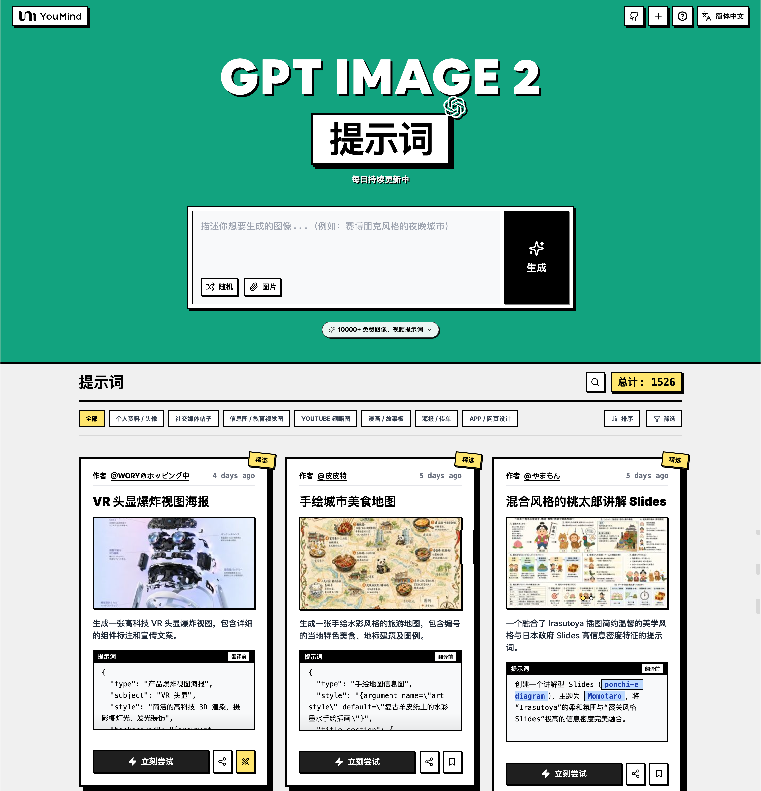

<a href="https://youmind.com/zh-TW/gpt-image-2-prompts">
  
</a>

> 💡 🎬 進階玩法：用 **Seedance 2** 把 GPT Image 2 生成的圖變成炸裂 AI 影片，2000+ 提示詞等你探索 👉 [awesome-seedance-2-prompts](https://github.com/YouMind-OpenLab/awesome-seedance-2-prompts)
# 🚀 GPT Image 2 提示詞大全

[](https://github.com/sindresorhus/awesome)
[](https://github.com/YouMind-OpenLab/awesome-gpt-image-2)
[](https://creativecommons.org/licenses/by/4.0/)
[](https://github.com/YouMind-OpenLab/awesome-gpt-image-2/actions)
[](docs/CONTRIBUTING.md)

> 🎨 OpenAI GPT Image 2 創意提示詞精選集合

> ⚠️ **版權聲明**：所有提示詞均收集自社區，僅供教育目的使用。如果您認為任何內容侵犯了您的權利，請[提交 issue](https://github.com/YouMind-OpenLab/awesome-gpt-image-2/issues/new?template=bug-report.yml)，我們將立即移除。

---

[](README.md) [](README_zh.md) [](README_zh-TW.md) [](README_ja-JP.md) [](README_ko-KR.md) [](README_th-TH.md) [](README_vi-VN.md) [](README_hi-IN.md) [](README_es-ES.md) [-Click%20to%20View-lightgrey)](README_es-419.md) [](README_de-DE.md) [](README_fr-FR.md) [](README_it-IT.md) [-Click%20to%20View-lightgrey)](README_pt-BR.md) [](README_pt-PT.md) [](README_tr-TR.md)

---

## 🌐 在網頁圖庫中查看

<div align="center">

[](https://youmind.com/zh-TW/gpt-image-2-prompts)

</div>

**[👉 瀏覽 YouMind GPT Image 2 提示詞圖庫](https://youmind.com/zh-TW/gpt-image-2-prompts)**

為什麼使用圖庫？

| Feature | GitHub README | youmind.com 圖庫 |
|---------|--------------|---------------------|
| 🎨 可視化佈局 | 線性列表 | 精美的瀑布流網格 |
| 🔍 搜索 | 僅 Ctrl+F | 全文搜索和篩選 |
| 🤖 AI 一鍵生圖 | - | AI 一鍵生圖 |
| 📱 移動端 | 基礎 | 完全響應式 |
| 🏷️ 分類 | - | 分類瀏覽 |


### 🏷️ 按分類瀏覽

- **使用情境**
  - [個人檔案 / 頭像](https://youmind.com/zh-TW/gpt-image-2-prompts?categories=profile-avatar)
  - [社群媒體貼文](https://youmind.com/zh-TW/gpt-image-2-prompts?categories=social-media-post)
  - [資訊圖表 / 教育視覺化內容](https://youmind.com/zh-TW/gpt-image-2-prompts?categories=infographic-edu-visual)
  - [YouTube 縮圖](https://youmind.com/zh-TW/gpt-image-2-prompts?categories=youtube-thumbnail)
  - [漫畫 / 分鏡腳本](https://youmind.com/zh-TW/gpt-image-2-prompts?categories=comic-storyboard)
  - [產品行銷](https://youmind.com/zh-TW/gpt-image-2-prompts?categories=product-marketing)
  - [電子商務主圖](https://youmind.com/zh-TW/gpt-image-2-prompts?categories=ecommerce-main-image)
  - [遊戲素材](https://youmind.com/zh-TW/gpt-image-2-prompts?categories=game-asset)
  - [海報／傳單](https://youmind.com/zh-TW/gpt-image-2-prompts?categories=poster-flyer)
  - [App / 網站設計](https://youmind.com/zh-TW/gpt-image-2-prompts?categories=app-web-design)
- **風格**
  - [攝影](https://youmind.com/zh-TW/gpt-image-2-prompts?categories=photography)
  - [電影感 / 電影劇照](https://youmind.com/zh-TW/gpt-image-2-prompts?categories=cinematic-film-still)
  - [動畫 / 漫畫](https://youmind.com/zh-TW/gpt-image-2-prompts?categories=anime-manga)
  - [插圖](https://youmind.com/zh-TW/gpt-image-2-prompts?categories=illustration)
  - [草圖 / 線稿](https://youmind.com/zh-TW/gpt-image-2-prompts?categories=sketch-line-art)
  - [漫畫 / 圖像小說](https://youmind.com/zh-TW/gpt-image-2-prompts?categories=comic-graphic-novel)
  - [3D 渲染](https://youmind.com/zh-TW/gpt-image-2-prompts?categories=3d-render)
  - [Q 版風格](https://youmind.com/zh-TW/gpt-image-2-prompts?categories=chibi-q-style)
  - [等距視角](https://youmind.com/zh-TW/gpt-image-2-prompts?categories=isometric)
  - [像素藝術](https://youmind.com/zh-TW/gpt-image-2-prompts?categories=pixel-art)
  - [油畫](https://youmind.com/zh-TW/gpt-image-2-prompts?categories=oil-painting)
  - [水彩](https://youmind.com/zh-TW/gpt-image-2-prompts?categories=watercolor)
  - [水墨 / 中式風格](https://youmind.com/zh-TW/gpt-image-2-prompts?categories=ink-chinese-style)
  - [復古 / 懷舊](https://youmind.com/zh-TW/gpt-image-2-prompts?categories=retro-vintage)
  - [賽博龐克 / 科幻](https://youmind.com/zh-TW/gpt-image-2-prompts?categories=cyberpunk-sci-fi)
  - [極簡主義](https://youmind.com/zh-TW/gpt-image-2-prompts?categories=minimalism)
- **主體**
  - [人像 / 自拍](https://youmind.com/zh-TW/gpt-image-2-prompts?categories=portrait-selfie)
  - [網紅 / 模特兒](https://youmind.com/zh-TW/gpt-image-2-prompts?categories=influencer-model)
  - [角色](https://youmind.com/zh-TW/gpt-image-2-prompts?categories=character)
  - [團體 / 情侶](https://youmind.com/zh-TW/gpt-image-2-prompts?categories=group-couple)
  - [產品](https://youmind.com/zh-TW/gpt-image-2-prompts?categories=product)
  - [食物 / 飲品](https://youmind.com/zh-TW/gpt-image-2-prompts?categories=food-drink)
  - [時尚單品](https://youmind.com/zh-TW/gpt-image-2-prompts?categories=fashion-item)
  - [動物 / 生物](https://youmind.com/zh-TW/gpt-image-2-prompts?categories=animal-creature)
  - [車輛](https://youmind.com/zh-TW/gpt-image-2-prompts?categories=vehicle)
  - [建築 / 室內設計](https://youmind.com/zh-TW/gpt-image-2-prompts?categories=architecture-interior)
  - [風景 / 大自然](https://youmind.com/zh-TW/gpt-image-2-prompts?categories=landscape-nature)
  - [城市景觀 / 街道](https://youmind.com/zh-TW/gpt-image-2-prompts?categories=cityscape-street)
  - [圖表](https://youmind.com/zh-TW/gpt-image-2-prompts?categories=diagram-chart)
  - [文字 / 字體排版](https://youmind.com/zh-TW/gpt-image-2-prompts?categories=text-typography)
  - [摘要 / 背景](https://youmind.com/zh-TW/gpt-image-2-prompts?categories=abstract-background)

---

## 📖 目錄

- [🌐 在網頁圖庫中查看](#-view-in-web-gallery)
- [🤔 什麼是 GPT Image 2？](#-what-is-gpt-image-2)
- [📊 統計數據](#-statistics)
- [🔥 精選提示詞](#-featured-prompts)
- [📋 所有提示詞](#-all-prompts)
- [🤝 如何貢獻](#-how-to-contribute)
- [📄 許可證](#-license)
- [🙏 致謝](#-acknowledgements)
- [⭐ Star 歷史](#-star-history)

---

## 🤔 什麼是 GPT Image 2？

**GPT Image 2**（代號 **"duct-tape"**）是 OpenAI 下一代圖像生成模型。社群測試回饋它在以下方面實現了質的飛躍：

- 🎯 **像素級文字渲染** — 中文、英文、日文均達到 native 水準，無錯字、無字形扭曲
- 🎨 **跨圖像素級一致性** — 同一角色、風格、IP 在多張圖間保持像素級一致
- ⚡ **商用級插畫質量** — 插畫風格輸出無需人工精修，即可直接用於商業場景
- 🌈 **真實藝術風格注入** — 不止是「模仿參考圖」，而是真正理解並再現藝術風格的靈魂
- 🔧 **故事板與產品系列** — 適合故事板、IP 形象、產品系列圖等需要多圖一致性的場景
- 📐 **多語言平面設計** — 社交卡片、Banner、海報一次生圖即可完成多語言文字排版

📚 **了解更多：** 查看社群測試 [報告要點](docs/FAQ.md)

### 🚀 Raycast 集成

部分提示詞支持使用 [Raycast Snippets](https://raycast.com/help/snippets) 語法的**動態參數**。尋找 🚀 Raycast Friendly 徽章！

**示例：**
```
A quote card with "{argument name="quote" default="Stay hungry, stay foolish"}"
by {argument name="author" default="Steve Jobs"}
```

在 Raycast 中使用時，您可以動態替換參數以快速迭代！

---

## 📊 統計數據

<div align="center">

| 指標 | 數量 |
|--------|-------|
| 📝 提示詞總數 | **18102** |
| ⭐ 精選 | **6** |
| 🔄 最後更新 | **2026年11月7日 星期六 下午5:07:24 [UTC]** |

</div>

---

## 🔥 精選提示詞

> ⭐ 由我們的團隊精心挑選，具有卓越的質量和創造力

### No. 1: VR 頭戴裝置爆炸圖海報


#### 📖 描述

生成一張高科技 VR 頭戴裝置爆炸圖，包含詳細的組件標註與宣傳文案。

#### 📝 提示詞

```
{
  "type": "產品爆炸圖海報",
  "subject": "VR 頭戴裝置",
  "style": "簡潔的高科技 3D 渲染，攝影棚燈光，發光細節",
  "background": "{argument name=\"background color\" default=\"柔和的紫藍色漸層\"}",
  "header": {
    "logo": "∞ {argument name=\"product name\" default=\"Meta Quest 3\"}",
    "subtitle": "{argument name=\"main catchphrase\" default=\"以全新的結構，定義全新的現實。\"}"
  },
  "layout": {
    "centerpiece": "垂直堆疊的 VR 頭戴裝置爆炸圖，展示 9 個不同的內部組件層：外殼、攝影機感測器、主機板與晶片、Pancake 透鏡、內部框架、電池組、側邊頭帶、頂部頭帶以及面部襯墊。",
    "callout_labels": {
      "count": 8,
      "left_side": [
        "Snapdragon® XR2 Gen 2\n以強大的處理效能，實現即時體驗。",
        "可調式 IPD 機構\n為廣大用戶提供舒適的配戴感。",
        "精密設計頭帶\n追求舒適與穩定性的工學設計。"
      ],
      "right_side": [
        "前飾板\n洗鍊的設計與最佳的重量平衡。",
        "追蹤攝影機\n實現高精度的位置追蹤與環境感知。",
        "Pancake 透鏡\n輕薄設計，提供寬廣視野與清晰影像。",
        "高效能電池\n支援長時間運作的最佳化電源設計。",
        "柔軟面部襯墊\n即使長時間配戴也能保持舒適。"
      ]
    },
    "footer": {
      "left_text_block": {
        "headline": "{argument name=\"bottom headline\" default=\"體驗，從結構進化。\"}",
        "body": "每一個零件都蘊含著支撐沉浸式體驗的尖端科技與匠心設計。Meta Quest 3 從內部結構開始，為您創造感受未來的體驗。"
      },
      "right_logo": "∞ Meta"
    }
  }
}
```

#### 🖼️ 生成圖片

##### Image 1

<div align="center">

</div>

#### 📌 詳情

- **作者:** [wory＠ホッピング中](https://x.com/wory37303852)
- **來源:** [Twitter Post](https://x.com/wory37303852/status/2045925660401795478#reversed-0)
- **發布時間:** 2026年4月19日
- **多語言:** en

**[👉 立即嘗試 →](https://youmind.com/zh-TW/gpt-image-2-prompts?id=13460)**

---

### No. 2: 手繪城市美食地圖


#### 📖 描述

生成一張手繪水彩風格的旅遊地圖，包含編號的在地特色美食、地標以及圖例。

#### 📝 提示詞

```
{
  "type": "手繪地圖資訊圖表",
  "style": "{argument name=\"art style\" default=\"復古羊皮紙上的水彩與墨水手繪插圖\"}",
  "title_section": {
    "text": "{argument name=\"city name\" default=\"成都\"} {argument name=\"map title\" default=\"吃貨暴走地圖\"}",
    "mascot": "戴著太陽眼鏡並比讚的卡通紅辣椒"
  },
  "border": "{argument name=\"border decoration\" default=\"綠葉與紅辣椒藤蔓\"}",
  "layout": {
    "background": "帶有黃色道路、藍色河流與綠色公園區域的質感米色羊皮紙",
    "sections": [
      {
        "title": "地標",
        "count": 6,
        "illustrations": ["傳統涼亭", "傳統寺院", "攀爬著熊貓的現代摩天大樓", "高聳電視塔", "傳統牌樓", "工業建築"],
        "labels": ["人民公園", "文殊院", "IFS", "339電視塔", "寬窄巷子", "東郊記憶"]
      },
      {
        "title": "美食景點",
        "count": 12,
        "illustrations": ["麻婆豆腐", "紅油水餃", "串串香", "三大炮", "蛋烘糕", "九宮格火鍋", "肥腸粉", "缽缽雞", "冒椒火辣", "蓋碗茶", "冰粉", "雙流老媽兔頭"],
        "labels": ["1 陳麻婆豆腐", "2 鍾水餃", "3 春熙路", "4 寬窄巷子·三大炮", "5 建設路·葉婆婆蛋烘糕", "6 玉林路·小龍坎火鍋", "7 香香巷·肥腸粉", "8 武侯祠大街·缽缽雞", "9 東郊記憶·冒椒火辣", "10 人民公園·鶴鳴茶社", "11 錦里古街·冰粉", "12 雙流老媽兔頭"]
      },
      {
        "title": "圖例",
        "position": "右下角",
        "count": 5,
        "items": ["紅點", "綠色房屋", "綠樹", "藍線", "黃色雙線"],
        "labels": ["美食地點", "地標景點", "公園綠地", "河流湖泊", "主要道路"]
      }
    ],
    "centerpiece": "坐著吃竹子的巨型熊貓",
    "bottom_right_extras": ["帶有 N、S、E、W 的復古羅盤玫瑰", "免責聲明文字『溫馨提示：吃辣需謹慎，腸胃要保護~』並附帶一個紅辣椒圖示"]
  }
}
```

#### 🖼️ 生成圖片

##### Image 1

<div align="center">

</div>

#### 📌 詳情

- **作者:** [皮皮特](https://x.com/mm_zzm44854)
- **來源:** [Twitter Post](https://x.com/mm_zzm44854/status/2045861258520568230#reversed-1)
- **發布時間:** 2026年4月19日
- **多語言:** en

**[👉 立即嘗試 →](https://youmind.com/zh-TW/gpt-image-2-prompts?id=13515)**

---

### No. 3: 採用混合風格的桃太郎說明用 Slides


#### 📖 描述

這是一個結合了「いらすとや (Irasutoya)」插圖簡約溫暖的美學，以及日本政府簡報高資訊密度特徵的提示詞。

#### 📝 提示詞

```
請為 {argument name="theme" default="桃太郎"} 製作一張說明用 Slides ({argument name="format" default="ポンチ絵 (ponchi-e) 圖表"})，將「いらすとや (Irasutoya)」的溫和氛圍與「霞關風格 (Kasumigaseki slides)」那種壓倒性的資訊密度融合在一起。
```

#### 🖼️ 生成圖片

##### Image 1

<div align="center">

</div>

##### Image 2

<div align="center">

</div>

#### 📌 詳情

- **作者:** [やまもん](https://x.com/yammamon)
- **來源:** [Twitter Post](https://x.com/yammamon/status/2045778624092254603)
- **發布時間:** 2026年4月19日
- **多語言:** ja

**[👉 立即嘗試 →](https://youmind.com/zh-TW/gpt-image-2-prompts?id=13983)**

---

### No. 4: 電子商務直播 UI 模型


#### 📖 描述

生成逼真的社群媒體直播介面並疊加在肖像上，包含可自訂的聊天訊息、禮物彈出視窗以及商品購買卡片。

#### 📝 提示詞

```
{
  "type": "直播 UI 模型",
  "subject": {
    "description": "{argument name=\"host name\" default=\"Elon Musk\"} 的肖像，微笑，穿著印有白色技術示意圖的黑色 T 恤",
    "background": "左側顯示帶有 '{argument name=\"left background logo\" default=\"SPACEX\"}' 文字的螢幕，右側顯示紅色的 '{argument name=\"right background logo\" default=\"Tesla T logo\"}' 和一輛深色汽車"
  },
  "ui_overlay": {
    "top_header": {
      "host_info": "頭像，名稱 '{argument name=\"host name\" default=\"Elon Musk\"}'，副標題 '55.6 萬本場點讚'，紅色 '關注' 按鈕",
      "rank_badge": "帶有 '全站第 1 名' 的金幣圖示",
      "viewer_stats": "3 個頂級觀眾頭像，分別顯示 '12.3w'、'8.6w'、'5.7w'，總計 '68.7 萬'，'X' 關閉按鈕",
      "right_links": "'更多直播 >'，'禮物展館 0/24' 帶有藍色 '經典' 標籤"
    },
    "mid_left_gifts": {
      "count": 2,
      "items": [
        "頭像 '科技愛好者'，'送小心心'，愛心圖示 x 1314",
        "頭像 '星辰大海'，'送火箭'，火箭圖示 x 666"
      ]
    },
    "bottom_left_chat": {
      "system_message": "等級 37 徽章 '宇宙漫遊者 加入了直播間'",
      "message_count": 7,
      "messages": [
        "小火箭: 馬斯克！未來可期！🚀",
        "future: 特斯拉 Model 2 什麼時候出？",
        "星空夢想家: SpaceX 今年能上火星嗎？",
        "AI 探索者: Neuralink 進展如何？",
        "帥氣的網友: 馬總好！",
        "Mars: 第一次來你的直播，超激動！",
        "用戶 123: 講講 AI 吧，會取代人類嗎？"
      ]
    },
    "bottom_right_product_card": {
      "hot_tag": "橘色 '熱賣 x 1888'",
      "image": "Tesla Cybertruck",
      "title": "{argument name=\"product name\" default=\"特斯拉 Cybertruck 電動皮卡\"}",
      "price": "{argument name=\"product price\" default=\"¥ 1,618,000\"}",
      "button": "紅色 '搶' 按鈕",
      "floating_animation": "半透明愛心沿著右側邊緣向上飄浮"
    },
    "bottom_bar": {
      "input_field": "'說點什麼...'",
      "icons": ["笑臉", "三個點", "購物車", "禮物盒", "分享"]
    }
  }
}
```

#### 🖼️ 生成圖片

##### Image 1

<div align="center">

</div>

#### 📌 詳情

- **作者:** [神经病不想好转](https://x.com/sjbbxhz)
- **來源:** [Twitter Post](https://x.com/sjbbxhz/status/2045684734714380687#reversed-0)
- **發布時間:** 2026年4月19日
- **多語言:** en

**[👉 立即嘗試 →](https://youmind.com/zh-TW/gpt-image-2-prompts?id=14036)**

---

### No. 5: 動漫武術對決


#### 📖 描述

生成一個動態的動漫風格動作場景，描繪兩名角色在傳統道場中伴隨元素光環進行戰鬥。

#### 📝 提示詞

```
一張極具動態感的動漫插圖，描繪兩名少女在傳統木造道場內進行激烈的武術對決。在前景中，一名留著 {argument name="character 1 hair" default="黑色高包頭配紅色髮帶"} 的少女擺出強而有力的低位武術架勢，奮力向前揮拳。她身穿 {argument name="character 1 outfit" default="白色中式上衣配紅色流蘇與寬鬆紅褲"}，強烈的紅色能量斬擊環繞著她揮動的四肢。在右側半空中，一名留著 {argument name="character 2 hair" default="淺紫色雙包頭"} 的少女優雅地躍起，自信地微笑著，身穿 {argument name="character 2 outfit" default="深綠色刺繡金邊洋裝與黑色緊身褲"}，伴隨著如水流般掃過的藍色能量軌跡。背景為古樸的木造寺廟內部，上方懸掛著一塊顯眼的招牌，寫著「{argument name="sign text" default="武術会"}」。場景充滿了爆炸性的動作張力、飛揚的塵土、碎裂的木質地板、閃耀的彩色粒子特效，以及將角色與細緻背景完美區隔的戲劇性低角度光影。
```

#### 🖼️ 生成圖片

##### Image 1

<div align="center">

</div>

#### 📌 詳情

- **作者:** [たねもみ 2.0 / Tanemomi Ver2.0](https://x.com/Tanemomi_Ver2)
- **來源:** [Twitter Post](https://x.com/Tanemomi_Ver2/status/2046063806846214265#reversed-0)
- **發布時間:** 2026年4月20日
- **多語言:** en

**[👉 立即嘗試 →](https://youmind.com/zh-TW/gpt-image-2-prompts?id=13467)**

---

### No. 6: 3D 石階演化資訊圖表


#### 📖 描述

將平面的演化時間軸轉換為逼真的 3D 石階資訊圖表，包含細緻的生物渲染圖與結構化的側邊欄。

#### 📝 提示詞

```
{
  "type": "演化時間軸資訊圖表",
  "instruction": "以 REFERENCE_0 作為結構基礎，將平面向量設計轉換為高度逼真的 3D 資訊圖表。將平滑的坡道替換為層次分明的石階，並將所有生物升級為照片級的 3D 模型。",
  "style": {
    "background": "{argument name=\"background style\" default=\"復古紋理羊皮紙\"}",
    "staircase": "{argument name=\"staircase material\" default=\"逼真的紋理石塊\"}",
    "subjects": "{argument name=\"organism style\" default=\"高度細緻的照片級 3D 渲染圖\"}"
  },
  "layout": {
    "main_title": "{argument name=\"main title\" default=\"人類演化\"}",
    "sections": [
      {
        "position": "左側邊欄",
        "count": 8,
        "labels": ["L0: 單細胞生命", "L1: 多細胞生物", "L2: 動物界", "L3: 脊索動物", "L4: 上陸革命", "L5: 哺乳綱", "L6: 人科演化", "L7: 智人紀元"]
      },
      {
        "position": "右上角",
        "title": "獲得的功能 / 失去的功能",
        "description": "帶有加號與減號圖示的圖例"
      },
      {
        "position": "底部中央",
        "title": "演化關鍵里程碑",
        "count": 6,
        "description": "包含 6 個展示猿類到人類演化剪影圖的時間軸"
      }
    ],
    "centerpiece": {
      "description": "蜿蜒的石階，共有 25 個編號階梯，展示特定生物。",
      "count": 25,
      "notable_elements": [
        "第 07 階：水母",
        "第 09 階：菊石",
        "第 10 階：三葉蟲",
        "第 24 階：直立行走的人類",
        "第 25 階：{argument name=\"future evolution concept\" default=\"帶有問號的發光宇宙剪影\"}"
      ]
    }
  }
}
```

#### 🖼️ 生成圖片

##### Image 1

<div align="center">

</div>

#### 📌 詳情

- **作者:** [知识猫图解](https://x.com/GeekCatX)
- **來源:** [Twitter Post](https://x.com/GeekCatX/status/2045792240044511277#reversed-1)
- **發布時間:** 2026年4月19日
- **多語言:** en

**[👉 立即嘗試 →](https://youmind.com/zh-TW/gpt-image-2-prompts?id=13491)**

---

## 📋 所有提示詞

> 📝 按發布日期排序（最新優先）

### No. 1: 個人檔案 / 頭像 - 臥室自拍人像提示詞


#### 📖 描述

用於生成一位長捲髮、身穿粉紅睡衣與開襟毛衣的年輕東亞女性在舒適寫實臥室中自拍照的提示詞。

#### 📝 提示詞

```
【整體風格】

1:1 正方形構圖，單一獨立畫面，超寫實韓系成年女性室內人像攝影，溫柔甜美的少女感，奶油粉色調，擬真近距離手機自拍，柔和自然光，輕微柔焦，保留真實攝影質感。

【五官特徵】

23 至 25 歲的漂亮東亞成年女性，精緻小巧的鵝蛋臉，下顎線條柔和流暢，下巴圓潤小巧，膚質清透細膩的冷白皮。

明亮清澈的深棕色圓杏眼，自然雙眼皮，飽滿柔和的臥蠶，纖長捲翹的睫毛，細緻的淺粉棕色眼妝。

鼻樑細挺，鼻尖小巧，雙頰帶有明顯卻自然暈染的蜜桃粉色腮紅。

柔軟飽滿的櫻花玫瑰粉色唇瓣，呈現水潤精緻的玻璃唇光澤。

雙唇自然微張，眼神溫柔直視鏡頭，神情恬靜、甜美且帶點慵懶，保留自然的肌膚微紋理。

【髮型 - 核心】

極度濃密蓬鬆的深黑茶色及腰長髮，散發自然的深巧克力棕色光澤。

頭頂自然蓬鬆，採用中分髮型，額前留有輕盈凌亂的空氣碎瀏海。

兩側長髮自然垂落於肩膀與胸前，帶有柔和寬鬆的大弧度波浪捲。

幾縷纖細髮絲自然散落於額前與臉頰，髮量層次豐富，保留真實的獨立髮絲感與自然凌亂度。

【服裝與飾品】

身穿淺櫻花粉色細肩帶小可愛上衣，柔軟棉質彈性布料，簡約的圓弧領口。

外搭奶油白色寬鬆針織開襟衫，質地細緻柔軟，前襟自然敞開，長袖微微蓋住手腕。

配戴小巧的白色珍珠耳環與極細的銀色鎖骨鍊。

【人物姿勢】

人物坐在臥室床沿，上半身自然微向前傾，身體正面朝向鏡頭。

頭部輕輕歪斜，下巴微收，雙眼直視鏡頭。

畫面左側的手舉至髮際旁，手指自然彎曲，輕輕撥弄耳畔的長髮。

另一隻手輕托臉頰，掌心自然貼合下顎邊緣，手指柔軟舒展。

雙手姿態放鬆自然，營造出溫柔親暱的自拍氛圍。

【背景環境】

溫馨簡約的粉色調臥室，人物身後是一張鋪著淺櫻花粉色床單的大床，搭配粉色枕頭與奶油白色寢具。

背景為淺粉米色牆面與簡約床頭板，整體環境柔和、乾淨且舒適。

【鏡頭與光線】

1:1 正方形比例，等效 35 至 50mm 鏡頭，近距離胸部以上的半身特寫，平視視角。

人物臉部置於畫面中央，頭頂貼近畫面上緣，雙手自然環繞臉頰構圖。

柔和的冷白正面補光均勻照亮臉部、雙唇與雙手，膚色清透自然。

背景保留淡淡的暖粉色環境光，形成柔和的冷暖對比。

低飽和度的奶油粉色調，細膩真實的皮膚質感，高光柔和，帶有輕微相機顆粒感，不過度磨皮，也不過度銳化。

【反向提示詞】

動漫、插畫、3D 渲染、CG 假臉、塑膠肌、過度磨皮、眼睛異常放大、下巴過尖、五官錯位、假髮、頭髮結塊、僵硬捲髮、多餘手指、手掌變形、手腕扭曲、身材比例異常、衣物穿模、嚴重過曝、強烈 HDR、過度銳化、明顯 AI 感、文字、浮水印、LOGO、拼貼圖。
```

#### 🖼️ 生成圖片

##### Image 1

<div align="center">

</div>

#### 📌 詳情

- **作者:** [沧瑶](https://x.com/CryY666666)
- **來源:** [Twitter Post](https://x.com/CryY666666/status/2118790521837769129)
- **發布時間:** 2026年11月6日
- **多語言:** zh

**[👉 立即嘗試 →](https://youmind.com/zh-TW/gpt-image-2-prompts?id=37386)**

---

### No. 2: 個人檔案 / 頭像 - 柔和特寫：年輕女性人像


#### 📖 描述

生成一張逼真的高調特寫人像，呈現一位留著深色頭髮、化著自然妝容並微笑的年輕女性，背景為純白色。

#### 📝 提示詞

```
一張擬真風格的年輕東亞女性特寫肖像，肌膚白皙細緻，深棕色長直髮自然垂落於雙肩。她微微側首低垂目光，嘴角帶著溫柔淺笑，散發出寧靜而溫暖的氣息。光線明亮柔和且採高調（high-key）打光，營造出乾淨清透的氛圍與柔美的陰影。妝容自然水潤，唇瓣與雙頰點綴著淡雅粉嫩色澤。背景為素面失焦的白色或淺灰色，藉此突顯人物的五官輪廓。
```

#### 🖼️ 生成圖片

##### Image 1

<div align="center">

</div>

#### 📌 詳情

- **作者:** [Kevin Tech Labs](https://x.com/HongyeMain)
- **來源:** [Twitter Post](https://x.com/HongyeMain/status/2117775627839553765#reversed-0)
- **發布時間:** 2026年11月4日
- **多語言:** en

**[👉 立即嘗試 →](https://youmind.com/zh-TW/gpt-image-2-prompts?id=37299)**

---

### No. 3: 個人檔案 / 頭像 - GPT Image 韓風人像


#### 📖 描述

生成年輕女性韓式室內寫實人像的詳細提示詞。

#### 📝 提示詞

```
[整體風格]
9:16 直式構圖，單一獨立場景，超寫實韓系成年女性室內生活照，清冷溫柔的空氣感，低飽和奶油粉與冷藍灰色調，柔和自然窗光，輕微底片柔焦效果，真實相機攝影質感。

[五官特徵]
23-25 歲的東亞成年美女，精緻小巧的鵝蛋臉，下顎線條柔和流暢，下巴小巧圓潤，清透冷白瓷肌，雙頰帶有淡淡蜜桃粉色紅暈。
明亮清澈的深灰棕色杏仁眼，自然雙眼皮，細緻臥蠶，纖長自然的睫毛，淺粉棕色眼影，眼尾微微上揚的眼線。
鼻樑細挺，鼻頭小巧，雙唇柔軟豐潤，呈現玫瑰豆沙粉色且水潤有光澤。
雙唇自然閉合，神情溫柔清冷，帶點慵懶氣息，眼神靜靜直視鏡頭，保留真實肌膚的微觀紋理。

[髮型]
濃密蓬鬆的烏黑及腰長髮，散發自然的深黑茶色光澤，頭頂具備真實的空氣感。
自然中分，額前有輕盈不規則的八字碎瀏海，幾根細碎髮絲輕輕拂過額頭與臉頰。
長髮自然垂落於肩膀與胸前，整體柔順，髮尾帶有鬆散的大弧度捲曲，保留真實的根根分明髮絲與自然蓬鬆感。

[服裝與飾品]
身穿淺櫻花粉細肩帶貼身短版上衣，柔軟棉質布料，簡約淺圓領設計。
外搭奶油白寬鬆針織開襟衫，前襟自然敞開，衣袖鬆垮垂落至上手臂處，露出自然的肩頸與鎖骨線條。
配戴小巧銀色圈狀耳環與精緻的銀色細手鍊。

[姿勢]
人物坐在臥室窗邊的梳妝台前，身體微微轉向鏡頭，雙肩自然放鬆。
頭部輕輕傾斜，下巴微收，雙眼直視鏡頭。
雙手自然抬至胸前，一手輕攏肩前的長髮，另一手輕柔整理髮尾。
姿態溫柔放鬆，手部結構精準，動作自然流暢。

[背景環境]
現代簡約的淺灰白色臥室，畫面左側為明亮的大窗戶，窗台上擺放著一束淺粉與奶油白色的花束。
畫面右側為白色梳妝台，檯面上放置化妝刷、粉餅、保養品及部分彩妝用品。
梳妝台上方懸掛一面大圓鏡，隱約映照出人物的背影與烏黑長髮。
背景充滿真實的生活氣息，整體乾淨、柔和且自然。

[鏡頭與光影]
9:16 直式構圖，等效 35-50mm 鏡頭，平視視角拍攝，人物置中，採頭部至腰部的半身構圖。
柔和的冷白自然窗光從畫面左側灑入，臉部明亮清晰，肌膚呈現自然的冷白色調。
髮絲帶有細膩的深棕色反光，窗框邊緣與明亮背景略微泛出光暈。
整體採用低對比冷藍灰調色，陰影柔和，帶有輕微底片顆粒感與自然的光學柔焦效果。
保留真實肌膚紋理、細碎髮絲、自然布料皺褶與真實空間透視，避免過度磨皮與明顯的 AI 生成痕跡。

[反向提示詞]
動漫、插畫、3D 渲染、CG 假臉、塑膠肌、過度磨皮、誇張網紅臉、眼睛異常放大、下巴過尖、五官錯位、假髮、頭髮毛躁打結、手指變形、多餘手指、手部結構錯誤、身材比例異常、衣物穿模錯誤、鏡中倒影變形、鏡像反射錯誤、化妝品糊成一團、嚴重過曝、強烈 HDR、過度銳化、商業棚拍燈光、明顯 AI 感、文字、浮水印、LOGO、拼貼圖。
```

#### 🖼️ 生成圖片

##### Image 1

<div align="center">

</div>

#### 📌 詳情

- **作者:** [沧瑶](https://x.com/CryY666666)
- **來源:** [Twitter Post](https://x.com/CryY666666/status/2117284530839232946)
- **發布時間:** 2026年11月2日
- **多語言:** zh

**[👉 立即嘗試 →](https://youmind.com/zh-TW/gpt-image-2-prompts?id=37243)**

---

### No. 4: 個人檔案 / 頭像 - GPT Image 客廳人像


#### 📖 描述

現代客廳場景中女性寫實人像的 GPT Image 提示詞。

#### 📝 提示詞

```
[整體風格]
1:1 正方形構圖，單一獨立場景，超寫實韓系成年女性室內人像攝影，清冷溫柔氣質，奶油白現代客廳，柔和自然補光，低飽和灰藍色調，真實相機質感，輕微自然柔焦。

[五官特徵]
23-25 歲絕美東亞成年女性，精緻小巧鵝蛋臉，下顎線條柔和流暢，下巴圓潤小巧，清透冷白瓷肌，淺蜜桃粉色腮紅。
明亮清澈的深棕色杏仁眼，自然雙眼皮，精緻臥蠶，纖長捲翹睫毛，眼尾微微上揚的眼線，鼻樑細挺筆直。
柔軟飽滿的玫瑰豆沙粉色水潤雙唇，嘴唇自然微張，嘴角輕輕上揚，眼神溫柔直視鏡頭，保留細膩真實的肌膚紋理。

[髮型 - 核心]
極濃密柔順的烏黑及腰長髮，呈現自然的深黑茶色光澤，頭頂蓬鬆，側分髮型，髮根帶有真實空氣感。
長髮以柔順直髮為主，髮尾帶有輕微自然弧度，自然垂落於雙肩與胸前兩側。
額前散落幾縷細碎髮絲，右耳上方（畫面右側）配戴精緻銀色水晶花朵髮夾，頭髮自然收攏至耳後。
呈現真實髮絲感，光澤柔和，避免假髮質感。

[服裝與飾品]
身穿淺冰灰藍色一字領毛絨針織毛衣，柔軟蓬鬆的馬海毛材質，針織紋理細膩，寬鬆不對稱領口自然滑落，露出右肩（畫面右側）與鎖骨。
長袖設計，袖口寬鬆柔軟，帶有自然褶皺。
配戴白色珍珠耳釘與精緻銀色水晶細手鍊。

[姿勢]
人物坐在奶油白沙發上，身體微側面向鏡頭，上半身自然前傾。
頭部輕輕偏向畫面左側（畫面左方），下巴微收。
左手（畫面左側）輕托下巴，手指自然彎曲；另一隻手抬至肩膀旁，輕握一束烏黑長髮。
雙肩放鬆，姿態自然優雅，眼神清冷溫柔。

[背景與光影]
現代簡約奶油白客廳，身後為柔和米色布藝沙發、淺米色牆面，右上角透出柔和暖黃色燈光。
正面冷白柔光補光照亮臉部，肌膚呈現清透冷白色調，背景保留溫暖柔和的環境光。
等效 50mm 人像鏡頭，近距離半身構圖，人物置中，臉部清晰，背景輕微自然虛化。
真實攝影曝光，髮絲細緻分明，眼神清澈，膚質柔和，帶有輕微自然顆粒感，無明顯 AI 生成感。

[反向提示詞]
動漫、插畫、3D 渲染、CG 假臉、塑膠肌、過度磨皮、誇張大眼、尖銳下巴、五官錯位、假髮、毛躁打結髮質、僵硬髮絲、多餘手指、手掌畸形、肩膀脫臼、身材比例異常、一字領結構錯誤、衣物穿模、過度銳化、強烈 HDR、嚴重過曝、明顯 AI 感、文字、浮水印、LOGO、拼貼。
```

#### 🖼️ 生成圖片

##### Image 1

<div align="center">

</div>

#### 📌 詳情

- **作者:** [沧瑶](https://x.com/CryY666666)
- **來源:** [Twitter Post](https://x.com/CryY666666/status/2117219660366262436)
- **發布時間:** 2026年11月2日
- **多語言:** zh

**[👉 立即嘗試 →](https://youmind.com/zh-TW/gpt-image-2-prompts?id=37246)**

---

### No. 5: 個人檔案 / 頭像 - 神社前的昭和復古風人像


#### 📖 描述

一張充滿懷舊氛圍與底片顆粒感的肖像照，描繪一位身穿碎花洋裝的年輕女子佇立於日本神社前，營造出昭和時代特有的憂鬱氣息。

#### 📝 提示詞

```
一張直式人像照，畫面中是一位年輕的東亞女性，留著深色短鮑伯頭與瀏海，站在戶外的日本傳統神社前。她身穿一件灰藍色復古風小碎花中長版洋裝，搭配彼得潘領、短袖與前開扣式上身設計。她的神情帶著一絲憂鬱與疏離，目光微微偏向鏡頭之外，雙手輕柔地交握在腰前。背景是朱紅色的神社建築（鳥居與塔樓屋頂）以及石燈籠，皆以失焦方式呈現。她腳下的地面可見斑馬線的白色條紋。整張影像散發濃厚的昭和復古氛圍，色調溫暖且帶有底片褪色的質感，並保留了明顯的顆粒感、邊緣漏光，以及老式拍立得照片常見的刮痕。
```

#### 🖼️ 生成圖片

##### Image 1

<div align="center">

</div>

#### 📌 詳情

- **作者:** [いがぐりメタボ](https://x.com/Kmsbdd0GXBOcrXQ)
- **來源:** [Twitter Post](https://x.com/Kmsbdd0GXBOcrXQ/status/2116849131599933528#reversed-0)
- **發布時間:** 2026年11月1日
- **多語言:** en

**[👉 立即嘗試 →](https://youmind.com/zh-TW/gpt-image-2-prompts?id=37213)**

---

### No. 6: 個人檔案 / 頭像 - 異想天開的剪貼簿彩色鉛筆插畫


#### 📖 描述

此提示詞可將上傳的照片轉化為溫馨、異想天開的手繪彩色鉛筆與蠟筆剪貼簿插畫，在保留原始主體與構圖的同時，增添裝飾性邊框與復古紋理。

#### 📝 提示詞

```
將上傳的照片轉換成一幅美麗、溫馨又充滿童趣的「手繪色鉛筆與蠟筆剪貼簿插畫」。

重要提醒 — 請保留原始照片內容：

首先，請仔細分析上傳的照片。辨識出實際的主體、人物、五官特徵、髮型、服裝、姿勢、表情、配件、物品、背景與周遭環境。

將同一張照片重新繪製成迷人的插畫作品。請保留原始的構圖、可辨識的面部特徵、服裝細節、身體姿態與互動方式，切勿隨意替換或憑空捏造主要主體。

藝術風格：
- 道地的手繪色鉛筆與蠟筆插畫。
- 清晰可見的筆觸、顆粒質感與不完美的素描線條。
- 柔和如水彩般的上色，搭配豐富的色鉛筆陰影。
- 細膩的交叉排線與層層堆疊的手繪細節。
- 略帶粗糙感、充滿懷舊氣息的童話故事書插畫美學。
- 溫暖、夢幻、舒適且天馬行空的氛圍。
- 奶油色質感紙張背景。
- 柔和的光線，帶有暖色調的高光與輕柔的陰影。
- 飽和卻微微褪色的復古色彩。

剪貼簿裝飾：

在主要插畫周圍加上俏皮的手作剪貼簿邊框，包含以下元素：
- 粉色與紅色的亮片愛心貼紙。
- 小巧的彩色寶石與珍珠串珠。
- 金色星星與水晶裝飾。
- 迷你手繪花朵與蝴蝶。
- 可愛塗鴉、笑臉與小星星。
- 小型裝飾葉片與季節性元素。
- 多彩的手繪輪廓與俏皮符號。

請讓這些裝飾看起來就像真實的實體貼紙與小綴飾，自然地散落在作品邊緣。

構圖：

讓主要主體維持在畫面視覺中心。運用細緻的色鉛筆紋理重現原始場景。裝飾性的剪貼簿元素請集中安排在四周外圍，避免遮擋照片中的重要部分。

整幅作品應該要像是一頁精心裝飾的個人日記，或是充滿回憶的懷舊手繪紀念冊。

最終美感呈現：

極致細膩、討喜、溫馨、懷舊、富有藝術感；柔和的復古剪貼簿美學、手作插畫、明顯的蠟筆顆粒感、色鉛筆紋理、精緻的不完美痕跡、溫暖的粉彩色調、迷人的裝飾點綴、高質感的插畫日記頁面。

重要提醒：成果必須看起來像是完全手繪的插畫，而不是套用卡通濾鏡的照片。請避免寫實攝影感、3D 渲染、塑膠質感以及過度平滑的數位繪畫效果。
```

#### 🖼️ 生成圖片

##### Image 1

<div align="center">

</div>

##### Image 2

<div align="center">

</div>

##### Image 3

<div align="center">

</div>

#### 📌 詳情

- **作者:** [Sairah](https://x.com/Sairah_0)
- **來源:** [Twitter Post](https://x.com/Sairah_0/status/2116773143691878877)
- **發布時間:** 2026年11月1日
- **多語言:** en

**[👉 立即嘗試 →](https://youmind.com/zh-TW/gpt-image-2-prompts?id=37163)**

---

### No. 7: 個人檔案 / 頭像 - 荷葉邊婚紗動漫新娘


#### 📖 描述

生成一位身穿精緻荷葉邊婚紗、帶有花卉細節的優雅新娘全身動漫風格肖像，適用於角色設計或浪漫插畫專案。

#### 📝 提示詞

```
全身動漫風格插畫，描繪一位美麗的新娘站在純白背景前。她留著深棕色頭髮，梳成優雅的盤髮，臉龐兩側垂落幾縷瀏海，頭上點綴著精緻的花卉頭飾，並配戴長款垂墜耳環。雙眼大而靈動，妝容淡雅，神情柔和且充滿自信。婚紗細節極為豐富：無肩帶心形領口上衣，搭配繁複的繫帶馬甲設計，邊緣飾有花卉貼花。蓬鬆的落肩袖層層堆疊出戲劇性的荷葉邊，沿禮服兩側自然垂落。高開衩設計展露一雙勻稱美腿，裙身則以蔓延而下的花卉裝飾點綴。裙襬在底部寬闊展開，由多層飄逸布料堆疊而成。她穿著尖頭高跟鞋，腳踝處繫有小蝴蝶結。輕透的頭紗自腦後垂下，輕輕披覆於肩膀與背部。整體畫風線條俐落、賽璐珞上色平滑流暢，配色精緻典雅，以白色、米色與溫暖膚色為主調。
```

#### 🖼️ 生成圖片

##### Image 1

<div align="center">

</div>

##### Image 2

<div align="center">

</div>

##### Image 3

<div align="center">

</div>

#### 📌 詳情

- **作者:** [Jema Christian](https://x.com/jemachristian)
- **來源:** [Twitter Post](https://x.com/jemachristian/status/2116523085176373667#reversed-0)
- **發布時間:** 2026年10月31日
- **多語言:** en

**[👉 立即嘗試 →](https://youmind.com/zh-TW/gpt-image-2-prompts?id=37165)**

---

### No. 8: 個人檔案 / 頭像 - 復古萬聖節吸血鬼女孩


#### 📖 描述

用於生成懷舊昭和風格照片的提示詞，內容為身穿吸血鬼服裝慶祝萬聖節的女孩。

#### 📝 提示詞

```
一張復古風格的照片，畫面中是一位年輕的亞洲女性，留著凌亂的深色短髮，坐在一张復古花卉圖案的扶手椅上。她身穿米色粗針織毛衣搭配格紋裙，腳踩鬆垮的白襪與棕色樂福鞋。肩上披著一件黑色絲絨吸血鬼斗篷，內裡為紅色緞面，並在頸部以緞帶繫上。她的雙手舉起，比出俏皮的爪狀手勢，嘴裡露出小小的尖牙。背景佈滿萬聖節裝飾，牆上有橘色的南瓜燈與黑色的蝙蝠剪紙，左側則擺放著一台老式 CRT 電視。整張影像散發著懷舊的昭和時代氛圍，光線溫暖並帶有底片顆粒感。
```

#### 🖼️ 生成圖片

##### Image 1

<div align="center">

</div>

#### 📌 詳情

- **作者:** [いがぐりメタボ](https://x.com/Kmsbdd0GXBOcrXQ)
- **來源:** [Twitter Post](https://x.com/Kmsbdd0GXBOcrXQ/status/2116498284344992013#reversed-0)
- **發布時間:** 2026年10月31日
- **多語言:** en

**[👉 立即嘗試 →](https://youmind.com/zh-TW/gpt-image-2-prompts?id=37166)**

---

### No. 9: 個人檔案 / 頭像 - 昭和復古萬聖節人像


#### 📖 描述

一張充滿懷舊感的底片顆粒風格照片，捕捉了一位身穿 DIY 紙製南瓜裝的女孩，在夜晚復古日本小巷中擺姿勢的瞬間。

#### 📝 提示詞

```
一張垂直構圖的中景人像照，畫面中是一位年輕的亞洲女性，留著深色短髮與瀏海。她穿著自製的萬聖節服裝，頭戴橘色紙南瓜帽，頸間繫著同款的鋸齒狀橘色紙領飾，內搭一件黑色長袖洋裝。她身體微微前傾，右手在臉頰旁比出 YA 的手勢，左手則提著一個小牛皮紙袋，袋上裝飾著南瓜燈與黑貓圖案。背景是夜晚一條燈光昏暗的日式懷舊窄巷（橫丁），可見木造店面、發光的燈籠，以及遠去人群的模糊身影。左側懸掛著紙製裝飾，包含南瓜燈與白色幽靈；右側的直式招牌上寫著「おもちや」（Omo-cha）。整張影像散發濃厚的昭和復古氛圍，色調溫暖而略顯褪色，並帶有底片顆粒感、刮痕、塵點，以及老式拍立得攝影特有的柔焦效果。
```

#### 🖼️ 生成圖片

##### Image 1

<div align="center">

</div>

#### 📌 詳情

- **作者:** [いがぐりメタボ](https://x.com/Kmsbdd0GXBOcrXQ)
- **來源:** [Twitter Post](https://x.com/Kmsbdd0GXBOcrXQ/status/2116479886592450725#reversed-0)
- **發布時間:** 2026年10月31日
- **多語言:** en

**[👉 立即嘗試 →](https://youmind.com/zh-TW/gpt-image-2-prompts?id=37167)**

---

### No. 10: 個人檔案 / 頭像 - 復古美式卡通風格影像轉換


#### 📖 描述

將上傳的照片轉換為 1960 至 1980 年代復古美式卡通風格全身插畫的提示詞，在保留主體特徵與構圖的同時，應用橡皮管動畫比例與復古動畫美學。

#### 📝 提示詞

```
將上傳的圖片原封不動地轉換為全身插畫，並採用 1960 至 1980 年代美式復古卡通風格繪製。請完整保留原圖中的主角、臉部特徵、髮型、服裝、配件、色彩、比例、姿勢、肢體語言、面部表情、鏡頭角度、取景範圍、構圖、透視、光線，以及所有可見細節。切勿重新設計、重新詮釋、簡化、替換或憑空新增任何元素。上傳的圖片必須一眼就能認出，僅改變藝術風格。

角色應具備誇張的橡皮管（rubber hose）比例、生動的肢體語言、略大的頭部、簡化的身體結構與富有彈性的四肢；搭配經典的大橢圓形卡通眼睛與簡單的黑色瞳孔、纖細且表情豐富的眉毛、圓潤的手部及俐落的幾何造型，並散發出俏皮的復古韻味，同時精準保留原始人物的樣貌、神情與輪廓。

插畫需呈現粗黑的鮮明外框線、平塗實色、極簡的賽璐珞風格陰影、淡淡的復古底片顆粒質感，以及如同早期動畫賽璐珞片般略微降低飽和度的色調；搭配流暢的手繪 2D 線條、簡單的色彩區塊、柔和的復古印刷紋理，重現美國二十世紀中葉的經典動畫美學。

除非另有說明，否則請完全依照上傳圖片所示，原封不動地保留原始背景。

維持與原圖完全相同的構圖、取景、透視與鏡頭角度。若原圖中可看見全身，則須保持全身入鏡。高解析度、乾淨的插畫風格；不要寫實感、不要 3D 渲染、不要動漫風、不要 Pixar 或 Disney 風格，也不要現代卡通風格，僅限道地的 1960 至 1980 年代美式復古動畫美學。
```

#### 🖼️ 生成圖片

##### Image 1

<div align="center">

</div>

##### Image 2

<div align="center">

</div>

#### 📌 詳情

- **作者:** [Sairah](https://x.com/Sairah_0)
- **來源:** [Twitter Post](https://x.com/Sairah_0/status/2116413622293520427)
- **發布時間:** 2026年10月31日
- **多語言:** en

**[👉 立即嘗試 →](https://youmind.com/zh-TW/gpt-image-2-prompts?id=37162)**

---

### No. 11: 個人檔案 / 頭像 - GPT Image 2 夜間街頭攝影提示詞


#### 📖 描述

使用 iPhone 閃光燈攝影風格，生成一位東亞女性寫實夜間街頭人像的提示詞，包含濕潤街道與霓虹反光效果。

#### 📝 提示詞

```
1:1 正方形構圖，單一獨立畫面，超寫實韓系成年女性夜晚街頭攝影，真實 iPhone 夜間直閃拍攝，濕潤的城市街道，霓虹燈倒影，清冷甜美生活感人像風格，真實自然，無明顯 AI 感。

[人物臉部]

23-25 歲的漂亮東亞成年女性，精緻小巧的鵝蛋臉，柔和收窄的下顎線，小巧圓潤的下巴，乾淨的冷白皮，透著淡淡的蜜桃粉腮紅。

明亮清澈的深棕色杏仁眼，自然雙眼皮，精緻的臥蠶，纖長自然的睫毛，淺粉棕色眼影，柔和微揚的眼線。

細挺的鼻樑，小巧的鼻尖，柔軟飽滿的玫瑰粉色水潤雙唇。

嘴角微微上揚，呈現自然溫柔的閉唇微笑，雙眼直視鏡頭，神情甜美放鬆。

保留真實的肌膚微紋理與自然的五官比例。

[髮型 - 核心]

極度濃密蓬鬆的及腰深栗棕色長髮，帶有自然的巧克力棕光澤。

頭頂蓬鬆，髮根具備真實的空氣感，自然中分，額前留有稀疏不規則的八字瀏海。

兩側長髮自然垂落於肩膀與胸前，帶有柔和鬆散的大波浪捲度。

右側頭髮特別豐盈、層次豐富，有幾縷髮絲被夜風輕輕吹起。

頭髮受正面閃光燈照射，呈現細膩的深棕色高光，保留真實獨立的髮絲感。

[服裝與飾品]

身穿純白色合身短袖 T 恤，簡約圓領，柔軟棉質彈性布料，自然貼合身體曲線。

頸部配戴極細的銀色鎖骨鍊，正中央墜有小水晶吊飾。

單側手腕配戴簡約的細銀手環。

整體穿搭清新、日常且簡約。

[人物姿勢 - 關鍵]

自然站立於夜晚城市街道的斑馬線上，身體面向鏡頭，雙肩放鬆。

頭部微傾，下巴自然內收，眼神溫柔地望向鏡頭。

左手抬起置於臉頰旁，食指與拇指自然彎曲形成半心形的 C 字手勢，其餘手指放鬆。

另一隻手輕握右胸前一束長髮，手指自然彎曲。

雙手錯落有致，姿態自然俏皮，宛如朋友在街頭隨手拍下的照片。

[背景環境]

雨後初歇的中國繁忙城市商業街夜景。

深色濕潤的柏油路面，寬闊的白色斑馬線自人物身後向遠方延伸。

兩側林立著便利商店、餐廳與店鋪，亮著紅、藍、白、黃色的發光招牌。

遠處有車輛行駛，車頭燈模糊，路燈點點，行人稀少。

濕潤的柏油路反射出大量紅、藍、暖黃色霓虹燈光，形成真實不規則的彩色倒影。

背景具備都市夜景的空間縱深感，車燈帶有輕微動態模糊，店鋪燈光呈現柔和散景。

[鏡頭與光線]

1:1 正方形構圖，等效 28-35mm 手機主鏡頭，平視角度拍攝。

人物置中，取景範圍從頭頂上方留白至腰部，完整呈現臉部、雙手、長髮與白色 T 恤。

使用夜間手機直閃或柔和的正面 LED 補光，臉部明亮清晰，冷白肌膚與暗夜場景形成強烈對比。

閃光燈照亮額頭、鼻樑、雙頰、長髮與雙手，產生真實柔和的近距離補光效果。

背景保留自然的都市霓虹環境光，濕潤街道呈現紅藍光影反射。

人物銳利清晰，背景帶有輕微的真實動態模糊與夜間數位噪點。

真實的手機夜拍質感，曝光自然，保留肌膚紋理、細膩髮絲以及環境的光影變化。

[反向提示詞]

動漫、插畫、3D 渲染、CG 假臉、塑膠肌、過度磨皮、誇張網紅臉、異常大眼、過尖下巴、五官錯位、假髮、毛躁打結的頭髮、僵硬捲髮、多餘手指、變形手掌、錯誤愛心手勢、扭曲手腕、多餘手臂、異常身體比例、T 恤穿模、變形斑馬線、扭曲車輛、過度飽和的霓虹燈、背景過度模糊、強烈 HDR、過度銳化、商業攝影棚質感、明顯 AI 生成痕跡、浮水印、Logo、拼貼。
```

#### 🖼️ 生成圖片

##### Image 1

<div align="center">

</div>

#### 📌 詳情

- **作者:** [沧瑶](https://x.com/CryY666666)
- **來源:** [Twitter Post](https://x.com/CryY666666/status/2116182588419121355)
- **發布時間:** 2026年10月30日
- **多語言:** zh

**[👉 立即嘗試 →](https://youmind.com/zh-TW/gpt-image-2-prompts?id=37115)**

---

### No. 12: 個人檔案 / 頭像 - 昭和復古風粉紅廚房人像


#### 📖 描述

生成一張充滿懷舊感的 1980 年代風格人像，描繪身穿紅色格紋洋裝的女孩站在復古粉紅廚房中。

#### 📝 提示詞

```
一張 3:4 直式人像照片，呈現昭和時代的懷舊復古美學。畫面中央是一位年輕的東亞女子，站在老式的粉色廚房裡。她留著帶瀏海的深色短髮，頭上繫著一條細紅髮帶。神情淡然，帶著一絲憂鬱，雙眼直視鏡頭。她身穿一件紅白格紋細肩帶洋裝，方領處綴有白色蕾絲邊，裙擺則有兩層橫向的白色蕾絲裝飾，裙長及小腿中段。腳上穿著白色踝襪，站在米色與紅褐色交錯的格紋地板上。

背景是一間略顯凌亂、色調溫暖的廚房，以褪色的粉色櫥櫃為主。左側有一座老式爐台，上面放著奶油色水壺和印花鍋子；上方掛著一塊紅格紋布與一個裝飾盤。右側檯面上，白色高腳蛋糕架擺著一份草莓鮮奶油蛋糕，旁邊還有一個裝滿紅蘋果的玻璃碗。一面粉色邊框的鏡子映照出房間的一角。光線柔和漫射，帶有 1980 年代室內閃光燈攝影的特徵，營造出顆粒感十足的底片質地，色彩略微泛白褪色，充滿濃厚的懷舊氛圍。
```

#### 🖼️ 生成圖片

##### Image 1

<div align="center">

</div>

#### 📌 詳情

- **作者:** [いがぐりメタボ](https://x.com/Kmsbdd0GXBOcrXQ)
- **來源:** [Twitter Post](https://x.com/Kmsbdd0GXBOcrXQ/status/2116123333469073536#reversed-0)
- **發布時間:** 2026年10月30日
- **多語言:** en

**[👉 立即嘗試 →](https://youmind.com/zh-TW/gpt-image-2-prompts?id=37118)**

---

### No. 13: 個人檔案 / 頭像 - GPT Image 2 白金髮色人像


#### 📖 描述

用於生成臥室場景中白金髮色女性特寫肖像的提示詞，包含用於品質控制的反向提示詞。

#### 📝 提示詞

```
1:1 正方形構圖，單張獨立影像，超寫實韓系清冷女性人像攝影，真實相機質感，柔和冷白光，低飽和奶油色調，精緻溫柔，帶有輕微自然柔焦。

[五官特徵]

23-25 歲東亞成年女性，精緻小巧的鵝蛋臉，下顎線條柔和收斂，下巴小巧圓潤，肌膚呈現清透冷白瓷光感，透出淡淡粉嫩腮紅。

明亮清澈的灰綠色杏眼，自然雙眼皮，臥蠶細節清晰，睫毛纖長捲翹，淺灰棕色眉毛，鼻樑細挺筆直。

飽滿柔軟的玫瑰豆沙粉色唇瓣，帶有細緻水潤光澤，雙唇自然閉合，神情清冷又溫柔，雙眼直視鏡頭，保留真實肌膚的微觀紋理。

[髮型]

極度豐厚柔軟的奶油白金長髮，泛著淡淡的銀白、香檳金與淺冷灰色澤。

自然中分，頭頂蓬鬆，髮根具備真實空氣感，細薄的八字瀏海自然修飾額頭與臉頰輪廓。

長髮垂落至胸口以下，整體順直，髮尾帶有輕微自然弧度，兩側髮絲自然垂墜，保留根根分明的髮絲與些許飛揚的碎髮。

[服裝與飾品]

身穿淺薰衣草紫的修身 V 領長袖針織毛衣，細緻的直條羅紋布料，質地柔軟貼身，袖口略長，自然遮住部分手掌。

配戴精緻的銀色水晶流蘇耳環，手指上戴著一只簡約的細銀戒。

[姿勢]

人物坐在室內，正面朝向鏡頭，上半身微微前傾，雙肩自然內收。

雙手舉至下巴兩側，手指輕輕彎曲，擺出可愛的托腮姿勢。

長袖在手腕處自然堆疊，頭部微傾，眼神靜靜凝視鏡頭，表情平靜而溫柔。

[背景環境]

現代簡約風的臥室衣櫃區，牆面為淺奶油白色。

畫面右側是敞開的白色衣櫃，裡頭掛著黑、白、米色的衣物，櫃頂設有柔和的暖黃色 LED 燈帶。

衣櫃背景略微自然虛化，左側則是乾淨的淺白牆面。

[鏡頭與光線]

等效 50mm 人像鏡頭，平視角度拍攝，上半身近景構圖，人物置中。

柔和的冷白正面補光照亮臉部，肌膚顯得清透冷白，雙眼帶有自然反光。

白金髮絲展現細膩的銀白高光，背景衣櫃透出些許暖黃燈光，形成微妙的冷暖對比。

低飽和度、柔和對比、自然曝光，膚質紋理細緻，髮絲真實分明，帶有輕微相機顆粒感，無明顯 AI 感。

[反向提示詞]

動漫、插畫、3D 渲染、CG 假臉、塑膠肌、過度磨皮、誇張大眼、過尖下巴、臉部畸形、瞳孔異常、假髮、毛躁打結髮絲、僵硬髮束、多餘手指、手掌變形、身體比例錯誤、衣物穿模、過度曝光、強烈 HDR、過度銳化、商業棚拍質感、明顯 AI 痕跡、文字、浮水印、Logo、拼貼。
```

#### 🖼️ 生成圖片

##### Image 1

<div align="center">

</div>

#### 📌 詳情

- **作者:** [沧瑶](https://x.com/CryY666666)
- **來源:** [Twitter Post](https://x.com/CryY666666/status/2115911199204483114)
- **發布時間:** 2026年10月29日
- **多語言:** zh

**[👉 立即嘗試 →](https://youmind.com/zh-TW/gpt-image-2-prompts?id=37082)**

---

### No. 14: 個人檔案 / 頭像 - 超寫實韓系室內自拍提示詞


#### 📖 描述

一份詳細的提示詞，用於使用 GPT Image 生成一張色調溫暖、超寫實風格的東亞女性臥室人像。內容包含相機角度、光線條件、服裝材質細節，以及避免 AI 生成瑕疵的反向提示詞（negative prompts）。

#### 📝 提示詞

```
9:16 直式構圖，單一獨立畫面，超寫實韓系成年女性室內人像攝影，溫柔成熟氛圍，奶油暖白色調，真實智慧型手機自拍質感，柔和自然補光，細緻肌膚紋理，輕微柔焦，溫暖靜謐的臥室氛圍。

[臉部特徵]

一位 23 至 25 歲的東亞美女，明顯為成年人，精緻小巧的鵝蛋臉，臉部輪廓柔和流暢，顴骨平緩，下顎線條自然收窄，下巴小巧圓潤。

清透冷白肌透出淡淡蜜桃粉紅暈，鼻樑細挺，鼻尖小巧自然。

明亮清澈的深灰棕色杏眼，自然雙眼皮，柔和臥蠶，睫毛纖長捲翹，淺粉棕色眼影，自然平眉。

柔軟飽滿的玫瑰豆沙粉色唇瓣，帶有細緻自然的濕潤光澤。

嘴角微微上揚，神情溫柔平靜，雙眼直視鏡頭，散發自然親近感。

真實肌膚微觀紋理，避免誇張美顏濾鏡與過度幼態的五官。

[髮型 - 核心]

濃密蓬鬆的深栗棕色長髮，帶有自然巧克力棕色光澤，長度延伸至胸部以下、接近腰際。

頭頂具備明顯的自然蓬鬆度，髮根鬆散不貼頭皮，髮量豐盈。

自然中分造型，部分頭髮在腦後隨意收攏，形成輕微的半紮髮效果。

幾縷細碎髮絲自然垂落於額前與臉頰兩側。

畫面左側的頭髮自然往後收，露出耳朵與小巧珍珠耳環。

畫面右側大量濃密長髮自然披落於肩膀與胸前，形成柔和鬆散的大波浪。

髮絲需具備真實粗細變化、自然光澤與些許毛躁碎髮；切勿使用過於整齊的捲度或假髮般的生硬質感。

[服裝與飾品]

身穿奶油白／淺燕麥色一字領合身針織上衣。

柔軟緻密的針織布料，寬鬆的水平領口自然滑落至肩部下方，露出一側肩膀與清晰柔和的鎖骨。

長袖設計，袖口自然服貼於手腕處，布料呈現細緻真實的編織紋理與柔軟皺褶。

頸部配戴極細銀色鎖骨鍊，單耳配戴小巧白色珍珠耳釘。

整體穿搭簡約、溫柔且優雅。

[姿勢 - 重點關注]

人物坐在臥室床沿，上半身微轉向鏡頭，雙肩自然放鬆。

頭部輕輕偏向畫面右側，下巴微收，眼神溫柔直視相機。

畫面左側的一隻手自然抬起，手掌輕觸臉頰與耳下，手指順著下顎線自然舒展，形成溫柔的捧臉姿勢。

另一隻手抬至肩膀旁，手指輕柔整理胸前的長髮，指尖自然彎曲。

長髮自然垂落於身體右側，雙手位置高低交錯，構成自然柔和的畫面結構。

維持真實的手指數量、自然的手腕角度，以及合理的肩頸比例。

[背景環境]

溫暖簡約的現代臥室或飯店房間。

畫面左側為大型落地窗，覆蓋著半透明白色紗簾，窗簾呈現柔和自然的垂直皺褶。

人物身後是一張鋪著純白寢具的柔軟大床。

畫面右後方可見淺米色床頭板與暖黃色床頭燈光源。

牆面為奶油白與淺米色，室內乾淨整潔，無複雜雜物。

整體營造出真實居家夜晚休憩的溫馨氛圍。

[鏡頭與光線]

9:16 直式，上半身特寫人像構圖，等效 35-50mm 鏡頭，平視視角，人物置於畫面中央。

頭頂上方保留少許空間，長髮自然延伸至畫面底部。

採用柔和冷白正面補光，均勻照亮雙眼、臉頰與嘴唇，使肌膚呈現乾淨通透的冷白質感。

右側背景的床頭燈散發柔和暖黃環境光，營造自然的冷暖色溫對比。

頭髮受光處展現細緻的栗棕色高光，陰影處則維持濃郁的深棕色。

整體亮度適中，對比度略微降低，保留自然陰影、真實髮絲、細緻布料紋理，以及輕微的智慧型手機攝影顆粒感。

[反向提示詞]

動漫、插畫、3D 渲染、CG 假臉、塑膠肌、過度磨皮、誇張網紅臉、異常大眼、過尖下巴、五官錯位、雙眼不對稱、濃妝、假髮、結塊頭髮、過於規律的捲度、手指變形、多餘手指、手部融合、手腕扭曲、肩膀脫臼、身體比例異常、錯誤針織紋理、衣物穿模、背景雜亂、強烈 HDR、嚴重過曝、過度銳化、商業攝影棚燈光、明顯 AI 生成痕跡、文字、浮水印、標誌、拼貼。
```

#### 🖼️ 生成圖片

##### Image 1

<div align="center">

</div>

#### 📌 詳情

- **作者:** [沧瑶](https://x.com/CryY666666)
- **來源:** [Twitter Post](https://x.com/CryY666666/status/2115854591560651052)
- **發布時間:** 2026年10月29日
- **多語言:** zh

**[👉 立即嘗試 →](https://youmind.com/zh-TW/gpt-image-2-prompts?id=37085)**

---

### No. 15: 個人檔案 / 頭像 - 超寫實韓系冷豔美女人像


#### 📖 描述

專為 GPT Image 2 設計的詳細提示詞，用於生成銀灰色頭髮、冷調藍灰美學的超寫實直式東亞女性人像。

#### 📝 提示詞

```
9:16 直式比例，單一獨立畫面，超寫實韓系清冷風女性人像攝影，真實相機質感，冷調藍灰色系，柔和自然光，清晰、溫柔、精緻、微帶夢幻感。

[臉部特徵]

23-25 歲絕美成年東亞女性，精緻小巧的鵝蛋臉，下顎線條柔和收斂，下巴圓潤小巧，肌膚為清透冷白瓷肌，帶有淺粉色腮紅。

明亮清澈的灰藍色杏仁眼，自然雙眼皮，細緻臥蠶，睫毛長而捲翹，淺灰棕色眉毛，鼻樑細挺，鼻尖小巧。

飽滿柔軟的玫瑰粉色唇瓣，微微透出濕潤光澤，雙唇自然微啟，神情清冷又溫柔，眼神靜靜直視鏡頭。

五官精緻協調，保留真實肌膚紋理，避免誇張的網紅臉。

[髮型 - 核心重點]

極度濃密蓬鬆的淺銀灰亞麻色長髮，泛著淡香檳灰與冷銀色光澤。

髮長及腰，頭頂蓬鬆，髮根呈現自然空氣感。

輕薄蓬鬆的空氣瀏海，幾縷碎髮自然垂落額前。

長髮呈現柔和的大弧度波浪，髮量豐盈，兩側長捲髮自然披散於肩膀與胸前。

部分銀灰髮絲隨微風輕輕飄動，幾根細長髮絲交錯掠過臉頰與唇邊。

髮絲根根分明，具備自然蓬鬆感與真實重量感，避免假髮質感。

[服裝]

身穿奶油白、淺灰粉色修身長袖針織上衣。

柔軟細緻的羅紋針織面料，簡約圓領設計，貼合自然身形輪廓。

衣物色彩清淡柔和，具備真實針織紋理與自然皺褶。

[人物姿態]

人物正面朝向鏡頭，身體微傾，雙肩放鬆。

畫面左側的一隻手自然抬起，手指輕柔彎曲，指節靠近下巴與下唇下方，形成慵懶托腮的姿勢。

另一隻手抬至髮際旁，輕輕捏起一束銀灰色長捲髮。

頭部微傾，目光直視鏡頭，神情平靜溫柔。

手指自然纖細，關節結構精準。

[背景]

簡約現代的冷調藍灰色室內空間，淺灰藍色牆面、深灰色櫃門與自然陰影。

背景乾淨，無複雜家具或裝飾。

人物置中於畫面，銀灰色長捲髮佔據畫面兩側，背景保留些許自然模糊。

[光影與攝影]

柔和的冷白色側前方自然光，臉部明亮，肌膚呈現清透冷白。

銀灰色長髮在柔光照射下，折射出細膩的銀白與香檳灰反光。

臉部保留自然的淺灰色陰影，雙眼有清晰的柔和反光點。

整體低飽和度冷調藍灰濾鏡，對比柔和，輕微光學柔焦效果，真實相機顆粒感。

等效 50mm 人像鏡頭，近景半身構圖，平視角度，臉部清晰，真實景深。

[反向提示詞]

動漫、插畫、3D 渲染、CG 假臉、塑膠肌、過度磨皮、誇張大眼、尖下巴、五官扭曲、雙眼不對稱、假髮、僵硬捲髮、結塊頭髮、過於整齊的瀏海、手指變形、多餘手指、手部融合、身體比例異常、衣物穿模、強烈 HDR、過度銳化、商業棚拍燈光、嚴重過曝、明顯 AI 感、文字、浮水印、Logo、拼貼。
```

#### 🖼️ 生成圖片

##### Image 1

<div align="center">

</div>

#### 📌 詳情

- **作者:** [沧瑶](https://x.com/CryY666666)
- **來源:** [Twitter Post](https://x.com/CryY666666/status/2115815637876723853)
- **發布時間:** 2026年10月29日
- **多語言:** zh

**[👉 立即嘗試 →](https://youmind.com/zh-TW/gpt-image-2-prompts?id=37086)**

---

### No. 16: 個人檔案 / 頭像 - 雪中穿和服行走的女子


#### 📖 描述

用於生成懷舊電影感肖像的提示詞，描繪一位身穿和服與羊毛大衣的女子站在白雪覆蓋的日本傳統巷弄中。

#### 📝 提示詞

```
一張垂直構圖的全身電影感鏡頭，畫面中一位年輕的亞洲女子佇立在狹窄、白雪覆蓋的巷弄裡，兩旁林立著傳統的木造町屋（machiya）。場景設定在細雪紛飛之際，營造出懷舊的昭和復古氛圍。女子的深色頭髮紮成低馬尾，身穿一襲點綴米色菊花圖案的紅色和服，外頭再罩上一件厚實的棕色格紋羊毛羽織外套。她腳踩白色足袋與草履。她的姿態若有所思；站在濕滑泥濘的鵝卵石小徑上，向左上方凝望飄落的雪花，一手輕觸下巴，另一手則緊抓著外套衣領。光線柔和漫射，呈現典型冬日陰天的質感，整體色調以低調的大地色系為主。影像帶有底片顆粒質地，邊緣還有輕微的漏光效果，更添復古美感。
```

#### 🖼️ 生成圖片

##### Image 1

<div align="center">

</div>

#### 📌 詳情

- **作者:** [いがぐりメタボ](https://x.com/Kmsbdd0GXBOcrXQ)
- **來源:** [Twitter Post](https://x.com/Kmsbdd0GXBOcrXQ/status/2115785361427190220#reversed-0)
- **發布時間:** 2026年10月29日
- **多語言:** en

**[👉 立即嘗試 →](https://youmind.com/zh-TW/gpt-image-2-prompts?id=37089)**

---

### No. 17: 個人檔案 / 頭像 - 昭和復古風和服女子人像


#### 📖 描述

逆向工程提示詞，打造懷舊膠片風格的和服花卉圖案女子倚窗人像。

#### 📝 提示詞

```
一幅直式人像攝影，畫面中是一位神情憂鬱的年輕亞洲女子，將頭輕輕倚靠在傳統日式障子窗的木框上。她深色的頭髮隨性地往後束起，肌膚紋理自然真實，臉上的雀斑清晰可見。她身穿一件復古的芥末黃和服，上頭點綴著紅色菊花、白色花朵與藍色葉片的圖樣。雙手溫柔地交握於下巴附近。背景是模糊的室內空間，散發著溫潤的木質色調，並懸掛著卷軸。整張影像帶有昭和時代攝影特有的濃厚復古底片氛圍，以柔焦效果、溫暖的色調調校，以及模擬的底片刮痕與塵埃為特色。
```

#### 🖼️ 生成圖片

##### Image 1

<div align="center">

</div>

#### 📌 詳情

- **作者:** [いがぐりメタボ](https://x.com/Kmsbdd0GXBOcrXQ)
- **來源:** [Twitter Post](https://x.com/Kmsbdd0GXBOcrXQ/status/2115768084900569546#reversed-0)
- **發布時間:** 2026年10月29日
- **多語言:** en

**[👉 立即嘗試 →](https://youmind.com/zh-TW/gpt-image-2-prompts?id=37088)**

---

### No. 18: 個人檔案 / 頭像 - GPT Image 2 韓國森林人像提示詞


#### 📖 描述

提供生成東亞女性在夏季森林溪流場景中寫實人像的詳細提示詞，包含特定的光影與構圖指令。

#### 📝 提示詞

```
夏日溪流 · 韓系清冷森林感美女人像

[整體視覺風格]

1:1 正方形構圖，單張獨立影像，韓系超寫實自然成人東亞女性人像攝影，融合高畫質真實相機攝影與清冷森林主題的韓式美學。

一位 23 至 25 歲的絕美成年東亞女性，擁有精緻鵝蛋臉、清透冷白肌膚、深灰棕色杏仁眼、柔和玫瑰粉色雙唇，以及及腰的濃密烏黑長髮。

她站在夏日森林的淺溪旁，身穿純白色短版合身針織開襟衫，內搭淺粉色上衣。

身體側向鏡頭，頭部自然回望，目光靜靜直視相機。

一手抬起靠近耳邊，輕柔整理黑色長髮；另一手自然彎曲，置於身前。

背景為清澈流動的森林溪流，水面散落著天然圓潤的灰色鵝卵石，四周環繞著茂密的深綠樹木。

明亮的夏日陽光穿透樹林，在人物頭髮、臉頰、肩膀與溪流水面上灑下寫實的斑駁光影。

整體畫面清新、寧靜且自然，散發柔和的韓系初戀感與清冷氣質。

具備真實攝影的光學質感、自然膚質紋理、細緻髮絲、輕微柔焦與真實相機顆粒感，避免商業棚拍質感與明顯的 AI 生成痕跡。

[臉部特徵]

23 至 25 歲的絕美成年東亞女性。

精緻小巧的鵝蛋臉，頭部比例自然，額頭飽滿柔和，顴骨平滑，雙頰帶有自然的輕微柔軟飽滿感。

下顎線由兩側自然收窄，下巴小巧微圓，臉部輪廓精緻流暢。

五官和諧精緻，散發安靜、清冷的韓系美女氣質。

肌膚為清透的奶油冷白色，雙頰帶有極淡的蜜桃粉色紅暈。

保留真實的皮膚微紋理、自然毛孔，以及細膩的臉部光影過渡。

眼睛為深灰棕色杏仁眼，瞳孔清澈明亮，眼型自然偏大，眼尾微微上揚。

自然的細節雙眼皮、柔和的臥蠶（aegyo-sal）、淺灰棕色眼影，以及貼近睫毛根部的細眼線。

睫毛自然纖長分明，眉毛為柔和自然的深灰棕色平眉。

鼻樑細挺筆直，山根過渡自然，鼻尖小巧圓潤。

雙唇自然豐潤，唇峰柔和，塗抹低飽和度的玫瑰豆沙粉色口紅。

上下唇輕閉，嘴角放鬆，不刻意微笑。

眼神清冷、溫柔且寧靜，帶有一絲若有所思的韻味。

人物直視鏡頭，面部表情自然放鬆。

[髮型設計 - 重點]

極為濃密的烏黑長髮，髮色為自然的深黑茶棕色。

髮長垂至腰部以下，髮量豐厚但保有自然蓬鬆感。

頭頂髮量豐盈，髮根自然蓬起，呈現寫實的髮量厚度。

採用自然的中分髮型設計。

額前有幾縷細碎、不規則的空氣感瀏海。

數根細髮絲自然垂落於額頭中央，部分髮絲輕輕覆蓋在眉毛附近。

臉頰兩側有細碎的八字瀏海修飾臉型，部分自然貼合臉部。

大部分烏黑長髮披散於肩後，順著背部自然垂落至腰部。

另一部分長髮則從肩膀自然向前滑落。

髮絲大致順直，帶有輕微的自然大弧度波浪。

幾根細碎髮絲受森林微風吹拂，輕盈飄動於臉頰與頭頂周圍。

陽光從人物左上方照射，使頭頂與外層髮絲呈現自然的銀白色與深棕色反光。

髮絲層次分明，可清晰看見一根根真實的細髮。

避免過於整齊的死板直髮、假髮般的質感與僵硬的頭髮輪廓。

[服裝設計]

身穿純白色短版合身針織開襟衫。

開襟衫採用緻密柔軟的棉質針織布料，具備寫實的細羅紋結構。

長袖設計，衣袖順著手臂自然輪廓貼合。

上衣版型修身，布料柔軟，衣長結束於腰部以上。

前襟自然微敞，形成柔和的垂直層次感。

下擺自然收邊，帶有柔軟的針織皺褶。

內搭簡約的淺櫻花粉色上衣，僅在白色開襟衫領口與下擺間露出少許淺粉色布料。

下半身隱約可見淺米色或卡其色高腰裙的腰頭邊緣。

整體服裝色彩以純白、淡粉與淺米色為主。

白色針織布料在陽光下略微提亮，但仍保留真實的紡織細節。

服裝簡約自然，無誇張印花、LOGO 或繁複裝飾。

[人物姿態 - 核心]

人物站在清澈溪流旁的淺水石灘上。

身體呈約 60 至 70 度側角，肩膀微微轉向畫面左側。

上半身自然挺直，腰部呈現柔和的自然曲線。

頭部輕輕向後轉，臉部朝向鏡頭。

下巴微收，雙眼平靜地注視相機。

畫面右側的手臂自然抬起，手肘向外彎曲。

手掌輕放於耳邊的長髮上。

食指、中指及其餘手指自然彎曲，輕輕攏起一束黑色長髮。

手指與頭髮之間呈現寫實自然的接觸關係。

畫面左側的另一隻手臂自然向上彎曲。

手掌位於胸口左側，手指微捲，呈現放鬆自然的姿態。

雙肩放鬆下沉，不刻意聳肩。

濃密的烏黑長髮沿著肩膀與背部自然垂落，部分髮絲遮蓋背部輪廓。

整體姿態宛如朋友在溪邊隨手捕捉到的自然回眸瞬間。

肩膀、手臂、手腕、手指與頸部的比例寫實，符合人體解剖學。

[背景環境 - 重點]

寫實的夏日山林溪流環境。

人物站在清澈緩流的溪畔。

溪水從畫面左上方的遠處自然流向底部。

水面透明清澈，呈現淺灰綠色、淡青綠色與自然的銀白色反光。

溪中散布著許多大小不一的圓潤石頭。

石頭顏色包含淺灰、深灰、青灰與少量淺褐色。

有些石頭露出水面，有些則沒入清澈的溪水中。

遠處可見淺水流經石頭時激起的白色小水花。

左側背景主要為明亮的溪水、天然鵝卵石與受光照射的綠色植物。

右側背景為陰影較深的森林。

大量的深綠葉片、灌木與樹幹構成茂密的天然林地背景。

溪岸邊有一條微濕的灰色碎石小徑。

樹林上方的陽光穿過葉片縫隙，在溪水與石頭表面投下不規則的斑駁光點。

遠景具備自然的空間深度，部分溪流與樹木略微模糊。

無建築物、人工水池、木橋、路燈或其他人物。

整體環境原始、自然、清透，散發真實山谷溪流的空靈感。

[鏡頭與構圖]

嚴格的 1:1 正方形比例，單張獨立人像。

採用等效 50mm 至 70mm 人像鏡頭視角。

機位接近人物視線高度，呈現自然的平視視角。

人物置於畫面中心偏右的位置。

構圖從頭頂上方保留些許背景開始，向下延伸至人物腰部附近。

人物頭頂靠近畫面上緣。

臉部位於畫面中央偏上處，雙眼為視覺焦點。

人物身體轉向畫面左側，頭部自然回望。

一手在耳邊整理頭髮，另一手自然抬至胸前。

長髮垂落至畫面底部，遮蓋部分背部。

畫面左側保留較多空間，展現明亮的森林溪流。

畫面右側保留深綠樹林、灰色鵝卵石與天然溪岸。

人物的臉部、雙眼、雙唇與烏黑長髮保持銳利清晰。

溪流與近處石頭具備一定的自然清晰度，遠處樹木適度模糊。

使用真實相機的景深效果，勿製造極度誇張的人像模式背景虛化。

[自然光影設計 - 最重要]

明亮的夏日森林自然光攝影。

午後陽光穿透茂密樹冠，從畫面左上方照射而下。

左側背景的溪流受強烈陽光照射，形成大量明亮的銀白色水面反光。

右側背景的樹林處於自然陰影中，維持豐富的深綠色調。

人物位於陽光與樹蔭的交界處。

臉部受柔和的天空漫射光與溪面反射光照亮，整體膚色明亮自然。

額頭、鼻樑、臉頰與下巴帶有細膩的自然高光。

人物頭頂呈現明顯但不過度的陽光反射，照亮細小的碎髮。

鼻樑與臉頰保留輕微的自然陰影，賦予五官寫實的立體感。

白色針織開襟衫受陽光照耀，呈現明亮乾淨的自然白。

人物的肩膀與手臂具有柔和的光影層次。

溪面出現輕微的局部過曝與真實的高光閃爍。

背景明暗對比鮮明，但臉部曝光始終保持自然。

整體呈現真實相機在強弱光對比的森林環境中拍攝的效果。

不使用商業棚拍的補光燈、誇張的逆光光束或人造柔光濾鏡。

[色彩與攝影質感]

整體採用低飽和度的韓系森林清冷綠色調。

主色調為深森林綠、淺青綠、自然灰、純白、烏黑與淡玫瑰粉。

背景森林呈現濃郁的墨綠與深青綠色。

溪水為透明的淺綠灰色，在陽光下泛著銀白色高光。

人物膚色為清透的冷白色，雙頰帶有淡淡的粉色紅暈。

頭髮為濃郁的烏黑色，受光處呈現細膩的深棕色反光。

白色針織上衣明亮潔淨，淺粉色內搭維持柔和的低飽和色調。

整體亮度適中，人物比背景略微明亮。

保留真實陰影與自然高光，適度降低飽和度。

細膩的皮膚紋理、根根分明的髮絲、真實的水波紋與鵝卵石質感。

輕微的真實相機顆粒感、適當的自然柔焦，不過度銳化。

拒絕過度修圖、塑膠肌、明顯的 CG 或 AI 算圖質感。

單張獨立影像，無文字、無浮水印、無 LOGO、無拼貼、無邊框。

[反向提示詞]

動漫、插畫、卡通、3D 渲染、CG 假臉、塑膠肌、過度修圖、誇張美顏濾鏡、下巴過尖、眼睛異常放大、五官錯位、雙眼不對稱、瞳孔變形、濃妝、誇張假睫毛、表情僵硬、假髮、頭髮毛躁打結、髮流方向錯誤、頭髮過於整齊死板、多餘手指、手指融合、手掌變形、抓握動作錯誤、多餘手臂、肩膀脫臼、頸部異常、身體比例扭曲、服裝結構錯誤、針織布料穿模、衣服過度透明、溪流變成游泳池、水面結構異常、石頭融合、石頭重複、樹木紋理錯誤、背景過度模糊、臉部嚴重過曝、強烈 HDR、過度銳化、商業攝影棚燈光、明顯 AI 生成痕跡、文字、LOGO、浮水印、拼貼。
```

#### 🖼️ 生成圖片

##### Image 1

<div align="center">

</div>

#### 📌 詳情

- **作者:** [沧瑶](https://x.com/CryY666666)
- **來源:** [Twitter Post](https://x.com/CryY666666/status/2115741849264795720)
- **發布時間:** 2026年10月29日
- **多語言:** zh

**[👉 立即嘗試 →](https://youmind.com/zh-TW/gpt-image-2-prompts?id=37081)**

---

### No. 19: 個人檔案 / 頭像 - GPT Image 2 彩色鉛筆插畫


#### 📖 描述

詳細的提示詞指南，將上傳的照片轉換為手繪彩色鉛筆插畫，同時保留原始構圖與人物特徵。

#### 📝 提示詞

```
將上傳的照片轉換為精美的手繪色鉛筆插畫，同時完整保留原照片的內容、構圖與情感氛圍。

1. 參考圖片的精準度
請仔細分析上傳的照片，包含人物的身分、五官、髮型、表情、姿勢、服裝、配件、身體比例、周圍物品、背景、拍攝角度、透視、光線，以及各種獨特的小細節。

以插畫形式重現相同場景。保留主角可辨識的外貌特徵與場景的精確配置。請勿改變姿勢、憑空添加新物品、移除重要細節或更動原始環境。

2. 藝術風格
採用傳統色鉛筆與蠟筆的插畫風格，呈現出在米色紋理素描紙上親手繪製的精美質感。

需包含以下元素：
- 清晰可見的色鉛筆筆觸與細膩的交叉排線。
- 柔和且略帶不規則的手繪輪廓線。
- 層層堆疊的鉛筆陰影，並帶有自然輕重的筆壓變化。
- 細緻的紙張紋理與淡淡的蠟筆質感。
- 溫暖柔和的色調，帶有淡雅的粉彩底蘊。
- 略顯隨性的輪廓線條，以及迷人的手工不完美感。
- 自然的色彩暈染，避免平滑的數位漸層效果。
- 以一絲絲流暢的鉛筆線條描繪出細緻的髮絲。
- 生動的面部細節，特徵雖經簡化但仍清晰可辨。
- 透過層疊的鉛筆筆觸營造柔和陰影，而非寫實照片般的明暗處理。

3. 色彩配置
使用溫暖懷舊的色調，包含奶油米色、乾燥玫瑰粉、柔和棕色、暖焦糖色、炭黑色、淺灰色及低調的大地色系。在忠於原照片真實色彩的同時，將其轉化為傳統插畫媒材的表現方式。

4. 背景與環境
忠實還原原始背景，包含家具、門、牆面、街道、人行道、欄杆、植物、寵物、建築物及其他可見元素。

以隨性卻有目的性的鉛筆筆觸描繪背景細節。維持原有的景深、透視與空間關係，讓整體畫面呈現一致的手繪插畫風格。

5. 光影與氛圍
保留原始的光源方向與整體氛圍。營造溫馨、親密且懷舊的感受，彷彿這個瞬間被記錄在私人的圖文日記或藝術家的素描本中。

6. 最終成品
整張圖片必須看起來像是真正用色鉛筆在紋理紙張上手繪而成，而非套用藝術濾鏡的照片。

維持原始的長寬比與構圖。全圖皆須運用精緻的插畫細節、自然的線條、可見的鉛筆顆粒、柔和的不完美感，以及一致的手繪紋理。

重要提醒：上傳的照片是此場景的唯一參考依據。請務必保留其中的人物身分、姿勢、物品與構圖，僅將視覺呈現形式轉換為傳統插畫。
```

#### 🖼️ 生成圖片

##### Image 1

<div align="center">

</div>

##### Image 2

<div align="center">

</div>

##### Image 3

<div align="center">

</div>

#### 📌 詳情

- **作者:** [Sairah](https://x.com/Sairah_0)
- **來源:** [Twitter Post](https://x.com/Sairah_0/status/2115676409092096205)
- **發布時間:** 2026年10月29日
- **多語言:** en

**[👉 立即嘗試 →](https://youmind.com/zh-TW/gpt-image-2-prompts?id=37045)**

---

### No. 20: 個人檔案 / 頭像 - 黃色格紋護理師服裝 Prompt


#### 📖 描述

用於生成可愛粉嫩黃色與白色格紋護理師服裝的提示詞，包含泡泡袖、蕾絲荷葉邊及搭配帽等 Lolita 風格細節。

#### 📝 提示詞

```
可愛粉嫩黃白格紋護士服，甜美蘿莉風洋裝，泡泡袖，精緻白色蕾絲荷葉邊，褶邊圍裙，收腰設計，蓬鬆多層裙擺， oversized 格紋蝴蝶結，珍珠鈕扣，同色系黃色格紋護士帽搭配白色荷葉邊與小巧花朵裝飾，柔和粉彩色調，可愛優雅風格，溫柔微笑，動態姿勢，細緻布料紋理，無紅十字標誌，無醫療符號，傑作，最高畫質。
```

#### 🖼️ 生成圖片

##### Image 1

<div align="center">

</div>

##### Image 2

<div align="center">

</div>

#### 📌 詳情

- **作者:** [のぞむ＊AIイラスト](https://x.com/ArtistaNozomu)
- **來源:** [Twitter Post](https://x.com/ArtistaNozomu/status/2115339029633716513)
- **發布時間:** 2026年10月28日
- **多語言:** en

**[👉 立即嘗試 →](https://youmind.com/zh-TW/gpt-image-2-prompts?id=37008)**

---

### No. 21: 社群媒體貼文 - GPT Image 2 粉蠟筆插畫


#### 📖 描述

將參考照片轉換為可愛、懷舊童話故事風格的粉蠟筆插畫之提示詞。

#### 📝 提示詞

```
將上傳的參考照片轉換為迷人的手繪粉蠟筆插畫，同時完整保留原始主體的身分、臉部特徵、表情、姿勢、比例、服裝或配件，以及整體構圖。務必讓寵物一眼就能認出，包括毛色、眼睛、體型與各種獨特細節。請以柔和的蠟筆、色鉛筆及帶有質感的粉彩筆觸，重現可愛又充滿懷舊感的童話故事書畫風。背景使用溫暖的奶油色紋理紙張，呈現清晰可見的紙張纖維紋理、粗獷的手繪輪廓、略帶隨性的素描邊緣，以及柔和層疊的蠟筆陰影。在主體周圍加入俏皮的手繪小塗鴉，例如愛心、花朵、星星、陽光、草地、精緻的裝飾插圖，以及能襯托原始場景的可愛主題元素。搭配幾句隨性童趣風格的手寫短句，營造溫馨的手作剪貼簿氛圍。色彩上採用柔和溫暖的粉彩色調，並融入自然的大地色系。主體需維持大而居中的位置，鏡頭角度與取景範圍皆須與原照完全一致。最終成果應宛如繪製在復古素描紙上的精美手作蠟筆畫，既討喜、溫暖、俏皮，又充滿個人特色。請勿更改主體或重新設計場景，僅需將攝影影像轉換為此插畫藝術風格即可。
```

#### 🖼️ 生成圖片

##### Image 1

<div align="center">

</div>

##### Image 2

<div align="center">

</div>

#### 📌 詳情

- **作者:** [Taaruk](https://x.com/Taaruk_)
- **來源:** [Twitter Post](https://x.com/Taaruk_/status/2118686059126984796)
- **發布時間:** 2026年11月6日
- **多語言:** en

**[👉 立即嘗試 →](https://youmind.com/zh-TW/gpt-image-2-prompts?id=37384)**

---

### No. 22: 社群媒體貼文 - GPT Image 2 筆記本跳出視錯覺


#### 📖 描述

用於建立女子從破損筆記本頁面中浮現之超逼真視錯覺的提示詞。

#### 📝 提示詞

```
生成一張超精細的擬真場景：一位年輕女子彷彿從撕開的橫線螺旋筆記本紙張中破紙而出，呈現出極具說服力的 3D 立體錯視效果。採用微俯角透視，畫面左側可見螺旋裝訂線圈，筆記本周圍則是木質桌面。柔和溫暖的自然光灑落在她的臉龐上，淺景深，35mm 鏡頭視角，光圈 f/1.8，焦點精準對準她的雙眼。她留著一頭微捲的金色長髮，太陽眼鏡輕巧地架在頭頂，妝容自然紅潤，嘴角帶著溫柔的微笑，身穿奶油色麻花針織毛衣，配戴米色皮錶帶手錶；皮膚紋理與毛孔細緻逼真，點綴著淡淡的雀斑，眼神光栩栩如生。撕裂的紙張邊緣參差不齊且微微捲曲，四周散落著碎紙屑與紙纖維，能清楚看見紙張強烈的立體陰影以及撕開處厚實的紙板斷面。一隻右手握著削尖的鉛筆，正沿著右上方的撕裂邊緣描繪勾勒，另一隻手則穿過破洞朝觀者伸出。木質桌面上就近擺放著一把黑色剪刀與一支金屬刀片的黃色美工刀，表面泛著柔和的高光。紙張、布料、木材與金屬皆具備超寫實材質紋理，肌膚的次表面散射（subsurface scattering）效果精準自然，搭配溫暖的電影感調色、超高解析度、照片級擬真渲染、精緻細膩的光影、逼真的陰影，以及淡淡的底片顆粒感。
```

#### 🖼️ 生成圖片

##### Image 1

<div align="center">

</div>

#### 📌 詳情

- **作者:** [Aiza](https://x.com/AizaAi12)
- **來源:** [Twitter Post](https://x.com/AizaAi12/status/2118669744597586303)
- **發布時間:** 2026年11月6日
- **多語言:** en

**[👉 立即嘗試 →](https://youmind.com/zh-TW/gpt-image-2-prompts?id=37383)**

---

### No. 23: 社群媒體貼文 - Haaland 動漫對決


#### 📖 描述

動漫風格描繪足球員 Erling Haaland 在雨中比賽中與裁判激烈對峙的畫面。

#### 📝 提示詞

```
一幅充滿戲劇張力的動漫風格插畫，描繪身穿 Manchester City 球衣的 Erling Haaland 雙手緊抓頭髮、憤怒嘶吼的模樣。他正與一名背對觀眾的光頭裁判對峙，裁判舉起一手試圖安撫他的情緒。畫面右側可隱約看見另一名球員的身影。場景設定在一場大雨中的比賽，雨滴不斷落下，體育場的燈光在背景暈染出模糊的光影效果。
```

#### 🖼️ 生成圖片

##### Image 1

<div align="center">

</div>

#### 📌 詳情

- **作者:** [Popcraft AI](https://x.com/popcraftAI)
- **來源:** [Twitter Post](https://x.com/popcraftAI/status/2118508745034801661#reversed-0)
- **發布時間:** 2026年11月6日
- **多語言:** en

**[👉 立即嘗試 →](https://youmind.com/zh-TW/gpt-image-2-prompts?id=37385)**

---

### No. 24: 社群媒體貼文 - OOTD 時尚拼貼編輯風格提示詞


#### 📖 描述

專為 GPT Image 2 設計的詳細提示詞，能將上傳的照片轉化為時尚的「OOTD」每日穿搭編輯風格拼貼。作品採用分割式構圖：上方為全身模特兒照，下方則是在陶瓷盤上呈現創意平鋪 moodboard，結合韓系雜誌美學與復古字體排版。

#### 📝 提示詞

```
將上傳的照片轉換為時尚的「今日穿搭 (OUTFIT OF THE DAY)」編輯風格拼貼，採用 3:4 直式構圖。

上半部（50%）：
製作一張全身的高端時尚編輯攝影，人物需穿著與參考圖片完全相同的服裝。請保留其臉部特徵、髮型、服裝、顏色、配件、鞋子及自然比例。使用乾淨溫暖的象牙白攝影棚背景、柔和的自然光線，以及放鬆的時尚模特兒姿勢。

下半部（50%）：
在一個精緻的大陶瓷盤上，創作極具創意的平鋪時尚情緒板 (moodboard)。將各項穿搭單品呈現為逼真的紙質剪貼貼紙，帶有細緻的白邊與柔和陰影，內容包括：
- 人物的剪貼肖像。
- 上衣、長褲或裙子。
- 鞋子與襪子。
- 帽子、包包、珠寶首飾與配件。
- 照片中可見或與該穿搭相關的任何其他物品。

將所有元素以美感方式排列於盤內，彷彿正在展示一份完整的穿搭配方。

設計與細節：
在盤子上方加入優雅復古風格的字體，文字內容為「{argument name="caption" default="OUTFIT OF THE DAY"}」。使用粉彩條紋背景，兩側各放置一把超大銀色叉子與湯匙，並點綴小巧的手繪閃爍星光與俏皮塗鴉。

視覺風格：
高級韓國時尚雜誌美學、Pinterest 風格的編輯設計、溫暖奶油色調、粉彩色系、逼真產品攝影、剪貼簿拼貼、紙質剪貼貼紙效果、柔和陰影、俏皮構圖與精緻復古造型。

重要提示：請自動辨識上傳照片中的服裝與配件。切勿自行虛構不同的穿搭或改變人物身分。平鋪畫面中的每一項物品都必須對應實際的穿搭或其可見配件。

超精細、精緻的平面設計，平衡的構圖，3:4 直式海報。
```

#### 🖼️ 生成圖片

##### Image 1

<div align="center">

</div>

##### Image 2

<div align="center">

</div>

##### Image 3

<div align="center">

</div>

#### 📌 詳情

- **作者:** [Sairah](https://x.com/Sairah_0)
- **來源:** [Twitter Post](https://x.com/Sairah_0/status/2118210300654821424)
- **發布時間:** 2026年11月5日
- **多語言:** en

**[👉 立即嘗試 →](https://youmind.com/zh-TW/gpt-image-2-prompts?id=37338)**

---

### No. 25: 社群媒體貼文 - 復古童話插畫風格轉換


#### 📖 描述

透過此提示，將上傳的照片轉換為迷人的復古童話插畫風格，結合水粉與水彩技法。

#### 📝 提示詞

```
將上傳的照片轉化為精美的手繪故事書插畫，呈現迷人的復古童書美學。

藝術風格：傳統水粉與水彩畫風、可見的紙張紋理、柔和筆觸、細膩的畫布質感、溫暖的大地色系、精緻的手繪輪廓，以及豐富的繪畫細節。

人物：保留原始主角的身分、五官、髮型、服裝、姿勢與獨特細節，並將所有元素轉化為迷人的插畫形式。運用生動的眼神、柔和的面部輪廓與自然流暢的線條。

環境：將原始場景重新描繪為精美的故事書背景，加入細緻的環境細節、自然的有機紋理與夢幻氛圍。

色彩配置：溫暖的秋日橘、金黃色、磚紅色、大地棕、柔和米色與淡雅天藍。維持豐富卻和諧的色彩搭配。

光影與氛圍：柔和的自然日光、溫暖懷舊的氣息、充滿童趣的故事感，營造溫馨又魔幻的視覺魅力。

最終效果：細節豐富、滿版構圖的傳統兒童故事書插畫，宛如手繪的復古繪本。絕對不可出現照片般的寫實感、3D 渲染、數位光澤效果或人工 AI 感。
```

#### 🖼️ 生成圖片

##### Image 1

<div align="center">

</div>

##### Image 2

<div align="center">

</div>

#### 📌 詳情

- **作者:** [Sairah](https://x.com/Sairah_0)
- **來源:** [Twitter Post](https://x.com/Sairah_0/status/2117849881054437427)
- **發布時間:** 2026年11月4日
- **多語言:** en

**[👉 立即嘗試 →](https://youmind.com/zh-TW/gpt-image-2-prompts?id=37298)**

---

### No. 26: 社群媒體貼文 - Sam Altman 長頸鹿脖子梗圖


#### 📖 描述

使用 gpt-image-2 生成 Sam Altman 擁有如長頸鹿般誇張長脖子的幽默提示詞。

#### 📝 提示詞

```
{argument name="subject" default="RAM altman 的脖子太長了，像長頸鹿一樣"}
```

#### 🖼️ 生成圖片

##### Image 1

<div align="center">

</div>

#### 📌 詳情

- **作者:** [thoufic](https://x.com/iamthoufic)
- **來源:** [Twitter Post](https://x.com/iamthoufic/status/2117818110459982321)
- **發布時間:** 2026年11月4日
- **多語言:** en

**[👉 立即嘗試 →](https://youmind.com/zh-TW/gpt-image-2-prompts?id=37294)**

---

### No. 27: 社群媒體貼文 - GPT Image 2 秋季浪漫約會穿搭 Prompt


#### 📖 描述

使用 GPT Image 2 生成優雅秋季時尚插畫的詳細 prompt，特色為駝色大衣與格紋裙。

#### 📝 提示詞

```
一件精緻的駝色羊毛剪裁大衣，輪廓寬鬆卻結構分明，肩線自然流暢，缺口領（notched lapels）線條俐落有型，搭配經典雙排扣細節、比例自然的直筒袖身與乾淨對稱的下擺。

大衣敞開穿著，內搭一件細緻的白色襯衫，點綴優雅的蕾絲袖口，下身則為米棕格紋百褶中長裙。

大衣沿著身形自然垂墜，前片輪廓清晰分明，布料厚度均勻一致，呈現出細膩自然的褶皺。

腳踩棕色及膝皮靴，並搭配一只小巧硬挺的手提包。

浪漫復古的秋日約會穿搭，優雅柔美的女性風格，精緻的層次堆疊，和諧的比例配置，打造迷人的季節造型。
```

#### 🖼️ 生成圖片

##### Image 1

<div align="center">

</div>

##### Image 2

<div align="center">

</div>

#### 📌 詳情

- **作者:** [のぞむ＊AIイラスト](https://x.com/ArtistaNozomu)
- **來源:** [Twitter Post](https://x.com/ArtistaNozomu/status/2117815347189330064)
- **發布時間:** 2026年11月4日
- **多語言:** ja

**[👉 立即嘗試 →](https://youmind.com/zh-TW/gpt-image-2-prompts?id=37295)**

---

### No. 28: 社群媒體貼文 - 電影感奇幻人像：手持迷你自我


#### 📖 描述

一個高度精細的提示詞，用於生成超寫實的電影感奇幻人像，描繪一位女性手持自己的迷你版本，周圍環繞著魔法特效。

#### 📝 提示詞

```
風格與構圖：創作一幅超寫實、照片級逼真、具電影感的奇幻肖像，採用 9:16 的垂直構圖。一位美麗的年輕女子優雅地坐在光線柔和的現代室內空間中，身下是一張極簡風格的白色圓柱凳。她身穿淺藍色鈕扣襯衫（袖子捲起）、合身的藍色牛仔褲，以及乾淨的白色運動鞋。一頭濃密的深棕色長波浪髮自然地垂落在雙肩上。妝容柔和自然，呈現真實的肌膚紋理、精緻的五官，以及溫柔夢幻的神情。

主體人物——姿勢與表情：女子優雅地翹著腿坐著，上半身微微向右轉。她帶著驚嘆與憐愛的眼神，仰望漂浮在雙手上方、自己的迷你分身。雙臂向前伸展，掌心攤開並輕輕拱起，彷彿正以魔法托住這個小小的人偶。手指姿態自然、符合人體工學，並被金色的光芒細膩照亮。

迷你分身——最高優先級：一個完全可辨識的迷你版分身，漂浮在她攤開的掌心上方約 20 至 30 公分處。這個小人偶擁有與坐姿女子相同的五官、髮型、膚色、藍色鈕扣襯衫、合身牛仔褲及白色運動鞋。請以全身視角呈現這位迷你女子，讓她無重力般地懸浮著，雙臂微微向外伸展，雙腳在腳踝處輕輕交叉，頭部優雅地向上微傾。她的神情平靜而喜悅。迷你分身必須呈現立體感、比例寫實，並自然地融入場景之中，不可出現任何平台、細線或支撐物。

魔法特效：在漂浮的迷你分身周圍點綴細緻的金色火花、發光粒子、微小的閃亮星星，以及環繞她身體螺旋上升的優雅暖金色光圈。加入細緻的閃粉軌跡與柔和的鏡頭光暈，最明亮的金色光芒應集中在迷你分身的輪廓與雙腳周圍。光線柔和地照亮女子的雙手、臉龐、秀髮與衣物。魔法特效須保持優雅、空靈且寫實，避免卡通化。

背景與光線：溫暖的灰褐色室內牆面，強烈的自然陽光從畫面左側的大型窗戶（未入鏡）灑入。清晰的幾何窗框陰影斜向延伸至牆面與淺色地板上，形成充滿質感的建築光影圖案。柔和的午後陽光、女子髮絲周圍的溫暖輪廓光、輕柔的陰影、自然的肌膚高光，以及奶油般的中性色調。些微的淺景深營造出電影般的空間層次，同時不模糊任何一位主體。

鏡頭與畫質：全身環境人像、垂直構圖、略低的拍攝角度、50mm 人像鏡頭、f/2.8、寫實的透視效果、平衡的取景、專業時尚攝影風格、高動態範圍、栩栩如生的毛孔細節、根根分明的髮絲。
```

#### 🖼️ 生成圖片

##### Image 1

<div align="center">

</div>

#### 📌 詳情

- **作者:** [Aiza](https://x.com/AizaAi12)
- **來源:** [Twitter Post](https://x.com/AizaAi12/status/2117806055464018409)
- **發布時間:** 2026年11月4日
- **多語言:** en

**[👉 立即嘗試 →](https://youmind.com/zh-TW/gpt-image-2-prompts?id=37296)**

---

### No. 29: 社群媒體貼文 - 混合媒體剪貼簿塗鴉風格


#### 📖 描述

將上傳的參考圖片轉換為結合真實攝影、手繪塗鴉藝術與復古日記美學的混合媒體剪貼簿頁面之提示詞。

#### 📝 提示詞

```
將上傳的參考圖片轉換為迷人且充滿童趣的 2D 故事書插畫，同時完整保留原圖的構圖、鏡頭角度、透視、取景範圍、主體身分、臉部特徵、髮型、姿勢、服裝、比例、表情以及所有物件的位置。請勿重新設計、移除或移動任何元素。主體需維持照片般的寫實感或柔和的擬真風格，而周圍背景則轉換為精緻的手繪插畫。

打造唯美的混合媒材美學，將寫實攝影與極簡的黑色墨水塗鴉結合，並置於溫暖的奶油色紋理紙張背景上。依據畫面情境加入可愛的手繪裝飾元素，例如小花、星星、雪花、蝴蝶、樹木、愛心、草地、小人物、動物及趣味插圖。塗鴉線條應保持簡單細緻，自然地圍繞在主體四周，切勿遮擋重要細節。

採用柔和粉彩與溫暖大地色系，搭配細緻的紙張紋理、鉛筆般的素描筆觸、略帶不規則的精細黑色輪廓線，營造溫馨復古的手帳氛圍。加入與畫面相襯的優雅手寫草寫文字，並點綴小箭頭、裝飾線條、愛心與俏皮的註記。

最終成果應兼具創意剪貼簿頁面、懷舊插畫日記與精美生活風格雜誌內頁的質感。請確保原始主體依然是視覺焦點，並保留乾淨的奶油色背景與平衡的留白空間。

風格：混合媒材攝影、手繪塗鴉藝術、復古剪貼簿、溫馨插畫手帳、極簡墨水素描、奶油色紋理紙張、奇幻故事書美學。

高品質細節、自然光線、優美構圖、直式 9:16 格式。
```

#### 🖼️ 生成圖片

##### Image 1

<div align="center">

</div>

##### Image 2

<div align="center">

</div>

#### 📌 詳情

- **作者:** [Taaruk](https://x.com/Taaruk_)
- **來源:** [Twitter Post](https://x.com/Taaruk_/status/2117634872252809670)
- **發布時間:** 2026年11月3日
- **多語言:** en

**[👉 立即嘗試 →](https://youmind.com/zh-TW/gpt-image-2-prompts?id=37297)**

---

### No. 30: 社群媒體貼文 - 昭和復古咖啡廳人像


#### 📖 描述

生成懷舊的膠片質感人像，呈現一位女性在復古日式咖啡廳享用咖啡與糕點的場景。

#### 📝 提示詞

```
一張復古風格的照片，畫面中一位年輕女子坐在昭和時代的懷舊咖啡廳裡。她留著深色長髮並向後束起，幾縷髮絲自然垂落在臉龐兩側，戴著圓形金屬細框眼鏡，身穿一件細緻的碎花吊帶洋裝，外搭白色落肩針織開衫。她正將一小塊糕點舉到嘴邊，眼神直視鏡頭，神情柔和而自然不做作。她面前的木桌上擺著一杯黑咖啡，盛裝在帶有花紋的陶瓷杯碟中，旁邊還放著一個糖罐。背景是溫暖的木質牆板與陳列玻璃杯具的層架，遠處另一位客人的身影則被虛化模糊，營造出濃濃的懷舊氛圍。整張影像帶有顆粒感的底片質地、褪色的色調，以及 1970 年代日本攝影作品中常見的光斑漏光效果。
```

#### 🖼️ 生成圖片

##### Image 1

<div align="center">

</div>

#### 📌 詳情

- **作者:** [いがぐりメタボ](https://x.com/Kmsbdd0GXBOcrXQ)
- **來源:** [Twitter Post](https://x.com/Kmsbdd0GXBOcrXQ/status/2117590878739177515#reversed-0)
- **發布時間:** 2026年11月3日
- **多語言:** en

**[👉 立即嘗試 →](https://youmind.com/zh-TW/gpt-image-2-prompts?id=37300)**

---

### No. 31: 社群媒體貼文 - 田野中的女性復古照片


#### 📖 描述

生成一張復古風格的照片，描繪一位年輕女子坐在草地上沉思，營造出懷舊的昭和時代氛圍。

#### 📝 提示詞

```
一張充滿懷舊復古風格的照片，畫面中一位年輕女子坐在綠意盎然的草地上。她留著深色短鮑伯頭與瀏海，低頭凝視，神情若有所思、帶著淡淡憂鬱。她身穿黑色長袖上衣，深 V 領口點綴著荷葉邊。背景是一片遼闊的高草或農作物，一路延伸至晴空下的遠方山丘。整張影像散發出鮮明的復古美感，帶有底片顆粒感、溫暖色調、刮痕與塵點，完美重現昭和時代傳統類比攝影的典型質感。
```

#### 🖼️ 生成圖片

##### Image 1

<div align="center">

</div>

#### 📌 詳情

- **作者:** [いがぐりメタボ](https://x.com/Kmsbdd0GXBOcrXQ)
- **來源:** [Twitter Post](https://x.com/Kmsbdd0GXBOcrXQ/status/2117580472662511974#reversed-0)
- **發布時間:** 2026年11月3日
- **多語言:** en

**[👉 立即嘗試 →](https://youmind.com/zh-TW/gpt-image-2-prompts?id=37301)**

---

### No. 32: 社群媒體貼文 - 攝影與厚塗油畫對比海報


#### 📖 描述

建立高級對比海報，將畫面水平分割。上半部完整保留原始照片，下半部則將主體重新想像為具有厚重質感與刮刀細節的雕塑感厚塗油畫。

#### 📝 提示詞

```
請使用上傳的照片，製作一張 3:4 直式的高級攝影與厚塗油畫對比海報。

### 版面配置
將畫布水平均分為完全相等的上下兩區（50/50）：
- 上方：原始照片。
- 下方：藝術化的厚塗油畫詮釋。

兩區必須以乾淨的水平界線直接相接，不可有縫隙、漸層或重疊。

### 上方區塊 — 攝影
完整保留原始主體的身分、數量、姿態、比例、輪廓、細節、構圖、透視、光線與自然色彩。僅套用細緻的高級調色。請勿重新繪製、扭曲變形、複製、移動位置或修改主體。不加入任何文字或裝飾。

### 下方區塊 — 藝術詮釋
將同一主體重新想像為具有雕塑感的厚塗油畫微景觀。運用厚重的堆疊顏料、刮刀紋理、手工塑形的質感、立體凸起的邊緣與充滿表現力的筆觸。

保持主體清晰可辨，置於中央或略微偏離中心，四周留出大面積的暖白色留白空間。加入一道源自原始照片的色彩帶，將其轉化為地面、水面、小徑或抽象的景觀元素。

### 色彩與紋理
從原始照片中擷取和諧且精簡的配色。保留主體的自然色彩特質，同時增添些許明亮度與光澤感。選擇性地運用豐富的顏料肌理，搭配精緻的主體細節與細膩的霧面紙張紋理。

### 字體排版
在下方區塊的留白處，加入簡短優雅的英文標題與一行小型輔助文字。採用纖細、極簡的字體風格。文字內容需根據實際主體或氛圍發想。避免憑空捏造日期、地點、標誌、簽名及多餘的註解。

### 美學風格
寧靜、極簡、精緻且具備編輯刊物質感。透過留白、雕塑般的立體深度、材質紋理與均衡構圖，營造出值得收藏的藝術出版品美學。

### 應避免的元素
照片拼貼、遭竄改的主體、無關的場景、插畫式攝影、額外的標題列、雜亂畫面、過多裝飾、錯誤文字、浮水印、卡通風格、螢光色系、過度飽和、混濁色調、塑膠感的 3D 效果，以及廉價的 CGI 質感。
```

#### 🖼️ 生成圖片

##### Image 1

<div align="center">

</div>

##### Image 2

<div align="center">

</div>

##### Image 3

<div align="center">

</div>

#### 📌 詳情

- **作者:** [Sairah](https://x.com/Sairah_0)
- **來源:** [Twitter Post](https://x.com/Sairah_0/status/2117485755153179000)
- **發布時間:** 2026年11月3日
- **多語言:** en

**[👉 立即嘗試 →](https://youmind.com/zh-TW/gpt-image-2-prompts?id=37239)**

---

### No. 33: 社群媒體貼文 - 結合詩意文字的分割畫面海報


#### 📖 描述

生成一張垂直海報，分為兩個無縫拼接的區塊：上方為原始照片，下方為質感紙張上的風格化剪貼與詩意文字。包含版面配置、字體排印及 3D 突出效果等視覺特效的製作說明。

#### 📝 提示詞

```
使用上傳的照片，製作一張 3:4 的直式海報，分為上下兩半且無縫銜接，中間不可出現白線、空隙或邊框。

上半部：原始照片滿版呈現。

下半部：溫暖的米白色紙質紋理背景。將主體去背、放大並置中。主體後方放置一個細長的橫向矩形，顯示原始場景的模糊裁切畫面，並讓主體突破框架（3D 立體浮出效果）。主體底部以自然的顆粒、陰影或倒影柔和地融入紙張之中。加入淺灰色、字距加寬的小型大寫襯線字體：左上角排列 3 行簡短的詩意文字，右下角則為 2 行文字並加上「—」符號。極簡藝廊海報風格，擬真寫實。
```

#### 🖼️ 生成圖片

##### Image 1

<div align="center">

</div>

##### Image 2

<div align="center">

</div>

##### Image 3

<div align="center">

</div>

##### Image 4

<div align="center">

</div>

#### 📌 詳情

- **作者:** [K](https://x.com/ChillaiKalan__)
- **來源:** [Twitter Post](https://x.com/ChillaiKalan__/status/2117484463471083862)
- **發布時間:** 2026年11月3日
- **多語言:** en

**[👉 立即嘗試 →](https://youmind.com/zh-TW/gpt-image-2-prompts?id=37238)**

---

### No. 34: 社群媒體貼文 - 特定服裝的寫實傍晚散步人像


#### 📖 描述

此提示詞用於生成寫實人像，以上傳的照片為基礎。在嚴格保留面部特徵的同時，套用特定的服裝（黑色連身褲、米色風衣外套）與場景（傍晚散步）。

#### 📝 提示詞

```
請使用我上傳的照片，生成一張在傍晚海濱步道上的超寫實氛圍感照片。臉部必須嚴格 1:1 還原；請勿改變五官、眼型、鼻型、唇形、臉型輪廓或任何個人特徵，相似度需達 100%。

服裝：一件黑色長袖合身連身褲，搭配高領設計並完全包覆頸部。外搭一件米色短版風衣外套，具備寬翻領、裝飾性肩章、附扣環的腰帶，以及袖口束帶。
```

#### 🖼️ 生成圖片

##### Image 1

<div align="center">

</div>

#### 📌 詳情

- **作者:** [Emma](https://x.com/Emmma___0)
- **來源:** [Twitter Post](https://x.com/Emmma___0/status/2117475829840257141)
- **發布時間:** 2026年11月3日
- **多語言:** en

**[👉 立即嘗試 →](https://youmind.com/zh-TW/gpt-image-2-prompts?id=37237)**

---

### No. 35: 社群媒體貼文 - 動漫秋日約會穿搭 Prompt


#### 📖 描述

用於生成動漫風格插畫的 prompt，描繪一位身穿紅色外套與奶油色針織洋裝的可愛少女，置身於秋日樹林之中。

#### 📝 提示詞

```
可愛的年輕女性，自然裸妝，波浪捲髮，佇立在美麗的秋日樹下。

她身穿一件鮮紅色收腰短版外套，內搭奶油色柔軟針織洋裝，點綴著精緻的蕾絲細節，腳踩黑色尖頭靴，手提米色小包包。

大膽又甜美的 2026 秋季約會穿搭。

精美動漫插畫、細膩線條、柔和上色、精緻布料紋理、優雅時尚造型、溫暖秋日光影、和諧配色、迷人氛圍、時尚構圖、傑作、最高畫質
```

#### 🖼️ 生成圖片

##### Image 1

<div align="center">

</div>

##### Image 2

<div align="center">

</div>

#### 📌 詳情

- **作者:** [のぞむ＊AIイラスト](https://x.com/ArtistaNozomu)
- **來源:** [Twitter Post](https://x.com/ArtistaNozomu/status/2117455474794910171)
- **發布時間:** 2026年11月3日
- **多語言:** ja

**[👉 立即嘗試 →](https://youmind.com/zh-TW/gpt-image-2-prompts?id=37242)**

---

### No. 36: 社群媒體貼文 - 復古故事書風格聖誕插畫提示詞


#### 📖 描述

將參考圖片轉換為復古手繪風格聖誕插畫的提示詞，呈現溫馨懷舊的故事書美學。

#### 📝 提示詞

```
將上傳的參考圖片轉換為精美的復古聖誕主題手繪插畫，呈現溫馨懷舊的故事書美學。請完整保留原圖的構圖、鏡頭角度、取景範圍、主角身分、五官特徵、髮型、姿勢、服裝、比例、背景元素與物件位置，切勿更改或重新編排任何細節。

採用充滿懷舊感的 2D 插畫風格，靈感源自復古聖誕賀卡、傳統色鉛筆畫與帶有紋理的兒童故事書。呈現清晰可見的手繪鉛筆筆觸、粗獷的蠟筆塗抹、細膩的素描輪廓、淡雅的水彩質感，以及迷人的再生紙顆粒紋理。

運用溫暖的節慶配色，包含深森林綠、暖巧克力棕、柔和芥末黃、焦橙色、奶油白、米色、灰紅色與柔金色調。透過略帶不完美的線條、臉頰上的淡淡紅暈、生動有神的雙眼與柔和的光影，營造出迷人的手作質感。

保留參考圖中出現的所有聖誕元素，包括裝飾好的聖誕樹、金色星星、閃爍燈串、包裝好的禮物、冬日雪景、保暖衣物與節慶佈置。以迷人的復古插畫風格，打造溫馨懷舊的佳節氛圍。

整體美學：復古聖誕故事書插畫、舊紙張紋理、手繪色鉛筆藝術、懷舊節慶明信片、溫馨冬日氛圍、奇幻 2D 藝術作品、細緻鉛筆筆觸、溫暖大地色系、柔和不規則邊緣、高品質藝術質感。

長寬比：9:16 直式。
```

#### 🖼️ 生成圖片

##### Image 1

<div align="center">

</div>

##### Image 2

<div align="center">

</div>

#### 📌 詳情

- **作者:** [Taaruk](https://x.com/Taaruk_)
- **來源:** [Twitter Post](https://x.com/Taaruk_/status/2117263429476175991)
- **發布時間:** 2026年11月2日
- **多語言:** en

**[👉 立即嘗試 →](https://youmind.com/zh-TW/gpt-image-2-prompts?id=37236)**

---

### No. 37: 社群媒體貼文 - 復古日系網球少女


#### 📖 描述

生成充滿懷舊感、膠片風格的年輕女子發球人像，重現復古日本美學氛圍。

#### 📝 提示詞

```
一張垂直構圖的全身照，畫面中一位年輕女子正在晴朗藍天下的戶外紅土網球場打網球。她正處於發球的瞬間，右臂高舉過頭釋放出一顆黃色網球，左手則將一支復古木製網球拍向後拉至肩膀後方。她身穿白色百褶網球裙、白色短袖 Polo 衫、白色中筒襪與白色運動鞋。深色頭髮紮成馬尾，頭戴一頂紅色帽簷的白色棒球帽。整張影像散發著鮮明的復古美學，宛如掃描自日本昭和時代（1970 至 80 年代）的底片照片，特色包含溫暖的色調、些許顆粒感、柔和的對焦，以及邊緣的漏光或刮痕。背景可見綠色鐵絲網圍籬、樹木與一根電線桿。
```

#### 🖼️ 生成圖片

##### Image 1

<div align="center">

</div>

#### 📌 詳情

- **作者:** [いがぐりメタボ](https://x.com/Kmsbdd0GXBOcrXQ)
- **來源:** [Twitter Post](https://x.com/Kmsbdd0GXBOcrXQ/status/2117211751381180809#reversed-0)
- **發布時間:** 2026年11月2日
- **多語言:** en

**[👉 立即嘗試 →](https://youmind.com/zh-TW/gpt-image-2-prompts?id=37245)**

---

### No. 38: 資訊圖表 / 教育視覺化內容 - 個人化手相指南資訊圖表


#### 📖 描述

生成詳細的多欄式資訊圖表，分析手部特徵、掌紋與指紋，並提供個人化解讀。

#### 📝 提示詞

```
目標：建立一份垂直資訊圖表風格的手相指南，標題為 {argument name="title text" default="你的個人指南"}。
畫布：採用乾淨、現代的版面配置，白底黑字，並劃分為三個主要欄位。整體風格極簡且具教育性，類似高階健康或自我成長 App 的介面。
版面配置：
- 左欄：頂端區塊以大號粗體字顯示標題「你的個人指南」，下方接著副標題「認識自己 · 專注成長 · 持續進化」。其下是一張張開右手的寫實照片（掌心朝前）。再往下依序為「你的手」（Your Hand）區塊，列出慣用手、元素、手型與手指特徵等細節；「快速總結」（Quick Summary）；以項目符號列出的「優勢」（Strengths）；以及同樣以項目符號呈現的「關鍵關注點」（Key Focus Points）。
- 中欄：頂端區塊顯示一張詳細的黑白指紋掃描影像，標示為「掌印圖」（Palm Print Image）。下方是手掌線條圖，標示為「主要掌紋圖」（Main Palm Lines Diagram），並以編號線條（1-5）對應特定的掌紋。再往下是長條圖區塊「手型類型」（Hand Type），顯示火、風、土、水四種元素的百分比。底部則是「掌丘」（Mounts）的圖例，說明其代表的意義。
- 右欄：包含五張獨立的卡片，詳細說明特定掌紋：1. 感情線（Heart Line）、2. 智慧線（Head Line）、3. 生命線（Life Line）、4. 命運線（Fate Line）及 5. 太陽線（Sun Line）。每張卡片皆包含描述與解析。這些卡片下方是最後的建議框「最終建議」，以及備註區塊「備註」。
視覺風格：卡片使用細黑邊框。圖示應為簡單的線條藝術（例如愛心、大腦、盾牌）。文字須採用清晰的無襯線中文字體。指紋影像應具備高對比度，並清楚呈現紋路。
文字內容：確保所有中文標籤與提供的圖片完全一致，包括「手相解讀」、「掌印圖」等標題，以及各條掌紋的專屬解析內容。
```

#### 🖼️ 生成圖片

##### Image 1

<div align="center">

</div>

#### 📌 詳情

- **作者:** [露西的百宝箱](https://x.com/Lucy_love_AI)
- **來源:** [Twitter Post](https://x.com/Lucy_love_AI/status/2115276390832722382#reversed-0)
- **發布時間:** 2026年10月28日
- **多語言:** en

**[👉 立即嘗試 →](https://youmind.com/zh-TW/gpt-image-2-prompts?id=37011)**

---

### No. 39: 資訊圖表 / 教育視覺化內容 - 鯨魚尾巴攝影與水墨插畫雙聯作品


#### 📖 描述

採用分割版面設計，上方為寫實的鯨魚躍出水面之尾部攝影，下方搭配極簡風格的點描水墨插畫與韓文字體排版。

#### 📝 提示詞

```
建立一幅垂直雙聯畫風格的構圖，畫面分為上下兩個截然不同的部分。上半部是一張照片級寫實的高解析度攝影作品，呈現大翅鯨的尾鰭從深藍海洋中垂直揚起的瞬間。尾基部周圍的海水帶有白色泡沫與飛濺的水珠紋理。背景則是柔和失焦的藍色山巒，上方為明亮的天空與散落的雲朵。下半部是極簡風格的插畫，以淡藍灰色紙質紋理為背景。畫面中是同一個鯨尾形狀的風格化黑色墨水畫，但完全採用點描技法（由數千個細小圓點組成）繪製。請在下半部加入特定的韓文排版：左上角以小字標示「No. 027」，接著是大標題「먼바다로 가는 꼬리」，以及較小的副標題「먼 곳을 향한 꼬리」。在畫面最底部正中央，以襯線字體標示學名「Megaptera novaeangliae · 해양 포유류」。
```

#### 🖼️ 生成圖片

##### Image 1

<div align="center">

</div>

##### Image 2

<div align="center">

</div>

##### Image 3

<div align="center">

</div>

##### Image 4

<div align="center">

</div>

#### 📌 詳情

- **作者:** [小小东](https://x.com/xiaoxiaodong)
- **來源:** [Twitter Post](https://x.com/xiaoxiaodong/status/2113568095839068251#reversed-0)
- **發布時間:** 2026年10月23日
- **多語言:** en

**[👉 立即嘗試 →](https://youmind.com/zh-TW/gpt-image-2-prompts?id=36846)**

---

### No. 40: 資訊圖表 / 教育視覺化內容 - 從寫實到水彩風格轉換提示詞


#### 📖 描述

兩組提示詞，將照片轉化為上下分割構圖的藝術作品：上半部為寫實風格，下半部則呈現細膩的水彩插畫。

#### 📝 提示詞

```
請使用參考圖片，建立迷人的寫實照片轉水彩風格轉換效果。畫面中呈現一位可愛的幼兒，戴著黃色遮陽帽、身穿淺藍色格紋連身短褲、黃色襪子與深色涼鞋，正好奇地蹲下，在寧靜的鄉間小路上與三隻白鴨互動。路邊點綴著茂盛的綠草、遠處的住宅建築、柔和的自然光線，營造出恬靜的鄉村氛圍。在下半部，將同一場景轉換為繪製於米色紋理紙張上的精緻手繪水彩插畫。保留幼兒的姿勢、服裝、鴨子的位置以及原始構圖。運用柔和的水彩暈染、細緻的鉛筆輪廓、淡雅的粉藍與鼠尾草綠色調、隨性的筆觸，以及極簡的手繪草地細節。優雅簡約的童話故事書美學、溫暖的紙張質感、充足的留白、溫馨動人的氛圍、高細節、直式 4:5 構圖。

請使用參考圖片，建立唯美的寫實照片轉水彩風格轉換效果。畫面中呈現一隻毛茸茸的可愛金色狗狗坐在翠綠的草地上，用明亮有神的棕色雙眼直視鏡頭，開心地張開嘴巴，吐出粉紅色的舌頭。在溫暖的自然陽光下，捕捉牠柔軟蓬鬆的毛髮、圓潤的耳朵、蓬鬆的尾巴與親切的個性，背景則是柔焦模糊的鄉村景色。在下半部，將同一隻狗狗轉換為繪製於米色紋理紙張上的精緻水彩畫。保留狗狗的五官特徵、毛色、表情與整體輪廓。運用隨性的金米色水彩暈染、細膩的鉛筆輪廓、柔和的顏料潑灑、淡雅的鼠尾草綠草地筆觸，以及淺藍色刷痕點綴。極簡手繪插畫、迷人的兒童故事書風格、自然的紙張紋理、柔和的粉彩色調、充足的留白、舒適溫馨的氛圍、直式 4:5 構圖。
```

#### 🖼️ 生成圖片

##### Image 1

<div align="center">

</div>

##### Image 2

<div align="center">

</div>

#### 📌 詳情

- **作者:** [Taaruk](https://x.com/Taaruk_)
- **來源:** [Twitter Post](https://x.com/Taaruk_/status/2113553689386655988)
- **發布時間:** 2026年10月23日
- **多語言:** en

**[👉 立即嘗試 →](https://youmind.com/zh-TW/gpt-image-2-prompts?id=36839)**

---

### No. 41: 資訊圖表 / 教育視覺化內容 - GPT Image 2 提示詞長度比較


#### 📖 描述

透過並排視覺比較，展示 GPT Image 2 如何使用 5 字、25 字及 100 字的提示詞（prompt）來呈現太空圖書館的概念。

#### 📝 提示詞

```
一張橫向三聯畫風格的對比圖，背景為深藏青色，畫面均分為三個垂直區塊。每個區塊皆呈現一幅照片級寫實的 3D 渲染圖，描繪奇幻的「太空圖書館」場景，藉此展現提示詞複雜度的差異。

左側區塊：底部以白色無襯線字體標示「5 WORDS」。畫面為一座宏偉華麗的圖書館建築外觀全景，漂浮於深邃太空中。建築頂部設有巨大的玻璃穹頂，透出內部的星系景象，四周環繞著星雲與繁星，下方如水面般的倒影清晰可見。

中間區塊：底部標示「25 WORDS」。畫面採用室內視角，透過巨大的弧形窗戶向外眺望一顆帶有光環的巨大行星（形似土星）。室內高聳的木質書架沿牆排列，擺放著一張舒適的皮革扶手椅、一張配有檯燈的小桌，以及鋪在光亮地板上的花紋地毯。

右側區塊：底部標示「100 WORDS」。畫面為室內細節特寫，呈現一張木製書桌，桌上放著一本翻開的書、一盞黃銅銀行家檯燈與一個地球儀。書桌後方是大型拱窗，窗外可見同一顆環狀行星與星空，溫暖的光線與冷色調的藍色太空背景形成鮮明對比。
```

#### 🖼️ 生成圖片

##### Image 1

<div align="center">

</div>

#### 📌 詳情

- **作者:** [Human.exe](https://x.com/Human_exer)
- **來源:** [Twitter Post](https://x.com/Human_exer/status/2112922619598999694#reversed-0)
- **發布時間:** 2026年10月21日
- **多語言:** en

**[👉 立即嘗試 →](https://youmind.com/zh-TW/gpt-image-2-prompts?id=36761)**

---

### No. 42: 資訊圖表 / 教育視覺化內容 - GPT Image 2 手繪風格資訊圖提示詞


#### 📖 描述

適用於 GPT Image 2 的提示詞，用於製作解釋水循環的手繪風格資訊圖卡片，包含特定的版面與配色指令。

#### 📝 提示詞

```
兩個垂直相連的圓角矩形面板，以極粗且略帶起伏的黑色手繪輪廓線為骨架，白色扣件橫跨面板邊緣，構成醒目的成對模組與清晰的垂直節奏。內容運用格式塔鄰近性原則與版面分區進行組織，每個面板內部皆劃分為穩定的左圖右文欄位，左右視覺比重均衡，標題與資訊於右欄由上而下閱讀；整體視覺重心落在兩面板交接處及各自醒目的大標題上，並讓頁首區域保持獨立，放置標誌與主標題。圖像與文字透過並置與襯底相互連結：左側保留給角色或主題插畫，置於不規則的圓角淺色乾淨底座上；右側則以醒目的大字引領多行說明文字，並在文字旁搭配小型線稿符號來標示內容。文字層級始終分明，大標題粗重搶眼，說明文字較細且行距寬鬆，小字與符號則營造出節奏點；字形結構端正易讀，字腔清晰、筆畫收尾俐落，緊湊的字面與手繪圖像相得益彰，無論文字量多寡皆維持此層級關係；若文字不足，則依主題補充次要小字。文字邊緣平整清晰，在手繪線條之外形成乾淨的排版圖層。留白包含面板間的間隙、圖像底座周圍的襯底留白、文字行間的閱讀空隙，以及頁首與內文之間的停頓；各處皆保持寬敞，讓粗框、插畫與標題能清楚突顯。插畫內容由附加主題提供，在左欄內採用完整、集中且略微傾斜的手繪構圖，主輪廓簡潔、動態細節輕盈，承重部位保持端正；內容密度約佔半個框架，主要集中於各面板的左欄，其餘則為白色或淺色的圓角底座、平整的面板色塊與底部留白，不產生任何背景場景。技法上採用複合手法：以連續且略帶抖動的粗黑線條勾勒框架與角色；以乾淨滑順的數位平塗上色鋪陳大面積面板與局部插畫色彩；並以俐落的文字排版壓實資訊區塊；整體宛如結合手繪線條、電腦平塗與清晰排版的插畫編排。配色維持高明度基調，色彩鮮明飽和卻不刺眼，最濃烈的色面落在成對面板內，並與角色的局部色彩相互呼應；將溫暖的淺色背景與不同明度的淺色色塊相互搭配，以強烈的黑白線條與文字對比來穩定畫面層次。整體風格溫暖歡快、親切且充滿活力，猶如霧面數位色塊結合濃密的麥克筆線條；色相隨主題而變，但明暗、粗細、飽和度、暖色傾向，以及歡快親切的心理感受，皆不受主題影響而維持此一性格。整體氣質輕盈、友善且有條理。附加主題、精確的文字、用途與長寬比為優先考量；上下面板分組、左圖右文、粗黑手繪邊框、圖像襯底、清晰的文字層級，以及高明度的暖厚配色方案，則維持不變。

------

主題：水循環教育海報
```

#### 🖼️ 生成圖片

##### Image 1

<div align="center">

</div>

#### 📌 詳情

- **作者:** [小小东](https://x.com/xiaoxiaodong)
- **來源:** [Twitter Post](https://x.com/xiaoxiaodong/status/2112841549046505677)
- **發布時間:** 2026年10月21日
- **多語言:** zh

**[👉 立即嘗試 →](https://youmind.com/zh-TW/gpt-image-2-prompts?id=36760)**

---

### No. 43: 資訊圖表 / 教育視覺化內容 - 清水寺旅遊 LP：結合動漫吉祥物


#### 📖 描述

為清水寺旅遊打造的詳細垂直資訊圖表風格登陸頁面，結合動漫角色導覽、真實風景照片、App UI 模擬畫面及結構化旅遊資訊。

#### 📝 提示詞

```
目標：為京都清水寺打造一個內容豐富、資訊密度高的垂直式旅遊登陸頁面（LP）。
畫布：垂直比例（約 4:5），以乾淨的白色背景搭配橘色與紫色筆觸，生動融合動漫插畫與寫實攝影。
版面配置：
1. 頁首：頂部導覽列，左側為 Logo「あぽろ塾 APOLLO JUKU」，中央為選單項目（Search、Model Course、Spot、Gourmet、Access），右側為橘色 CTA 按鈕「今すぐ旅に出る」。
2. 主視覺區（Hero Section）：大標題「清水寺 Kiyomizu-dera」採用粗體黑色襯線字體。副標題「京都・東山の絶景と歴史をめぐる」。中央是一位動漫角色（橘髮、貓耳、身穿印有「KYOTO」字樣的街頭風外套）指向右方，身旁伴隨一隻燕尾服貓。背景呈現京都秋葉與寶塔的 panoramic 全景。浮動手寫文字：「見たことのない京都に、きっと出会える。」與「ここにしかない景色がある。」。地點資訊區塊：「京都・東山」、「早朝散策がおすすめ」、「春は桜、秋は紅葉が人気」。世界遺產徽章與座標「34.9945, 135.7843」。
3. 看點專區（「見どころ」）：可橫向滑動的卡片，展示「清水の舞台」、「音羽の滝」、「三年坂・二年坂」、「京都の街並みを一望」、「世界遺産」的照片。每張卡片皆包含照片、標題與簡短說明。
4. App 與功能專區：左側為智慧型手機 mockup，顯示地圖 App 介面，標示清水寺、音羽瀑布等景點的圖釘。中間欄位列出「アプリの主な機能」（App 主要功能）並搭配圖示：Spot Search、Model Course、Favorites、Offline Map。右側為「モデルコース」（Model Course），以編號步驟 01-04 展示路線縮圖。
5. 推薦季節（「おすすめの季節」）：四個各具特色的季節區塊（春、夏、秋、冬），搭配相應的風景照片與簡短文字說明。
6. 交通方式專區（「アクセス」）：右下區域列出交通選項（Train、Bus、Car），並附上具體站名與步行時間。包含小型寶塔剪影與「Kyoto」字樣。
視覺風格：現代日式網頁設計美學。色彩繽紛的動漫吉祥物與寧靜的寫實攝影形成強烈對比。運用橘色（約 #FF5722）與紫色作為點綴。內文使用乾淨的無襯線字體，標題則採用優雅的襯線字體。
文字內容：完整保留圖片中所有日文文字，包括「見どころ」、「モデルコース」、「アクセス」等區塊標題，以及特定的地點名稱。
```

#### 🖼️ 生成圖片

##### Image 1

<div align="center">

</div>

#### 📌 詳情

- **作者:** [あぽろ](https://x.com/apollo_nt)
- **來源:** [Twitter Post](https://x.com/apollo_nt/status/2112813837955240340#reversed-0)
- **發布時間:** 2026年10月21日
- **多語言:** en

**[👉 立即嘗試 →](https://youmind.com/zh-TW/gpt-image-2-prompts?id=36766)**

---

### No. 44: 資訊圖表 / 教育視覺化內容 - GPT Image 2 提示詞：實驗性紋理雙聯畫


#### 📖 描述

為 GPT Image 2 設計的精緻提示詞，用於創建垂直雙聯畫，比較原始照片與七種實驗性紋理疊加效果（如條紋玻璃、雕刻和半色調）。

#### 📝 提示詞

```
為每張上傳的照片製作一張 3:4 直式雙聯畫，上下兩半等分且無縫銜接。不加任何分隔線、邊框或拼貼效果。呈現瑞士編輯設計風格、實驗攝影與復古印刷美學。

上半部 — 原始照片
完整保留原圖的人物特徵、姿勢、場景、構圖、透視、光線與色彩。僅允許微幅調色與背景延伸。不添加任何文字。

下半部 — 七個實驗性紋理區域
重複使用整張原始照片。將七個大小不一的非對稱矩形區域直接疊加於影像像素上，可跨越非關鍵細節。每個區域內外皆須維持視覺連貫性。嚴禁裁切、縮放、位移、複製或重繪影像，並確保所有重要焦點特徵清晰可見。

七項編號技法

01. Reeded Glass：垂直光學折射。

02. Black-and-White Engraving：精細蝕刻線條與交叉排線。

03. American Stipple：黑白微點紋理。

04. Vintage Halftone：CMYK 印刷網點。

05. Pixel Mosaic：方形像素區塊。

06. Transparent Overlay：2–4 層半透明重疊圖層。

07. Duotone Screen Print：雙色網版印刷效果。

設計細節
加入極細邊框、角落小方塊與精細指引線以標示每個矩形區域。為每項技法標註對應編號與英文名稱。七個區域以外的範圍皆須維持攝影般的寫實質感。

嚴格要求
不得出現標誌、浮水印、額外圖片或不必要的裝飾元素。務必維護原始照片的完整性，並保持乾淨俐落、精緻高雅的編輯版面。

輸出：一張高解析度 3:4 直式海報，上下兩半等分。
```

#### 🖼️ 生成圖片

##### Image 1

<div align="center">

</div>

##### Image 2

<div align="center">

</div>

#### 📌 詳情

- **作者:** [Sairah](https://x.com/Sairah_0)
- **來源:** [Twitter Post](https://x.com/Sairah_0/status/2112779843251376490)
- **發布時間:** 2026年10月21日
- **多語言:** en

**[👉 立即嘗試 →](https://youmind.com/zh-TW/gpt-image-2-prompts?id=36722)**

---

### No. 45: 資訊圖表 / 教育視覺化內容 - 動漫角色設定圖：哭泣的女孩


#### 📖 描述

詳細的動漫角色參考設定圖，展示了一位 3 歲女孩的多種表情、身體角度及服裝細節。

#### 📝 提示詞

```
一張高解析度的動漫角色設定表，描繪一名 3 歲小女孩，採用柔和的粉彩風格呈現。版面劃分為以下幾個區塊：左上：哭泣女孩的大特寫，留著棕色妹妹頭、紅色雙眼，身穿粉色碎花洋裝，正伸出雙手。標示「3歳」（3 歲）與「災害シーン用キャラクターシート」（災害場景用角色設定表）。右上：四個較小的表情分鏡，分別標示為「泣く」（哭泣）、「怯える」（害怕）、「驚く」（驚訝）與「普段の笑顔」（平常的笑容）。左下：全身三視圖，標示為「正面」（正面）、「側面」（側面）與「背面」（背面）。她穿著櫻花圖案的蛋糕層褶邊洋裝、白色襪子與粉色運動鞋。右下：細節特寫，標示為「瞳ディテール」（眼睛細節）、「口ディテール」（嘴巴細節）、「髪飾り」（髮飾——花朵髮夾）、「服ディテール」（服裝細節——蝴蝶結）、「靴ディテール」（鞋子細節）與「生地の柄」（布料花紋）。
```

#### 🖼️ 生成圖片

##### Image 1

<div align="center">

</div>

#### 📌 詳情

- **作者:** [ヌケがら🔥](https://x.com/nukegala83)
- **來源:** [Twitter Post](https://x.com/nukegala83/status/2112505860450894056#reversed-0)
- **發布時間:** 2026年10月20日
- **多語言:** en

**[👉 立即嘗試 →](https://youmind.com/zh-TW/gpt-image-2-prompts?id=36726)**

---

### No. 46: 資訊圖表 / 教育視覺化內容 - 賽博舞台角色概念設定圖


#### 📖 描述

為未來感偶像戰士混合角色生成詳細的角色設計文件，包含多角度視圖、表情、材質、武器及戰鬥姿勢，適用於遊戲開發或動畫專案。

#### 📝 提示詞

```
為 {argument name="character name" default="Cyber Stage Yuna"} 建立一份完整的角色概念設定表，採用未來感偶像戰士的設計風格。版面配置應包含：

1. **主視覺立繪**：角色的全身插畫，身穿精緻的賽博龐克舞台服裝，並搭配全息投影元素、水晶飾品與飄逸的布料細節。
2. **服裝展示**：提供多角度視圖（正面、側面、背面），完整呈現服裝設計的各個面向。
3. **表情集**：九種面部表情，包含咧嘴笑、自信、科技達人風範、舞台突發狀況、嚴肅、堅定、眨眼、歡欣與得意微笑。
4. **細節特寫**：針對靴子與領口、肩部護甲、背部細節、眼部細節及髮型細節進行局部放大展示。
5. **材質與紋理**：色塊樣本展示全息銀、珍珠白網格、電光藍水晶與霓虹薰衣草紫等點綴色彩。
6. **配件與武器**：展示光環頭冠、各式水晶長槍、全息披風與聲波耳機。
7. **戰鬥姿勢**：以剪影插畫呈現充滿張力的動態戰鬥架勢。
8. **武器特效**：攻擊動畫展示，包含破曉斬擊、貫穿突刺，以及終極數位和諧特效。
9. **概念總覽**：關鍵元素區塊，附上配色色票與主題圖示。
10. **風格備註**：文字描述需強調未來感光暈、舞台偶像魅力，以及科技與夢幻交織的美學。
11. **角色簡介**：定位為偶像／治療者，屬性為水／數位，性格為自信且極具標誌性。
12. **專屬語錄**：「當旋律化為你的利刃，連潮汐也將俯首稱臣。」

整體美學應將賽博龐克科技與空靈奇幻元素完美融合，配色以深藍、紫色、銀色為主調，並點綴發光效果。請加入五星評級標示，且全程維持專業遊戲美術文件的規格標準。
```

#### 🖼️ 生成圖片

##### Image 1

<div align="center">

</div>

#### 📌 詳情

- **作者:** [Popcraft AI](https://x.com/popcraftAI)
- **來源:** [Twitter Post](https://x.com/popcraftAI/status/2111985752640999832#reversed-0)
- **發布時間:** 2026年10月19日
- **多語言:** en

**[👉 立即嘗試 →](https://youmind.com/zh-TW/gpt-image-2-prompts?id=36697)**

---

### No. 47: 資訊圖表 / 教育視覺化內容 - 安靜與廢棄火車站對比


#### 📖 描述

生成並排比較圖，展示將單詞從 'quiet'（安靜）改為 'abandoned'（廢棄）如何顯著改變黃昏時的火車站場景，適用於演示 AI 提示詞的敏感度。

#### 📝 提示詞

```
兩幅黃昏時分火車站場景的分屏對比圖，中間由一條細垂直線分隔。左側面板：一座名為 "RIVERDALE" 的安靜且維護良好的火車站，月台雨棚下散發著溫暖的黃色燈光，有一張木製長椅，牆上掛著一個圓形時鐘，乾淨的混凝土月台邊緣鋪設了黃色觸覺鋪面，彎曲的鐵軌延伸至遠方，信號燈發出紅光，遠處山丘上空是橙色和紫色調的絢麗日落天空。右側面板：一座名為 "RAVENSBROOK" 的廢棄且破敗的火車站，油漆剝落，窗戶破碎，裂開的混凝土月台間雜草叢生，鐵軌鏽蝕，風化的木製支撐樑，氛圍陰暗詭異，類似的日落天空但色調更暗淡且雲層較厚。底部標籤：左圖下方深色背景上的白色文字 "QUIET"，右圖下方深色背景上的白色文字 "ABANDONED"。
```

#### 🖼️ 生成圖片

##### Image 1

<div align="center">

</div>

#### 📌 詳情

- **作者:** [Human.exe](https://x.com/Human_exer)
- **來源:** [Twitter Post](https://x.com/Human_exer/status/2111111073168269554#reversed-0)
- **發布時間:** 2026年10月16日
- **多語言:** en

**[👉 立即嘗試 →](https://youmind.com/zh-TW/gpt-image-2-prompts?id=36543)**

---

### No. 48: 資訊圖表 / 教育視覺化內容 - 關於荒廢酒窖的俳句


#### 📖 描述

由 GPT Image 2 Low 生成的詩意提示，描繪了荒廢酒窖中的老鼠。

#### 📝 提示詞

```
住持
疏於照料酒窖
老鼠們
安享腐敗葡萄
盡情遊走其間
```

#### 🖼️ 生成圖片

##### Image 1

<div align="center">

</div>

#### 📌 詳情

- **作者:** [Michael H. Lester](https://x.com/mhlester)
- **來源:** [Twitter Post](https://x.com/mhlester/status/2110806010516660564)
- **發布時間:** 2026年10月15日
- **多語言:** en

**[👉 立即嘗試 →](https://youmind.com/zh-TW/gpt-image-2-prompts?id=36506)**

---

### No. 49: 資訊圖表 / 教育視覺化內容 - 動漫角色設計表提示詞


#### 📖 描述

生成包含服裝細節分解的全面角色設計表，適用於角色扮演遊戲或同人創作參考。

#### 📝 提示詞

```
目標：為《鏈鋸人》中的 {argument name="character name" default="Makima"} 創建詳細的動漫角色設計表及服裝分解。
畫布：垂直人像佈局，採用米白色、略帶紋理的紙張背景。風格簡潔專業，類似概念藝術參考頁。
佈局：角色全身插圖位於中央。周圍環繞著帶有線條草圖和中英文描述文字的標註區塊。細紅線將她服裝的特定部分連接到對應的細節框。
主體細節：Makima 自信地站立，身穿黑色燕尾服外套，內搭挺括的白色鈕扣襯衫，繫著細黑領帶，下穿高腰黑色西褲和光亮的黑色皮鞋。她留著齊肩紅棕色頭髮，有直瀏海和兩束辮子修飾臉龐。她的眼睛呈金黃色，具有明顯的同心圓環。
區塊：
- 左上角：標題「真紀真 MAKIMA」和副標題「角色設定 · 服飾解析 / CHARACTER SETTING · COSTUME BREAKDOWN」。下方有一句引言：「人類……終極的味道是絕望。」
- 左欄（從上到下）：五個矩形面板詳述服裝單品：襯衫（白色長袖）、領帶（黑色窄版）、西裝外套（黑色燕尾服）、西裝褲（高腰）、皮鞋（黑色）。每個面板包含該單品的草圖和雙語描述。
- 右欄（從上到下）：六個面板詳述特徵：簡介（隸屬：公安惡魔退治局，身份：支配惡魔，能力：支配）；髮型（紅髮，後腦勺編成一條辮子）；眼色（深邃的金黃色眼睛）；武器/鎖鏈（由支配之力具現化的鎖鏈）；歷史參考（靈感來自中世紀的鎖鏈和手銬）；配飾（極簡風格）。
- 左下角：標題為「歷史參考」的區塊，包含三張穿著商務套裝的女性小照片，參考昭和時代的美學。
- 底部中央：標誌「チェンソーマン CHAINSAW MAN」。
- 右下角：最後兩個面板：道具（蓋章的合同文件）和調色板（紅色、米色、白色、黑色、金色的色塊）。下方是關鍵詞區塊，列出：支配、理性、冷靜、神秘、危險。
視覺風格：高品質數位插畫結合技術圖表美學。英文文字使用襯線字體，中文標籤使用標準無襯線字體。
```

#### 🖼️ 生成圖片

##### Image 1

<div align="center">

</div>

##### Image 2

<div align="center">

</div>

##### Image 3

<div align="center">

</div>

##### Image 4

<div align="center">

</div>

#### 📌 詳情

- **作者:** [Popcraft AI](https://x.com/popcraftAI)
- **來源:** [Twitter Post](https://x.com/popcraftAI/status/2109449072436498806#reversed-0)
- **發布時間:** 2026年10月12日
- **多語言:** en

**[👉 立即嘗試 →](https://youmind.com/zh-TW/gpt-image-2-prompts?id=36328)**

---

### No. 50: 資訊圖表 / 教育視覺化內容 - 尼莫點資訊圖表


#### 📖 描述

一張關於尼莫點（Point Nemo）的教育性資訊圖表，詳細介紹這個海洋不可達極點的位置、與各大洲的相對關係，以及其極度偏遠的有趣事實。

#### 📝 提示詞

```
目標：製作一張教育性資訊圖表，解釋 {argument name="topic" default="尼莫點（Point Nemo），位於海洋中地球上最偏遠的地方"}。

畫布：垂直直式版面，採用深海军藍背景，頂部帶有微妙的星空夜空紋理。風格簡潔、現代且具資訊性，使用金色和白色文字以確保高對比度。

版面配置：
1. **標題區：** 大型襯線字體標題「THE MOST REMOTE PLACE ON EARTH IS IN THE OCEAN」（其中「IN THE OCEAN」以淺藍色強調）。下方有一段小型引言段落，將尼莫點定義為距離陸地最遠的位置，並提及距離為 2,688 公里（1,671 英里）。
2. **中央地圖：** 以太平洋南部為中心的風格化世界地圖。陸地以柔和的大地色調（綠色、棕色）呈現，與深藍色海洋形成對比。標籤包括 NORTH AMERICA、SOUTH AMERICA、EUROPE、ASIA、AFRICA、AUSTRALIA 和 ANTARCTICA。
3. **數據視覺化：** 一個明亮的黃色圓點標示出復活節島南方海洋中的「POINT NEMO」。三條虛線黃色箭頭從該點輻射至最近的陸塊，並標註距離：至南極洲「2,688 km (1,671 miles)」，至南美洲「2,754 km (1,711 miles)」，至澳洲「2,966 km (1,843 miles)」。
4. **資訊框（左側）：** 一個包含指南針圖示的矩形框，顯示座標「48°52.6'S 123°23.6'W」以及別名「oceanic pole of inaccessibility」（海洋不可達極點）。
5. **底部區塊：** 標題為「WHY IS IT INTERESTING?」（為什麼它很有趣？）的區塊，分為三欄，每欄包含圖示和文字：
   - 圖示：衛星天線。文字：「它是距離任何陸地最遠的點，使其成為地球上最孤立的地方。」
   - 圖示：太空站/衛星。文字：「太空船和國際太空站將其作為再入大氣層或墜落物體的最安全地點。」
   - 圖示：輪船。文字：「它如此偏遠，以至於最近的人類通常是太空人——而不是水手。」
6. **頁腳：** 地球圖示旁邊的結語：「尼莫點告訴我們，即使在我們已充分探索的星球上，仍有比陸地上任何地方都更偏遠的所在。」

視覺風格：專業資訊圖表設計。正文使用清晰的無襯線字體，標題使用襯線字體。確保地圖投影清晰突顯中心點的孤立感。
```

#### 🖼️ 生成圖片

##### Image 1

<div align="center">

</div>

#### 📌 詳情

- **作者:** [Generated Atlas](https://x.com/GeneratedAtlas)
- **來源:** [Twitter Post](https://x.com/GeneratedAtlas/status/2109003821342966150#reversed-0)
- **發布時間:** 2026年10月10日
- **多語言:** en

**[👉 立即嘗試 →](https://youmind.com/zh-TW/gpt-image-2-prompts?id=36265)**

---

### No. 51: 資訊圖表 / 教育視覺化內容 - 人物熱成像照片


#### 📖 描述

生成逼真的室內人物熱相機影像，包含 FLIR 品牌標識、時間戳記疊加層及溫度刻度。

#### 📝 提示詞

```
一張在室內環境中站立人物的逼真熱成像照片，由 FLIR 相機拍攝。受試者身穿長袖襯衫和褲子，採用經典的彩虹色調渲染，其中高溫區域（臉部、手部、腳部）呈現白色／黃色／紅色，而低溫區域（衣物、背景）則呈現藍色／紫色。左上角有數位疊加文字顯示「2026-10-10 14:23:51」與「CAM 01 THERMAL」。右上角可見白色的「FLIR」標誌。最右側邊緣有一條垂直溫度刻度條，範圍從底部的 20.0°C 到頂部的 40.0°C。背景為光線昏暗的房間，左側有一盆植物，右側則有門框。
```

#### 🖼️ 生成圖片

##### Image 1

<div align="center">

</div>

#### 📌 詳情

- **作者:** [Super PINTO](https://x.com/PINTO03091)
- **來源:** [Twitter Post](https://x.com/PINTO03091/status/2108954573524373936#reversed-0)
- **發布時間:** 2026年10月10日
- **多語言:** en

**[👉 立即嘗試 →](https://youmind.com/zh-TW/gpt-image-2-prompts?id=36263)**

---

### No. 52: 資訊圖表 / 教育視覺化內容 - 清華藝術節海報設計


#### 📖 描述

2025 年清華大學藝術節雙版面宣傳海報，結合鮮豔花卉插畫，呈現銳利向量風格與柔焦美學。

#### 📝 提示詞

```
為「2025 春之清華藝術節」製作分割畫面平面設計海報。左側採用純白背景，搭配色彩繽紛的扁平向量風格花卉插畫，包括大型雛菊、粉紅百合、藍色繡球花及紫色丁香。最左側垂直排列中文文字「2025 春之清華藝術節」，並附英文文字「Spring x Tsing Hua Arts Festival」。左下角列有四項活動類別：「音樂會暨大師班」、「創作展覽」、「藝術工作坊」及「研討論壇」，每項均標註特定日期（4/15-5/28）及小型 QR Code。右側則以溫暖朦朧的奶油色為底，呈現同一組花卉安排的柔焦夢幻版本。頂部使用大型襯線字體標示「2025 Spring x Tsing Hua Arts Festival」，下方輔以小字「ART CULTURE PEOPLE IN BLOOM」。右下角顯示日期「4.15 — 5.28」及標誌「TSING HUA UNIVERSITY」。
```

#### 🖼️ 生成圖片

##### Image 1

<div align="center">

</div>

#### 📌 詳情

- **作者:** [小小东](https://x.com/xiaoxiaodong)
- **來源:** [Twitter Post](https://x.com/xiaoxiaodong/status/2108154573127045545#reversed-0)
- **發布時間:** 2026年10月8日
- **多語言:** en

**[👉 立即嘗試 →](https://youmind.com/zh-TW/gpt-image-2-prompts?id=36171)**

---

### No. 53: 資訊圖表 / 教育視覺化內容 - 日本遊戲開發橫幅


#### 📖 描述

此提示詞用於生成一個遊戲開發專案的宣傳橫幅，內容包含多個由 AI 生成的怪物設計，以及關於將常見生成式 AI 瑕疵轉化為敵人角色的日文說明文字。

#### 📝 提示詞

```
一張淺米色背景的橫向橫幅圖片。左側有紫色和黃色的日文文字：「制作記録 #2 敵キャラ編」（製作紀錄 #2 敵人角色篇），接著是粗體大字「生成AIの「あるある」がモンスターに！」（生成式 AI 的「常見現象」變成怪物了！），下方還有較小的文字「ジェネコの冒険 ～ノイズの大迷宮～ 敵キャラ制作の2日間」（Geneko 的冒險 ～噪音的大迷宮～ 敵人角色製作的兩天）。文字右側有兩個小型 Q 版角色：一個戴著眼鏡、穿著校服並手持打開書本的棕髮女孩，以及一隻在她肩後閱讀的粉紅耳朵藍色貓形生物。圖片其餘部分填滿了排列成行的各種彩色怪物設計拼貼。頂排包括一個長著眼睛的閃亮綠色球體、一隻肌肉發達且雙眼發出紫光的藍色毛茸茸野獸、一個長著綠翅的紫色昆蟲機器人，以及一個多肢機器人形象。中間部分特色為一個殼上有警告標誌的紅色甲蟲狀生物、一個戴著彩虹尖帽並穿著長袍手持法杖的巫師角色、一個翅膀上有藍色眼紋的白色蛾狀生物、一輛帶有紅燈的黑色蜘蛛坦克混合體，以及一個類似臉孔或符號的粉色抽象形狀。底排展示了一個雙眼發出黃光的綠色哥布林狀生物、一隻棕色帶刺的烏龜狀怪物、一個面部特徵空白的蒼白人形、一個半粉半灰且手持小刀的裂臉娃娃角色，以及一隻眼神憤怒的紫色史萊姆怪物。
```

#### 🖼️ 生成圖片

##### Image 1

<div align="center">

</div>

#### 📌 詳情

- **作者:** [Ryu](https://x.com/dragonboy765)
- **來源:** [Twitter Post](https://x.com/dragonboy765/status/2105998118160629884#reversed-0)
- **發布時間:** 2026年10月2日
- **多語言:** en

**[👉 立即嘗試 →](https://youmind.com/zh-TW/gpt-image-2-prompts?id=35865)**

---

### No. 54: YouTube 縮圖 - 賽博龐克 2099 年肖像


#### 📖 描述

GPT Image 2 詳細提示詞，用於打造未來賽博龐克城市中的超寫實電影感男性肖像。

#### 📝 提示詞

```
生成一張超寫實的電影級人像，描繪一位來自 2099 年的神祕青年，在暴雨之夜佇立於充滿未來感的賽博龐克城市中。

**角色外觀：** 一名年輕男子，頂著蓬鬆凌亂的深棕色頭髮，留有淡淡的短鬍渣，肌膚紋理逼真，下顎線條俐落分明，戴著圓形黑框眼鏡。他的雙眼散發強烈的電光藍光芒，右側太陽穴與臉頰嵌有精緻的藍色生化迴路。神情沉穩、嚴肅、睿智且神祕。請維持自然的人類臉部比例與寫實的面部細節。

**服裝：** 身穿高級黑色未來感風衣，搭配硬挺高領，內搭黑色高領機能服。風衣具備精細的防水布料紋理與金屬扣件，肩部及翻領處點綴低調的電光藍發光飾條，表面布滿細小水珠。整體穿著實用、昂貴且科技感十足，但不應看起來像全身機械化的機器人。

**場景環境：** 令人屏息的 2099 年未來巨型都市，矗立著巨大的玻璃摩天大樓、發光的青藍色建築線條、全像投影看板、懸浮數位廣告，以及穿梭於建築物之間的飛行載具。畫面右側的角色身後，有一個巨大的發光圓形時光傳送門。左側則有一面未來感的全像顯示器，上面顯示數字「2099」與文字「THE FUTURE IS NOW」。濕潤的街道倒映著藍色霓虹燈光，遠處撐傘的行人在雨中穿梭。

**光影與氛圍：** 深邃的電影感藍青色調，微妙的紫色高光，潮濕表面的真實反射，體積霧效果與空氣透視感。角色髮絲與肩部周圍帶有戲劇性的輪廓光，眼鏡鏡片反射出柔和光線。雨水自然地灑落整個場景，臉龐、頭髮與外套上皆清晰可見一顆顆雨滴。

**構圖與鏡頭：** 直式 9:16 人像，胸部以上的中特寫取景，角色置中，頭部微側，以強烈目光直視鏡頭。淺景深，50mm 鏡頭，f/1.8 光圈，臉部對焦銳利，未來感背景柔和模糊，呈現電影級透視感。

**視覺品質：** 超寫實人體結構，自然的臉部不對稱特徵，根根分明的髮絲細節，逼真的毛孔紋理，符合物理法則的雨水與反射效果，高動態範圍（HDR），專業科幻電影攝影風格，頂級電影海報美學，精緻的美術設計，極致細膩的材質紋理，戲劇性卻不失真實的光影，8K 等級細節。

**反向提示詞（Negative prompt）：** cartoon, anime, illustration, plastic skin, artificial face, exaggerated muscles, oversized eyes, deformed glasses, asymmetrical pupils, distorted anatomy, extra fingers, duplicate people in foreground, blurry face, low resolut
```

#### 🖼️ 生成圖片

##### Image 1

<div align="center">

</div>

#### 📌 詳情

- **作者:** [Harry Potter](https://x.com/mon010_de)
- **來源:** [Twitter Post](https://x.com/mon010_de/status/2117099197984112704)
- **發布時間:** 2026年11月2日
- **多語言:** en

**[👉 立即嘗試 →](https://youmind.com/zh-TW/gpt-image-2-prompts?id=37244)**

---

### No. 55: YouTube 縮圖 - 兩位身著漢服的女子漫步於霧氣繚繞的宮殿大廳


#### 📖 描述

生成一張電影感十足的圖像，呈現兩位身著傳統中國服飾的女子，在宏偉且充滿氛圍感的宮殿內部行走，搭配戲劇性的光影與霧效。

#### 📝 提示詞

```
一段電影感的廣角高角度鏡頭，畫面中兩名女子身著華麗的中國傳統漢服，漫步穿過一座寬闊而光線昏暗的宮殿大廳。場景瀰漫著迷濛的煙霧，柔和溫暖的燭光映照在打磨光滑的深色石地板上，泛起點點微光。左側的女子穿著深紅與米白交織的飄逸長裙，衣袖長垂曳地，秀髮挽成精緻的髮髻，並綴以金色飾品。右側的女子則穿著款式相近的服飾，色調為較淺的桃粉與米色，頭上同樣配戴著華麗的髮飾。背景中，高聳的立柱與懸掛的燈籠逐漸隱沒於迷濛的遠方，營造出深邃而神祕的氛圍。整體光影充滿戲劇性且空靈縹緲，完美襯托出絲綢面料的細膩質感與地板的光澤倒影。
```

#### 🖼️ 生成圖片

##### Image 1

<div align="center">

</div>

##### Image 2

<div align="center">

</div>

##### Image 3

<div align="center">

</div>

##### Image 4

<div align="center">

</div>

#### 📌 詳情

- **作者:** [古一](https://x.com/MANISH1027512)
- **來源:** [Twitter Post](https://x.com/MANISH1027512/status/2116915781388890608#reversed-0)
- **發布時間:** 2026年11月1日
- **多語言:** en

**[👉 立即嘗試 →](https://youmind.com/zh-TW/gpt-image-2-prompts?id=37212)**

---

### No. 56: YouTube 縮圖 - 巨型警用機器人對決機械大猩猩


#### 📖 描述

一張寫實風格的圖片，呈現巨型白色警用機器人在日本港口場景中與龐然大物般的機械大猩猩激戰。

#### 📝 提示詞

```
一段電影感、照片級寫實的動作場景，描繪一台巨型警用機器人正在日本港口與一隻巨大的機械猩猩展開激戰。左側的警用機器人為黑白配色，肩膀與頭部裝有紅色警示燈，胸甲與手臂上印有「警視庁」與「MPD」字樣，頭部則由複雜的感應器陣列構成。右側的敵人是一隻體型龐大、深灰色且重裝甲的機械猩猩，雙眼泛著紅光，張開大口發出怒吼。兩台機器人正激烈交鋒；猩猩的重拳猛擊在警用機器人的肩膀上，迸發出火花與四散的碎片。前景左下角停著一輛黑白配色的日本警車，車身側面寫有「警視庁 MPD」，紅色警示燈不斷閃爍。前景右下角可見一名警察的背影，他戴著頭盔、身穿背面印有「警視庁 MPD」的戰術背心，手中握著無線電或攝影機。背景是一座繁忙的工業港灣，佈滿貨櫃與起重機，還有一座大型懸索橋，上方則是點綴著朵朵白雲的湛藍天空。
```

#### 🖼️ 生成圖片

##### Image 1

<div align="center">

</div>

#### 📌 詳情

- **作者:** [カーブミラー](https://x.com/kabumira862571)
- **來源:** [Twitter Post](https://x.com/kabumira862571/status/2116891360544641438#reversed-0)
- **發布時間:** 2026年11月1日
- **多語言:** en

**[👉 立即嘗試 →](https://youmind.com/zh-TW/gpt-image-2-prompts?id=37209)**

---

### No. 57: YouTube 縮圖 - 賽艇場的女性


#### 📖 描述

一位時尚女性手持門票站在賽艇場的逼真肖像。

#### 📝 提示詞

```
一張照片級寫實的中景影像，畫面中是一位美麗的年輕日本女性，站在競艇比賽場地。她留著帶瀏海的棕色長波浪髮，身穿一件時尚的灰藍色裹身洋裝，搭配百褶裙擺與腰間繫帶。她腳踩黑色及膝皮靴，左肩揹著一只金色鏈條背帶的黑色菱格紋小手提包。她右手舉起一張白色門票，上面印有「BOAT RACE」字樣與部分日文，並對著鏡頭露出溫柔的微笑。她的左手則自然地靠在金屬欄杆上。背景是陽光明媚的戶外場景，一面大型數位螢幕正顯示著「BOAT RACE」與比賽結果；遠處水面上有競速快艇正在奔馳，看台上的觀眾則呈現模糊效果。在她左側的欄杆上掛著一塊藍色標示牌，上面寫著「A-3」。
```

#### 🖼️ 生成圖片

##### Image 1

<div align="center">

</div>

#### 📌 詳情

- **作者:** [kuripon](https://x.com/malonpon)
- **來源:** [Twitter Post](https://x.com/malonpon/status/2116317936864669801#reversed-0)
- **發布時間:** 2026年10月30日
- **多語言:** en

**[👉 立即嘗試 →](https://youmind.com/zh-TW/gpt-image-2-prompts?id=37116)**

---

### No. 58: YouTube 縮圖 - 巨型機器人執行救災任務


#### 📖 描述

巨型工業機器人與警察一同卸載救災物資。

#### 📝 提示詞

```
一張擬真寫實的垂直構圖照片，畫面中一台巨大的雙足重型機器人佇立在戶外城市廣場上。這台機器人由複雜的工業機械結構組成，外露的齒輪、液壓活塞清晰可見，並配有白色與深灰色相間的裝甲板。它的頭部搭載多組攝影鏡頭，雙肩則設有紅色警示燈。胸甲與手臂部位印有「警視庁 MPD」（Metropolitan Police Department）字樣。機器人的大型機械雙手正捧著一個木棧板，上面堆滿標示「災害支援物資」的紙箱。機器人旁邊停著一輛平板卡車，車上載滿整箱的瓶裝水。現場有三名身穿深藍色制服、頭戴安全帽的警察，制服背面印有「警視庁 MPD」：其中一名員警站在卡車旁指揮作業，另外兩名則站在前景的地面上。背景是一棟大型混凝土建築，掛有寫著「区立総合体育館」的日文招牌，一旁還搭設了同樣標註「災害支援」的白色帳篷。畫面右下角可見成疊堆放的綠色管線或路障。
```

#### 🖼️ 生成圖片

##### Image 1

<div align="center">

</div>

#### 📌 詳情

- **作者:** [カーブミラー](https://x.com/kabumira862571)
- **來源:** [Twitter Post](https://x.com/kabumira862571/status/2116174472508297328#reversed-0)
- **發布時間:** 2026年10月30日
- **多語言:** en

**[👉 立即嘗試 →](https://youmind.com/zh-TW/gpt-image-2-prompts?id=37119)**

---

### No. 59: YouTube 縮圖 - 電影感金色 B Logo


#### 📖 描述

生成具備未來感的電影風格影像，特色為發光的金色抽象 Logo 與人物剪影，適用於科技品牌識別或概念藝術。

#### 📝 提示詞

```
電影感的廣角鏡頭，拍攝一名孤獨的身影背對觀者，佇立在黑暗且具反射效果的表面上。人物的剪影襯托著後方一座巨大、散發金光的結構體，其造型宛如抽象風格化的字母「B」或扭曲的緞帶，看似由拋光金屬打造，並散發出溫暖的光芒。這座結構體位於一顆巨大的發光球體前方，球體猶如冉冉升起的太陽或行星，為整個場景灑下柔和的光暈。整體氛圍充滿未來感且令人震撼，色調以深邃的黑色與濃郁的金色為主。畫面正上方中央，以簡潔的白色無襯線字體顯示「B.AI」字樣。
```

#### 🖼️ 生成圖片

##### Image 1

<div align="center">

</div>

#### 📌 詳情

- **作者:** [CHIRABEN | AI × Web3](https://x.com/ChibuezeNwekpa)
- **來源:** [Twitter Post](https://x.com/ChibuezeNwekpa/status/2114798502211412400#reversed-0)
- **發布時間:** 2026年10月26日
- **多語言:** en

**[👉 立即嘗試 →](https://youmind.com/zh-TW/gpt-image-2-prompts?id=36955)**

---

### No. 60: YouTube 縮圖 - 雨中東京的巨型 MPD 機器人


#### 📖 描述

一張寫實風格的照片，展示了一台巨大的機械警察機器人矗立在雨中的東京十字路口，周圍環繞著微小的警員和巡邏車。

#### 📝 提示詞

```
一具巨大的雙足警用機器人矗立在雨中的東京街頭，身形高聳入雲。這台機器人由重型工業機械零件組裝而成，外露的齒輪、液壓活塞清晰可見，粗黑的纜線將一塊塊分節的白色裝甲板串連起來。它沒有擬人的面孔，頭部是一個長方形的感測器陣列，上面佈滿多個攝影機鏡頭。肩膀與胸口的紅色警示燈不斷閃爍。軀幹與大腿的白色裝甲上，以黑色模板噴漆印著「警視庁 MPD」（Metropolitan Police Department）字樣。前景中，濕潤的柏油路面倒映著四周警車與交通號誌的紅藍燈光。幾名身穿深色戰術裝備、身形渺小的人類警察站在機器人腳邊，更加襯托出它的龐大體積。畫面右側可見一面藍色路標，標示著前往「Tokyo Sta.」與「Ginza」的方向。灰濛濛的陰沉天空中，一架直升機正在盤旋。
```

#### 🖼️ 生成圖片

##### Image 1

<div align="center">

</div>

#### 📌 詳情

- **作者:** [カーブミラー](https://x.com/kabumira862571)
- **來源:** [Twitter Post](https://x.com/kabumira862571/status/2114706140336619550#reversed-0)
- **發布時間:** 2026年10月26日
- **多語言:** en

**[👉 立即嘗試 →](https://youmind.com/zh-TW/gpt-image-2-prompts?id=36958)**

---

### No. 61: YouTube 縮圖 - 音樂科技 YouTube 縮圖


#### 📖 描述

用於生成一系列富有表現力的 YouTube 縮圖的提示詞，適用於音樂科技評測與新聞內容，並包含一致的主持人角色。

#### 📝 提示詞

```
請以提供的參考圖片作為風格指南，生成一組包含六款不同 YouTube 縮圖設計的垂直拼貼圖。每張縮圖都必須使用同一位男性主角（戴著耳機的蓄鬍男子），但要搭配不同的誇張表情與姿勢，以呼應各支影片的主題。

1. **SoundCloud 新聞：** 主角露出震驚／懷疑的表情。背景呈現 SoundCloud logo，以及黃色或白色大字「BIG NEWS」。片長：11:41。
2. **Tembo 產品：** 主角露出困惑／質疑的表情。畫面中有一台橘色網格狀裝置（Tembo）和醒目的大字「WHY??」。片長：16:54。
3. **Akai MPC Live II：** 主角露出驚訝的表情。畫面中有一台白色的 Akai MPC 控制器和醒目的大字「WHY??」。片長：11:16。
4. **免費外掛：** 主角開心大笑。畫面呈現深色外掛介面和醒目的大字「FREE PLUGINS」。片長：12:03。
5. **Soothe2 外掛：** 主角露出痛苦／強烈的表情。畫面呈現 Soothe2 外掛介面和文字「FREE」。片長：18:16。
6. **作弊？：** 主角露出狐疑／震驚的表情。畫面呈現紫色外掛介面，內含標示為 A 與 B 的波形比較圖，以及紅色大字「CHEATING?」。片長：14:26。

請確保所有縮圖都具備高對比、鮮豔的色彩，以及科技／音樂製作類內容常見的專業打光效果。
```

#### 🖼️ 生成圖片

##### Image 1

<div align="center">

</div>

#### 📌 詳情

- **作者:** [Busy Works Beats](https://x.com/BusyWorksBeats)
- **來源:** [Twitter Post](https://x.com/BusyWorksBeats/status/2114630639706079371#reversed-1)
- **發布時間:** 2026年10月26日
- **多語言:** en

**[👉 立即嘗試 →](https://youmind.com/zh-TW/gpt-image-2-prompts?id=36959)**

---

### No. 62: YouTube 縮圖 - 橋下的廢棄道路


#### 📖 描述

一組充滿氛圍感的寫實提示詞，用於生成夜晚橋下廢棄道路的場景。

#### 📝 提示詞

```
生成一張夜晚廢棄道路的擬真影像。畫面應呈現黑暗詭譎的氛圍，道路向遠方微微蜿蜒延伸。左側矗立著一根高聳的金屬電線桿，上頭拉出數條電線。道路右側沿線是一道混凝土擋土牆，表面佈滿斑駁的青苔與蔓生的雜草。擋土牆上方是一座由粗壯橋墩支撐的大型混凝土橋梁結構。地面濕潤並反射著微光，散落著枯葉與碎屑。稀疏的乾草叢從柏油路面的裂縫中探出頭來。整體氣氛荒涼而神祕，散發著典型的城市衰敗氣息。
```

#### 🖼️ 生成圖片

##### Image 1

<div align="center">

</div>

#### 📌 詳情

- **作者:** [Hyogoku Rumi👾国際AIクリエイターアワード2026エントリー！（固定ツイ）❣️](https://x.com/HYOGOKU_RUMI)
- **來源:** [Twitter Post](https://x.com/HYOGOKU_RUMI/status/2114337831913132372#reversed-0)
- **發布時間:** 2026年10月25日
- **多語言:** en

**[👉 立即嘗試 →](https://youmind.com/zh-TW/gpt-image-2-prompts?id=36913)**

---

### No. 63: YouTube 縮圖 - 青銅坐像：蒙面女子


#### 📖 描述

一張寫實風格的照片，呈現一座風化的銅像，描繪一位蒙面女子坐在墓園中。雕像表面覆蓋著濃郁的綠色銅鏽，搭配充滿情緒張力的光影效果。

#### 📝 提示詞

```
一張照片級寫實的垂直人像，描繪墓園中一座飽經風霜的青銅雕像，刻畫一位端坐的女子。雕像表面覆蓋著厚重的綠色銅鏽，縫隙間則帶有深褐色的氧化痕跡。她身披垂墜的長袍，布料如面紗般遮覆頭部，並在石製基座旁堆疊於雙腳四周。她的臉龐微微仰向天空，雙眼輕閉，神情流露出寧靜的臣服或虔誠祈禱之意。一手輕放於膝上，另一手則自然垂落身側。她身後是一座佈滿青苔的簡樸墓碑。背景為失焦的樹木，秋葉呈現柔和的綠與褐色調，營造出淺景深的視覺效果。光線氛圍陰鬱而戲劇化，在暗沉環境的襯托下，突顯出金屬表面的紋理質感。
```

#### 🖼️ 生成圖片

##### Image 1

<div align="center">

</div>

##### Image 2

<div align="center">

</div>

##### Image 3

<div align="center">

</div>

#### 📌 詳情

- **作者:** [Dreamkeeper](https://x.com/InchainAlice)
- **來源:** [Twitter Post](https://x.com/InchainAlice/status/2114100847210910023#reversed-0)
- **發布時間:** 2026年10月24日
- **多語言:** en

**[👉 立即嘗試 →](https://youmind.com/zh-TW/gpt-image-2-prompts?id=36886)**

---

### No. 64: YouTube 縮圖 - 東京巨型機器人警察


#### 📖 描述

夕陽下的東京街頭，一名醉酒的上班族被巨大的機器人警察俯視，呈現出一幕幽默的場景。

#### 📝 提示詞

```
一張電影感、照片級寫實的黃昏東京街頭廣角鏡頭。畫面中央的主體是一台約三層樓高的巨大雙足警用機器人。這台機器人採用工業風設計，配備重型黑色機械關節與白色裝甲板。它的頭部為長方形結構，搭載多組攝影機鏡頭，雙肩則裝有紅色警示燈。機器人的胸甲與護肩上，以白色字樣清楚印著「警視庁 MPD」。前景中，一名身穿深色西裝、領帶鬆開的日本醉漢上班族正踉蹌後退，一手拿著啤酒罐，另一手舉起智慧型手機自拍。畫面右側，兩名身穿深色制服、背後印有「警視庁 MPD」的人類警察站在金屬護欄旁，抬頭仰望這台巨型機械。背景可見溫暖的黃色路燈、模糊的行人身影、指向日本橋的藍色路標，以及在紫橘交織的暮色天空中閃耀的東京鐵塔。
```

#### 🖼️ 生成圖片

##### Image 1

<div align="center">

</div>

#### 📌 詳情

- **作者:** [カーブミラー](https://x.com/kabumira862571)
- **來源:** [Twitter Post](https://x.com/kabumira862571/status/2113645448955339104#reversed-0)
- **發布時間:** 2026年10月23日
- **多語言:** en

**[👉 立即嘗試 →](https://youmind.com/zh-TW/gpt-image-2-prompts?id=36844)**

---

### No. 65: YouTube 縮圖 - 電影感火柴人像


#### 📖 描述

一張超寫實、電影感的特寫人像，呈現一位女性手持點燃的火柴，搭配戲劇性的明暗對比光影效果。

#### 📝 提示詞

```
生成一張超寫實、電影感的特寫人像，主角是一位美麗的年輕女子，留著長而凌亂飄逸的深色秀髮，眉毛濃密、睫毛纖長，雙唇微啟。她輕輕閉上雙眼，神情寧靜、夢幻且充滿情緒張力。右手舉起一根點燃的火柴，靠近臉部。溫暖的橘金色火光映照出她半邊的臉龐、鼻樑、嘴唇、頸部與手指，另一半則隱沒在深邃柔和的陰影之中。幾縷散落的髮絲自然地勾勒著臉型。整體呈現暗沉憂鬱的氛圍、戲劇性的明暗對比（chiaroscuro）光線、逼真的肌膚紋理與精緻的五官細節；風格為藝術攝影，色調溫暖如琥珀，陰影柔和，景深極淺，細節豐富，4K 畫質，直式人像構圖，9:16 比例。請保留自然的面部比例，營造出優雅而神祕的美感。
```

#### 🖼️ 生成圖片

##### Image 1

<div align="center">

</div>

#### 📌 詳情

- **作者:** [Hassan](https://x.com/Hassanlaurent)
- **來源:** [Twitter Post](https://x.com/Hassanlaurent/status/2113518423456297040)
- **發布時間:** 2026年10月23日
- **多語言:** en

**[👉 立即嘗試 →](https://youmind.com/zh-TW/gpt-image-2-prompts?id=36791)**

---

### No. 66: YouTube 縮圖 - 巨型機器人交通指揮


#### 📖 描述

在雨中的東京十字路口，一台巨大的黑白警察機器人與人類交警及汽車一同指揮交通。

#### 📝 提示詞

```
一段電影感十足、照片級寫實的東京夜景，一台巨大的雙足警用機器人矗立在繁忙的十字路口上方。機器人身軀由厚重的黑白機械裝甲板打造而成，液壓關節與活塞外露。它的頭部並非人臉造型，而是一組水平排列的感測器陣列，內建多顆攝影機鏡頭，雙肩則閃爍著紅色警示燈。機器人胸口、肩甲與腿部以白色字樣印著「警視庁 MPD」（Metropolitan Police Department）。這台機器人正指揮著交通，一手高舉做出停止手勢，另一手向側邊平伸。前景中，濕潤的柏油路面映照出城市燈光，地上擺放了數個橘白相間的交通錐。一名身穿深藍色制服、頭戴白色安全帽、背心上印有「MPD」反光字樣的人類警察背對鏡頭站立，手中握著發光的紅色指揮棒。畫面左側可隱約看見一輛閃爍紅藍警示燈的白色日本警車。背景是密集的都市天際線，摩天大樓燈火通明，標誌性的 Tokyo Skytree 在夜空中散發著藍色光芒。上方的公路指示牌標示著銀座、上野以及首都高速道路的方向。
```

#### 🖼️ 生成圖片

##### Image 1

<div align="center">

</div>

#### 📌 詳情

- **作者:** [カーブミラー](https://x.com/kabumira862571)
- **來源:** [Twitter Post](https://x.com/kabumira862571/status/2113246168180539726#reversed-0)
- **發布時間:** 2026年10月22日
- **多語言:** en

**[👉 立即嘗試 →](https://youmind.com/zh-TW/gpt-image-2-prompts?id=36798)**

---

### No. 67: YouTube 縮圖 - 電影感炸雞食品廣告


#### 📖 描述

一個高度詳細的提示詞，用於生成包含炸雞與模特兒的寫實風格食品廣告，專為 GPT Image 2 最佳化。

#### 📝 提示詞

```
GOLDEN CRUNCH | 極致美食電影級視覺。

打造一支超寫實、世界級的電影感美食廣告：畫面中，一位年輕貌美的女子坐在燈光溫暖、格調優雅的現代餐廳裡。她五官生動自然，一頭柔軟微捲的深褐色長髮，身穿質感舒適的高級米色針織毛衣。精準捕捉那令人無法抗拒的瞬間——她正將一塊炸得金黃酥脆的雞腿送向微啟的雙唇，神情中滿是真實的興奮與期待。前景處，奢華的白色陶瓷餐盤上堆滿了剛起鍋的炸雞塊，外皮粗獷酥脆、紋理細緻分明，散發著濃郁的金琥珀色澤，點綴著輕薄脆片與淡淡的天然油光。

**電影級卓越畫質：** 使用 ARRI Alexa 65 搭配 85mm 電影人像鏡頭拍攝，淺景深效果，精準對焦於女子臉龐與主角炸雞塊，呈現奶油般柔滑的光學散景；採用精緻溫暖的鎢絲燈現場光源、柔和的方向性主光，以及勾勒髮絲的細膩輪廓光；真實還原肌膚毛孔、手部細節、符合人體工學的手指比例、栩栩如生的雙眼與逼真材質紋理。
```

#### 🖼️ 生成圖片

##### Image 1

<div align="center">

</div>

##### Image 2

<div align="center">

</div>

#### 📌 詳情

- **作者:** [Aaqib ali](https://x.com/akkiwani99_ali)
- **來源:** [Twitter Post](https://x.com/akkiwani99_ali/status/2112468197828153506)
- **發布時間:** 2026年10月20日
- **多語言:** en

**[👉 立即嘗試 →](https://youmind.com/zh-TW/gpt-image-2-prompts?id=36723)**

---

### No. 68: YouTube 縮圖 - 戰鬥修女之崛起


#### 📖 描述

一張圖像生成提示詞，描繪一名受傷的戰鬥修女在聖塞萊斯汀的注視下，手持爆彈槍重新站起。

#### 📝 提示詞

```
她神聖的鏈鋸劍已碎裂，鮮血直流，被包圍且寡不敵眾。然而，在聖塞萊斯汀燃燒般的注視下，這名戰鬥修女高舉咆哮的爆彈槍重新站起，唇間呼喚著帝皇之名。
```

#### 🖼️ 生成圖片

##### Image 1

<div align="center">

</div>

#### 📌 詳情

- **作者:** [Mainstream Madness](https://x.com/HairnetNation)
- **來源:** [Twitter Post](https://x.com/HairnetNation/status/2110524597536002376)
- **發布時間:** 2026年10月15日
- **多語言:** en

**[👉 立即嘗試 →](https://youmind.com/zh-TW/gpt-image-2-prompts?id=36450)**

---

### No. 69: YouTube 縮圖 - 荷魯斯異端終極決鬥


#### 📖 描述

生成一場充滿戲劇張力的《戰鎚 40K》場景，描繪帝皇與叛亂之主荷魯斯在復仇之魂號上的對峙。

#### 📝 提示詞

```
荷魯斯異端的最終決戰。在燃燒的泰拉上空軌道中的復仇之魂號上，人類帝皇面對他曾經最寵愛的兒子——如今已完全被混沌吞噬的叛亂之主荷魯斯。
```

#### 🖼️ 生成圖片

##### Image 1

<div align="center">

</div>

#### 📌 詳情

- **作者:** [Mainstream Madness](https://x.com/HairnetNation)
- **來源:** [Twitter Post](https://x.com/HairnetNation/status/2110158371802226743)
- **發布時間:** 2026年10月13日
- **多語言:** en

**[👉 立即嘗試 →](https://youmind.com/zh-TW/gpt-image-2-prompts?id=36401)**

---

### No. 70: YouTube 縮圖 - 死亡女神對抗惡魔


#### 📖 描述

一張圖像生成提示，描繪 Brian Pulido 筆下的 Lady Death 角色在奇幻場景中與長角惡魔激戰。

#### 📝 提示詞

```
Brian Pulido 的 Lady Death（Hope）斬殺數隻長角惡魔及低階妖魔。
```

#### 🖼️ 生成圖片

##### Image 1

<div align="center">

</div>

#### 📌 詳情

- **作者:** [Mainstream Madness](https://x.com/HairnetNation)
- **來源:** [Twitter Post](https://x.com/HairnetNation/status/2110142724842127610)
- **發布時間:** 2026年10月13日
- **多語言:** en

**[👉 立即嘗試 →](https://youmind.com/zh-TW/gpt-image-2-prompts?id=36448)**

---

### No. 71: YouTube 縮圖 - 宇宙黃昏下的山頂剪影


#### 📖 描述

生成一張戲劇性圖像，呈現一個人站在彎曲的行星地平線上，夜幕與白晝交匯處的剪影。

#### 📝 提示詞

```
一幅壯麗且超現實的風景畫，前景中有一個人孤獨地站在崎嶇岩石山峰上的剪影。這個人單臂高舉，朝向天空，充滿勝利姿態。在其上方，地平線如行星邊緣般劇烈彎曲，將下方的雲海與上方的史詩級天空分隔開來。天空分為兩個截然不同的區域：上半部是深藍色的星空，佈滿旋轉的星雲和星座；下半部則閃耀著強烈的金橙色夕陽光輝，形成火熱的對比。在彎曲的地平線下方，層層蓬鬆的白色與灰色雲朵漂浮於遠處的山脈之間，被落日餘暉溫暖照亮。整體氛圍令人敬畏、富有電影感且充滿奇幻色彩，融合了太空探索元素與地球自然之美。
```

#### 🖼️ 生成圖片

##### Image 1

<div align="center">

</div>

##### Image 2

<div align="center">

</div>

##### Image 3

<div align="center">

</div>

##### Image 4

<div align="center">

</div>

#### 📌 詳情

- **作者:** [Zephyra Leigh](https://x.com/ZephyraLeigh)
- **來源:** [Twitter Post](https://x.com/ZephyraLeigh/status/2109978002293682440#reversed-0)
- **發布時間:** 2026年10月13日
- **多語言:** en

**[👉 立即嘗試 →](https://youmind.com/zh-TW/gpt-image-2-prompts?id=36411)**

---

### No. 72: YouTube 縮圖 - 中世紀戰場上的寫實動漫女戰士


#### 📖 描述

生成一名身穿改製校服少女在燃燒的中世紀村莊中與殭屍戰鬥的逼真圖像提示詞。

#### 📝 提示詞

```
一張超寫實、電影感的動作鏡頭，捕捉了一名年輕日本女戰士在混亂的中世紀戰場中的瞬間。她留著長黑髮，用兩個金色髮夾束起，身穿深藍色水手服風格的改製校服（seifuku），肩部與手臂加裝厚重皮革護甲。她的臉龐沾染煙燻與血漬，神情堅毅果決，正向前突進。前景中模糊的殭屍狀生物正在襲擊。背景是一座燃燒的村莊，木質建築被火焰吞噬，濃煙直衝雲霄，其他士兵也在混亂中激戰。整體光線戲劇化且粗礪，強調場景的真實感。
```

#### 🖼️ 生成圖片

##### Image 1

<div align="center">

</div>

#### 📌 詳情

- **作者:** [レティシア・ノエル](https://x.com/N7S6P1)
- **來源:** [Twitter Post](https://x.com/N7S6P1/status/2108560011643514935#reversed-0)
- **發布時間:** 2026年10月9日
- **多語言:** en

**[👉 立即嘗試 →](https://youmind.com/zh-TW/gpt-image-2-prompts?id=36227)**

---

### No. 73: YouTube 縮圖 - 向日葵田中的 Minecraft 角色


#### 📖 描述

在夕陽下的向日葵田中，一位留著鬍子的 Minecraft 頭像手持蜜蜂的電影感渲染圖，背景為像素風格彩虹。

#### 📝 提示詞

```
一張超寫實、電影感的特寫鏡頭，捕捉了一位 Minecraft 風格的角色站在金色夕陽下鮮豔的向日葵田中。該角色由方塊狀的體素構成，擁有深色皮膚、濃密的黑色鬍子，並戴著綠色帽子，身穿白色 T 恤和綠色長褲。他正輕輕地將一隻巨大的方塊狀蜜蜂貼在臉頰旁。周圍環繞著許多其他飛行的蜜蜂，牠們擁有半透明的翅膀，並呈現出逼真的動態模糊與景深效果。背景中，一道像素化的彩虹橫跨橙色天空，天空中佈滿方塊狀雲朵，遠處有樹林輪廓，以及一輛停在土路上的白色小貨車。溫暖且具體積感的光線營造出一種懷舊而寧靜的氛圍。
```

#### 🖼️ 生成圖片

##### Image 1

<div align="center">

</div>

#### 📌 詳情

- **作者:** [Jxsfly](https://x.com/Jsxfly777)
- **來源:** [Twitter Post](https://x.com/Jsxfly777/status/2107130027259076687#reversed-0)
- **發布時間:** 2026年10月5日
- **多語言:** en

**[👉 立即嘗試 →](https://youmind.com/zh-TW/gpt-image-2-prompts?id=36034)**

---

### No. 74: 漫畫 / 分鏡腳本 - 傳說級武器獲取場景


#### 📖 描述

用於生成動漫插畫的提示詞，描繪角色將一件傳說級的日常生活用品作為裝備獲取的場景，同時保持面部特徵不變，並營造出平凡物品與莊嚴儀式之間的幽默反差。

#### 📝 提示詞

```
請描繪附圖角色取得決定世界命運的傳說裝備的那一刻。

請保留角色的五官、髮型、基本配色與身分設定。

傳說裝備的真面目，必須從原本並非用於戰鬥的日常物品中重新發想。請勿指定具體的物品選項，也不要侷限於適合該角色的東西。

請分別構思該物品的本質、被視為傳說的缘由、存放的地點以及取得時的儀式，再將這些元素融合成單一場景。

請讓物品維持一眼就能認出日常用途的外觀。不要用華麗的裝飾掩蓋它的真面目，也不要把它改造成一般長劍的形狀。

取得的瞬間請採用莊嚴正統的演出方式。周圍的人物與環境都要表現出深信此事無比重要的模樣。

角色本身也必須以極度認真的態度對待該物品，透過「隨處可見的日常用品」與「盛大儀式」之間的強烈反差來營造幽默感。

不要使用文字說明；畫面焦點請放在角色的雙手與傳說裝備上。不要用光影特效遮擋臉部或物品輪廓；請創作出一張帥氣與荒謬並存的動漫插畫。
```

#### 🖼️ 生成圖片

##### Image 1

<div align="center">

</div>

##### Image 2

<div align="center">

</div>

##### Image 3

<div align="center">

</div>

##### Image 4

<div align="center">

</div>

#### 📌 詳情

- **作者:** [むぎ@AIアートのセカイ](https://x.com/mugi_AI_Art)
- **來源:** [Twitter Post](https://x.com/mugi_AI_Art/status/2116802425055224262)
- **發布時間:** 2026年11月1日
- **多語言:** ja

**[👉 立即嘗試 →](https://youmind.com/zh-TW/gpt-image-2-prompts?id=37210)**

---

### No. 75: 漫畫 / 分鏡腳本 - 萬聖節死神少女


#### 📖 描述

一幅動漫風格插畫，描繪一名手持鐮刀的少女站在鬧鬼城堡與滿月前，周圍環繞著南瓜燈。

#### 📝 提示詞

```
全身動漫插畫，描繪一位美麗的年輕女子，留著飄逸的白色長髮，髮尾漸層為藍綠色。她擁有白皙的肌膚與迷人的湛藍雙眼。身穿一件下襬帶有破損設計的 oversized 黑色帽 T，內搭白色襯衫領上衣，下半身搭配黑色過膝長襪與厚底白色運動鞋。右手握著一把巨大的華麗鐮刀，彎曲的刀刃上刻有精緻的哥德式圖騰。背景呈現詭異的萬聖節場景：一輪散發光芒的巨大滿月高掛在她身後的夜空中，映襯出遠處黑暗哥德式城堡或大教堂的剪影，建築窗戶透出點點燈光。前景地面上散落著數顆雕刻好的南瓜燈（jack-o'-lantern），散發著橘色光暈。遠方還有蝙蝠飛舞。整體氛圍既詭譎又時尚，冷調月光與暖色南瓜光形成強烈對比。
```

#### 🖼️ 生成圖片

##### Image 1

<div align="center">

</div>

#### 📌 詳情

- **作者:** [ふぁりー💚💛](https://x.com/506Farley)
- **來源:** [Twitter Post](https://x.com/506Farley/status/2116410020552482899#reversed-0)
- **發布時間:** 2026年10月31日
- **多語言:** en

**[👉 立即嘗試 →](https://youmind.com/zh-TW/gpt-image-2-prompts?id=37117)**

---

### No. 76: 漫畫 / 分鏡腳本 - 萬聖節繃帶束腰洋裝提示詞


#### 📖 描述

使用 ChatGPT Image 2 生成身穿萬聖節主題繃帶束腰洋裝女孩的詳細提示詞。

#### 📝 提示詞

```
一位女孩穿著萬聖節繃帶馬甲洋裝。
這套服裝是一件米色迷你洋裝。潔白的繃帶整齊地纏繞在軀幹上，宛如馬甲一般。洋裝的顏色從繃帶的縫隙中透出，打結處則在腰間形成一條緞帶。同樣的繃帶在手臂上纏繞一圈作為點綴。臉部清晰可見。
沒有披風。頭上沒有戴帽子。配色為米色、白色、淺紫色與夜空藍。
正面全身視角，能清楚看見繃帶馬甲。表情帶著一絲困擾，卻又十分可愛。
```

#### 🖼️ 生成圖片

##### Image 1

<div align="center">

</div>

##### Image 2

<div align="center">

</div>

#### 📌 詳情

- **作者:** [のぞむ＊AIイラスト](https://x.com/ArtistaNozomu)
- **來源:** [Twitter Post](https://x.com/ArtistaNozomu/status/2116365795261600085)
- **發布時間:** 2026年10月31日
- **多語言:** ja

**[👉 立即嘗試 →](https://youmind.com/zh-TW/gpt-image-2-prompts?id=37114)**

---

### No. 77: 漫畫 / 分鏡腳本 - 萬聖節蘑菇公主提示詞


#### 📖 描述

適合萬聖節主題角色的可愛動漫風格插畫提示詞，角色身穿有毒蘑菇禮服，置身於月光森林中。

#### 📝 提示詞

```
一位穿著萬聖節毒蘑菇洋裝的可愛成年女性。

服裝為紅色迷你洋裝。裙擺造型宛如巨大的圓形毒蘑菇傘蓋，上面散落著白色圓點。傘蓋邊緣略帶波浪狀，並裝飾有白色蕾絲荷葉邊與黑色緞帶。

上半身為白色領口馬甲。胸前繫著小巧的黑色緞帶。沒有披風。頭上未戴帽子。髮間別著一枚紅色小毒蘑菇胸針。

背景是萬聖節之夜，一輪明月高掛閃耀。遠處有古老城堡的剪影、散發光芒的南瓜燈、漂浮在空中的可愛幽靈、蝙蝠，以及長滿詭異發光毒蘑菇的奇幻森林。

配色包含紅、白、黑、淺紫與夜空藍。氛圍融合了清冷月光與溫暖的南瓜燈光，營造出可愛又帶點詭譎的萬聖節氣息。

全身構圖，從頭到腳完整呈現不裁切。採用斜前方視角的站立姿勢，讓蘑菇造型的裙擺成為視覺主角。雙膝微彎，露出調皮又開心的笑容。人體結構自然，五官精緻美麗，眼神細膩動人，高畫質少女漫畫風格插畫。
```

#### 🖼️ 生成圖片

##### Image 1

<div align="center">

</div>

##### Image 2

<div align="center">

</div>

#### 📌 詳情

- **作者:** [のぞむ＊AIイラスト](https://x.com/ArtistaNozomu)
- **來源:** [Twitter Post](https://x.com/ArtistaNozomu/status/2116003407374991381)
- **發布時間:** 2026年10月30日
- **多語言:** ja

**[👉 立即嘗試 →](https://youmind.com/zh-TW/gpt-image-2-prompts?id=37087)**

---

### No. 78: 漫畫 / 分鏡腳本 - 萬聖節幽靈禮服動漫風格


#### 📖 描述

生成可愛成年女性穿著蓬鬆白色幽靈禮服的詳細提示詞，適用於萬聖節動漫風格場景，背景為月光下的巷弄。

#### 📝 提示詞

```
可愛的成年女性，身穿萬聖節白色幽靈裝。
純白平口迷你連身裙，整件裙擺蓬起成圓滾滾的巨大白色幽靈造型，正面點綴著黑色圓眼睛與小嘴巴，裙襬如幽靈般飄逸，半透明白色雪紡材質，搭配黑色緞帶、金色南瓜吊飾、幽靈與新月髮飾，以及白色短靴。
單手提著幽靈造型糖果袋，露出調皮的笑容，輕輕回頭的姿勢。滿月下的夜晚巷弄，空中飄浮著幽靈與黑貓。
奇幻動漫風格，全身構圖，不裁切頭部。
```

#### 🖼️ 生成圖片

##### Image 1

<div align="center">

</div>

##### Image 2

<div align="center">

</div>

#### 📌 詳情

- **作者:** [のぞむ＊AIイラスト](https://x.com/ArtistaNozomu)
- **來源:** [Twitter Post](https://x.com/ArtistaNozomu/status/2115641019719102966)
- **發布時間:** 2026年10月29日
- **多語言:** ja

**[👉 立即嘗試 →](https://youmind.com/zh-TW/gpt-image-2-prompts?id=37046)**

---

### No. 79: 漫畫 / 分鏡腳本 - GPT Image 2 搞笑召喚儀式提示詞


#### 📖 描述

此提示詞旨在生成一張幽默圖片，描繪角色進行宏大的召喚儀式，卻意外召喚出荒謬的物品。它指示模型在保持角色外觀不變的同時，創造嚴肅儀式與滑稽結果之間的喜劇反差。

#### 📝 提示詞

```
請繪製一幅充滿喜感的畫面：附圖中的角色透過一場盛大的召喚儀式，卻意外召喚出了令人意想不到的東西。

[角色]
保留原本的五官、髮型、基本配色與性格特徵。配合本次場景，調整表情與姿勢。

[召喚物]
請勿指定具體範例或選項，而是為這次的情境原創一個新事物。要與盛大的儀式形成強烈反差，讓人光看畫面就能明白出現了什麼，並忍不住想問「為什麼要召喚這個？」。避免侷限於與角色外貌或服裝直接相關的物品，請加入出人意表的組合。

[場景構圖]
分別從不同角度決定召喚物、其大小與狀態、角色的反應，以及對周遭環境造成的影響。接著將這些元素串聯成一個容易理解的事件。角色的反應不要只停留在「驚訝」，務必透過表情與肢體動作，傳達出他與召喚物之間的關係。

[表現手法]
讓儀式的呈現既道地又盛大，利用與出現物品之間的「落差感」來營造笑點。主要的笑點（哏）請限定為一個，並安排道具與配角來加以襯托。不要依賴文字說明，請設計出一目了然的構圖，讓人一眼就能看懂角色、召喚物與反應。如果本次對話中已經產生過同一專案的圖片，請勿重複使用相同的物品或笑點，請嘗試不同的方向。
```

#### 🖼️ 生成圖片

##### Image 1

<div align="center">

</div>

##### Image 2

<div align="center">

</div>

##### Image 3

<div align="center">

</div>

#### 📌 詳情

- **作者:** [むぎ@AIアートのセカイ](https://x.com/mugi_AI_Art)
- **來源:** [Twitter Post](https://x.com/mugi_AI_Art/status/2113888995520417974)
- **發布時間:** 2026年10月24日
- **多語言:** ja

**[👉 立即嘗試 →](https://youmind.com/zh-TW/gpt-image-2-prompts?id=36842)**

---

### No. 80: 漫畫 / 分鏡腳本 - 反 AI 修辭反應第一部分


#### 📖 描述

一幅漫畫風格插圖，描繪一位穿著高反光背心、留著粉紅色頭髮的女性坐在辦公椅上，手持啤酒並指向觀眾，對話框中寫著「Skill Issue.」

#### 📝 提示詞

```
請使用提供的參考圖片，以全新的姿勢與情境重新生成該角色。角色的設計（粉紅色頭髮、眼鏡、鴨舌帽、頭巾、反光背心）須維持不變。將場景改為她往後靠在辦公椅上翹著腿，一隻手指向觀看者，另一隻手拿著一罐「Lite」啤酒。將對話框內的文字更新為：「SKILL ISSUE.」。背景海報請改為兔子骷髏標誌，並加上「CANS CATS PLANES ETC.」字樣。在桌上新增一個印有「BAD PLANS TODAY」字樣的馬克杯。
```

#### 🖼️ 生成圖片

##### Image 1

<div align="center">

</div>

#### 📌 詳情

- **作者:** [Flutterwhat](https://x.com/flutterwhat)
- **來源:** [Twitter Post](https://x.com/flutterwhat/status/2113497778131177772#reversed-1)
- **發布時間:** 2026年10月23日
- **多語言:** en

**[👉 立即嘗試 →](https://youmind.com/zh-TW/gpt-image-2-prompts?id=36800)**

---

### No. 81: 漫畫 / 分鏡腳本 - 滑稽通緝令角色提示詞


#### 📖 描述

將角色轉化為滑稽通緝令或逮捕場景的提示詞，包含隨機搞笑罪名。

#### 📝 提示詞

```
請將附圖中的角色 [姓名：{argument name="character_name" default="Unknown"}] 製作成搞笑的通緝海報／逮捕風格視覺圖，營造出「明明應該沒犯法，卻因為某種莫名其妙的罪名被帶走」的氛圍。

罪名請隨機決定。整體內容要輕鬆、有趣又充滿喜劇效果。

構圖方面，請採用站在身高標記牆前的姿勢，或是正被輕輕制伏的瞬間。此外，在周圍擺放一些奇怪的小物品當作「證物」。可以做成兩格畫面（正面與側面），或是一張完整的圖片。請勿使用真實的警察標誌或國徽；必須是完全虛構的幽默風格。並預留空間，以便後續補上罪名文字。
```

#### 🖼️ 生成圖片

##### Image 1

<div align="center">

</div>

##### Image 2

<div align="center">

</div>

##### Image 3

<div align="center">

</div>

#### 📌 詳情

- **作者:** [むぎ@AIアートのセカイ](https://x.com/mugi_AI_Art)
- **來源:** [Twitter Post](https://x.com/mugi_AI_Art/status/2112801064500293753)
- **發布時間:** 2026年10月21日
- **多語言:** ja

**[👉 立即嘗試 →](https://youmind.com/zh-TW/gpt-image-2-prompts?id=36725)**

---

### No. 82: 漫畫 / 分鏡腳本 - 動漫女孩投擲棒球


#### 📖 描述

此提示詞生成一張動漫女孩投擲棒球並帶有魔法特效的圖片，風格類似運動漫畫分鏡。

#### 📝 提示詞

```
一幅直式 Webtoon 風格插畫，描繪一位女性動漫角色正在投擲棒球。該角色擁有長銀髮、貓耳和紫色眼睛。她戴著一頂印有標誌的橙色棒球帽，身穿寫有 'SynClub' 字樣的白色球衣、帶橙色條紋的白色褲子，並配戴黑色手套。她的右手向前伸展，釋放出一顆發光的棒球，周圍環繞著旋轉的紫色能量和黑暗的狐靈。背景是一座擠滿觀眾的體育場，上方是藍天白雲。左側有三個較小的分鏡：一個顯示她震驚的表情，另一個從遠處展示她的全身，第三個則是紫色能量的特寫。右上角有一個包含日文文字的對話框。底部有大號風格化的日文文字「狐火トルネード・タイプ3」。整體風格充滿動感與活力，是典型的運動漫畫風格。
```

#### 🖼️ 生成圖片

##### Image 1

<div align="center">

</div>

#### 📌 詳情

- **作者:** [レティシア・ノエル](https://x.com/N7S6P1)
- **來源:** [Twitter Post](https://x.com/N7S6P1/status/2111798897031151873#reversed-0)
- **發布時間:** 2026年10月18日
- **多語言:** en

**[👉 立即嘗試 →](https://youmind.com/zh-TW/gpt-image-2-prompts?id=36653)**

---

### No. 83: 漫畫 / 分鏡腳本 - 優雅紳士搭配保齡球裝備提示詞


#### 📖 描述

用於生成圖像的提示詞，描繪一位身穿棕色風衣、手持綠色保齡球並穿著多彩鞋子的男士，展現出優雅迷人的氣質。

#### 📝 提示詞

```
一位男士出現
身穿棕色風衣
看起來優雅迷人
儘管他手持綠色保齡球
並穿著多彩的保齡球鞋
```

#### 🖼️ 生成圖片

##### Image 1

<div align="center">

</div>

#### 📌 詳情

- **作者:** [Michael H. Lester](https://x.com/mhlester)
- **來源:** [Twitter Post](https://x.com/mhlester/status/2110080496277540890)
- **發布時間:** 2026年10月13日
- **多語言:** en

**[👉 立即嘗試 →](https://youmind.com/zh-TW/gpt-image-2-prompts?id=36406)**

---

### No. 84: 漫畫 / 分鏡腳本 - 無線門鈴攝影機說明書提示詞


#### 📖 描述

用於生成包裹抵達場景的提示詞，包含無線門鈴攝影機以及字體過小而無法閱讀的說明書。

#### 📝 提示詞

```
包裹抵達…
一台無線門鈴攝影機
附帶說明書
若字體不是小到無法閱讀
這些說明本應令人困惑
```

#### 🖼️ 生成圖片

##### Image 1

<div align="center">

</div>

#### 📌 詳情

- **作者:** [Michael H. Lester](https://x.com/mhlester)
- **來源:** [Twitter Post](https://x.com/mhlester/status/2109859311212245101)
- **發布時間:** 2026年10月13日
- **多語言:** en

**[👉 立即嘗試 →](https://youmind.com/zh-TW/gpt-image-2-prompts?id=36408)**

---

### No. 85: 漫畫 / 分鏡腳本 - 可愛企鵝女孩四格漫畫


#### 📖 描述

一部四格漫畫，描繪一位穿著企鵝裝的寫實 3D Q 版女孩發現垃圾桶的情景。

#### 📝 提示詞

```
一部四格直式漫畫，主角是一位可愛的 Q 版女孩，身穿毛茸茸的黑色企鵝服裝，頸上繫著一個大大的粉紅緞面蝴蝶結。藝術風格為超寫實 3D 渲染（皮克斯/Blender 風格），採用柔和光線與淺景深效果。

第 1 格：中景鏡頭，女孩走在陽光明媚的公園小徑上，開心地微笑。對話框文字：「いい天気だな〜♪」（天氣真好～）。
第 2 格：女孩的背影，她正看著草地上的銀色金屬垃圾桶。對話框文字：「……あれ？なんだろう」（……咦？那是什麼？）。
第 3 格：女孩臉部的極致特寫，睜大藍色雙眼，張開嘴巴，顯得十分驚訝。對話框文字：「おっきい！」（好大！）。
第 4 格：女孩的側視圖，她好奇地嗅聞垃圾桶。桶身上貼有標籤，寫著「一斗缶 18L」。對話框文字：「くんくん…」（嗅嗅…）。
```

#### 🖼️ 生成圖片

##### Image 1

<div align="center">

</div>

##### Image 2

<div align="center">

</div>

##### Image 3

<div align="center">

</div>

##### Image 4

<div align="center">

</div>

#### 📌 詳情

- **作者:** [ぐはぁ](https://x.com/gugugagaday)
- **來源:** [Twitter Post](https://x.com/gugugagaday/status/2109260863299567848#reversed-0)
- **發布時間:** 2026年10月11日
- **多語言:** en

**[👉 立即嘗試 →](https://youmind.com/zh-TW/gpt-image-2-prompts?id=36327)**

---

### No. 86: 漫畫 / 分鏡腳本 - Mad Crow Popping Yellow Balloon


#### 📖 描述

一幅幽默插畫，描繪一隻慌張的黑烏鴉在城市屋頂上方的電話線上戳破一個黃色氣球。

#### 📝 提示詞

```
這幅充滿童趣的手繪風格插畫，描繪了電話線上的一場混亂場景。左側是一隻巨大的黑烏鴉，雙眼圓睜、嘴巴大張，顯得十分慌張；它棲息在線上，翅膀因激動而展開。烏鴉右側是一個明亮的黃色氣球，卡在線上並剛剛爆裂，鋸齒狀的黃色碎片向四面八方飛散，背景是蓬鬆的白雲和藍天。電線下方可見幾座歐洲風格建築的屋頂，配有紅色瓦片和煙囪。整幅作品運用質感線條與水彩般的陰影處理。
```

#### 🖼️ 生成圖片

##### Image 1

<div align="center">

</div>

#### 📌 詳情

- **作者:** [Michael H. Lester](https://x.com/mhlester)
- **來源:** [Twitter Post](https://x.com/mhlester/status/2108996278936097273#reversed-0)
- **發布時間:** 2026年10月10日
- **多語言:** en

**[👉 立即嘗試 →](https://youmind.com/zh-TW/gpt-image-2-prompts?id=36269)**

---

### No. 87: 漫畫 / 分鏡腳本 - 新樸素風格角色打鬥插畫提示詞


#### 📖 描述

用於生成新樸素/局外人藝術風格插圖的詳細提示詞，描繪角色笨拙地打鬥。明確指出生成模型為 GPT-image2。

#### 📝 提示詞

```
[角色 A] 與 [角色 B]，新樸素繪畫 × 局外人藝術 × 原始具象繪畫 × 兒童畫風格的角色轉譯。

兩個角色由少量不規則的幾何色塊組成，僅保留其最強烈的身份標誌：主色調、頭部輪廓、髮型或耳朵、眼睛、代表性服裝色塊、標誌性配飾。

兩人激烈但滑稽地打鬥，身體緊貼並糾纏在一起。根據角色隨機設計動作，如抓臉、推頭、擁抱、拉扯、掌摑、壓制或互相撲倒；手部接觸清晰，肢體交錯，重心不穩，使打鬥關係一目了然。

幼稚且不準確的人體解剖結構：細長軀幹、僵硬筆直的四肢、比例失準、頭部傾斜、誇張的手腳、錯誤透視。面部特徵壓縮為幾個粗糙的色塊，表情憤怒、震驚、齜牙咧嘴、尖叫或委屈，具有荒誕的喜劇感。

粗糙的不透明顏料平塗、乾筆觸、邊緣毛糙、填充不均、手繪輪廓顫抖、局部底色外露；身體和服裝直接以平面色塊表現。

暖灰白或米白色紙張背景，大片留白。兩個角色位於中心，彼此糾纏形成緊湊的動作團塊，畫面重點在於表達角色之間的關係。

就像未經訓練的人憑記憶快速畫出的打鬥瞬間：原始、笨拙、直接、荒誕、可愛。

豎版格式，右下角有極小的「voxcat」簽名。
```

#### 🖼️ 生成圖片

##### Image 1

<div align="center">

</div>

##### Image 2

<div align="center">

</div>

##### Image 3

<div align="center">

</div>

##### Image 4

<div align="center">

</div>

#### 📌 詳情

- **作者:** [VoxCat](https://x.com/VoxcatAI)
- **來源:** [Twitter Post](https://x.com/VoxcatAI/status/2107021472493666555)
- **發布時間:** 2026年10月5日
- **多語言:** zh

**[👉 立即嘗試 →](https://youmind.com/zh-TW/gpt-image-2-prompts?id=36029)**

---

### No. 88: 漫畫 / 分鏡腳本 - Opus 5.5 vs Wife GPT 漫畫條


#### 📖 描述

一部幽默的三格漫畫風格條漫，描繪用戶在新款「Opus 5.5」AI 模型與現有的「Wife GPT」之間的兩難處境，將其比喻為一段外遇。

#### 📝 提示詞

```
目標：創作一幅標題為「體驗 Opus 5.5 後的感想」的動漫風格垂直三格漫畫。

畫布：採用垂直佈局，三個不同的畫面上下堆疊。

第一格（頂部）：
- 主題：一名頭髮凌亂、雙眼閃爍著星星光芒的年輕男子，興奮地看著一位留著長橘髮、身穿向日葵主題連身裙的開朗女孩。
- 對話框（男子）：「體驗過 Opus 5.5 之後……哇……太迷人了……！！」
- 資訊框（右側）：一個黃色裝飾框，標籤為「Claude:」，內含文字「青春又聰明，讓生活色彩繽紛！」。
- 背景：明亮陽光下的向日葵花田。

第二格（中間）：
- 主題：同一名男子現在雙手掩面，緊張地流汗。他身旁站著一位優雅的女性，留著長白髮，頭上有角，表情冷漠。
- 對話框（男子）：「糟了，這感覺像是出軌……失去了新婚時的激情……」
- 資訊框（左側）：一個紫色裝飾框，標籤為「Wife GPT:」，內含文字「依然美麗優雅，但有點冷淡。」。
- 背景：較暗的室內場景，配有藍色窗簾。

第三格（底部）：
- 主題：火車站月台的場景。男子躲在柱子後偷看，臉紅地站在橘髮女孩（Claude）旁邊。背景中，白髮女性（Wife GPT）站在遠處的列車旁注視著他們。
- 標誌：上方懸掛的藍色標誌寫著「轉乘站 ->」。
- 對話框（左側）：「家規嚴厲，只能在轉乘站秘密見面！小聲點……」
- 對話框（右側）：「我都知道……靜靜地看著。」

視覺風格：乾淨的數位插畫，第一格使用鮮豔色彩，第二格使用柔和色調，第三格則採用寫實光線。
```

#### 🖼️ 生成圖片

##### Image 1

<div align="center">

</div>

#### 📌 詳情

- **作者:** [John PJ](https://x.com/John_W_PJ)
- **來源:** [Twitter Post](https://x.com/John_W_PJ/status/2107005329494122628#reversed-0)
- **發布時間:** 2026年10月5日
- **多語言:** en

**[👉 立即嘗試 →](https://youmind.com/zh-TW/gpt-image-2-prompts?id=35983)**

---

### No. 89: 漫畫 / 分鏡腳本 - 漫畫資訊圖表：AI 提示詞工程


#### 📖 描述

一張風格化的漫畫頁面，透過狐妖角色與視覺元素拆解，生動呈現 AI 圖像生成的提示詞工程概念。

#### 📝 提示詞

```
一張垂直構圖、細節豐富的漫畫風格資訊圖表頁面，背景採用仿羊皮紙質感。版面主要分為三個區塊：頂部插畫區、中段圖解拆解區，以及底部以文字為主的結論區。

頂部區塊：
- 一幅大型且充滿空靈感的插畫，描繪一位留著白色長髮、擁有狐狸耳朵的狐妖（Kitsune）角色，身穿飄逸白袍，佇立於夕陽下的山巔。
- 在她下方，一位將黑色長髮束起的老者身著深藍色傳統漢服，盤腿而坐手持毛筆，神情若有所思地仰望上方。
- 老者右側有一位身穿灰袍的年輕男子跪坐著，正在紙上描繪狐妖的形象。
- 場景周圍環繞著日文文字區塊，解釋「Prompt」（プロンプト，即提示詞）的概念。
- 左側排列著四個小型方形角色頭像，標註著如「美女」、「舞者」等描述，展示不同女性角色的變體。
- 右側有大型直排日文標題寫著「提示詞入門」。

中段區塊：
- 一個水平流程圖，標題為「將特徵語言化以構建畫面」。
- 圖中顯示六張小型方形圖片依序由加號（+）連接，最終導向等號（=）及一張結果圖。
- 序列包含：1. 銀色長髮、2. 藍色眼睛、3. 白色服裝、4. 山間夕陽、5. 回眸姿勢、6. 柔和逆光。
- 最終結果即為頂部區塊中完整的狐妖形象。

底部區塊：
- 一則粗體大字日文標題，採用紅黑墨跡風格：「百語を並べて一画を失う」（堆砌百字反失一筆）。
- 標題周圍散落著撕碎的紙片，上面手寫列出了過度使用提示詞的負面影響，例如「8K 解析度」、「超高品質」、「複雜構圖」、「不自然的光線」、「電影感光效」、「大規模」、「最高品質」。
- 最底部的方框內有一句總結性文字，指出文字雖是工具，但過多反而會掩蓋單一筆觸的本質。
```

#### 🖼️ 生成圖片

##### Image 1

<div align="center">

</div>

#### 📌 詳情

- **作者:** [レティシア・ノエル](https://x.com/N7S6P1)
- **來源:** [Twitter Post](https://x.com/N7S6P1/status/2103857155845783883#reversed-0)
- **發布時間:** 2026年9月26日
- **多語言:** en

**[👉 立即嘗試 →](https://youmind.com/zh-TW/gpt-image-2-prompts?id=35529)**

---

### No. 90: 漫畫 / 分鏡腳本 - 春麗重踢巨型怪獸


#### 📖 描述

一張充滿動感的插畫，描繪春麗對一隻巨大的綠色怪獸施展毀滅性踢擊，而隆則倒臥在前景中。

#### 📝 提示詞

```
這是一張高解析度的數位插畫，採用鮮豔的漫畫風格，描繪了一場混亂的街頭格鬥場景。畫面右側是《快打旋風》中的春麗，她身穿標誌性的藍色旗袍（帶有金色滾邊）和白色長靴，正施展一記強勁的高踢，直接命中一隻巨大綠色皮膚怪獸的軀幹。這隻怪獸的外型類似布蘭卡，但體型更為龐大且肌肉發達，擁有狂野的紅髮、銳利的爪子以及發光的雙眼，因承受衝擊而痛苦咆哮。在前景佈滿瓦礫的地面上，躺著戰敗的《快打旋風》角色隆，他身穿破損的白色道服，顯得遍體鱗傷且昏迷不醒。背景呈現出一條粗獷的城市小巷，有磚造建築、消防逃生梯和滿溢的垃圾桶，天空則被戲劇性的火橙色與紫色雲層覆蓋。衝擊點向外爆發飛濺的碎片與塵土。
```

#### 🖼️ 生成圖片

##### Image 1

<div align="center">

</div>

#### 📌 詳情

- **作者:** [LANDCÄSTER.EXE](https://x.com/LANDCASTER_92)
- **來源:** [Twitter Post](https://x.com/LANDCASTER_92/status/2103129730547630558#reversed-0)
- **發布時間:** 2026年9月24日
- **多語言:** en

**[👉 立即嘗試 →](https://youmind.com/zh-TW/gpt-image-2-prompts?id=35416)**

---

### No. 91: 產品行銷 - 經典咖啡廳約會穿搭提示詞


#### 📖 描述

用於生成優雅海軍藍緞面禮服搭配珍珠飾品的詳細時尚提示詞，呈現經典咖啡廳約會美學。

#### 📝 提示詞

```
穿搭：
一件 {argument name="dress color" default="navy blue"} 緞面中長洋裝，搭配優雅的長袖與精緻的白色蕾絲領口，勾勒出典雅經典的輪廓。

腰間以細珍珠腰帶點綴，並外搭一件白色小披肩外套，增添柔美婉約的女人味。

腳踩裝飾著小巧緞帶細節的黑色瑪莉珍高跟鞋，手拿精緻的珍珠小包。

優雅、浪漫且經典的咖啡廳約會穿搭風格。
海軍藍、純白、黑色與珍珠象牙白的色調組合。
柔滑緞面、細緻蕾絲、溫潤珍珠與光澤面料的質感交織。
知性、柔美且永不過時的季節造型。
```

#### 🖼️ 生成圖片

##### Image 1

<div align="center">

</div>

##### Image 2

<div align="center">

</div>

#### 📌 詳情

- **作者:** [のぞむ＊AIイラスト](https://x.com/ArtistaNozomu)
- **來源:** [Twitter Post](https://x.com/ArtistaNozomu/status/2118540122744336700)
- **發布時間:** 2026年11月6日
- **多語言:** en

**[👉 立即嘗試 →](https://youmind.com/zh-TW/gpt-image-2-prompts?id=37369)**

---

### No. 92: 產品行銷 - 超寫實時尚攝影提示詞


#### 📖 描述

用於生成超寫實全身時尚照片的提示詞，呈現身穿傳統服飾的女性在豪華攝影棚中的場景。

#### 📝 提示詞

```
超寫實全身時尚攝影，主角是一位美麗的年輕女子，留著柔順的黑色長髮與修飾臉型的輕柔瀏海，配戴精緻的粉色花朵髮夾，妝容自然，面帶溫柔微笑。她身穿奢華的黑色巴基斯坦傳統服飾 shalwar kameez，領口、袖口與下襬點綴優雅的香檳金花卉刺繡，搭配同色系寬褲，並披上飾有細緻金色刺繡的黑色透膚 dupatta 長巾。她姿態優雅地站立，雙手輕輕交握於身前，頭部微傾，直視鏡頭。背景為溫暖米色調的豪華攝影棚內景，玻璃花瓶中插著白玫瑰與黃玫瑰，金色展示架上擺放裝飾帽款與黑色手提包，柔和的自然日光，真實的肌膚紋理，精緻的面料細節，專業服裝品牌拍攝，自然的身體比例，精準對焦，照片級寫實，高解析度，全身垂直構圖。
```

#### 🖼️ 生成圖片

##### Image 1

<div align="center">

</div>

#### 📌 詳情

- **作者:** [Mano Malik](https://x.com/Arjmalick)
- **來源:** [Twitter Post](https://x.com/Arjmalick/status/2117482538239230039)
- **發布時間:** 2026年11月3日
- **多語言:** en

**[👉 立即嘗試 →](https://youmind.com/zh-TW/gpt-image-2-prompts?id=37235)**

---

### No. 93: 產品行銷 - 優雅白色時尚人像：搭配軟呢帽 Fedora


#### 📖 描述

高解析度女性特寫人像詳細提示詞，模特兒佩戴白色軟呢帽（Fedora）、絲質襯衫與羽毛短外套。重點呈現柔和金色光線與寫實時尚美學。

#### 📝 提示詞

```
一張高解析度的女性特寫肖像，她留著深色長波浪髮，擁有一雙溫暖的棕色眼眸，頭戴一頂時尚的白色寬簷紳士帽，帽身飾有緞帶。她身穿優雅的白色絲質襯衫，領口為蝴蝶結設計，外搭一件蓬鬆的白色羽毛短外套。光線柔和且呈金黃色，映照出髮絲的光澤，並在臉龐上灑下溫柔的光芒，背景則是乾淨的中性色調。擬真攝影風格，呈現高端時尚攝影質感。
```

#### 🖼️ 生成圖片

##### Image 1

<div align="center">

</div>

#### 📌 詳情

- **作者:** [Ayesha](https://x.com/AyeshaEvie)
- **來源:** [Twitter Post](https://x.com/AyeshaEvie/status/2117244630064415223)
- **發布時間:** 2026年11月2日
- **多語言:** en

**[👉 立即嘗試 →](https://youmind.com/zh-TW/gpt-image-2-prompts?id=37240)**

---

### No. 94: 產品行銷 - GPT Image 未來感洋裝城市人像


#### 📖 描述

生成一位身穿未來感高級訂製洋裝的東亞女性超寫實人像提示詞，背景為現代城市街道，強調時尚雜誌級質感。

#### 📝 提示詞

```
主題：一位年輕貌美的東亞成年女性，長髮飄逸、五官精緻、妝容細膩。姿態自然站立，身體微側面向鏡頭，散發優雅迷人的氣質。

服裝設計：身穿極具未來感的高級訂製禮服，大膽混搭鮮明的高端配色，融合金屬緞面、透視薄紗、立體歐根紗、水晶、珍珠與寶石刺繡等元素，搭配不對稱肩線、立體花朵、多層次裙襬及奢華披肩。不對稱肩部設計與多層飄逸裙襬相呼應，禮服採用優雅的不規則高開衩剪裁，完美展現修長腿部線條。整體造型華麗、典雅且前衛。

背景場景：日常現代城市街景，包含玻璃帷幕商業大樓、時尚精品店、都市人行道、路邊綠植與遠處行人。人物自然融入真實的城市環境中，呈現高級時裝與日常街頭景象的強烈視覺對比。

構圖與攝影：直式全身構圖，主體置中，從頭部到鞋子完整入鏡，禮服裙襬全貌盡收眼底。採用自然日光，光影柔和，背景適度虛化，讓主體清晰突出。

攝影風格：超寫實真人攝影，電影級燈光效果，膚質真實細膩，服裝材質精緻考究，色彩鮮豔飽和，8K 高畫質，呈現時尚雜誌大片的視覺效果。
```

#### 🖼️ 生成圖片

##### Image 1

<div align="center">

</div>

#### 📌 詳情

- **作者:** [鱼哥](https://x.com/MrGafish)
- **來源:** [Twitter Post](https://x.com/MrGafish/status/2117149893399916637)
- **發布時間:** 2026年11月2日
- **多語言:** zh

**[👉 立即嘗試 →](https://youmind.com/zh-TW/gpt-image-2-prompts?id=37241)**

---

### No. 95: 產品行銷 - 高擬真 Contact Sheet 提示詞


#### 📖 描述

根據上傳的參考照片，生成 3x3 網格的高擬真照片，呈現特定人物的多樣姿勢與地中海風格光線。

#### 📝 提示詞

```
建立一張超寫實的 3×3 攝影接觸印相表，主角為上傳臉部參考圖中的這位女性。每一格畫面都必須完整保留她精確的面部特徵、膚色、髮型與自然比例。

將這九張照片的背景設定在湛藍的天空下，點綴著極具戲劇張力的白雲。她身穿一件帶有紋理的象牙白亨利領襯衫，上方幾顆鈕扣敞開，搭配深靛藍色牛仔褲與一條細緻的銀色項鍊。明亮的地中海陽光勾勒出俐落的陰影，讓肌膚顯得透亮有光澤。

九個畫格各自捕捉不同的姿勢與鏡頭視角：雙手抱頭、自信地雙腿微張站立；運用透視縮短法，手掌朝鏡頭伸出；比出 OK 手勢框住單眼；下巴輕托在雙手上，露出放鬆的微笑；用手遮住半邊臉龐的神祕神情；低角度拍攝的行走動態；隨風飄逸的自然大笑；直視鏡頭的特寫；以及坐著望向遠方的姿態。

交替使用 35mm 全身構圖與 85mm 親密感特寫人像。真實呈現毛孔細節、根根分明的髮絲、擬真的丹寧布料紋理、自然的手部姿態與精準的人體結構，並帶有細微的底片顆粒感，營造高級時尚大片的質感與極致的攝影寫實度。完美對齊的 3×3 網格、九張截然不同的照片、畫格之間無邊界、無文字、無浮水印，整體畫布比例為 4:5。
```

#### 🖼️ 生成圖片

##### Image 1

<div align="center">

</div>

#### 📌 詳情

- **作者:** [Aniya Intelligence](https://x.com/aniyaintel)
- **來源:** [Twitter Post](https://x.com/aniyaintel/status/2116939838356345235)
- **發布時間:** 2026年11月1日
- **多語言:** en

**[👉 立即嘗試 →](https://youmind.com/zh-TW/gpt-image-2-prompts?id=37206)**

---

### No. 96: 產品行銷 - 橄欖綠蠟帆布捲口後背包


#### 📖 描述

生成一張逼真的產品照片，展示一款帶有皮革裝飾和黃銅五金配件的橄欖綠蠟帆布後背包，背景為極簡風格的攝影棚。

#### 📝 提示詞

```
一張高解析度的產品照片，拍攝一款深橄欖綠色的上蠟帆布捲口式後背包。背包正面有兩條垂直的棕褐色皮革束帶，搭配方形黃銅扣環；束帶下方設有一個橫向拉鍊口袋，並配有黃銅拉鍊頭。頂部中央可見同材質布料的提把。背包直立擺放在淺米色石材檯面上，背景為素面且帶有紋理的奶油色牆面。柔和的漫射自然光從左側照亮整個場景，在右側投下淡淡的陰影。
```

#### 🖼️ 生成圖片

##### Image 1

<div align="center">

</div>

##### Image 2

<div align="center">

</div>

#### 📌 詳情

- **作者:** [Sjolt](https://x.com/Sjolt_ai)
- **來源:** [Twitter Post](https://x.com/Sjolt_ai/status/2116516886154539478#reversed-0)
- **發布時間:** 2026年10月31日
- **多語言:** en

**[👉 立即嘗試 →](https://youmind.com/zh-TW/gpt-image-2-prompts?id=37161)**

---

### No. 97: 產品行銷 - 休閒咖啡廳時尚人像提示詞


#### 📖 描述

適用於 GPT Image 2 的提示詞，用於生成一位身穿休閒街頭服飾、在咖啡廳外的女性超寫實全身時尚人像。

#### 📝 提示詞

```
生成一張超寫實、高畫質的全身時尚人像照，畫面中是一位美麗的年輕女子，隨性地站在現代咖啡廳外。她留著深色長髮，帶有自然波浪捲度與柔和的法式瀏海（簾子瀏海），五官精緻，妝容清透自然，臉上掛著溫柔淡雅的微笑。她身穿一件 oversize 白色大學 T，上面印有藍色蝴蝶圖案；下半身搭配寬鬆的寬版藍色牛仔褲，兩側膝蓋處皆有大型裝飾性牛仔布蝴蝶結與珍珠細節；腳踩藍白配色運動鞋，肩背奶油色小肩背包，並配戴細緻的銀色項鍊與手錶。她的雙手隨性地插在前方口袋裡，姿態放鬆自然，頭部微微傾斜。

背景：典雅的現代咖啡廳，設有黑色窗框的玻璃窗、溫暖的吊燈、木製長椅、綠色植栽與點綴其間的白色小花。柔和的自然日光、寫實的肌膚紋理、逼真的丹寧布料質感、精準的服裝細節、曝光均衡、專業街拍風格時尚攝影、50mm 鏡頭、全身構圖、對焦銳利、比例自然、照片級寫實、高解析度。請保留參考圖片中的整體穿搭、姿勢與構圖。
```

#### 🖼️ 生成圖片

##### Image 1

<div align="center">

</div>

#### 📌 詳情

- **作者:** [Mano Malik](https://x.com/Arjmalick)
- **來源:** [Twitter Post](https://x.com/Arjmalick/status/2116039404133478898)
- **發布時間:** 2026年10月30日
- **多語言:** en

**[👉 立即嘗試 →](https://youmind.com/zh-TW/gpt-image-2-prompts?id=37111)**

---

### No. 98: 產品行銷 - GPT Image 2 普普風編輯部提示詞


#### 📖 描述

使用 GPT Image 2 打造高級時尚超現實主義與普普藝術美學的三種獨特提示詞。

#### 📝 提示詞

```
高級時尚編輯攝影，超現實主義室內設計。一位年輕女子（參考照片）坐在圓桌旁。桌上鋪著鮮豔的紅白格紋桌布，擺放著一把亮面綠色茶壺與黃色茶杯。她坐在紅色椅子上，旁邊是一張線條流暢的紅色弧形沙發。背景為對比強烈的色塊牆角，由大膽的橘紅色牆面與深邃的鈷藍色牆面拼接而成。地板鋪設著綠、藍、紅交錯的彩色格紋磁磚。高對比定向光線投射出戲劇性陰影，電影感構圖，Wes Anderson 式對稱美學，超精細細節，8K 解析度。

高級時尚編輯攝影，鮮明超現實主義。一張對稱的棚拍人像，一位女子（參考照片）挺直腰桿坐在白色椅子上閱讀報紙。背景為純色深寶藍色牆面，兩側各掛著一幅普普藝術畫框：左側是重複排列的紅色愛心圖案，右側則是綠莖上的風格化紅色鬱金香。椅子兩旁各有一座紅色展示台，上頭擺放著插滿鮮豔粉紅玫瑰的紅色花瓶。地板為飽和的純綠色。俐落線條，大膽的原色與二次色配色，商業攝影棚燈光，超精細細節，8K 解析度。

高級時尚編輯攝影，超現實主義棚拍人像。一位女子居中站立，背景為純色寶藍色。她身穿紅色高領上衣，外搭剪裁利落的紅綠格紋西裝（西裝外套搭配寬褲），戴著鮮紅色太陽眼鏡與大型圓形金色造型耳環，腳踩紅色尖頭鞋。她在胸前舉起一個畫框，呈現「畫中畫」效果——框中的她穿著純紅色西裝外套，背景為純綠色。大膽色塊拼接，俐落線條，高對比攝影棚燈光，超精細細節，8K 解析度。
```

#### 🖼️ 生成圖片

##### Image 1

<div align="center">

</div>

##### Image 2

<div align="center">

</div>

##### Image 3

<div align="center">

</div>

#### 📌 詳情

- **作者:** [Soulful Ai](https://x.com/soulful__ai)
- **來源:** [Twitter Post](https://x.com/soulful__ai/status/2115715709363978448)
- **發布時間:** 2026年10月29日
- **多語言:** en

**[👉 立即嘗試 →](https://youmind.com/zh-TW/gpt-image-2-prompts?id=37084)**

---

### No. 99: 產品行銷 - 3D 設計師玩具女孩肖像


#### 📖 描述

用於生成 Pop Mart/C4D 風格 3D 設計師玩具女孩肖像的提示詞，專注於特定顏色與配件細節。

#### 📝 提示詞

```
正方形 1:1 收藏級 3D 設計師玩具女孩特寫肖像，呈現高端 Pop Mart / C4D Octane 質感。柔和的東亞少女五官、圓潤臉頰、鼻樑上淡淡的雀斑、水潤蜜桃唇色，以及搭配濃密長睫毛的大大淡褐色雙眼。柔軟波浪狀的栗色長髮垂至鎖骨，隨性側分並別著兩個薄荷綠小髮夾。她將下巴輕輕靠在一隻手背上。配戴奶油色半透明橢圓形太陽眼鏡，鏡片帶有淡淡薄荷色調。內搭薄荷綠羅紋背心，外罩一件寬版米白色拉鍊帽 T，其中一側肩膀自然滑落。搭配同色系薄荷綠球形耳環。純色薄荷海泡沫背景。明亮的商業主光、柔和的眼神光、細膩的次表面散射效果，以及超精細的髮絲與針織紋理。無標誌、無浮水印、無文字，非真人照片。
```

#### 🖼️ 生成圖片

##### Image 1

<div align="center">

</div>

##### Image 2

<div align="center">

</div>

##### Image 3

<div align="center">

</div>

##### Image 4

<div align="center">

</div>

#### 📌 詳情

- **作者:** [mo Ki](https://x.com/static_stare)
- **來源:** [Twitter Post](https://x.com/static_stare/status/2115415848861024720)
- **發布時間:** 2026年10月28日
- **多語言:** en

**[👉 立即嘗試 →](https://youmind.com/zh-TW/gpt-image-2-prompts?id=37047)**

---

### No. 100: 產品行銷 - 六款雜誌封面


#### 📖 描述

角色設定圖展示了一位動漫女孩作為六種不同類型日本雜誌的封面模特兒。

#### 📝 提示詞

```
生成一張高解析度的橫向圖片，在乾淨的白色背景上並排呈現六本風格各異的雜誌封面。畫面主角為同一位動漫風格的年輕女性，留著及肩棕髮與藍色雙眼，但每本封面的服裝與造型皆依雜誌類型而有所不同。

由左至右，各封面內容如下：
1. 女性時尚：標題為「凛と日和」。她身穿珊瑚色上衣搭配白色長褲，手持提包。
2. 動漫／遊戲：標題為「アニマギア」。她穿著帶有發光細節的未來感螢光紫色偶像服裝。
3. 商業：標題為「週刊ビジネス羅針盤」。她身穿專業深灰色西裝，手持平板電腦。
4. 旅遊：標題為「旅色めぐり」。她穿著休閒橘色外套，以山景為背景站立。
5. 料理：標題為「おいしい毎日」。她在黃色襯衫外繫上圍裙，站在擺滿新鮮食材的廚房中。
6. 神祕學：標題為「異界探訪」。她身穿暗紅色維多利亞風格洋裝，置身於神祕陰暗的場景中。

每本封面都必須包含道地的日文排版、大標以及真實雜誌常見的小型文字區塊。
```

#### 🖼️ 生成圖片

##### Image 1

<div align="center">

</div>

#### 📌 詳情

- **作者:** [オオトリヒカリ🐦‍🔥](https://x.com/ohtori1)
- **來源:** [Twitter Post](https://x.com/ohtori1/status/2115393144397152596#reversed-0)
- **發布時間:** 2026年10月28日
- **多語言:** en

**[👉 立即嘗試 →](https://youmind.com/zh-TW/gpt-image-2-prompts?id=37050)**

---

### No. 101: 產品行銷 - 秋葉原的 Suica 企鵝


#### 📖 描述

色彩繽紛的普普藝術插畫，描繪 Suica 企鵝吉祥物探索日本秋葉原霓虹閃爍的街道。

#### 📝 提示詞

```
一幅充滿活力的普普藝術風格插畫，描繪 Suica Penguin 吉祥物站在人來人往的秋葉原街道中央。這隻企鵝採擬人化設計，擁有黑色皮膚與白色雙眼，身穿時髦的黃色棒球外套，內搭印有粉色星星的白色 T 恤，下半身是點綴著黃色星星的藍綠色工裝褲，腳踩色彩繽紛的運動鞋。牠脖子上掛著大耳機，手上提著一個寫有「メイド CAFE」（女僕咖啡廳）字樣的購物袋。畫面左側是一列綠白相間的山手線列車，車頭顯示幕上標示著「AKIHABARA AKB」。背景布滿色彩鮮豔的直立式招牌，上面繪有動漫角色，並寫著「電気街」（電器街）、「PCパーツ」（PC 零件）、「アニメ」（動畫）與「ゲーム」（遊戲）等文字。整體視覺風格呈現高對比、飽和的色彩搭配粗獷的輪廓線條。
```

#### 🖼️ 生成圖片

##### Image 1

<div align="center">

</div>

#### 📌 詳情

- **作者:** [フグリーナ](https://x.com/fugurina)
- **來源:** [Twitter Post](https://x.com/fugurina/status/2114298600746618912#reversed-0)
- **發布時間:** 2026年10月25日
- **多語言:** en

**[👉 立即嘗試 →](https://youmind.com/zh-TW/gpt-image-2-prompts?id=36914)**

---

### No. 102: 產品行銷 - GPT Image 2 超現實時尚與奇幻提示詞


#### 📖 描述

提供兩組 GPT Image 2 詳細提示詞：一組為搭配粉紅大炮的超現實電影感時尚場景，另一組為騎乘巨型兔子的奇幻童趣場景。

#### 📝 提示詞

```
創作一張超現實、電影感的時尚攝影作品：一位時髦的金髮女子身穿粉彩花卉迷你洋裝、粉色及膝長靴，戴著充滿未來感的護目鏡，自信地邁步前行，手中握著一把以玫瑰裝飾的超大粉色科幻巨砲。巨砲朝遠方射出戲劇性的烈焰與煙霧。場景設定在夢幻的粉色郊區街景中，包含一輛復古粉色汽車、一棟粉彩小屋、塵土飛揚的街道，以及煙霧繚繞的壯闊天空。採用柔和的粉彩色調、復古未來主義美學、擬真材質紋理、電影級光影、廣角構圖，呈現高端時尚編輯攝影風格。如夢似幻卻極度寫實，超高細節，8K 畫質。

創作一幅異想天開、照片般逼真的奇幻場景：一位優雅的年輕女子身穿粉彩虹漸層薄紗禮服、奶油色馬甲，頭戴精緻的復古小禮帽，騎乘在一隻巨大的蓬鬆白兔背上，優雅地翱翔於起伏的鄉間丘陵之上。白兔豎著長長的耳朵，毛髮柔軟且細節豐富，身上繫著精緻的皮革挽具。她們下方是金黃色的田野、遠方的森林與雲霧繚繞的山巒，頭頂則是佈滿柔雲的夢幻藍天。捕捉白兔騰空時的魔幻動態、飄逸流動的布料、溫暖的黃金時刻陽光、電影級的景深效果、擬真的材質紋理、童話般的氛圍，以及奢華的時尚編輯造型風格。超高細節、迷人夢幻，8K 照片級寫實。
```

#### 🖼️ 生成圖片

##### Image 1

<div align="center">

</div>

##### Image 2

<div align="center">

</div>

#### 📌 詳情

- **作者:** [Taaruk](https://x.com/Taaruk_)
- **來源:** [Twitter Post](https://x.com/Taaruk_/status/2113951353987092749)
- **發布時間:** 2026年10月24日
- **多語言:** en

**[👉 立即嘗試 →](https://youmind.com/zh-TW/gpt-image-2-prompts?id=36882)**

---

### No. 103: 產品行銷 - 戲劇光影下的電影感肖像


#### 📖 描述

超寫實提示詞，呈現身穿黑色禮服女性的電影感肖像，結合戲劇性冷暖光線與大氣煙霧效果。

#### 📝 提示詞

```
生成一張超寫實、高細節的電影級人像，主角是一位美麗的年輕女性，擁有散發暖光的肌膚、充滿表現力的榛棕色雙眼、自然的雀斑、柔潤亮澤的雙唇，以及深棕色的頭髮，梳成隨性優雅的髮髻，幾縷散落的髮絲輕拂臉龐。她身穿奢華的黑色質感平口洋裝，搭配細緻的細肩帶，手臂周圍垂墜著飄逸的透膚布料。身體微微側轉，臉部則直視鏡頭，神情自信而神秘。

戲劇性的電影光效，溫暖的金橘色高光映照在她的一側臉龐，另一側則是冷調的煙燻藍灰光線。深色氛圍背景中帶有繚繞的琥珀色煙霧、淡淡的薄霧與藝術般的景深層次。精緻的布料細節、逼真的肌膚紋理、根根分明的髮絲、自然的面部比例、專業時尚雜誌攝影風格、淺景深、85mm 人像鏡頭、HDR、超銳利對焦、豐富對比度、照片級寫實、8K 畫質、4:5 直式構圖。

反向提示詞（Negative Prompt）：模糊影像、低解析度、塑膠感肌膚、過度修圖、臉部扭曲、雙眼不對稱、多餘手指、手部變形、不自然的身體比例、色彩過飽和、卡通、動漫、浮水印、文字、標誌。
```

#### 🖼️ 生成圖片

##### Image 1

<div align="center">

</div>

#### 📌 詳情

- **作者:** [Hassan](https://x.com/Hassanlaurent)
- **來源:** [Twitter Post](https://x.com/Hassanlaurent/status/2113572782063902873)
- **發布時間:** 2026年10月23日
- **多語言:** en

**[👉 立即嘗試 →](https://youmind.com/zh-TW/gpt-image-2-prompts?id=36841)**

---

### No. 104: 產品行銷 - 萬聖節殭屍女孩造型提示詞


#### 📖 描述

用於生成可愛殭屍主題女孩的提示詞，角色身穿破損露肩迷你洋裝並搭配繃帶緞帶。

#### 📝 提示詞

```
一名女孩穿著萬聖節殭屍風格的連身裙。
這套服裝是米白色的平口迷你洋裝。肩膀、腰部和裙擺多處刻意設計了撕裂開口，布料邊緣呈現捲曲狀。
從破損處可以看見內層的淺紫色布料。
撕裂邊緣帶有細緻的黑色縫線。
頸部繫著一條乾淨的小繃帶風緞帶。
頭上沒有戴帽子。
配色為米白、淺紫、黑色與夜靛藍。沒有任何污漬或血跡。
全身視角，能清楚看見撕裂設計細節。臉蛋可愛，神情略顯困擾。
```

#### 🖼️ 生成圖片

##### Image 1

<div align="center">

</div>

##### Image 2

<div align="center">

</div>

#### 📌 詳情

- **作者:** [のぞむ＊AIイラスト](https://x.com/ArtistaNozomu)
- **來源:** [Twitter Post](https://x.com/ArtistaNozomu/status/2112741916521431175)
- **發布時間:** 2026年10月21日
- **多語言:** ja

**[👉 立即嘗試 →](https://youmind.com/zh-TW/gpt-image-2-prompts?id=36724)**

---

### No. 105: 產品行銷 - 東方茶葉商業海報設計


#### 📖 描述

用於創建極簡藝術風格中國茶品牌商業海報的提示詞，專注於紙藝折疊美學與氛圍照明。

#### 📝 提示詞

```
輸出一張 4:5 直式商業海報，不拼貼、不分格。請使用原創虛構品牌，切勿模仿現有品牌的包裝、標誌或廣告。文字僅限提示詞中明確列出的品牌名稱、主標題與品類；不得新增價格、獎項、參數、日期、產地或標語。圖像完成度須達到可供創意總監審閱的水準，結構寫實、材質可信、版面清晰且無浮水印。

主題：東方茶評鑑樣品。原創品牌「嵐序」，產品「岩茶」（Yancha），主標題「山田入盞」。

一張暖白色宣紙長條由底部向上摺起，形成三層高度不同的摺頁，形似抽象山脊，同時保留真實的紙張厚度、纖維紋理與摺痕。最底層放置一把深褐色小茶壺，中層放置一只白瓷茶杯，最高層僅擺放幾片乾燥岩茶葉；物件比例寫實且互不重疊。

核心構圖：「裝幀摺頁—山徑層次—茶煙串連」。一縷琥珀色茶煙自壺嘴升起，沿著串連茶杯的摺疊山徑蜿蜒而上，宛如內斂的水墨筆觸，帶有局部濃淡變化，但不構成具體文字或龍鳳圖案。主標題「山田入盞」以現代宋體於右側留白處直排呈現，上方置小字「嵐序」，下方置小字「岩茶」。配色：暖白、岩褐、茶湯琥珀色，以及極少量的墨黑。

畫面中不得出現人物、古裝、真實茶室場景、滿版山水、大型書法、金邊、禪意老套元素、複雜包裝或多圖拼貼。
```

#### 🖼️ 生成圖片

##### Image 1

<div align="center">

</div>

##### Image 2

<div align="center">

</div>

##### Image 3

<div align="center">

</div>

##### Image 4

<div align="center">

</div>

#### 📌 詳情

- **作者:** [蛋黄堡](https://x.com/Hamburgerai)
- **來源:** [Twitter Post](https://x.com/Hamburgerai/status/2112211420695720134)
- **發布時間:** 2026年10月19日
- **多語言:** zh

**[👉 立即嘗試 →](https://youmind.com/zh-TW/gpt-image-2-prompts?id=36692)**

---

### No. 106: 產品行銷 - 礦泉水輪廓折射海報


#### 📖 描述

一款極簡風格的礦泉水瓶海報提示詞，特色為冰藍色水平輪廓線，透過玻璃瓶身呈現逼真的折射與扭曲效果。

#### 📝 提示詞

```
製作一張 4:5 直式、完成度極高的瓶裝礦泉水宣傳海報。全圖僅以「等高線折射谷地」作為唯一核心構圖，採用略帶俯角的垂直視角。畫面中下方直立放置一只無標籤、結構簡約的透明玻璃水瓶，瓶蓋為霧面銀色金屬質感。整個背景鋪滿極細、等距且連續的冰藍色水平等高線；線條在靠近瓶身處向內凹陷，彷彿被瓶身重量壓出一道柔和的峽谷，向外延伸後則恢復平直。線條絕不可斷裂、交叉或產生雜亂的波紋。

水瓶並非懸浮的去背素材，瓶底必須確實壓在淺灰藍色的礦物表面上，瓶身與線條場域處於同一空間。唯有透過瓶內清水所見的等高線，才會產生真實的折射、輕微放大與水平位移效果，而瓶外的線條仍須保持精準連續。左側凝結少許自然水珠，右側帶有清透的高光邊緣。整體材質需呈現高端飲用水廣告攝影的質感，絕不可有塑膠感的 CGI 人工痕跡。

上方留白處放置寬窄體無襯線大標題「{argument name="title" default="FLOW"}」，字距拉開，顏色為深藏青藍。標題下方僅保留小字「{argument name="subtitle" default="MINERAL WATER"}」。文字不得疊壓於瓶身之上，也不可與線條爭奪視覺重心。全圖色彩限用冰藍、霧白、深藏青與少量銀色。

運用柔和的頂部天光與左後方輪廓光，讓瓶身通透卻不致隱沒。整體氛圍講求精準、俐落、極簡，具備當代編輯設計風格。背景須為完全不透明的矩形，完整覆蓋畫布。不得出現透明像素、黑邊死角、Alpha 遮罩、邊緣羽化或不規則裁切。嚴禁加入山景照片、人物、懸浮水花、過多文案、既有品牌 Logo 或浮水印。
```

#### 🖼️ 生成圖片

##### Image 1

<div align="center">

</div>

##### Image 2

<div align="center">

</div>

##### Image 3

<div align="center">

</div>

##### Image 4

<div align="center">

</div>

#### 📌 詳情

- **作者:** [蛋黄堡](https://x.com/Hamburgerai)
- **來源:** [Twitter Post](https://x.com/Hamburgerai/status/2112152281294536762)
- **發布時間:** 2026年10月19日
- **多語言:** zh

**[👉 立即嘗試 →](https://youmind.com/zh-TW/gpt-image-2-prompts?id=36694)**

---

### No. 107: 產品行銷 - 燈具光影投影海報


#### 📖 描述

用於製作極簡風格燈具廣告海報的提示詞，透過光束穿過鏤空設計在牆面上投射出「BEAM」字樣，強調光學寫實效果。

#### 📝 提示詞

```
製作一張 4:5 直式的高級檯燈宣傳海報。核心構圖為「光束字母槽」。畫面左下角放置一盞極簡金屬檯燈，燈桿纖細，搭配霧面深紅色半圓柱形燈罩，寫實的電源線沿著桌面自然延伸。燈頭向右上方投射出暖白色錐形光束，邊緣清晰但不過於銳利。

畫面中央垂直豎立四片深靛藍色霧面薄板，間距保持一致。薄板本身無任何印刷文字；唯有當光束穿過四片薄板上精準的鏤空切口時，後方暖灰色牆面上的投影才會拼出完整的單字「{argument name="word" default="BEAM"}」。每個字母皆由光線構成，而非一般貼在牆上的發光字體。光束穿過不同切口後，會呈現輕微的寬度變化與真實的柔和邊緣。薄板邊緣的高光需加以控制，表面則保留清晰的投影方向感。

除標題外，僅於右下角加入小字資訊「{argument name="subtitle" default="ARC LAMP / LIGHT SHAPED BY FORM"}」。不添加任何圖示、參數卡或裝飾線條。色彩嚴格限定為深靛藍、霧面紅、暖灰與暖白光。

採用靜謐的室內夜景攝影質感。燈具材質須逼真寫實。光學關係必須合理：光源、切口與投影需位於同一條直線上。構圖簡約且具備空間深度。使用完全不透明的矩形背景覆蓋整個畫布，不得有透明像素、黑邊、Alpha 遮罩或邊緣羽化。不可出現霓虹燈招牌、舞台煙霧、賽博龐克元素、人物、既有品牌標誌或浮水印。
```

#### 🖼️ 生成圖片

##### Image 1

<div align="center">

</div>

##### Image 2

<div align="center">

</div>

##### Image 3

<div align="center">

</div>

##### Image 4

<div align="center">

</div>

#### 📌 詳情

- **作者:** [蛋黄堡](https://x.com/Hamburgerai)
- **來源:** [Twitter Post](https://x.com/Hamburgerai/status/2112129131131609167)
- **發布時間:** 2026年10月19日
- **多語言:** zh

**[👉 立即嘗試 →](https://youmind.com/zh-TW/gpt-image-2-prompts?id=36693)**

---

### No. 108: 產品行銷 - 耳機產品海報提示詞


#### 📖 描述

一份專業提示詞，用於使用 GPT-2 生成耳機商業海報，包含特定品牌名稱、產品細節及藝術構圖指令。

#### 📝 提示詞

```
輸出獨立的 {argument name="aspect_ratio" default="4:5"} 直式商業海報，禁止拼貼或網格排版。使用原創虛構品牌，不得模仿現有品牌的包裝、標誌或廣告。文字僅限於提示中明確列出的品牌名稱、主標題和類別；嚴禁捏造價格、獎項、規格、日期、產地或口號。圖像需達到創意總監審核品質：結構真實、材質可信、字體清晰、無浮水印。

主題：耳機評測樣品。原創品牌 "{argument name="brand_name" default="SONA"}"，產品型號 "{argument name="product_model" default="ARC H1"}"，主標題 "{argument name="main_title" default="LISTEN"}"。

將一組石墨黑耳罩式耳機置於奶油白攝影棚中。耳罩面向鏡頭，頭帶略微後傾，清晰展現真實的軟墊與金屬鉸鏈。一條啞光鈷藍色實體聲波帶從左下角進入，寬度由窄變寬，依次穿過左耳罩、頭帶後方空間及右側背景，形成柔和起伏。它並非發光的音頻波形或裝飾曲線，而是具有厚度、邊緣和陰影的柔性材質。

構圖核心：「產品懸掛於實體聲波帶上 — 標題構成聲學腔室」。巨大的壓縮字體 "{argument name="main_title" default="LISTEN"}" 以六個字符框架的形式排列在場景深處。耳機與聲波帶在这些框架前後交織穿插，創造清晰的遮擋關係與空間層次。頂部放置品牌 "{argument name="brand_name" default="SONA"}"，底部文字僅為 "{argument name="product_model" default="ARC H1"} / HEADPHONES"。配色：黑色、暖白色、鈷藍色。直接柔和照明，靜物廣告級質感。

禁止出現人物、舞台燈光、音樂節、EQ 介面、頻譜圖、紅色偶像封面、霓虹燈、額外耳機或無意義標籤。
```

#### 🖼️ 生成圖片

##### Image 1

<div align="center">

</div>

##### Image 2

<div align="center">

</div>

##### Image 3

<div align="center">

</div>

##### Image 4

<div align="center">

</div>

#### 📌 詳情

- **作者:** [蛋黄堡](https://x.com/Hamburgerai)
- **來源:** [Twitter Post](https://x.com/Hamburgerai/status/2111821099155525877)
- **發布時間:** 2026年10月18日
- **多語言:** zh

**[👉 立即嘗試 →](https://youmind.com/zh-TW/gpt-image-2-prompts?id=36648)**

---

### No. 109: 電子商務主圖 - 復古紅黑穿搭 Prompt


#### 📖 描述

使用 ChatGPT Image 2 生成可愛、女性化且帶有微復古風格的休閒穿搭 Prompt，包含紅色襯衫與黑色絲襪。

#### 📝 提示詞

```
**穿搭：**
紅色上衣搭配黑色絲襪。
以簡約的協調配件點綴整體造型。
甜美、柔美，帶點復古感的休閒時尚風格。
紅黑配色，並點綴柔和的粉色細節。
不戴帽子。
無任何頭飾。
無多餘裝飾。
```

#### 🖼️ 生成圖片

##### Image 1

<div align="center">

</div>

##### Image 2

<div align="center">

</div>

#### 📌 詳情

- **作者:** [のぞむ＊AIイラスト](https://x.com/ArtistaNozomu)
- **來源:** [Twitter Post](https://x.com/ArtistaNozomu/status/2116426192744280145)
- **發布時間:** 2026年10月31日
- **多語言:** en

**[👉 立即嘗試 →](https://youmind.com/zh-TW/gpt-image-2-prompts?id=37113)**

---

### No. 110: 電子商務主圖 - 秋季格紋穿搭風格提示詞


#### 📖 描述

用於生成穿著紅黑格紋服裝與牛仔外套的動漫風格女孩之提示詞，專為 ChatGPT Image 2 最佳化。

#### 📝 提示詞

```
可愛、紅黑格紋短褲、黑色針織背心、牛仔外套、清爽秋季穿搭、時尚姿勢、精緻格紋、高畫質、傑作
```

#### 🖼️ 生成圖片

##### Image 1

<div align="center">

</div>

##### Image 2

<div align="center">

</div>

#### 📌 詳情

- **作者:** [のぞむ＊AIイラスト](https://x.com/ArtistaNozomu)
- **來源:** [Twitter Post](https://x.com/ArtistaNozomu/status/2116063805125935372)
- **發布時間:** 2026年10月30日
- **多語言:** ja

**[👉 立即嘗試 →](https://youmind.com/zh-TW/gpt-image-2-prompts?id=37112)**

---

### No. 111: 電子商務主圖 - 單色優雅秋季穿搭


#### 📖 描述

專為生成可愛單色秋季穿搭而設計的時尚提示，包含格紋裙與針織毛衣。

#### 📝 提示詞

```
可愛黑色格紋緊身裙、黑色針織毛衣、米色靴子，單色優雅風格，俐落時尚造型，柔和光線，精緻布料細節，高雅氛圍，傑作，最高畫質
```

#### 🖼️ 生成圖片

##### Image 1

<div align="center">

</div>

##### Image 2

<div align="center">

</div>

#### 📌 詳情

- **作者:** [のぞむ＊AIイラスト](https://x.com/ArtistaNozomu)
- **來源:** [Twitter Post](https://x.com/ArtistaNozomu/status/2112439926272950299)
- **發布時間:** 2026年10月20日
- **多語言:** ja

**[👉 立即嘗試 →](https://youmind.com/zh-TW/gpt-image-2-prompts?id=36691)**

---

### No. 112: 電子商務主圖 - GPT Image 2 可愛小熊連帽衫穿搭提示詞


#### 📖 描述

使用 GPT Image 2 生成毛茸茸薄荷綠抓絨連帽衫的詳細提示詞，結合熊耳設計與運動休閒風格。

#### 📝 提示詞

```
穿搭：

一件毛茸茸的薄荷綠抓絨連帽衫，配有圓潤的熊耳兜帽，敞開穿著搭配修身背心，下身則搭配低腰 Cargo 迷你短褲，並有多個柔軟口袋。

搭配拉高至小腿的厚實條紋堆堆襪，以及帶有粉彩鞋帶的白色厚底運動鞋。

充滿趣味、運動感且可愛的休閒時尚美學。
採用薄荷綠、白色與柔和粉彩的配色方案。
無額外裝飾。
```

#### 🖼️ 生成圖片

##### Image 1

<div align="center">

</div>

##### Image 2

<div align="center">

</div>

#### 📌 詳情

- **作者:** [のぞむ＊AIイラスト](https://x.com/ArtistaNozomu)
- **來源:** [Twitter Post](https://x.com/ArtistaNozomu/status/2112077538516406551)
- **發布時間:** 2026年10月19日
- **多語言:** ja

**[👉 立即嘗試 →](https://youmind.com/zh-TW/gpt-image-2-prompts?id=36639)**

---

### No. 113: 電子商務主圖 - 秋季街頭風格穿搭提示詞


#### 📖 描述

用於生成一位穿著棕色格紋短褲、寬鬆灰色連帽衫和耳罩帽的可愛女孩，呈現輕鬆愜意的秋季街頭風格姿勢的提示詞。

#### 📝 提示詞

```
1girl, cute, brown gingham short pants, oversized gray hoodie, ear muff cap, casual autumn outfit, relaxed pose, street style, detailed clothing, masterpiece, best quality
```

#### 🖼️ 生成圖片

##### Image 1

<div align="center">

</div>

##### Image 2

<div align="center">

</div>

#### 📌 詳情

- **作者:** [のぞむ＊AIイラスト](https://x.com/ArtistaNozomu)
- **來源:** [Twitter Post](https://x.com/ArtistaNozomu/status/2109904469278253162)
- **發布時間:** 2026年10月13日
- **多語言:** en

**[👉 立即嘗試 →](https://youmind.com/zh-TW/gpt-image-2-prompts?id=36362)**

---

### No. 114: 電子商務主圖 - 冷面角色產品攝影提示詞


#### 📖 描述

用於生成幽默產品攝影的提示詞，特色為成人化的動漫/遊戲角色手持超大日常物品，背景為純淨白色。重點在於冷面表情與極簡構圖。

#### 📝 提示詞

```
{argument name="character" default="Hatsune Miku"} 成人化寫實版本，真人角色攝影，古怪可愛氛圍 x 冷面幽默 x 極簡白底產品攝影構圖。

保留 [Character] 最核心的身分辨識度：髮型輪廓、髮色、眼睛主色、面部特徵、角色主色調、標誌性配件、服裝輪廓、頭飾、耳朵/角/尾巴/面部符號及其他關鍵視覺錨點。整體並非普通的 Cosplay 擺拍，而是將 [Character] 轉化為極簡、乾淨、荒謬且帶有輕微商業感的肖像產品照。人物必須明顯為成年人。

人物位於畫面中下部，呈現半身或四分之三身，面向鏡頭或略微側身，單手或雙手持有 [Prop]。若 [Prop] 適合飲用、擁抱、展示、舉起、咬住、持握或倚靠，讓 [Character] 與 [Prop] 形成簡單、直接且一目了然的互動動作。動作宜少但需清晰，例如：高舉、捧持、遞向鏡頭、吸吮吸管、擁抱、背負、支撐、舉至胸前、貼臉。重點在於「角色認真地與物品互動」，藉此產生幽默感。

[Prop] 佔據畫面較大比例，接近人物頭部或上半身的尺寸，形成超大道具互動。道具材質清晰、形狀完整、輪廓分明，視覺上成為與人物並重的重要主體。人物與道具的關係應簡單、直接、可愛且略帶荒謬感。

人物表情以冷面（Deadpan）為主：眼神略顯空洞、冷淡、呆滯、輕微疲憊或嚴肅，彷彿在極度認真地做一件非常平常的事。避免誇張大笑或強烈的戲劇性表演。整體氛圍為尷尬可愛、柔和荒謬及可愛的商業形象。

構圖採用：
底部重心構圖 x 廣闊留白。
人物與道具集中在畫面下方或中下部，上方保留大量純白空間。背景為白色或極淺灰白色的無縫攝影棚背景，極簡空間，類似產品廣告或角色周邊海報。

攝影採用：
高调產品攝影 x 柔和攝影棚燈光 x 極簡攝影棚人像。
柔和正面漫射光，略帶攝影棚質感，明亮、乾淨、陰影極淡。人物皮膚、衣物、頭髮、配件與 [Prop] 之間的材質差異必須清晰：布料、金屬、塑膠、玻璃、紙張、液體、食物等皆應具有明顯紋理。

整體視覺要求：
極簡，
乾淨，
大面積留白，
人物居中偏下，
超大道具比例，
簡單清晰的動作，
幽默感源自表情與道具比例，
如同高端但輕鬆的角色廣告。

影像清晰，具備現代商業攝影品質，但非奢華時尚大片，而是更簡潔、輕鬆，宛如「角色拿著大東西拍攝產品照」。最終效果如極簡白底真人角色海報：一位寫實的 [Character] 站在純白背景前，認真地手持超大 [Prop]，表情呆滯，動作簡單，畫面留有大量空白，笑點直觀，外觀可愛卻荒謬。

豎向格式。
右下角僅有極小的 "voxcat" 簽名，無其他文字。
```

#### 🖼️ 生成圖片

##### Image 1

<div align="center">

</div>

##### Image 2

<div align="center">

</div>

##### Image 3

<div align="center">

</div>

##### Image 4

<div align="center">

</div>

#### 📌 詳情

- **作者:** [VoxCat](https://x.com/VoxcatAI)
- **來源:** [Twitter Post](https://x.com/VoxcatAI/status/2108192853742456945)
- **發布時間:** 2026年10月8日
- **多語言:** zh

**[👉 立即嘗試 →](https://youmind.com/zh-TW/gpt-image-2-prompts?id=36162)**

---

### No. 115: 電子商務主圖 - 薄荷綠鉤針毛衣穿搭提示詞


#### 📖 描述

用於 ChatGPT image2 的明確提示詞，描述薄荷綠鉤針毛衣穿搭，適合街頭風格造型。

#### 📝 提示詞

```
穿搭：

一件舒適寬鬆的薄荷綠與米白色鉤針方格紋毛衣，具有柔軟的手工質感與休閒版型。

搭配簡約的黑色騎行短褲與厚底運動鞋。

可選造型：充滿活力的街頭風、俏皮能量感、都市休閒場景。

清新、年輕、充滿活力的外觀。
配色為薄荷綠、米白與黑色。
無額外裝飾。
```

#### 🖼️ 生成圖片

##### Image 1

<div align="center">

</div>

##### Image 2

<div align="center">

</div>

#### 📌 詳情

- **作者:** [のぞむ＊AIイラスト](https://x.com/ArtistaNozomu)
- **來源:** [Twitter Post](https://x.com/ArtistaNozomu/status/2107307356577271823)
- **發布時間:** 2026年10月6日
- **多語言:** ja

**[👉 立即嘗試 →](https://youmind.com/zh-TW/gpt-image-2-prompts?id=36031)**

---

### No. 116: 電子商務主圖 - GPT Image 法式休閒穿搭


#### 📖 描述

描述貝雷帽、條紋襯衫與背帶裙搭配的法式美學提示詞。

#### 📝 提示詞

```
柔軟的貝雷帽搭配簡約條紋長袖襯衫，外層疊穿剪裁合身的背帶裙，呈現乾淨利落的輪廓。

可愛、簡潔且帶有柔和休閒感的時尚美學，散發著現代且略具法式風情的氛圍。

淺灰色、深藍色與柔和中性色的配色方案。

不戴手套。

無額外裝飾。
```

#### 🖼️ 生成圖片

##### Image 1

<div align="center">

</div>

##### Image 2

<div align="center">

</div>

#### 📌 詳情

- **作者:** [のぞむ＊AIイラスト](https://x.com/ArtistaNozomu)
- **來源:** [Twitter Post](https://x.com/ArtistaNozomu/status/2106220192699211793)
- **發布時間:** 2026年10月3日
- **多語言:** en

**[👉 立即嘗試 →](https://youmind.com/zh-TW/gpt-image-2-prompts?id=35858)**

---

### No. 117: 電子商務主圖 - GPT Image 香水瓶提示詞


#### 📖 描述

用於生成逼真香水瓶的詳細提示詞，瓶內包含微型苔蘚山谷，重點在於光影與材質物理特性，而非通用的風格關鍵字。

#### 📝 提示詞

```
一個巨大的、圓潤的淺綠色透明玻璃香水瓶，內部封存著微型苔蘚山谷、盆景樹木、岩石和小瀑布。放置在覆蓋著水的野性主義清水混凝土空間中；冷色調日光從左上方的建築開口射入，而暖色調夕陽光則從右後方形成輪廓光。玻璃展現出真實的折射、焦散效果、微小水滴和高光扭曲；水面產生自然反射。低角度產品攝影，主體略微偏右，留有大量負空間，具備寫實的景深效果，達到高端香水廣告品質，無文字，無標誌，無塑料感 CGI 外觀。
```

#### 🖼️ 生成圖片

##### Image 1

<div align="center">

</div>

#### 📌 詳情

- **作者:** [Dry Seven](https://x.com/plex233)
- **來源:** [Twitter Post](https://x.com/plex233/status/2104727282690748464)
- **發布時間:** 2026年9月29日
- **多語言:** zh

**[👉 立即嘗試 →](https://youmind.com/zh-TW/gpt-image-2-prompts?id=35679)**

---

### No. 118: 電子商務主圖 - 附成分清單的寫實備餐罐


#### 📖 描述

用於生成寫實美食攝影場景的提示詞，內容為玻璃罐中分層裝盛的墨西哥風味雞肉沙拉，並包含手寫成分清單疊加效果。

#### 📝 提示詞

```
建立一個寫實的生活方式美食攝影場景，展示四個透明玻璃備餐罐整齊排列在乾淨的淺色廚房檯面上。每個罐子都配有天然竹製木蓋和白色密封圈。

罐內裝有精美分層的 {argument name="dish type" default="Mexican-inspired chicken salads"}，從底部到頂部呈現清晰分離的多彩層次：切塊小黃瓜、櫻桃番茄、紅洋蔥、紅甜椒、甜玉米、黑豆、碎 Cotija 起司、新鮮切碎的羅馬生菜，以及撕碎的熟雞肉。確保每種食材看起來新鮮、色彩鮮豔、口感清脆，並透過透明玻璃清晰可見。

將兩個罐子放在前景，另外兩個稍微靠後放置以營造深度和構圖感。背景為溫暖的現代廚房，帶有細微的木製櫥櫃，柔和的自然日光從窗戶透入，淺景深效果，玻璃上的真實反射，柔和陰影，高級美食攝影風格，自然色彩，高細節度，真實質感，4K 解析度，編輯級備餐美學。

在右側加入一份整潔的手寫風格成分清單，內容如下：
“Shredded Chicken
Romaine
Cojita
Black beans
Corn
Red pepper
Red onion
Cherry tomatoes
Cucumber”

垂直構圖，真實比例，乾淨且令人食慾大開的呈現方式，專業商業美食攝影。
```

#### 🖼️ 生成圖片

##### Image 1

<div align="center">

</div>

#### 📌 詳情

- **作者:** [Dua Fatima](https://x.com/DuaFatimaAi)
- **來源:** [Twitter Post](https://x.com/DuaFatimaAi/status/2104377831581253709)
- **發布時間:** 2026年9月28日
- **多語言:** en

**[👉 立即嘗試 →](https://youmind.com/zh-TW/gpt-image-2-prompts?id=35569)**

---

### No. 119: 電子商務主圖 - 霧面黑色 B.AI 鍵盤鍵帽


#### 📖 描述

生成一張逼真的產品照片，展示一款客製化的黑色機械鍵盤鍵帽，上面印有「B.AI」標誌，適用於科技品牌行銷或硬體模擬展示。

#### 📝 提示詞

```
高角度特寫攝影棚鏡頭，捕捉一顆靜置於純白表面上的霧面黑色機械鍵盤鍵帽。該鍵帽為大型長方形修飾鍵尺寸（類似空白鍵或 Shift 鍵），邊緣略帶圓弧並具有細膩質感。鍵帽頂部中央深深刻有「B.AI」字樣，採用簡潔現代的無襯線字體。鍵帽頂面四角可見四顆小型銀色螺絲，增添工業風細節。柔和的漫射光線在鍵帽底部周圍形成輕微陰影，強調其立體造型與極簡背景的對比。
```

#### 🖼️ 生成圖片

##### Image 1

<div align="center">

</div>

#### 📌 詳情

- **作者:** [AlexanderXQ HTX SmartEarn 13% APY 💎](https://x.com/AlexanderXQ_)
- **來源:** [Twitter Post](https://x.com/AlexanderXQ_/status/2104290574236782889#reversed-0)
- **發布時間:** 2026年9月27日
- **多語言:** en

**[👉 立即嘗試 →](https://youmind.com/zh-TW/gpt-image-2-prompts?id=35574)**

---

### No. 120: 電子商務主圖 - LEGO 迷你人偶轉換


#### 📖 描述

一份詳細的提示詞，用於在 ChatGPT 上使用 GPT Image 2 將上傳的照片轉換為 LEGO 風格的迷你人偶，同時保留身份特徵和服裝細節。

#### 📝 提示詞

```
將上傳圖片中所有可見的人物轉換為逼真的 LEGO 風格迷你人偶玩具，同時保留每個人的可辨識身份、髮型、服裝、顏色、配件、相對身高、姿勢以及彼此之間的關係。

格式鎖定 — 不可協商
垂直 3:4 長寬比。
全身產品構圖。
所有人偶必須從頭到腳完全可見。
不要生成方形、橫向、寬螢幕、特寫、裁剪或半身構圖。

人數鎖定 — 不可協商
偵測上傳圖片中所有可見的人物。
如果有 1 個人，創建 1 個 LEGO 風格迷你人偶。
如果有 2 個人，創建 2 個 LEGO 風格迷你人偶。
如果有 3 人或更多，創建相同數量的 LEGO 風格迷你人偶。
不要移除、合併、忽略、重複或替換任何人物。
參考圖片中可見的每個人必須作為其獨立的 LEGO 風格迷你人偶出現。

參考鎖定 — 不可協商
僅使用上傳的圖片作為所有主體的參考。
在簡化的 LEGO 迷你人偶風格中，盡可能保留每個人的可辨識面部身份。
維持每個人的髮型和髮色，並將其調整為模製的 LEGO 風格塑膠髮飾。
保留每個人的面部表情、服裝顏色、服裝設計、可見圖案、配件和造型。
最終的人偶必須清楚地呈現出轉化為 LEGO 風格玩具形式的同一批人物。
不要創建通用的人偶。
不要重新設計服裝或發明新的配件。

服裝細節鎖定
盡可能準確地以 LEGO 迷你人偶形式重現每個人的服裝。
保留確切的服裝配色方案、層次感、服裝類型、領口形狀、袖長、夾克形狀、褲子或裙子樣式、鞋子、可見圖案、縫線、按鈕、拉鍊、皮帶、標誌、珠寶、包包、眼鏡、帽子和配件。
將真實服裝轉化為具有乾淨玩具風格線條的印刷 LEGO 軀幹和腿部圖形。
外套應呈現為模製或印刷的 LEGO 風格服裝細節。
鞋子應簡化為 LEGO 腳部/腿部印刷，同時保持原始顏色和風格。
不要用通用的 LEGO 服裝替換原裝扮。
不要過度簡化服裝以至於失去原始造型。

群體構圖
保持與上傳圖片相同的人數。
保留主體之間的關係。
保留相對身高差異。
保留基本姿勢方向和肢體語言。
如果參考顯示一對情侶，創建匹配的 LEGO 風格情侶。
如果參考顯示一個團體，將整個團體創建為獨立的人偶。
將人偶自然地排列在一起，形成乾淨的產品風格構圖。

LEGO 迷你人偶結構
對每一個人偶使用正宗的 LEGO 風格迷你人偶比例。
圓柱形頭部。
簡化的印刷面部特徵。
塊狀軀幹。
每個軀幹上的印刷服裝細節。
Sta
```

#### 🖼️ 生成圖片

##### Image 1

<div align="center">

</div>

##### Image 2

<div align="center">

</div>

#### 📌 詳情

- **作者:** [Visual AI Club](https://x.com/visualaiclub)
- **來源:** [Twitter Post](https://x.com/visualaiclub/status/2104203933308633179)
- **發布時間:** 2026年9月27日
- **多語言:** en

**[👉 立即嘗試 →](https://youmind.com/zh-TW/gpt-image-2-prompts?id=35570)**

---

---

## 📚 更多提示詞

<div align="center">

### 🎯 17982 更多提示詞未在此顯示

Due to GitHub's content length limitations, we can only display the first 120 regular prompts in this README.

**[👉 在網頁圖庫中查看所有提示詞](https://youmind.com/zh-TW/gpt-image-2-prompts)**

The gallery features:

✨ 精美的瀑布流網格佈局

🔍 全文搜索和篩選

🌍 支持 17 種語言

📱 移動端優化體驗

</div>

---

## 🤝 如何貢獻

我們歡迎貢獻！您可以通過以下方式提交提示詞：

### 🐛 GitHub Issue

1. Click [**提交新提示詞**](https://github.com/YouMind-OpenLab/awesome-gpt-image-2/issues/new?template=submit-prompt.yml)
2. 填寫表單，包含提示詞詳情和圖片
3. 提交並等待團隊審核
4. 如果通過審核（我們會添加 `approved` 標籤），它將自動同步到 CMS
5. 您的提示詞將在 4 小時內出現在 README 中

**注意：** 我們僅接受通過 GitHub Issues 提交的內容，以確保質量控制。

查看 [CONTRIBUTING.md](docs/CONTRIBUTING.md) 了解詳細指南。

---

## 📄 許可證

根據 [CC BY 4.0](https://creativecommons.org/licenses/by/4.0/) 許可。

---

## 🙏 致謝

- [Payload CMS](https://payloadcms.com/)
- [youmind.com](https://youmind.com)

---

## ⭐ Star 歷史

[](https://star-history.com/#YouMind-OpenLab/awesome-gpt-image-2&Date)

---

<div align="center">

**[🌐 在網頁圖庫中查看](https://youmind.com/zh-TW/gpt-image-2-prompts)** •
**[📝 提交提示詞](https://github.com/YouMind-OpenLab/awesome-gpt-image-2/issues/new?template=submit-prompt.yml)** •
**[⭐ 給倉庫點星](https://github.com/YouMind-OpenLab/awesome-gpt-image-2)**

<sub>🤖 此 README 自動生成。最後更新： 2026-11-07T17:07:24.596Z</sub>

</div>
