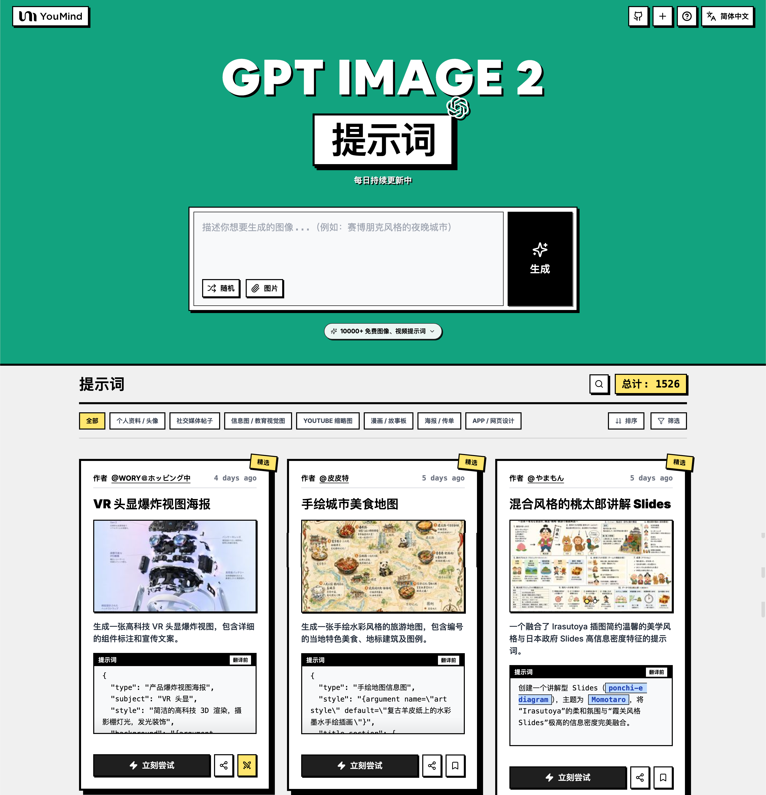

<a href="https://youmind.com/zh-TW/gpt-image-2-prompts">
  
</a>

> 💡 🎬 進階玩法：用 **Seedance 2** 把 GPT Image 2 生成的圖變成炸裂 AI 影片，2000+ 提示詞等你探索 👉 [awesome-seedance-2-prompts](https://github.com/YouMind-OpenLab/awesome-seedance-2-prompts)
# 🚀 GPT Image 2 提示詞大全

[](https://github.com/sindresorhus/awesome)
[](https://github.com/YouMind-OpenLab/awesome-gpt-image-2)
[](https://creativecommons.org/licenses/by/4.0/)
[](https://github.com/YouMind-OpenLab/awesome-gpt-image-2/actions)
[](docs/CONTRIBUTING.md)

> 🎨 OpenAI GPT Image 2 創意提示詞精選集合

> ⚠️ **版權聲明**：所有提示詞均收集自社區，僅供教育目的使用。如果您認為任何內容侵犯了您的權利，請[提交 issue](https://github.com/YouMind-OpenLab/awesome-gpt-image-2/issues/new?template=bug-report.yml)，我們將立即移除。

---

[](README.md) [](README_zh.md) [](README_zh-TW.md) [](README_ja-JP.md) [](README_ko-KR.md) [](README_th-TH.md) [](README_vi-VN.md) [](README_hi-IN.md) [](README_es-ES.md) [-Click%20to%20View-lightgrey)](README_es-419.md) [](README_de-DE.md) [](README_fr-FR.md) [](README_it-IT.md) [-Click%20to%20View-lightgrey)](README_pt-BR.md) [](README_pt-PT.md) [](README_tr-TR.md)

---

## 🌐 在網頁圖庫中查看

<div align="center">

[](https://youmind.com/zh-TW/gpt-image-2-prompts)

</div>

**[👉 瀏覽 YouMind GPT Image 2 提示詞圖庫](https://youmind.com/zh-TW/gpt-image-2-prompts)**

為什麼使用圖庫？

| Feature | GitHub README | youmind.com 圖庫 |
|---------|--------------|---------------------|
| 🎨 可視化佈局 | 線性列表 | 精美的瀑布流網格 |
| 🔍 搜索 | 僅 Ctrl+F | 全文搜索和篩選 |
| 🤖 AI 一鍵生圖 | - | AI 一鍵生圖 |
| 📱 移動端 | 基礎 | 完全響應式 |
| 🏷️ 分類 | - | 分類瀏覽 |


### 🏷️ 按分類瀏覽

- **使用情境**
  - [個人檔案 / 頭像](https://youmind.com/zh-TW/gpt-image-2-prompts?categories=profile-avatar)
  - [社群媒體貼文](https://youmind.com/zh-TW/gpt-image-2-prompts?categories=social-media-post)
  - [資訊圖表 / 教育視覺化內容](https://youmind.com/zh-TW/gpt-image-2-prompts?categories=infographic-edu-visual)
  - [YouTube 縮圖](https://youmind.com/zh-TW/gpt-image-2-prompts?categories=youtube-thumbnail)
  - [漫畫 / 分鏡腳本](https://youmind.com/zh-TW/gpt-image-2-prompts?categories=comic-storyboard)
  - [產品行銷](https://youmind.com/zh-TW/gpt-image-2-prompts?categories=product-marketing)
  - [電子商務主圖](https://youmind.com/zh-TW/gpt-image-2-prompts?categories=ecommerce-main-image)
  - [遊戲素材](https://youmind.com/zh-TW/gpt-image-2-prompts?categories=game-asset)
  - [海報／傳單](https://youmind.com/zh-TW/gpt-image-2-prompts?categories=poster-flyer)
  - [App / 網站設計](https://youmind.com/zh-TW/gpt-image-2-prompts?categories=app-web-design)
- **風格**
  - [攝影](https://youmind.com/zh-TW/gpt-image-2-prompts?categories=photography)
  - [電影感 / 電影劇照](https://youmind.com/zh-TW/gpt-image-2-prompts?categories=cinematic-film-still)
  - [動畫 / 漫畫](https://youmind.com/zh-TW/gpt-image-2-prompts?categories=anime-manga)
  - [插圖](https://youmind.com/zh-TW/gpt-image-2-prompts?categories=illustration)
  - [草圖 / 線稿](https://youmind.com/zh-TW/gpt-image-2-prompts?categories=sketch-line-art)
  - [漫畫 / 圖像小說](https://youmind.com/zh-TW/gpt-image-2-prompts?categories=comic-graphic-novel)
  - [3D 渲染](https://youmind.com/zh-TW/gpt-image-2-prompts?categories=3d-render)
  - [Q 版風格](https://youmind.com/zh-TW/gpt-image-2-prompts?categories=chibi-q-style)
  - [等距視角](https://youmind.com/zh-TW/gpt-image-2-prompts?categories=isometric)
  - [像素藝術](https://youmind.com/zh-TW/gpt-image-2-prompts?categories=pixel-art)
  - [油畫](https://youmind.com/zh-TW/gpt-image-2-prompts?categories=oil-painting)
  - [水彩](https://youmind.com/zh-TW/gpt-image-2-prompts?categories=watercolor)
  - [水墨 / 中式風格](https://youmind.com/zh-TW/gpt-image-2-prompts?categories=ink-chinese-style)
  - [復古 / 懷舊](https://youmind.com/zh-TW/gpt-image-2-prompts?categories=retro-vintage)
  - [賽博龐克 / 科幻](https://youmind.com/zh-TW/gpt-image-2-prompts?categories=cyberpunk-sci-fi)
  - [極簡主義](https://youmind.com/zh-TW/gpt-image-2-prompts?categories=minimalism)
- **主體**
  - [人像 / 自拍](https://youmind.com/zh-TW/gpt-image-2-prompts?categories=portrait-selfie)
  - [網紅 / 模特兒](https://youmind.com/zh-TW/gpt-image-2-prompts?categories=influencer-model)
  - [角色](https://youmind.com/zh-TW/gpt-image-2-prompts?categories=character)
  - [團體 / 情侶](https://youmind.com/zh-TW/gpt-image-2-prompts?categories=group-couple)
  - [產品](https://youmind.com/zh-TW/gpt-image-2-prompts?categories=product)
  - [食物 / 飲品](https://youmind.com/zh-TW/gpt-image-2-prompts?categories=food-drink)
  - [時尚單品](https://youmind.com/zh-TW/gpt-image-2-prompts?categories=fashion-item)
  - [動物 / 生物](https://youmind.com/zh-TW/gpt-image-2-prompts?categories=animal-creature)
  - [車輛](https://youmind.com/zh-TW/gpt-image-2-prompts?categories=vehicle)
  - [建築 / 室內設計](https://youmind.com/zh-TW/gpt-image-2-prompts?categories=architecture-interior)
  - [風景 / 大自然](https://youmind.com/zh-TW/gpt-image-2-prompts?categories=landscape-nature)
  - [城市景觀 / 街道](https://youmind.com/zh-TW/gpt-image-2-prompts?categories=cityscape-street)
  - [圖表](https://youmind.com/zh-TW/gpt-image-2-prompts?categories=diagram-chart)
  - [文字 / 字體排版](https://youmind.com/zh-TW/gpt-image-2-prompts?categories=text-typography)
  - [摘要 / 背景](https://youmind.com/zh-TW/gpt-image-2-prompts?categories=abstract-background)

---

## 📖 目錄

- [🌐 在網頁圖庫中查看](#-view-in-web-gallery)
- [🤔 什麼是 GPT Image 2？](#-what-is-gpt-image-2)
- [📊 統計數據](#-statistics)
- [🔥 精選提示詞](#-featured-prompts)
- [📋 所有提示詞](#-all-prompts)
- [🤝 如何貢獻](#-how-to-contribute)
- [📄 許可證](#-license)
- [🙏 致謝](#-acknowledgements)
- [⭐ Star 歷史](#-star-history)

---

## 🤔 什麼是 GPT Image 2？

**GPT Image 2**（代號 **"duct-tape"**）是 OpenAI 下一代圖像生成模型。社群測試回饋它在以下方面實現了質的飛躍：

- 🎯 **像素級文字渲染** — 中文、英文、日文均達到 native 水準，無錯字、無字形扭曲
- 🎨 **跨圖像素級一致性** — 同一角色、風格、IP 在多張圖間保持像素級一致
- ⚡ **商用級插畫質量** — 插畫風格輸出無需人工精修，即可直接用於商業場景
- 🌈 **真實藝術風格注入** — 不止是「模仿參考圖」，而是真正理解並再現藝術風格的靈魂
- 🔧 **故事板與產品系列** — 適合故事板、IP 形象、產品系列圖等需要多圖一致性的場景
- 📐 **多語言平面設計** — 社交卡片、Banner、海報一次生圖即可完成多語言文字排版

📚 **了解更多：** 查看社群測試 [報告要點](docs/FAQ.md)

### 🚀 Raycast 集成

部分提示詞支持使用 [Raycast Snippets](https://raycast.com/help/snippets) 語法的**動態參數**。尋找 🚀 Raycast Friendly 徽章！

**示例：**
```
A quote card with "{argument name="quote" default="Stay hungry, stay foolish"}"
by {argument name="author" default="Steve Jobs"}
```

在 Raycast 中使用時，您可以動態替換參數以快速迭代！

---

## 📊 統計數據

<div align="center">

| 指標 | 數量 |
|--------|-------|
| 📝 提示詞總數 | **18148** |
| ⭐ 精選 | **6** |
| 🔄 最後更新 | **2026年11月26日 星期四 晚上8:40:18 [UTC]** |

</div>

---

## 🔥 精選提示詞

> ⭐ 由我們的團隊精心挑選，具有卓越的質量和創造力

### No. 1: VR 頭戴裝置爆炸圖海報


#### 📖 描述

生成一張高科技 VR 頭戴裝置爆炸圖，包含詳細的組件標註與宣傳文案。

#### 📝 提示詞

```
{
  "type": "產品爆炸圖海報",
  "subject": "VR 頭戴裝置",
  "style": "簡潔的高科技 3D 渲染，攝影棚燈光，發光細節",
  "background": "{argument name=\"background color\" default=\"柔和的紫藍色漸層\"}",
  "header": {
    "logo": "∞ {argument name=\"product name\" default=\"Meta Quest 3\"}",
    "subtitle": "{argument name=\"main catchphrase\" default=\"以全新的結構，定義全新的現實。\"}"
  },
  "layout": {
    "centerpiece": "垂直堆疊的 VR 頭戴裝置爆炸圖，展示 9 個不同的內部組件層：外殼、攝影機感測器、主機板與晶片、Pancake 透鏡、內部框架、電池組、側邊頭帶、頂部頭帶以及面部襯墊。",
    "callout_labels": {
      "count": 8,
      "left_side": [
        "Snapdragon® XR2 Gen 2\n以強大的處理效能，實現即時體驗。",
        "可調式 IPD 機構\n為廣大用戶提供舒適的配戴感。",
        "精密設計頭帶\n追求舒適與穩定性的工學設計。"
      ],
      "right_side": [
        "前飾板\n洗鍊的設計與最佳的重量平衡。",
        "追蹤攝影機\n實現高精度的位置追蹤與環境感知。",
        "Pancake 透鏡\n輕薄設計，提供寬廣視野與清晰影像。",
        "高效能電池\n支援長時間運作的最佳化電源設計。",
        "柔軟面部襯墊\n即使長時間配戴也能保持舒適。"
      ]
    },
    "footer": {
      "left_text_block": {
        "headline": "{argument name=\"bottom headline\" default=\"體驗，從結構進化。\"}",
        "body": "每一個零件都蘊含著支撐沉浸式體驗的尖端科技與匠心設計。Meta Quest 3 從內部結構開始，為您創造感受未來的體驗。"
      },
      "right_logo": "∞ Meta"
    }
  }
}
```

#### 🖼️ 生成圖片

##### Image 1

<div align="center">

</div>

#### 📌 詳情

- **作者:** [wory＠ホッピング中](https://x.com/wory37303852)
- **來源:** [Twitter Post](https://x.com/wory37303852/status/2045925660401795478#reversed-0)
- **發布時間:** 2026年4月19日
- **多語言:** en

**[👉 立即嘗試 →](https://youmind.com/zh-TW/gpt-image-2-prompts?id=13460)**

---

### No. 2: 手繪城市美食地圖


#### 📖 描述

生成一張手繪水彩風格的旅遊地圖，包含編號的在地特色美食、地標以及圖例。

#### 📝 提示詞

```
{
  "type": "手繪地圖資訊圖表",
  "style": "{argument name=\"art style\" default=\"復古羊皮紙上的水彩與墨水手繪插圖\"}",
  "title_section": {
    "text": "{argument name=\"city name\" default=\"成都\"} {argument name=\"map title\" default=\"吃貨暴走地圖\"}",
    "mascot": "戴著太陽眼鏡並比讚的卡通紅辣椒"
  },
  "border": "{argument name=\"border decoration\" default=\"綠葉與紅辣椒藤蔓\"}",
  "layout": {
    "background": "帶有黃色道路、藍色河流與綠色公園區域的質感米色羊皮紙",
    "sections": [
      {
        "title": "地標",
        "count": 6,
        "illustrations": ["傳統涼亭", "傳統寺院", "攀爬著熊貓的現代摩天大樓", "高聳電視塔", "傳統牌樓", "工業建築"],
        "labels": ["人民公園", "文殊院", "IFS", "339電視塔", "寬窄巷子", "東郊記憶"]
      },
      {
        "title": "美食景點",
        "count": 12,
        "illustrations": ["麻婆豆腐", "紅油水餃", "串串香", "三大炮", "蛋烘糕", "九宮格火鍋", "肥腸粉", "缽缽雞", "冒椒火辣", "蓋碗茶", "冰粉", "雙流老媽兔頭"],
        "labels": ["1 陳麻婆豆腐", "2 鍾水餃", "3 春熙路", "4 寬窄巷子·三大炮", "5 建設路·葉婆婆蛋烘糕", "6 玉林路·小龍坎火鍋", "7 香香巷·肥腸粉", "8 武侯祠大街·缽缽雞", "9 東郊記憶·冒椒火辣", "10 人民公園·鶴鳴茶社", "11 錦里古街·冰粉", "12 雙流老媽兔頭"]
      },
      {
        "title": "圖例",
        "position": "右下角",
        "count": 5,
        "items": ["紅點", "綠色房屋", "綠樹", "藍線", "黃色雙線"],
        "labels": ["美食地點", "地標景點", "公園綠地", "河流湖泊", "主要道路"]
      }
    ],
    "centerpiece": "坐著吃竹子的巨型熊貓",
    "bottom_right_extras": ["帶有 N、S、E、W 的復古羅盤玫瑰", "免責聲明文字『溫馨提示：吃辣需謹慎，腸胃要保護~』並附帶一個紅辣椒圖示"]
  }
}
```

#### 🖼️ 生成圖片

##### Image 1

<div align="center">

</div>

#### 📌 詳情

- **作者:** [皮皮特](https://x.com/mm_zzm44854)
- **來源:** [Twitter Post](https://x.com/mm_zzm44854/status/2045861258520568230#reversed-1)
- **發布時間:** 2026年4月19日
- **多語言:** en

**[👉 立即嘗試 →](https://youmind.com/zh-TW/gpt-image-2-prompts?id=13515)**

---

### No. 3: 採用混合風格的桃太郎說明用 Slides


#### 📖 描述

這是一個結合了「いらすとや (Irasutoya)」插圖簡約溫暖的美學，以及日本政府簡報高資訊密度特徵的提示詞。

#### 📝 提示詞

```
請為 {argument name="theme" default="桃太郎"} 製作一張說明用 Slides ({argument name="format" default="ポンチ絵 (ponchi-e) 圖表"})，將「いらすとや (Irasutoya)」的溫和氛圍與「霞關風格 (Kasumigaseki slides)」那種壓倒性的資訊密度融合在一起。
```

#### 🖼️ 生成圖片

##### Image 1

<div align="center">

</div>

##### Image 2

<div align="center">

</div>

#### 📌 詳情

- **作者:** [やまもん](https://x.com/yammamon)
- **來源:** [Twitter Post](https://x.com/yammamon/status/2045778624092254603)
- **發布時間:** 2026年4月19日
- **多語言:** ja

**[👉 立即嘗試 →](https://youmind.com/zh-TW/gpt-image-2-prompts?id=13983)**

---

### No. 4: 電子商務直播 UI 模型


#### 📖 描述

生成逼真的社群媒體直播介面並疊加在肖像上，包含可自訂的聊天訊息、禮物彈出視窗以及商品購買卡片。

#### 📝 提示詞

```
{
  "type": "直播 UI 模型",
  "subject": {
    "description": "{argument name=\"host name\" default=\"Elon Musk\"} 的肖像，微笑，穿著印有白色技術示意圖的黑色 T 恤",
    "background": "左側顯示帶有 '{argument name=\"left background logo\" default=\"SPACEX\"}' 文字的螢幕，右側顯示紅色的 '{argument name=\"right background logo\" default=\"Tesla T logo\"}' 和一輛深色汽車"
  },
  "ui_overlay": {
    "top_header": {
      "host_info": "頭像，名稱 '{argument name=\"host name\" default=\"Elon Musk\"}'，副標題 '55.6 萬本場點讚'，紅色 '關注' 按鈕",
      "rank_badge": "帶有 '全站第 1 名' 的金幣圖示",
      "viewer_stats": "3 個頂級觀眾頭像，分別顯示 '12.3w'、'8.6w'、'5.7w'，總計 '68.7 萬'，'X' 關閉按鈕",
      "right_links": "'更多直播 >'，'禮物展館 0/24' 帶有藍色 '經典' 標籤"
    },
    "mid_left_gifts": {
      "count": 2,
      "items": [
        "頭像 '科技愛好者'，'送小心心'，愛心圖示 x 1314",
        "頭像 '星辰大海'，'送火箭'，火箭圖示 x 666"
      ]
    },
    "bottom_left_chat": {
      "system_message": "等級 37 徽章 '宇宙漫遊者 加入了直播間'",
      "message_count": 7,
      "messages": [
        "小火箭: 馬斯克！未來可期！🚀",
        "future: 特斯拉 Model 2 什麼時候出？",
        "星空夢想家: SpaceX 今年能上火星嗎？",
        "AI 探索者: Neuralink 進展如何？",
        "帥氣的網友: 馬總好！",
        "Mars: 第一次來你的直播，超激動！",
        "用戶 123: 講講 AI 吧，會取代人類嗎？"
      ]
    },
    "bottom_right_product_card": {
      "hot_tag": "橘色 '熱賣 x 1888'",
      "image": "Tesla Cybertruck",
      "title": "{argument name=\"product name\" default=\"特斯拉 Cybertruck 電動皮卡\"}",
      "price": "{argument name=\"product price\" default=\"¥ 1,618,000\"}",
      "button": "紅色 '搶' 按鈕",
      "floating_animation": "半透明愛心沿著右側邊緣向上飄浮"
    },
    "bottom_bar": {
      "input_field": "'說點什麼...'",
      "icons": ["笑臉", "三個點", "購物車", "禮物盒", "分享"]
    }
  }
}
```

#### 🖼️ 生成圖片

##### Image 1

<div align="center">

</div>

#### 📌 詳情

- **作者:** [神经病不想好转](https://x.com/sjbbxhz)
- **來源:** [Twitter Post](https://x.com/sjbbxhz/status/2045684734714380687#reversed-0)
- **發布時間:** 2026年4月19日
- **多語言:** en

**[👉 立即嘗試 →](https://youmind.com/zh-TW/gpt-image-2-prompts?id=14036)**

---

### No. 5: 動漫武術對決


#### 📖 描述

生成一個動態的動漫風格動作場景，描繪兩名角色在傳統道場中伴隨元素光環進行戰鬥。

#### 📝 提示詞

```
一張極具動態感的動漫插圖，描繪兩名少女在傳統木造道場內進行激烈的武術對決。在前景中，一名留著 {argument name="character 1 hair" default="黑色高包頭配紅色髮帶"} 的少女擺出強而有力的低位武術架勢，奮力向前揮拳。她身穿 {argument name="character 1 outfit" default="白色中式上衣配紅色流蘇與寬鬆紅褲"}，強烈的紅色能量斬擊環繞著她揮動的四肢。在右側半空中，一名留著 {argument name="character 2 hair" default="淺紫色雙包頭"} 的少女優雅地躍起，自信地微笑著，身穿 {argument name="character 2 outfit" default="深綠色刺繡金邊洋裝與黑色緊身褲"}，伴隨著如水流般掃過的藍色能量軌跡。背景為古樸的木造寺廟內部，上方懸掛著一塊顯眼的招牌，寫著「{argument name="sign text" default="武術会"}」。場景充滿了爆炸性的動作張力、飛揚的塵土、碎裂的木質地板、閃耀的彩色粒子特效，以及將角色與細緻背景完美區隔的戲劇性低角度光影。
```

#### 🖼️ 生成圖片

##### Image 1

<div align="center">

</div>

#### 📌 詳情

- **作者:** [たねもみ 2.0 / Tanemomi Ver2.0](https://x.com/Tanemomi_Ver2)
- **來源:** [Twitter Post](https://x.com/Tanemomi_Ver2/status/2046063806846214265#reversed-0)
- **發布時間:** 2026年4月20日
- **多語言:** en

**[👉 立即嘗試 →](https://youmind.com/zh-TW/gpt-image-2-prompts?id=13467)**

---

### No. 6: 3D 石階演化資訊圖表


#### 📖 描述

將平面的演化時間軸轉換為逼真的 3D 石階資訊圖表，包含細緻的生物渲染圖與結構化的側邊欄。

#### 📝 提示詞

```
{
  "type": "演化時間軸資訊圖表",
  "instruction": "以 REFERENCE_0 作為結構基礎，將平面向量設計轉換為高度逼真的 3D 資訊圖表。將平滑的坡道替換為層次分明的石階，並將所有生物升級為照片級的 3D 模型。",
  "style": {
    "background": "{argument name=\"background style\" default=\"復古紋理羊皮紙\"}",
    "staircase": "{argument name=\"staircase material\" default=\"逼真的紋理石塊\"}",
    "subjects": "{argument name=\"organism style\" default=\"高度細緻的照片級 3D 渲染圖\"}"
  },
  "layout": {
    "main_title": "{argument name=\"main title\" default=\"人類演化\"}",
    "sections": [
      {
        "position": "左側邊欄",
        "count": 8,
        "labels": ["L0: 單細胞生命", "L1: 多細胞生物", "L2: 動物界", "L3: 脊索動物", "L4: 上陸革命", "L5: 哺乳綱", "L6: 人科演化", "L7: 智人紀元"]
      },
      {
        "position": "右上角",
        "title": "獲得的功能 / 失去的功能",
        "description": "帶有加號與減號圖示的圖例"
      },
      {
        "position": "底部中央",
        "title": "演化關鍵里程碑",
        "count": 6,
        "description": "包含 6 個展示猿類到人類演化剪影圖的時間軸"
      }
    ],
    "centerpiece": {
      "description": "蜿蜒的石階，共有 25 個編號階梯，展示特定生物。",
      "count": 25,
      "notable_elements": [
        "第 07 階：水母",
        "第 09 階：菊石",
        "第 10 階：三葉蟲",
        "第 24 階：直立行走的人類",
        "第 25 階：{argument name=\"future evolution concept\" default=\"帶有問號的發光宇宙剪影\"}"
      ]
    }
  }
}
```

#### 🖼️ 生成圖片

##### Image 1

<div align="center">

</div>

#### 📌 詳情

- **作者:** [知识猫图解](https://x.com/GeekCatX)
- **來源:** [Twitter Post](https://x.com/GeekCatX/status/2045792240044511277#reversed-1)
- **發布時間:** 2026年4月19日
- **多語言:** en

**[👉 立即嘗試 →](https://youmind.com/zh-TW/gpt-image-2-prompts?id=13491)**

---

## 📋 所有提示詞

> 📝 按發布日期排序（最新優先）

### No. 1: 個人檔案 / 頭像 - 女子抱著毛茸茸的貓


#### 📖 描述

生成一張寫實風格的照片，呈現一位年輕女子在明亮的室內環境中微笑並抱著一隻毛茸茸的貓。

#### 📝 提示詞

```
一張擬真風格的肖像照，畫面中是一位年輕的東亞女子，留著深棕色長髮，正溫柔地抱著一隻毛茸茸的布偶貓（Ragdoll cat）。她身穿一件米白色平口針織毛衣，妝容清透自然，臉上帶著淺淺的微笑。貓咪有著迷人的藍眼睛與一身白毛，臉部和耳朵則帶有灰色斑塊。背景是一間明亮通透的客廳，可以看見白色的沙發與輕柔的紗簾。光線柔和漫射，營造出溫暖舒適的氛圍。
```

#### 🖼️ 生成圖片

##### Image 1

<div align="center">

</div>

#### 📌 詳情

- **作者:** [Anissa](https://x.com/SimplyAnnisa)
- **來源:** [Twitter Post](https://x.com/SimplyAnnisa/status/2125523351976210925#reversed-0)
- **發布時間:** 2026年11月25日
- **多語言:** en

**[👉 立即嘗試 →](https://youmind.com/zh-TW/gpt-image-2-prompts?id=37731)**

---

### No. 2: 個人檔案 / 頭像 - 女子抱著 Ragdoll 貓


#### 📖 描述

一張寫實風格的人像照片，展現一位面帶微笑的年輕女子在陽光明媚的客廳中，懷抱一隻毛茸茸的 Ragdoll 貓。

#### 📝 提示詞

```
一張寫實風格的年輕東亞女性肖像照，她留著深棕色長髮，柔和的瀏海輕拂臉龐。肌膚白皙、五官精緻，帶著溫柔的微笑直視鏡頭。她身穿一件白色平口針織毛衣，懷裡抱著一隻毛茸茸的布偶貓，貓咪有著藍眼睛與白灰相間的毛色。背景是一間明亮通風的客廳，左側窗戶透進柔和的自然光，畫面中可見米色沙發，以及牆上一幅略微模糊的裱框畫。高品質攝影，8K 解析度，電影級光影效果。
```

#### 🖼️ 生成圖片

##### Image 1

<div align="center">

</div>

#### 📌 詳情

- **作者:** [APIMart-智能体](https://x.com/7xdgap)
- **來源:** [Twitter Post](https://x.com/7xdgap/status/2125502550246044153#reversed-0)
- **發布時間:** 2026年11月25日
- **多語言:** en

**[👉 立即嘗試 →](https://youmind.com/zh-TW/gpt-image-2-prompts?id=37732)**

---

### No. 3: 個人檔案 / 頭像 - GPT Image 2 紅色針織開襟毛衣寫實人像提示詞


#### 📖 描述

適用於 GPT Image 2 的詳細提示詞，用於生成身穿紅色針織開襟毛衣與條紋連身褲的女性電影感寫實人像。

#### 📝 提示詞

```
一張照片級寫實的電影感人像，描繪一位美麗的年輕女子站在戶外，背景是茂密翠綠的樹籬。她留著中分的深棕色直髮，長度及肩，畫著自然淡妝，神情柔和而自信。她身穿一件鮮紅色開襟衫，內搭合身的白色無袖連身褲，褲身帶有細黑色垂直條紋。她的雙手輕輕交叉於胸前，姿態放鬆且優雅。她微微側頭望向一旁，嘴角帶著一抹淺笑。柔和的自然日光、逼真的肌膚紋理、精緻的面料細節、專業時尚攝影風格、淺景深、唯美模糊的綠葉背景、DSLR 畫質、4K 解析度。請保留自然的身體比例與寫實的面部細節。
```

#### 🖼️ 生成圖片

##### Image 1

<div align="center">

</div>

#### 📌 詳情

- **作者:** [Rubi](https://x.com/AIwithRubii)
- **來源:** [Twitter Post](https://x.com/AIwithRubii/status/2124136460114956664)
- **發布時間:** 2026年11月21日
- **多語言:** en

**[👉 立即嘗試 →](https://youmind.com/zh-TW/gpt-image-2-prompts?id=37692)**

---

### No. 4: 個人檔案 / 頭像 - 皇家藍毛衣人像提示詞


#### 📖 描述

用於生成兩位身穿皇家藍毛衣的女性變體的詳細提示詞，包含戴口罩與不戴口罩的版本，並維持參考圖像的面部一致性。

#### 📝 提示詞

```
請根據參考圖片，生成兩張同一位美麗年輕女子的獨立照片，並完整保留她精確的五官、迷人的綠色雙眼、自然的膚色，以及一頭棕色長波浪髮（梳成蓬鬆的半紮髮造型，並繫上寶藍色緞帶蝴蝶結）。在第一張照片中，她身穿一件漂亮的寶藍色寬版針織毛衣，身上沒有任何黑色衣物；她以優雅放鬆的姿態坐著，單膝微抬，臉頰輕柔地倚在手上。整張臉龐清晰可見，妝容柔和自然，雙頰透著紅潤，嘴唇呈現粉嫩光澤。第二張照片必須與第一張完全相同的女孩、五官、髮型、藍色緞帶蝴蝶結及寶藍色毛衣保持一致，但需加上一個同色系的寶藍色針織口罩遮住口鼻；她的一隻手輕扶著臉頰旁的口罩，同時那雙美麗的眼睛依然清晰可見。兩張照片皆須採用柔和的炭灰色攝影棚背景、電影級光影效果、逼真的皮膚紋理與精緻的針織布料細節，呈現專業時尚攝影風格、超寫實 8K 畫質、9:16 直式比例，且不得出現任何黑色衣物、文字或浮水印。
```

#### 🖼️ 生成圖片

##### Image 1

<div align="center">

</div>

##### Image 2

<div align="center">

</div>

#### 📌 詳情

- **作者:** [liana](https://x.com/Lianaalane)
- **來源:** [Twitter Post](https://x.com/Lianaalane/status/2123964230890348559)
- **發布時間:** 2026年11月21日
- **多語言:** en

**[👉 立即嘗試 →](https://youmind.com/zh-TW/gpt-image-2-prompts?id=37686)**

---

### No. 5: 個人檔案 / 頭像 - 昭和復古花卉連衣裙人像


#### 📖 描述

生成一張寫實風格的照片，展現一位身穿復古花卉連衣裙的女性，置身於寧靜的日本庭園之中，捕捉充滿懷舊氛圍的昭和時代情調。

#### 📝 提示詞

```
一張寫實風格的年輕女子肖像，散發著溫柔懷舊的昭和時代氛圍。她留著深色長髮，編成單側的鬆散辮子，身穿一件復古風的奶油色中長版洋裝，上頭印有精緻的紫色花卉圖案，搭配短袖、彼得潘領與前開扣式上身設計。她佇立在蓊鬱的日本庭園中，舉起手輕觸頭頂青楓的枝枒。光線柔和斑駁，營造出溫暖的底片顆粒感，喚起 1970 年代的復古情調。
```

#### 🖼️ 生成圖片

##### Image 1

<div align="center">

</div>

#### 📌 詳情

- **作者:** [いがぐりメタボ](https://x.com/Kmsbdd0GXBOcrXQ)
- **來源:** [Twitter Post](https://x.com/Kmsbdd0GXBOcrXQ/status/2123734795746484634#reversed-0)
- **發布時間:** 2026年11月20日
- **多語言:** en

**[👉 立即嘗試 →](https://youmind.com/zh-TW/gpt-image-2-prompts?id=37685)**

---

### No. 6: 個人檔案 / 頭像 - 大理石雕塑頭像提示詞


#### 📖 描述

適用於 GPT Image 2 的提示詞，可將上傳的照片轉換為具有古典希臘羅馬雕像風格與博物館級燈光效果的超寫實大理石雕塑頭像。

#### 📝 提示詞

```
將上傳的照片轉換為超寫實的大理石雕塑頭像，呈現古希臘羅馬雕像的古典風格。五官輪廓精雕細琢並帶有自然微瑕，清晰可見石材紋理與天然大理石肌理。表面光滑卻略帶歲月風化痕跡，具備逼真的雕刻刀觸與精緻的人體解剖結構。採用柔和的博物館式定向光源，投射出細膩陰影以強化立體感與輪廓層次。搭配中性藝廊背景與淺景深效果，營造優雅的藝術氛圍與雋永美感，超高解析度、電影級寫實質感，1:1 比例，頂級雕像人像品質。
```

#### 🖼️ 生成圖片

##### Image 1

<div align="center">

</div>

#### 📌 詳情

- **作者:** [Smiling Khan](https://x.com/AIwithkhan)
- **來源:** [Twitter Post](https://x.com/AIwithkhan/status/2123423368301138088)
- **發布時間:** 2026年11月19日
- **多語言:** en

**[👉 立即嘗試 →](https://youmind.com/zh-TW/gpt-image-2-prompts?id=37660)**

---

### No. 7: 個人檔案 / 頭像 - 皇家藍晚禮服人像提示詞


#### 📖 描述

適用於 GPT Image 2 的寫實編輯風格人像提示詞，呈現一位身穿皇家藍珠飾禮服的迷人女性，背景為城市景觀與混凝土交通結構。

#### 📝 提示詞

```
魅力四射的女子留著深棕色長波浪髮，塗上搶眼的紅唇，在戶外的現代混凝土高架軌道與城市街景前擺出姿勢。她身穿合身的寶藍色與藍綠色珠飾晚禮服，採用心形領口、垂墜腰身設計，並點綴懸垂的珠串流蘇；左手輕抬至髮際旁，配戴低調的藍色水滴耳環與精緻手鍊。自然日光照明，淺景深，中景構圖，照片級寫實的編輯風格人像攝影。
```

#### 🖼️ 生成圖片

##### Image 1

<div align="center">

</div>

#### 📌 詳情

- **作者:** [Ayesha](https://x.com/AyeshaEvie)
- **來源:** [Twitter Post](https://x.com/AyeshaEvie/status/2123411037718462564)
- **發布時間:** 2026年11月19日
- **多語言:** en

**[👉 立即嘗試 →](https://youmind.com/zh-TW/gpt-image-2-prompts?id=37661)**

---

### No. 8: 個人檔案 / 頭像 - 優雅東亞女性時尚人像


#### 📖 描述

適用於 GPT Image 2 的專業人像攝影提示詞，呈現一位身穿芥末黃鉤針帽與花卉襯衫的優雅東亞女性，背景為黑色。

#### 📝 提示詞

```
專業人像攝影，9:16 直式構圖，一位令人驚豔的優雅東亞女性，上半身特寫，背景為純深黑色。

她留著一頭豐盈的長波浪黑髮，在微風中柔美飄逸，溫暖的金色輪廓光沿著髮絲與肩膀閃耀。她戴著一頂亮芥末黃色的鉤針漁夫帽，左側點綴著優雅的大緞面蝴蝶結。配戴拋光大金雙環垂墜耳環。

她身穿一件絲滑的乳白色襯衫，印有鮮明的復古花卉圖案——盛開的橙色與金色罌粟花，搭配柔和的藍綠色葉片與莖幹，袖子為及肘的泡泡袖設計。下身搭配高腰柔黃色長褲或裙裝。她的右手輕觸帽簷，姿態優雅，眼神溫暖自信地直視鏡頭，嘴角帶著一抹淡淡的微笑。

柔和的棚內燈光，溫暖的金色調，高端時尚美學，臉部精準對焦，超精細細節，照片級真實感，8K 解析度，色彩鮮明卻不失優雅，電影級質感，細緻的肌膚紋理，展現精緻且雋永的優雅氣質。
```

#### 🖼️ 生成圖片

##### Image 1

<div align="center">

</div>

#### 📌 詳情

- **作者:** [Aiza](https://x.com/AizaAi12)
- **來源:** [Twitter Post](https://x.com/AizaAi12/status/2123380215317676180)
- **發布時間:** 2026年11月19日
- **多語言:** en

**[👉 立即嘗試 →](https://youmind.com/zh-TW/gpt-image-2-prompts?id=37663)**

---

### No. 9: 個人檔案 / 頭像 - 年輕女性六格人像拼貼


#### 📖 描述

由六張棚拍人像組成的拼貼畫，展示一位留著棕色長髮的年輕女性在灰色背景前呈現多種休閒表情。

#### 📝 提示詞

```
由六張直式照片組成的網格，主角是一位年輕的東亞女性，留著深棕色的長波浪髮與輕盈的瀏海。她身穿簡單的黑色細肩帶上衣，配戴一條綴有小吊墜的精緻銀項鍊。背景為素面的冷調灰牆，呈現出室內攝影棚的氛圍；柔和的漫射光線在她的臉龐上投下淡淡的陰影。

左上：她雙手托腮，掌心朝內，神情淡然，視線微微偏向左方。
中上：她在右眼旁比出 YA 的手勢，同時用同一隻眼睛眨眼，雙唇微啟。
右上：她閉著雙眼，頭部微微低垂，一手抬起輕觸髮頂。
左下：她將臉頰靠在右手上，指尖輕觸太陽穴，目光望向一旁，神情若有所思。
中下：一張自然捕捉的照片，她露齒燦笑，視線看向鏡頭外的右方。
右下：她直視鏡頭，帶著一抹溫柔淺笑，一手輕輕將耳後的頭髮往後撥。
```

#### 🖼️ 生成圖片

##### Image 1

<div align="center">

</div>

#### 📌 詳情

- **作者:** [なかやま](https://x.com/yudetamago__san)
- **來源:** [Twitter Post](https://x.com/yudetamago__san/status/2123050336764239971#reversed-0)
- **發布時間:** 2026年11月18日
- **多語言:** en

**[👉 立即嘗試 →](https://youmind.com/zh-TW/gpt-image-2-prompts?id=37621)**

---

### No. 10: 個人檔案 / 頭像 - GPT Image 2 夜景自拍提示詞


#### 📖 描述

適用於 GPT Image 2 的提示詞，用於生成一位年輕東亞女性在夜晚城市街道行走時的高寫實智慧型手機自拍照片。

#### 📝 提示詞

```
夜間拍攝的超現實智慧型手機自拍，看起來像是用真實的 iPhone／相機拍的，而不是單眼相機。一位美麗的年輕東亞女性，保留參考圖片中的五官特徵，留著略顯凌亂的深棕色長髮，在微風中自然飄逸；肌膚白皙如瓷，一雙靈動的大棕眼，妝容清淡自然、帶著微微腮紅，水潤粉唇嘟起可愛的鴨嘴表情。身穿合身的灰色細肩帶背心，一手隨性地拿著手機，走在夜晚寧靜的林蔭人行道上。溫暖的路燈照亮她的臉龐並映出柔和陰影，背景是路邊停放的車輛、綠樹與空蕩的街道。帶有輕微的手持晃動模糊、自然的手機 HDR 效果、寫實的皮膚紋理、根根分明的髮絲、些許數位噪點、前鏡頭視角，呈現即興的生活感氛圍，就像深夜隨性散步時拍下的 Instagram 風格自拍。高細節、照片級寫實，一眼就能看出是未經修圖的手機原照，而非 AI 生成或棚拍作品。
```

#### 🖼️ 生成圖片

##### Image 1

<div align="center">

</div>

#### 📌 詳情

- **作者:** [我叫聂磊](https://x.com/zhy2024806)
- **來源:** [Twitter Post](https://x.com/zhy2024806/status/2122887530052022398)
- **發布時間:** 2026年11月18日
- **多語言:** zh

**[👉 立即嘗試 →](https://youmind.com/zh-TW/gpt-image-2-prompts?id=37581)**

---

### No. 11: 個人檔案 / 頭像 - 昭和復古風：花卉洋裝女子肖像


#### 📖 描述

生成一張充滿懷舊電影感的肖像，描繪一位身穿花卉洋裝的年輕女子坐在搖椅上，背景為復古日式臥室。此風格完美呈現昭和時代的美學氛圍，適合用於情感敘事視覺創作。

#### 📝 提示詞

```
一張直式人像照，畫面中是一位年輕的東亞女性，坐在溫馨復古臥室裡的一張老式木製搖椅上。她留著深棕色長髮，隨性地紮在腦後，幾縷碎瀏海輕拂臉龐，側邊別著一朵白色小花髮夾。神情平靜，帶著一絲淡淡的憂鬱，雙眼直視鏡頭。她身穿一件米白色短袖洋裝，上頭印著精緻的小花圖案（粉色與藍色小碎花），搭配圓潤的彼得潘領、泡泡袖，胸前則有一排小鈕扣。雙手交疊輕放在腿上，雙膝自然交疊。

場景散發著日本昭和時代的懷舊氛圍：左側柔和的自然光穿透薄紗蕾絲窗簾灑落，在畫面中投下溫柔的光影。她右後方是一張深色木製床架，鋪著花卉圖案的寢具；再往後方則是一座古董梳妝台，上頭擺著一盞散發暖光的黃銅檯燈、一瓶鮮花與幾幅相框。地板為打亮的硬木材質，搖椅下方鋪著一塊米色長毛地毯，質感蓬鬆柔軟。

風格：底片攝影美學——帶有顆粒感、低飽和的粉彩色調、淺景深，並保留些許肌膚瑕疵與不均勻光線等真實的不完美細節，讓畫面更具寫實感。氛圍：寧靜、內斂，帶著一抹惆悵的懷舊情懷。
```

#### 🖼️ 生成圖片

##### Image 1

<div align="center">

</div>

#### 📌 詳情

- **作者:** [いがぐりメタボ](https://x.com/Kmsbdd0GXBOcrXQ)
- **來源:** [Twitter Post](https://x.com/Kmsbdd0GXBOcrXQ/status/2122650353510576594#reversed-0)
- **發布時間:** 2026年11月17日
- **多語言:** en

**[👉 立即嘗試 →](https://youmind.com/zh-TW/gpt-image-2-prompts?id=37586)**

---

### No. 12: 個人檔案 / 頭像 - GPT Image 2 冬季剪貼簿拼貼人像提示詞


#### 📖 描述

適用於 GPT Image 2 的詳細提示詞，用於生成超寫實風格的冬季剪貼簿拼貼人像，特徵包括紫色頭髮、舒適街頭穿搭及珍珠奶茶。

#### 📝 提示詞

```
建立一張超寫實的全身冬季剪貼簿拼貼肖像，主角為參考圖片中的同一位年輕女性角色。請完整保留她的招牌造型：鮮豔的紫羅蘭紫色及肩直瀏海鮑伯頭（搭配輕柔瀏海）、白皙如瓷的肌膚、鼻樑與雙頰自然的雀斑、榛果色／淺棕色杏仁眼、精緻的五官、水潤光澤的雙唇，以及纖細的身形。

她側身坐在紙箱上，姿態放鬆又愜意；左手拿著一杯粉紅色的草莓冰珍珠奶茶，頂部擠滿鮮奶油，右手則摟著一隻笑容可掬的可愛草莓絨毛娃娃。她身穿溫暖的奶油色針織高領毛衣，外搭一件 oversize 淺刷色牛仔外套，外套上點綴著繽紛的花卉、格紋、圓點與草莓拼布圖案。下身搭配同風格的寬版拼布牛仔褲與厚底白色老爹鞋，完美呈現舒適的冬季街頭穿搭。

紙箱上手寫著 "{argument name="box text" default="FRAGILE"}" 字樣，旁邊還畫了一顆愛心。背景由揉皺的藍色剪貼簿紙張構成，並裝飾著撕下的筆記本內頁、手寫文字 "{argument name="background words" default="Winter", "Slow", "dream", and "Sweet"}"、紅色格紋和紙膠帶、迴紋針、草莓貼紙、白色雪花塗鴉，以及一位戴著紅色針織帽與圍巾的可愛雪人。最後加上手寫的 "{argument name="message" default="Stay Cozy"}" 訊息。

請採用柔和擴散的冬季攝影棚光線、冷調粉彩藍色系、溫暖療癒的細節、真實的肌膚紋理、細緻的紫色髮絲、針織布料質感、電影般的景深效果、細膩的陰影與照片級寫實品質，輸出超高細節的 8K 解析度，打造頂級的冬季 cottagecore Y2K 剪貼簿時尚大片。
```

#### 🖼️ 生成圖片

##### Image 1

<div align="center">

</div>

#### 📌 詳情

- **作者:** [Wareen AI 💟](https://x.com/Wareenaa)
- **來源:** [Twitter Post](https://x.com/Wareenaa/status/2122551075098284096)
- **發布時間:** 2026年11月17日
- **多語言:** en

**[👉 立即嘗試 →](https://youmind.com/zh-TW/gpt-image-2-prompts?id=37534)**

---

### No. 13: 個人檔案 / 頭像 - GPT Image 2 提示詞：將照片轉化為 3D 玩具情侶


#### 📖 描述

詳細的提示詞，用於將上傳的情侶參考照片轉換為咖啡廳場景中極致細節的 3D 收藏級黑膠公仔，在保留面部特徵的同時應用風格化的玩具美學。

#### 📝 提示詞

```
將上傳的參考照片中的人物，轉換成在時尚露天咖啡廳裡的超精細 3D 收藏級玩具情侶場景。請保留他們可辨識的面部特徵，並將他們重新塑造成高級亮面乙烯基（vinyl）公仔，具備光滑塑膠質感、略微誇張的比例、生動的表情以及逼真的玩具細節。

女性角色留著深棕色頭髮，梳成優雅的編髮盤髮造型，配戴黑色太陽眼鏡、精緻金色圈狀耳環與多層次金項鍊，身穿白色泡泡袖上衣。她以單手輕托下巴，帶著溫柔微笑深情凝視身旁的伴侶。

男性角色擁有濃密蓬鬆的深色捲髮與修剪整齊的鬍子，戴著黑色太陽眼鏡，身穿俐落的白色鈕扣襯衫並捲起袖子。他配戴銀色腕錶，隨性地將一個白色小陶瓷咖啡杯舉至唇邊。

兩位角色緊鄰而坐，坐在拋光木質咖啡桌上。畫面中需包含迷你白色咖啡杯、相襯的杯碟以及優雅的銀色茶匙。

環境：一間迷人的歐洲高級露天咖啡廳，擁有溫暖的米色石材建築、高挑玻璃窗、茂密的綠樹、藍色遮陽傘、木製家具，背景則有柔和模糊的咖啡廳客人。溫暖的午後陽光營造出美麗的光影反射與柔和陰影。

視覺風格：高級設計師乙烯基玩具、亮面 3D 公仔、可愛又不失精緻的角色設計、平滑的雕塑表面、細緻的髮型、逼真的迷你配件、高端收藏玩具攝影、電影感景深、溫暖金色調色、超寫實 3D 渲染。

構圖：4:5 垂直人像比例、平視正面鏡頭、兩位角色明顯佔據前景、自然放鬆的姿勢、親密的咖啡廳氛圍。

渲染品質：超精細 3D 建模、逼真亮面反射、光線追蹤照明、環境遮蔽、全域照明、物理基礎材質、電影感陰影、專業產品攝影、8K 等級畫質。

重要提示：請務必保留參考照片中這對情侶的身分與獨特面部特徵。兩人都必須看起來像是精心打造的實體收藏玩具，而非一般人物照片。不得出現文字、浮水印或額外的前景人物。
```

#### 🖼️ 生成圖片

##### Image 1

<div align="center">

</div>

#### 📌 詳情

- **作者:** [Smiling Khan](https://x.com/AIwithkhan)
- **來源:** [Twitter Post](https://x.com/AIwithkhan/status/2121954653500035343)
- **發布時間:** 2026年11月15日
- **多語言:** en

**[👉 立即嘗試 →](https://youmind.com/zh-TW/gpt-image-2-prompts?id=37519)**

---

### No. 14: 個人檔案 / 頭像 - GPT Image 2 多視角角色一致性提示詞


#### 📖 描述

使用 GPT Image 2，透過參考圖片（包含臉部、服裝及姿勢深度圖）生成具有一致性角色照片的提示詞。

#### 📝 提示詞

```
請生成一張圖片：照片級寫實，直式 2:3 比例，一位虛構的 {argument name="age" default="20-year-old"} 成年女性獨照，氣質青春、像大學二年級生，不要看起來太成熟。圖 1 為臉部參考：請保持五官、膚色、髮型與髮色一致。圖 2 為服裝參考：請完全依照圖中穿搭，維持款式、顏色、材質與配件一致。圖 3 為人體模型的灰階深度圖：僅供身體姿勢與拍攝角度參考；它不是真人，也不提供服裝或臉部細節。場景：{argument name="scene_description" default="a tree-lined path in a park on a spring afternoon"}，路旁有嫩綠樹葉與長椅，柔和自然光，iPhone 隨手拍質感，真實皮膚紋理，輕微底片顆粒感。單張圖片，非拼貼，無文字或浮水印，雙手自然放鬆且五指完整，臉部與四肢無變形。

請再生成一張圖片：參考上一張，人物、髮型、服裝、場景與光線須完全一致，但將身體姿勢與拍攝角度改為符合這張深度圖的姿勢（深度圖僅為人體模型，不提供服裝或臉部資訊）。直式 2:3 單張圖片，非拼貼，無文字或浮水印，手指完整。
```

#### 🖼️ 生成圖片

##### Image 1

<div align="center">

</div>

##### Image 2

<div align="center">

</div>

#### 📌 詳情

- **作者:** [Candy](https://x.com/CandyTravelight)
- **來源:** [Twitter Post](https://x.com/CandyTravelight/status/2121772672140886063)
- **發布時間:** 2026年11月15日
- **多語言:** zh

**[👉 立即嘗試 →](https://youmind.com/zh-TW/gpt-image-2-prompts?id=37510)**

---

### No. 15: 個人檔案 / 頭像 - 鹿紋斗篷秋裝動漫少女


#### 📖 描述

生成一位戴眼鏡、身穿斑點鹿紋連帽斗篷的動漫角色，站在落滿黃色銀杏葉的秋季公園中。

#### 📝 提示詞

```
全身動漫風格插畫，描繪一位開朗的年輕女子站在鋪滿黃色落葉銀杏的小徑上。她留著一頭飄逸的金色長髮，綁成雙馬尾，並有著尖尖的精灵耳。圓形紅框眼鏡後是一雙明亮的綠色眼睛，她正張開嘴開心地笑著。她身穿一件獨特的棕色連帽披風，上面印有白色斑點圖案（類似鹿皮紋路），帽子上帶有動物耳朵造型，領口則繫著一個大粉色蝴蝶結。披風內搭一件棕色格紋裙。腿上穿著寬鬆的棕色及膝長靴，搭配白色羅紋襪。背景是藍天下成排的鮮黃銀杏樹，空中還有幾片落葉隨風飄舞。
```

#### 🖼️ 生成圖片

##### Image 1

<div align="center">

</div>

#### 📌 詳情

- **作者:** [Toudaiji](https://x.com/ISoBZrpOBM85706)
- **來源:** [Twitter Post](https://x.com/ISoBZrpOBM85706/status/2121422631304126591#reversed-0)
- **發布時間:** 2026年11月14日
- **多語言:** en

**[👉 立即嘗試 →](https://youmind.com/zh-TW/gpt-image-2-prompts?id=37497)**

---

### No. 16: 個人檔案 / 頭像 - 從參考圖生成時尚小鴨肖像


#### 📖 描述

根據上傳的參考圖片中的姿勢與微笑，生成一隻自信站立於時尚居家環境中的精緻 3D 小鴨肖像。

#### 📝 提示詞

```
請根據附圖，創作一幅精美的小鴨肖像，採用細節豐富且風格搞怪的 3D 呈現方式。小鴨自信地站在時尚的居家環境中，以與圖片相同的姿勢溫柔微笑。
```

#### 🖼️ 生成圖片

##### Image 1

<div align="center">

</div>

#### 📌 詳情

- **作者:** [ゆきと](https://x.com/bakupso2)
- **來源:** [Twitter Post](https://x.com/bakupso2/status/2121271796511195595)
- **發布時間:** 2026年11月13日
- **多語言:** ja

**[👉 立即嘗試 →](https://youmind.com/zh-TW/gpt-image-2-prompts?id=37493)**

---

### No. 17: 個人檔案 / 頭像 - 穿奶油色開襟毛衣的動漫女孩


#### 📖 描述

重現動漫風格人像的逆向工程提示詞：女孩身穿舒適針織開襟毛衣，背景為晴朗天空。

#### 📝 提示詞

```
高解析度動漫風格的年輕女子肖像，她留著及肩的薰衣草灰波浪長髮，左側繫著一個白色小緞帶。她擁有一雙大而靈動的琥珀藍漸層雙眼，以及溫柔溫暖的微笑。她的右手優雅地舉至臉頰旁，指尖輕觸髮絲。她身穿一件厚實的奶油色麻花針織開襟衫，內搭帶有小巧鈕扣的鼠尾草綠荷葉邊襯衫，畫面下方可見深海軍藍百褶裙。一條細銀項鍊搭配星形吊飾，輕輕垂落在鎖骨上。背景為柔焦的湛藍天空，點綴著散落的散景光斑，營造出晴朗白天的氛圍。光線柔和自然，突顯了針織衣物的紋理與髮絲的透光感。直式構圖，腰部以上的半身特寫。
```

#### 🖼️ 生成圖片

##### Image 1

<div align="center">

</div>

#### 📌 詳情

- **作者:** [降月@十師団物語](https://x.com/ten_division_kz)
- **來源:** [Twitter Post](https://x.com/ten_division_kz/status/2120195378037633026#reversed-0)
- **發布時間:** 2026年11月10日
- **多語言:** en

**[👉 立即嘗試 →](https://youmind.com/zh-TW/gpt-image-2-prompts?id=37453)**

---

### No. 18: 個人檔案 / 頭像 - GPT Image 2 Prompt：韓系臥室人像，搭配粉色吊帶衫


#### 📖 描述

高度詳細的 prompt，用於生成超寫實的韓系臥室人像，主角為身穿粉色吊帶衫與開襟毛衣的東亞女性，著重於皮膚質感與光影表現。

#### 📝 提示詞

```
[整體風格]

1:1 正方形構圖，單張獨立影像，超寫實韓系室內女性人像攝影，氣質清冷溫柔，低飽和奶油暖白色調，柔和自然光，肌膚紋理細膩，帶有輕微自然柔焦感，呈現真實手機攝影質感。

[五官特徵]

23-25 歲東亞成年女性，容貌精緻，小巧鵝蛋臉，下顎線條柔和流暢，下巴圓潤小巧，膚色清透冷白，雙頰透出淡淡蜜桃粉色紅暈。

明亮清澈的深棕色杏仁眼，自然雙眼皮，臥蠶細節清晰，睫毛纖長捲翹，眼影為淺粉棕色，眼線細長且尾端柔和微揚。

鼻樑纖挺，鼻頭小巧自然，雙唇柔軟飽滿，呈玫瑰豆沙粉色，帶有自然水潤光澤。

雙唇自然閉合，雙眼直視鏡頭，神情安靜溫柔中帶點清冷感，保留真實肌膚的微觀紋理。

[髮型 - 核心]

濃密柔順的深黑茶色及腰長髮，散發自然的深巧克力棕光澤。

髮根蓬鬆，採用隨性的半紮髮造型，額前自然中分，垂落幾縷纖細的八字瀏海。

兩側頭髮自然收攏至耳後，露出耳朵與珍珠水滴耳環，其餘長髮披散於肩頭與胸前。

長髮整體柔順，髮尾帶有自然微捲弧度，保留真實的髮絲感、自然蓬鬆度與些許凌亂碎髮。

[服裝與飾品]

身穿淺櫻花粉細肩帶吊帶背心，材質為柔軟細緻的棉質布料，簡約淺圓領設計。

外搭奶油白寬鬆針織開襟衫，織紋柔軟細密，前方自然敞開，露出淺粉色肩帶與自然的鎖骨線條。

長袖微微蓋住手腕，呈現真實柔軟的布料皺褶。

配戴白色小珍珠水滴耳環與極細銀質鎖骨鍊。

[姿勢]

人物坐在床沿，上半身自然挺直，正面微側向鏡頭。

頭部輕輕傾斜，下巴自然微收，眼神柔和地直視鏡頭。

左手自然抬起，掌心輕貼臉頰，手指沿著下顎線柔和舒展，形成溫柔的托腮姿勢。

另一隻手抬至肩膀旁，輕輕撥弄垂落的長髮，手指自然彎曲。

雙肩放鬆，姿態慵懶自然，手部結構寫實。

[背景環境]

簡約溫馨的現代奶油白臥室，人物身後是一張鋪著純白寢具與柔軟白枕頭的大床。

背景為淺米色牆面與奶油色軟墊床頭板，房間乾淨寧靜，沒有雜亂的裝飾物。

[鏡頭與光線]

1:1 正方形比例，等效 50mm 人像鏡頭，平視角度，胸部以上的近景半身特寫，臉部置中。

柔和的冷白正面自然補光，照亮臉部、鼻樑、雙頰與鎖骨。

肌膚呈現清透冷白感，雙頰透出淡淡蜜桃血色，雙唇帶有細膩的自然反光。

深黑茶色長髮泛著柔和的深棕色高光，背景保留淡淡的暖白環境光。

低飽和的奶油白與淺粉色調，對比柔和，具備真實景深與輕微自然顆粒感，無過度磨皮或銳化。

[反向提示詞]

動漫、插畫、3D 渲染、CG 假臉、塑膠肌、過度磨皮、誇張大眼、過尖下巴、五官錯位、雙眼不對稱、假髮、毛躁打結髮質、僵硬髮絲、多餘手指、手掌變形、手腕扭曲、肩膀錯位、身體比例異常、衣物穿模、嚴重過曝、強烈 HDR、過度銳化、明顯 AI 感、文字、浮水印、LOGO、拼貼圖。
```

#### 🖼️ 生成圖片

##### Image 1

<div align="center">

</div>

#### 📌 詳情

- **作者:** [沧瑶](https://x.com/CryY666666)
- **來源:** [Twitter Post](https://x.com/CryY666666/status/2120184677873209619)
- **發布時間:** 2026年11月10日
- **多語言:** zh

**[👉 立即嘗試 →](https://youmind.com/zh-TW/gpt-image-2-prompts?id=37450)**

---

### No. 19: 個人檔案 / 頭像 - GPT Image 2 提示詞：韓系風格夏日海邊人像，搭配藍色針織上衣


#### 📖 描述

用於生成超寫實韓系風格夏日海邊人像的詳細提示詞，描繪一位身穿藍色針織上衣與白色百褶裙、髮絲隨風飄逸的東亞女性。

#### 📝 提示詞

```
[整體風格]

9:16 直式構圖，單張獨立影像，超寫實韓系夏日海邊成人女性人像攝影，清新溫柔的初戀感，天空藍與奶油白色調，明亮自然陽光，真實智慧型手機拍攝質感，細膩自然的光影層次。

[五官特徵]

一位 23 至 25 歲的東亞成年女性，精緻小巧的鵝蛋臉，下顎線條柔和流暢，下巴圓潤小巧，肌膚清透冷白，帶有淡淡的蜜桃粉色腮紅。

明亮清澈的深棕色杏仁眼，自然雙眼皮，臥蠶細節清晰，睫毛纖長自然，淺粉棕色眼影，眼線柔和且微微上揚。

鼻樑細挺，鼻尖小巧，雙唇飽滿柔軟、呈現玫瑰粉色且水潤有光澤。

嘴角微微上揚，露出溫柔自然的閉唇微笑，雙眼直視鏡頭，保留真實的肌膚微紋理。

[髮型 - 核心]

極其濃密柔順的深栗棕色及腰長髮，頭頂蓬鬆自然，採用自然的側分髮型。

額前留有幾縷纖細的八字瀏海，柔和修飾額頭與臉頰輪廓。

大量長髮自然垂落於肩膀與背部，長度延伸至腰部以下，整體為柔順直髮，髮尾帶有輕微的自然弧度。

海風由左向右吹拂，使部分長髮自然向右飄動，形成明顯的水平飛揚髮絲。

陽光照亮長髮頂部與外側，呈現細膩的淺栗棕色高光，保留真實的根根分明髮絲與自然的迎風動態。

[服裝與配飾]

身穿淺天藍色、淡冰藍色的短版合身針織上衣。

簡約圓領、短袖設計，材質為柔軟細緻的羅紋針織布料，衣襬長度在腰部以上，微微露出自然的腰線。

下半身搭配純白色高腰 A 字百褶長裙，布料柔軟輕盈，裙擺自然散開，帶有真實細膩的垂直褶皺。

耳戴小巧的白色珍珠耳釘，手腕配戴精緻的銀色細手鍊。

[姿勢動作]

人物自然站立於海邊木棧道上，身體與鏡頭呈約 60 度角。

上半身自然挺直，腰部微微轉動，頭部回望，形成溫柔的側身回眸姿勢。

靠近左側的手自然抬起至胸前，手指輕觸肩膀附近的衣物或頭髮。

另一隻手臂自然垂放於身側，手腕放鬆，手指自然舒展。

頭部微微傾斜，下巴自然內收，眼神溫柔地直視鏡頭，帶著一抹淺笑。

濃密的長髮沿著背部自然垂落，部分髮絲隨海風向右飄逸。

[背景環境]

夏日晴朗的海邊木棧道，淺棕灰色的木板向遠方延伸。

右側是開闊的湛藍海面，帶有自然的小波紋與柔和的陽光倒影。

遠處可見低矮的深綠色針葉林海岸線。

天空為清澈明亮的淺藍色，點綴著幾朵淡淡的白色薄雲。

棧道邊緣散落著幾顆灰色的天然石塊，呈現真實的海岸環境質感。

背景乾淨開闊，沒有其他行人或複雜建築。

[鏡頭與光影]

9:16 直式構圖，等效 35-50mm 人像鏡頭，平視角度，人物位於畫面中央偏左。

中景回眸構圖，頭頂上方保留較多藍天，畫面延伸至大腿附近，完整呈現長髮、上衣與白裙。

明亮的夏日自然光從左前方照射，照亮臉部、肩膀與長髮。

膚色自然清透冷白，頭髮受光處帶有細膩的淺棕色反光。

淺藍色針織上衣與純白長裙保持乾淨柔和的色彩。

背景的海面與樹林保留真實自然的空間層次，適度的景深，不刻意過度虛化背景。

整體為低飽和度的清新藍白色調，對比柔和，真實攝影曝光，帶有輕微的相機顆粒感與細膩的肌膚紋理，避免過度磨皮與明顯的 AI 生成感。

[反向提示詞]

動漫、插畫、3D 渲染、CG 假臉、塑膠肌、過度磨皮、誇張網紅臉、眼睛過大、下巴過尖、五官錯位、假髮、頭髮毛躁打結、髮絲僵硬、風向錯誤、多餘手指、手掌變形、肩膀錯位、身材比例扭曲、衣物穿模、裙襬異常、棧道透視錯誤、海水不自然、嚴重過曝、強烈 HDR、過度銳化、明顯 AI 感、文字、浮水印、LOGO、拼貼。
```

#### 🖼️ 生成圖片

##### Image 1

<div align="center">

</div>

#### 📌 詳情

- **作者:** [沧瑶](https://x.com/CryY666666)
- **來源:** [Twitter Post](https://x.com/CryY666666/status/2120170198342979652)
- **發布時間:** 2026年11月10日
- **多語言:** zh

**[👉 立即嘗試 →](https://youmind.com/zh-TW/gpt-image-2-prompts?id=37448)**

---

### No. 20: 個人檔案 / 頭像 - 昭和復古人像


#### 📖 描述

生成具有懷舊膠片顆粒感的年輕女性人像，背景為復古日本街頭場景。

#### 📝 提示詞

```
一張充滿懷舊電影風格的肖像照，畫面中是一位留著黑色長髮與齊瀏海的日本年輕女子，身穿米白色針織毛衣搭配棕色格紋裙。她身體微微前傾，雙手托腮，神情若有所思。背景是昭和時代的復古街景，可見寫著「たばこ」（菸草）的紅色招牌，以及藍白配色的「雪印牛乳」招牌。整張影像色調溫暖且略帶褪色感，並帶有明顯的顆粒與刮痕，完美重現老照片的質感。
```

#### 🖼️ 生成圖片

##### Image 1

<div align="center">

</div>

#### 📌 詳情

- **作者:** [いがぐりメタボ](https://x.com/Kmsbdd0GXBOcrXQ)
- **來源:** [Twitter Post](https://x.com/Kmsbdd0GXBOcrXQ/status/2120101937886745027#reversed-0)
- **發布時間:** 2026年11月10日
- **多語言:** en

**[👉 立即嘗試 →](https://youmind.com/zh-TW/gpt-image-2-prompts?id=37451)**

---

### No. 21: 社群媒體貼文 - 復古編輯攝影海報提示詞


#### 📖 描述

為 GPT Image 2 設計的詳細提示詞，能將上傳的參考照片轉化為精緻的復古編輯風格海報。它會建立垂直分割版面：上方保留原始照片，下方則呈現極簡、幾何且受包浩斯啟發的同場景插畫，並融入瑞士平面設計元素與陳舊紙張質感。

#### 📝 提示詞

```
將上傳的參考照片轉化為精緻的復古編輯風格攝影海報，並嚴格遵循所提供範例的視覺美學。

建立 2:3 比例的垂直分割版面構圖。將原始照片置於上半部，完整保留其原有色彩、主體、拍攝角度、透視、取景與細節；下半部則以極簡、幾何且帶有復古韻味的 2D 插畫形式，重現完全相同的場景。

採用洗鍊的瑞士平面設計與包浩斯（Bauhaus）風格的編輯美學。運用低飽和的大地色系，包含暖米色、奶油白、炭黑色、霧灰色、柔和藍灰與淡雅棕色調。將畫面中的主體與周遭環境簡化為俐落的幾何圖形、鮮明的剪影、稜角分明的輪廓與平塗色塊，同時維持原始場景的構圖與可辨識的細節。

加入細微的泛黃紙張紋理、細緻顆粒感、斑駁的復古印刷效果與略微褪色的墨跡。在插畫場景周圍點綴精緻的平面設計元素，例如纖細的圓弧、垂直與水平對齊輔助線、交錯線條、虛線、小方塊標記以及極簡的幾何網格。

搭配打字機風格字體的小型編輯排版文字，並於插畫區塊的左上角加入攝影系列編號標籤。在右下角放置小型序號，並沿左下邊緣配置一組極簡的三色色票。

保持充裕的留白、精準的對齊、均衡的比例，呈現博物館等級的優雅藝術指導風格。

重要提示：請完整保留上半部的原始照片，切勿更動場景內容。下半部的插畫必須精確還原同一張照片，包含相同的主體、位置、透視、建築、物件與背景。請勿新增任何元素或改變原始構圖。

整體美學：復古攝影誌、瑞士編輯平面設計、極簡建築插畫、復古藝術指導、精緻印刷設計與雋永的視覺敘事。高解析度、清晰銳利的細節、垂直海報格式。
```

#### 🖼️ 生成圖片

##### Image 1

<div align="center">

</div>

##### Image 2

<div align="center">

</div>

#### 📌 詳情

- **作者:** [Taaruk](https://x.com/Taaruk_)
- **來源:** [Twitter Post](https://x.com/Taaruk_/status/2124358326486269975)
- **發布時間:** 2026年11月22日
- **多語言:** en

**[👉 立即嘗試 →](https://youmind.com/zh-TW/gpt-image-2-prompts?id=37691)**

---

### No. 22: 社群媒體貼文 - 粗獷午夜便利商店雜誌封面


#### 📖 描述

一款賽博龐克風格的雜誌封面設計，主角為便利商店中的年輕女性，搭配大膽的日本字體排版、霓虹綠與粉紅點綴，以及做舊網紋質感。

#### 📝 提示詞

```
目標：為 {argument name="magazine title" default="深夜便利店 (Midnight Mart)"} 打造一款粗獷、高對比的雜誌封面設計。

畫布：直式肖像版面，採用米白色質感紙張背景，搭配濃重的半色調網點圖案與斑駁破舊的邊緣效果。

版面配置與字體排印：
1. 頂部標題：大型粗黑體日式書法風格文字「深夜便利店」橫跨頂部寬度。角落處搭配小型無襯線字體：左上角為「VOL.07 CITY CULTURE MAGAZINE」，右上角為「2024 WINTER ISSUE」。
2. 左欄：粗黑無襯線字體垂直堆疊排列：「24H / OPEN / CITY / LIGHTS /」。下方放置一張便利商店貨架照片的垂直長條裁切圖，並覆蓋明亮的螢光綠潑墨效果。
3. 右欄：沿邊緣排列的直式日文「シティー・ナイト・マート」。一罐汽水罐的風格化黑白插圖。一份日文商品清單（Coffee、Drink、Snack、Tobacco、Daily Goods）。一個螢光綠醒目方框，內含手寫風格的日文「都市の不眠時間」。
4. 底部區塊：巨大的粗黑無襯線字體「MIDNIGHT MART」橫跨底部寬度。右側放置一個小條碼，以及帶有粉色點綴的便利商店外觀線條插圖。

主體細節：
中央影像：一張寫實照片，主角是一位年輕亞洲女性，留著凌亂的深色短髮，身穿灰色帽 T 外搭深色牛仔外套，脖子上掛著耳機。她神情淡然、略帶憂鬱，雙眼直視鏡頭。她站在燈火通明的便利商店內，倚靠著玻璃門或窗框。背景呈現模糊的商店貨架與霓虹燈光。

視覺風格：
- 賽博龐克／街頭潮流美學，融合復古印刷質感。
- 色彩計畫：黑色、白色／米白色、亮粉色與螢光萊姆綠。
- 特效：半色調網點、潑墨、撕裂紙張邊緣與高對比顆粒感。
- 材質紋理：在字體與背景上套用斑駁的頹廢風（Grunge）疊加效果。

限制條件：
- 確保中央照片被圖像元素包圍，但不可遮擋人物臉部。
- 維持特定的色彩規範：粉色用於高光／陰影，綠色用於點綴／潑墨。
- 主標題須使用道地且具真實感的日文字體排印。
```

#### 🖼️ 生成圖片

##### Image 1

<div align="center">

</div>

#### 📌 詳情

- **作者:** [Tree.ai](https://x.com/dreamchyzw)
- **來源:** [Twitter Post](https://x.com/dreamchyzw/status/2123287151563436061#reversed-0)
- **發布時間:** 2026年11月19日
- **多語言:** en

**[👉 立即嘗試 →](https://youmind.com/zh-TW/gpt-image-2-prompts?id=37667)**

---

### No. 23: 社群媒體貼文 - 蒸汽朋克工匠肖像


#### 📖 描述

生成一幅電影感的蒸汽朋克插畫，描繪一位擁有機械義肢的女性工匠，在溫暖燈光照耀的工作坊中操作發條裝置。

#### 📝 提示詞

```
一幅細節豐富、極具電影感的蒸汽龐克風格肖像畫，描繪一位黑髮美麗女子，秀髮優雅地盤起，坐在堆滿雜物的木製工作檯前。她擁有精密的金色機械義肢手臂，臉頰上則點綴著細緻的金色花絲紋飾。她正全神貫注地使用微型工具，組裝複雜的黃銅發條機械裝置。她的右側擺放著一顆拋光金屬自動人偶頭部，外露的齒輪與鏡片清晰可見。背景是一間光線昏暗的工作室，牆上掛滿藍圖，四周佈滿銅管，散發溫暖琥珀色光芒的復古油燈點亮整個空間。左側牆面的黑板上以大字寫著拉丁文「INVENIMUS AUT FACIMUS」，下方則以綠色字體寫著「DEFICIMUS」。整幅影像由華麗的裝飾藝術（Art Deco）邊框環繞，邊框帶有幾何圖案，底部中央飾有飛翼徽章。整體色調以濃郁的棕色、古董金、深邃的黑色與柔和的綠色為主。
```

#### 🖼️ 生成圖片

##### Image 1

<div align="center">

</div>

#### 📌 詳情

- **作者:** [Cosmic Cowboy](https://x.com/CosmicCowboyCDN)
- **來源:** [Twitter Post](https://x.com/CosmicCowboyCDN/status/2123049585887138069#reversed-0)
- **發布時間:** 2026年11月18日
- **多語言:** en

**[👉 立即嘗試 →](https://youmind.com/zh-TW/gpt-image-2-prompts?id=37622)**

---

### No. 24: 社群媒體貼文 - 海邊時尚人像 Prompt


#### 📖 描述

用於生成海邊岩石岸上女性超寫實全身時尚人像的詳細 prompt，包含適合 gpt-image-2 的特定服裝與燈光指令。

#### 📝 提示詞

```
超寫實全身時尚人像，一位美麗的年輕女子優雅佇立於岩石海岸邊。她留著一頭豐盈蓬鬆、自然微捲的深棕色長髮，帶著柔美迷人的微笑，五官精緻，肌膚散發自然光澤。身穿 oversize 粉彩粉色針織毛衣，領口、袖口與下襬處點綴白色條紋細節，搭配多口袋設計的寬版白色工裝褲與白色運動鞋。一手輕撫秀髮，另一手隨性地插在口袋裡。背景是壯麗粗獷的海岸岩層，四周環繞著清澈透亮的藍綠色海水、輕柔的海浪與蔚藍柔和的天空。優美的自然日光、清新的海岸氛圍、逼真的布料紋理、優雅休閒的造型風格、專業時尚攝影、DSLR 畫質、照片級寫實細節、自然色彩、全身構圖、8K 解析度。請精準保留參考人臉與面部特徵。
```

#### 🖼️ 生成圖片

##### Image 1

<div align="center">

</div>

#### 📌 詳情

- **作者:** [Rubi](https://x.com/AIwithRubii)
- **來源:** [Twitter Post](https://x.com/AIwithRubii/status/2122950449246715945)
- **發布時間:** 2026年11月18日
- **多語言:** en

**[👉 立即嘗試 →](https://youmind.com/zh-TW/gpt-image-2-prompts?id=37580)**

---

### No. 25: 社群媒體貼文 - GPT Image 2 提示詞：花園躺臥人像


#### 📖 描述

用於生成寫實全身人像的提示詞，描繪一位東亞女性在花園迴廊的木製長椅上躺臥，著重於放鬆姿態與自然光線。

#### 📝 提示詞

```
9:16 直式構圖，單人完整全身照。專業 DSLR 人像攝影 × 簡約實景拍攝 × 慵懶斜躺或倚靠姿態，8K 超高畫質細節。23-27 歲明顯成年女性，氣質靈動俏麗，姿態放鬆。自然 D 罩杯視覺效果，與肩線、胸廓及腰線比例協調。

九頭身時尚模特兒視覺比例，腰臀比約 0.70，利用連續的臀腿線條與較高腰線，營造出接近身高三分之二的長腿視覺，肚臍位置約在自腳底向上 61.8% 處。四肢纖細緊實，保留真實關節比例與受力姿態。

人物為狹長梨形臉，下巴精緻，深棕色上揚眼型，黑色捲髮向後束起，淡橘色妝容。臉部輪廓小巧且修長，下顎帶有真實骨點，眼神的情感表現勝過表情。雙眼清澈，瞳孔、眼白與自然水潤感皆層次分明。

裸露肌膚貫穿真實質感。鼻翼與雙頰毛孔分布不均，僅在側光掃過時，太陽穴、肩緣與手臂才可見細緻天然汗毛。顴骨與鼻翼血色略有差異，膝蓋、手肘、指節與腳踝保留自然色差與彎曲皺褶。膚質與妝容呈現真實明暗變化，不以光滑塑膠反光取代皮膚，也不將細紋、毛孔與汗毛銳化成規律的點陣圖樣。

人物身穿奶油黃短泡泡袖洋裝，大開襟低方領，細緻抓褶自胸側自然延伸至腰線，裙襬為輕盈短版 A 字剪裁，霧面棉質布料帶有細緻纖維紋理，搭配奶油色低跟鞋。自然 D 罩杯視覺效果仍與肩線、胸廓及腰線保持協調，透過真實的胸省、內部支撐與布料張力，呈現自然的豐滿輪廓。領口與肩部固定穩妥，必要部位由不透光布料妥善遮覆；無論站立、坐臥、躺姿或輕舞，布料皆會產生對應的拉伸與垂墜摺痕。

人物沿著縱向長椅自然斜靠，頭部枕於枕頭上，略偏畫面上半部右側，腰背與臀部由椅墊支撐。雙腿沿長椅朝畫面下方中央延伸，一側膝蓋微鬆，兩隻鞋子前後略微錯開，完全停留在椅墊範圍內；雙腳不朝畫面左右邊緣水平延伸。雙臂放鬆貼近身體，一手輕停在髮際旁，另一手自然置於髖側。臉部轉向鏡頭，眼中帶有微小真實的窗光反射。長椅前端及其下方地面須完整可見。

帶頂走廊連接小庭園，近處石面有輕微磨損痕跡，側邊僅露出矮牆局部、一根木柱與遠處綠葉。走廊靠牆處擺放寬木長椅，鋪有淺麻色坐墊，椅腳與板材清晰可見。本圖僅保留一人，視覺焦點依序由臉部、輪廓至姿態引導。牆面、地面與家具邊緣線條簡潔，近處地面帶有輕微使用痕跡。

採用 9:16 直式完整全身環境人像，攝影師實際後退取景，完整頭頂位於距畫面上緣約 8% 處，兩隻完整鞋子位於距畫面下緣約 15% 處。雙鞋下方清晰可見具質感的真實地面；頭頂、指尖與鞋尖周圍皆為真實環境，無白邊、空白條或子母畫面。機位高度約在腰部／臀部，55-65mm 自然人像透視，避免高角度導致腿部縮短。

走廊外無直射強光，天光自相機右前方灑入，灰色石材反光提亮雙頰與虹膜，葉影極淡地映在背景牆上。

焦點精準落在雙眼，髮絲與衣物車縫線清晰可辨。選用約 f/4-f/5.6 的自然人像景深，保留真實室內或戶外距離感，背景色彩克制，鞋底／身體與支撐面之間留有短暫自然的接觸陰影。維持 8K 等級細節，不將汗毛與皮膚紋理銳化成邊緣線條。

核心關鍵字：庭園走廊、慵懶斜躺或倚靠、23-27 歲成年女性、真實人類膚質、自然 D 罩杯、長腿構圖、明亮直視目光、溫柔美麗、完整全身、8K DSLR 人像攝影。

反向提示詞：複雜故事背景、人物忙於操作物品、雜亂物件、多餘人物、凌亂海報、頭髮遮臉、眼神呆滯、眼白過亮、幼態臉龐、圓腫雙頰、僵硬商業姿勢、誇張動作、短腿、廣角透視變形雙腳、裁切頭部／雙腳、支撐面被裁切、鞋底懸空、衣物滑落、透明布料、胸部形狀誇張／扁平、蠟像般平滑、規律點陣毛孔、粗硬汗毛、過度銳化、CG 背景、強烈濾鏡、浮水印、鞋尖被裁切、指尖超出畫面、上下白邊、子母畫面、頭部過大、腿部壓縮、軀幹拉長、膝蓋內扣。
```

#### 🖼️ 生成圖片

##### Image 1

<div align="center">

</div>

#### 📌 詳情

- **作者:** [Ssr_404](https://x.com/ziyouzhixu)
- **來源:** [Twitter Post](https://x.com/ziyouzhixu/status/2122911489304736090)
- **發布時間:** 2026年11月18日
- **多語言:** zh

**[👉 立即嘗試 →](https://youmind.com/zh-TW/gpt-image-2-prompts?id=37578)**

---

### No. 26: 社群媒體貼文 - GPT Image 2 時尚人像提示詞


#### 📖 描述

適用於 GPT Image 2 的詳細提示詞，用於生成一位女性從破損紙張中顯現的超寫實高端時尚人像。

#### 📝 提示詞

```
生成一張超寫實的高端時尚人像，畫面中一位美麗的年輕女子正對著鏡頭溫暖微笑，從白色紙牆上一個不規則的大型撕裂破洞中探出身來。她留著一頭豐盈蓬鬆、自然微捲的深棕色長髮，帶有低調的焦糖色挑染，前額瀏海為中分造型；五官柔和，擁有一雙靈動的淡褐色眼眸、自然的玫瑰色系妝容，以及明亮迷人的笑容。

她身穿一件合身的象牙白羅紋針織開襟衫，搭配方領設計與精緻鈕扣，腰間繫著一條配有優雅金色蝴蝶扣環的黑色皮帶。請加上小巧的珍珠垂墜耳環、精緻的蝴蝶吊墜項鍊，以及一款搭配金色鏈條肩帶的時尚黑色側背包。頭髮上繫著一個大型黑色緞帶蝴蝶結。

她的雙手輕柔地扶著撕裂的紙張邊緣，營造出極具創意的 3D 立體躍出效果。撕開的白紙呈現逼真的纖維質感、自然的褶皺與柔和的陰影，並能透過破洞看見後方溫暖的淺灰色背景。

攝影風格：奢華時尚雜誌大片、照片級真實膚質紋理、根根分明的髮絲細節、擬真布料材質、柔和棚拍燈光、自然臉部比例、優雅構圖、精準對焦、專業 DSLR 攝影、85mm 人像鏡頭、頂級調色、高細節、4:5 直式構圖。

反向提示詞（Negative prompt）：卡通、動漫、CGI、塑膠感肌膚、臉部模糊、手部變形、多餘手指、多餘肢體、人物重複、不自然的笑容、雙眼不對稱、不真實的頭髮、人體結構錯誤、低解析度、文字、浮水印。
```

#### 🖼️ 生成圖片

##### Image 1

<div align="center">

</div>

#### 📌 詳情

- **作者:** [Hania Ai](https://x.com/HaniaAi12)
- **來源:** [Twitter Post](https://x.com/HaniaAi12/status/2122886883994746946)
- **發布時間:** 2026年11月18日
- **多語言:** en

**[👉 立即嘗試 →](https://youmind.com/zh-TW/gpt-image-2-prompts?id=37579)**

---

### No. 27: 社群媒體貼文 - GPT Image 2 溫馨秋日生活風格人像提示詞


#### 📖 描述

用於生成逼真、溫馨生活風格照片的提示詞，描繪一位身穿針織毛衣的女子坐在床上，並針對直式長寬比進行最佳化。

#### 📝 提示詞

```
一位美麗的年輕女子，留著自然微捲的深棕色長髮，身穿淺藍、白色與深棕色橫條紋相間的寬鬆蓬鬆針織毛衣，搭配炭灰色寬版牛仔褲。她舒適地坐在溫馨的床上，單手輕輕托著臉頰，對著鏡頭露出溫柔的微笑。溫暖的臥室場景，奶油色牆面、柔軟的枕頭、散發暖光的床頭燈，以及一盆懸掛的綠色植物。自然窗光、真實的肌膚紋理、細緻的針織布料質感、隨性的生活風格攝影、愜意的秋日氛圍、85mm 鏡頭、淺景深、專業時尚攝影、超寫實 4K、直式 9:16。
```

#### 🖼️ 生成圖片

##### Image 1

<div align="center">

</div>

#### 📌 詳情

- **作者:** [Rubi](https://x.com/AIwithRubii)
- **來源:** [Twitter Post](https://x.com/AIwithRubii/status/2122742391270723825)
- **發布時間:** 2026年11月17日
- **多語言:** en

**[👉 立即嘗試 →](https://youmind.com/zh-TW/gpt-image-2-prompts?id=37582)**

---

### No. 28: 社群媒體貼文 - GPT Image 2 燭光禮服人像


#### 📖 描述

使用 GPT Image 2 生成燭光下身穿花卉禮服女性寫實人像的詳細提示詞。

#### 📝 提示詞

```
一位 20 多歲的日本成年女性，虛構角色，留著茶色長髮、淡雅妝容與透亮肌膚；身穿淺米色雪紡碎花裹身洋裝，深 V 領口、胸前抓皺設計、蓬鬆半袖、腰間繫帶、裙長及膝以上，赤腳。
場景：深棕色木桌上點燃白色蠟燭，擺放酒杯與香檳瓶，背景為模糊昏暗的 Lounge 酒吧；溫暖燭光照亮臉龐，暖色調，寫實照片質感。
負面提示詞：模糊、低畫質、臉部扭曲、手部不自然、過度曝光、文字、浮水印。
```

#### 🖼️ 生成圖片

##### Image 1

<div align="center">

</div>

##### Image 2

<div align="center">

</div>

##### Image 3

<div align="center">

</div>

##### Image 4

<div align="center">

</div>

#### 📌 詳情

- **作者:** [丰收](https://x.com/ai_fengshou)
- **來源:** [Twitter Post](https://x.com/ai_fengshou/status/2122703052746453315)
- **發布時間:** 2026年11月17日
- **多語言:** zh

**[👉 立即嘗試 →](https://youmind.com/zh-TW/gpt-image-2-prompts?id=37583)**

---

### No. 29: 社群媒體貼文 - GPT Image 2 寫實健行人像提示詞


#### 📖 描述

用於生成年輕女性在石階上健行寫實全身人像的詳細提示詞，強調自然光線、真實皮膚質感與特定身體比例。

#### 📝 提示詞

```
9:16 直式構圖，單人全身真人照片，專業單眼人像攝影 x 生活隨拍風格 x 活力元氣型。一位明顯成年的女性，年齡約 {argument name="age range" default="23-27"}，散發著活力、輕盈且專注的氣質。採用九頭身時尚模特兒比例，沙漏型腰臀比約為 {argument name="waist hip ratio" default="0.70"}。在自然站立的基準下，腿部視覺長度約佔身高的三分之二，肚臍位置約在自腳底向上算起 61.8% 的身高處。四肢緊實俐落，腰線清晰，膝蓋、腳踝與軀幹的銜接自然流暢。

人物身穿橄欖綠速乾背心、卡其色高腰工裝短褲及登山鞋。速乾背心採寬弧領口設計，在林間斑駁的光影下，可隱約看見肩帶與上胸線條。視覺罩杯為 D 罩杯，輪廓自然豐滿，與肩膀、胸部及腰線的比例協調。露出的上胸部位由領口邊緣與側光勾勒出輪廓。布料從側胸到下胸圍展現出真實的支撐力與表面張力，領口服貼，並隨著動作產生細緻的皺褶。

人物停在登山石階外的寬闊平台上，雙腳自然且完整地踩在同一級階梯上，登山杖倚靠在肩膀外側的石面上。面帶淺笑，望向鏡頭方向。雙手與道具的接觸點清晰可見。正對攝影師，雙眼皆帶有自然的細微環境反光。

場景為戶外山徑。山路石階的寬度略有差異，背陰處的幾道縫隙長有青苔，階梯外側堆積著落葉。登山杖觸碰乾燥的踏面，附近的樹幹斜向遮蔽部分天空，林間隙光灑落在上方的石階上。

五官特徵：窄長橢圓臉型，臉頰線條精緻，顴骨起伏自然，下顎線向內收攏至小巧柔和的下巴。眼型橫向拉長，眼尾微微上揚，目光靈動有神，整體散發出清透靈巧的成年仙女氣質。眼、鼻、唇的比例符合真實人體骨骼結構。此場景的表情與妝容細節：肌膚曬成淺蜜色，眉眼間洋溢著愉悅感。髮型為垂落於胸前的深栗色辮子，髮色呈深栗色。呈現未經修圖的真實人類肌膚。鼻翼與臉頰內側有稀疏不均的細緻毛孔，側光照射下的臉頰外側可見自然的汗毛。鼻孔微紅，眼下帶有淡淡陰影，臉頰至下顎的膚色過渡自然。鼻尖與受光的顴骨略顯明亮，其餘臉頰部位維持霧面質感與細微起伏。表情隨著當下的動作自然流露。

反向提示詞：自拍、俯視廣角、大頭、圓臉、側臉、眼神偏移、頭部或鞋子被裁切、特寫、假皮膚、磨皮、嘴唇變形、短腿、衣物裁切、浮水印。
```

#### 🖼️ 生成圖片

##### Image 1

<div align="center">

</div>

#### 📌 詳情

- **作者:** [Ssr_404](https://x.com/ziyouzhixu)
- **來源:** [Twitter Post](https://x.com/ziyouzhixu/status/2122643020537614640)
- **發布時間:** 2026年11月17日
- **多語言:** zh

**[👉 立即嘗試 →](https://youmind.com/zh-TW/gpt-image-2-prompts?id=37584)**

---

### No. 30: 社群媒體貼文 - 韓系風格時尚人像提示詞


#### 📖 描述

用於生成寫實、高級時裝人像的詳細提示詞，場景設定為現代公寓，並包含特定的燈光與服裝細節。

#### 📝 提示詞

```
【整體風格】

3:4 直式構圖，單一獨立畫面，超寫實韓系成年女性高級時尚人像攝影，清冷優雅的成熟氣質，現代高層公寓落地窗場景，奶油白與冷灰色調，柔和自然窗光，真實相機攝影質感。

【五官特徵】

一位 23 至 25 歲的絕美東亞成年女性，精緻小巧的鵝蛋臉，柔和流暢的下顎線，小巧圓潤的下巴，清透冷白肌膚，透出淡淡的玫瑰粉紅暈。

深灰棕色杏仁眼，自然雙眼皮，纖長捲翹睫毛，淺粉棕色眼影，眼尾微微上揚的眼線。

細挺鼻樑，小巧自然的鼻尖，柔潤飽滿的玫瑰豆沙粉色雙唇，帶有自然水潤光澤。

頭部微側，目光望向畫面左側窗外，神情靜謐、清冷且優雅，保留真實肌膚的微觀紋理。

【髮型 - 核心】

濃密蓬鬆的深黑茶色及腰長髮，散發自然的深巧克力棕光澤。

頭頂自然蓬鬆，側分髮型，額前自然垂落幾縷細碎髮絲。

兩側長髮呈現柔軟寬鬆的大弧度波浪，部分披散於胸前，其餘長髮沿背部自然垂落。

保留真實的獨立髮絲感、自然蓬鬆度與柔和的深棕色反光。

【服裝與配件】

身穿奶油白、淺象牙色真絲緞面細肩帶長洋裝。

細肩帶設計，領口採用柔和自然垂墜的垂領剪裁，在胸前形成細緻的絲質皺褶。

裙身修身但自然垂落，腰部微收，裙襬延伸至膝蓋以下。

真絲面料散發柔和的珍珠白光澤，具備自然垂墜感與真實的細緻皺褶。

配戴小巧白珍珠耳環、極細銀色鎖骨鍊與精緻銀手鐲。

【姿勢 - 核心】

人物站在高層公寓的大型落地窗旁，身體朝鏡頭方向轉約 30 至 45 度。

腰部微側，上半身自然挺直，雙肩放鬆。

畫面左側的手臂自然向外伸展，手掌輕放於水平窗框上，手指舒展。

另一隻手自然彎曲，輕置於腰腹附近。

頭部轉向畫面左側，下巴微收，目光凝視窗外遠處的城市建築。

長髮沿著肩膀與背部自然垂落，整體姿態優雅放鬆，營造出真實生活中倚窗休憩的氛圍。

【背景環境】

現代高層公寓室內，大面積落地玻璃窗，深灰色金屬窗框，淺灰白色牆面。

窗外是密集的現代都市高層住宅建築與玻璃帷幕結構。

畫面左側可見鄰近的淺灰白色住宅大樓，窗戶、陽台與建築結構清晰分明。

畫面右側遠方是籠罩在灰藍色薄霧中的高樓天際線，城市景觀具備自然的空間景深感。

窗邊掛有淺色窗簾，整體室內空間乾淨、靜謐且簡約。

【鏡頭與光影】

3:4 直式構圖，等效 35-50mm 人像鏡頭，平視視角，人物位於畫面中心偏右。

中景構圖，呈現頭部、上半身、雙手以及洋裝至大腿區域。

柔和的陰天自然光從畫面左側的大窗戶灑入，均勻照亮人物的臉部、肩膀、鎖骨與真絲長洋裝。

肌膚呈現自然的冷白色調，並保留柔和陰影。

深黑茶色長髮帶有細膩的自然反光，奶油白真絲洋裝展現柔和的銀白色高光與真實布料皺褶。

窗外建築受薄霧影響，呈現低對比的冷灰色調，但仍保有清晰的建築輪廓。

整體採用低飽和度的奶油白與淺灰藍色調，柔和自然曝光，輕微光學柔焦，保留真實攝影的景深與細膩的相機顆粒感。

【反向提示詞】

動漫、插畫、3D 渲染、CG 假臉、塑膠肌、過度磨皮、誇張網紅臉、異常大眼、過尖下巴、五官錯位、假髮、毛躁打結頭髮、僵硬捲髮、多餘手指、變形手掌、肩膀脫臼、身材比例異常、真絲材質變塑膠、衣物穿模、窗框透視錯誤、建築結構變形、城市背景過度模糊、嚴重過曝、強烈 HDR、過度銳化、明顯 AI 感、文字、浮水印、LOGO、拼貼。
```

#### 🖼️ 生成圖片

##### Image 1

<div align="center">

</div>

#### 📌 詳情

- **作者:** [沧瑶](https://x.com/CryY666666)
- **來源:** [Twitter Post](https://x.com/CryY666666/status/2122583417875521552)
- **發布時間:** 2026年11月17日
- **多語言:** zh

**[👉 立即嘗試 →](https://youmind.com/zh-TW/gpt-image-2-prompts?id=37533)**

---

### No. 31: 資訊圖表 / 教育視覺化內容 - 復古編輯海報：將照片轉換為極簡插畫


#### 📖 描述

生成採用分割版式的海報，上方為真實照片，下方則是在質感紙張背景上呈現對應的極簡主義、包浩斯風格向量插畫。

#### 📝 提示詞

```
目標：製作一張直式復古編輯風格海報，畫面分為上下兩個截然不同的區塊，將照片轉化為極簡設計。

畫布：直式比例（約 4:5）。版面水平分割為上下相等的兩半。

上半部（原始照片）：
- 內容：日本嚴島知名海上鳥居的高品質攝影作品。
- 細節：鮮豔的橘紅色木造鳥居矗立於平靜的湛藍海水中，天空半晴半雲，遠處可見山巒。右側背景有幾位划著立式划槳板（SUP）的渺小身影。
- 風格：寫實攝影、自然光線、色彩鮮明。

下半部（設計詮釋）：
- 背景：帶有質感的米白色紙張背景，呈現細微的顆粒與歲月痕跡。
- 中央圖形：以極簡扁平向量風格重新繪製上方照片中的同一座鳥居。
  - 鳥居以純色橘紅與深灰色調呈現。
  - 鳥居後方有一個邊緣柔和的大圓代表太陽，採用低飽和的赤陶色／粉色。
  - 鳥居背後襯著淺藍灰色的淡色幾何山巒剪影。
  - 細黑線構成十字準心或網格，疊加於插圖中央。
  - 一道細緻的虛線半圓弧框住圖形左側。
- 字體排版與 UI 元素：
  - 左上角：文字「ID. 0724」，使用小型等寬字體。
  - 右下角：文字「001 / 100」，使用小型等寬字體。
  - 左下角：四個小正方形色票水平排列：橘色、藍綠色／藍灰色、深灰色、淺灰色。
  - 右上角：簡單的圓形靶心／十字準心圖示。
- 風格：瑞士國際主義風格結合包浩斯極簡主義。線條俐落、幾何造型、大量留白，散發復古現代美學。

限制條件：確保上半部的寫實影像與下半部的風格化插圖之間過渡分明，但主題相互呼應。下方的插圖必須精準對應上方照片的幾何結構。
```

#### 🖼️ 生成圖片

##### Image 1

<div align="center">

</div>

##### Image 2

<div align="center">

</div>

#### 📌 詳情

- **作者:** [운전자동화](https://x.com/unjeon_auto)
- **來源:** [Twitter Post](https://x.com/unjeon_auto/status/2125423133960335436#reversed-0)
- **發布時間:** 2026年11月25日
- **多語言:** en

**[👉 立即嘗試 →](https://youmind.com/zh-TW/gpt-image-2-prompts?id=37724)**

---

### No. 32: 資訊圖表 / 教育視覺化內容 - GPT Image 2 極簡美學提示詞


#### 📖 描述

使用 GPT Image 2 生成具有大量留白及傳統水墨/水彩美學的高品質封面藝術詳細提示詞。

#### 📝 提示詞

```
圍繞任何主題物件，生成一張極度寧靜、大量留白的封面風格圖像。第一眼看見的是大面積明亮空曠的留白與克制的排版秩序；第二眼才落入底部細緻密集的圖形。頂部放置一行極細、字距寬鬆的資訊文字；中央標題採用高瘦的襯線體或輕盈的手排字體，字距開闊、筆畫淡雅、層級分明，讓文字彷彿靜靜漂浮於空氣中，而非壓在畫面上。不要直接堆疊主題物件，而是將其轉化為從下緣生長而出的象徵性承載結構：以清晰的深色線稿勾勒有機脈絡，斜向穿透留白，並與低處的淡色敘事層、微小的比例尺標記，以及局部的建築或器物細節相互呼應，營造出靜觀的節奏。圖形密度集中於底部與單側，邊緣可裁切，讓留白承擔莊重感、停頓與餘韻。繪製質感介於東方水墨與木刻版畫之間，線條帶有手工毛邊與些微套印偏移，淡色層透明疊加，紙面細膩但保持乾淨。色彩萃取自主題本身的材質、情緒、季節與文化訊號；大面積高明度底色負責透氣，少量低飽和中間色支撐敘事層，明確的深色承擔線條骨架與文字資訊，極少量的主題點綴色僅置於視覺停頓處。整體維持清、靜、明、淨，將冷暖色調輕輕拉開，質感絕不可混濁、煙燻或過度做舊。
```

#### 🖼️ 生成圖片

##### Image 1

<div align="center">

</div>

##### Image 2

<div align="center">

</div>

##### Image 3

<div align="center">

</div>

##### Image 4

<div align="center">

</div>

##### Image 5

<div align="center">

</div>

#### 📌 詳情

- **作者:** [小小东](https://x.com/xiaoxiaodong)
- **來源:** [Twitter Post](https://x.com/xiaoxiaodong/status/2121587331371290946)
- **發布時間:** 2026年11月14日
- **多語言:** zh

**[👉 立即嘗試 →](https://youmind.com/zh-TW/gpt-image-2-prompts?id=37509)**

---

### No. 33: 資訊圖表 / 教育視覺化內容 - 擬人化狼角色參考表


#### 📖 描述

詳細的角色設計表，展示肌肉發達的擬人化女性狼在多種姿勢、表情和服裝轉面圖中的形象。

#### 📝 提示詞

```
目標：為擬人化狼角色建立專業的設定參考表。
畫布：橫向版面，搭配乾淨的米白色背景。
版面配置：左側區塊呈現角色的大型動態姿勢。中央區塊展示三張全身轉面圖（正面、側面與背面）。右側區塊包含垂直排列的三個表情頭像特寫，接著是一排五個色票，以及兩個小型細節特寫（肉球與毛髮紋理）。
主體細節：該角色是一位肌肉結實的女性擬人化狼，擁有灰色短毛，臉部與腹部有較淺的棕褐色斑紋，以及明亮的藍色雙眼。她身穿米色短版背心、配有工具腰帶的棕色工作褲、露指手套與厚底戰鬥靴。脖子上繫著一條紅色頭巾。尾巴蓬鬆且尾端為白色。
視覺風格：現代獸迷（furry）藝術風格，具備俐落的線稿、賽璐璐上色與柔和的環境陰影。高解析度數位插畫。
限制條件：確保所有視角的比例保持一致。不得包含任何文字或標籤。
```

#### 🖼️ 生成圖片

##### Image 1

<div align="center">

</div>

#### 📌 詳情

- **作者:** [Syn 🇺🇸🧬](https://x.com/Synolytic)
- **來源:** [Twitter Post](https://x.com/Synolytic/status/2120925753806336249#reversed-0)
- **發布時間:** 2026年11月12日
- **多語言:** en

**[👉 立即嘗試 →](https://youmind.com/zh-TW/gpt-image-2-prompts?id=37481)**

---

### No. 34: 資訊圖表 / 教育視覺化內容 - 極簡白色家電海報提示詞


#### 📖 描述

用於製作極簡資訊視覺的提示詞，特點為大量留白、乾淨字體與細膩質感，特別適用於白色廚房家電週年紀念海報。

#### 📝 提示詞

```
為任何主題物件生成極簡風格的資訊視覺：以大面積、高亮度的乾淨背景建立第一印象，僅保留如紙張般或柔霧般的淺層紋理，讓空氣感與靜謐成為主體的一部分。不要將視覺焦點完全填滿；將主題內容拆分為清晰的上層資訊區與下層實體錨點：上半部以端正、纖細且具書卷氣的中文排版來組織主標題、副資訊與微小註解，字距寬敞、行高節制，置中的主標題形成莊重的停頓，日期／備註／符號線條則以精準的水平秩序輔助閱讀；下半部放置由主題語意轉化而來的簡潔主體造型，體積小巧、邊緣俐落，細節寫實但不過度裝飾，宛如靜謐的實體證據落入留白之中。在主體與文字之間維持寬廣的呼吸空間，讓留白承載高級感、距離感與儀式感，而非暗示內容缺失。從主體的材質、情緒與文化語意中提取色彩：背景佔據最大面積並保持明亮清澈，主體色彩作為低飽和度的柔和襯托，文字與結構線條採用清晰而不沉重的深色資訊層，點綴色則極少量地出現在關鍵細節或視覺節點上；整體維持清晰的靜謐感、高亮度、低雜訊、乾淨的色彩階調與柔和對比，避免混濁、老化效果、煙燻感與灰黃暗沉。最終效果應如同精心設計的展覽公告或產品紀念視覺，第一眼看見閱讀動線與留白，第二眼才注意到主體實體與微小資訊，質感節制、明亮、自然且可信。

——————
製作一張白色家電 30 週年展覽海報，延續清新留白的資訊公告氣質，採用象牙白背景、霧銀灰色文字，並以一處淡青色細節構成清冷關係；主體造型為一台靜置於底部中央的白色廚房小家電，上方標題放大置中，搭配日期水平線作為視覺停頓，適合用於品牌展覽入口與社群媒體預覽；長寬比為直式 3:4。
```

#### 🖼️ 生成圖片

##### Image 1

<div align="center">

</div>

##### Image 2

<div align="center">

</div>

##### Image 3

<div align="center">

</div>

#### 📌 詳情

- **作者:** [小小东](https://x.com/xiaoxiaodong)
- **來源:** [Twitter Post](https://x.com/xiaoxiaodong/status/2120876175656710416)
- **發布時間:** 2026年11月12日
- **多語言:** zh

**[👉 立即嘗試 →](https://youmind.com/zh-TW/gpt-image-2-prompts?id=37480)**

---

### No. 35: 資訊圖表 / 教育視覺化內容 - 個人化手相指南資訊圖表


#### 📖 描述

生成詳細的多欄式資訊圖表，分析手部特徵、掌紋與指紋，並提供個人化解讀。

#### 📝 提示詞

```
目標：建立一份垂直資訊圖表風格的手相指南，標題為 {argument name="title text" default="你的個人指南"}。
畫布：採用乾淨、現代的版面配置，白底黑字，並劃分為三個主要欄位。整體風格極簡且具教育性，類似高階健康或自我成長 App 的介面。
版面配置：
- 左欄：頂端區塊以大號粗體字顯示標題「你的個人指南」，下方接著副標題「認識自己 · 專注成長 · 持續進化」。其下是一張張開右手的寫實照片（掌心朝前）。再往下依序為「你的手」（Your Hand）區塊，列出慣用手、元素、手型與手指特徵等細節；「快速總結」（Quick Summary）；以項目符號列出的「優勢」（Strengths）；以及同樣以項目符號呈現的「關鍵關注點」（Key Focus Points）。
- 中欄：頂端區塊顯示一張詳細的黑白指紋掃描影像，標示為「掌印圖」（Palm Print Image）。下方是手掌線條圖，標示為「主要掌紋圖」（Main Palm Lines Diagram），並以編號線條（1-5）對應特定的掌紋。再往下是長條圖區塊「手型類型」（Hand Type），顯示火、風、土、水四種元素的百分比。底部則是「掌丘」（Mounts）的圖例，說明其代表的意義。
- 右欄：包含五張獨立的卡片，詳細說明特定掌紋：1. 感情線（Heart Line）、2. 智慧線（Head Line）、3. 生命線（Life Line）、4. 命運線（Fate Line）及 5. 太陽線（Sun Line）。每張卡片皆包含描述與解析。這些卡片下方是最後的建議框「最終建議」，以及備註區塊「備註」。
視覺風格：卡片使用細黑邊框。圖示應為簡單的線條藝術（例如愛心、大腦、盾牌）。文字須採用清晰的無襯線中文字體。指紋影像應具備高對比度，並清楚呈現紋路。
文字內容：確保所有中文標籤與提供的圖片完全一致，包括「手相解讀」、「掌印圖」等標題，以及各條掌紋的專屬解析內容。
```

#### 🖼️ 生成圖片

##### Image 1

<div align="center">

</div>

#### 📌 詳情

- **作者:** [露西的百宝箱](https://x.com/Lucy_love_AI)
- **來源:** [Twitter Post](https://x.com/Lucy_love_AI/status/2115276390832722382#reversed-0)
- **發布時間:** 2026年10月28日
- **多語言:** en

**[👉 立即嘗試 →](https://youmind.com/zh-TW/gpt-image-2-prompts?id=37011)**

---

### No. 36: 資訊圖表 / 教育視覺化內容 - 鯨魚尾巴攝影與水墨插畫雙聯作品


#### 📖 描述

採用分割版面設計，上方為寫實的鯨魚躍出水面之尾部攝影，下方搭配極簡風格的點描水墨插畫與韓文字體排版。

#### 📝 提示詞

```
建立一幅垂直雙聯畫風格的構圖，畫面分為上下兩個截然不同的部分。上半部是一張照片級寫實的高解析度攝影作品，呈現大翅鯨的尾鰭從深藍海洋中垂直揚起的瞬間。尾基部周圍的海水帶有白色泡沫與飛濺的水珠紋理。背景則是柔和失焦的藍色山巒，上方為明亮的天空與散落的雲朵。下半部是極簡風格的插畫，以淡藍灰色紙質紋理為背景。畫面中是同一個鯨尾形狀的風格化黑色墨水畫，但完全採用點描技法（由數千個細小圓點組成）繪製。請在下半部加入特定的韓文排版：左上角以小字標示「No. 027」，接著是大標題「먼바다로 가는 꼬리」，以及較小的副標題「먼 곳을 향한 꼬리」。在畫面最底部正中央，以襯線字體標示學名「Megaptera novaeangliae · 해양 포유류」。
```

#### 🖼️ 生成圖片

##### Image 1

<div align="center">

</div>

##### Image 2

<div align="center">

</div>

##### Image 3

<div align="center">

</div>

##### Image 4

<div align="center">

</div>

#### 📌 詳情

- **作者:** [小小东](https://x.com/xiaoxiaodong)
- **來源:** [Twitter Post](https://x.com/xiaoxiaodong/status/2113568095839068251#reversed-0)
- **發布時間:** 2026年10月23日
- **多語言:** en

**[👉 立即嘗試 →](https://youmind.com/zh-TW/gpt-image-2-prompts?id=36846)**

---

### No. 37: 資訊圖表 / 教育視覺化內容 - 從寫實到水彩風格轉換提示詞


#### 📖 描述

兩組提示詞，將照片轉化為上下分割構圖的藝術作品：上半部為寫實風格，下半部則呈現細膩的水彩插畫。

#### 📝 提示詞

```
請使用參考圖片，建立迷人的寫實照片轉水彩風格轉換效果。畫面中呈現一位可愛的幼兒，戴著黃色遮陽帽、身穿淺藍色格紋連身短褲、黃色襪子與深色涼鞋，正好奇地蹲下，在寧靜的鄉間小路上與三隻白鴨互動。路邊點綴著茂盛的綠草、遠處的住宅建築、柔和的自然光線，營造出恬靜的鄉村氛圍。在下半部，將同一場景轉換為繪製於米色紋理紙張上的精緻手繪水彩插畫。保留幼兒的姿勢、服裝、鴨子的位置以及原始構圖。運用柔和的水彩暈染、細緻的鉛筆輪廓、淡雅的粉藍與鼠尾草綠色調、隨性的筆觸，以及極簡的手繪草地細節。優雅簡約的童話故事書美學、溫暖的紙張質感、充足的留白、溫馨動人的氛圍、高細節、直式 4:5 構圖。

請使用參考圖片，建立唯美的寫實照片轉水彩風格轉換效果。畫面中呈現一隻毛茸茸的可愛金色狗狗坐在翠綠的草地上，用明亮有神的棕色雙眼直視鏡頭，開心地張開嘴巴，吐出粉紅色的舌頭。在溫暖的自然陽光下，捕捉牠柔軟蓬鬆的毛髮、圓潤的耳朵、蓬鬆的尾巴與親切的個性，背景則是柔焦模糊的鄉村景色。在下半部，將同一隻狗狗轉換為繪製於米色紋理紙張上的精緻水彩畫。保留狗狗的五官特徵、毛色、表情與整體輪廓。運用隨性的金米色水彩暈染、細膩的鉛筆輪廓、柔和的顏料潑灑、淡雅的鼠尾草綠草地筆觸，以及淺藍色刷痕點綴。極簡手繪插畫、迷人的兒童故事書風格、自然的紙張紋理、柔和的粉彩色調、充足的留白、舒適溫馨的氛圍、直式 4:5 構圖。
```

#### 🖼️ 生成圖片

##### Image 1

<div align="center">

</div>

##### Image 2

<div align="center">

</div>

#### 📌 詳情

- **作者:** [Taaruk](https://x.com/Taaruk_)
- **來源:** [Twitter Post](https://x.com/Taaruk_/status/2113553689386655988)
- **發布時間:** 2026年10月23日
- **多語言:** en

**[👉 立即嘗試 →](https://youmind.com/zh-TW/gpt-image-2-prompts?id=36839)**

---

### No. 38: 資訊圖表 / 教育視覺化內容 - GPT Image 2 提示詞長度比較


#### 📖 描述

透過並排視覺比較，展示 GPT Image 2 如何使用 5 字、25 字及 100 字的提示詞（prompt）來呈現太空圖書館的概念。

#### 📝 提示詞

```
一張橫向三聯畫風格的對比圖，背景為深藏青色，畫面均分為三個垂直區塊。每個區塊皆呈現一幅照片級寫實的 3D 渲染圖，描繪奇幻的「太空圖書館」場景，藉此展現提示詞複雜度的差異。

左側區塊：底部以白色無襯線字體標示「5 WORDS」。畫面為一座宏偉華麗的圖書館建築外觀全景，漂浮於深邃太空中。建築頂部設有巨大的玻璃穹頂，透出內部的星系景象，四周環繞著星雲與繁星，下方如水面般的倒影清晰可見。

中間區塊：底部標示「25 WORDS」。畫面採用室內視角，透過巨大的弧形窗戶向外眺望一顆帶有光環的巨大行星（形似土星）。室內高聳的木質書架沿牆排列，擺放著一張舒適的皮革扶手椅、一張配有檯燈的小桌，以及鋪在光亮地板上的花紋地毯。

右側區塊：底部標示「100 WORDS」。畫面為室內細節特寫，呈現一張木製書桌，桌上放著一本翻開的書、一盞黃銅銀行家檯燈與一個地球儀。書桌後方是大型拱窗，窗外可見同一顆環狀行星與星空，溫暖的光線與冷色調的藍色太空背景形成鮮明對比。
```

#### 🖼️ 生成圖片

##### Image 1

<div align="center">

</div>

#### 📌 詳情

- **作者:** [Human.exe](https://x.com/Human_exer)
- **來源:** [Twitter Post](https://x.com/Human_exer/status/2112922619598999694#reversed-0)
- **發布時間:** 2026年10月21日
- **多語言:** en

**[👉 立即嘗試 →](https://youmind.com/zh-TW/gpt-image-2-prompts?id=36761)**

---

### No. 39: 資訊圖表 / 教育視覺化內容 - GPT Image 2 手繪風格資訊圖提示詞


#### 📖 描述

適用於 GPT Image 2 的提示詞，用於製作解釋水循環的手繪風格資訊圖卡片，包含特定的版面與配色指令。

#### 📝 提示詞

```
兩個垂直相連的圓角矩形面板，以極粗且略帶起伏的黑色手繪輪廓線為骨架，白色扣件橫跨面板邊緣，構成醒目的成對模組與清晰的垂直節奏。內容運用格式塔鄰近性原則與版面分區進行組織，每個面板內部皆劃分為穩定的左圖右文欄位，左右視覺比重均衡，標題與資訊於右欄由上而下閱讀；整體視覺重心落在兩面板交接處及各自醒目的大標題上，並讓頁首區域保持獨立，放置標誌與主標題。圖像與文字透過並置與襯底相互連結：左側保留給角色或主題插畫，置於不規則的圓角淺色乾淨底座上；右側則以醒目的大字引領多行說明文字，並在文字旁搭配小型線稿符號來標示內容。文字層級始終分明，大標題粗重搶眼，說明文字較細且行距寬鬆，小字與符號則營造出節奏點；字形結構端正易讀，字腔清晰、筆畫收尾俐落，緊湊的字面與手繪圖像相得益彰，無論文字量多寡皆維持此層級關係；若文字不足，則依主題補充次要小字。文字邊緣平整清晰，在手繪線條之外形成乾淨的排版圖層。留白包含面板間的間隙、圖像底座周圍的襯底留白、文字行間的閱讀空隙，以及頁首與內文之間的停頓；各處皆保持寬敞，讓粗框、插畫與標題能清楚突顯。插畫內容由附加主題提供，在左欄內採用完整、集中且略微傾斜的手繪構圖，主輪廓簡潔、動態細節輕盈，承重部位保持端正；內容密度約佔半個框架，主要集中於各面板的左欄，其餘則為白色或淺色的圓角底座、平整的面板色塊與底部留白，不產生任何背景場景。技法上採用複合手法：以連續且略帶抖動的粗黑線條勾勒框架與角色；以乾淨滑順的數位平塗上色鋪陳大面積面板與局部插畫色彩；並以俐落的文字排版壓實資訊區塊；整體宛如結合手繪線條、電腦平塗與清晰排版的插畫編排。配色維持高明度基調，色彩鮮明飽和卻不刺眼，最濃烈的色面落在成對面板內，並與角色的局部色彩相互呼應；將溫暖的淺色背景與不同明度的淺色色塊相互搭配，以強烈的黑白線條與文字對比來穩定畫面層次。整體風格溫暖歡快、親切且充滿活力，猶如霧面數位色塊結合濃密的麥克筆線條；色相隨主題而變，但明暗、粗細、飽和度、暖色傾向，以及歡快親切的心理感受，皆不受主題影響而維持此一性格。整體氣質輕盈、友善且有條理。附加主題、精確的文字、用途與長寬比為優先考量；上下面板分組、左圖右文、粗黑手繪邊框、圖像襯底、清晰的文字層級，以及高明度的暖厚配色方案，則維持不變。

------

主題：水循環教育海報
```

#### 🖼️ 生成圖片

##### Image 1

<div align="center">

</div>

#### 📌 詳情

- **作者:** [小小东](https://x.com/xiaoxiaodong)
- **來源:** [Twitter Post](https://x.com/xiaoxiaodong/status/2112841549046505677)
- **發布時間:** 2026年10月21日
- **多語言:** zh

**[👉 立即嘗試 →](https://youmind.com/zh-TW/gpt-image-2-prompts?id=36760)**

---

### No. 40: 資訊圖表 / 教育視覺化內容 - 清水寺旅遊 LP：結合動漫吉祥物


#### 📖 描述

為清水寺旅遊打造的詳細垂直資訊圖表風格登陸頁面，結合動漫角色導覽、真實風景照片、App UI 模擬畫面及結構化旅遊資訊。

#### 📝 提示詞

```
目標：為京都清水寺打造一個內容豐富、資訊密度高的垂直式旅遊登陸頁面（LP）。
畫布：垂直比例（約 4:5），以乾淨的白色背景搭配橘色與紫色筆觸，生動融合動漫插畫與寫實攝影。
版面配置：
1. 頁首：頂部導覽列，左側為 Logo「あぽろ塾 APOLLO JUKU」，中央為選單項目（Search、Model Course、Spot、Gourmet、Access），右側為橘色 CTA 按鈕「今すぐ旅に出る」。
2. 主視覺區（Hero Section）：大標題「清水寺 Kiyomizu-dera」採用粗體黑色襯線字體。副標題「京都・東山の絶景と歴史をめぐる」。中央是一位動漫角色（橘髮、貓耳、身穿印有「KYOTO」字樣的街頭風外套）指向右方，身旁伴隨一隻燕尾服貓。背景呈現京都秋葉與寶塔的 panoramic 全景。浮動手寫文字：「見たことのない京都に、きっと出会える。」與「ここにしかない景色がある。」。地點資訊區塊：「京都・東山」、「早朝散策がおすすめ」、「春は桜、秋は紅葉が人気」。世界遺產徽章與座標「34.9945, 135.7843」。
3. 看點專區（「見どころ」）：可橫向滑動的卡片，展示「清水の舞台」、「音羽の滝」、「三年坂・二年坂」、「京都の街並みを一望」、「世界遺産」的照片。每張卡片皆包含照片、標題與簡短說明。
4. App 與功能專區：左側為智慧型手機 mockup，顯示地圖 App 介面，標示清水寺、音羽瀑布等景點的圖釘。中間欄位列出「アプリの主な機能」（App 主要功能）並搭配圖示：Spot Search、Model Course、Favorites、Offline Map。右側為「モデルコース」（Model Course），以編號步驟 01-04 展示路線縮圖。
5. 推薦季節（「おすすめの季節」）：四個各具特色的季節區塊（春、夏、秋、冬），搭配相應的風景照片與簡短文字說明。
6. 交通方式專區（「アクセス」）：右下區域列出交通選項（Train、Bus、Car），並附上具體站名與步行時間。包含小型寶塔剪影與「Kyoto」字樣。
視覺風格：現代日式網頁設計美學。色彩繽紛的動漫吉祥物與寧靜的寫實攝影形成強烈對比。運用橘色（約 #FF5722）與紫色作為點綴。內文使用乾淨的無襯線字體，標題則採用優雅的襯線字體。
文字內容：完整保留圖片中所有日文文字，包括「見どころ」、「モデルコース」、「アクセス」等區塊標題，以及特定的地點名稱。
```

#### 🖼️ 生成圖片

##### Image 1

<div align="center">

</div>

#### 📌 詳情

- **作者:** [あぽろ](https://x.com/apollo_nt)
- **來源:** [Twitter Post](https://x.com/apollo_nt/status/2112813837955240340#reversed-0)
- **發布時間:** 2026年10月21日
- **多語言:** en

**[👉 立即嘗試 →](https://youmind.com/zh-TW/gpt-image-2-prompts?id=36766)**

---

### No. 41: 資訊圖表 / 教育視覺化內容 - GPT Image 2 提示詞：實驗性紋理雙聯畫


#### 📖 描述

為 GPT Image 2 設計的精緻提示詞，用於創建垂直雙聯畫，比較原始照片與七種實驗性紋理疊加效果（如條紋玻璃、雕刻和半色調）。

#### 📝 提示詞

```
為每張上傳的照片製作一張 3:4 直式雙聯畫，上下兩半等分且無縫銜接。不加任何分隔線、邊框或拼貼效果。呈現瑞士編輯設計風格、實驗攝影與復古印刷美學。

上半部 — 原始照片
完整保留原圖的人物特徵、姿勢、場景、構圖、透視、光線與色彩。僅允許微幅調色與背景延伸。不添加任何文字。

下半部 — 七個實驗性紋理區域
重複使用整張原始照片。將七個大小不一的非對稱矩形區域直接疊加於影像像素上，可跨越非關鍵細節。每個區域內外皆須維持視覺連貫性。嚴禁裁切、縮放、位移、複製或重繪影像，並確保所有重要焦點特徵清晰可見。

七項編號技法

01. Reeded Glass：垂直光學折射。

02. Black-and-White Engraving：精細蝕刻線條與交叉排線。

03. American Stipple：黑白微點紋理。

04. Vintage Halftone：CMYK 印刷網點。

05. Pixel Mosaic：方形像素區塊。

06. Transparent Overlay：2–4 層半透明重疊圖層。

07. Duotone Screen Print：雙色網版印刷效果。

設計細節
加入極細邊框、角落小方塊與精細指引線以標示每個矩形區域。為每項技法標註對應編號與英文名稱。七個區域以外的範圍皆須維持攝影般的寫實質感。

嚴格要求
不得出現標誌、浮水印、額外圖片或不必要的裝飾元素。務必維護原始照片的完整性，並保持乾淨俐落、精緻高雅的編輯版面。

輸出：一張高解析度 3:4 直式海報，上下兩半等分。
```

#### 🖼️ 生成圖片

##### Image 1

<div align="center">

</div>

##### Image 2

<div align="center">

</div>

#### 📌 詳情

- **作者:** [Sairah](https://x.com/Sairah_0)
- **來源:** [Twitter Post](https://x.com/Sairah_0/status/2112779843251376490)
- **發布時間:** 2026年10月21日
- **多語言:** en

**[👉 立即嘗試 →](https://youmind.com/zh-TW/gpt-image-2-prompts?id=36722)**

---

### No. 42: 資訊圖表 / 教育視覺化內容 - 動漫角色設定圖：哭泣的女孩


#### 📖 描述

詳細的動漫角色參考設定圖，展示了一位 3 歲女孩的多種表情、身體角度及服裝細節。

#### 📝 提示詞

```
一張高解析度的動漫角色設定表，描繪一名 3 歲小女孩，採用柔和的粉彩風格呈現。版面劃分為以下幾個區塊：左上：哭泣女孩的大特寫，留著棕色妹妹頭、紅色雙眼，身穿粉色碎花洋裝，正伸出雙手。標示「3歳」（3 歲）與「災害シーン用キャラクターシート」（災害場景用角色設定表）。右上：四個較小的表情分鏡，分別標示為「泣く」（哭泣）、「怯える」（害怕）、「驚く」（驚訝）與「普段の笑顔」（平常的笑容）。左下：全身三視圖，標示為「正面」（正面）、「側面」（側面）與「背面」（背面）。她穿著櫻花圖案的蛋糕層褶邊洋裝、白色襪子與粉色運動鞋。右下：細節特寫，標示為「瞳ディテール」（眼睛細節）、「口ディテール」（嘴巴細節）、「髪飾り」（髮飾——花朵髮夾）、「服ディテール」（服裝細節——蝴蝶結）、「靴ディテール」（鞋子細節）與「生地の柄」（布料花紋）。
```

#### 🖼️ 生成圖片

##### Image 1

<div align="center">

</div>

#### 📌 詳情

- **作者:** [ヌケがら🔥](https://x.com/nukegala83)
- **來源:** [Twitter Post](https://x.com/nukegala83/status/2112505860450894056#reversed-0)
- **發布時間:** 2026年10月20日
- **多語言:** en

**[👉 立即嘗試 →](https://youmind.com/zh-TW/gpt-image-2-prompts?id=36726)**

---

### No. 43: 資訊圖表 / 教育視覺化內容 - 賽博舞台角色概念設定圖


#### 📖 描述

為未來感偶像戰士混合角色生成詳細的角色設計文件，包含多角度視圖、表情、材質、武器及戰鬥姿勢，適用於遊戲開發或動畫專案。

#### 📝 提示詞

```
為 {argument name="character name" default="Cyber Stage Yuna"} 建立一份完整的角色概念設定表，採用未來感偶像戰士的設計風格。版面配置應包含：

1. **主視覺立繪**：角色的全身插畫，身穿精緻的賽博龐克舞台服裝，並搭配全息投影元素、水晶飾品與飄逸的布料細節。
2. **服裝展示**：提供多角度視圖（正面、側面、背面），完整呈現服裝設計的各個面向。
3. **表情集**：九種面部表情，包含咧嘴笑、自信、科技達人風範、舞台突發狀況、嚴肅、堅定、眨眼、歡欣與得意微笑。
4. **細節特寫**：針對靴子與領口、肩部護甲、背部細節、眼部細節及髮型細節進行局部放大展示。
5. **材質與紋理**：色塊樣本展示全息銀、珍珠白網格、電光藍水晶與霓虹薰衣草紫等點綴色彩。
6. **配件與武器**：展示光環頭冠、各式水晶長槍、全息披風與聲波耳機。
7. **戰鬥姿勢**：以剪影插畫呈現充滿張力的動態戰鬥架勢。
8. **武器特效**：攻擊動畫展示，包含破曉斬擊、貫穿突刺，以及終極數位和諧特效。
9. **概念總覽**：關鍵元素區塊，附上配色色票與主題圖示。
10. **風格備註**：文字描述需強調未來感光暈、舞台偶像魅力，以及科技與夢幻交織的美學。
11. **角色簡介**：定位為偶像／治療者，屬性為水／數位，性格為自信且極具標誌性。
12. **專屬語錄**：「當旋律化為你的利刃，連潮汐也將俯首稱臣。」

整體美學應將賽博龐克科技與空靈奇幻元素完美融合，配色以深藍、紫色、銀色為主調，並點綴發光效果。請加入五星評級標示，且全程維持專業遊戲美術文件的規格標準。
```

#### 🖼️ 生成圖片

##### Image 1

<div align="center">

</div>

#### 📌 詳情

- **作者:** [Popcraft AI](https://x.com/popcraftAI)
- **來源:** [Twitter Post](https://x.com/popcraftAI/status/2111985752640999832#reversed-0)
- **發布時間:** 2026年10月19日
- **多語言:** en

**[👉 立即嘗試 →](https://youmind.com/zh-TW/gpt-image-2-prompts?id=36697)**

---

### No. 44: 資訊圖表 / 教育視覺化內容 - 安靜與廢棄火車站對比


#### 📖 描述

生成並排比較圖，展示將單詞從 'quiet'（安靜）改為 'abandoned'（廢棄）如何顯著改變黃昏時的火車站場景，適用於演示 AI 提示詞的敏感度。

#### 📝 提示詞

```
兩幅黃昏時分火車站場景的分屏對比圖，中間由一條細垂直線分隔。左側面板：一座名為 "RIVERDALE" 的安靜且維護良好的火車站，月台雨棚下散發著溫暖的黃色燈光，有一張木製長椅，牆上掛著一個圓形時鐘，乾淨的混凝土月台邊緣鋪設了黃色觸覺鋪面，彎曲的鐵軌延伸至遠方，信號燈發出紅光，遠處山丘上空是橙色和紫色調的絢麗日落天空。右側面板：一座名為 "RAVENSBROOK" 的廢棄且破敗的火車站，油漆剝落，窗戶破碎，裂開的混凝土月台間雜草叢生，鐵軌鏽蝕，風化的木製支撐樑，氛圍陰暗詭異，類似的日落天空但色調更暗淡且雲層較厚。底部標籤：左圖下方深色背景上的白色文字 "QUIET"，右圖下方深色背景上的白色文字 "ABANDONED"。
```

#### 🖼️ 生成圖片

##### Image 1

<div align="center">

</div>

#### 📌 詳情

- **作者:** [Human.exe](https://x.com/Human_exer)
- **來源:** [Twitter Post](https://x.com/Human_exer/status/2111111073168269554#reversed-0)
- **發布時間:** 2026年10月16日
- **多語言:** en

**[👉 立即嘗試 →](https://youmind.com/zh-TW/gpt-image-2-prompts?id=36543)**

---

### No. 45: 資訊圖表 / 教育視覺化內容 - 關於荒廢酒窖的俳句


#### 📖 描述

由 GPT Image 2 Low 生成的詩意提示，描繪了荒廢酒窖中的老鼠。

#### 📝 提示詞

```
住持
疏於照料酒窖
老鼠們
安享腐敗葡萄
盡情遊走其間
```

#### 🖼️ 生成圖片

##### Image 1

<div align="center">

</div>

#### 📌 詳情

- **作者:** [Michael H. Lester](https://x.com/mhlester)
- **來源:** [Twitter Post](https://x.com/mhlester/status/2110806010516660564)
- **發布時間:** 2026年10月15日
- **多語言:** en

**[👉 立即嘗試 →](https://youmind.com/zh-TW/gpt-image-2-prompts?id=36506)**

---

### No. 46: 資訊圖表 / 教育視覺化內容 - 動漫角色設計表提示詞


#### 📖 描述

生成包含服裝細節分解的全面角色設計表，適用於角色扮演遊戲或同人創作參考。

#### 📝 提示詞

```
目標：為《鏈鋸人》中的 {argument name="character name" default="Makima"} 創建詳細的動漫角色設計表及服裝分解。
畫布：垂直人像佈局，採用米白色、略帶紋理的紙張背景。風格簡潔專業，類似概念藝術參考頁。
佈局：角色全身插圖位於中央。周圍環繞著帶有線條草圖和中英文描述文字的標註區塊。細紅線將她服裝的特定部分連接到對應的細節框。
主體細節：Makima 自信地站立，身穿黑色燕尾服外套，內搭挺括的白色鈕扣襯衫，繫著細黑領帶，下穿高腰黑色西褲和光亮的黑色皮鞋。她留著齊肩紅棕色頭髮，有直瀏海和兩束辮子修飾臉龐。她的眼睛呈金黃色，具有明顯的同心圓環。
區塊：
- 左上角：標題「真紀真 MAKIMA」和副標題「角色設定 · 服飾解析 / CHARACTER SETTING · COSTUME BREAKDOWN」。下方有一句引言：「人類……終極的味道是絕望。」
- 左欄（從上到下）：五個矩形面板詳述服裝單品：襯衫（白色長袖）、領帶（黑色窄版）、西裝外套（黑色燕尾服）、西裝褲（高腰）、皮鞋（黑色）。每個面板包含該單品的草圖和雙語描述。
- 右欄（從上到下）：六個面板詳述特徵：簡介（隸屬：公安惡魔退治局，身份：支配惡魔，能力：支配）；髮型（紅髮，後腦勺編成一條辮子）；眼色（深邃的金黃色眼睛）；武器/鎖鏈（由支配之力具現化的鎖鏈）；歷史參考（靈感來自中世紀的鎖鏈和手銬）；配飾（極簡風格）。
- 左下角：標題為「歷史參考」的區塊，包含三張穿著商務套裝的女性小照片，參考昭和時代的美學。
- 底部中央：標誌「チェンソーマン CHAINSAW MAN」。
- 右下角：最後兩個面板：道具（蓋章的合同文件）和調色板（紅色、米色、白色、黑色、金色的色塊）。下方是關鍵詞區塊，列出：支配、理性、冷靜、神秘、危險。
視覺風格：高品質數位插畫結合技術圖表美學。英文文字使用襯線字體，中文標籤使用標準無襯線字體。
```

#### 🖼️ 生成圖片

##### Image 1

<div align="center">

</div>

##### Image 2

<div align="center">

</div>

##### Image 3

<div align="center">

</div>

##### Image 4

<div align="center">

</div>

#### 📌 詳情

- **作者:** [Popcraft AI](https://x.com/popcraftAI)
- **來源:** [Twitter Post](https://x.com/popcraftAI/status/2109449072436498806#reversed-0)
- **發布時間:** 2026年10月12日
- **多語言:** en

**[👉 立即嘗試 →](https://youmind.com/zh-TW/gpt-image-2-prompts?id=36328)**

---

### No. 47: YouTube 縮圖 - 巨型 MPD 機器人交通指揮


#### 📖 描述

一張超寫實風格的圖片，描繪巨型警察機甲在東京雨夜中指揮交通。

#### 📝 提示詞

```
電影感、照片級寫實的夜景，描繪一台巨大的雙足警用機器人佇立在雨水浸濕的東京十字路口中央。這台機器人由重型工業機械零件組裝而成，具備深色金屬關節與白色裝甲板，胸口和肩部印有「MPD」與「警視庁」（東京都警視廳）標誌。它的頭部是長方形的感測器，造型類似警示燈條，雙肩則散發著紅色光芒。右臂高舉，做出威嚴的「停止」手勢；左手握著一支發光的橘色交通指揮棒。前景中，一名身穿深色雨衣、頭戴安全帽的人類警察背對鏡頭站立，手中同樣拿著發光的指揮棒。畫面右側的金屬路障告示牌上寫著「交通規制」（交通管制）。背景是模糊的城市摩天大樓、路燈，以及標示新宿與四谷方向的藍色道路指示牌。空中布滿傾盆大雨的雨絲，與警車閃爍的紅光一同倒映在濕漉漉的柏油路面上。
```

#### 🖼️ 生成圖片

##### Image 1

<div align="center">

</div>

#### 📌 詳情

- **作者:** [カーブミラー](https://x.com/kabumira862571)
- **來源:** [Twitter Post](https://x.com/kabumira862571/status/2122755620604625054#reversed-0)
- **發布時間:** 2026年11月17日
- **多語言:** en

**[👉 立即嘗試 →](https://youmind.com/zh-TW/gpt-image-2-prompts?id=37587)**

---

### No. 48: YouTube 縮圖 - 動漫風格家庭晚餐海報


#### 📖 描述

逆向工程提示詞，用於創作一幅動漫風格的海報，描繪父親與兩個孩子在溫馨餐桌旁享用咖哩的場景，標題為「龍之子」。

#### 📝 提示詞

```
這是一張直式動漫風格的海報插畫，描繪溫馨愜意的家庭晚餐場景。畫面頂部中央是藍色的大字毛筆日文書法「龍の子」（龍之子）。標題下方則有較小的文字寫著「第 8 話 カレーの日」（第 8 話：咖哩日）。

場景中有三位角色圍坐在低矮的木桌旁，陽光灑進房內，大窗戶外可見秋日的紅葉景色。

1. **中央／後方：** 一位黑髮凌亂、深色眼眸的年輕男子，身穿黑色拉鍊帽 T，內搭灰色 T 恤。他手持一匙咖哩飯，臉上掛著溫柔的微笑。
2. **左側：** 一位綁著兩條橙色長辮子的少女，穿著白色領口襯衫。她有著琥珀色的大眼睛，正開心地吃著碗裡的咖哩，神情興奮又愉悅。
3. **右側：** 一位淺藍色刺蝟頭、藍色眼睛的小男孩，穿著白色 T 恤。他同樣拿著一匙咖哩，帶著開朗的笑容望向前方。

前景的圓形木桌上擺放著好幾個白碗，盛滿黃橙色的咖哩與白飯。左側有一個銀色鍋子放在編織隔熱墊上，裡面裝著更多咖哩。光線柔和金黃，營造出傍晚時分的氛圍。背景左側設有書架，窗邊則點綴著盆栽。整體風格為高品質的數位動漫插畫，色彩鮮明且光影細節豐富。
```

#### 🖼️ 生成圖片

##### Image 1

<div align="center">

</div>

##### Image 2

<div align="center">

</div>

##### Image 3

<div align="center">

</div>

#### 📌 詳情

- **作者:** [うさりゅ](https://x.com/PT1jg3MgqU60490)
- **來源:** [Twitter Post](https://x.com/PT1jg3MgqU60490/status/2122202558035120551#reversed-0)
- **發布時間:** 2026年11月16日
- **多語言:** en

**[👉 立即嘗試 →](https://youmind.com/zh-TW/gpt-image-2-prompts?id=37522)**

---

### No. 49: YouTube 縮圖 - 機器人警察單位


#### 📖 描述

一張寫實照片，展示一台巨大的雙足機器人，其腳部和頭部採用坦克履帶設計，矗立在警察維修場中，旁邊有警官正在觀察它。

#### 📝 提示詞

```
一張超寫實的高解析度照片，畫面中一台巨大的雙足機器人佇立在工業維修場中央。這台機器人由黑白色調的重型機械零件打造而成，結構複雜，彷彿由齒輪、活塞與裝甲板精密組裝而成。它呈現人形外觀，但頭部與腳部卻配備了類似坦克的履帶系統，肩膀與胸口處可見紅色警示燈。機器人的胸甲上印有「警視庁 MPD」（Metropolitan Police Department）字樣。前景中有兩名身穿深藍色制服、頭戴白色安全帽的警察正抬頭觀察著機器人，其中一名員警手持平板電腦，他們的制服上同樣標示著「警視庁 MPD」。兩人身後擺放著標有「MPD」字樣的銀色設備箱與橘色交通錐。背景是一棟大型灰色工業建築，敞開的廠門上分別編號為「02」、「03」與「04」。建築左側的招牌寫著「警視庁 MPD」，右側則標示「整備場 MAINTENANCE YARD」。遠處一輛白色卡車旁，還隱約可見幾名身穿反光背心、頭戴安全帽的工作人員。畫面沐浴在明亮的日光下，天空蔚藍澄澈，在混凝土地面上投射出俐落分明的陰影。
```

#### 🖼️ 生成圖片

##### Image 1

<div align="center">

</div>

#### 📌 詳情

- **作者:** [カーブミラー](https://x.com/kabumira862571)
- **來源:** [Twitter Post](https://x.com/kabumira862571/status/2121953232410870076#reversed-0)
- **發布時間:** 2026年11月15日
- **多語言:** en

**[👉 立即嘗試 →](https://youmind.com/zh-TW/gpt-image-2-prompts?id=37521)**

---

### No. 50: YouTube 縮圖 - 都會警察重型機器人


#### 📖 描述

一台巨大的黑白警用機器人，站在高科技維修設施外的一名警官身旁。

#### 📝 提示詞

```
一張照片級寫實的全景全身照，畫面中一台巨大的雙足重型機器人佇立在工業機庫的場地上。這台機器人由複雜的機械零件組裝而成，深色的金屬關節與液壓活塞外層覆蓋著分段式的白色裝甲板。它的頭部是一道橫向的感應器條，配備多顆攝影機鏡頭，頂端則裝有兩盞發著紅光的警示燈。胸甲上以白底黑字清楚標示著「警視庁 MPD」字樣，右肩護甲同樣印有「MPD」。機器人的雙腿粗壯如柱，底部是寬大的履帶式腳掌。畫面左前方的前景處，一名身穿深藍色制服、背後印著「警視庁 MPD」的警察雙手叉腰，正抬頭仰望這台巨物。背景可見一棟灰色的大型工業建築，敞開的機庫門上分別標註著「01」與「02」，旁邊還有一面掛著金色徽章、寫著「警視庁 MPD」的招牌。建築入口附近也能看到幾位戴著安全帽的渺小身影。整體光線為明亮的日光，天空蔚藍晴朗。
```

#### 🖼️ 生成圖片

##### Image 1

<div align="center">

</div>

#### 📌 詳情

- **作者:** [カーブミラー](https://x.com/kabumira862571)
- **來源:** [Twitter Post](https://x.com/kabumira862571/status/2121273873752866845#reversed-0)
- **發布時間:** 2026年11月13日
- **多語言:** en

**[👉 立即嘗試 →](https://youmind.com/zh-TW/gpt-image-2-prompts?id=37496)**

---

### No. 51: YouTube 縮圖 - 賽博龐克 2099 年肖像


#### 📖 描述

GPT Image 2 詳細提示詞，用於打造未來賽博龐克城市中的超寫實電影感男性肖像。

#### 📝 提示詞

```
生成一張超寫實的電影級人像，描繪一位來自 2099 年的神祕青年，在暴雨之夜佇立於充滿未來感的賽博龐克城市中。

**角色外觀：** 一名年輕男子，頂著蓬鬆凌亂的深棕色頭髮，留有淡淡的短鬍渣，肌膚紋理逼真，下顎線條俐落分明，戴著圓形黑框眼鏡。他的雙眼散發強烈的電光藍光芒，右側太陽穴與臉頰嵌有精緻的藍色生化迴路。神情沉穩、嚴肅、睿智且神祕。請維持自然的人類臉部比例與寫實的面部細節。

**服裝：** 身穿高級黑色未來感風衣，搭配硬挺高領，內搭黑色高領機能服。風衣具備精細的防水布料紋理與金屬扣件，肩部及翻領處點綴低調的電光藍發光飾條，表面布滿細小水珠。整體穿著實用、昂貴且科技感十足，但不應看起來像全身機械化的機器人。

**場景環境：** 令人屏息的 2099 年未來巨型都市，矗立著巨大的玻璃摩天大樓、發光的青藍色建築線條、全像投影看板、懸浮數位廣告，以及穿梭於建築物之間的飛行載具。畫面右側的角色身後，有一個巨大的發光圓形時光傳送門。左側則有一面未來感的全像顯示器，上面顯示數字「2099」與文字「THE FUTURE IS NOW」。濕潤的街道倒映著藍色霓虹燈光，遠處撐傘的行人在雨中穿梭。

**光影與氛圍：** 深邃的電影感藍青色調，微妙的紫色高光，潮濕表面的真實反射，體積霧效果與空氣透視感。角色髮絲與肩部周圍帶有戲劇性的輪廓光，眼鏡鏡片反射出柔和光線。雨水自然地灑落整個場景，臉龐、頭髮與外套上皆清晰可見一顆顆雨滴。

**構圖與鏡頭：** 直式 9:16 人像，胸部以上的中特寫取景，角色置中，頭部微側，以強烈目光直視鏡頭。淺景深，50mm 鏡頭，f/1.8 光圈，臉部對焦銳利，未來感背景柔和模糊，呈現電影級透視感。

**視覺品質：** 超寫實人體結構，自然的臉部不對稱特徵，根根分明的髮絲細節，逼真的毛孔紋理，符合物理法則的雨水與反射效果，高動態範圍（HDR），專業科幻電影攝影風格，頂級電影海報美學，精緻的美術設計，極致細膩的材質紋理，戲劇性卻不失真實的光影，8K 等級細節。

**反向提示詞（Negative prompt）：** cartoon, anime, illustration, plastic skin, artificial face, exaggerated muscles, oversized eyes, deformed glasses, asymmetrical pupils, distorted anatomy, extra fingers, duplicate people in foreground, blurry face, low resolut
```

#### 🖼️ 生成圖片

##### Image 1

<div align="center">

</div>

#### 📌 詳情

- **作者:** [Harry Potter](https://x.com/mon010_de)
- **來源:** [Twitter Post](https://x.com/mon010_de/status/2117099197984112704)
- **發布時間:** 2026年11月2日
- **多語言:** en

**[👉 立即嘗試 →](https://youmind.com/zh-TW/gpt-image-2-prompts?id=37244)**

---

### No. 52: YouTube 縮圖 - 兩位身著漢服的女子漫步於霧氣繚繞的宮殿大廳


#### 📖 描述

生成一張電影感十足的圖像，呈現兩位身著傳統中國服飾的女子，在宏偉且充滿氛圍感的宮殿內部行走，搭配戲劇性的光影與霧效。

#### 📝 提示詞

```
一段電影感的廣角高角度鏡頭，畫面中兩名女子身著華麗的中國傳統漢服，漫步穿過一座寬闊而光線昏暗的宮殿大廳。場景瀰漫著迷濛的煙霧，柔和溫暖的燭光映照在打磨光滑的深色石地板上，泛起點點微光。左側的女子穿著深紅與米白交織的飄逸長裙，衣袖長垂曳地，秀髮挽成精緻的髮髻，並綴以金色飾品。右側的女子則穿著款式相近的服飾，色調為較淺的桃粉與米色，頭上同樣配戴著華麗的髮飾。背景中，高聳的立柱與懸掛的燈籠逐漸隱沒於迷濛的遠方，營造出深邃而神祕的氛圍。整體光影充滿戲劇性且空靈縹緲，完美襯托出絲綢面料的細膩質感與地板的光澤倒影。
```

#### 🖼️ 生成圖片

##### Image 1

<div align="center">

</div>

##### Image 2

<div align="center">

</div>

##### Image 3

<div align="center">

</div>

##### Image 4

<div align="center">

</div>

#### 📌 詳情

- **作者:** [古一](https://x.com/MANISH1027512)
- **來源:** [Twitter Post](https://x.com/MANISH1027512/status/2116915781388890608#reversed-0)
- **發布時間:** 2026年11月1日
- **多語言:** en

**[👉 立即嘗試 →](https://youmind.com/zh-TW/gpt-image-2-prompts?id=37212)**

---

### No. 53: YouTube 縮圖 - 巨型警用機器人對決機械大猩猩


#### 📖 描述

一張寫實風格的圖片，呈現巨型白色警用機器人在日本港口場景中與龐然大物般的機械大猩猩激戰。

#### 📝 提示詞

```
一段電影感、照片級寫實的動作場景，描繪一台巨型警用機器人正在日本港口與一隻巨大的機械猩猩展開激戰。左側的警用機器人為黑白配色，肩膀與頭部裝有紅色警示燈，胸甲與手臂上印有「警視庁」與「MPD」字樣，頭部則由複雜的感應器陣列構成。右側的敵人是一隻體型龐大、深灰色且重裝甲的機械猩猩，雙眼泛著紅光，張開大口發出怒吼。兩台機器人正激烈交鋒；猩猩的重拳猛擊在警用機器人的肩膀上，迸發出火花與四散的碎片。前景左下角停著一輛黑白配色的日本警車，車身側面寫有「警視庁 MPD」，紅色警示燈不斷閃爍。前景右下角可見一名警察的背影，他戴著頭盔、身穿背面印有「警視庁 MPD」的戰術背心，手中握著無線電或攝影機。背景是一座繁忙的工業港灣，佈滿貨櫃與起重機，還有一座大型懸索橋，上方則是點綴著朵朵白雲的湛藍天空。
```

#### 🖼️ 生成圖片

##### Image 1

<div align="center">

</div>

#### 📌 詳情

- **作者:** [カーブミラー](https://x.com/kabumira862571)
- **來源:** [Twitter Post](https://x.com/kabumira862571/status/2116891360544641438#reversed-0)
- **發布時間:** 2026年11月1日
- **多語言:** en

**[👉 立即嘗試 →](https://youmind.com/zh-TW/gpt-image-2-prompts?id=37209)**

---

### No. 54: YouTube 縮圖 - 賽艇場的女性


#### 📖 描述

一位時尚女性手持門票站在賽艇場的逼真肖像。

#### 📝 提示詞

```
一張照片級寫實的中景影像，畫面中是一位美麗的年輕日本女性，站在競艇比賽場地。她留著帶瀏海的棕色長波浪髮，身穿一件時尚的灰藍色裹身洋裝，搭配百褶裙擺與腰間繫帶。她腳踩黑色及膝皮靴，左肩揹著一只金色鏈條背帶的黑色菱格紋小手提包。她右手舉起一張白色門票，上面印有「BOAT RACE」字樣與部分日文，並對著鏡頭露出溫柔的微笑。她的左手則自然地靠在金屬欄杆上。背景是陽光明媚的戶外場景，一面大型數位螢幕正顯示著「BOAT RACE」與比賽結果；遠處水面上有競速快艇正在奔馳，看台上的觀眾則呈現模糊效果。在她左側的欄杆上掛著一塊藍色標示牌，上面寫著「A-3」。
```

#### 🖼️ 生成圖片

##### Image 1

<div align="center">

</div>

#### 📌 詳情

- **作者:** [kuripon](https://x.com/malonpon)
- **來源:** [Twitter Post](https://x.com/malonpon/status/2116317936864669801#reversed-0)
- **發布時間:** 2026年10月30日
- **多語言:** en

**[👉 立即嘗試 →](https://youmind.com/zh-TW/gpt-image-2-prompts?id=37116)**

---

### No. 55: YouTube 縮圖 - 巨型機器人執行救災任務


#### 📖 描述

巨型工業機器人與警察一同卸載救災物資。

#### 📝 提示詞

```
一張擬真寫實的垂直構圖照片，畫面中一台巨大的雙足重型機器人佇立在戶外城市廣場上。這台機器人由複雜的工業機械結構組成，外露的齒輪、液壓活塞清晰可見，並配有白色與深灰色相間的裝甲板。它的頭部搭載多組攝影鏡頭，雙肩則設有紅色警示燈。胸甲與手臂部位印有「警視庁 MPD」（Metropolitan Police Department）字樣。機器人的大型機械雙手正捧著一個木棧板，上面堆滿標示「災害支援物資」的紙箱。機器人旁邊停著一輛平板卡車，車上載滿整箱的瓶裝水。現場有三名身穿深藍色制服、頭戴安全帽的警察，制服背面印有「警視庁 MPD」：其中一名員警站在卡車旁指揮作業，另外兩名則站在前景的地面上。背景是一棟大型混凝土建築，掛有寫著「区立総合体育館」的日文招牌，一旁還搭設了同樣標註「災害支援」的白色帳篷。畫面右下角可見成疊堆放的綠色管線或路障。
```

#### 🖼️ 生成圖片

##### Image 1

<div align="center">

</div>

#### 📌 詳情

- **作者:** [カーブミラー](https://x.com/kabumira862571)
- **來源:** [Twitter Post](https://x.com/kabumira862571/status/2116174472508297328#reversed-0)
- **發布時間:** 2026年10月30日
- **多語言:** en

**[👉 立即嘗試 →](https://youmind.com/zh-TW/gpt-image-2-prompts?id=37119)**

---

### No. 56: YouTube 縮圖 - 電影感金色 B Logo


#### 📖 描述

生成具備未來感的電影風格影像，特色為發光的金色抽象 Logo 與人物剪影，適用於科技品牌識別或概念藝術。

#### 📝 提示詞

```
電影感的廣角鏡頭，拍攝一名孤獨的身影背對觀者，佇立在黑暗且具反射效果的表面上。人物的剪影襯托著後方一座巨大、散發金光的結構體，其造型宛如抽象風格化的字母「B」或扭曲的緞帶，看似由拋光金屬打造，並散發出溫暖的光芒。這座結構體位於一顆巨大的發光球體前方，球體猶如冉冉升起的太陽或行星，為整個場景灑下柔和的光暈。整體氛圍充滿未來感且令人震撼，色調以深邃的黑色與濃郁的金色為主。畫面正上方中央，以簡潔的白色無襯線字體顯示「B.AI」字樣。
```

#### 🖼️ 生成圖片

##### Image 1

<div align="center">

</div>

#### 📌 詳情

- **作者:** [CHIRABEN | AI × Web3](https://x.com/ChibuezeNwekpa)
- **來源:** [Twitter Post](https://x.com/ChibuezeNwekpa/status/2114798502211412400#reversed-0)
- **發布時間:** 2026年10月26日
- **多語言:** en

**[👉 立即嘗試 →](https://youmind.com/zh-TW/gpt-image-2-prompts?id=36955)**

---

### No. 57: YouTube 縮圖 - 雨中東京的巨型 MPD 機器人


#### 📖 描述

一張寫實風格的照片，展示了一台巨大的機械警察機器人矗立在雨中的東京十字路口，周圍環繞著微小的警員和巡邏車。

#### 📝 提示詞

```
一具巨大的雙足警用機器人矗立在雨中的東京街頭，身形高聳入雲。這台機器人由重型工業機械零件組裝而成，外露的齒輪、液壓活塞清晰可見，粗黑的纜線將一塊塊分節的白色裝甲板串連起來。它沒有擬人的面孔，頭部是一個長方形的感測器陣列，上面佈滿多個攝影機鏡頭。肩膀與胸口的紅色警示燈不斷閃爍。軀幹與大腿的白色裝甲上，以黑色模板噴漆印著「警視庁 MPD」（Metropolitan Police Department）字樣。前景中，濕潤的柏油路面倒映著四周警車與交通號誌的紅藍燈光。幾名身穿深色戰術裝備、身形渺小的人類警察站在機器人腳邊，更加襯托出它的龐大體積。畫面右側可見一面藍色路標，標示著前往「Tokyo Sta.」與「Ginza」的方向。灰濛濛的陰沉天空中，一架直升機正在盤旋。
```

#### 🖼️ 生成圖片

##### Image 1

<div align="center">

</div>

#### 📌 詳情

- **作者:** [カーブミラー](https://x.com/kabumira862571)
- **來源:** [Twitter Post](https://x.com/kabumira862571/status/2114706140336619550#reversed-0)
- **發布時間:** 2026年10月26日
- **多語言:** en

**[👉 立即嘗試 →](https://youmind.com/zh-TW/gpt-image-2-prompts?id=36958)**

---

### No. 58: YouTube 縮圖 - 音樂科技 YouTube 縮圖


#### 📖 描述

用於生成一系列富有表現力的 YouTube 縮圖的提示詞，適用於音樂科技評測與新聞內容，並包含一致的主持人角色。

#### 📝 提示詞

```
請以提供的參考圖片作為風格指南，生成一組包含六款不同 YouTube 縮圖設計的垂直拼貼圖。每張縮圖都必須使用同一位男性主角（戴著耳機的蓄鬍男子），但要搭配不同的誇張表情與姿勢，以呼應各支影片的主題。

1. **SoundCloud 新聞：** 主角露出震驚／懷疑的表情。背景呈現 SoundCloud logo，以及黃色或白色大字「BIG NEWS」。片長：11:41。
2. **Tembo 產品：** 主角露出困惑／質疑的表情。畫面中有一台橘色網格狀裝置（Tembo）和醒目的大字「WHY??」。片長：16:54。
3. **Akai MPC Live II：** 主角露出驚訝的表情。畫面中有一台白色的 Akai MPC 控制器和醒目的大字「WHY??」。片長：11:16。
4. **免費外掛：** 主角開心大笑。畫面呈現深色外掛介面和醒目的大字「FREE PLUGINS」。片長：12:03。
5. **Soothe2 外掛：** 主角露出痛苦／強烈的表情。畫面呈現 Soothe2 外掛介面和文字「FREE」。片長：18:16。
6. **作弊？：** 主角露出狐疑／震驚的表情。畫面呈現紫色外掛介面，內含標示為 A 與 B 的波形比較圖，以及紅色大字「CHEATING?」。片長：14:26。

請確保所有縮圖都具備高對比、鮮豔的色彩，以及科技／音樂製作類內容常見的專業打光效果。
```

#### 🖼️ 生成圖片

##### Image 1

<div align="center">

</div>

#### 📌 詳情

- **作者:** [Busy Works Beats](https://x.com/BusyWorksBeats)
- **來源:** [Twitter Post](https://x.com/BusyWorksBeats/status/2114630639706079371#reversed-1)
- **發布時間:** 2026年10月26日
- **多語言:** en

**[👉 立即嘗試 →](https://youmind.com/zh-TW/gpt-image-2-prompts?id=36959)**

---

### No. 59: YouTube 縮圖 - 橋下的廢棄道路


#### 📖 描述

一組充滿氛圍感的寫實提示詞，用於生成夜晚橋下廢棄道路的場景。

#### 📝 提示詞

```
生成一張夜晚廢棄道路的擬真影像。畫面應呈現黑暗詭譎的氛圍，道路向遠方微微蜿蜒延伸。左側矗立著一根高聳的金屬電線桿，上頭拉出數條電線。道路右側沿線是一道混凝土擋土牆，表面佈滿斑駁的青苔與蔓生的雜草。擋土牆上方是一座由粗壯橋墩支撐的大型混凝土橋梁結構。地面濕潤並反射著微光，散落著枯葉與碎屑。稀疏的乾草叢從柏油路面的裂縫中探出頭來。整體氣氛荒涼而神祕，散發著典型的城市衰敗氣息。
```

#### 🖼️ 生成圖片

##### Image 1

<div align="center">

</div>

#### 📌 詳情

- **作者:** [Hyogoku Rumi👾国際AIクリエイターアワード2026エントリー！（固定ツイ）❣️](https://x.com/HYOGOKU_RUMI)
- **來源:** [Twitter Post](https://x.com/HYOGOKU_RUMI/status/2114337831913132372#reversed-0)
- **發布時間:** 2026年10月25日
- **多語言:** en

**[👉 立即嘗試 →](https://youmind.com/zh-TW/gpt-image-2-prompts?id=36913)**

---

### No. 60: YouTube 縮圖 - 青銅坐像：蒙面女子


#### 📖 描述

一張寫實風格的照片，呈現一座風化的銅像，描繪一位蒙面女子坐在墓園中。雕像表面覆蓋著濃郁的綠色銅鏽，搭配充滿情緒張力的光影效果。

#### 📝 提示詞

```
一張照片級寫實的垂直人像，描繪墓園中一座飽經風霜的青銅雕像，刻畫一位端坐的女子。雕像表面覆蓋著厚重的綠色銅鏽，縫隙間則帶有深褐色的氧化痕跡。她身披垂墜的長袍，布料如面紗般遮覆頭部，並在石製基座旁堆疊於雙腳四周。她的臉龐微微仰向天空，雙眼輕閉，神情流露出寧靜的臣服或虔誠祈禱之意。一手輕放於膝上，另一手則自然垂落身側。她身後是一座佈滿青苔的簡樸墓碑。背景為失焦的樹木，秋葉呈現柔和的綠與褐色調，營造出淺景深的視覺效果。光線氛圍陰鬱而戲劇化，在暗沉環境的襯托下，突顯出金屬表面的紋理質感。
```

#### 🖼️ 生成圖片

##### Image 1

<div align="center">

</div>

##### Image 2

<div align="center">

</div>

##### Image 3

<div align="center">

</div>

#### 📌 詳情

- **作者:** [Dreamkeeper](https://x.com/InchainAlice)
- **來源:** [Twitter Post](https://x.com/InchainAlice/status/2114100847210910023#reversed-0)
- **發布時間:** 2026年10月24日
- **多語言:** en

**[👉 立即嘗試 →](https://youmind.com/zh-TW/gpt-image-2-prompts?id=36886)**

---

### No. 61: YouTube 縮圖 - 東京巨型機器人警察


#### 📖 描述

夕陽下的東京街頭，一名醉酒的上班族被巨大的機器人警察俯視，呈現出一幕幽默的場景。

#### 📝 提示詞

```
一張電影感、照片級寫實的黃昏東京街頭廣角鏡頭。畫面中央的主體是一台約三層樓高的巨大雙足警用機器人。這台機器人採用工業風設計，配備重型黑色機械關節與白色裝甲板。它的頭部為長方形結構，搭載多組攝影機鏡頭，雙肩則裝有紅色警示燈。機器人的胸甲與護肩上，以白色字樣清楚印著「警視庁 MPD」。前景中，一名身穿深色西裝、領帶鬆開的日本醉漢上班族正踉蹌後退，一手拿著啤酒罐，另一手舉起智慧型手機自拍。畫面右側，兩名身穿深色制服、背後印有「警視庁 MPD」的人類警察站在金屬護欄旁，抬頭仰望這台巨型機械。背景可見溫暖的黃色路燈、模糊的行人身影、指向日本橋的藍色路標，以及在紫橘交織的暮色天空中閃耀的東京鐵塔。
```

#### 🖼️ 生成圖片

##### Image 1

<div align="center">

</div>

#### 📌 詳情

- **作者:** [カーブミラー](https://x.com/kabumira862571)
- **來源:** [Twitter Post](https://x.com/kabumira862571/status/2113645448955339104#reversed-0)
- **發布時間:** 2026年10月23日
- **多語言:** en

**[👉 立即嘗試 →](https://youmind.com/zh-TW/gpt-image-2-prompts?id=36844)**

---

### No. 62: YouTube 縮圖 - 電影感火柴人像


#### 📖 描述

一張超寫實、電影感的特寫人像，呈現一位女性手持點燃的火柴，搭配戲劇性的明暗對比光影效果。

#### 📝 提示詞

```
生成一張超寫實、電影感的特寫人像，主角是一位美麗的年輕女子，留著長而凌亂飄逸的深色秀髮，眉毛濃密、睫毛纖長，雙唇微啟。她輕輕閉上雙眼，神情寧靜、夢幻且充滿情緒張力。右手舉起一根點燃的火柴，靠近臉部。溫暖的橘金色火光映照出她半邊的臉龐、鼻樑、嘴唇、頸部與手指，另一半則隱沒在深邃柔和的陰影之中。幾縷散落的髮絲自然地勾勒著臉型。整體呈現暗沉憂鬱的氛圍、戲劇性的明暗對比（chiaroscuro）光線、逼真的肌膚紋理與精緻的五官細節；風格為藝術攝影，色調溫暖如琥珀，陰影柔和，景深極淺，細節豐富，4K 畫質，直式人像構圖，9:16 比例。請保留自然的面部比例，營造出優雅而神祕的美感。
```

#### 🖼️ 生成圖片

##### Image 1

<div align="center">

</div>

#### 📌 詳情

- **作者:** [Hassan](https://x.com/Hassanlaurent)
- **來源:** [Twitter Post](https://x.com/Hassanlaurent/status/2113518423456297040)
- **發布時間:** 2026年10月23日
- **多語言:** en

**[👉 立即嘗試 →](https://youmind.com/zh-TW/gpt-image-2-prompts?id=36791)**

---

### No. 63: YouTube 縮圖 - 巨型機器人交通指揮


#### 📖 描述

在雨中的東京十字路口，一台巨大的黑白警察機器人與人類交警及汽車一同指揮交通。

#### 📝 提示詞

```
一段電影感十足、照片級寫實的東京夜景，一台巨大的雙足警用機器人矗立在繁忙的十字路口上方。機器人身軀由厚重的黑白機械裝甲板打造而成，液壓關節與活塞外露。它的頭部並非人臉造型，而是一組水平排列的感測器陣列，內建多顆攝影機鏡頭，雙肩則閃爍著紅色警示燈。機器人胸口、肩甲與腿部以白色字樣印著「警視庁 MPD」（Metropolitan Police Department）。這台機器人正指揮著交通，一手高舉做出停止手勢，另一手向側邊平伸。前景中，濕潤的柏油路面映照出城市燈光，地上擺放了數個橘白相間的交通錐。一名身穿深藍色制服、頭戴白色安全帽、背心上印有「MPD」反光字樣的人類警察背對鏡頭站立，手中握著發光的紅色指揮棒。畫面左側可隱約看見一輛閃爍紅藍警示燈的白色日本警車。背景是密集的都市天際線，摩天大樓燈火通明，標誌性的 Tokyo Skytree 在夜空中散發著藍色光芒。上方的公路指示牌標示著銀座、上野以及首都高速道路的方向。
```

#### 🖼️ 生成圖片

##### Image 1

<div align="center">

</div>

#### 📌 詳情

- **作者:** [カーブミラー](https://x.com/kabumira862571)
- **來源:** [Twitter Post](https://x.com/kabumira862571/status/2113246168180539726#reversed-0)
- **發布時間:** 2026年10月22日
- **多語言:** en

**[👉 立即嘗試 →](https://youmind.com/zh-TW/gpt-image-2-prompts?id=36798)**

---

### No. 64: YouTube 縮圖 - 電影感炸雞食品廣告


#### 📖 描述

一個高度詳細的提示詞，用於生成包含炸雞與模特兒的寫實風格食品廣告，專為 GPT Image 2 最佳化。

#### 📝 提示詞

```
GOLDEN CRUNCH | 極致美食電影級視覺。

打造一支超寫實、世界級的電影感美食廣告：畫面中，一位年輕貌美的女子坐在燈光溫暖、格調優雅的現代餐廳裡。她五官生動自然，一頭柔軟微捲的深褐色長髮，身穿質感舒適的高級米色針織毛衣。精準捕捉那令人無法抗拒的瞬間——她正將一塊炸得金黃酥脆的雞腿送向微啟的雙唇，神情中滿是真實的興奮與期待。前景處，奢華的白色陶瓷餐盤上堆滿了剛起鍋的炸雞塊，外皮粗獷酥脆、紋理細緻分明，散發著濃郁的金琥珀色澤，點綴著輕薄脆片與淡淡的天然油光。

**電影級卓越畫質：** 使用 ARRI Alexa 65 搭配 85mm 電影人像鏡頭拍攝，淺景深效果，精準對焦於女子臉龐與主角炸雞塊，呈現奶油般柔滑的光學散景；採用精緻溫暖的鎢絲燈現場光源、柔和的方向性主光，以及勾勒髮絲的細膩輪廓光；真實還原肌膚毛孔、手部細節、符合人體工學的手指比例、栩栩如生的雙眼與逼真材質紋理。
```

#### 🖼️ 生成圖片

##### Image 1

<div align="center">

</div>

##### Image 2

<div align="center">

</div>

#### 📌 詳情

- **作者:** [Aaqib ali](https://x.com/akkiwani99_ali)
- **來源:** [Twitter Post](https://x.com/akkiwani99_ali/status/2112468197828153506)
- **發布時間:** 2026年10月20日
- **多語言:** en

**[👉 立即嘗試 →](https://youmind.com/zh-TW/gpt-image-2-prompts?id=36723)**

---

### No. 65: YouTube 縮圖 - 戰鬥修女之崛起


#### 📖 描述

一張圖像生成提示詞，描繪一名受傷的戰鬥修女在聖塞萊斯汀的注視下，手持爆彈槍重新站起。

#### 📝 提示詞

```
她神聖的鏈鋸劍已碎裂，鮮血直流，被包圍且寡不敵眾。然而，在聖塞萊斯汀燃燒般的注視下，這名戰鬥修女高舉咆哮的爆彈槍重新站起，唇間呼喚著帝皇之名。
```

#### 🖼️ 生成圖片

##### Image 1

<div align="center">

</div>

#### 📌 詳情

- **作者:** [Mainstream Madness](https://x.com/HairnetNation)
- **來源:** [Twitter Post](https://x.com/HairnetNation/status/2110524597536002376)
- **發布時間:** 2026年10月15日
- **多語言:** en

**[👉 立即嘗試 →](https://youmind.com/zh-TW/gpt-image-2-prompts?id=36450)**

---

### No. 66: YouTube 縮圖 - 荷魯斯異端終極決鬥


#### 📖 描述

生成一場充滿戲劇張力的《戰鎚 40K》場景，描繪帝皇與叛亂之主荷魯斯在復仇之魂號上的對峙。

#### 📝 提示詞

```
荷魯斯異端的最終決戰。在燃燒的泰拉上空軌道中的復仇之魂號上，人類帝皇面對他曾經最寵愛的兒子——如今已完全被混沌吞噬的叛亂之主荷魯斯。
```

#### 🖼️ 生成圖片

##### Image 1

<div align="center">

</div>

#### 📌 詳情

- **作者:** [Mainstream Madness](https://x.com/HairnetNation)
- **來源:** [Twitter Post](https://x.com/HairnetNation/status/2110158371802226743)
- **發布時間:** 2026年10月13日
- **多語言:** en

**[👉 立即嘗試 →](https://youmind.com/zh-TW/gpt-image-2-prompts?id=36401)**

---

### No. 67: 漫畫 / 分鏡腳本 - 復古漫畫：屋頂上的男孩與杯子人


#### 📖 描述

一部溫馨且充滿超現實風格的連環漫畫，講述一名男孩在屋頂釣魚時，遇見了一位頭是咖啡杯的神秘人物。

#### 📝 提示詞

```
生成一組垂直排列、多格漫畫風格的連環圖，採用復古手繪美學。畫風應具備粗黑輪廓線、柔和低飽和色彩（青綠色天空、赤陶色屋頂、奶油色背景），以及點狀眼睛的簡約角色設計。

**版面配置：**
- **第 1 格（左上）：** 一名男孩站在屋頂上，仰望著一道延伸至天空的梯子。直式日文文字：「どこかに 行ける気がした」。
- **第 2 格（右上）：** 男孩坐在屋頂上，身旁有一隻黑貓，正看著一條大白魚在雲層間游動。直式日文文字：「屋根の上で 魚が泳いでいた」。
- **第 3 格（中左）：** 紅瓦屋頂的畫面，屋頂上有一個黑洞。兩隻白色小眼睛從洞內的黑暗中窺視著。直式日文文字：「中から 誰かが見ていた」。
- **第 4 格（中右）：** 男孩坐在洞口旁，手持釣竿，釣線垂入洞中。旁邊放著一個水桶。直式日文文字：「釣り糸を垂らすと 穴が開いた」。
- **第 5 格（下左－上）：** 一個角色從洞裡現身。這個角色的頭部是一個冒著熱氣的白色咖啡杯，身體則是黑色的。男孩看起來很驚訝。直式日文文字：「君もここに 住むといいよ」。
- **第 6 格（下右－上）：** 杯子頭角色與男孩面對面坐在屋頂上。直式日文文字：「出てきたのは カップの人だった」。
- **第 7 格（下左－下）：** 兩個角色仰躺在屋瓦上，悠閒放鬆。背景中有一隻鳥停在煙囪上。直式日文文字：「そうして二人は 星になるまで 何も しなかった」。
- **第 8 格（下右－下）：** 夜景。深藍／黑色天空中點綴著星星與一彎新月。杯子頭角色與男孩並肩而坐，仰望夜空。直式日文文字：「屋根の上は 夜になると 宇宙になる」。
```

#### 🖼️ 生成圖片

##### Image 1

<div align="center">

</div>

##### Image 2

<div align="center">

</div>

##### Image 3

<div align="center">

</div>

##### Image 4

<div align="center">

</div>

#### 📌 詳情

- **作者:** [シオナイ](https://x.com/sion41754400)
- **來源:** [Twitter Post](https://x.com/sion41754400/status/2122561347292647754#reversed-0)
- **發布時間:** 2026年11月17日
- **多語言:** en

**[👉 立即嘗試 →](https://youmind.com/zh-TW/gpt-image-2-prompts?id=37536)**

---

### No. 68: 漫畫 / 分鏡腳本 - 海邊電話亭漫畫頁面


#### 📖 描述

這是一頁三格復古風格的漫畫，描繪一名女孩在海灘上發現一座神奇的電話亭，該電話亭允許人們以記憶為代價與過去通話。

#### 📝 提示詞

```
目標：創作一頁直式漫畫風格的頁面，由三個分鏡組成，描繪海邊電話亭中帶有憂傷氛圍的場景。

畫布：直式比例（約 2:3），白色背景搭配黑色分鏡框線。畫風應為復古日式漫畫，運用網點來表現陰影與質感，色調採用米色、灰藍色與懷舊褐色等低飽和色彩。

版面配置與分鏡：
1. 上方分鏡（寬幅）：夕陽下沙灘的全景畫面。正中央佇立著一座老式木造電話亭。右側有一名身穿深色水手服制服的少女背對讀者，眺望著大海。太陽正緩緩沉入地平線，在水面上映出倒影。少女的對話框寫著：「こんな電話ボックスあったっけ」（這裡以前有這種電話亭嗎？）。

2. 左下方分鏡（特寫）：同一位少女面向右側的側臉特寫。她留著凌亂的深色短髮，大眼裡噙滿淚水，神情流露出思念或哀傷。她的雙手緊握著一枚粉色小貝殼，貼在胸前。對話框寫著：「記憶が消えるのか…」（我的記憶會消失嗎……？）。

3. 右下方分鏡（內部／細節）：木造電話亭的內部視角。一台復古的黑色轉盤電話放在層板上，上方釘著一塊公告板。公告板上以日文手寫字體說明這支電話的使用規則，內容寫著：「ここからは過去に電話ができます。通話の代償はひとつの記憶。※お相手との記憶からいただきます」（從這裡可以打電話給過去。通話的代價是一段記憶。※將從你與對方的共同記憶中收取。）。

視覺風格：陰影與天空紋理請使用層次分明的半色調網點。線條需細膩且富有表現力。整體氛圍要營造出寧靜、懷舊，並帶有一絲超自然的氣息。
```

#### 🖼️ 生成圖片

##### Image 1

<div align="center">

</div>

##### Image 2

<div align="center">

</div>

##### Image 3

<div align="center">

</div>

##### Image 4

<div align="center">

</div>

##### Image 5

<div align="center">

</div>

##### Image 6

<div align="center">

</div>

#### 📌 詳情

- **作者:** [tane@AI](https://x.com/gin1910410)
- **來源:** [Twitter Post](https://x.com/gin1910410/status/2122226478884819380#reversed-0)
- **發布時間:** 2026年11月16日
- **多語言:** en

**[👉 立即嘗試 →](https://youmind.com/zh-TW/gpt-image-2-prompts?id=37523)**

---

### No. 69: 漫畫 / 分鏡腳本 - 哈比人與巫師的奇幻沙漠咖啡館


#### 📖 描述

用於生成奇幻場景的提示詞，描繪銀河下的沙漠咖啡館與旅人，特別提及 GPT Image 2。

#### 📝 提示詞

```
星空沙漠與神祕戒指

在銀河灑落沙漠的夜晚，
三位旅人來到了 Crash Cafe。

一位身穿灰袍的老巫師，
以及兩名年輕的哈比人。

他們似乎正踏上漫長的旅途，
前往遙遠的國度。

旅人們喝著熱咖啡稍作歇息，
但貓咪店長卻好像有心事。

年輕人的胸口隱約閃爍著金色鍊子的光芒，
底下藏著一個神祕的祕密。

即使對這些背負世界命運的旅人而言，
今晚也擁有只屬於他們的寧靜時光 ⭐

GPT Image2, 5k
```

#### 🖼️ 生成圖片

##### Image 1

<div align="center">

</div>

#### 📌 詳情

- **作者:** [もしもし@Aiart](https://x.com/moshimoshi_ai)
- **來源:** [Twitter Post](https://x.com/moshimoshi_ai/status/2120840865270894624)
- **發布時間:** 2026年11月12日
- **多語言:** ja

**[👉 立即嘗試 →](https://youmind.com/zh-TW/gpt-image-2-prompts?id=37479)**

---

### No. 70: 漫畫 / 分鏡腳本 - 水彩與彩色鉛筆風格童書插畫範本


#### 📖 描述

適用於 GPT Image 的可重複使用提示範本，用於生成水彩與彩色鉛筆風格的童書插畫，具備特定的質感、構圖及角色限制。

#### 📝 提示詞

```
手繪兒童繪本插畫，傳統媒材質感。底層由大面積的水彩與不透明水彩（gouache）色塊構成，色塊內可見不均勻的水痕、筆觸方向與顏料沉澱；邊緣帶有水漬，色塊之間以半透明方式相互疊加。上層使用色鉛筆勾勒線條與排線，線條顏色與填色一致（非墨線或深色輪廓），粗細不一、略帶顫抖感，許多形狀刻意不勾邊，紋理則以手繪的平行鉛筆線條來表現。畫面扁平且具裝飾性，不使用透視法，空間深度僅靠色塊的前後遮擋，以及遠處色彩偏冷、偏暗來營造。沒有統一光源，也沒有立體陰影；物件僅有以色鉛筆排線畫出的小範圍接觸陰影。背景灑滿細緻的白色與淺色顆粒斑點。深色部分使用靛藍或深紫色，絕不使用純黑。

場景：{argument name="scene" default="森林野餐"}。構圖：{argument name="composition" default="中央對稱"}，元素分佈疏密有致，物件大小錯落，並有部分相互遮擋。
裝飾圖案：{argument name="patterns" default="蘑菇、樹葉、漿果"}。
色彩調性：{argument name="color_palette" default="暖色調"}。
角色：體型都非常小，約占畫面高度的六分之一，身體為無細節的扁平剪影（不畫出鼻子、嘴巴或腳掌等細節）；眼睛是白圓圈搭配單一黑點瞳孔，略大且微微傾斜。{argument name="character_action" default="小兔子吃紅蘿蔔"}。
{argument name="optional_technique" default=""}

不要向量扁平風格、不要 3D 算圖、不要平滑的數位漸層、不要亮面反光、不要寫實的光影、不要均勻的紙張紋理濾鏡、不要文字。
```

#### 🖼️ 生成圖片

##### Image 1

<div align="center">

</div>

##### Image 2

<div align="center">

</div>

##### Image 3

<div align="center">

</div>

##### Image 4

<div align="center">

</div>

#### 📌 詳情

- **作者:** [大龙](https://x.com/JackieLiu_13)
- **來源:** [Twitter Post](https://x.com/JackieLiu_13/status/2120182176390037876)
- **發布時間:** 2026年11月10日
- **多語言:** zh

**[👉 立即嘗試 →](https://youmind.com/zh-TW/gpt-image-2-prompts?id=37449)**

---

### No. 71: 漫畫 / 分鏡腳本 - 復古童話插畫風格轉換


#### 📖 描述

透過此提示，將上傳的照片轉換為迷人的復古童話插畫風格，結合水粉與水彩技法。

#### 📝 提示詞

```
將上傳的照片轉化為精美的手繪故事書插畫，呈現迷人的復古童書美學。

藝術風格：傳統水粉與水彩畫風、可見的紙張紋理、柔和筆觸、細膩的畫布質感、溫暖的大地色系、精緻的手繪輪廓，以及豐富的繪畫細節。

人物：保留原始主角的身分、五官、髮型、服裝、姿勢與獨特細節，並將所有元素轉化為迷人的插畫形式。運用生動的眼神、柔和的面部輪廓與自然流暢的線條。

環境：將原始場景重新描繪為精美的故事書背景，加入細緻的環境細節、自然的有機紋理與夢幻氛圍。

色彩配置：溫暖的秋日橘、金黃色、磚紅色、大地棕、柔和米色與淡雅天藍。維持豐富卻和諧的色彩搭配。

光影與氛圍：柔和的自然日光、溫暖懷舊的氣息、充滿童趣的故事感，營造溫馨又魔幻的視覺魅力。

最終效果：細節豐富、滿版構圖的傳統兒童故事書插畫，宛如手繪的復古繪本。絕對不可出現照片般的寫實感、3D 渲染、數位光澤效果或人工 AI 感。
```

#### 🖼️ 生成圖片

##### Image 1

<div align="center">

</div>

##### Image 2

<div align="center">

</div>

#### 📌 詳情

- **作者:** [Sairah](https://x.com/Sairah_0)
- **來源:** [Twitter Post](https://x.com/Sairah_0/status/2117849881054437427)
- **發布時間:** 2026年11月4日
- **多語言:** en

**[👉 立即嘗試 →](https://youmind.com/zh-TW/gpt-image-2-prompts?id=37298)**

---

### No. 72: 漫畫 / 分鏡腳本 - 傳說級武器獲取場景


#### 📖 描述

用於生成動漫插畫的提示詞，描繪角色將一件傳說級的日常生活用品作為裝備獲取的場景，同時保持面部特徵不變，並營造出平凡物品與莊嚴儀式之間的幽默反差。

#### 📝 提示詞

```
請描繪附圖角色取得決定世界命運的傳說裝備的那一刻。

請保留角色的五官、髮型、基本配色與身分設定。

傳說裝備的真面目，必須從原本並非用於戰鬥的日常物品中重新發想。請勿指定具體的物品選項，也不要侷限於適合該角色的東西。

請分別構思該物品的本質、被視為傳說的缘由、存放的地點以及取得時的儀式，再將這些元素融合成單一場景。

請讓物品維持一眼就能認出日常用途的外觀。不要用華麗的裝飾掩蓋它的真面目，也不要把它改造成一般長劍的形狀。

取得的瞬間請採用莊嚴正統的演出方式。周圍的人物與環境都要表現出深信此事無比重要的模樣。

角色本身也必須以極度認真的態度對待該物品，透過「隨處可見的日常用品」與「盛大儀式」之間的強烈反差來營造幽默感。

不要使用文字說明；畫面焦點請放在角色的雙手與傳說裝備上。不要用光影特效遮擋臉部或物品輪廓；請創作出一張帥氣與荒謬並存的動漫插畫。
```

#### 🖼️ 生成圖片

##### Image 1

<div align="center">

</div>

##### Image 2

<div align="center">

</div>

##### Image 3

<div align="center">

</div>

##### Image 4

<div align="center">

</div>

#### 📌 詳情

- **作者:** [むぎ@AIアートのセカイ](https://x.com/mugi_AI_Art)
- **來源:** [Twitter Post](https://x.com/mugi_AI_Art/status/2116802425055224262)
- **發布時間:** 2026年11月1日
- **多語言:** ja

**[👉 立即嘗試 →](https://youmind.com/zh-TW/gpt-image-2-prompts?id=37210)**

---

### No. 73: 漫畫 / 分鏡腳本 - 萬聖節死神少女


#### 📖 描述

一幅動漫風格插畫，描繪一名手持鐮刀的少女站在鬧鬼城堡與滿月前，周圍環繞著南瓜燈。

#### 📝 提示詞

```
全身動漫插畫，描繪一位美麗的年輕女子，留著飄逸的白色長髮，髮尾漸層為藍綠色。她擁有白皙的肌膚與迷人的湛藍雙眼。身穿一件下襬帶有破損設計的 oversized 黑色帽 T，內搭白色襯衫領上衣，下半身搭配黑色過膝長襪與厚底白色運動鞋。右手握著一把巨大的華麗鐮刀，彎曲的刀刃上刻有精緻的哥德式圖騰。背景呈現詭異的萬聖節場景：一輪散發光芒的巨大滿月高掛在她身後的夜空中，映襯出遠處黑暗哥德式城堡或大教堂的剪影，建築窗戶透出點點燈光。前景地面上散落著數顆雕刻好的南瓜燈（jack-o'-lantern），散發著橘色光暈。遠方還有蝙蝠飛舞。整體氛圍既詭譎又時尚，冷調月光與暖色南瓜光形成強烈對比。
```

#### 🖼️ 生成圖片

##### Image 1

<div align="center">

</div>

#### 📌 詳情

- **作者:** [ふぁりー💚💛](https://x.com/506Farley)
- **來源:** [Twitter Post](https://x.com/506Farley/status/2116410020552482899#reversed-0)
- **發布時間:** 2026年10月31日
- **多語言:** en

**[👉 立即嘗試 →](https://youmind.com/zh-TW/gpt-image-2-prompts?id=37117)**

---

### No. 74: 漫畫 / 分鏡腳本 - 萬聖節繃帶束腰洋裝提示詞


#### 📖 描述

使用 ChatGPT Image 2 生成身穿萬聖節主題繃帶束腰洋裝女孩的詳細提示詞。

#### 📝 提示詞

```
一位女孩穿著萬聖節繃帶馬甲洋裝。
這套服裝是一件米色迷你洋裝。潔白的繃帶整齊地纏繞在軀幹上，宛如馬甲一般。洋裝的顏色從繃帶的縫隙中透出，打結處則在腰間形成一條緞帶。同樣的繃帶在手臂上纏繞一圈作為點綴。臉部清晰可見。
沒有披風。頭上沒有戴帽子。配色為米色、白色、淺紫色與夜空藍。
正面全身視角，能清楚看見繃帶馬甲。表情帶著一絲困擾，卻又十分可愛。
```

#### 🖼️ 生成圖片

##### Image 1

<div align="center">

</div>

##### Image 2

<div align="center">

</div>

#### 📌 詳情

- **作者:** [のぞむ＊AIイラスト](https://x.com/ArtistaNozomu)
- **來源:** [Twitter Post](https://x.com/ArtistaNozomu/status/2116365795261600085)
- **發布時間:** 2026年10月31日
- **多語言:** ja

**[👉 立即嘗試 →](https://youmind.com/zh-TW/gpt-image-2-prompts?id=37114)**

---

### No. 75: 漫畫 / 分鏡腳本 - 萬聖節蘑菇公主提示詞


#### 📖 描述

適合萬聖節主題角色的可愛動漫風格插畫提示詞，角色身穿有毒蘑菇禮服，置身於月光森林中。

#### 📝 提示詞

```
一位穿著萬聖節毒蘑菇洋裝的可愛成年女性。

服裝為紅色迷你洋裝。裙擺造型宛如巨大的圓形毒蘑菇傘蓋，上面散落著白色圓點。傘蓋邊緣略帶波浪狀，並裝飾有白色蕾絲荷葉邊與黑色緞帶。

上半身為白色領口馬甲。胸前繫著小巧的黑色緞帶。沒有披風。頭上未戴帽子。髮間別著一枚紅色小毒蘑菇胸針。

背景是萬聖節之夜，一輪明月高掛閃耀。遠處有古老城堡的剪影、散發光芒的南瓜燈、漂浮在空中的可愛幽靈、蝙蝠，以及長滿詭異發光毒蘑菇的奇幻森林。

配色包含紅、白、黑、淺紫與夜空藍。氛圍融合了清冷月光與溫暖的南瓜燈光，營造出可愛又帶點詭譎的萬聖節氣息。

全身構圖，從頭到腳完整呈現不裁切。採用斜前方視角的站立姿勢，讓蘑菇造型的裙擺成為視覺主角。雙膝微彎，露出調皮又開心的笑容。人體結構自然，五官精緻美麗，眼神細膩動人，高畫質少女漫畫風格插畫。
```

#### 🖼️ 生成圖片

##### Image 1

<div align="center">

</div>

##### Image 2

<div align="center">

</div>

#### 📌 詳情

- **作者:** [のぞむ＊AIイラスト](https://x.com/ArtistaNozomu)
- **來源:** [Twitter Post](https://x.com/ArtistaNozomu/status/2116003407374991381)
- **發布時間:** 2026年10月30日
- **多語言:** ja

**[👉 立即嘗試 →](https://youmind.com/zh-TW/gpt-image-2-prompts?id=37087)**

---

### No. 76: 漫畫 / 分鏡腳本 - 萬聖節幽靈禮服動漫風格


#### 📖 描述

生成可愛成年女性穿著蓬鬆白色幽靈禮服的詳細提示詞，適用於萬聖節動漫風格場景，背景為月光下的巷弄。

#### 📝 提示詞

```
可愛的成年女性，身穿萬聖節白色幽靈裝。
純白平口迷你連身裙，整件裙擺蓬起成圓滾滾的巨大白色幽靈造型，正面點綴著黑色圓眼睛與小嘴巴，裙襬如幽靈般飄逸，半透明白色雪紡材質，搭配黑色緞帶、金色南瓜吊飾、幽靈與新月髮飾，以及白色短靴。
單手提著幽靈造型糖果袋，露出調皮的笑容，輕輕回頭的姿勢。滿月下的夜晚巷弄，空中飄浮著幽靈與黑貓。
奇幻動漫風格，全身構圖，不裁切頭部。
```

#### 🖼️ 生成圖片

##### Image 1

<div align="center">

</div>

##### Image 2

<div align="center">

</div>

#### 📌 詳情

- **作者:** [のぞむ＊AIイラスト](https://x.com/ArtistaNozomu)
- **來源:** [Twitter Post](https://x.com/ArtistaNozomu/status/2115641019719102966)
- **發布時間:** 2026年10月29日
- **多語言:** ja

**[👉 立即嘗試 →](https://youmind.com/zh-TW/gpt-image-2-prompts?id=37046)**

---

### No. 77: 漫畫 / 分鏡腳本 - GPT Image 2 搞笑召喚儀式提示詞


#### 📖 描述

此提示詞旨在生成一張幽默圖片，描繪角色進行宏大的召喚儀式，卻意外召喚出荒謬的物品。它指示模型在保持角色外觀不變的同時，創造嚴肅儀式與滑稽結果之間的喜劇反差。

#### 📝 提示詞

```
請繪製一幅充滿喜感的畫面：附圖中的角色透過一場盛大的召喚儀式，卻意外召喚出了令人意想不到的東西。

[角色]
保留原本的五官、髮型、基本配色與性格特徵。配合本次場景，調整表情與姿勢。

[召喚物]
請勿指定具體範例或選項，而是為這次的情境原創一個新事物。要與盛大的儀式形成強烈反差，讓人光看畫面就能明白出現了什麼，並忍不住想問「為什麼要召喚這個？」。避免侷限於與角色外貌或服裝直接相關的物品，請加入出人意表的組合。

[場景構圖]
分別從不同角度決定召喚物、其大小與狀態、角色的反應，以及對周遭環境造成的影響。接著將這些元素串聯成一個容易理解的事件。角色的反應不要只停留在「驚訝」，務必透過表情與肢體動作，傳達出他與召喚物之間的關係。

[表現手法]
讓儀式的呈現既道地又盛大，利用與出現物品之間的「落差感」來營造笑點。主要的笑點（哏）請限定為一個，並安排道具與配角來加以襯托。不要依賴文字說明，請設計出一目了然的構圖，讓人一眼就能看懂角色、召喚物與反應。如果本次對話中已經產生過同一專案的圖片，請勿重複使用相同的物品或笑點，請嘗試不同的方向。
```

#### 🖼️ 生成圖片

##### Image 1

<div align="center">

</div>

##### Image 2

<div align="center">

</div>

##### Image 3

<div align="center">

</div>

#### 📌 詳情

- **作者:** [むぎ@AIアートのセカイ](https://x.com/mugi_AI_Art)
- **來源:** [Twitter Post](https://x.com/mugi_AI_Art/status/2113888995520417974)
- **發布時間:** 2026年10月24日
- **多語言:** ja

**[👉 立即嘗試 →](https://youmind.com/zh-TW/gpt-image-2-prompts?id=36842)**

---

### No. 78: 漫畫 / 分鏡腳本 - 反 AI 修辭反應第一部分


#### 📖 描述

一幅漫畫風格插圖，描繪一位穿著高反光背心、留著粉紅色頭髮的女性坐在辦公椅上，手持啤酒並指向觀眾，對話框中寫著「Skill Issue.」

#### 📝 提示詞

```
請使用提供的參考圖片，以全新的姿勢與情境重新生成該角色。角色的設計（粉紅色頭髮、眼鏡、鴨舌帽、頭巾、反光背心）須維持不變。將場景改為她往後靠在辦公椅上翹著腿，一隻手指向觀看者，另一隻手拿著一罐「Lite」啤酒。將對話框內的文字更新為：「SKILL ISSUE.」。背景海報請改為兔子骷髏標誌，並加上「CANS CATS PLANES ETC.」字樣。在桌上新增一個印有「BAD PLANS TODAY」字樣的馬克杯。
```

#### 🖼️ 生成圖片

##### Image 1

<div align="center">

</div>

#### 📌 詳情

- **作者:** [Flutterwhat](https://x.com/flutterwhat)
- **來源:** [Twitter Post](https://x.com/flutterwhat/status/2113497778131177772#reversed-1)
- **發布時間:** 2026年10月23日
- **多語言:** en

**[👉 立即嘗試 →](https://youmind.com/zh-TW/gpt-image-2-prompts?id=36800)**

---

### No. 79: 漫畫 / 分鏡腳本 - 滑稽通緝令角色提示詞


#### 📖 描述

將角色轉化為滑稽通緝令或逮捕場景的提示詞，包含隨機搞笑罪名。

#### 📝 提示詞

```
請將附圖中的角色 [姓名：{argument name="character_name" default="Unknown"}] 製作成搞笑的通緝海報／逮捕風格視覺圖，營造出「明明應該沒犯法，卻因為某種莫名其妙的罪名被帶走」的氛圍。

罪名請隨機決定。整體內容要輕鬆、有趣又充滿喜劇效果。

構圖方面，請採用站在身高標記牆前的姿勢，或是正被輕輕制伏的瞬間。此外，在周圍擺放一些奇怪的小物品當作「證物」。可以做成兩格畫面（正面與側面），或是一張完整的圖片。請勿使用真實的警察標誌或國徽；必須是完全虛構的幽默風格。並預留空間，以便後續補上罪名文字。
```

#### 🖼️ 生成圖片

##### Image 1

<div align="center">

</div>

##### Image 2

<div align="center">

</div>

##### Image 3

<div align="center">

</div>

#### 📌 詳情

- **作者:** [むぎ@AIアートのセカイ](https://x.com/mugi_AI_Art)
- **來源:** [Twitter Post](https://x.com/mugi_AI_Art/status/2112801064500293753)
- **發布時間:** 2026年10月21日
- **多語言:** ja

**[👉 立即嘗試 →](https://youmind.com/zh-TW/gpt-image-2-prompts?id=36725)**

---

### No. 80: 漫畫 / 分鏡腳本 - 動漫女孩投擲棒球


#### 📖 描述

此提示詞生成一張動漫女孩投擲棒球並帶有魔法特效的圖片，風格類似運動漫畫分鏡。

#### 📝 提示詞

```
一幅直式 Webtoon 風格插畫，描繪一位女性動漫角色正在投擲棒球。該角色擁有長銀髮、貓耳和紫色眼睛。她戴著一頂印有標誌的橙色棒球帽，身穿寫有 'SynClub' 字樣的白色球衣、帶橙色條紋的白色褲子，並配戴黑色手套。她的右手向前伸展，釋放出一顆發光的棒球，周圍環繞著旋轉的紫色能量和黑暗的狐靈。背景是一座擠滿觀眾的體育場，上方是藍天白雲。左側有三個較小的分鏡：一個顯示她震驚的表情，另一個從遠處展示她的全身，第三個則是紫色能量的特寫。右上角有一個包含日文文字的對話框。底部有大號風格化的日文文字「狐火トルネード・タイプ3」。整體風格充滿動感與活力，是典型的運動漫畫風格。
```

#### 🖼️ 生成圖片

##### Image 1

<div align="center">

</div>

#### 📌 詳情

- **作者:** [レティシア・ノエル](https://x.com/N7S6P1)
- **來源:** [Twitter Post](https://x.com/N7S6P1/status/2111798897031151873#reversed-0)
- **發布時間:** 2026年10月18日
- **多語言:** en

**[👉 立即嘗試 →](https://youmind.com/zh-TW/gpt-image-2-prompts?id=36653)**

---

### No. 81: 漫畫 / 分鏡腳本 - 優雅紳士搭配保齡球裝備提示詞


#### 📖 描述

用於生成圖像的提示詞，描繪一位身穿棕色風衣、手持綠色保齡球並穿著多彩鞋子的男士，展現出優雅迷人的氣質。

#### 📝 提示詞

```
一位男士出現
身穿棕色風衣
看起來優雅迷人
儘管他手持綠色保齡球
並穿著多彩的保齡球鞋
```

#### 🖼️ 生成圖片

##### Image 1

<div align="center">

</div>

#### 📌 詳情

- **作者:** [Michael H. Lester](https://x.com/mhlester)
- **來源:** [Twitter Post](https://x.com/mhlester/status/2110080496277540890)
- **發布時間:** 2026年10月13日
- **多語言:** en

**[👉 立即嘗試 →](https://youmind.com/zh-TW/gpt-image-2-prompts?id=36406)**

---

### No. 82: 漫畫 / 分鏡腳本 - 無線門鈴攝影機說明書提示詞


#### 📖 描述

用於生成包裹抵達場景的提示詞，包含無線門鈴攝影機以及字體過小而無法閱讀的說明書。

#### 📝 提示詞

```
包裹抵達…
一台無線門鈴攝影機
附帶說明書
若字體不是小到無法閱讀
這些說明本應令人困惑
```

#### 🖼️ 生成圖片

##### Image 1

<div align="center">

</div>

#### 📌 詳情

- **作者:** [Michael H. Lester](https://x.com/mhlester)
- **來源:** [Twitter Post](https://x.com/mhlester/status/2109859311212245101)
- **發布時間:** 2026年10月13日
- **多語言:** en

**[👉 立即嘗試 →](https://youmind.com/zh-TW/gpt-image-2-prompts?id=36408)**

---

### No. 83: 漫畫 / 分鏡腳本 - 可愛企鵝女孩四格漫畫


#### 📖 描述

一部四格漫畫，描繪一位穿著企鵝裝的寫實 3D Q 版女孩發現垃圾桶的情景。

#### 📝 提示詞

```
一部四格直式漫畫，主角是一位可愛的 Q 版女孩，身穿毛茸茸的黑色企鵝服裝，頸上繫著一個大大的粉紅緞面蝴蝶結。藝術風格為超寫實 3D 渲染（皮克斯/Blender 風格），採用柔和光線與淺景深效果。

第 1 格：中景鏡頭，女孩走在陽光明媚的公園小徑上，開心地微笑。對話框文字：「いい天気だな〜♪」（天氣真好～）。
第 2 格：女孩的背影，她正看著草地上的銀色金屬垃圾桶。對話框文字：「……あれ？なんだろう」（……咦？那是什麼？）。
第 3 格：女孩臉部的極致特寫，睜大藍色雙眼，張開嘴巴，顯得十分驚訝。對話框文字：「おっきい！」（好大！）。
第 4 格：女孩的側視圖，她好奇地嗅聞垃圾桶。桶身上貼有標籤，寫著「一斗缶 18L」。對話框文字：「くんくん…」（嗅嗅…）。
```

#### 🖼️ 生成圖片

##### Image 1

<div align="center">

</div>

##### Image 2

<div align="center">

</div>

##### Image 3

<div align="center">

</div>

##### Image 4

<div align="center">

</div>

#### 📌 詳情

- **作者:** [ぐはぁ](https://x.com/gugugagaday)
- **來源:** [Twitter Post](https://x.com/gugugagaday/status/2109260863299567848#reversed-0)
- **發布時間:** 2026年10月11日
- **多語言:** en

**[👉 立即嘗試 →](https://youmind.com/zh-TW/gpt-image-2-prompts?id=36327)**

---

### No. 84: 漫畫 / 分鏡腳本 - Mad Crow Popping Yellow Balloon


#### 📖 描述

一幅幽默插畫，描繪一隻慌張的黑烏鴉在城市屋頂上方的電話線上戳破一個黃色氣球。

#### 📝 提示詞

```
這幅充滿童趣的手繪風格插畫，描繪了電話線上的一場混亂場景。左側是一隻巨大的黑烏鴉，雙眼圓睜、嘴巴大張，顯得十分慌張；它棲息在線上，翅膀因激動而展開。烏鴉右側是一個明亮的黃色氣球，卡在線上並剛剛爆裂，鋸齒狀的黃色碎片向四面八方飛散，背景是蓬鬆的白雲和藍天。電線下方可見幾座歐洲風格建築的屋頂，配有紅色瓦片和煙囪。整幅作品運用質感線條與水彩般的陰影處理。
```

#### 🖼️ 生成圖片

##### Image 1

<div align="center">

</div>

#### 📌 詳情

- **作者:** [Michael H. Lester](https://x.com/mhlester)
- **來源:** [Twitter Post](https://x.com/mhlester/status/2108996278936097273#reversed-0)
- **發布時間:** 2026年10月10日
- **多語言:** en

**[👉 立即嘗試 →](https://youmind.com/zh-TW/gpt-image-2-prompts?id=36269)**

---

### No. 85: 產品行銷 - 奇幻高級訂製風動漫少女


#### 📖 描述

生成高品質的動漫風格肖像，描繪一位身穿精緻奇幻靈感高級訂製服的成年女性時尚模特兒。

#### 📝 提示詞

```
成人動漫時尚模特兒，原創光學高級訂製服靈感源自沙烏地阿拉伯，以黑色作為唯一保留的傳承色調，搭配珍珠灰、低調鈷藍與內斂的香檳金屬色，頂級動漫主視覺，沉靜而氣場強大，優雅迷人
```

#### 🖼️ 生成圖片

##### Image 1

<div align="center">

</div>

##### Image 2

<div align="center">

</div>

#### 📌 詳情

- **作者:** [のぞむ*AIイラスト](https://x.com/ArtistaNozomu)
- **來源:** [Twitter Post](https://x.com/ArtistaNozomu/status/2125714898063876099#reversed-0)
- **發布時間:** 2026年11月25日
- **多語言:** en

**[👉 立即嘗試 →](https://youmind.com/zh-TW/gpt-image-2-prompts?id=37733)**

---

### No. 86: 產品行銷 - 天使惡魔伴隨女子購物


#### 📖 描述

一張寫實照片，呈現一名女子在鞋店特賣會場查看手機，身旁有微縮版的天使與惡魔自我形象正就購買決定進行辯論。

#### 📝 提示詞

```
一張照片級寫實的中景畫面，一位年輕的亞洲女性站在購物商場裡，神情糾結地低頭看著自己的智慧型手機。她留著深色頭髮，隨性地紮成高丸子頭，頭頂架著一副玳瑁色太陽眼鏡。她身穿扣好的橄欖綠羅紋針織開襟衫、棕色燈芯絨長褲搭配寬版棕色皮帶，頸上戴著一條綴有綠色愛心墜飾的金項鍊，腰際掛著一個棕色斜背包。

她的右肩（畫面左側）坐著一個迷你版的「惡魔」自己：身穿黑色背心、亮面黑色皮褲與紅色厚底鞋，頭上長著一對小紅角，背後還有蝙蝠翅膀和惡魔尾巴。這個小惡魔正貼在她耳邊低語。

她的左側（畫面右側）則漂浮著一個迷你版的「天使」自己：穿著飄逸的白色洋裝，背上有巨大的白色羽毛翅膀，頭頂懸浮著發光的金色光環。天使看起來滿臉擔憂，正伸手比向商店櫥窗。

背景是燈光明亮的模糊商場場景。畫面右側是一間鞋店的展示櫥窗，裡面有兩雙亮面紅色高跟鞋擺放在白色展示台上。櫥窗內掛著一面醒目的紅色大招牌，上面寫著「70% OFF」。左上方的背景中，有一面黑色招牌寫著「BLACK FRIDAY」，旁邊還垂掛著一面紅色直幅布條，上面寫著「SALE」。
```

#### 🖼️ 生成圖片

##### Image 1

<div align="center">

</div>

#### 📌 詳情

- **作者:** [medsinform](https://x.com/meds76_)
- **來源:** [Twitter Post](https://x.com/meds76_/status/2122391218101367207#reversed-0)
- **發布時間:** 2026年11月16日
- **多語言:** en

**[👉 立即嘗試 →](https://youmind.com/zh-TW/gpt-image-2-prompts?id=37535)**

---

### No. 87: 產品行銷 - 真實照片與塗鴉互動提示詞


#### 📖 描述

用於創建混合媒體時尚攝影的提示詞，讓真人根據上傳的參考圖片與手繪火柴人進行互動。

#### 📝 提示詞

```
僅以使用者上傳的人像照作為主體的唯一參考，創作一張充滿趣味與創意的混合媒材時尚攝影作品，將「真實攝影」與「2D 手繪塗鴉」巧妙結合。

[人物還原度]
精準保留上傳照片中人物的五官特徵、比例、臉型、髮型、髮色、膚色、年齡感與個人氣質，確保生成角色與原始照片具備高度的一致性。優先維持原圖的服裝風格、色彩與穿搭細節；請勿擅自更改人物的外貌或衣著造型。

[創意互動]
畫面的核心在於真人與黑色手繪火柴人之間的趣味互動。
人物位置略偏畫面右側，正自然且動感十足地朝右前方行走，身體微微前傾，一腳邁出、另一腳向後延伸。人物回頭望向身後的手繪角色，展現出生動的表情，例如開心大笑、俏皮驚訝或略顯無奈，營造出充滿故事感的定格瞬間。
畫面左側有一個以粗黑線條繪製的可愛簡筆火柴人，擁有圓滾滾的頭部、簡單的五官、纖細的四肢以及逗趣的神情。
火柴人正用力拉扯真人的衣襬、袖子或包包，身體向後傾斜、雙腿彎曲，擺出拼命想阻止人物離開的滑稽姿勢。請根據人物實際的衣著與配件，自動選擇最自然的互動接觸點。
強調逼真的互動效果：火柴人的雙手準確抓住真實的衣物或配件，使布料因拉扯而產生自然的延展、變形、皺褶與張力。2D 手繪線條在接觸點上與真實攝影主體精準銜接，營造出手繪角色真的參與了人物動作的視覺錯覺。

[塗鴉風格]
採用極簡、可愛又幽默的黑色麥克筆手繪塗鴉風格。線條帶有手繪特有的輕微自然不規則感，粗細適中、視覺扁平，不添加 3D 陰影、複雜紋理或擬真材質。
在人物與火柴人周圍點綴少許手繪驚嘆號、汗滴、動態線、愛心或俏皮符號，強化情緒互動。塗鴉元素需自然融入構圖，且不可遮擋人物臉部。

[場景與構圖]
極簡的淺灰／白色攝影棚，無縫純色背景，地面帶有柔和寫實的接觸陰影。
採用 3:4 直式全身構圖。真人集中在畫面右側，手繪角色位於左側，透過拉扯動作形成明確的視覺連結。人物與火柴人都須完整入鏡、雙腳清晰可見，主體周圍保留適當留白，呈現乾淨俐落且富有設計感的視覺效果。

[攝影與質感]
專業商業時尚攝影風格，柔和均勻的棚內擴散光線，寫實自然的肌膚紋理、清晰的髮絲細節、逼真的衣物纖維與皺褶，動作自然生動，色彩明亮柔和。
真人部分呈現高解析度的擬真攝影效果，手繪部分則維持純粹的 2D 黑色塗鴉質感，讓兩種視覺語言形成鮮明卻和諧的對比。
整體氛圍輕鬆、俏皮、可愛又幽默，具備創意社群時尚大片的視覺吸引力。
不含文字、不含浮水印、不含複雜背景、不含多餘的卡通角色。
```

#### 🖼️ 生成圖片

##### Image 1

<div align="center">

</div>

#### 📌 詳情

- **作者:** [鱼哥](https://x.com/MrGafish)
- **來源:** [Twitter Post](https://x.com/MrGafish/status/2121800940743520742)
- **發布時間:** 2026年11月15日
- **多語言:** zh

**[👉 立即嘗試 →](https://youmind.com/zh-TW/gpt-image-2-prompts?id=37511)**

---

### No. 88: 產品行銷 - 雨夜奢華街頭時尚攝影


#### 📖 描述

生成一張超寫實的高級街頭風格時尚攝影作品，描繪一名年輕男子在雨中的城市街道上手持透明傘，包含精緻的服裝細節描述與電影感燈光效果。

#### 📝 提示詞

```
生成一張超寫實的奢華街頭風格時尚攝影作品，主角為一位 20 多歲的俊朗青年男性。他留著自然造型的深色頭髮，擁有線條分明的陽剛下顎線與精緻五官，肌膚紋理真實細膩，神情沉穩而自信。

姿勢與構圖：

在一個雨天的繁忙城市街道中央，他姿態自然地站著，單手將一把大型透明圓頂雨傘高舉過頭。身體微微朝向鏡頭，頭部則轉向畫面右側，以從容深思的神情凝視遠方。另一隻手隨性地提著一只俐落的黑色皮革手提包。請以直式全身時尚攝影的方式捕捉他的完整身形，並維持與參考圖片相同的拍攝角度、主體位置與透視感。

服裝與造型：

內搭一件質感精緻的米白色高領針織毛衣，外罩一件短版米白配炭灰色飛行員外套，外套上點綴著繁複的黑色植物與復古花卉圖案。外套採用微寬鬆版型、鋪棉質感、立領設計，並帶有低調的黑色細節。下身搭配優雅寬鬆的象牙白寬版西裝褲，垂墜感流暢且剪裁俐落。最後以低調奢華的鞋款完成整體造型，鞋子大部分隱藏於褲管之下。

雨傘與配件：

一把大型透明雨傘，配有弧形黑色傘柄與纖細的黑色金屬傘骨，透明傘面上散落著逼真的雨滴與水珠。他以自然的高度將雨傘握於胸前。另一隻手則隨性提著一只極簡風格的黑色皮革手提包。

環境與背景：

場景設定在細雨中的高雅歐式城市購物街。具備典雅的建築立面、大面積的玻璃櫥窗、溫暖的琥珀色室內燈光，以及倒映著四周光影的濕潤路面；背景中可見幾位撐著深色雨傘的行人。周圍人物需呈現自然的模糊效果並帶有輕微動態模糊，營造出電影般的流動感，同時確保男性主體保持絕對清晰銳利。

攝影與光線：

使用專業 Canon EOS R5 相機搭配 85mm 人像鏡頭拍攝，具備淺景深效果。光線融合自然的陰天漫射光與溫暖的店面燈光，呈現逼真的反射、優美受控的高光、細緻的布料紋理、真實的雨滴，以及電影級的色彩調校。整體為頂級奢華時尚編輯攝影風格，散發低調的「靜奢風」美學，採用精緻的中性色調，展現極致的照片寫實感。

長寬比：9:16 直式人像。

請保留參考圖片的整體構圖、雨傘位置、全身取景範圍、服裝輪廓、雨天的都市氛圍、背景行人的動態，以及優雅的編輯風格氛圍。不要文字、不要標誌、不要浮水印。
```

#### 🖼️ 生成圖片

##### Image 1

<div align="center">

</div>

#### 📌 詳情

- **作者:** [ORHAN](https://x.com/OrhanGhazi65942)
- **來源:** [Twitter Post](https://x.com/OrhanGhazi65942/status/2121593952059134027)
- **發布時間:** 2026年11月14日
- **多語言:** en

**[👉 立即嘗試 →](https://youmind.com/zh-TW/gpt-image-2-prompts?id=37507)**

---

### No. 89: 產品行銷 - 瓦迪拉姆沙漠旅行人像


#### 📖 描述

這是一份關於約旦瓦迪拉姆旅行人像的詳細寫實風格提示詞，結合了黃金時刻的光線與貝都因文化元素。

#### 📝 提示詞

```
一張令人驚豔的超寫實全身旅行人像照，描繪一位美麗的年輕女子在日落時分佇立於約旦瓦地倫（Wadi Rum）的金色沙漠中。她身穿時尚的米色寬版襯衫、白色合身背心與米色工作褲，腳踩乾淨的白色運動鞋，肩上揹著一只小巧的奶油色肩背包。她的深棕色頭髮隨性地盤成優雅的丸子頭，並留有柔和修飾臉型的瀏海。她一手輕撫髮絲，另一手則自然地插在口袋裡。背景中站著一頭駱駝，周圍點綴著傳統貝都因風格的裝飾、散發暖光的燈籠與波斯地毯，遠方則是氣勢磅礴的砂岩山脈。溫暖的黃金時刻陽光、自然的肌膚紋理、逼真的五官細節、柔和的電影感光影、奢華旅行攝影、編輯級時尚攝影風格、85mm 鏡頭、淺景深、超高細節、4K 畫質、自然色彩、9:16 直式構圖。無文字、無浮水印、無標誌。
```

#### 🖼️ 生成圖片

##### Image 1

<div align="center">

</div>

#### 📌 詳情

- **作者:** [Rubi](https://x.com/AIwithRubii)
- **來源:** [Twitter Post](https://x.com/AIwithRubii/status/2121522846048678162)
- **發布時間:** 2026年11月14日
- **多語言:** en

**[👉 立即嘗試 →](https://youmind.com/zh-TW/gpt-image-2-prompts?id=37508)**

---

### No. 90: 產品行銷 - 海洋波浪洋裝動漫女孩


#### 📖 描述

生成高品質的動漫風格女性肖像，身穿優雅的海洋波浪靈感洋裝，背景為荷蘭海岸風光。

#### 📝 提示詞

```
成人動漫時尚模特兒，靈感源自荷蘭的原創流體力學高級訂製服，以白色作為唯一保留的傳承色調，搭配深邃海洋藍、低調海藻綠與內斂風化黃銅色，頂級動漫主視覺圖，優雅海岸風格
```

#### 🖼️ 生成圖片

##### Image 1

<div align="center">

</div>

##### Image 2

<div align="center">

</div>

#### 📌 詳情

- **作者:** [のぞむ＊AIイラスト](https://x.com/ArtistaNozomu)
- **來源:** [Twitter Post](https://x.com/ArtistaNozomu/status/2120270295701524835#reversed-0)
- **發布時間:** 2026年11月10日
- **多語言:** en

**[👉 立即嘗試 →](https://youmind.com/zh-TW/gpt-image-2-prompts?id=37452)**

---

### No. 91: 產品行銷 - 經典咖啡廳約會穿搭提示詞


#### 📖 描述

用於生成優雅海軍藍緞面禮服搭配珍珠飾品的詳細時尚提示詞，呈現經典咖啡廳約會美學。

#### 📝 提示詞

```
穿搭：
一件 {argument name="dress color" default="navy blue"} 緞面中長洋裝，搭配優雅的長袖與精緻的白色蕾絲領口，勾勒出典雅經典的輪廓。

腰間以細珍珠腰帶點綴，並外搭一件白色小披肩外套，增添柔美婉約的女人味。

腳踩裝飾著小巧緞帶細節的黑色瑪莉珍高跟鞋，手拿精緻的珍珠小包。

優雅、浪漫且經典的咖啡廳約會穿搭風格。
海軍藍、純白、黑色與珍珠象牙白的色調組合。
柔滑緞面、細緻蕾絲、溫潤珍珠與光澤面料的質感交織。
知性、柔美且永不過時的季節造型。
```

#### 🖼️ 生成圖片

##### Image 1

<div align="center">

</div>

##### Image 2

<div align="center">

</div>

#### 📌 詳情

- **作者:** [のぞむ＊AIイラスト](https://x.com/ArtistaNozomu)
- **來源:** [Twitter Post](https://x.com/ArtistaNozomu/status/2118540122744336700)
- **發布時間:** 2026年11月6日
- **多語言:** en

**[👉 立即嘗試 →](https://youmind.com/zh-TW/gpt-image-2-prompts?id=37369)**

---

### No. 92: 產品行銷 - 超寫實時尚攝影提示詞


#### 📖 描述

用於生成超寫實全身時尚照片的提示詞，呈現身穿傳統服飾的女性在豪華攝影棚中的場景。

#### 📝 提示詞

```
超寫實全身時尚攝影，主角是一位美麗的年輕女子，留著柔順的黑色長髮與修飾臉型的輕柔瀏海，配戴精緻的粉色花朵髮夾，妝容自然，面帶溫柔微笑。她身穿奢華的黑色巴基斯坦傳統服飾 shalwar kameez，領口、袖口與下襬點綴優雅的香檳金花卉刺繡，搭配同色系寬褲，並披上飾有細緻金色刺繡的黑色透膚 dupatta 長巾。她姿態優雅地站立，雙手輕輕交握於身前，頭部微傾，直視鏡頭。背景為溫暖米色調的豪華攝影棚內景，玻璃花瓶中插著白玫瑰與黃玫瑰，金色展示架上擺放裝飾帽款與黑色手提包，柔和的自然日光，真實的肌膚紋理，精緻的面料細節，專業服裝品牌拍攝，自然的身體比例，精準對焦，照片級寫實，高解析度，全身垂直構圖。
```

#### 🖼️ 生成圖片

##### Image 1

<div align="center">

</div>

#### 📌 詳情

- **作者:** [Mano Malik](https://x.com/Arjmalick)
- **來源:** [Twitter Post](https://x.com/Arjmalick/status/2117482538239230039)
- **發布時間:** 2026年11月3日
- **多語言:** en

**[👉 立即嘗試 →](https://youmind.com/zh-TW/gpt-image-2-prompts?id=37235)**

---

### No. 93: 產品行銷 - 優雅白色時尚人像：搭配軟呢帽 Fedora


#### 📖 描述

高解析度女性特寫人像詳細提示詞，模特兒佩戴白色軟呢帽（Fedora）、絲質襯衫與羽毛短外套。重點呈現柔和金色光線與寫實時尚美學。

#### 📝 提示詞

```
一張高解析度的女性特寫肖像，她留著深色長波浪髮，擁有一雙溫暖的棕色眼眸，頭戴一頂時尚的白色寬簷紳士帽，帽身飾有緞帶。她身穿優雅的白色絲質襯衫，領口為蝴蝶結設計，外搭一件蓬鬆的白色羽毛短外套。光線柔和且呈金黃色，映照出髮絲的光澤，並在臉龐上灑下溫柔的光芒，背景則是乾淨的中性色調。擬真攝影風格，呈現高端時尚攝影質感。
```

#### 🖼️ 生成圖片

##### Image 1

<div align="center">

</div>

#### 📌 詳情

- **作者:** [Ayesha](https://x.com/AyeshaEvie)
- **來源:** [Twitter Post](https://x.com/AyeshaEvie/status/2117244630064415223)
- **發布時間:** 2026年11月2日
- **多語言:** en

**[👉 立即嘗試 →](https://youmind.com/zh-TW/gpt-image-2-prompts?id=37240)**

---

### No. 94: 產品行銷 - GPT Image 未來感洋裝城市人像


#### 📖 描述

生成一位身穿未來感高級訂製洋裝的東亞女性超寫實人像提示詞，背景為現代城市街道，強調時尚雜誌級質感。

#### 📝 提示詞

```
主題：一位年輕貌美的東亞成年女性，長髮飄逸、五官精緻、妝容細膩。姿態自然站立，身體微側面向鏡頭，散發優雅迷人的氣質。

服裝設計：身穿極具未來感的高級訂製禮服，大膽混搭鮮明的高端配色，融合金屬緞面、透視薄紗、立體歐根紗、水晶、珍珠與寶石刺繡等元素，搭配不對稱肩線、立體花朵、多層次裙襬及奢華披肩。不對稱肩部設計與多層飄逸裙襬相呼應，禮服採用優雅的不規則高開衩剪裁，完美展現修長腿部線條。整體造型華麗、典雅且前衛。

背景場景：日常現代城市街景，包含玻璃帷幕商業大樓、時尚精品店、都市人行道、路邊綠植與遠處行人。人物自然融入真實的城市環境中，呈現高級時裝與日常街頭景象的強烈視覺對比。

構圖與攝影：直式全身構圖，主體置中，從頭部到鞋子完整入鏡，禮服裙襬全貌盡收眼底。採用自然日光，光影柔和，背景適度虛化，讓主體清晰突出。

攝影風格：超寫實真人攝影，電影級燈光效果，膚質真實細膩，服裝材質精緻考究，色彩鮮豔飽和，8K 高畫質，呈現時尚雜誌大片的視覺效果。
```

#### 🖼️ 生成圖片

##### Image 1

<div align="center">

</div>

#### 📌 詳情

- **作者:** [鱼哥](https://x.com/MrGafish)
- **來源:** [Twitter Post](https://x.com/MrGafish/status/2117149893399916637)
- **發布時間:** 2026年11月2日
- **多語言:** zh

**[👉 立即嘗試 →](https://youmind.com/zh-TW/gpt-image-2-prompts?id=37241)**

---

### No. 95: 產品行銷 - 高擬真 Contact Sheet 提示詞


#### 📖 描述

根據上傳的參考照片，生成 3x3 網格的高擬真照片，呈現特定人物的多樣姿勢與地中海風格光線。

#### 📝 提示詞

```
建立一張超寫實的 3×3 攝影接觸印相表，主角為上傳臉部參考圖中的這位女性。每一格畫面都必須完整保留她精確的面部特徵、膚色、髮型與自然比例。

將這九張照片的背景設定在湛藍的天空下，點綴著極具戲劇張力的白雲。她身穿一件帶有紋理的象牙白亨利領襯衫，上方幾顆鈕扣敞開，搭配深靛藍色牛仔褲與一條細緻的銀色項鍊。明亮的地中海陽光勾勒出俐落的陰影，讓肌膚顯得透亮有光澤。

九個畫格各自捕捉不同的姿勢與鏡頭視角：雙手抱頭、自信地雙腿微張站立；運用透視縮短法，手掌朝鏡頭伸出；比出 OK 手勢框住單眼；下巴輕托在雙手上，露出放鬆的微笑；用手遮住半邊臉龐的神祕神情；低角度拍攝的行走動態；隨風飄逸的自然大笑；直視鏡頭的特寫；以及坐著望向遠方的姿態。

交替使用 35mm 全身構圖與 85mm 親密感特寫人像。真實呈現毛孔細節、根根分明的髮絲、擬真的丹寧布料紋理、自然的手部姿態與精準的人體結構，並帶有細微的底片顆粒感，營造高級時尚大片的質感與極致的攝影寫實度。完美對齊的 3×3 網格、九張截然不同的照片、畫格之間無邊界、無文字、無浮水印，整體畫布比例為 4:5。
```

#### 🖼️ 生成圖片

##### Image 1

<div align="center">

</div>

#### 📌 詳情

- **作者:** [Aniya Intelligence](https://x.com/aniyaintel)
- **來源:** [Twitter Post](https://x.com/aniyaintel/status/2116939838356345235)
- **發布時間:** 2026年11月1日
- **多語言:** en

**[👉 立即嘗試 →](https://youmind.com/zh-TW/gpt-image-2-prompts?id=37206)**

---

### No. 96: 產品行銷 - 橄欖綠蠟帆布捲口後背包


#### 📖 描述

生成一張逼真的產品照片，展示一款帶有皮革裝飾和黃銅五金配件的橄欖綠蠟帆布後背包，背景為極簡風格的攝影棚。

#### 📝 提示詞

```
一張高解析度的產品照片，拍攝一款深橄欖綠色的上蠟帆布捲口式後背包。背包正面有兩條垂直的棕褐色皮革束帶，搭配方形黃銅扣環；束帶下方設有一個橫向拉鍊口袋，並配有黃銅拉鍊頭。頂部中央可見同材質布料的提把。背包直立擺放在淺米色石材檯面上，背景為素面且帶有紋理的奶油色牆面。柔和的漫射自然光從左側照亮整個場景，在右側投下淡淡的陰影。
```

#### 🖼️ 生成圖片

##### Image 1

<div align="center">

</div>

##### Image 2

<div align="center">

</div>

#### 📌 詳情

- **作者:** [Sjolt](https://x.com/Sjolt_ai)
- **來源:** [Twitter Post](https://x.com/Sjolt_ai/status/2116516886154539478#reversed-0)
- **發布時間:** 2026年10月31日
- **多語言:** en

**[👉 立即嘗試 →](https://youmind.com/zh-TW/gpt-image-2-prompts?id=37161)**

---

### No. 97: 產品行銷 - 休閒咖啡廳時尚人像提示詞


#### 📖 描述

適用於 GPT Image 2 的提示詞，用於生成一位身穿休閒街頭服飾、在咖啡廳外的女性超寫實全身時尚人像。

#### 📝 提示詞

```
生成一張超寫實、高畫質的全身時尚人像照，畫面中是一位美麗的年輕女子，隨性地站在現代咖啡廳外。她留著深色長髮，帶有自然波浪捲度與柔和的法式瀏海（簾子瀏海），五官精緻，妝容清透自然，臉上掛著溫柔淡雅的微笑。她身穿一件 oversize 白色大學 T，上面印有藍色蝴蝶圖案；下半身搭配寬鬆的寬版藍色牛仔褲，兩側膝蓋處皆有大型裝飾性牛仔布蝴蝶結與珍珠細節；腳踩藍白配色運動鞋，肩背奶油色小肩背包，並配戴細緻的銀色項鍊與手錶。她的雙手隨性地插在前方口袋裡，姿態放鬆自然，頭部微微傾斜。

背景：典雅的現代咖啡廳，設有黑色窗框的玻璃窗、溫暖的吊燈、木製長椅、綠色植栽與點綴其間的白色小花。柔和的自然日光、寫實的肌膚紋理、逼真的丹寧布料質感、精準的服裝細節、曝光均衡、專業街拍風格時尚攝影、50mm 鏡頭、全身構圖、對焦銳利、比例自然、照片級寫實、高解析度。請保留參考圖片中的整體穿搭、姿勢與構圖。
```

#### 🖼️ 生成圖片

##### Image 1

<div align="center">

</div>

#### 📌 詳情

- **作者:** [Mano Malik](https://x.com/Arjmalick)
- **來源:** [Twitter Post](https://x.com/Arjmalick/status/2116039404133478898)
- **發布時間:** 2026年10月30日
- **多語言:** en

**[👉 立即嘗試 →](https://youmind.com/zh-TW/gpt-image-2-prompts?id=37111)**

---

### No. 98: 產品行銷 - GPT Image 2 普普風編輯部提示詞


#### 📖 描述

使用 GPT Image 2 打造高級時尚超現實主義與普普藝術美學的三種獨特提示詞。

#### 📝 提示詞

```
高級時尚編輯攝影，超現實主義室內設計。一位年輕女子（參考照片）坐在圓桌旁。桌上鋪著鮮豔的紅白格紋桌布，擺放著一把亮面綠色茶壺與黃色茶杯。她坐在紅色椅子上，旁邊是一張線條流暢的紅色弧形沙發。背景為對比強烈的色塊牆角，由大膽的橘紅色牆面與深邃的鈷藍色牆面拼接而成。地板鋪設著綠、藍、紅交錯的彩色格紋磁磚。高對比定向光線投射出戲劇性陰影，電影感構圖，Wes Anderson 式對稱美學，超精細細節，8K 解析度。

高級時尚編輯攝影，鮮明超現實主義。一張對稱的棚拍人像，一位女子（參考照片）挺直腰桿坐在白色椅子上閱讀報紙。背景為純色深寶藍色牆面，兩側各掛著一幅普普藝術畫框：左側是重複排列的紅色愛心圖案，右側則是綠莖上的風格化紅色鬱金香。椅子兩旁各有一座紅色展示台，上頭擺放著插滿鮮豔粉紅玫瑰的紅色花瓶。地板為飽和的純綠色。俐落線條，大膽的原色與二次色配色，商業攝影棚燈光，超精細細節，8K 解析度。

高級時尚編輯攝影，超現實主義棚拍人像。一位女子居中站立，背景為純色寶藍色。她身穿紅色高領上衣，外搭剪裁利落的紅綠格紋西裝（西裝外套搭配寬褲），戴著鮮紅色太陽眼鏡與大型圓形金色造型耳環，腳踩紅色尖頭鞋。她在胸前舉起一個畫框，呈現「畫中畫」效果——框中的她穿著純紅色西裝外套，背景為純綠色。大膽色塊拼接，俐落線條，高對比攝影棚燈光，超精細細節，8K 解析度。
```

#### 🖼️ 生成圖片

##### Image 1

<div align="center">

</div>

##### Image 2

<div align="center">

</div>

##### Image 3

<div align="center">

</div>

#### 📌 詳情

- **作者:** [Soulful Ai](https://x.com/soulful__ai)
- **來源:** [Twitter Post](https://x.com/soulful__ai/status/2115715709363978448)
- **發布時間:** 2026年10月29日
- **多語言:** en

**[👉 立即嘗試 →](https://youmind.com/zh-TW/gpt-image-2-prompts?id=37084)**

---

### No. 99: 產品行銷 - 3D 設計師玩具女孩肖像


#### 📖 描述

用於生成 Pop Mart/C4D 風格 3D 設計師玩具女孩肖像的提示詞，專注於特定顏色與配件細節。

#### 📝 提示詞

```
正方形 1:1 收藏級 3D 設計師玩具女孩特寫肖像，呈現高端 Pop Mart / C4D Octane 質感。柔和的東亞少女五官、圓潤臉頰、鼻樑上淡淡的雀斑、水潤蜜桃唇色，以及搭配濃密長睫毛的大大淡褐色雙眼。柔軟波浪狀的栗色長髮垂至鎖骨，隨性側分並別著兩個薄荷綠小髮夾。她將下巴輕輕靠在一隻手背上。配戴奶油色半透明橢圓形太陽眼鏡，鏡片帶有淡淡薄荷色調。內搭薄荷綠羅紋背心，外罩一件寬版米白色拉鍊帽 T，其中一側肩膀自然滑落。搭配同色系薄荷綠球形耳環。純色薄荷海泡沫背景。明亮的商業主光、柔和的眼神光、細膩的次表面散射效果，以及超精細的髮絲與針織紋理。無標誌、無浮水印、無文字，非真人照片。
```

#### 🖼️ 生成圖片

##### Image 1

<div align="center">

</div>

##### Image 2

<div align="center">

</div>

##### Image 3

<div align="center">

</div>

##### Image 4

<div align="center">

</div>

#### 📌 詳情

- **作者:** [mo Ki](https://x.com/static_stare)
- **來源:** [Twitter Post](https://x.com/static_stare/status/2115415848861024720)
- **發布時間:** 2026年10月28日
- **多語言:** en

**[👉 立即嘗試 →](https://youmind.com/zh-TW/gpt-image-2-prompts?id=37047)**

---

### No. 100: 電子商務主圖 - GPT Image 2 秋季浪漫約會穿搭 Prompt


#### 📖 描述

使用 GPT Image 2 生成優雅秋季時尚插畫的詳細 prompt，特色為駝色大衣與格紋裙。

#### 📝 提示詞

```
一件精緻的駝色羊毛剪裁大衣，輪廓寬鬆卻結構分明，肩線自然流暢，缺口領（notched lapels）線條俐落有型，搭配經典雙排扣細節、比例自然的直筒袖身與乾淨對稱的下擺。

大衣敞開穿著，內搭一件細緻的白色襯衫，點綴優雅的蕾絲袖口，下身則為米棕格紋百褶中長裙。

大衣沿著身形自然垂墜，前片輪廓清晰分明，布料厚度均勻一致，呈現出細膩自然的褶皺。

腳踩棕色及膝皮靴，並搭配一只小巧硬挺的手提包。

浪漫復古的秋日約會穿搭，優雅柔美的女性風格，精緻的層次堆疊，和諧的比例配置，打造迷人的季節造型。
```

#### 🖼️ 生成圖片

##### Image 1

<div align="center">

</div>

##### Image 2

<div align="center">

</div>

#### 📌 詳情

- **作者:** [のぞむ＊AIイラスト](https://x.com/ArtistaNozomu)
- **來源:** [Twitter Post](https://x.com/ArtistaNozomu/status/2117815347189330064)
- **發布時間:** 2026年11月4日
- **多語言:** ja

**[👉 立即嘗試 →](https://youmind.com/zh-TW/gpt-image-2-prompts?id=37295)**

---

### No. 101: 電子商務主圖 - 特定服裝的寫實傍晚散步人像


#### 📖 描述

此提示詞用於生成寫實人像，以上傳的照片為基礎。在嚴格保留面部特徵的同時，套用特定的服裝（黑色連身褲、米色風衣外套）與場景（傍晚散步）。

#### 📝 提示詞

```
請使用我上傳的照片，生成一張在傍晚海濱步道上的超寫實氛圍感照片。臉部必須嚴格 1:1 還原；請勿改變五官、眼型、鼻型、唇形、臉型輪廓或任何個人特徵，相似度需達 100%。

服裝：一件黑色長袖合身連身褲，搭配高領設計並完全包覆頸部。外搭一件米色短版風衣外套，具備寬翻領、裝飾性肩章、附扣環的腰帶，以及袖口束帶。
```

#### 🖼️ 生成圖片

##### Image 1

<div align="center">

</div>

#### 📌 詳情

- **作者:** [Emma](https://x.com/Emmma___0)
- **來源:** [Twitter Post](https://x.com/Emmma___0/status/2117475829840257141)
- **發布時間:** 2026年11月3日
- **多語言:** en

**[👉 立即嘗試 →](https://youmind.com/zh-TW/gpt-image-2-prompts?id=37237)**

---

### No. 102: 電子商務主圖 - 動漫秋日約會穿搭 Prompt


#### 📖 描述

用於生成動漫風格插畫的 prompt，描繪一位身穿紅色外套與奶油色針織洋裝的可愛少女，置身於秋日樹林之中。

#### 📝 提示詞

```
可愛的年輕女性，自然裸妝，波浪捲髮，佇立在美麗的秋日樹下。

她身穿一件鮮紅色收腰短版外套，內搭奶油色柔軟針織洋裝，點綴著精緻的蕾絲細節，腳踩黑色尖頭靴，手提米色小包包。

大膽又甜美的 2026 秋季約會穿搭。

精美動漫插畫、細膩線條、柔和上色、精緻布料紋理、優雅時尚造型、溫暖秋日光影、和諧配色、迷人氛圍、時尚構圖、傑作、最高畫質
```

#### 🖼️ 生成圖片

##### Image 1

<div align="center">

</div>

##### Image 2

<div align="center">

</div>

#### 📌 詳情

- **作者:** [のぞむ＊AIイラスト](https://x.com/ArtistaNozomu)
- **來源:** [Twitter Post](https://x.com/ArtistaNozomu/status/2117455474794910171)
- **發布時間:** 2026年11月3日
- **多語言:** ja

**[👉 立即嘗試 →](https://youmind.com/zh-TW/gpt-image-2-prompts?id=37242)**

---

### No. 103: 電子商務主圖 - 復古紅黑穿搭 Prompt


#### 📖 描述

使用 ChatGPT Image 2 生成可愛、女性化且帶有微復古風格的休閒穿搭 Prompt，包含紅色襯衫與黑色絲襪。

#### 📝 提示詞

```
**穿搭：**
紅色上衣搭配黑色絲襪。
以簡約的協調配件點綴整體造型。
甜美、柔美，帶點復古感的休閒時尚風格。
紅黑配色，並點綴柔和的粉色細節。
不戴帽子。
無任何頭飾。
無多餘裝飾。
```

#### 🖼️ 生成圖片

##### Image 1

<div align="center">

</div>

##### Image 2

<div align="center">

</div>

#### 📌 詳情

- **作者:** [のぞむ＊AIイラスト](https://x.com/ArtistaNozomu)
- **來源:** [Twitter Post](https://x.com/ArtistaNozomu/status/2116426192744280145)
- **發布時間:** 2026年10月31日
- **多語言:** en

**[👉 立即嘗試 →](https://youmind.com/zh-TW/gpt-image-2-prompts?id=37113)**

---

### No. 104: 電子商務主圖 - 秋季格紋穿搭風格提示詞


#### 📖 描述

用於生成穿著紅黑格紋服裝與牛仔外套的動漫風格女孩之提示詞，專為 ChatGPT Image 2 最佳化。

#### 📝 提示詞

```
可愛、紅黑格紋短褲、黑色針織背心、牛仔外套、清爽秋季穿搭、時尚姿勢、精緻格紋、高畫質、傑作
```

#### 🖼️ 生成圖片

##### Image 1

<div align="center">

</div>

##### Image 2

<div align="center">

</div>

#### 📌 詳情

- **作者:** [のぞむ＊AIイラスト](https://x.com/ArtistaNozomu)
- **來源:** [Twitter Post](https://x.com/ArtistaNozomu/status/2116063805125935372)
- **發布時間:** 2026年10月30日
- **多語言:** ja

**[👉 立即嘗試 →](https://youmind.com/zh-TW/gpt-image-2-prompts?id=37112)**

---

### No. 105: 電子商務主圖 - 單色優雅秋季穿搭


#### 📖 描述

專為生成可愛單色秋季穿搭而設計的時尚提示，包含格紋裙與針織毛衣。

#### 📝 提示詞

```
可愛黑色格紋緊身裙、黑色針織毛衣、米色靴子，單色優雅風格，俐落時尚造型，柔和光線，精緻布料細節，高雅氛圍，傑作，最高畫質
```

#### 🖼️ 生成圖片

##### Image 1

<div align="center">

</div>

##### Image 2

<div align="center">

</div>

#### 📌 詳情

- **作者:** [のぞむ＊AIイラスト](https://x.com/ArtistaNozomu)
- **來源:** [Twitter Post](https://x.com/ArtistaNozomu/status/2112439926272950299)
- **發布時間:** 2026年10月20日
- **多語言:** ja

**[👉 立即嘗試 →](https://youmind.com/zh-TW/gpt-image-2-prompts?id=36691)**

---

### No. 106: 電子商務主圖 - GPT Image 2 可愛小熊連帽衫穿搭提示詞


#### 📖 描述

使用 GPT Image 2 生成毛茸茸薄荷綠抓絨連帽衫的詳細提示詞，結合熊耳設計與運動休閒風格。

#### 📝 提示詞

```
穿搭：

一件毛茸茸的薄荷綠抓絨連帽衫，配有圓潤的熊耳兜帽，敞開穿著搭配修身背心，下身則搭配低腰 Cargo 迷你短褲，並有多個柔軟口袋。

搭配拉高至小腿的厚實條紋堆堆襪，以及帶有粉彩鞋帶的白色厚底運動鞋。

充滿趣味、運動感且可愛的休閒時尚美學。
採用薄荷綠、白色與柔和粉彩的配色方案。
無額外裝飾。
```

#### 🖼️ 生成圖片

##### Image 1

<div align="center">

</div>

##### Image 2

<div align="center">

</div>

#### 📌 詳情

- **作者:** [のぞむ＊AIイラスト](https://x.com/ArtistaNozomu)
- **來源:** [Twitter Post](https://x.com/ArtistaNozomu/status/2112077538516406551)
- **發布時間:** 2026年10月19日
- **多語言:** ja

**[👉 立即嘗試 →](https://youmind.com/zh-TW/gpt-image-2-prompts?id=36639)**

---

### No. 107: 電子商務主圖 - 秋季街頭風格穿搭提示詞


#### 📖 描述

用於生成一位穿著棕色格紋短褲、寬鬆灰色連帽衫和耳罩帽的可愛女孩，呈現輕鬆愜意的秋季街頭風格姿勢的提示詞。

#### 📝 提示詞

```
1girl, cute, brown gingham short pants, oversized gray hoodie, ear muff cap, casual autumn outfit, relaxed pose, street style, detailed clothing, masterpiece, best quality
```

#### 🖼️ 生成圖片

##### Image 1

<div align="center">

</div>

##### Image 2

<div align="center">

</div>

#### 📌 詳情

- **作者:** [のぞむ＊AIイラスト](https://x.com/ArtistaNozomu)
- **來源:** [Twitter Post](https://x.com/ArtistaNozomu/status/2109904469278253162)
- **發布時間:** 2026年10月13日
- **多語言:** en

**[👉 立即嘗試 →](https://youmind.com/zh-TW/gpt-image-2-prompts?id=36362)**

---

### No. 108: 電子商務主圖 - 冷面角色產品攝影提示詞


#### 📖 描述

用於生成幽默產品攝影的提示詞，特色為成人化的動漫/遊戲角色手持超大日常物品，背景為純淨白色。重點在於冷面表情與極簡構圖。

#### 📝 提示詞

```
{argument name="character" default="Hatsune Miku"} 成人化寫實版本，真人角色攝影，古怪可愛氛圍 x 冷面幽默 x 極簡白底產品攝影構圖。

保留 [Character] 最核心的身分辨識度：髮型輪廓、髮色、眼睛主色、面部特徵、角色主色調、標誌性配件、服裝輪廓、頭飾、耳朵/角/尾巴/面部符號及其他關鍵視覺錨點。整體並非普通的 Cosplay 擺拍，而是將 [Character] 轉化為極簡、乾淨、荒謬且帶有輕微商業感的肖像產品照。人物必須明顯為成年人。

人物位於畫面中下部，呈現半身或四分之三身，面向鏡頭或略微側身，單手或雙手持有 [Prop]。若 [Prop] 適合飲用、擁抱、展示、舉起、咬住、持握或倚靠，讓 [Character] 與 [Prop] 形成簡單、直接且一目了然的互動動作。動作宜少但需清晰，例如：高舉、捧持、遞向鏡頭、吸吮吸管、擁抱、背負、支撐、舉至胸前、貼臉。重點在於「角色認真地與物品互動」，藉此產生幽默感。

[Prop] 佔據畫面較大比例，接近人物頭部或上半身的尺寸，形成超大道具互動。道具材質清晰、形狀完整、輪廓分明，視覺上成為與人物並重的重要主體。人物與道具的關係應簡單、直接、可愛且略帶荒謬感。

人物表情以冷面（Deadpan）為主：眼神略顯空洞、冷淡、呆滯、輕微疲憊或嚴肅，彷彿在極度認真地做一件非常平常的事。避免誇張大笑或強烈的戲劇性表演。整體氛圍為尷尬可愛、柔和荒謬及可愛的商業形象。

構圖採用：
底部重心構圖 x 廣闊留白。
人物與道具集中在畫面下方或中下部，上方保留大量純白空間。背景為白色或極淺灰白色的無縫攝影棚背景，極簡空間，類似產品廣告或角色周邊海報。

攝影採用：
高调產品攝影 x 柔和攝影棚燈光 x 極簡攝影棚人像。
柔和正面漫射光，略帶攝影棚質感，明亮、乾淨、陰影極淡。人物皮膚、衣物、頭髮、配件與 [Prop] 之間的材質差異必須清晰：布料、金屬、塑膠、玻璃、紙張、液體、食物等皆應具有明顯紋理。

整體視覺要求：
極簡，
乾淨，
大面積留白，
人物居中偏下，
超大道具比例，
簡單清晰的動作，
幽默感源自表情與道具比例，
如同高端但輕鬆的角色廣告。

影像清晰，具備現代商業攝影品質，但非奢華時尚大片，而是更簡潔、輕鬆，宛如「角色拿著大東西拍攝產品照」。最終效果如極簡白底真人角色海報：一位寫實的 [Character] 站在純白背景前，認真地手持超大 [Prop]，表情呆滯，動作簡單，畫面留有大量空白，笑點直觀，外觀可愛卻荒謬。

豎向格式。
右下角僅有極小的 "voxcat" 簽名，無其他文字。
```

#### 🖼️ 生成圖片

##### Image 1

<div align="center">

</div>

##### Image 2

<div align="center">

</div>

##### Image 3

<div align="center">

</div>

##### Image 4

<div align="center">

</div>

#### 📌 詳情

- **作者:** [VoxCat](https://x.com/VoxcatAI)
- **來源:** [Twitter Post](https://x.com/VoxcatAI/status/2108192853742456945)
- **發布時間:** 2026年10月8日
- **多語言:** zh

**[👉 立即嘗試 →](https://youmind.com/zh-TW/gpt-image-2-prompts?id=36162)**

---

### No. 109: 電子商務主圖 - 薄荷綠鉤針毛衣穿搭提示詞


#### 📖 描述

用於 ChatGPT image2 的明確提示詞，描述薄荷綠鉤針毛衣穿搭，適合街頭風格造型。

#### 📝 提示詞

```
穿搭：

一件舒適寬鬆的薄荷綠與米白色鉤針方格紋毛衣，具有柔軟的手工質感與休閒版型。

搭配簡約的黑色騎行短褲與厚底運動鞋。

可選造型：充滿活力的街頭風、俏皮能量感、都市休閒場景。

清新、年輕、充滿活力的外觀。
配色為薄荷綠、米白與黑色。
無額外裝飾。
```

#### 🖼️ 生成圖片

##### Image 1

<div align="center">

</div>

##### Image 2

<div align="center">

</div>

#### 📌 詳情

- **作者:** [のぞむ＊AIイラスト](https://x.com/ArtistaNozomu)
- **來源:** [Twitter Post](https://x.com/ArtistaNozomu/status/2107307356577271823)
- **發布時間:** 2026年10月6日
- **多語言:** ja

**[👉 立即嘗試 →](https://youmind.com/zh-TW/gpt-image-2-prompts?id=36031)**

---

### No. 110: 電子商務主圖 - GPT Image 法式休閒穿搭


#### 📖 描述

描述貝雷帽、條紋襯衫與背帶裙搭配的法式美學提示詞。

#### 📝 提示詞

```
柔軟的貝雷帽搭配簡約條紋長袖襯衫，外層疊穿剪裁合身的背帶裙，呈現乾淨利落的輪廓。

可愛、簡潔且帶有柔和休閒感的時尚美學，散發著現代且略具法式風情的氛圍。

淺灰色、深藍色與柔和中性色的配色方案。

不戴手套。

無額外裝飾。
```

#### 🖼️ 生成圖片

##### Image 1

<div align="center">

</div>

##### Image 2

<div align="center">

</div>

#### 📌 詳情

- **作者:** [のぞむ＊AIイラスト](https://x.com/ArtistaNozomu)
- **來源:** [Twitter Post](https://x.com/ArtistaNozomu/status/2106220192699211793)
- **發布時間:** 2026年10月3日
- **多語言:** en

**[👉 立即嘗試 →](https://youmind.com/zh-TW/gpt-image-2-prompts?id=35858)**

---

### No. 111: 電子商務主圖 - GPT Image 香水瓶提示詞


#### 📖 描述

用於生成逼真香水瓶的詳細提示詞，瓶內包含微型苔蘚山谷，重點在於光影與材質物理特性，而非通用的風格關鍵字。

#### 📝 提示詞

```
一個巨大的、圓潤的淺綠色透明玻璃香水瓶，內部封存著微型苔蘚山谷、盆景樹木、岩石和小瀑布。放置在覆蓋著水的野性主義清水混凝土空間中；冷色調日光從左上方的建築開口射入，而暖色調夕陽光則從右後方形成輪廓光。玻璃展現出真實的折射、焦散效果、微小水滴和高光扭曲；水面產生自然反射。低角度產品攝影，主體略微偏右，留有大量負空間，具備寫實的景深效果，達到高端香水廣告品質，無文字，無標誌，無塑料感 CGI 外觀。
```

#### 🖼️ 生成圖片

##### Image 1

<div align="center">

</div>

#### 📌 詳情

- **作者:** [Dry Seven](https://x.com/plex233)
- **來源:** [Twitter Post](https://x.com/plex233/status/2104727282690748464)
- **發布時間:** 2026年9月29日
- **多語言:** zh

**[👉 立即嘗試 →](https://youmind.com/zh-TW/gpt-image-2-prompts?id=35679)**

---

### No. 112: 電子商務主圖 - 附成分清單的寫實備餐罐


#### 📖 描述

用於生成寫實美食攝影場景的提示詞，內容為玻璃罐中分層裝盛的墨西哥風味雞肉沙拉，並包含手寫成分清單疊加效果。

#### 📝 提示詞

```
建立一個寫實的生活方式美食攝影場景，展示四個透明玻璃備餐罐整齊排列在乾淨的淺色廚房檯面上。每個罐子都配有天然竹製木蓋和白色密封圈。

罐內裝有精美分層的 {argument name="dish type" default="Mexican-inspired chicken salads"}，從底部到頂部呈現清晰分離的多彩層次：切塊小黃瓜、櫻桃番茄、紅洋蔥、紅甜椒、甜玉米、黑豆、碎 Cotija 起司、新鮮切碎的羅馬生菜，以及撕碎的熟雞肉。確保每種食材看起來新鮮、色彩鮮豔、口感清脆，並透過透明玻璃清晰可見。

將兩個罐子放在前景，另外兩個稍微靠後放置以營造深度和構圖感。背景為溫暖的現代廚房，帶有細微的木製櫥櫃，柔和的自然日光從窗戶透入，淺景深效果，玻璃上的真實反射，柔和陰影，高級美食攝影風格，自然色彩，高細節度，真實質感，4K 解析度，編輯級備餐美學。

在右側加入一份整潔的手寫風格成分清單，內容如下：
“Shredded Chicken
Romaine
Cojita
Black beans
Corn
Red pepper
Red onion
Cherry tomatoes
Cucumber”

垂直構圖，真實比例，乾淨且令人食慾大開的呈現方式，專業商業美食攝影。
```

#### 🖼️ 生成圖片

##### Image 1

<div align="center">

</div>

#### 📌 詳情

- **作者:** [Dua Fatima](https://x.com/DuaFatimaAi)
- **來源:** [Twitter Post](https://x.com/DuaFatimaAi/status/2104377831581253709)
- **發布時間:** 2026年9月28日
- **多語言:** en

**[👉 立即嘗試 →](https://youmind.com/zh-TW/gpt-image-2-prompts?id=35569)**

---

### No. 113: 電子商務主圖 - 霧面黑色 B.AI 鍵盤鍵帽


#### 📖 描述

生成一張逼真的產品照片，展示一款客製化的黑色機械鍵盤鍵帽，上面印有「B.AI」標誌，適用於科技品牌行銷或硬體模擬展示。

#### 📝 提示詞

```
高角度特寫攝影棚鏡頭，捕捉一顆靜置於純白表面上的霧面黑色機械鍵盤鍵帽。該鍵帽為大型長方形修飾鍵尺寸（類似空白鍵或 Shift 鍵），邊緣略帶圓弧並具有細膩質感。鍵帽頂部中央深深刻有「B.AI」字樣，採用簡潔現代的無襯線字體。鍵帽頂面四角可見四顆小型銀色螺絲，增添工業風細節。柔和的漫射光線在鍵帽底部周圍形成輕微陰影，強調其立體造型與極簡背景的對比。
```

#### 🖼️ 生成圖片

##### Image 1

<div align="center">

</div>

#### 📌 詳情

- **作者:** [AlexanderXQ HTX SmartEarn 13% APY 💎](https://x.com/AlexanderXQ_)
- **來源:** [Twitter Post](https://x.com/AlexanderXQ_/status/2104290574236782889#reversed-0)
- **發布時間:** 2026年9月27日
- **多語言:** en

**[👉 立即嘗試 →](https://youmind.com/zh-TW/gpt-image-2-prompts?id=35574)**

---

### No. 114: 電子商務主圖 - LEGO 迷你人偶轉換


#### 📖 描述

一份詳細的提示詞，用於在 ChatGPT 上使用 GPT Image 2 將上傳的照片轉換為 LEGO 風格的迷你人偶，同時保留身份特徵和服裝細節。

#### 📝 提示詞

```
將上傳圖片中所有可見的人物轉換為逼真的 LEGO 風格迷你人偶玩具，同時保留每個人的可辨識身份、髮型、服裝、顏色、配件、相對身高、姿勢以及彼此之間的關係。

格式鎖定 — 不可協商
垂直 3:4 長寬比。
全身產品構圖。
所有人偶必須從頭到腳完全可見。
不要生成方形、橫向、寬螢幕、特寫、裁剪或半身構圖。

人數鎖定 — 不可協商
偵測上傳圖片中所有可見的人物。
如果有 1 個人，創建 1 個 LEGO 風格迷你人偶。
如果有 2 個人，創建 2 個 LEGO 風格迷你人偶。
如果有 3 人或更多，創建相同數量的 LEGO 風格迷你人偶。
不要移除、合併、忽略、重複或替換任何人物。
參考圖片中可見的每個人必須作為其獨立的 LEGO 風格迷你人偶出現。

參考鎖定 — 不可協商
僅使用上傳的圖片作為所有主體的參考。
在簡化的 LEGO 迷你人偶風格中，盡可能保留每個人的可辨識面部身份。
維持每個人的髮型和髮色，並將其調整為模製的 LEGO 風格塑膠髮飾。
保留每個人的面部表情、服裝顏色、服裝設計、可見圖案、配件和造型。
最終的人偶必須清楚地呈現出轉化為 LEGO 風格玩具形式的同一批人物。
不要創建通用的人偶。
不要重新設計服裝或發明新的配件。

服裝細節鎖定
盡可能準確地以 LEGO 迷你人偶形式重現每個人的服裝。
保留確切的服裝配色方案、層次感、服裝類型、領口形狀、袖長、夾克形狀、褲子或裙子樣式、鞋子、可見圖案、縫線、按鈕、拉鍊、皮帶、標誌、珠寶、包包、眼鏡、帽子和配件。
將真實服裝轉化為具有乾淨玩具風格線條的印刷 LEGO 軀幹和腿部圖形。
外套應呈現為模製或印刷的 LEGO 風格服裝細節。
鞋子應簡化為 LEGO 腳部/腿部印刷，同時保持原始顏色和風格。
不要用通用的 LEGO 服裝替換原裝扮。
不要過度簡化服裝以至於失去原始造型。

群體構圖
保持與上傳圖片相同的人數。
保留主體之間的關係。
保留相對身高差異。
保留基本姿勢方向和肢體語言。
如果參考顯示一對情侶，創建匹配的 LEGO 風格情侶。
如果參考顯示一個團體，將整個團體創建為獨立的人偶。
將人偶自然地排列在一起，形成乾淨的產品風格構圖。

LEGO 迷你人偶結構
對每一個人偶使用正宗的 LEGO 風格迷你人偶比例。
圓柱形頭部。
簡化的印刷面部特徵。
塊狀軀幹。
每個軀幹上的印刷服裝細節。
Sta
```

#### 🖼️ 生成圖片

##### Image 1

<div align="center">

</div>

##### Image 2

<div align="center">

</div>

#### 📌 詳情

- **作者:** [Visual AI Club](https://x.com/visualaiclub)
- **來源:** [Twitter Post](https://x.com/visualaiclub/status/2104203933308633179)
- **發布時間:** 2026年9月27日
- **多語言:** en

**[👉 立即嘗試 →](https://youmind.com/zh-TW/gpt-image-2-prompts?id=35570)**

---

### No. 115: 遊戲素材 - GTA VI 風格載入畫面海報提示詞


#### 📖 描述

適用於 GPT Image 2 的詳細提示詞，可將上傳的參考照片轉換為《Grand Theft Auto VI》風格的載入畫面海報。內容指定了霓虹燈照亮的邁阿密街道、角色姿勢等場景元素，以及 GTA 標誌和載入進度條等平面設計組件。

#### 📝 提示詞

```
將上傳的參考照片轉換為一張令人驚豔、靈感源自 Grand Theft Auto VI 的讀取畫面海報，採用直式 3:4 比例。

主要概念：
打造一個視覺張力十足的電影級場景，靈感取自 GTA VI 的世界觀與充滿活力的邁阿密生活風格。以上傳照片中的人物作為主角，並完整保留其辨識度高的五官特徵、髮型、膚色與整體形象。

場景與環境：
將角色置於以 Vice City 為靈感的刺激都會環境中。場景可包含霓虹閃爍的邁阿密街道、精品購物區、地下停車場、濱海步道、頂樓空間、夜店、海灘或棕櫚樹夾道的公路。加入寫實的環境細節，例如豪華跑車、現代建築、發光路燈、玻璃店面與遠方的摩天大樓。

角色與姿勢：
賦予角色自然、自信且時髦的姿勢。視環境而定，可以是在城市中漫步、坐在跑車上、倚靠欄杆、滑著智慧型手機、站在濱海處或悠閒地待著。為角色穿上時尚街頭服飾、Oversize T 恤、寬鬆牛仔褲、運動鞋、外套、棒球帽或其他能與場景完美搭配的當代穿搭。

視覺風格：
道地的 GTA VI 宣傳美術風格、高度細緻的半寫實數位插畫、精緻的美漫渲染手法、寫實的人體結構、銳利的臉部細節、粗獷輪廓線、電影級構圖、戲劇化光影與精美呈現的材質紋理。

使用招牌 GTA 風格配色，包含鮮豔的霓虹粉紅、洋紅、紫色、橘色、金黃色與深藍色。加入氛圍感十足的夕陽光影、繽紛反射、強烈陰影與豐富的視覺對比。

平面設計元素：
- 大型 Grand Theft Auto VI 標誌，自然地配置於左上角或右上角。
- 左下角附近放置粗斜體白色「Loading...」字樣。
- 正下方設置水平讀取進度條，並以亮粉色顯示部分填滿的進度指示。
- 乾淨俐落、專業級的電玩遊戲讀取畫面構圖。

最終品質：
讓成品看起來如同官方品質的次世代開放世界電玩遊戲讀取畫面。維持一致的 GTA VI 風格美術指導、沉浸式敘事氛圍、出色的角色比例、精細背景、優美光影與專業的海報設計。

超精細、4K 畫質、直式 3:4 構圖。
```

#### 🖼️ 生成圖片

##### Image 1

<div align="center">

</div>

##### Image 2

<div align="center">

</div>

##### Image 3

<div align="center">

</div>

#### 📌 詳情

- **作者:** [Sairah](https://x.com/Sairah_0)
- **來源:** [Twitter Post](https://x.com/Sairah_0/status/2123672630989554059)
- **發布時間:** 2026年11月20日
- **多語言:** en

**[👉 立即嘗試 →](https://youmind.com/zh-TW/gpt-image-2-prompts?id=37662)**

---

### No. 116: 遊戲素材 - 電影感奇幻人像：手持迷你自我


#### 📖 描述

一個高度精細的提示詞，用於生成超寫實的電影感奇幻人像，描繪一位女性手持自己的迷你版本，周圍環繞著魔法特效。

#### 📝 提示詞

```
風格與構圖：創作一幅超寫實、照片級逼真、具電影感的奇幻肖像，採用 9:16 的垂直構圖。一位美麗的年輕女子優雅地坐在光線柔和的現代室內空間中，身下是一張極簡風格的白色圓柱凳。她身穿淺藍色鈕扣襯衫（袖子捲起）、合身的藍色牛仔褲，以及乾淨的白色運動鞋。一頭濃密的深棕色長波浪髮自然地垂落在雙肩上。妝容柔和自然，呈現真實的肌膚紋理、精緻的五官，以及溫柔夢幻的神情。

主體人物——姿勢與表情：女子優雅地翹著腿坐著，上半身微微向右轉。她帶著驚嘆與憐愛的眼神，仰望漂浮在雙手上方、自己的迷你分身。雙臂向前伸展，掌心攤開並輕輕拱起，彷彿正以魔法托住這個小小的人偶。手指姿態自然、符合人體工學，並被金色的光芒細膩照亮。

迷你分身——最高優先級：一個完全可辨識的迷你版分身，漂浮在她攤開的掌心上方約 20 至 30 公分處。這個小人偶擁有與坐姿女子相同的五官、髮型、膚色、藍色鈕扣襯衫、合身牛仔褲及白色運動鞋。請以全身視角呈現這位迷你女子，讓她無重力般地懸浮著，雙臂微微向外伸展，雙腳在腳踝處輕輕交叉，頭部優雅地向上微傾。她的神情平靜而喜悅。迷你分身必須呈現立體感、比例寫實，並自然地融入場景之中，不可出現任何平台、細線或支撐物。

魔法特效：在漂浮的迷你分身周圍點綴細緻的金色火花、發光粒子、微小的閃亮星星，以及環繞她身體螺旋上升的優雅暖金色光圈。加入細緻的閃粉軌跡與柔和的鏡頭光暈，最明亮的金色光芒應集中在迷你分身的輪廓與雙腳周圍。光線柔和地照亮女子的雙手、臉龐、秀髮與衣物。魔法特效須保持優雅、空靈且寫實，避免卡通化。

背景與光線：溫暖的灰褐色室內牆面，強烈的自然陽光從畫面左側的大型窗戶（未入鏡）灑入。清晰的幾何窗框陰影斜向延伸至牆面與淺色地板上，形成充滿質感的建築光影圖案。柔和的午後陽光、女子髮絲周圍的溫暖輪廓光、輕柔的陰影、自然的肌膚高光，以及奶油般的中性色調。些微的淺景深營造出電影般的空間層次，同時不模糊任何一位主體。

鏡頭與畫質：全身環境人像、垂直構圖、略低的拍攝角度、50mm 人像鏡頭、f/2.8、寫實的透視效果、平衡的取景、專業時尚攝影風格、高動態範圍、栩栩如生的毛孔細節、根根分明的髮絲。
```

#### 🖼️ 生成圖片

##### Image 1

<div align="center">

</div>

#### 📌 詳情

- **作者:** [Aiza](https://x.com/AizaAi12)
- **來源:** [Twitter Post](https://x.com/AizaAi12/status/2117806055464018409)
- **發布時間:** 2026年11月4日
- **多語言:** en

**[👉 立即嘗試 →](https://youmind.com/zh-TW/gpt-image-2-prompts?id=37296)**

---

### No. 117: 遊戲素材 - 荷葉邊婚紗動漫新娘


#### 📖 描述

生成一位身穿精緻荷葉邊婚紗、帶有花卉細節的優雅新娘全身動漫風格肖像，適用於角色設計或浪漫插畫專案。

#### 📝 提示詞

```
全身動漫風格插畫，描繪一位美麗的新娘站在純白背景前。她留著深棕色頭髮，梳成優雅的盤髮，臉龐兩側垂落幾縷瀏海，頭上點綴著精緻的花卉頭飾，並配戴長款垂墜耳環。雙眼大而靈動，妝容淡雅，神情柔和且充滿自信。婚紗細節極為豐富：無肩帶心形領口上衣，搭配繁複的繫帶馬甲設計，邊緣飾有花卉貼花。蓬鬆的落肩袖層層堆疊出戲劇性的荷葉邊，沿禮服兩側自然垂落。高開衩設計展露一雙勻稱美腿，裙身則以蔓延而下的花卉裝飾點綴。裙襬在底部寬闊展開，由多層飄逸布料堆疊而成。她穿著尖頭高跟鞋，腳踝處繫有小蝴蝶結。輕透的頭紗自腦後垂下，輕輕披覆於肩膀與背部。整體畫風線條俐落、賽璐珞上色平滑流暢，配色精緻典雅，以白色、米色與溫暖膚色為主調。
```

#### 🖼️ 生成圖片

##### Image 1

<div align="center">

</div>

##### Image 2

<div align="center">

</div>

##### Image 3

<div align="center">

</div>

#### 📌 詳情

- **作者:** [Jema Christian](https://x.com/jemachristian)
- **來源:** [Twitter Post](https://x.com/jemachristian/status/2116523085176373667#reversed-0)
- **發布時間:** 2026年10月31日
- **多語言:** en

**[👉 立即嘗試 →](https://youmind.com/zh-TW/gpt-image-2-prompts?id=37165)**

---

### No. 118: 遊戲素材 - 東京健身房前的萬聖節機器人


#### 📖 描述

一台巨大的工業警用機器人裝飾著萬聖節服裝與花環，矗立在日本某健身房外的慶典現場。

#### 📝 提示詞

```
一張擬真寫實的垂直全身照，畫面中一台巨大的雙足人形機器人佇立在戶外，背景是一座現代化的日本區立體育館。這台機器人由重型工業機械打造而成，配備黑白相間的裝甲板、外露的液壓活塞與複雜的機械關節。它的頭部是一組長方形的感測器陣列，搭載多顆攝影機鏡頭，雙肩則裝有發著紅光的緊急警示燈。機器人身上佈滿了萬聖節裝飾：披著一件印有黑色蝙蝠與南瓜燈圖案的飄逸橘色斗篷，軀幹上纏繞著紫色亮絲花環、小塑膠南瓜以及三角旗串。胸前的幾塊裝甲板上標示著「警視庁」（Metropolitan Police Department）與「MPD」字樣。

前景中有兩名員警背對鏡頭站立，身穿深藍色制服、戰術背心並戴著頭盔；他們的背心上同樣印有「警視庁 MPD」字樣。右側聚集了一群民眾，其中一名女子正用智慧型手機拍照，還有一位穿著橘色女巫裝、戴著尖頂帽的小孩。背景是一棟設有玻璃窗的大型混凝土建築，醒目的招牌上寫著「区立総合体育館」（區立綜合體育館）。建築右側懸掛著一面高大的直式布條，上面印著卡通南瓜圖案與「ハロウィン スポーツ フェスティバル」（萬聖節運動會）字樣。整個場景沐浴在蔚藍晴空下明亮自然的日光之中。
```

#### 🖼️ 生成圖片

##### Image 1

<div align="center">

</div>

#### 📌 詳情

- **作者:** [カーブミラー](https://x.com/kabumira862571)
- **來源:** [Twitter Post](https://x.com/kabumira862571/status/2116522343606710355#reversed-0)
- **發布時間:** 2026年10月31日
- **多語言:** en

**[👉 立即嘗試 →](https://youmind.com/zh-TW/gpt-image-2-prompts?id=37164)**

---

### No. 119: 遊戲素材 - 復古美式卡通風格影像轉換


#### 📖 描述

將上傳的照片轉換為 1960 至 1980 年代復古美式卡通風格全身插畫的提示詞，在保留主體特徵與構圖的同時，應用橡皮管動畫比例與復古動畫美學。

#### 📝 提示詞

```
將上傳的圖片原封不動地轉換為全身插畫，並採用 1960 至 1980 年代美式復古卡通風格繪製。請完整保留原圖中的主角、臉部特徵、髮型、服裝、配件、色彩、比例、姿勢、肢體語言、面部表情、鏡頭角度、取景範圍、構圖、透視、光線，以及所有可見細節。切勿重新設計、重新詮釋、簡化、替換或憑空新增任何元素。上傳的圖片必須一眼就能認出，僅改變藝術風格。

角色應具備誇張的橡皮管（rubber hose）比例、生動的肢體語言、略大的頭部、簡化的身體結構與富有彈性的四肢；搭配經典的大橢圓形卡通眼睛與簡單的黑色瞳孔、纖細且表情豐富的眉毛、圓潤的手部及俐落的幾何造型，並散發出俏皮的復古韻味，同時精準保留原始人物的樣貌、神情與輪廓。

插畫需呈現粗黑的鮮明外框線、平塗實色、極簡的賽璐珞風格陰影、淡淡的復古底片顆粒質感，以及如同早期動畫賽璐珞片般略微降低飽和度的色調；搭配流暢的手繪 2D 線條、簡單的色彩區塊、柔和的復古印刷紋理，重現美國二十世紀中葉的經典動畫美學。

除非另有說明，否則請完全依照上傳圖片所示，原封不動地保留原始背景。

維持與原圖完全相同的構圖、取景、透視與鏡頭角度。若原圖中可看見全身，則須保持全身入鏡。高解析度、乾淨的插畫風格；不要寫實感、不要 3D 渲染、不要動漫風、不要 Pixar 或 Disney 風格，也不要現代卡通風格，僅限道地的 1960 至 1980 年代美式復古動畫美學。
```

#### 🖼️ 生成圖片

##### Image 1

<div align="center">

</div>

##### Image 2

<div align="center">

</div>

#### 📌 詳情

- **作者:** [Sairah](https://x.com/Sairah_0)
- **來源:** [Twitter Post](https://x.com/Sairah_0/status/2116413622293520427)
- **發布時間:** 2026年10月31日
- **多語言:** en

**[👉 立即嘗試 →](https://youmind.com/zh-TW/gpt-image-2-prompts?id=37162)**

---

### No. 120: 遊戲素材 - 電影感夜市女劍客


#### 📖 描述

用於生成寫實電影風格影像的詳細提示詞，描繪一位在燈籠照亮的夜市中年輕女劍客，著重於構圖、光影及角色細節。

#### 📝 提示詞

```
超寬 2.2:1，照片級寫實電影感，年輕女劍客在燈籠照亮的夜市中回首張望，溫暖的燈籠光暈對比冷調的藍色夜空。單一主體。

【構圖】四分之三背側視角，位於畫面中心偏左，臉部位置為寬度 41%、高度 38%、畫框高度 30%。右側 55% 為背景：燈籠光球向遠處延伸並逐漸模糊。深色劍柄位於寬度 24%，低垂未舉起。鏡頭與肩膀同高，長焦段，淺景深。

【角色】年輕女子，鵝蛋臉，下顎線條柔和，下巴尖俏，溫暖的夜色燈光灑落肌膚，泛著緞面般的光澤。深棕色雙眼，煙燻眼影，根根分明的睫毛，平直濃眉。雙唇呈低調暗紅色，緊閉不笑。神情：沉靜、疏離、暗自警覺——宛如一位正在觀察四周環境的頂尖女劍客。身體朝前方行走，頭部越過肩膀回望，目光清澈深邃地直視觀者，雙眉平齊。幾縷黑色髮絲自然垂落額前與臉頰，隨風飄逸，並非濕潤狀態。

【髮型／服裝】極長的黑色秀髮，半束半放，呈現自然的流動質感，髮絲在夜風中輕輕飄動，邊緣被燈籠光勾勒出金色輪廓。素白遊俠長袍，寬袖設計，內搭深青黑色交領裡衣，啞光細織布料，白色透出淡淡的暖金。無珠寶、無刺繡——盡顯低調優雅。劍身僅露出樸素的深色劍柄，纏繞短繩。

【姿勢】軀幹朝向街道深處，肩膀呈四分之三背影，重心於行進間向前轉移。僅頭部與頸部轉回，下巴保持水平，臉龐越過肩膀正對鏡頭。手臂不作強調，劍低垂於身後。轉身的動態沿脊椎與頸部連貫延伸。

【環境】老城夜市：左側木造店面昏暗，上方中央有模糊的招牌，成串的紙燈籠向右延伸至遠方，化為溫暖的橘色散景。遠處街道與右下角瀰漫冷調藍灰色陰影，石板地面泛著濕潤反光。無可辨識的文字。無其他人物。

【光線】所有光源皆來自燈籠。右後方的大片燈籠群綻放出溫暖光球，為頭髮與肩膀鑲上金邊。較近的燈籠在左臉頰與下顎投下斜向的暖色光斑，臉部其餘部分則隱於冷藍色陰影中——冷暖光影將臉龐一分為二。背景左側為琥珀棕色，右側為藍灰色夜空。色彩配置：燈籠琥珀 #E8A04C、夜色藍 #33455C、陰影棕 #241A14、長袍白 #E9DCC8、髮黑 #14100E、唇紅 #8E4A42、肌膚高光 #D9A37E。

【渲染】照片級寫實電影感，無膠片顆粒的電影質感：肌膚如細緻緞面，髮絲自然流暢且邊緣帶有高光反射，布料呈現啞光厚重感。眼睛與臉部髮絲清晰銳利；燈籠與街道融為層層散景，空氣中瀰漫著淡淡的夜霧。

反向提示詞：第二人、武器出鞘、可辨識文字、浮水印、標誌、動漫風格、卡通風格、過度飽和、塑膠感肌膚、多餘肢體、置中構圖、全身照、背景清晰對焦。
```

#### 🖼️ 生成圖片

##### Image 1

<div align="center">

</div>

#### 📌 詳情

- **作者:** [AI art gallery](https://x.com/sandmrk)
- **來源:** [Twitter Post](https://x.com/sandmrk/status/2115317315579613660)
- **發布時間:** 2026年10月28日
- **多語言:** en

**[👉 立即嘗試 →](https://youmind.com/zh-TW/gpt-image-2-prompts?id=37005)**

---

---

## 📚 更多提示詞

<div align="center">

### 🎯 18028 更多提示詞未在此顯示

Due to GitHub's content length limitations, we can only display the first 120 regular prompts in this README.

**[👉 在網頁圖庫中查看所有提示詞](https://youmind.com/zh-TW/gpt-image-2-prompts)**

The gallery features:

✨ 精美的瀑布流網格佈局

🔍 全文搜索和篩選

🌍 支持 17 種語言

📱 移動端優化體驗

</div>

---

## 🤝 如何貢獻

我們歡迎貢獻！您可以通過以下方式提交提示詞：

### 🐛 GitHub Issue

1. Click [**提交新提示詞**](https://github.com/YouMind-OpenLab/awesome-gpt-image-2/issues/new?template=submit-prompt.yml)
2. 填寫表單，包含提示詞詳情和圖片
3. 提交並等待團隊審核
4. 如果通過審核（我們會添加 `approved` 標籤），它將自動同步到 CMS
5. 您的提示詞將在 4 小時內出現在 README 中

**注意：** 我們僅接受通過 GitHub Issues 提交的內容，以確保質量控制。

查看 [CONTRIBUTING.md](docs/CONTRIBUTING.md) 了解詳細指南。

---

## 📄 許可證

根據 [CC BY 4.0](https://creativecommons.org/licenses/by/4.0/) 許可。

---

## 🙏 致謝

- [Payload CMS](https://payloadcms.com/)
- [youmind.com](https://youmind.com)

---

## ⭐ Star 歷史

[](https://star-history.com/#YouMind-OpenLab/awesome-gpt-image-2&Date)

---

<div align="center">

**[🌐 在網頁圖庫中查看](https://youmind.com/zh-TW/gpt-image-2-prompts)** •
**[📝 提交提示詞](https://github.com/YouMind-OpenLab/awesome-gpt-image-2/issues/new?template=submit-prompt.yml)** •
**[⭐ 給倉庫點星](https://github.com/YouMind-OpenLab/awesome-gpt-image-2)**

<sub>🤖 此 README 自動生成。最後更新： 2026-11-26T20:40:18.648Z</sub>

</div>
