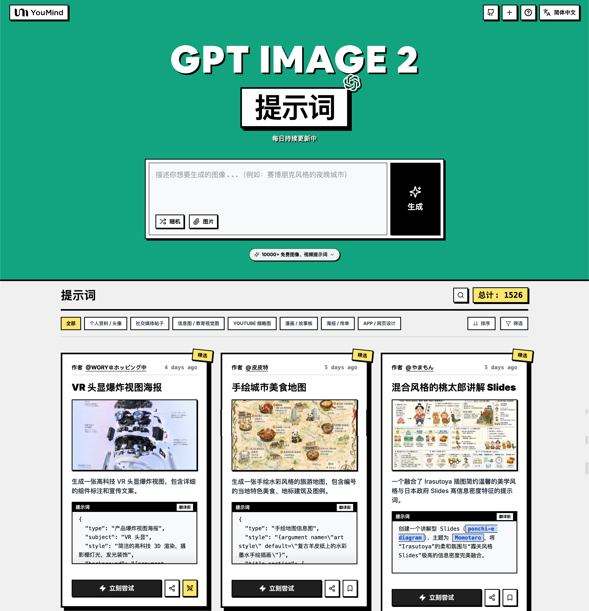

<a href="https://youmind.com/zh-TW/gpt-image-2-prompts">
  
</a>

> 💡 🎬 進階玩法：用 **Seedance 2** 把 GPT Image 2 生成的圖變成炸裂 AI 影片，2000+ 提示詞等你探索 👉 [awesome-seedance-2-prompts](https://github.com/YouMind-OpenLab/awesome-seedance-2-prompts)
# 🚀 GPT Image 2 提示詞大全

[](https://github.com/sindresorhus/awesome)
[](https://github.com/YouMind-OpenLab/awesome-gpt-image-2)
[](https://creativecommons.org/licenses/by/4.0/)
[](https://github.com/YouMind-OpenLab/awesome-gpt-image-2/actions)
[](docs/CONTRIBUTING.md)

> 🎨 OpenAI GPT Image 2 創意提示詞精選集合

> ⚠️ **版權聲明**：所有提示詞均收集自社區，僅供教育目的使用。如果您認為任何內容侵犯了您的權利，請[提交 issue](https://github.com/YouMind-OpenLab/awesome-gpt-image-2/issues/new?template=bug-report.yml)，我們將立即移除。

---

[](README.md) [](README_zh.md) [](README_zh-TW.md) [](README_ja-JP.md) [](README_ko-KR.md) [](README_th-TH.md) [](README_vi-VN.md) [](README_hi-IN.md) [](README_es-ES.md) [-Click%20to%20View-lightgrey)](README_es-419.md) [](README_de-DE.md) [](README_fr-FR.md) [](README_it-IT.md) [-Click%20to%20View-lightgrey)](README_pt-BR.md) [](README_pt-PT.md) [](README_tr-TR.md)

---

## 🌐 在網頁圖庫中查看

<div align="center">

[](https://youmind.com/zh-TW/gpt-image-2-prompts)

</div>

**[👉 瀏覽 YouMind GPT Image 2 提示詞圖庫](https://youmind.com/zh-TW/gpt-image-2-prompts)**

為什麼使用圖庫？

| Feature | GitHub README | youmind.com 圖庫 |
|---------|--------------|---------------------|
| 🎨 可視化佈局 | 線性列表 | 精美的瀑布流網格 |
| 🔍 搜索 | 僅 Ctrl+F | 全文搜索和篩選 |
| 🤖 AI 一鍵生圖 | - | AI 一鍵生圖 |
| 📱 移動端 | 基礎 | 完全響應式 |
| 🏷️ 分類 | - | 分類瀏覽 |


### 🏷️ 按分類瀏覽

- **使用情境**
  - [個人檔案 / 頭像](https://youmind.com/zh-TW/gpt-image-2-prompts?categories=profile-avatar)
  - [社群媒體貼文](https://youmind.com/zh-TW/gpt-image-2-prompts?categories=social-media-post)
  - [資訊圖表 / 教育視覺化內容](https://youmind.com/zh-TW/gpt-image-2-prompts?categories=infographic-edu-visual)
  - [YouTube 縮圖](https://youmind.com/zh-TW/gpt-image-2-prompts?categories=youtube-thumbnail)
  - [漫畫 / 分鏡腳本](https://youmind.com/zh-TW/gpt-image-2-prompts?categories=comic-storyboard)
  - [產品行銷](https://youmind.com/zh-TW/gpt-image-2-prompts?categories=product-marketing)
  - [電子商務主圖](https://youmind.com/zh-TW/gpt-image-2-prompts?categories=ecommerce-main-image)
  - [遊戲素材](https://youmind.com/zh-TW/gpt-image-2-prompts?categories=game-asset)
  - [海報／傳單](https://youmind.com/zh-TW/gpt-image-2-prompts?categories=poster-flyer)
  - [App / 網站設計](https://youmind.com/zh-TW/gpt-image-2-prompts?categories=app-web-design)
- **風格**
  - [攝影](https://youmind.com/zh-TW/gpt-image-2-prompts?categories=photography)
  - [電影感 / 電影劇照](https://youmind.com/zh-TW/gpt-image-2-prompts?categories=cinematic-film-still)
  - [動畫 / 漫畫](https://youmind.com/zh-TW/gpt-image-2-prompts?categories=anime-manga)
  - [插圖](https://youmind.com/zh-TW/gpt-image-2-prompts?categories=illustration)
  - [草圖 / 線稿](https://youmind.com/zh-TW/gpt-image-2-prompts?categories=sketch-line-art)
  - [漫畫 / 圖像小說](https://youmind.com/zh-TW/gpt-image-2-prompts?categories=comic-graphic-novel)
  - [3D 渲染](https://youmind.com/zh-TW/gpt-image-2-prompts?categories=3d-render)
  - [Q 版風格](https://youmind.com/zh-TW/gpt-image-2-prompts?categories=chibi-q-style)
  - [等距視角](https://youmind.com/zh-TW/gpt-image-2-prompts?categories=isometric)
  - [像素藝術](https://youmind.com/zh-TW/gpt-image-2-prompts?categories=pixel-art)
  - [油畫](https://youmind.com/zh-TW/gpt-image-2-prompts?categories=oil-painting)
  - [水彩](https://youmind.com/zh-TW/gpt-image-2-prompts?categories=watercolor)
  - [水墨 / 中式風格](https://youmind.com/zh-TW/gpt-image-2-prompts?categories=ink-chinese-style)
  - [復古 / 懷舊](https://youmind.com/zh-TW/gpt-image-2-prompts?categories=retro-vintage)
  - [賽博龐克 / 科幻](https://youmind.com/zh-TW/gpt-image-2-prompts?categories=cyberpunk-sci-fi)
  - [極簡主義](https://youmind.com/zh-TW/gpt-image-2-prompts?categories=minimalism)
- **主體**
  - [人像 / 自拍](https://youmind.com/zh-TW/gpt-image-2-prompts?categories=portrait-selfie)
  - [網紅 / 模特兒](https://youmind.com/zh-TW/gpt-image-2-prompts?categories=influencer-model)
  - [角色](https://youmind.com/zh-TW/gpt-image-2-prompts?categories=character)
  - [團體 / 情侶](https://youmind.com/zh-TW/gpt-image-2-prompts?categories=group-couple)
  - [產品](https://youmind.com/zh-TW/gpt-image-2-prompts?categories=product)
  - [食物 / 飲品](https://youmind.com/zh-TW/gpt-image-2-prompts?categories=food-drink)
  - [時尚單品](https://youmind.com/zh-TW/gpt-image-2-prompts?categories=fashion-item)
  - [動物 / 生物](https://youmind.com/zh-TW/gpt-image-2-prompts?categories=animal-creature)
  - [車輛](https://youmind.com/zh-TW/gpt-image-2-prompts?categories=vehicle)
  - [建築 / 室內設計](https://youmind.com/zh-TW/gpt-image-2-prompts?categories=architecture-interior)
  - [風景 / 大自然](https://youmind.com/zh-TW/gpt-image-2-prompts?categories=landscape-nature)
  - [城市景觀 / 街道](https://youmind.com/zh-TW/gpt-image-2-prompts?categories=cityscape-street)
  - [圖表](https://youmind.com/zh-TW/gpt-image-2-prompts?categories=diagram-chart)
  - [文字 / 字體排版](https://youmind.com/zh-TW/gpt-image-2-prompts?categories=text-typography)
  - [摘要 / 背景](https://youmind.com/zh-TW/gpt-image-2-prompts?categories=abstract-background)

---

## 📖 目錄

- [🌐 在網頁圖庫中查看](#-view-in-web-gallery)
- [🤔 什麼是 GPT Image 2？](#-what-is-gpt-image-2)
- [📊 統計數據](#-statistics)
- [🔥 精選提示詞](#-featured-prompts)
- [📋 所有提示詞](#-all-prompts)
- [🤝 如何貢獻](#-how-to-contribute)
- [📄 許可證](#-license)
- [🙏 致謝](#-acknowledgements)
- [⭐ Star 歷史](#-star-history)

---

## 🤔 什麼是 GPT Image 2？

**GPT Image 2**（代號 **"duct-tape"**）是 OpenAI 下一代圖像生成模型。社群測試回饋它在以下方面實現了質的飛躍：

- 🎯 **像素級文字渲染** — 中文、英文、日文均達到 native 水準，無錯字、無字形扭曲
- 🎨 **跨圖像素級一致性** — 同一角色、風格、IP 在多張圖間保持像素級一致
- ⚡ **商用級插畫質量** — 插畫風格輸出無需人工精修，即可直接用於商業場景
- 🌈 **真實藝術風格注入** — 不止是「模仿參考圖」，而是真正理解並再現藝術風格的靈魂
- 🔧 **故事板與產品系列** — 適合故事板、IP 形象、產品系列圖等需要多圖一致性的場景
- 📐 **多語言平面設計** — 社交卡片、Banner、海報一次生圖即可完成多語言文字排版

📚 **了解更多：** 查看社群測試 [報告要點](docs/FAQ.md)

### 🚀 Raycast 集成

部分提示詞支持使用 [Raycast Snippets](https://raycast.com/help/snippets) 語法的**動態參數**。尋找 🚀 Raycast Friendly 徽章！

**示例：**
```
A quote card with "{argument name="quote" default="Stay hungry, stay foolish"}"
by {argument name="author" default="Steve Jobs"}
```

在 Raycast 中使用時，您可以動態替換參數以快速迭代！

---

## 📊 統計數據

<div align="center">

| 指標 | 數量 |
|--------|-------|
| 📝 提示詞總數 | **17906** |
| ⭐ 精選 | **6** |
| 🔄 最後更新 | **2026年10月17日 星期六 凌晨1:59:11 [UTC]** |

</div>

---

## 🔥 精選提示詞

> ⭐ 由我們的團隊精心挑選，具有卓越的質量和創造力

### No. 1: VR 頭戴裝置爆炸圖海報


#### 📖 描述

生成一張高科技 VR 頭戴裝置爆炸圖，包含詳細的組件標註與宣傳文案。

#### 📝 提示詞

```
{
  "type": "產品爆炸圖海報",
  "subject": "VR 頭戴裝置",
  "style": "簡潔的高科技 3D 渲染，攝影棚燈光，發光細節",
  "background": "{argument name=\"background color\" default=\"柔和的紫藍色漸層\"}",
  "header": {
    "logo": "∞ {argument name=\"product name\" default=\"Meta Quest 3\"}",
    "subtitle": "{argument name=\"main catchphrase\" default=\"以全新的結構，定義全新的現實。\"}"
  },
  "layout": {
    "centerpiece": "垂直堆疊的 VR 頭戴裝置爆炸圖，展示 9 個不同的內部組件層：外殼、攝影機感測器、主機板與晶片、Pancake 透鏡、內部框架、電池組、側邊頭帶、頂部頭帶以及面部襯墊。",
    "callout_labels": {
      "count": 8,
      "left_side": [
        "Snapdragon® XR2 Gen 2\n以強大的處理效能，實現即時體驗。",
        "可調式 IPD 機構\n為廣大用戶提供舒適的配戴感。",
        "精密設計頭帶\n追求舒適與穩定性的工學設計。"
      ],
      "right_side": [
        "前飾板\n洗鍊的設計與最佳的重量平衡。",
        "追蹤攝影機\n實現高精度的位置追蹤與環境感知。",
        "Pancake 透鏡\n輕薄設計，提供寬廣視野與清晰影像。",
        "高效能電池\n支援長時間運作的最佳化電源設計。",
        "柔軟面部襯墊\n即使長時間配戴也能保持舒適。"
      ]
    },
    "footer": {
      "left_text_block": {
        "headline": "{argument name=\"bottom headline\" default=\"體驗，從結構進化。\"}",
        "body": "每一個零件都蘊含著支撐沉浸式體驗的尖端科技與匠心設計。Meta Quest 3 從內部結構開始，為您創造感受未來的體驗。"
      },
      "right_logo": "∞ Meta"
    }
  }
}
```

#### 🖼️ 生成圖片

##### Image 1

<div align="center">

</div>

#### 📌 詳情

- **作者:** [wory＠ホッピング中](https://x.com/wory37303852)
- **來源:** [Twitter Post](https://x.com/wory37303852/status/2045925660401795478#reversed-0)
- **發布時間:** 2026年4月19日
- **多語言:** en

**[👉 立即嘗試 →](https://youmind.com/zh-TW/gpt-image-2-prompts?id=13460)**

---

### No. 2: 手繪城市美食地圖


#### 📖 描述

生成一張手繪水彩風格的旅遊地圖，包含編號的在地特色美食、地標以及圖例。

#### 📝 提示詞

```
{
  "type": "手繪地圖資訊圖表",
  "style": "{argument name=\"art style\" default=\"復古羊皮紙上的水彩與墨水手繪插圖\"}",
  "title_section": {
    "text": "{argument name=\"city name\" default=\"成都\"} {argument name=\"map title\" default=\"吃貨暴走地圖\"}",
    "mascot": "戴著太陽眼鏡並比讚的卡通紅辣椒"
  },
  "border": "{argument name=\"border decoration\" default=\"綠葉與紅辣椒藤蔓\"}",
  "layout": {
    "background": "帶有黃色道路、藍色河流與綠色公園區域的質感米色羊皮紙",
    "sections": [
      {
        "title": "地標",
        "count": 6,
        "illustrations": ["傳統涼亭", "傳統寺院", "攀爬著熊貓的現代摩天大樓", "高聳電視塔", "傳統牌樓", "工業建築"],
        "labels": ["人民公園", "文殊院", "IFS", "339電視塔", "寬窄巷子", "東郊記憶"]
      },
      {
        "title": "美食景點",
        "count": 12,
        "illustrations": ["麻婆豆腐", "紅油水餃", "串串香", "三大炮", "蛋烘糕", "九宮格火鍋", "肥腸粉", "缽缽雞", "冒椒火辣", "蓋碗茶", "冰粉", "雙流老媽兔頭"],
        "labels": ["1 陳麻婆豆腐", "2 鍾水餃", "3 春熙路", "4 寬窄巷子·三大炮", "5 建設路·葉婆婆蛋烘糕", "6 玉林路·小龍坎火鍋", "7 香香巷·肥腸粉", "8 武侯祠大街·缽缽雞", "9 東郊記憶·冒椒火辣", "10 人民公園·鶴鳴茶社", "11 錦里古街·冰粉", "12 雙流老媽兔頭"]
      },
      {
        "title": "圖例",
        "position": "右下角",
        "count": 5,
        "items": ["紅點", "綠色房屋", "綠樹", "藍線", "黃色雙線"],
        "labels": ["美食地點", "地標景點", "公園綠地", "河流湖泊", "主要道路"]
      }
    ],
    "centerpiece": "坐著吃竹子的巨型熊貓",
    "bottom_right_extras": ["帶有 N、S、E、W 的復古羅盤玫瑰", "免責聲明文字『溫馨提示：吃辣需謹慎，腸胃要保護~』並附帶一個紅辣椒圖示"]
  }
}
```

#### 🖼️ 生成圖片

##### Image 1

<div align="center">

</div>

#### 📌 詳情

- **作者:** [皮皮特](https://x.com/mm_zzm44854)
- **來源:** [Twitter Post](https://x.com/mm_zzm44854/status/2045861258520568230#reversed-1)
- **發布時間:** 2026年4月19日
- **多語言:** en

**[👉 立即嘗試 →](https://youmind.com/zh-TW/gpt-image-2-prompts?id=13515)**

---

### No. 3: 採用混合風格的桃太郎說明用 Slides


#### 📖 描述

這是一個結合了「いらすとや (Irasutoya)」插圖簡約溫暖的美學，以及日本政府簡報高資訊密度特徵的提示詞。

#### 📝 提示詞

```
請為 {argument name="theme" default="桃太郎"} 製作一張說明用 Slides ({argument name="format" default="ポンチ絵 (ponchi-e) 圖表"})，將「いらすとや (Irasutoya)」的溫和氛圍與「霞關風格 (Kasumigaseki slides)」那種壓倒性的資訊密度融合在一起。
```

#### 🖼️ 生成圖片

##### Image 1

<div align="center">

</div>

##### Image 2

<div align="center">

</div>

#### 📌 詳情

- **作者:** [やまもん](https://x.com/yammamon)
- **來源:** [Twitter Post](https://x.com/yammamon/status/2045778624092254603)
- **發布時間:** 2026年4月19日
- **多語言:** ja

**[👉 立即嘗試 →](https://youmind.com/zh-TW/gpt-image-2-prompts?id=13983)**

---

### No. 4: 電子商務直播 UI 模型


#### 📖 描述

生成逼真的社群媒體直播介面並疊加在肖像上，包含可自訂的聊天訊息、禮物彈出視窗以及商品購買卡片。

#### 📝 提示詞

```
{
  "type": "直播 UI 模型",
  "subject": {
    "description": "{argument name=\"host name\" default=\"Elon Musk\"} 的肖像，微笑，穿著印有白色技術示意圖的黑色 T 恤",
    "background": "左側顯示帶有 '{argument name=\"left background logo\" default=\"SPACEX\"}' 文字的螢幕，右側顯示紅色的 '{argument name=\"right background logo\" default=\"Tesla T logo\"}' 和一輛深色汽車"
  },
  "ui_overlay": {
    "top_header": {
      "host_info": "頭像，名稱 '{argument name=\"host name\" default=\"Elon Musk\"}'，副標題 '55.6 萬本場點讚'，紅色 '關注' 按鈕",
      "rank_badge": "帶有 '全站第 1 名' 的金幣圖示",
      "viewer_stats": "3 個頂級觀眾頭像，分別顯示 '12.3w'、'8.6w'、'5.7w'，總計 '68.7 萬'，'X' 關閉按鈕",
      "right_links": "'更多直播 >'，'禮物展館 0/24' 帶有藍色 '經典' 標籤"
    },
    "mid_left_gifts": {
      "count": 2,
      "items": [
        "頭像 '科技愛好者'，'送小心心'，愛心圖示 x 1314",
        "頭像 '星辰大海'，'送火箭'，火箭圖示 x 666"
      ]
    },
    "bottom_left_chat": {
      "system_message": "等級 37 徽章 '宇宙漫遊者 加入了直播間'",
      "message_count": 7,
      "messages": [
        "小火箭: 馬斯克！未來可期！🚀",
        "future: 特斯拉 Model 2 什麼時候出？",
        "星空夢想家: SpaceX 今年能上火星嗎？",
        "AI 探索者: Neuralink 進展如何？",
        "帥氣的網友: 馬總好！",
        "Mars: 第一次來你的直播，超激動！",
        "用戶 123: 講講 AI 吧，會取代人類嗎？"
      ]
    },
    "bottom_right_product_card": {
      "hot_tag": "橘色 '熱賣 x 1888'",
      "image": "Tesla Cybertruck",
      "title": "{argument name=\"product name\" default=\"特斯拉 Cybertruck 電動皮卡\"}",
      "price": "{argument name=\"product price\" default=\"¥ 1,618,000\"}",
      "button": "紅色 '搶' 按鈕",
      "floating_animation": "半透明愛心沿著右側邊緣向上飄浮"
    },
    "bottom_bar": {
      "input_field": "'說點什麼...'",
      "icons": ["笑臉", "三個點", "購物車", "禮物盒", "分享"]
    }
  }
}
```

#### 🖼️ 生成圖片

##### Image 1

<div align="center">

</div>

#### 📌 詳情

- **作者:** [神经病不想好转](https://x.com/sjbbxhz)
- **來源:** [Twitter Post](https://x.com/sjbbxhz/status/2045684734714380687#reversed-0)
- **發布時間:** 2026年4月19日
- **多語言:** en

**[👉 立即嘗試 →](https://youmind.com/zh-TW/gpt-image-2-prompts?id=14036)**

---

### No. 5: 動漫武術對決


#### 📖 描述

生成一個動態的動漫風格動作場景，描繪兩名角色在傳統道場中伴隨元素光環進行戰鬥。

#### 📝 提示詞

```
一張極具動態感的動漫插圖，描繪兩名少女在傳統木造道場內進行激烈的武術對決。在前景中，一名留著 {argument name="character 1 hair" default="黑色高包頭配紅色髮帶"} 的少女擺出強而有力的低位武術架勢，奮力向前揮拳。她身穿 {argument name="character 1 outfit" default="白色中式上衣配紅色流蘇與寬鬆紅褲"}，強烈的紅色能量斬擊環繞著她揮動的四肢。在右側半空中，一名留著 {argument name="character 2 hair" default="淺紫色雙包頭"} 的少女優雅地躍起，自信地微笑著，身穿 {argument name="character 2 outfit" default="深綠色刺繡金邊洋裝與黑色緊身褲"}，伴隨著如水流般掃過的藍色能量軌跡。背景為古樸的木造寺廟內部，上方懸掛著一塊顯眼的招牌，寫著「{argument name="sign text" default="武術会"}」。場景充滿了爆炸性的動作張力、飛揚的塵土、碎裂的木質地板、閃耀的彩色粒子特效，以及將角色與細緻背景完美區隔的戲劇性低角度光影。
```

#### 🖼️ 生成圖片

##### Image 1

<div align="center">

</div>

#### 📌 詳情

- **作者:** [たねもみ 2.0 / Tanemomi Ver2.0](https://x.com/Tanemomi_Ver2)
- **來源:** [Twitter Post](https://x.com/Tanemomi_Ver2/status/2046063806846214265#reversed-0)
- **發布時間:** 2026年4月20日
- **多語言:** en

**[👉 立即嘗試 →](https://youmind.com/zh-TW/gpt-image-2-prompts?id=13467)**

---

### No. 6: 3D 石階演化資訊圖表


#### 📖 描述

將平面的演化時間軸轉換為逼真的 3D 石階資訊圖表，包含細緻的生物渲染圖與結構化的側邊欄。

#### 📝 提示詞

```
{
  "type": "演化時間軸資訊圖表",
  "instruction": "以 REFERENCE_0 作為結構基礎，將平面向量設計轉換為高度逼真的 3D 資訊圖表。將平滑的坡道替換為層次分明的石階，並將所有生物升級為照片級的 3D 模型。",
  "style": {
    "background": "{argument name=\"background style\" default=\"復古紋理羊皮紙\"}",
    "staircase": "{argument name=\"staircase material\" default=\"逼真的紋理石塊\"}",
    "subjects": "{argument name=\"organism style\" default=\"高度細緻的照片級 3D 渲染圖\"}"
  },
  "layout": {
    "main_title": "{argument name=\"main title\" default=\"人類演化\"}",
    "sections": [
      {
        "position": "左側邊欄",
        "count": 8,
        "labels": ["L0: 單細胞生命", "L1: 多細胞生物", "L2: 動物界", "L3: 脊索動物", "L4: 上陸革命", "L5: 哺乳綱", "L6: 人科演化", "L7: 智人紀元"]
      },
      {
        "position": "右上角",
        "title": "獲得的功能 / 失去的功能",
        "description": "帶有加號與減號圖示的圖例"
      },
      {
        "position": "底部中央",
        "title": "演化關鍵里程碑",
        "count": 6,
        "description": "包含 6 個展示猿類到人類演化剪影圖的時間軸"
      }
    ],
    "centerpiece": {
      "description": "蜿蜒的石階，共有 25 個編號階梯，展示特定生物。",
      "count": 25,
      "notable_elements": [
        "第 07 階：水母",
        "第 09 階：菊石",
        "第 10 階：三葉蟲",
        "第 24 階：直立行走的人類",
        "第 25 階：{argument name=\"future evolution concept\" default=\"帶有問號的發光宇宙剪影\"}"
      ]
    }
  }
}
```

#### 🖼️ 生成圖片

##### Image 1

<div align="center">

</div>

#### 📌 詳情

- **作者:** [知识猫图解](https://x.com/GeekCatX)
- **來源:** [Twitter Post](https://x.com/GeekCatX/status/2045792240044511277#reversed-1)
- **發布時間:** 2026年4月19日
- **多語言:** en

**[👉 立即嘗試 →](https://youmind.com/zh-TW/gpt-image-2-prompts?id=13491)**

---

## 📋 所有提示詞

> 📝 按發布日期排序（最新優先）

### No. 1: 個人檔案 / 頭像 - ChatGPT Image 2 秋季穿搭提示詞


#### 📖 描述

使用 ChatGPT Image 2 生成帶有格紋襯衫與皮夾克的可愛秋季時尚圖片的提示詞。

#### 📝 提示詞

```
可愛風，格紋上衣，格紋短褲，皮夾克，異材質混搭秋季造型，又酷又可愛，時尚姿勢，傑作，最佳品質
```

#### 🖼️ 生成圖片

##### Image 1

<div align="center">

</div>

##### Image 2

<div align="center">

</div>

#### 📌 詳情

- **作者:** [のぞむ＊AIイラスト](https://x.com/ArtistaNozomu)
- **來源:** [Twitter Post](https://x.com/ArtistaNozomu/status/2110990374768680975)
- **發布時間:** 2026年10月16日
- **多語言:** ja

**[👉 立即嘗試 →](https://youmind.com/zh-TW/gpt-image-2-prompts?id=36499)**

---

### No. 2: 個人檔案 / 頭像 - 萬聖節糖果口袋洋裝提示詞


#### 📖 描述

適用於 ChatGPT Image 2 的詳細日文提示詞，用於生成身穿萬聖節洋裝、口袋裡裝滿糖果的動漫風格女孩。

#### 📝 提示詞

```
柔和粉彩動漫風格。一名身穿「不給糖就搗蛋」主題萬聖節洋裝的女孩。
服裝為自然米色的露肩迷你洋裝。裙擺一側有一個類似零食袋的大口袋。
糖果和小餅乾從口袋開口處探出。
腰間繫著一條細橙色緞帶。
肩上披著短斗篷，斗篷末端像束口袋一樣打結。
頭上沒有戴帽子。一手拿著零食袋，另一手展示口袋。
背景是夜晚的房屋前，有燈光點綴。
配色為自然米色、蜂蜜色、淡橙色和夜空藍。
全身構圖，正準備分享甜點。帶著幸福的笑容。
```

#### 🖼️ 生成圖片

##### Image 1

<div align="center">

</div>

##### Image 2

<div align="center">

</div>

#### 📌 詳情

- **作者:** [のぞむ＊AIイラスト](https://x.com/ArtistaNozomu)
- **來源:** [Twitter Post](https://x.com/ArtistaNozomu/status/2110929977273188687)
- **發布時間:** 2026年10月16日
- **多語言:** ja

**[👉 立即嘗試 →](https://youmind.com/zh-TW/gpt-image-2-prompts?id=36504)**

---

### No. 3: 個人檔案 / 頭像 - 廢墟實驗室中的外星新娘


#### 📖 描述

一幅超現實肖像，描繪了一位身穿婚紗、戴著耳機的女性外星人，坐在被摧毀的實驗室中。

#### 📝 提示詞

```
一張超寫實的全景照片，展示了一位皮膚呈淺灰色、擁有巨大黑眼睛的女性外星人，她坐在一張破舊的皮革扶手椅上。她身穿蓬鬆的白色薄紗婚紗，腳踩白色厚底高跟鞋。頭上戴著銀色耳機，左手扶著其中一個耳罩，神情嚴肅地直視鏡頭。背景是一間破敗不堪、宛如廢墟的實驗室或工業空間，地板上散落著碎片、破碎的玻璃、老式電腦螢幕，左側桌上則擺放著燒杯等科學儀器。遠處可見在陰沉天空下被摧毀的城市天際線。整體光線充滿情緒感與電影質感，強調薄紗面料的紋理與粗糲環境之間的對比。
```

#### 🖼️ 生成圖片

##### Image 1

<div align="center">

</div>

#### 📌 詳情

- **作者:** [VERA 100%](https://x.com/Ledi_ru_noch)
- **來源:** [Twitter Post](https://x.com/Ledi_ru_noch/status/2110906954327466040#reversed-0)
- **發布時間:** 2026年10月16日
- **多語言:** en

**[👉 立即嘗試 →](https://youmind.com/zh-TW/gpt-image-2-prompts?id=36508)**

---

### No. 4: 個人檔案 / 頭像 - 廢墟大教堂中的兜帽旅人


#### 📖 描述

生成一個情緒化的夜晚場景提示詞：在廢墟大教堂內，月光透過玫瑰窗照亮一位兜帽旅人。

#### 📝 提示詞

```
夜晚的廢墟大教堂。月光透過玫瑰窗灑下花紋般的陰影，沿著走道鋪成一條小徑，而一位兜帽旅人正站立其上。
```

#### 🖼️ 生成圖片

##### Image 1

<div align="center">

</div>

#### 📌 詳情

- **作者:** [AI Art Alley](https://x.com/aiartalley)
- **來源:** [Twitter Post](https://x.com/aiartalley/status/2110732531876122650)
- **發布時間:** 2026年10月15日
- **多語言:** en

**[👉 立即嘗試 →](https://youmind.com/zh-TW/gpt-image-2-prompts?id=36505)**

---

### No. 5: 個人檔案 / 頭像 - 昭和復古風浴衣少女


#### 📖 描述

一張充滿懷舊氛圍的肖像照，描繪一位身穿藍色花卉浴衣、手持波子汽水（Ramune）的少女，背景為傳統紅色暖簾。

#### 📝 提示詞

```
這是一張垂直構圖的肖像攝影作品，呈現昭和時代的復古風格。畫面中，一位年輕亞洲女性回眸直視鏡頭。她留著深棕色長髮與輕盈瀏海，頭部左側佩戴精緻的花卉髮飾（Kanzashi），由淺藍色與白色布料花朵組成，並垂掛珍珠串飾。她的膚色白皙，保留自然紋理，包括雀斑與微小瑕疵，展現未經修飾的真實質感。她身著傳統浴衣（夏季和服），白底上印有大型藍色牽牛花圖案，腰間繫著純淺藍色寬腰帶（Obi）。她雙手在胸前握著一瓶透明玻璃裝的波子汽水（Ramune），瓶內可見彈珠封口。背景略微失焦，但清晰可見帶有白色書法字樣及招財貓（Maneki-neko）圖案的紅色暖簾，暗示傳統店鋪或祭典場景。整體影像具有復古膠片美學，色調溫暖，帶有輕微顆粒感，邊緣環繞著做舊的白色邊框。
```

#### 🖼️ 生成圖片

##### Image 1

<div align="center">

</div>

#### 📌 詳情

- **作者:** [拓斗](https://x.com/Kmsbdd0GXBOcrXQ)
- **來源:** [Twitter Post](https://x.com/Kmsbdd0GXBOcrXQ/status/2110668165311279606#reversed-0)
- **發布時間:** 2026年10月15日
- **多語言:** en

**[👉 立即嘗試 →](https://youmind.com/zh-TW/gpt-image-2-prompts?id=36507)**

---

### No. 6: 個人檔案 / 頭像 - 紫色上衣搭配黑色短褲造型提示詞


#### 📖 描述

使用 ChatGPT Image 2 生成優雅紫色與黑色穿搭圖片的提示詞。

#### 📝 提示詞

```
穿搭：

柔軟的紫色上衣搭配簡約的黑色短褲。

搭配高跟鞋。

乾淨、女性化且帶有輕微優雅感的時尚美學。
紫色與黑色的配色方案。
無額外裝飾。
```

#### 🖼️ 生成圖片

##### Image 1

<div align="center">

</div>

##### Image 2

<div align="center">

</div>

#### 📌 詳情

- **作者:** [のぞむ＊AIイラスト](https://x.com/ArtistaNozomu)
- **來源:** [Twitter Post](https://x.com/ArtistaNozomu/status/2110627986869543109)
- **發布時間:** 2026年10月15日
- **多語言:** en

**[👉 立即嘗試 →](https://youmind.com/zh-TW/gpt-image-2-prompts?id=36446)**

---

### No. 7: 個人檔案 / 頭像 - 復古日本泳裝人像


#### 📖 描述

一張復古風格的年輕女子泳裝肖像，她指向鏡頭，畫面帶有彷彿來自舊雜誌掃描的日本文字疊加效果。

#### 📝 提示詞

```
這是一張垂直構圖的全身照，拍攝了一位站在戶外游泳池旁的年輕日本女性。她留著黑色短鮑伯頭，身穿深藍色連身泳衣。她的右手直接指向鏡頭，左臂則自然垂於身側。她的表情平靜且略顯嚴肅。背景是一個公共游泳池，水中有其他游泳者，後方還有建築結構。整張圖片呈現出昭和時代（1970/80 年代）攝影特有的復古顆粒質感。畫面的左右兩側均有直排的日本文字，類似雜誌版面或相簿頁的設計。光線為明亮的日光。
```

#### 🖼️ 生成圖片

##### Image 1

<div align="center">

</div>

#### 📌 詳情

- **作者:** [拓斗](https://x.com/Kmsbdd0GXBOcrXQ)
- **來源:** [Twitter Post](https://x.com/Kmsbdd0GXBOcrXQ/status/2110571197650133503#reversed-0)
- **發布時間:** 2026年10月15日
- **多語言:** en

**[👉 立即嘗試 →](https://youmind.com/zh-TW/gpt-image-2-prompts?id=36460)**

---

### No. 8: 個人檔案 / 頭像 - 萬聖節蜘蛛網蕾絲洋裝提示詞


#### 📖 描述

使用 ChatGPT Image 2 生成萬聖節主題蜘蛛網蕾絲洋裝圖片的詳細提示詞。

#### 📝 提示詞

```
🕸️ 月光下的萬聖節夜會 - 蜘蛛網蕾絲洋裝

[長寬比] 4:5 直式

[最重要：角色重現]

請將附件中的角色圖像作為最重要的參考依據。

忠實保留面部特徵、眼睛顏色與形狀、髮型、髮色、瀏海、輪廓、年齡感以及人物柔和的氣質。請勿改變角色身份。

高清粉彩少女漫畫/動畫風格。精緻的线条藝術與透明柔和的上色。

[主題]

一位可愛的成年女性前往月光下的萬聖節夜會。

在優雅浪漫的氛圍中，透過蜘蛛網蕾絲增添微妙的哥德風情。

[服裝]

薰衣草紫露肩迷你連身裙。

胸前點綴精緻荷葉邊與小珍珠裝飾。

腰間繫上細黑色緞帶蝴蝶結，強調纖細身形。

裙擺由柔軟薰衣草紫布料覆蓋透明白色薄紗製成，營造蓬鬆擴張的設計感。

🕸️ 蜘蛛網刺繡（重要）

不僅將蜘蛛網表現為蕾絲圖案，更將其呈現為象徵萬聖節的美麗刺繡。

在裙擺整體下緣佈滿大小不一的精緻蜘蛛網刺繡。

在裙子中段以較寬間距添加更多蜘蛛網刺繡。

網線基底採用近白色奶油色，部分區域使用極細墨黑色線條。

確保放射狀與弧狀網線清晰可見，形成自然優美的造型。

中等密度的刺繡。保留足夠的留白與織物透明度。

透過蕾絲層疊效果，使蜘蛛網呈現立體突出的視覺感。

確保與背景薰衣草紫適度對比，讓蜘蛛網圖案從遠處亦能辨識。

[短披肩]

肩部搭配短款奶油色披肩。

沿邊緣施加精緻蜘蛛網刺繡，多處編入極細墨黑線條。

與裙擺統一使用相同蜘蛛網圖樣，打造輕盈優雅的質感。

[配飾]

不戴帽子。

頸部佩戴小巧可愛的不規則造型蜘蛛胸針。結合黑色與薰衣草紫寶石的精緻設計。

披肩邊緣懸掛一個小蜘蛛吊飾。

髮飾為低調奶油色緞帶。

鞋子為淺薰衣草紫綁帶高跟鞋。

[姿勢與表情]

構圖需展現全身自然狀態。

雙手輕提裙擺兩側，展示蜘蛛網刺繡的美麗展開。

優雅自然的站姿，一隻腳微微前伸。

面向觀者展露安靜愉悅的微笑。

符合成年女性典型體態與肢體平衡。

[背景]

巨大滿月照亮萬聖節夜晚。

深藍夜空飄著薄雲與點點繁星。

背景為柔光照射的哥德式豪宅。

遠處僅放置一個小型南瓜燈。

保持背景低調以突顯服裝，使人物與蜘蛛網蕾絲成為主要焦點。

[配色方案]

主色：淡薰衣草紫
副色：近白色奶油
強調色：細墨黑
背景：深夜藍
光線：柔和銀白月光

避免使用鮮豔橙色、過度黑色或過強對比。

[完成效果]

優雅、可愛且充滿奇幻感的粉彩萬聖節。

蜘蛛網刺繡清晰可見但不覆蓋整件洋裝。

高清描繪精緻蕾絲、柔軟荷葉邊及透光薄紗。

呈現美麗動人的萬聖節形象。
```

#### 🖼️ 生成圖片

##### Image 1

<div align="center">

</div>

#### 📌 詳情

- **作者:** [のぞむ＊AIイラスト](https://x.com/ArtistaNozomu)
- **來源:** [Twitter Post](https://x.com/ArtistaNozomu/status/2110567590632255535)
- **發布時間:** 2026年10月15日
- **多語言:** ja

**[👉 立即嘗試 →](https://youmind.com/zh-TW/gpt-image-2-prompts?id=36447)**

---

### No. 9: 個人檔案 / 頭像 - 霧紫灰調日本雜誌風格人像


#### 📖 描述

生成具有日本雜誌排版風格的寫實人像提示詞，特徵為低飽和度的霧紫與灰色調、柔和光線及檔案美學。

#### 📝 提示詞

```
{argument name="character" default="[角色描述]"}，真人角色，使用 Nokia 拍攝。
柔和角色設定人像 × 日本平面雜誌排版 × 平滑數位漸層搭配精細髮絲渲染 × 面部連續且微妙的光影漸層塑形。
正面全柔光，幾乎沒有明顯的陰影斷裂。
整體色彩調板採用霧紫色 / 象牙白 / 淺灰色，極低飽和度的冷色調。
主體居中於正面頭肩特寫構圖，面部結構清晰，邊緣留有空間供小型字體排印及檔案標籤區域使用。
```

#### 🖼️ 生成圖片

##### Image 1

<div align="center">

</div>

##### Image 2

<div align="center">

</div>

##### Image 3

<div align="center">

</div>

#### 📌 詳情

- **作者:** [VoxCat](https://x.com/VoxcatAI)
- **來源:** [Twitter Post](https://x.com/VoxcatAI/status/2110416845480366249)
- **發布時間:** 2026年10月14日
- **多語言:** zh

**[👉 立即嘗試 →](https://youmind.com/zh-TW/gpt-image-2-prompts?id=36452)**

---

### No. 10: 個人檔案 / 頭像 - 俯拍人物在沙發上熟睡


#### 📖 描述

用於生成頂視角生活方式照片的提示詞，描繪角色抱著抱枕、以毛絨玩具為枕頭，在沙發上安睡的場景。

#### 📝 提示詞

```
{argument name="subject" default="[主體描述]"}，室內生活方式攝影，俯視構圖。

角色躺在柔軟的沙發上休息或深度睡眠，身體自然側臥或微微蜷縮，雙手抱著柔軟的抱枕，頭部枕在毛絨玩具上將其作為枕頭。整體睡姿放鬆、自然且安靜，充滿居家感與些許可愛氣息。腿部可自然彎曲或輕輕收攏，身體與沙發形成柔和貼合，抱枕、玩具與人之間的關係清晰可見。

場景為舒適的室內空間，沙發柔軟舒適，周圍可自然包含靠墊、毯子、地毯、床頭燈、窗簾、書籍、雜誌或其他生活小物，營造安靜、放鬆、溫暖的居家氛圍。焦點突顯人、抱枕、毛絨玩具與沙發之間的親密關係，空間簡潔有序。

相機從上方往下拍攝，採用明顯的頂視角俯拍透視，清晰展現完整的躺臥姿勢、沙發佈局以及抱枕和玩具的位置關係。構圖自然，畫面乾淨，留有適度負空間。

光線柔和，可使用白天室內漫射自然光或溫暖柔和的室內燈光。整體氛圍安靜、療癒、舒適，具備高品質生活方式攝影質感，細節清晰，材質呈現柔軟寫實效果。3:4 直式圖片，右下角帶有微小的 voxcat 簽名。
```

#### 🖼️ 生成圖片

##### Image 1

<div align="center">

</div>

##### Image 2

<div align="center">

</div>

##### Image 3

<div align="center">

</div>

##### Image 4

<div align="center">

</div>

#### 📌 詳情

- **作者:** [VoxCat](https://x.com/VoxcatAI)
- **來源:** [Twitter Post](https://x.com/VoxcatAI/status/2110327539642343913)
- **發布時間:** 2026年10月14日
- **多語言:** zh

**[👉 立即嘗試 →](https://youmind.com/zh-TW/gpt-image-2-prompts?id=36453)**

---

### No. 11: 個人檔案 / 頭像 - 多符號複合表情系統


#### 📖 描述

為 GPT-image-2 設計的提示詞，將多個相互衝突的 Emoji 符號結合為單一自然表情，生成逼真的人臉。

#### 📝 提示詞

```
[角色]，成人寫實風格，保留角色的核心身分特徵。
多符號複合表情：🥺 😢 😼 (｡•́︿•̀｡) (¬‿¬)。
內側眉毛上揚，眼眶顯得濕潤，下唇微微抿起，但嘴角一側卻流露出壓抑不住的得意神情。
將多種情緒統一於一張自然、真實的臉龐，面部細節清晰，特寫人像攝影，3:4 直式構圖，右側邊緣帶有 tiny voxcat 簽名。
```

#### 🖼️ 生成圖片

##### Image 1

<div align="center">

</div>

##### Image 2

<div align="center">

</div>

##### Image 3

<div align="center">

</div>

##### Image 4

<div align="center">

</div>

#### 📌 詳情

- **作者:** [VoxCat](https://x.com/VoxcatAI)
- **來源:** [Twitter Post](https://x.com/VoxcatAI/status/2110209662687805886)
- **發布時間:** 2026年10月14日
- **多語言:** zh

**[👉 立即嘗試 →](https://youmind.com/zh-TW/gpt-image-2-prompts?id=36410)**

---

### No. 12: 個人檔案 / 頭像 - 動漫角色位於真實主體後方之提示詞


#### 📖 描述

用於生成圖像的詳細提示詞，其中一個小型動漫版本的主體站在真人後方並手持手電筒，營造輪廓光效果。使用 ChatGPT 上的 GPT Image 2。

#### 📝 提示詞

```
將主要主體轉化為逼真的攝影場景，特徵是在其正後方放置一個與同一人物相同的小型全身動漫/卡通版本。

主體保留：
完全保持真實主體不變。保留其確切的身份、面部特徵、髮型、服裝、配飾、身體比例、姿勢、位置、構圖和可辨識細節。不要修改原始主體。

動漫角色：
創建一個與同一主體相同的小型全身動漫/卡通版本。精確匹配原始髮型、服裝、配飾、顏色和可辨識的視覺細節。使用乾淨現代的動漫美學，具有清晰受控的线条、略大的頭部、緊湊的身體比例、富有表現力的面部細節和微妙的賽璐珞陰影。該角色應明顯類似於原始主體，同時保持有意風格化。

位置與動作：
將動漫角色直接放置在真實主體的後方，與原始身體位置自然對齊。動漫角色雙手持握手電筒，並將其向前指向主體的背部。

光照：
從主體後方產生強烈、逼真的白色手電筒光束。光束應從後方明顯照亮主體，沿輪廓創造強烈的自然邊緣光、微妙的環境光暈以及周圍環境中逼真的光線溢出。

在光束內添加受控的體積光，具有柔和衰減而非人工實心錐形。被照亮的邊緣應自然發光，不產生過度泛光。

環境：
略微調暗現有戶外環境光以創造更強的電影感對比，同時保留原始環境、顏色、紋理和光照邏輯。保持背景逼真且具攝影感。

陰影與深度：
根據手電筒方向創造物理上可信的陰影。維持動漫角色、真實主體和環境之間逼真的接觸陰影、光線衰減和深度。

構圖鎖定：
保留原始相機角度、透視、構圖、空間排列和整體構成。除了動漫角色及其手電筒外，不要移動、裁剪、替換、添加或移除環境元素。

風格：
結合寫實戶外攝影與乾淨現代動漫角色整合。動漫角色應看起來是有意繪製的，而真實主體和環境則保持完全攝影化。風格化角色與現實世界場景之間無縫的光照互動。

品質：
超寫實光照、電影感對比、逼真白光、自然邊緣光暈、微妙體積大氣、細節紋理、清晰主體分離、高動態範圍、專業攝影、4K。

禁止事項：
不要改變真實主體的身份、臉部、髮型、服裝、配飾、姿勢或比例。不要將真實主體
```

#### 🖼️ 生成圖片

##### Image 1

<div align="center">

</div>

##### Image 2

<div align="center">

</div>

#### 📌 詳情

- **作者:** [Visual AI Club](https://x.com/visualaiclub)
- **來源:** [Twitter Post](https://x.com/visualaiclub/status/2109924934340252026)
- **發布時間:** 2026年10月13日
- **多語言:** en

**[👉 立即嘗試 →](https://youmind.com/zh-TW/gpt-image-2-prompts?id=36402)**

---

### No. 13: 個人檔案 / 頭像 - Nokia 手機自拍搭配 Ragdoll 貓 Cosplay


#### 📖 描述

生成低解析度、2000 年代初期 Nokia 手機風格自拍照的提示詞，內容包含身穿 Ragdoll 貓 cosplay 的女性，並詳細描述特定的噪點、光線及背景細節。

#### 📝 提示詞

```
基於參考圖中的成年女性 cosplayer，保持主角臉部特徵、Ragdoll 貓主題服裝、黑色長髮、棕白色絨毛裝扮以及貓爪配件。

角色進行特寫自拍，身體略微前傾，頭部微側，輕嘟嘴，表情顯得困惑、不屑卻又可愛，直視鏡頭。

Ragdoll 貓的毛色與造型細節需嚴格遵循原始素材。

人物旁邊有一隻 Ragdoll 貓，前景則是一個藤編籃子，裡面裝著一隻毛茸茸的黃色小雞和一串深紫色葡萄。
人物、貓、小雞和葡萄自然地擠在同一個畫面中，形成一張荒謬卻充滿日常感的私人照片。

使用 2000 年代初期的舊款 Nokia 手機拍攝，呈現低像素彩色數位攝影效果，低解析度、輕微失焦、粗糙的數位噪點、JPEG 壓縮偽影、膚色輕微偏移、白平衡不均、動態範圍受限、邊緣柔和，陰影處有明顯的髒污噪點。

狹小的普通臥室，舊床鋪、木製家具、老式 CRT 電視自然進入背景。昏暗的室內環境光結合手機閃光燈直射，臉部輕微過曝，背景迅速衰減至黑暗。近距離廣角自拍視角，手臂伸向鏡頭產生明顯的近大遠小效果，構圖隨意，略微傾斜，彷彿朋友用舊手機拍下的私人照片。

整體呈現真實、廉價、粗糙的快照質感，無現代高清攝影紋理。僅保留極小的 fanfan 簽名。
```

#### 🖼️ 生成圖片

##### Image 1

<div align="center">

</div>

#### 📌 詳情

- **作者:** [花椰菜](https://x.com/indesjyo)
- **來源:** [Twitter Post](https://x.com/indesjyo/status/2108545119968477317)
- **發布時間:** 2026年10月9日
- **多語言:** zh

**[👉 立即嘗試 →](https://youmind.com/zh-TW/gpt-image-2-prompts?id=36219)**

---

### No. 14: 個人檔案 / 頭像 - 黃色編織角肖像


#### 📖 描述

這是一個逆向工程生成的提示詞，用於創作一幅引人注目的女性肖像，特徵為黃色編織角與頸部紋身。

#### 📝 提示詞

```
一張垂直構圖、低角度拍攝的中近景肖像，主角是一位年輕女性，擁有淺棕色皮膚，鼻樑與臉頰上佈滿明顯的雀斑。她眼神強烈且直視鏡頭，雙眼呈藍色，嘴唇豐厚。她的頭髮編成細長的黃色辮子，垂掛在臉的兩側，並裝飾著小巧的銀色珠子和圓環。頭頂伸出兩個粗大、雕塑般的角狀結構，由毛絨質感的黃色紗線或繩索製成，略微向上彎曲。她佩戴金色鼻中隔穿孔飾品和多枚垂墜式耳環。頸部前方覆蓋著黑色墨水紋身，呈現部落風格的漩渦圖案。她身穿質感針織毛衣，帶有芥末黃、白色和黑色的橫條紋，並搭配一條粗銀鏈項鍊。背景左側是清澈的藍天，右側則是模糊的灰色混凝土建築結構。光線為明亮的自然陽光，在她臉上投下清晰的陰影。
```

#### 🖼️ 生成圖片

##### Image 1

<div align="center">

</div>

#### 📌 詳情

- **作者:** [Jengo](https://x.com/jengo_ai_)
- **來源:** [Twitter Post](https://x.com/jengo_ai_/status/2108252992105328848#reversed-0)
- **發布時間:** 2026年10月8日
- **多語言:** en

**[👉 立即嘗試 →](https://youmind.com/zh-TW/gpt-image-2-prompts?id=36169)**

---

### No. 15: 個人檔案 / 頭像 - 幾何卡通雙人互動插畫


#### 📖 描述

用於創作現代幾何卡通插畫的提示詞，描繪兩個角色以 UPA 風格造型與有限動畫動作進行互動。

#### 📝 提示詞

```
{argument name="Character A" default="小明"} 和 {argument name="Character B" default="小紅"}，現代幾何卡通插畫 × UPA 風格造型語言 × 有限動畫動作設計 × 清晰數位扁平上色。

高度簡化的角色設計，由正方形、圓形、梯形和弧形構成頭部與身體。保留核心髮型、主色調、標誌性配件及服裝色塊。清晰流暢的粗黑輪廓線，大面積均勻實色填充，極簡硬邊陰影，誇張的手部、鞋子與肢體比例。

兩個角色進行清晰、幽默且充滿動態的互動。大幅度的拉伸、跳躍、追逐、閃避、踢腿和衝刺創造出明確的剪影。動作方向、視線和表情相互呼應，呈現 instantly readable（即刻可讀）的喜劇關係。

垂直構圖，角色縮小並集中在中下部，上方留有大量空白。單一高純度實色背景。在角色之間添加簡單的漫畫符號、道具或圖形元素，以建立敘事連結。

整體使用少量高對比色彩：黑色、白色、角色主色以及一兩種強調色。銳利的色塊邊緣，均勻填充，完整輪廓，平面質感。乾淨清晰的現代數位插畫品質，適用於動畫宣傳、貼紙和手機桌布。

垂直格式，右下角有微小的 voxcat 簽名。
```

#### 🖼️ 生成圖片

##### Image 1

<div align="center">

</div>

##### Image 2

<div align="center">

</div>

##### Image 3

<div align="center">

</div>

##### Image 4

<div align="center">

</div>

#### 📌 詳情

- **作者:** [VoxCat](https://x.com/VoxcatAI)
- **來源:** [Twitter Post](https://x.com/VoxcatAI/status/2108175696531198084)
- **發布時間:** 2026年10月8日
- **多語言:** zh

**[👉 立即嘗試 →](https://youmind.com/zh-TW/gpt-image-2-prompts?id=36165)**

---

### No. 16: 個人檔案 / 頭像 - GPT Image 2 逼真咖啡廳人像提示詞


#### 📖 描述

使用 GPT Image 2 生成 iPhone 風格咖啡廳女性寫實照片的詳細提示詞，重點在於忠實還原參考圖像中的人物特徵，以及特定的光影與構圖細節。

#### 📝 提示詞

```
以 iPhone 拍攝。女性的外貌必須 100% 忠於上傳的參考照片，她坐在戶外秋日樹下的咖啡桌旁，位於畫面中央。身體正面朝向鏡頭，頭部微微傾斜，一側臉頰輕靠在手背上，另一隻手放鬆地放在桌上，握著一個寬口紅酒杯的杯梗；該酒杯具有極細長的優雅杯梗和薄玻璃杯壁，底部僅剩少量葡萄酒。

她身穿一件寬鬆的黑色風衣，配有挺括的墊肩和覆蓋手指的超大長袖，內搭黑色高領毛衣。髮型與上傳的照片完全一致。

白色桌布、精緻的白色餐盤，背景為經典的歐洲建築立面，上方有秋樹填滿畫面上半部。

逼真的 iPhone 寫實風格，帶有細膩自然的底片顆粒感，真實的皮膚質感與光影。不要模糊背景；保持整個場景中真實的環境細節。

短款法式美甲（French-tip）。

9:16 直式格式。

她佩戴窄框黑色無邊框貓眼太陽眼鏡。

陰天白晝，無直射陽光。快門速度稍慢，營造微妙的自然動態或底片感，同時保持主體清晰可辨且寫實。
```

#### 🖼️ 生成圖片

##### Image 1

<div align="center">

</div>

##### Image 2

<div align="center">

</div>

#### 📌 詳情

- **作者:** [Sairah](https://x.com/Sairah_0)
- **來源:** [Twitter Post](https://x.com/Sairah_0/status/2108069146428940508)
- **發布時間:** 2026年10月8日
- **多語言:** en

**[👉 立即嘗試 →](https://youmind.com/zh-TW/gpt-image-2-prompts?id=36103)**

---

### No. 17: 個人檔案 / 頭像 - 極簡塗鴉構圖提示詞


#### 📖 描述

生成極簡卡通塗鴉的提示詞，涵蓋多種構圖路徑與負空間運用。

#### 📝 提示詞

```
{argument name="characters" default="[角色 A / 角色 B / 角色 C / 角色 D]"}，極簡卡通塗鴉插畫 x 巨大負空間 x 微觀角色動作鏈。

純白或極淺色背景，超過 65% 的面積保持空白。角色比例極小，僅保留髮型輪廓、主色調、標誌性配件及服裝色塊，轉化為簡化且易於辨識的卡通形象。

每張圖片隨機選擇一種構圖：中央垂直排隊、S 形蜿蜒、對角線墜落、單側懸掛、U 形路徑、微型環形、螺旋軌跡、間歇性浮動節點、頂部水平事件後接垂直墜落、底部角色塔。整體視覺軌跡細長清晰，角色集中於局部區域，周圍留有大量負空間。

沿著軌跡設置一個與角色世界觀相關的微觀目標物體，例如水果、食物、徽章、武器、寶石或玩偶。目標物體位於路徑起點/終點或環形/螺旋中心，角色的視線和動作自然指向該處。

每個角色採用不同的誇張動作：奔跑、跳躍、伸手、舉起、驚訝、跌倒、張嘴、回頭、被壓住或互相拉扯。通過手腳接觸、衣物拉扯、視線方向和間距變化，角色形成連續且可讀的動作關係。具體動作和角色順序隨機排列，保持清晰的視覺節奏。

輕鬆的手繪黑色輪廓線條，略帶抖動感、飛揚線條和不規則性，如同動畫草稿或兒童塗鴉。少量高純度平面色塊，簡單配色為黑線、白底以及紅、黃、藍、綠，角色主色作為身分錨點。

整體風格輕鬆、荒謬、可愛，類似動畫貼紙、角色日記插畫或極簡手機壁紙。豎向格式，右下角有微小的 voxcat。
```

#### 🖼️ 生成圖片

##### Image 1

<div align="center">

</div>

##### Image 2

<div align="center">

</div>

##### Image 3

<div align="center">

</div>

##### Image 4

<div align="center">

</div>

#### 📌 詳情

- **作者:** [VoxCat](https://x.com/VoxcatAI)
- **來源:** [Twitter Post](https://x.com/VoxcatAI/status/2108049869902663869)
- **發布時間:** 2026年10月8日
- **多語言:** zh

**[👉 立即嘗試 →](https://youmind.com/zh-TW/gpt-image-2-prompts?id=36113)**

---

### No. 18: 個人檔案 / 頭像 - 電影感奇幻人像提示詞


#### 📖 描述

專為 GPT Image 2 最佳化的詳細提示詞，用於生成月光露台上的女性電影感奇幻人像。

#### 📝 提示詞

```
一幅高度細節化的電影感奇幻人像，描繪一位美麗年輕女子站在暮色中優雅的花卉覆蓋露台上。她留著長而自然捲曲的深棕色頭髮，皮膚散發柔和光澤，擁有富有表現力的榛果棕色眼睛、精緻的面部輪廓、淡淡的粉紅臉頰以及帶有自然光澤的雙唇。她身穿一件高雅飄逸的黑色禮服，上面繡有複雜的銀色花卉刺繡，搭配透視袖口、優雅垂墜耳環和精緻髮飾。她以優美的四分之三側身姿勢站立，身體微微轉離鏡頭，回頭直視相機，一手輕握裙擺，另一手自然垂於身側。
在她身後是一片令人屏息的月光湖泊，遠處有一座充滿魔法的城市，閃耀著圓頂與塔樓，群山環繞，湖面倒映著光影。溫暖復古風格的燈籠圍繞著露台，白色花朵與綠色藤蔓勾勒出場景邊緣。天空中懸掛著一彎新月，點綴著柔和的紫藍色雲朵。浪漫且冷暖交織的電影感燈光，寫實的皮膚質感，細緻的发絲，自然的比例，淺景深效果，柔和散景，夢幻氛圍，照片級真實感的奇幻寫實主義，專業攝影品質，85mm 鏡頭，平視角度拍攝，全身構圖，垂直 9:16 比例。
```

#### 🖼️ 生成圖片

##### Image 1

<div align="center">

</div>

#### 📌 詳情

- **作者:** [Letty](https://x.com/LettyVesper)
- **來源:** [Twitter Post](https://x.com/LettyVesper/status/2107663393658196324)
- **發布時間:** 2026年10月7日
- **多語言:** en

**[👉 立即嘗試 →](https://youmind.com/zh-TW/gpt-image-2-prompts?id=36078)**

---

### No. 19: 個人檔案 / 頭像 - 復古河畔釣魚女子


#### 📖 描述

一張復古風格的圖片，展示一位面帶微笑的女子站在山間河流中，高舉她的漁獲。

#### 📝 提示詞

```
一張復古風格的照片，畫面中一位年輕女子站在清澈見底、佈滿石塊的河流中，水深及腰。她戴著一頂米色漁夫帽，身穿一件帶有細小花卉圖案的白色短袖襯衫，搭配深色防水褲。她的頭髮梳成兩條辮子。右手握著一根竹製釣竿，左臂高舉，展示掛在釣線上的兩條剛捕到的魚。她的腰間掛著一個編織籃，前景可見一個紅色網狀撈網。背景是藍天之下鬱鬱蔥蔥的青山。
```

#### 🖼️ 生成圖片

##### Image 1

<div align="center">

</div>

#### 📌 詳情

- **作者:** [拓斗](https://x.com/Kmsbdd0GXBOcrXQ)
- **來源:** [Twitter Post](https://x.com/Kmsbdd0GXBOcrXQ/status/2107434638423871930#reversed-0)
- **發布時間:** 2026年10月6日
- **多語言:** en

**[👉 立即嘗試 →](https://youmind.com/zh-TW/gpt-image-2-prompts?id=36080)**

---

### No. 20: 個人檔案 / 頭像 - 懷舊風女學生在黑板上畫兔子


#### 📖 描述

一幅充滿電影感的肖像照，描繪日本女學生在空教室的黑板上畫兔子，搭配復古底片顆粒與柔和光線。

#### 📝 提示詞

```
一張直式的中景照片呈現出懷舊的底片美學，捕捉了一位年輕亞洲女學生在空教室中的身影。她留著深色短鮑伯頭並有瀏海，身穿傳統深藍色水手服校服（seifuku），領口與袖口帶有白色條紋。她的神情平靜且略帶憂鬱，直視鏡頭。她站在綠色黑板旁，右手握著一支粉紅色粉筆，剛在黑板上畫了一張可愛的卡通兔子臉，旁邊還有一個愛心。前景中，一張磨損的木製課桌上放著一把大型橙色三角尺。背景可見成排的空木製桌椅、透入柔和自然光的高窗，以及遠牆上模糊的書法海報。畫面具有明顯的底片顆粒、灰塵斑點與刮痕，強化了復古氛圍。
```

#### 🖼️ 生成圖片

##### Image 1

<div align="center">

</div>

#### 📌 詳情

- **作者:** [拓斗](https://x.com/Kmsbdd0GXBOcrXQ)
- **來源:** [Twitter Post](https://x.com/Kmsbdd0GXBOcrXQ/status/2107403684074356901#reversed-0)
- **發布時間:** 2026年10月6日
- **多語言:** en

**[👉 立即嘗試 →](https://youmind.com/zh-TW/gpt-image-2-prompts?id=36079)**

---

### No. 21: 社群媒體貼文 - 高級編輯海報：下半部為剪紙拼貼風格


#### 📖 描述

生成一張水平分割的高級編輯海報：上半部保留原始照片，下半部將主體轉化為極簡風格的剪紙拼貼。

#### 📝 提示詞

```
為每張上傳的照片建立一張高級編輯海報，分別輸出結果，切勿合併圖片或重複使用其他照片的設計。

格式：嚴格採用垂直 3:4 構圖，分為兩個相等的水平半部。上方 50% 區域須保留原始照片中主體的樣貌、身份、姿勢、色彩、質感及自然光線，僅進行細微的編輯級調色。絕不可扭曲主體。

下半部：將主要主體轉化為極簡風格的剪紙拼貼，運用簡化的輪廓、幾何形狀、層疊紙張及細膩顆粒感。移除不必要的背景細節，同時保留主體的可辨識度與敘事性。

構圖：採用分割色塊佈局，上方留有寬裕的近白色負空間，下方則為橫跨整個寬度的純色基底。將主體置於分界線附近，可選擇性地添加簡單的幾何背景面板。保持乾淨的水平邊緣、不對稱平衡感及強烈的視覺層次。

色彩與質感：從原始照片中提取 2–4 種顏色，並將其精煉為柔和明亮的粉彩調色盤。使用細膩的紙張顆粒感、手工裁切邊緣及精緻的層疊效果。透過重疊形狀來營造深度，而非寫實的陰影或透視法。

字體排印：僅在適當時機使用極簡且優雅的編輯級文字， discreetly 放置於負空間內或靠近構圖邊緣。

風格：結合真實攝影、極簡紙藝拼貼、乾淨色塊、寬裕負空間及精緻編輯設計的高級藝術雜誌美學。

避免事項：雜亂元素、完整場景重繪、漸層效果、厚重陰影、過度細節、扭曲的主體、卡通風格、3D 特效及泛用的模板式佈局。

目標：創造一張獨特且具有畫廊水準的海報，上方保留原始照片，下方則以藝術手法重新詮釋其精髓。
```

#### 🖼️ 生成圖片

##### Image 1

<div align="center">

</div>

##### Image 2

<div align="center">

</div>

##### Image 3

<div align="center">

</div>

#### 📌 詳情

- **作者:** [Sairah](https://x.com/Sairah_0)
- **來源:** [Twitter Post](https://x.com/Sairah_0/status/2110958483474419754)
- **發布時間:** 2026年10月16日
- **多語言:** en

**[👉 立即嘗試 →](https://youmind.com/zh-TW/gpt-image-2-prompts?id=36500)**

---

### No. 22: 社群媒體貼文 - 秋季創意計畫拼貼


#### 📖 描述

一張充滿活力的數位拼貼海報，將一位紫髮女性的中央肖像與各種奇幻角色結合，背景為秋季主題，伴有落葉和俄文書法。

#### 📝 提示詞

```
這是一張垂直構圖的數位拼貼海報，中央是一位年輕女性，她留著凌亂的紫色頭髮，臉上有雀斑，身穿芥末黃色無袖上衣。她回頭自信地看著觀眾，並舉起一隻手，食指向上指。環繞在她周圍的是五個風格迥異的角色肖像，呈扇形排列：左上角是一個藍色皮膚、粉紅色莫西干頭、牙齒尖銳的龐克角色；上方中央是一隻擬人化的橘貓，擁有黃色眼睛，穿著綠色外套和黑色長褲；右上角是一隻毛茸茸的白色生物，看起來像綿羊或由花瓣組成的雲朵；中間左側是一張灰階圖像，顯示一個留著髒辮、戴著太陽眼鏡和防毒面具的人比出和平手勢；中間右側則是一個超現實的嬰兒形象，頭部很大，穿著紅色毛衣和綠色長褲，背著一個形狀像另一張臉的包包。背景是質感米色紙張風格，散落著秋天的楓葉和成串的紅色花楸漿果。底部有優雅的黑色草書文字寫著「Мои планы на осень — Творить!」。
```

#### 🖼️ 生成圖片

##### Image 1

<div align="center">

</div>

#### 📌 詳情

- **作者:** [VERA 100%](https://x.com/Ledi_ru_noch)
- **來源:** [Twitter Post](https://x.com/Ledi_ru_noch/status/2110854536852378048#reversed-0)
- **發布時間:** 2026年10月15日
- **多語言:** en

**[👉 立即嘗試 →](https://youmind.com/zh-TW/gpt-image-2-prompts?id=36509)**

---

### No. 23: 社群媒體貼文 - 關於荒廢酒窖的俳句


#### 📖 描述

由 GPT Image 2 Low 生成的詩意提示，描繪了荒廢酒窖中的老鼠。

#### 📝 提示詞

```
住持
疏於照料酒窖
老鼠們
安享腐敗葡萄
盡情遊走其間
```

#### 🖼️ 生成圖片

##### Image 1

<div align="center">

</div>

#### 📌 詳情

- **作者:** [Michael H. Lester](https://x.com/mhlester)
- **來源:** [Twitter Post](https://x.com/mhlester/status/2110806010516660564)
- **發布時間:** 2026年10月15日
- **多語言:** en

**[👉 立即嘗試 →](https://youmind.com/zh-TW/gpt-image-2-prompts?id=36506)**

---

### No. 24: 社群媒體貼文 - 懸浮紙片剪貼的 3D 剪貼簿構圖


#### 📖 描述

打造極簡風格的 3D 剪貼簿構圖，將真實照片轉化為厚實懸浮的紙片剪影，並搭配火柴人角色。

#### 📝 提示詞

```
創作一個極簡風格的 3D 剪貼簿構圖，將一張真實照片轉化為溫暖象牙色紋理背景上厚實且懸浮的紙片剪影。第一個場景展示一間陽光明媚的現代臥室，配有橄欖綠床鋪、胡桃木家具、大窗戶、茂盛的室內植物、圓形鏡子以及柔和的自然光線。第二個場景描繪覆蓋著翠綠草皮的壯觀白色海岸懸崖、深藍色的海浪，以及在多雲天空下醒目的紅白相間燈塔。讓照片呈現為一張彎曲摺疊的厚紙，具備逼真的深度感、可見的分層邊緣、柔和陰影和懸浮效果。加入微小的手繪黑色火柴人角色與紙片互動，例如推擠、舉起或抓握紙片邊緣，並搭配俏皮的手寫標題，如 "{argument name="caption1" default="Another version of my room"}" 和 "{argument name="caption2" default="Same place, different layer."}"。優雅的編輯攝影風格、逼真的質感、細微的不完美、極簡藝術指導、柔和米色系調、創意視覺敘事、高級設計雜誌美學、清晰細節、平衡構圖、直式海報佈局。
```

#### 🖼️ 生成圖片

##### Image 1

<div align="center">

</div>

##### Image 2

<div align="center">

</div>

#### 📌 詳情

- **作者:** [Taaruk](https://x.com/Taaruk_)
- **來源:** [Twitter Post](https://x.com/Taaruk_/status/2110655754927772000)
- **發布時間:** 2026年10月15日
- **多語言:** en

**[👉 立即嘗試 →](https://youmind.com/zh-TW/gpt-image-2-prompts?id=36501)**

---

### No. 25: 社群媒體貼文 - 第二世界編輯攝影海報


#### 📖 描述

生成一張垂直海報，將上傳照片的主體在下半部轉化為紙張上具實體感的 3D 攝影物件。

#### 📝 提示詞

```
根據上傳的照片，創建一張垂直 3:4 比例的「第二世界」編輯風格攝影海報。

### 構圖
將圖像完美地分為上下兩個相等的水平部分。

上半部：精確保留原始照片，僅允許按比例裁剪。保持原始主體、色彩、構圖、自然光線和寫實質感。禁止重繪或插畫。

下半部：使用溫暖的象牙白紙張背景，並留有充裕的負空間。

### 核心概念
識別照片中最具辨識度的視覺結構，並將其在下半部轉化為一個具實體感、三維的攝影物件。

該物件必須保留原始的攝影質感，看起來物理真實，具有可見的厚度、細微的摺痕或曲線、自然的陰影、透視感，以及與紙張的真實接觸。

主體保留至關重要：如果照片中包含可辨識的人物、建築、動物、地標或獨特物體，請將其作為下半部的中心焦點。保留其身份特徵、寫實質感及其大部分完整輪廓。切勿用背景元素取代主要主體。

下半部必須清晰展示一個實質性的攝影物件，而非仅仅是撕裂的紙張或微小的角色。

### 角色與標題
包含 0–2 個極簡的黑色線條藝術角色，與攝影物件進行有意義的互動，例如舉起、展開、推動、修復或進入其中。

添加一句簡短、隨意且略帶幽默的手寫英文標題。避免勵志格言和陈腔濫調。

### 視覺風格
寫實攝影 + 溫暖象牙紙 + 極簡黑色塗鴉 + 細膩的手工拼貼 + 獨立雜誌美學。

保持設計乾淨、明亮、極簡且具有視覺衝擊力。

### 避免事項
全圖插畫、通用的撕紙模板、微小的裝飾角色、無關的飾品、雜亂的元素、複雜的插畫以及商業化美學。

最終規則：下半部必須感覺像是原始照片中真實的、三維的一部分被帶入了第二世界。即使物理屬性經過創意轉化，主要主體也必須在第一眼就能立即被辨識出來。
```

#### 🖼️ 生成圖片

##### Image 1

<div align="center">

</div>

##### Image 2

<div align="center">

</div>

##### Image 3

<div align="center">

</div>

#### 📌 詳情

- **作者:** [Sairah](https://x.com/Sairah_0)
- **來源:** [Twitter Post](https://x.com/Sairah_0/status/2110617290727374964)
- **發布時間:** 2026年10月15日
- **多語言:** en

**[👉 立即嘗試 →](https://youmind.com/zh-TW/gpt-image-2-prompts?id=36503)**

---

### No. 26: 社群媒體貼文 - 極簡風格樓梯早安海報


#### 📖 描述

一款激勵人心的平面設計作品，特色為對角線樓梯、行走人物以及適合日常問候的雙語排版。

#### 📝 提示詞

```
一款極簡風格的直式海報設計，背景為純淨的白色，一條長而陡峭的樓梯從左下角斜向延伸至右上角。樓梯以深海军藍色呈現，邊緣清晰銳利，形成強烈的幾何對比。一個手提公事包的人物剪影正沿著樓梯中段向上行走，旁邊立著一個簡單的線條時鐘。在右上角的最頂端，柔和的橙色太陽或光源在樓梯頂峰後方發光。

文字元素：
- 左上角：黑色粗體大字「早安」，緊接著是「準時上行」，其中「準」字以橙色突出顯示，其餘文字為黑色。
- 標題下方：小字「2026-10-15」和「ON TIME MORNING」。
- 中間左側：三行灰色中文小字：「準時出發」、「讓更好的自己」、「更快抵達」，隨後是英文翻譯「A MORE FOCUSED DAY」、「A BRIGHTER YOU」。
- 右下角：深色樓梯側面的垂直堆疊白色小字：「ON TIME」、「HIGHER」、「FARTHER」、「A BRIGHTER YOU」。
```

#### 🖼️ 生成圖片

##### Image 1

<div align="center">

</div>

##### Image 2

<div align="center">

</div>

#### 📌 詳情

- **作者:** [小小东](https://x.com/xiaoxiaodong)
- **來源:** [Twitter Post](https://x.com/xiaoxiaodong/status/2110544822922781133#reversed-0)
- **發布時間:** 2026年10月15日
- **多語言:** en

**[👉 立即嘗試 →](https://youmind.com/zh-TW/gpt-image-2-prompts?id=36457)**

---

### No. 27: 社群媒體貼文 - Warhammer 騎士 vs. Bio-Titan


#### 📖 描述

一個圖像生成提示，描繪了 House Terryn 的一名孤獨騎士，對抗正在吞噬帝國世界的 Hive Fleet Hierophant Bio-titan。

#### 📝 提示詞

```
當 Hive Fleet Hierophant Bio-titan 吞噬另一個帝國世界時，House Terryn 的一名孤獨騎士挺身而出，與之抗衡。
```

#### 🖼️ 生成圖片

##### Image 1

<div align="center">

</div>

#### 📌 詳情

- **作者:** [Mainstream Madness](https://x.com/HairnetNation)
- **來源:** [Twitter Post](https://x.com/HairnetNation/status/2110515287821094935)
- **發布時間:** 2026年10月14日
- **多語言:** en

**[👉 立即嘗試 →](https://youmind.com/zh-TW/gpt-image-2-prompts?id=36449)**

---

### No. 28: 社群媒體貼文 - 茶杯內的超現實露營場景


#### 📖 描述

用於生成超現實微縮場景的提示詞，描繪陶瓷茶杯內部的露營佈置（帳篷、樹木、小徑）。

#### 📝 提示詞

```
生成一張 1:1 正方形超現實微縮場景海報。一個大型奶油白陶瓷茶杯位於畫面中央，杯內並非液體，而是一片小型苔蘚森林、兩棵小松樹、一頂溫暖橙色帳篷以及一條彎曲的碎石小徑，共同構成完整的露營地。帳篷散發溫暖柔和的光線，無明火，無人影。茶杯置於深墨綠色背景前，採用四分之三側俯視角度，把手清晰完整，微距攝影風格，呈現逼真的陶瓷釉面與苔蘚細節，淺景深效果。頂部大字標題「{argument name="main_title" default="將週末裝進一杯茶"}」，右下角小字「{argument name="sub_title" default="AI 生成範例"}」。文字清晰，無標誌、URL、價格或其他文字。
```

#### 🖼️ 生成圖片

##### Image 1

<div align="center">

</div>

#### 📌 詳情

- **作者:** [金水爱分享](https://x.com/AIjinshui)
- **來源:** [Twitter Post](https://x.com/AIjinshui/status/2110497200568709425)
- **發布時間:** 2026年10月14日
- **多語言:** zh

**[👉 立即嘗試 →](https://youmind.com/zh-TW/gpt-image-2-prompts?id=36454)**

---

### No. 29: 社群媒體貼文 - 極限戰士 vs 吞世者：激烈衝突


#### 📖 描述

一張圖像生成提示，描繪了極限戰士（Ultramarines）與吞世者（World Eaters）太空陸戰隊在燃燒山頂上進行的殘酷近身搏鬥。

#### 📝 提示詞

```
在一個被燒毀、覆蓋著灰燼的蜂巢世界山頂上，極限戰士太空陸戰隊與吞世者混沌太空陸戰隊之間爆發了一場殘酷的近距离搏鬥。
```

#### 🖼️ 生成圖片

##### Image 1

<div align="center">

</div>

#### 📌 詳情

- **作者:** [Mainstream Madness](https://x.com/HairnetNation)
- **來源:** [Twitter Post](https://x.com/HairnetNation/status/2110485389819646343)
- **發布時間:** 2026年10月14日
- **多語言:** en

**[👉 立即嘗試 →](https://youmind.com/zh-TW/gpt-image-2-prompts?id=36451)**

---

### No. 30: 社群媒體貼文 - 從照片生成暗色剪影海報設計


#### 📖 描述

一個複雜的提示詞，將上傳的照片轉換為分割式佈局的海報：上方保留原始照片，下方在深色背景上呈現扁平化剪影靜物，並附有特定的藝術限制。

#### 📝 提示詞

```
請將每張上傳的照片獨立轉化為高端設計海報，切勿拼接圖片，需分別輸出每張照片。採用 3:4 垂直構圖，像折疊卡片一樣分為上下兩半，折線位於水平中心線上，兩半高度相等，但不要畫出折線本身。

上半部分保留原始照片，維持主體的身份、結構、姿勢、寫實質感、自然光線及原始色彩氛圍，僅施加輕微的高端調色，賦予其藝術雜誌、獨立出版品及展覽影像的質感。為了符合長寬比，可自然延伸環境背景，但不得拉伸、扭曲或改變主體；以全景方式裁切，在主體頭部上方留出天空，不要裁切頂部。上半部分不放置任何文字，所有文字僅出現在下半部分。

下半部分僅提取照片中**最具辨識度的主體、輪廓、結構、姿勢和敘事關係**，將其重構為**深色背景上的扁平剪影靜物**。不要完全複製照片，而是將主體和少數相鄰物品壓縮成無輪廓線、無內部細節的扁平剪影，使其與上方照片的對應關係一目了然。**必須有多個無輪廓線的扁平剪影重疊成一組，立於純淨的深色背景上，其中只有一塊明顯最亮，彷彿被光照亮而凸顯出來**，這定義了風格，缺失則失敗。

下半部分需要新的藝術判斷。即使原圖構圖不佳、背景雜亂或主體過小，也要通過**移除環境、轉換為正面/側面視角、將分散的物品聚攏成一組**來挽救；安排不同高度的剪影錯落有致，彷彿安靜地放置在看不見的表面上。如果照片是場景（街道、走廊、風景、室內），僅取最具代表性的單一物件或片段，不要繪製其餘部分，不要繪製整個場景。

形式專注於**無輪廓線的正面/側面剪影塊**：每個形狀用單色塊表現，邊緣柔和並帶有輕微的手剪起伏，幾乎沒有內部結構，僅在必要處使用較深的同色小塊來標示開口、間隙或轉折。人物、動物、建築、物體、植物和風景統一為扁平的正面或側面剪影，深度僅透過遮擋和色彩深淺來體現，無透視或投影。

質感為**細膩的乾筆水粉顆粒感**：深色背景和每個剪影覆蓋著極細的粉末狀斑點，使色彩表面柔軟且略帶絨感；到此為止，不要有刮痕、污漬、摺皺或老化效果。

構圖使用**中等大小的剪影群 + 大片深色負空間**。下半部分繪製為**全景**，彷彿攝影師後退了一步，主體完整且周圍留有空白，比直覺預期的要小；在主體上方**留出天空**，如同裝裱時上方的邊距寬於下方，沒有任何東西接觸中央折線。剪影群稍微偏離中心，基線位於隱形的水平線上，另一側留給文字。偏好事物安靜地緊湊聚集，而非散佈在畫布上。

色彩從上方照片中最具情緒感的色調中提取，重新混合為**深沉的背景加上低飽和度的粉灰色塊**：將照片中最深的顏色進一步調暗，保留一些色調作為主要背景；其他顏色降低飽和度並與灰/白混合，成為柔和的粉灰色塊；僅提升一塊至接近暖白色的亮度，作為唯一的高光。根據照片調整冷暖色調，避免純黑、高飽和度和漸層。

文字進行極簡的編輯介入，可使用任何語言，無固定標題。僅從照片中具體的事物、地點、動作或細節中選取一個短名稱或單詞，無副標題或第二行；文字非常小，遠小於主體，使用深色空間旁的**細襯線大寫字形**。
```

#### 🖼️ 生成圖片

##### Image 1

<div align="center">

</div>

##### Image 2

<div align="center">

</div>

##### Image 3

<div align="center">

</div>

#### 📌 詳情

- **作者:** [小小东](https://x.com/xiaoxiaodong)
- **來源:** [Twitter Post](https://x.com/xiaoxiaodong/status/2110337314786578909)
- **發布時間:** 2026年10月14日
- **多語言:** zh

**[👉 立即嘗試 →](https://youmind.com/zh-TW/gpt-image-2-prompts?id=36455)**

---

### No. 31: 社群媒體貼文 - Vespa 機車：實景與迷你微縮模型對比


#### 📖 描述

一張分割畫面比較圖，上方為復古黃色 Vespa 機車的真實照片，下方則是同一場景的可愛迷你 3D 黏土模型版本。

#### 📝 提示詞

```
這是一張垂直雙聯式圖像，分為兩個截然不同的面板。上方面板以平視角度呈現寫實風格，展示一輛停在鵝卵石街道上的復古黃色 Vespa 機車，背景是一家擁有大面積玻璃窗和盆栽植物的咖啡廳。該機車配備粉綠色前擋泥板、橙色把手組件、圓形鍍鉻頭燈以及棕褐色皮革座椅。下方面板則將同一輛機車呈現為放置在方形灰色底座上的迷你 3D 黏土風格模型或微縮景觀，底座具有鋪磚紋理。這個迷你版本包含小型道具，如盆栽多肉植物、微型護柱和散落的樹葉，在純米色背景下以柔和的攝影棚燈光渲染而成。
```

#### 🖼️ 生成圖片

##### Image 1

<div align="center">

</div>

#### 📌 詳情

- **作者:** [小小东](https://x.com/xiaoxiaodong)
- **來源:** [Twitter Post](https://x.com/xiaoxiaodong/status/2110331450503643253#reversed-0)
- **發布時間:** 2026年10月14日
- **多語言:** en

**[👉 立即嘗試 →](https://youmind.com/zh-TW/gpt-image-2-prompts?id=36456)**

---

### No. 32: 資訊圖表 / 教育視覺化內容 - 動漫角色設計表提示詞


#### 📖 描述

生成包含服裝細節分解的全面角色設計表，適用於角色扮演遊戲或同人創作參考。

#### 📝 提示詞

```
目標：為《鏈鋸人》中的 {argument name="character name" default="Makima"} 創建詳細的動漫角色設計表及服裝分解。
畫布：垂直人像佈局，採用米白色、略帶紋理的紙張背景。風格簡潔專業，類似概念藝術參考頁。
佈局：角色全身插圖位於中央。周圍環繞著帶有線條草圖和中英文描述文字的標註區塊。細紅線將她服裝的特定部分連接到對應的細節框。
主體細節：Makima 自信地站立，身穿黑色燕尾服外套，內搭挺括的白色鈕扣襯衫，繫著細黑領帶，下穿高腰黑色西褲和光亮的黑色皮鞋。她留著齊肩紅棕色頭髮，有直瀏海和兩束辮子修飾臉龐。她的眼睛呈金黃色，具有明顯的同心圓環。
區塊：
- 左上角：標題「真紀真 MAKIMA」和副標題「角色設定 · 服飾解析 / CHARACTER SETTING · COSTUME BREAKDOWN」。下方有一句引言：「人類……終極的味道是絕望。」
- 左欄（從上到下）：五個矩形面板詳述服裝單品：襯衫（白色長袖）、領帶（黑色窄版）、西裝外套（黑色燕尾服）、西裝褲（高腰）、皮鞋（黑色）。每個面板包含該單品的草圖和雙語描述。
- 右欄（從上到下）：六個面板詳述特徵：簡介（隸屬：公安惡魔退治局，身份：支配惡魔，能力：支配）；髮型（紅髮，後腦勺編成一條辮子）；眼色（深邃的金黃色眼睛）；武器/鎖鏈（由支配之力具現化的鎖鏈）；歷史參考（靈感來自中世紀的鎖鏈和手銬）；配飾（極簡風格）。
- 左下角：標題為「歷史參考」的區塊，包含三張穿著商務套裝的女性小照片，參考昭和時代的美學。
- 底部中央：標誌「チェンソーマン CHAINSAW MAN」。
- 右下角：最後兩個面板：道具（蓋章的合同文件）和調色板（紅色、米色、白色、黑色、金色的色塊）。下方是關鍵詞區塊，列出：支配、理性、冷靜、神秘、危險。
視覺風格：高品質數位插畫結合技術圖表美學。英文文字使用襯線字體，中文標籤使用標準無襯線字體。
```

#### 🖼️ 生成圖片

##### Image 1

<div align="center">

</div>

##### Image 2

<div align="center">

</div>

##### Image 3

<div align="center">

</div>

##### Image 4

<div align="center">

</div>

#### 📌 詳情

- **作者:** [Popcraft AI](https://x.com/popcraftAI)
- **來源:** [Twitter Post](https://x.com/popcraftAI/status/2109449072436498806#reversed-0)
- **發布時間:** 2026年10月12日
- **多語言:** en

**[👉 立即嘗試 →](https://youmind.com/zh-TW/gpt-image-2-prompts?id=36328)**

---

### No. 33: 資訊圖表 / 教育視覺化內容 - 尼莫點資訊圖表


#### 📖 描述

一張關於尼莫點（Point Nemo）的教育性資訊圖表，詳細介紹這個海洋不可達極點的位置、與各大洲的相對關係，以及其極度偏遠的有趣事實。

#### 📝 提示詞

```
目標：製作一張教育性資訊圖表，解釋 {argument name="topic" default="尼莫點（Point Nemo），位於海洋中地球上最偏遠的地方"}。

畫布：垂直直式版面，採用深海军藍背景，頂部帶有微妙的星空夜空紋理。風格簡潔、現代且具資訊性，使用金色和白色文字以確保高對比度。

版面配置：
1. **標題區：** 大型襯線字體標題「THE MOST REMOTE PLACE ON EARTH IS IN THE OCEAN」（其中「IN THE OCEAN」以淺藍色強調）。下方有一段小型引言段落，將尼莫點定義為距離陸地最遠的位置，並提及距離為 2,688 公里（1,671 英里）。
2. **中央地圖：** 以太平洋南部為中心的風格化世界地圖。陸地以柔和的大地色調（綠色、棕色）呈現，與深藍色海洋形成對比。標籤包括 NORTH AMERICA、SOUTH AMERICA、EUROPE、ASIA、AFRICA、AUSTRALIA 和 ANTARCTICA。
3. **數據視覺化：** 一個明亮的黃色圓點標示出復活節島南方海洋中的「POINT NEMO」。三條虛線黃色箭頭從該點輻射至最近的陸塊，並標註距離：至南極洲「2,688 km (1,671 miles)」，至南美洲「2,754 km (1,711 miles)」，至澳洲「2,966 km (1,843 miles)」。
4. **資訊框（左側）：** 一個包含指南針圖示的矩形框，顯示座標「48°52.6'S 123°23.6'W」以及別名「oceanic pole of inaccessibility」（海洋不可達極點）。
5. **底部區塊：** 標題為「WHY IS IT INTERESTING?」（為什麼它很有趣？）的區塊，分為三欄，每欄包含圖示和文字：
   - 圖示：衛星天線。文字：「它是距離任何陸地最遠的點，使其成為地球上最孤立的地方。」
   - 圖示：太空站/衛星。文字：「太空船和國際太空站將其作為再入大氣層或墜落物體的最安全地點。」
   - 圖示：輪船。文字：「它如此偏遠，以至於最近的人類通常是太空人——而不是水手。」
6. **頁腳：** 地球圖示旁邊的結語：「尼莫點告訴我們，即使在我們已充分探索的星球上，仍有比陸地上任何地方都更偏遠的所在。」

視覺風格：專業資訊圖表設計。正文使用清晰的無襯線字體，標題使用襯線字體。確保地圖投影清晰突顯中心點的孤立感。
```

#### 🖼️ 生成圖片

##### Image 1

<div align="center">

</div>

#### 📌 詳情

- **作者:** [Generated Atlas](https://x.com/GeneratedAtlas)
- **來源:** [Twitter Post](https://x.com/GeneratedAtlas/status/2109003821342966150#reversed-0)
- **發布時間:** 2026年10月10日
- **多語言:** en

**[👉 立即嘗試 →](https://youmind.com/zh-TW/gpt-image-2-prompts?id=36265)**

---

### No. 34: 資訊圖表 / 教育視覺化內容 - 人物熱成像照片


#### 📖 描述

生成逼真的室內人物熱相機影像，包含 FLIR 品牌標識、時間戳記疊加層及溫度刻度。

#### 📝 提示詞

```
一張在室內環境中站立人物的逼真熱成像照片，由 FLIR 相機拍攝。受試者身穿長袖襯衫和褲子，採用經典的彩虹色調渲染，其中高溫區域（臉部、手部、腳部）呈現白色／黃色／紅色，而低溫區域（衣物、背景）則呈現藍色／紫色。左上角有數位疊加文字顯示「2026-10-10 14:23:51」與「CAM 01 THERMAL」。右上角可見白色的「FLIR」標誌。最右側邊緣有一條垂直溫度刻度條，範圍從底部的 20.0°C 到頂部的 40.0°C。背景為光線昏暗的房間，左側有一盆植物，右側則有門框。
```

#### 🖼️ 生成圖片

##### Image 1

<div align="center">

</div>

#### 📌 詳情

- **作者:** [Super PINTO](https://x.com/PINTO03091)
- **來源:** [Twitter Post](https://x.com/PINTO03091/status/2108954573524373936#reversed-0)
- **發布時間:** 2026年10月10日
- **多語言:** en

**[👉 立即嘗試 →](https://youmind.com/zh-TW/gpt-image-2-prompts?id=36263)**

---

### No. 35: 資訊圖表 / 教育視覺化內容 - 清華藝術節海報設計


#### 📖 描述

2025 年清華大學藝術節雙版面宣傳海報，結合鮮豔花卉插畫，呈現銳利向量風格與柔焦美學。

#### 📝 提示詞

```
為「2025 春之清華藝術節」製作分割畫面平面設計海報。左側採用純白背景，搭配色彩繽紛的扁平向量風格花卉插畫，包括大型雛菊、粉紅百合、藍色繡球花及紫色丁香。最左側垂直排列中文文字「2025 春之清華藝術節」，並附英文文字「Spring x Tsing Hua Arts Festival」。左下角列有四項活動類別：「音樂會暨大師班」、「創作展覽」、「藝術工作坊」及「研討論壇」，每項均標註特定日期（4/15-5/28）及小型 QR Code。右側則以溫暖朦朧的奶油色為底，呈現同一組花卉安排的柔焦夢幻版本。頂部使用大型襯線字體標示「2025 Spring x Tsing Hua Arts Festival」，下方輔以小字「ART CULTURE PEOPLE IN BLOOM」。右下角顯示日期「4.15 — 5.28」及標誌「TSING HUA UNIVERSITY」。
```

#### 🖼️ 生成圖片

##### Image 1

<div align="center">

</div>

#### 📌 詳情

- **作者:** [小小东](https://x.com/xiaoxiaodong)
- **來源:** [Twitter Post](https://x.com/xiaoxiaodong/status/2108154573127045545#reversed-0)
- **發布時間:** 2026年10月8日
- **多語言:** en

**[👉 立即嘗試 →](https://youmind.com/zh-TW/gpt-image-2-prompts?id=36171)**

---

### No. 36: 資訊圖表 / 教育視覺化內容 - 日本遊戲開發橫幅


#### 📖 描述

此提示詞用於生成一個遊戲開發專案的宣傳橫幅，內容包含多個由 AI 生成的怪物設計，以及關於將常見生成式 AI 瑕疵轉化為敵人角色的日文說明文字。

#### 📝 提示詞

```
一張淺米色背景的橫向橫幅圖片。左側有紫色和黃色的日文文字：「制作記録 #2 敵キャラ編」（製作紀錄 #2 敵人角色篇），接著是粗體大字「生成AIの「あるある」がモンスターに！」（生成式 AI 的「常見現象」變成怪物了！），下方還有較小的文字「ジェネコの冒険 ～ノイズの大迷宮～ 敵キャラ制作の2日間」（Geneko 的冒險 ～噪音的大迷宮～ 敵人角色製作的兩天）。文字右側有兩個小型 Q 版角色：一個戴著眼鏡、穿著校服並手持打開書本的棕髮女孩，以及一隻在她肩後閱讀的粉紅耳朵藍色貓形生物。圖片其餘部分填滿了排列成行的各種彩色怪物設計拼貼。頂排包括一個長著眼睛的閃亮綠色球體、一隻肌肉發達且雙眼發出紫光的藍色毛茸茸野獸、一個長著綠翅的紫色昆蟲機器人，以及一個多肢機器人形象。中間部分特色為一個殼上有警告標誌的紅色甲蟲狀生物、一個戴著彩虹尖帽並穿著長袍手持法杖的巫師角色、一個翅膀上有藍色眼紋的白色蛾狀生物、一輛帶有紅燈的黑色蜘蛛坦克混合體，以及一個類似臉孔或符號的粉色抽象形狀。底排展示了一個雙眼發出黃光的綠色哥布林狀生物、一隻棕色帶刺的烏龜狀怪物、一個面部特徵空白的蒼白人形、一個半粉半灰且手持小刀的裂臉娃娃角色，以及一隻眼神憤怒的紫色史萊姆怪物。
```

#### 🖼️ 生成圖片

##### Image 1

<div align="center">

</div>

#### 📌 詳情

- **作者:** [Ryu](https://x.com/dragonboy765)
- **來源:** [Twitter Post](https://x.com/dragonboy765/status/2105998118160629884#reversed-0)
- **發布時間:** 2026年10月2日
- **多語言:** en

**[👉 立即嘗試 →](https://youmind.com/zh-TW/gpt-image-2-prompts?id=35865)**

---

### No. 37: 資訊圖表 / 教育視覺化內容 - 可愛專注力桌面平鋪與 Kawaii 插畫


#### 📖 描述

雙面板圖像，展示粉彩文具的逼真俯拍照片，以及將這些物品擬人化的可愛水彩插畫。

#### 📝 提示詞

```
目標：創建一張垂直雙面板圖像，對比逼真的頂視角桌面照片與相同物品的可愛 Kawaii 風格插畫。

畫布：垂直 4:5 長寬比，水平分割為兩個相等的部分。

上半部分（逼真照片）：在潔淨白色表面上的高角度平鋪攝影。柔和的斑駁陽光陰影從左側灑落於場景中。物品包括：一張薄荷綠便利貼，上面印有白色襯線字體「Focus.」；一張藍米色馬卡龍的小方型照片；三個散落的銅絲螺旋迴紋針；一支蓋子打開的淺藍色麥克筆；一支金色筆尖的鼠尾草綠自動鉛筆；一支金色筆尖的淺藍色原子筆；一支淺藍色螢光筆；左側邊緣有一隻青綠色信封或資料夾；左下角露出一角橫線筆記本。

下半部分（Kawaii 插畫）：奶油色背景上的手繪水彩風格插畫，描繪上述物品的擬人化版本。角色擁有簡單快樂的表情（兩顆黑點眼睛、粉紅腮紅圓圈、微笑嘴巴）。元素包括：一疊兩個馬卡龍（上藍下米）帶有臉部表情；一個標有「Focus.」並手持小愛心的鼠尾草綠便利貼角色；一支直立的高大綠色麥克筆角色；一支躺著的藍色螢光筆角色；一張橫線紙張；一個銅製螺旋迴紋針；以及黃色閃亮星星。畫面中有兩處手寫韓文文字：右上角寫著「지금, 좋은 것에 집중해요.」（現在，專注於美好的事物。）並附有一個愛心符號；左下角寫著「작은 오늘이 좋은 하루를 만들어요.」（小小的今天創造美好的一天。）下方以綠色劃線強調。

視覺風格：上半部分為清晰、明亮且通透的攝影作品。下半部分為柔和、粉彩色調、異想天開的水彩藝術，配以細線條輪廓。
```

#### 🖼️ 生成圖片

##### Image 1

<div align="center">

</div>

#### 📌 詳情

- **作者:** [小小东](https://x.com/xiaoxiaodong)
- **來源:** [Twitter Post](https://x.com/xiaoxiaodong/status/2104962263367221257#reversed-0)
- **發布時間:** 2026年9月29日
- **多語言:** en

**[👉 立即嘗試 →](https://youmind.com/zh-TW/gpt-image-2-prompts?id=35690)**

---

### No. 38: 資訊圖表 / 教育視覺化內容 - 漫畫資訊圖表：AI 提示詞工程


#### 📖 描述

一張風格化的漫畫頁面，透過狐妖角色與視覺元素拆解，生動呈現 AI 圖像生成的提示詞工程概念。

#### 📝 提示詞

```
一張垂直構圖、細節豐富的漫畫風格資訊圖表頁面，背景採用仿羊皮紙質感。版面主要分為三個區塊：頂部插畫區、中段圖解拆解區，以及底部以文字為主的結論區。

頂部區塊：
- 一幅大型且充滿空靈感的插畫，描繪一位留著白色長髮、擁有狐狸耳朵的狐妖（Kitsune）角色，身穿飄逸白袍，佇立於夕陽下的山巔。
- 在她下方，一位將黑色長髮束起的老者身著深藍色傳統漢服，盤腿而坐手持毛筆，神情若有所思地仰望上方。
- 老者右側有一位身穿灰袍的年輕男子跪坐著，正在紙上描繪狐妖的形象。
- 場景周圍環繞著日文文字區塊，解釋「Prompt」（プロンプト，即提示詞）的概念。
- 左側排列著四個小型方形角色頭像，標註著如「美女」、「舞者」等描述，展示不同女性角色的變體。
- 右側有大型直排日文標題寫著「提示詞入門」。

中段區塊：
- 一個水平流程圖，標題為「將特徵語言化以構建畫面」。
- 圖中顯示六張小型方形圖片依序由加號（+）連接，最終導向等號（=）及一張結果圖。
- 序列包含：1. 銀色長髮、2. 藍色眼睛、3. 白色服裝、4. 山間夕陽、5. 回眸姿勢、6. 柔和逆光。
- 最終結果即為頂部區塊中完整的狐妖形象。

底部區塊：
- 一則粗體大字日文標題，採用紅黑墨跡風格：「百語を並べて一画を失う」（堆砌百字反失一筆）。
- 標題周圍散落著撕碎的紙片，上面手寫列出了過度使用提示詞的負面影響，例如「8K 解析度」、「超高品質」、「複雜構圖」、「不自然的光線」、「電影感光效」、「大規模」、「最高品質」。
- 最底部的方框內有一句總結性文字，指出文字雖是工具，但過多反而會掩蓋單一筆觸的本質。
```

#### 🖼️ 生成圖片

##### Image 1

<div align="center">

</div>

#### 📌 詳情

- **作者:** [レティシア・ノエル](https://x.com/N7S6P1)
- **來源:** [Twitter Post](https://x.com/N7S6P1/status/2103857155845783883#reversed-0)
- **發布時間:** 2026年9月26日
- **多語言:** en

**[👉 立即嘗試 →](https://youmind.com/zh-TW/gpt-image-2-prompts?id=35529)**

---

### No. 39: 資訊圖表 / 教育視覺化內容 - 地獄獵犬角色設定圖


#### 📖 描述

一份詳細的奇幻角色設定表，描繪了「地獄獵犬」守護者，包含屬性數據、解剖研究、行為姿態，以及與其主人——一隻名為 Stinky 的貓之間的守護誓言。

#### 📝 提示詞

```
創建一張垂直佈局的角色設定資訊圖，主角為名為「地獄獵犬」（Hell Hound）的奇幻生物，採用黑暗、哥德式且高度細節化的數位藝術風格。版面在仿羊皮紙背景上劃分為多個區塊，並配有黑色邊框。

**標題區塊：**
- **主標題：** 左上角以大型破損襯線字體顯示 "HELL HOUND"。
- **副標題：** 主標題下方顯示 "FOREST GUARDIAN & PROTECTOR"（森林守護者與保護者）。
- **屬性區塊（左側）：** 列出以下屬性：TYPE: Noble Protector（類型：高貴守護者）；HABITAT: Kolby's World（棲息地：Kolby 的世界）；SKIN: Charcoal Black — Guardian's Oath（皮膚：炭黑色 — 守護者之誓）；COAT: Shimmering Void（毛皮：閃爍虛空）；BEHAVIOR: Protective • Loyal • Gentle（行為：保護性 • 忠誠 • 溫柔）；PRIMARY MISSION: Protect the innocent — especially Stinky（主要任務：保護無辜者 — 尤其是 Stinky）。
- **引言（左側）：** 手寫風格文字："You will never harm what I swear to protect."（你永遠無法傷害我發誓要保護的事物。）後跟一個心形符號。
- **主插圖（中央/右側）：** 一隻巨大、令人畏懼的黑色獵犬，由陰影般的纖維材質構成，雙眼發出白光，周圍環繞著金色的魔法火花。它正保護性地蹲伏在一隻穿著粉色連帽衫的可愛小灰貓（角色 "Stinky"）身上。
- **顏色變體（右上角）：** 三個小型素描展示不同的配色方案，標籤分別為：CHARCOAL BLACK (DEFAULT)（炭黑色 - 預設）、ASH GRAY (MIST VEIL)（灰燼色 - 霧紗）、CORPSE GRAY (BONE VEIL)（屍灰色 - 骨紗）。

**細節面板（右欄）：**
五個矩形面板展示特寫鏡頭及描述：
1. **SKIN DETAIL（皮膚細節）：** 展示紋理。文字："Living shadow. Shifts and shimmers. Hardened by unyielding loyalty."（活著的陰影。變幻莫測，閃爍不定。因不屈的忠誠而堅硬。）
2. **EYE DETAIL（眼睛細節）：** 展示發光的眼睛。文字："Sees threats before they form. Seeks only Stinky's safety."（在威脅成形前便已看見。只尋求 Stinky 的安全。）
3. **HEAD DETAIL（頭部細節）：** 展示顱骨結構。文字："Ancient skull. Worn by time, softened by love."（古老的顱骨。被時間磨損，被愛撫平。）
4. **TEETH（牙齒）：** 展示獠牙。文字："Built for war. Used for protection only."（為戰爭而生。僅用於保護。）
5. **CLAW / HAND（爪子/手）：** 展示利爪。文字："Can tear through nightmares. Chooses to build safe spaces."（能撕裂噩夢。選擇構築安全空間。）

**中間區塊 - 骨骼研究：**
一條水平帶，標題為 "SKELETAL STUDY"（骨骼研究），包含該生物骨骼的五個解剖線條圖，從不同角度展示：FRONT VIEW（正面視圖）、LEFT VIEW（左側視圖）、BACK VIEW（背面視圖）、RIGHT VIEW（右側視圖），以及關於隆起脊柱的側面輪廓註解。

**中下區塊 - 行為與棲息地：**
兩欄內容：
1. **MOVEMENT & BEHAVIOR（移動與行為）：** 四個小型插圖展示姿態，標籤分別為 RESTING / WATCHING（休息/觀察）、PROTECTING（保護）、SHELTERING（庇護）、GENTLE（溫柔）。
2. **COMMON HIDING PLACES（常見藏身處）：** 兩個插圖，標籤分別為 FORESTS（森林）和 ABANDONED PLACES（廢棄之地）。
3. **ODOR（氣味）：** 一個帶有骷髏圖示的小面板，文字描述氣味為雨水、苔蘚與古老誓言的味道。

**底部區塊 - 守護者之誓：**
一個寬面板，特徵是兩幅獵犬睡在貓旁邊的插圖。兩者之間是一首標題為 "THE GUARDIAN'S OATH"（守護者之誓）的詩：
"I do not hunt her.
I do not frighten her.
I do not let harm come near her.
If danger comes,
I will stand between.
If fear comes,
I will be the dark she hides in.
If the world forgets her...
I will remember.
I am her guardian.
I am her Hell Hound.
I am her forever."
（我不獵殺她。
我不嚇唬她。
我不讓傷害靠近她。
若危險來臨，
我會站在中間。
若恐懼來臨，
我會成為她躲藏的黑暗。
若世界遺忘瞭她……
我會記得。
我是她的守護者。
我是她的地獄獵犬。
我永遠屬於她。）
側邊註解寫道："He does not ask for love. He earns it."（他不索求愛。他贏得愛。）以及 "She is tiny. He is endless. Together they are unbreakable."（她是渺小的。他是無盡的。在一起他們是不可摧毀的。）
頁腳文字："STINKY IS PROTECTED. ALWAYS. NO HARM SHALL TOUCH HER. EVER."（Stinky 受到保護。永遠如此。任何傷害都不得觸碰她。絕對不行。）
```

#### 🖼️ 生成圖片

##### Image 1

<div align="center">

</div>

#### 📌 詳情

- **作者:** [Flutterwhat](https://x.com/flutterwhat)
- **來源:** [Twitter Post](https://x.com/flutterwhat/status/2102866284778336744#reversed-0)
- **發布時間:** 2026年9月23日
- **多語言:** en

**[👉 立即嘗試 →](https://youmind.com/zh-TW/gpt-image-2-prompts?id=35336)**

---

### No. 40: 資訊圖表 / 教育視覺化內容 - 動漫角色設計圖：傳統漢服情侶


#### 📖 描述

一張詳細的角色參考圖，展示了一對身著傳統中國漢服的男女動漫角色，包含多角度視圖及配飾特寫。

#### 📝 提示詞

```
一張高解析度的角色設計圖，描繪了兩位身著傳統中國漢服的動漫風格角色，背景為純白色。版面包含兩位角色的全身正面與背面視圖，以及頭部、配飾和服裝紋理的詳細特寫。

左側角色（男性）：
- 外貌：年輕男子，留著黑色短髮，戴著一頂高挺且結構分明的黑色官帽（冠），帽帶垂下。他擁有藍色雙眼，神情溫和。
- 服飾：身穿深藏青色／黑色的交領長袍（衣），寬袖設計，邊緣飾有紅棕色圖案滾邊。內襯白色領口。下身穿著長裙狀的下裳。腰間繫著帶有金色扣環的腰帶，懸掛著配有紅色流蘇的玉佩飾品。手持一把裝在帶有紅色裝飾的黑色劍鞘中的寶劍。
- 視圖：手持寶劍的全身正面視圖；展示長袍垂墜感的全身背面視圖；頭部特寫；以及帽子、腰帶扣環、玉佩和寶劍的獨立細節圖。

右側角色（女性）：
- 外貌：年輕女子，淺棕色／赤褐色頭髮梳成精緻的盤髮，伴有髮圈造型，臉頰兩側留有瀏海。她擁有藍色雙眼，神情平靜。髮間點綴著一支帶有玉璧和紅色流蘇的髮簪。
- 服飾：層疊式穿搭，外罩一件桃色／淺橙色長袍，印有淡雅花卉圖案，領口和袖口飾有深紅色滾邊。內搭米色百褶裙（裙），裙擺處可見紅棕色圖案拼接。腰間繫著粉色腰帶，同樣懸掛著玉質飾品。
- 視圖：全身正面視圖；展示長髮與長袍細節的全身背面視圖；頭部特寫；以及髮簪、領口紋理和腰帶結的獨立細節圖。
```

#### 🖼️ 生成圖片

##### Image 1

<div align="center">

</div>

#### 📌 詳情

- **作者:** [スターシュレッダ](https://x.com/unicronian)
- **來源:** [Twitter Post](https://x.com/unicronian/status/2102820394625646969#reversed-0)
- **發布時間:** 2026年9月23日
- **多語言:** en

**[👉 立即嘗試 →](https://youmind.com/zh-TW/gpt-image-2-prompts?id=35340)**

---

### No. 41: 資訊圖表 / 教育視覺化內容 - 動漫角色設計圖：劍之女王


#### 📖 描述

為身著鎧甲的動漫女英雄打造的全方位角色參考表，包含個人檔案數據、正交轉面圖、表情變化、服裝分解、材質調色盤及技術註記。

#### 📝 提示詞

```
創建一份高度詳細且專業的動漫風格女性戰士角色設計圖，名稱為 {argument name="character name" default="RU RIO"}。版面應在深色背景上劃分為不同區塊，並使用金色與白色文字。

**左上角（個人檔案）：** 標題為 "CHARACTER PROFILE" 的頁首，配有帶翼徽章。下方以大型襯線字體顯示名稱 "RU RIO"，副標題為 "SWORD QUEEN"。包含數據列表：AGE (22)、HEIGHT (172cm)、OCCUPATION (Sword Queen)、AFFILIATION (The Royal Court of Elysion)、TITLE (Heir to the Radiant Throne)、ELEMENT (Light)、WEAPON (Regal Longsword "Lumina Regalia")。新增 "PERSONALITY" 區塊，描述她冷靜且堅定不移，以及 "LIKES/DISLIKES" 區塊。結尾引用語句："A queen's blade shall never waver."

**頂部中央（主視覺）：** 一張高品質的角色半身肖像，視線略微向上。她留著黑色短髮，灰色眼睛，身穿精緻的銀色板甲，飾有金絲雕花和高領。

**右上角（轉面圖與分析）：** 標註為 "ORTHOGRAPHIC TURNAROUND" 的區塊，展示角色直立時的五個全身視圖：FRONT、3/4 FRONT、SIDE、3/4 BACK 和 BACK。右側為 "PROPORTIONAL ANALYSIS" 圖示，顯示正面視圖並帶有水平網格線，標註頭到腳的比例（Head x 1, Head to Chin 等）。

**中間橫帶（表情）：** 標註為 "EXPRESSION ANCHORS" 的一排，包含八個方形面板，展示角色面部特寫的不同情緒：NEUTRAL、CALM、DETERMINED、PROUD、SOFT SMILE、SWEET SMILE、CONCERN/HANDLING 和 BATTLE CRY。

**左下角（服裝）：** 標題為 "WARDROBE & ACCESSORIES BREAKDOWN" 的區塊。展示人台模型上的全套服裝，隨後是單獨列出的物品標籤：CLOAK、TORSO ARMOR、GAUNTLETS、LEG ARMOR、BOOTS，以及皮帶和珠寶等各種小型配件。

**底部中央（材質與細節）：** 兩行內容。第一行為 "MATERIAL PALETTE"，展示 SILVER STEEL、MIDNIGHT SATIN、STARCHED TOP、ROYAL LEATHER 和 GILDED TRIM 的色票樣本。第二行為 "DETAIL CLOSE-UPS"，展示 SHOULDER PAULDRON、CHEST ORNAMENT、THIGH STRAP & CHAIN、THIGH HARP & CHAIN 和 SWORD HILT DETAIL 的微距鏡頭。

**右下角（技術）：** 一欄 "TECHNICAL NOTES"，列出關於輪廓和面料的項目符號說明。其下為 "COLOR SCHEME" 條狀圖，包含菱形色票樣本。最後是 "RIG & MOVEMENT REFERENCE" 區塊，展示三個角色的線框/骨架小圖。
```

#### 🖼️ 生成圖片

##### Image 1

<div align="center">

</div>

#### 📌 詳情

- **作者:** [GenAIPractice](https://x.com/kkm27889)
- **來源:** [Twitter Post](https://x.com/kkm27889/status/2101015598843220445#reversed-0)
- **發布時間:** 2026年9月18日
- **多語言:** en

**[👉 立即嘗試 →](https://youmind.com/zh-TW/gpt-image-2-prompts?id=35009)**

---

### No. 42: 資訊圖表 / 教育視覺化內容 - 民間藝術咖啡廳學習插畫


#### 📖 描述

用於生成垂直編輯故事書風格插畫的提示詞，描繪一位在咖啡廳學習的女性，結合北歐民間藝術的簡潔風格與水彩質感。

#### 📝 提示詞

```
描繪一家安靜的社區咖啡廳，呈現為極簡且富有詩意的日常場景。一位年輕女性獨自坐在小圓咖啡桌前，對著打開的 MacBook 專心學習。畫面中僅包含一把簡單的椅子、筆記型電腦、一本筆記本、一支筆、一個陶瓷杯，以及咖啡廳窗戶或吊燈的簡約輪廓。保持環境稀疏且平面化，不描繪細節豐富的室內建築結構。

以放鬆的四分之三側面視角展示這位年輕女性，她微微傾向筆記型電腦，一隻手靠近鍵盤，另一隻手正在寫筆記。她的表情平靜、好奇且全神貫注於學習。賦予她簡化的孩童般比例、柔和圓潤的臉龐、略大的雙手、緊湊幾何感的髮型，以及自然的坐姿。讓她穿著圖案開襟毛衣、寬鬆褲子和簡單鞋子。筆記型電腦應可辨識為輕薄的 MacBook，但不要顯示顯眼的標誌或任何可閱讀的螢幕內容。

融合精緻極簡水彩素描簿藝術的裝飾性民間平面插畫。結合北歐民間藝術的簡潔、日本繪本的克制感，以及現代平面編輯插畫風格。將每一個人物、物件和家具簡化為乾淨、柔和圓潤的幾何色塊。使用不透明的水粉狀形狀，並疊加淡淡的半透明水彩渲染。添加鬆散、不完美的鋼筆輪廓線，線條粗細輕輕波動，偶爾出現斷裂邊緣、微小刮痕、短縫線、點狀元素和天真手繪圖案。繪圖必須感覺是手工製作、略微不對稱、溫柔且刻意保留不完美的。

使用完全獨立於原始圖像的新鮮調色盤：灰紫色、長春花藍、覆盆子紅、淡檸檬黃、蘋果綠、溫暖可可棕和奶油象牙紙張色。不要使用青色、珊瑚橙、芥末黃或深海軍藍作為主導顏色。保持調色盤有限且和諧，以紫色或長春花藍作為主要服裝顏色，覆盆子紅和檸檬黃僅作為俏皮的點綴。

直式構圖，比例約為 2:3。讓坐着的女性和筆記型電腦成為明確的焦點，佔據畫布約 60% 的空間。使用被裁切的桌子和椅子來錨定下半部分。在人物周圍保留大量的米白色負空間，特別是在上方和外側邊緣。主要採用平面側視透視，僅帶有輕微的桌面角度。保持視覺層次簡單且立即易讀。

在空白處僅散落幾個微小的漂浮元素：四到五個點、兩片迷你花瓣、一顆天真的八角星、一小枝葉子，以及一抹淡淡的薰衣草水彩潑墨。在開襟毛衣上添加微小的手繪勾號或種子圖案，並在杯子或燈罩上添加簡單的扇形邊緣。
```

#### 🖼️ 生成圖片

##### Image 1

<div align="center">

</div>

##### Image 2

<div align="center">

</div>

##### Image 3

<div align="center">

</div>

##### Image 4

<div align="center">

</div>

#### 📌 詳情

- **作者:** [Simply Ray](https://x.com/kingofdairyque)
- **來源:** [Twitter Post](https://x.com/kingofdairyque/status/2100829530164277695)
- **發布時間:** 2026年9月18日
- **多語言:** en

**[👉 立即嘗試 →](https://youmind.com/zh-TW/gpt-image-2-prompts?id=34939)**

---

### No. 43: 資訊圖表 / 教育視覺化內容 - 中秋節字體海報提示詞


#### 📖 描述

用於生成極簡、實驗性中秋主題字體海報的提示詞，特色為大型無襯線字體與 Gucci 紅色點綴。

#### 📝 提示詞

```
採用任何未來主義主題，提供核心概念、短語及次要輔助註記，並將該主題轉化為極度放大的文字或符號主體：第一印象必須是厚重、粗體的無襯線字形，幾乎填滿整個畫面，水平壓入版面，字體主體如結構樑般佔據中心，部分被裁切或溢出，使閱讀首先成為強烈的形式事件，然後才是閱讀邊緣的副標題。背景保持大量留白，帶有冷色調的白色空間，疊加極細、淺暖色的構圖線、基線和垂直欄線；這些線條應看起來像未隱藏的設計草稿骨架，而非裝飾。僅使用高飽和度的橙紅色作為主色來承載所有視覺重量，灰色用於小字說明文字，避免多色彩和漸層。資訊模組稀疏地放置在網格交叉點和邊緣：由簡單幾何角度、點和短破折號組成的小圖標；標題簡短且粗體；正文位於窄欄中並呈淺灰色。整體呈現应具有精確、克制、實驗性的字體教育感。字形構造要求低對比度、粗筆畫、大開放字腔、平終端、緊字距；標點符號和輔助符號也遵循網格節奏。若切換到其他書寫系統，請保持等效的區塊體積、內/外空間關係、裁切壓力和水平閱讀動勢。禁止使用插畫背景、陰影、紙張紋理、置中卡片、圓潤可愛風格、商業海報燈光效果以及過度擁擠的資訊。

——————
主題：{argument name="theme_en" default="Joy"}
長寬比：{argument name="aspect_ratio_en" default="9:16"}
備註：適當的中秋元素
字體顏色：{argument name="font_color_en" default="Gucci Ancora Red"}
```

#### 🖼️ 生成圖片

##### Image 1

<div align="center">

</div>

##### Image 2

<div align="center">

</div>

##### Image 3

<div align="center">

</div>

##### Image 4

<div align="center">

</div>

#### 📌 詳情

- **作者:** [小小东](https://x.com/xiaoxiaodong01)
- **來源:** [Twitter Post](https://x.com/xiaoxiaodong01/status/2100526246707024323)
- **發布時間:** 2026年9月17日
- **多語言:** zh

**[👉 立即嘗試 →](https://youmind.com/zh-TW/gpt-image-2-prompts?id=34929)**

---

### No. 44: 資訊圖表 / 教育視覺化內容 - 污水處理廠資訊圖表


#### 📖 描述

一張細節豐富的工業風格資訊圖海報，透過流程圖與粗體字排版，展示污水處理廠的運作流程與原理。

#### 📝 提示詞

```
製作一張橫向資訊圖海報，說明污水處理廠的工作原理。設計風格為工業風、現代感且高對比，配色採用深紅、黑、白，以及用於呈現水元素的藍綠/青色。

**版面與文字元素：**
1.  **左上/中央（標題）：** 頂部橫跨大型、粗體、帶有磨損質感的紅色中文字「污水處理廠」。其下方為大型黑色粗體字「工作原理」。再下方為較小的黑色文字：「從進水、分離、生化反應到淨化出水」。
2.  **左側邊欄：** 垂直排列的小文字區塊。上方區塊包含：「讓每一滴污水重回自然」、「水的下一站是更潔淨的未來」，以及英文「CLEANER WATER BRIGHTER TOMORROW」。下方區塊（紅色背景）包含：「處理改變為了更好的水環境」，以及英文「CLEAN CYCLE HEALTHY CITIES」。
3.  **右側（背景圖像）：** 大型攝影拼貼畫，顯示充滿藍綠色水的圓形沉澱池鳥瞰圖，由管線和步道連接。右側疊加文字包括：「從污水到清水」、「連接城市與更健康的生活」、「FOR A CLEANER TOMORROW」、「水循環 城市運行 與自然共生」、「淨化 讓城市更有生命力」，以及「CLEAN WATER STRONGER CITIES」。
4.  **底部中央（流程圖）：** 示意剖面圖，顯示水流經不同階段的過程。箭頭指示方向由左至右。各區段上方標籤為：「格柵 / 沉砂」（Screening/Grit Chamber）、「初沉」（Primary Sedimentation）、「生化反應」（Biochemical Reaction - 以氣泡描繪）、「二沉」（Secondary Sedimentation）。兩端標籤分別為：左側「進水」（Influent），右側「出水」（Effluent）。
5.  **右下角：** 小文字區塊：「更乾淨的水 更宜居的城市 更可持續的明天」，以及英文「CLEANER WATER HEALTHIER CITIES A BRIGHTER TOMORROW」。
6.  **中央紅框：** 一個包含白色文字的小型紅色方塊：「看不見的工程 支撐看得見的美好生活」，以及英文「INFRASTRUCTURE FOR A HEALTHIER TOMORROW」。

**視覺風格細節：**
*   整張圖片使用顆粒質感覆蓋層，營造印刷紙張的感覺。
*   中文字體應使用厚重的無襯線體（Heavy Sans-serif）。
*   照片與圖示中的水應呈現鮮明的藍綠/青色，與灰階/紅/黑的背景形成對比。
```

#### 🖼️ 生成圖片

##### Image 1

<div align="center">

</div>

##### Image 2

<div align="center">

</div>

#### 📌 詳情

- **作者:** [小小东](https://x.com/xiaoxiaodong01)
- **來源:** [Twitter Post](https://x.com/xiaoxiaodong01/status/2099530880842879182#reversed-0)
- **發布時間:** 2026年9月14日
- **多語言:** en

**[👉 立即嘗試 →](https://youmind.com/zh-TW/gpt-image-2-prompts?id=34687)**

---

### No. 45: 資訊圖表 / 教育視覺化內容 - GPT Image 2 極簡儀式感海報提示詞


#### 📖 描述

專為 GPT Image 2 設計的詳細提示詞，用於生成具有儀式感與理性美學的極簡海報。內容涵蓋版面配置、字體排印、色彩運用及負面約束，以達成如美術館般的留白效果。

#### 📝 提示詞

```
針對任何指定主題，創建一張極簡風格的儀式感資訊海報。第一印象必須是大面積的暖白色留白空間，主標題精確置中，並與三個主題符號進行莊嚴對齊：將主題提供的核心名稱、參與者或關鍵字轉化為頂部的大號細筆畫標題、中央一組可辨識的抽象標誌，以及兩側的實色塊；語義可變但順序恆定。保留高比例留白、垂直中軸線、上下分區，以及細黑水平線帶來的停頓感；所有元素需如展覽目錄或國際機構年鑑般克制排列。正文使用高對比度的精緻襯線體或等效字形結構，具備開放的字腔、纖細的筆畫、銳利的末端和寬鬆的節奏，在切換至任何書寫系統時，保持纖細的骨架、寬鬆的字距、清晰的辨識度和平靜的呼吸感，而非單純複製特定的拉丁字型。從主題中提取兩種高純度的代表性顏色作為硬邊方形色塊；中央標誌僅使用黑色線條和最簡幾何圖形；背景保持帶有輕微紙質紋理的暖白色，避免漸層、陰影和裝飾性紋理。副標題和小字說明文字置於底部較低的重心位置，頁腳微資訊緊貼邊緣，營造出宏大主題被美術館式留白所馴服的對比感；失敗徵兆包括元素擁擠、色彩混亂、字體過粗、寫實圖標，或海報失去冷冽的儀式秩序。

將主題設定為「城市公共圖書館開放日」，作為公共文化機構活動的主海報：使用靛藍色和朱砂紅作為兩種高純度方形色；中央以黑色線條繪製抽象的翻開書頁和門拱，讓符號群沿著垂直軸平穩落在標題下方；主標題置於上半部中央，副標題和日期在下方形成稀疏的兩級資訊層級，保留大面積暖白留白和細黑線停頓；長寬比為直式 3:4。
```

#### 🖼️ 生成圖片

##### Image 1

<div align="center">

</div>

##### Image 2

<div align="center">

</div>

##### Image 3

<div align="center">

</div>

##### Image 4

<div align="center">

</div>

#### 📌 詳情

- **作者:** [小小东](https://x.com/xiaoxiaodong01)
- **來源:** [Twitter Post](https://x.com/xiaoxiaodong01/status/2099183233166614915)
- **發布時間:** 2026年9月13日
- **多語言:** zh

**[👉 立即嘗試 →](https://youmind.com/zh-TW/gpt-image-2-prompts?id=34648)**

---

### No. 46: 資訊圖表 / 教育視覺化內容 - UGC 風格行銷面板網格


#### 📖 描述

這是一個結構化的提示詞，用於為行銷活動建立 3x3 的真實 UGC 風格面板網格，並包含電影級視覺效果與製作筆記的空間。

#### 📝 提示詞

```
使用 GPT Image 2 建立一個 3x3 的完整 UGC 風格面板網格，並以 {argument name="category" default="雜貨店"} 為主題。將影片拆分為 3 個連續的部分。每個面板必須包含一個電影級的視覺畫面，以及直接列印在面板內的易讀製作筆記。目標不僅僅是展示產品，而是要幫助客戶想像購買它的理由。企業名稱為 {argument name="business name" default="Zioraa Ventures"}。請將企業名稱嵌入背景中。
```

#### 🖼️ 生成圖片

##### Image 1

<div align="center">

</div>

##### Image 2

<div align="center">

</div>

#### 📌 詳情

- **作者:** [Olatunde AI](https://x.com/OlatundeAI)
- **來源:** [Twitter Post](https://x.com/OlatundeAI/status/2098409803273879657)
- **發布時間:** 2026年9月11日
- **多語言:** en

**[👉 立即嘗試 →](https://youmind.com/zh-TW/gpt-image-2-prompts?id=34464)**

---

### No. 47: YouTube 縮圖 - 戰鬥修女之崛起


#### 📖 描述

一張圖像生成提示詞，描繪一名受傷的戰鬥修女在聖塞萊斯汀的注視下，手持爆彈槍重新站起。

#### 📝 提示詞

```
她神聖的鏈鋸劍已碎裂，鮮血直流，被包圍且寡不敵眾。然而，在聖塞萊斯汀燃燒般的注視下，這名戰鬥修女高舉咆哮的爆彈槍重新站起，唇間呼喚著帝皇之名。
```

#### 🖼️ 生成圖片

##### Image 1

<div align="center">

</div>

#### 📌 詳情

- **作者:** [Mainstream Madness](https://x.com/HairnetNation)
- **來源:** [Twitter Post](https://x.com/HairnetNation/status/2110524597536002376)
- **發布時間:** 2026年10月15日
- **多語言:** en

**[👉 立即嘗試 →](https://youmind.com/zh-TW/gpt-image-2-prompts?id=36450)**

---

### No. 48: YouTube 縮圖 - 荷魯斯異端終極決鬥


#### 📖 描述

生成一場充滿戲劇張力的《戰鎚 40K》場景，描繪帝皇與叛亂之主荷魯斯在復仇之魂號上的對峙。

#### 📝 提示詞

```
荷魯斯異端的最終決戰。在燃燒的泰拉上空軌道中的復仇之魂號上，人類帝皇面對他曾經最寵愛的兒子——如今已完全被混沌吞噬的叛亂之主荷魯斯。
```

#### 🖼️ 生成圖片

##### Image 1

<div align="center">

</div>

#### 📌 詳情

- **作者:** [Mainstream Madness](https://x.com/HairnetNation)
- **來源:** [Twitter Post](https://x.com/HairnetNation/status/2110158371802226743)
- **發布時間:** 2026年10月13日
- **多語言:** en

**[👉 立即嘗試 →](https://youmind.com/zh-TW/gpt-image-2-prompts?id=36401)**

---

### No. 49: YouTube 縮圖 - 死亡女神對抗惡魔


#### 📖 描述

一張圖像生成提示，描繪 Brian Pulido 筆下的 Lady Death 角色在奇幻場景中與長角惡魔激戰。

#### 📝 提示詞

```
Brian Pulido 的 Lady Death（Hope）斬殺數隻長角惡魔及低階妖魔。
```

#### 🖼️ 生成圖片

##### Image 1

<div align="center">

</div>

#### 📌 詳情

- **作者:** [Mainstream Madness](https://x.com/HairnetNation)
- **來源:** [Twitter Post](https://x.com/HairnetNation/status/2110142724842127610)
- **發布時間:** 2026年10月13日
- **多語言:** en

**[👉 立即嘗試 →](https://youmind.com/zh-TW/gpt-image-2-prompts?id=36448)**

---

### No. 50: YouTube 縮圖 - 宇宙黃昏下的山頂剪影


#### 📖 描述

生成一張戲劇性圖像，呈現一個人站在彎曲的行星地平線上，夜幕與白晝交匯處的剪影。

#### 📝 提示詞

```
一幅壯麗且超現實的風景畫，前景中有一個人孤獨地站在崎嶇岩石山峰上的剪影。這個人單臂高舉，朝向天空，充滿勝利姿態。在其上方，地平線如行星邊緣般劇烈彎曲，將下方的雲海與上方的史詩級天空分隔開來。天空分為兩個截然不同的區域：上半部是深藍色的星空，佈滿旋轉的星雲和星座；下半部則閃耀著強烈的金橙色夕陽光輝，形成火熱的對比。在彎曲的地平線下方，層層蓬鬆的白色與灰色雲朵漂浮於遠處的山脈之間，被落日餘暉溫暖照亮。整體氛圍令人敬畏、富有電影感且充滿奇幻色彩，融合了太空探索元素與地球自然之美。
```

#### 🖼️ 生成圖片

##### Image 1

<div align="center">

</div>

##### Image 2

<div align="center">

</div>

##### Image 3

<div align="center">

</div>

##### Image 4

<div align="center">

</div>

#### 📌 詳情

- **作者:** [Zephyra Leigh](https://x.com/ZephyraLeigh)
- **來源:** [Twitter Post](https://x.com/ZephyraLeigh/status/2109978002293682440#reversed-0)
- **發布時間:** 2026年10月13日
- **多語言:** en

**[👉 立即嘗試 →](https://youmind.com/zh-TW/gpt-image-2-prompts?id=36411)**

---

### No. 51: YouTube 縮圖 - 中世紀戰場上的寫實動漫女戰士


#### 📖 描述

生成一名身穿改製校服少女在燃燒的中世紀村莊中與殭屍戰鬥的逼真圖像提示詞。

#### 📝 提示詞

```
一張超寫實、電影感的動作鏡頭，捕捉了一名年輕日本女戰士在混亂的中世紀戰場中的瞬間。她留著長黑髮，用兩個金色髮夾束起，身穿深藍色水手服風格的改製校服（seifuku），肩部與手臂加裝厚重皮革護甲。她的臉龐沾染煙燻與血漬，神情堅毅果決，正向前突進。前景中模糊的殭屍狀生物正在襲擊。背景是一座燃燒的村莊，木質建築被火焰吞噬，濃煙直衝雲霄，其他士兵也在混亂中激戰。整體光線戲劇化且粗礪，強調場景的真實感。
```

#### 🖼️ 生成圖片

##### Image 1

<div align="center">

</div>

#### 📌 詳情

- **作者:** [レティシア・ノエル](https://x.com/N7S6P1)
- **來源:** [Twitter Post](https://x.com/N7S6P1/status/2108560011643514935#reversed-0)
- **發布時間:** 2026年10月9日
- **多語言:** en

**[👉 立即嘗試 →](https://youmind.com/zh-TW/gpt-image-2-prompts?id=36227)**

---

### No. 52: YouTube 縮圖 - 向日葵田中的 Minecraft 角色


#### 📖 描述

在夕陽下的向日葵田中，一位留著鬍子的 Minecraft 頭像手持蜜蜂的電影感渲染圖，背景為像素風格彩虹。

#### 📝 提示詞

```
一張超寫實、電影感的特寫鏡頭，捕捉了一位 Minecraft 風格的角色站在金色夕陽下鮮豔的向日葵田中。該角色由方塊狀的體素構成，擁有深色皮膚、濃密的黑色鬍子，並戴著綠色帽子，身穿白色 T 恤和綠色長褲。他正輕輕地將一隻巨大的方塊狀蜜蜂貼在臉頰旁。周圍環繞著許多其他飛行的蜜蜂，牠們擁有半透明的翅膀，並呈現出逼真的動態模糊與景深效果。背景中，一道像素化的彩虹橫跨橙色天空，天空中佈滿方塊狀雲朵，遠處有樹林輪廓，以及一輛停在土路上的白色小貨車。溫暖且具體積感的光線營造出一種懷舊而寧靜的氛圍。
```

#### 🖼️ 生成圖片

##### Image 1

<div align="center">

</div>

#### 📌 詳情

- **作者:** [Jxsfly](https://x.com/Jsxfly777)
- **來源:** [Twitter Post](https://x.com/Jsxfly777/status/2107130027259076687#reversed-0)
- **發布時間:** 2026年10月5日
- **多語言:** en

**[👉 立即嘗試 →](https://youmind.com/zh-TW/gpt-image-2-prompts?id=36034)**

---

### No. 53: YouTube 縮圖 - GPT Image 2 提示詞：神奇的駱馬變形


#### 📖 描述

一個富有創意的圖像生成提示詞，描述了一隻駱馬在魔法藤蔓與元素特效中經歷狂野魔法變形的過程。

#### 📝 提示詞

```
一隻駱馬正在經歷狂野魔法變形，伴隨著附魔藤蔓、發光羽毛、龍鱗以及元素火焰...
```

#### 🖼️ 生成圖片

##### Image 1

<div align="center">

</div>

##### Image 2

<div align="center">

</div>

#### 📌 詳情

- **作者:** [Prompt Llama](https://x.com/PromptLLamaTest)
- **來源:** [Twitter Post](https://x.com/PromptLLamaTest/status/2106653189215035444)
- **發布時間:** 2026年10月4日
- **多語言:** en

**[👉 立即嘗試 →](https://youmind.com/zh-TW/gpt-image-2-prompts?id=35931)**

---

### No. 54: YouTube 縮圖 - 超現實男子坐於雲端俯瞰城市


#### 📖 描述

生成一張超寫實照片的詳細提示詞，內容為一名男子坐在城市上方的雲端喝咖啡，下方有飛機飛過。

#### 📝 提示詞

```
創建一張極致寫實、具有電影感且超現實的照片：一位英俊的年輕南亞男子悠閒地坐在巨大蓬鬆的白色雲朵上，懸浮於廣闊現代城市上方數百米處，平靜地喝著一杯咖啡，商用飛機在他下方和周圍飛行。

這名男子約二十多歲中期，留著濃密略顯凌亂的黑色波浪髮，溫暖的棕色皮膚，深邃靈動的棕色眼睛，修剪整齊的鬍鬚與八字鬍。他身穿一件寬鬆的黑色機能夾克，內搭乾淨的白色 T 恤，深色寬腿工裝褲，未來感黑色運動鞋，佩戴銀色項鍊和黑色智慧手錶。他的神情平靜放鬆，彷彿坐在世界之上的陽台上。

巨大的雲朵看起來物理真實——柔軟、緻密、體積龐大且細節豐富，具有單獨的水蒸氣紋理，陽光從邊緣透射而出。男子自然地坐在雲面上，一條腿略微懸垂在邊緣，一手握著逼真的陶瓷咖啡杯。

遠方下方，一座廣闊的現代城市延伸至地平線，高樓大廈、道路、微小的車輛、公園以及真實的大氣霧霾清晰可見。幾架客機以不同的距離和比例穿過天空，營造出令人驚嘆的深度感。一架飛機相對較近地從雲下掠過，而其他飛機則在地平線附近顯得渺小。

黃金時段的陽光從側面照亮場景，在男子的臉龐、衣物和雲朵上形成溫暖的高光，並投下柔和自然的陰影。天空從地平線附近的明亮藍色過渡到頭頂更深邃的藍色，大氣中散佈著細微的縷縷雲彩。

採用史詩般的廣角構圖，展現男子、雲朵、飛機與下方城市之間巨大的規模差異。強烈的前景至背景深度，真實的大氣透視，自然反射，物理準確的光照，細膩的皮膚紋理，真實的織物纖維，逼真的髮絲，電影級色彩分級，HDR，細微的膠片顆粒感，角色淺景深，遠處的城市自然柔化。

拍攝風格如同高端電影編輯活動，35mm 鏡頭，f/2.8，超高細節，8K UHD，照片級寫實，自然比例，真實的人體解剖結構，可信的物理效果，戲劇性的規模，超現實但完全令人信服。

無卡通外觀，無插畫，無 CGI 感，無塑料皮膚，無扭曲臉部，無多餘手指，無重複人物，無變形飛機，無漂浮物體，無文字，無浮水印。
```

#### 🖼️ 生成圖片

##### Image 1

<div align="center">

</div>

#### 📌 詳情

- **作者:** [Harry Potter](https://x.com/mon010_de)
- **來源:** [Twitter Post](https://x.com/mon010_de/status/2106649880156590255)
- **發布時間:** 2026年10月4日
- **多語言:** en

**[👉 立即嘗試 →](https://youmind.com/zh-TW/gpt-image-2-prompts?id=35976)**

---

### No. 55: YouTube 縮圖 - GPT Image 2 電影感多門奇幻場景提示詞


#### 📖 描述

生成一個超寫實電影場景的提示詞，描繪一名男子站在大廳中央，周圍環繞著通往宇宙維度、冰雪王國和賽博龐克城市等不同世界的門。

#### 📝 提示詞

```
超寫實、8K HDR 電影質感的高級時尚編輯攝影作品，主角是一位約二十歲出頭、極具魅力的帥氣年輕男子。他擁有濃密自然的波浪狀烏黑頭髮、粗獷有力的男性眉毛、深邃強烈的深棕色眼睛、輪廓分明的雕塑般下顎線、輕微的自然鬍渣，以及帶有可見毛孔的真實皮膚質感。

概念與構圖：

這是一個令人屏息的超現實電影場景，描繪一位帥氣的年輕男子自信地站在一座巨大神秘大廳的中央，四周環繞著數十扇形狀、尺寸、材質和建築風格各異的壯麗大門。每一扇門都通向一個完全不同的世界，在現實、奇幻與未知之間創造出壯觀的視覺對比。

這名年輕男子身穿剪裁完美的黑色服裝，包括一件奢華的黑色高領襯衫、一件長款優雅的黑色大衣、合身的黑色西裝褲和拋光黑色靴子。他那濃密自然的波浪髮略顯凌亂，強烈的眼神直視鏡頭，表情平靜、自信且充滿神秘感。他的一隻手輕輕搭在一扇半開的門把手上，彷彿即將踏入另一個維度。

門及其所在的世界：

在他周圍是數十扇巨大且細節精美的門口，每個門口都展現出一個獨特而令人驚嘆的環境：

🌌 宇宙維度：發光的星系，充滿彩色星雲、遙遠行星、恆星和旋轉的宇宙能量。

🏔️ 冰雪王國：魔法般的冬季景觀，有積雪覆蓋的山脈、冰封的瀑布和緩緩飄落的雪花。

🔥 火焰王國：戲劇性的火山世界，流淌著熔岩河，天空燃燒，餘燼閃耀。

🌸 櫻花天堂：寧靜的日本風景，佈滿粉紅色的櫻花、傳統的日本寺廟和一座美麗的紅色橋樑。

🏰 黑暗奇幻領域：神秘的哥德式城堡，被黑暗的魔法森林包圍，天空被閃電照亮。

🌆 賽博龐克未來：未來的城市，有高聳的摩天大樓、發光的霓虹標誌、飛行載具以及充滿活力的藍色和紫色燈光。

🌿 魔法森林：非凡的魔法森林，有巨大的古樹、發光的花朵、漂浮的金色粒子和神秘的瀑布。

☁️ 天界維度：雲端之上的壯麗世界，特徵為金色宮殿、radiant sunlight（耀眼陽光）和無盡的白雲。

🏜️ 失落沙漠文明：被沙丘包圍的古老黃金城市。
```

#### 🖼️ 生成圖片

##### Image 1

<div align="center">

</div>

#### 📌 詳情

- **作者:** [HeisenLegacy](https://x.com/MohdAdnanA86218)
- **來源:** [Twitter Post](https://x.com/MohdAdnanA86218/status/2106545580508152140)
- **發布時間:** 2026年10月4日
- **多語言:** en

**[👉 立即嘗試 →](https://youmind.com/zh-TW/gpt-image-2-prompts?id=35927)**

---

### No. 56: YouTube 縮圖 - 蒸汽朋克最後齒輪提示詞


#### 📖 描述

一段以 GPT Image 2 創作的蒸汽朋克主題圖片「The Last Gear」的創意寫作提示詞。

#### 📝 提示詞

```
"The Last Gear"

機械之城已陷入停滯。
我輕輕拾起最後一枚殘存的齒輪。

若它能完美咬合，
這個世界必將再次運轉。
⚙️💧✨
```

#### 🖼️ 生成圖片

##### Image 1

<div align="center">

</div>

#### 📌 詳情

- **作者:** [あいぼりー](https://x.com/HetareIvory)
- **來源:** [Twitter Post](https://x.com/HetareIvory/status/2106219851383799820)
- **發布時間:** 2026年10月3日
- **多語言:** ja

**[👉 立即嘗試 →](https://youmind.com/zh-TW/gpt-image-2-prompts?id=35939)**

---

### No. 57: YouTube 縮圖 - 夜間救援中的巨型警用機器人


#### 📖 描述

用於生成逼真圖像的提示詞，描繪巨大的 MPD 機器人在夜間災難救援行動中協助人類第一 responders（緊急應變人員）。

#### 📝 提示詞

```
一幅具有電影感、寫實風格的夜景畫面，描繪了一台巨大的雙足警用機器人矗立在暴雨中的泥濘災區中心。這台巨型機器人採用黑白工業面板設計，肩部與頭部配有紅色警示燈，胸部與手臂上印有「警視庁 MPD」（首都圈警察本部）字樣。其頭部由多個水平排列的攝影鏡頭組成。機器人腳邊環繞著眾多緊急應變人員：身穿深色制服、背部印有「MPD」字樣的警察，身著橙色裝備的消防員，以及穿著印有日文文字藍色背心的急救人員。左側有一輛移動指揮車，螢幕上顯示著數據地圖。背景中，探照燈照亮了一大堆廢墟或殘骸，頂端可見挖掘機。數架無人機懸浮在空中，將明亮的聚光燈投射在濕潤的地面上。整體氛圍緊張且充滿高科技感，濕滑路面反射著光芒，雨絲在黑暗天空中清晰可見。
```

#### 🖼️ 生成圖片

##### Image 1

<div align="center">

</div>

#### 📌 詳情

- **作者:** [カーブミラー](https://x.com/kabumira862571)
- **來源:** [Twitter Post](https://x.com/kabumira862571/status/2105639047188369796#reversed-0)
- **發布時間:** 2026年10月1日
- **多語言:** en

**[👉 立即嘗試 →](https://youmind.com/zh-TW/gpt-image-2-prompts?id=35816)**

---

### No. 58: YouTube 縮圖 - 雪中街景閱讀女子


#### 📖 描述

生成一幅電影感肖像，描繪一名女子在暮色中的雪街上手持書籍，畫面呈現溫暖燈光與飄落的雪花。

#### 📝 提示詞

```
一幅垂直構圖的肖像，描繪一位留著深色長髮、瀏海柔軟的年輕女子，站在黃昏時分白雪覆蓋的歐洲街道中。她身穿厚實的米色羊毛大衣，頸間圍著同色系的粗針織圍巾。雙手緊抱著一本陳舊的棕色皮革精裝書貼於胸前。她的頭微微上揚，神情安詳地凝視遠方，呼出的氣息在冷冽空氣中形成清晰可見的白色霧氣。雪花紛飛落下，點綴在她的髮絲與肩頭。左側一盞復古瓦斯街燈散發著溫暖的黃色光暈。背景為虛化的鵝卵石街道與歷史建築，窗內透出燈光，天空則呈現紫藍交織的暮色。
```

#### 🖼️ 生成圖片

##### Image 1

<div align="center">

</div>

#### 📌 詳情

- **作者:** [空想AI](https://x.com/kuusouAI)
- **來源:** [Twitter Post](https://x.com/kuusouAI/status/2105150593937584407#reversed-0)
- **發布時間:** 2026年9月30日
- **多語言:** en

**[👉 立即嘗試 →](https://youmind.com/zh-TW/gpt-image-2-prompts?id=35692)**

---

### No. 59: YouTube 縮圖 - 巨型 MPD 機器人清理廢墟


#### 📖 描述

描繪日本警用巨型機甲在雨夜東京高速公路上舉起毀損車輛的寫實場景。

#### 📝 提示詞

```
一張具有電影質感且寫實的照片，展示了一台巨大的雙足警用機器人矗立在黃昏時分濕滑的東京高速公路上。這台機器人由厚重的黑色機械關節與白色裝甲板構成，胸甲上清晰印有黑色的「警視庁」及「MPD」字樣。其肩部裝有紅色警示燈，頭部則配備複雜的感測器陣列。機器人的左手正將一輛嚴重壓扁、扭曲變形的黑色轎車舉離地面。現場混亂卻井然有序：前景左側停著一輛閃爍紅燈的日本警車，身穿深色制服並套上印有「POLICE」字樣的高可見度黃色背心的警官們，正手持發光指揮棒引導交通。橙色交通錐排列在反射城市燈光的濕瀝青路面上。背景中，綠色的高速公路指示牌顯示著「Shutoko Expwy」、「Ginza」、「Tokyo Sta.」以及「Hamamatsucho」等方向資訊。右側可見一輛配有橙色吊臂的大型拖車。整體氛圍沉鬱而具工業感，雨後濕潤的表面與模糊的高樓大廈構成了深邃的背景。
```

#### 🖼️ 生成圖片

##### Image 1

<div align="center">

</div>

#### 📌 詳情

- **作者:** [カーブミラー](https://x.com/kabumira862571)
- **來源:** [Twitter Post](https://x.com/kabumira862571/status/2104925130921267642#reversed-0)
- **發布時間:** 2026年9月29日
- **多語言:** en

**[👉 立即嘗試 →](https://youmind.com/zh-TW/gpt-image-2-prompts?id=35691)**

---

### No. 60: YouTube 縮圖 - 寫實戰機風格轉換


#### 📖 描述

逆向工程提示詞，將二戰戰鬥機的數位繪畫轉換為超寫實的電影級照片。

#### 📝 提示詞

```
使用提供的參考圖像，將手繪插圖轉換為寫實的電影級鏡頭。保留精確的構圖，包括帶有鯊魚齒鼻部塗裝的風化青色戰鬥機，以及佩戴銅製頭盔和黃色護目鏡的飛行員。將場景渲染為彷彿由高階相機鏡頭捕捉：以逼真的金屬紋理、可見的鉚釘和機身上的刮痕取代繪畫筆觸。增強背景以展現體積雲和下方燃燒景觀的精細鳥瞰視角，同時維持相同的角度與動態模糊效果。
```

#### 🖼️ 生成圖片

##### Image 1

<div align="center">

</div>

#### 📌 詳情

- **作者:** [Roboelliotto](https://x.com/Roboelliotto)
- **來源:** [Twitter Post](https://x.com/Roboelliotto/status/2104747437210653010#reversed-1)
- **發布時間:** 2026年9月29日
- **多語言:** en

**[👉 立即嘗試 →](https://youmind.com/zh-TW/gpt-image-2-prompts?id=35626)**

---

### No. 61: YouTube 縮圖 - 溫馨復古走廊舞蹈場景


#### 📖 描述

一個由 ChatGPT 透過 GPT Image 2 生成的溫馨 3D 動畫電影級場景提示詞，描繪一對老年夫婦在舒適的復古走廊中跳舞並拍攝影片。

#### 📝 提示詞

```
創建一個位於舒適復古走廊內的溫馨 3D 動畫電影級場景。一位留著白色短髮、戴圓框眼鏡、身穿芥末黃寬鬆上衣、米色長褲和拖鞋的老婦人，正俏皮地擺姿勢跳舞；旁邊一位穿著淺藍色襯衫和米色長褲的老先生則蹲在地上，用智慧型手機為她錄影。溫暖的金色室內燈光、木質牆面、裝裱好的藝術品、帶有圖案的波斯地毯、吊燈，營造出舒適的居家氛圍。老婦人自然地變換各種俏皮姿勢——張開雙臂、指向前方、微笑、舉起雙手——而老先生在拍攝時也輕微移動身體。表情生動、充滿魅力的喜劇節奏、流暢自然的肢體動作、一致的角色形象、細節豐富的皮克斯風格 3D 動畫、電影級景深效果、逼真的光影、暖色調色彩分級、平滑的鏡頭運動、高細節度、4K 畫質。
```

#### 🖼️ 生成圖片

##### Image 1

<div align="center">

</div>

#### 📌 詳情

- **作者:** [Dua Fatima](https://x.com/DuaFatimaAi)
- **來源:** [Twitter Post](https://x.com/DuaFatimaAi/status/2104728081373999615)
- **發布時間:** 2026年9月29日
- **多語言:** en

**[👉 立即嘗試 →](https://youmind.com/zh-TW/gpt-image-2-prompts?id=35678)**

---

### No. 62: YouTube 縮圖 - 東京警察巨型機器人檢查站


#### 📖 描述

一張寫實風格的圖片，描繪了一台巨型警察機器人在東京高速公路上的交通檢查站執行任務，現場有警員和車輛。

#### 📝 提示詞

```
一張超寫實、廣角鏡頭下的畫面，展示了一台巨大的雙足警察機器人矗立在繁忙的東京高速公路檢查站中央。這台機器人高聳於汽車之上，擁有複雜的機械設計，配備黑白相間的裝甲板、外露的液壓關節以及肩部閃爍的紅色警示燈。它的頭部為矩形單元，面部由多個攝影鏡頭組成而非傳統五官。其胸部和肩甲上印有白色的「警視庁 MPD」（首都圈警察本部）字樣。它的一隻巨大機械手正舉起做出「停止」的手勢。前景中，身穿深藍色制服、戴著白色安全帽的人類警察正在指揮交通；其中一名警員手持發光的紅色指揮棒。他們旁邊豎立著一塊白色垂直標誌牌，上面寫著日文「検問実施中」（檢查站運作中）。道路上排列著橙色交通錐。右側有一輛黑色廂型車和其他車輛正停下接受檢查。背景是晴朗的藍天、現代化的城市摩天大樓、指示前往「Shutoko Expwy」（首都高速道路）、「Ginza」（銀座）和「Ueno」（上野）方向的綠色高架路標，以及遠處清晰可見的地標東京晴空塔（Tokyo Skytree）。
```

#### 🖼️ 生成圖片

##### Image 1

<div align="center">

</div>

#### 📌 詳情

- **作者:** [カーブミラー](https://x.com/kabumira862571)
- **來源:** [Twitter Post](https://x.com/kabumira862571/status/2103466298772762785#reversed-0)
- **發布時間:** 2026年9月25日
- **多語言:** en

**[👉 立即嘗試 →](https://youmind.com/zh-TW/gpt-image-2-prompts?id=35469)**

---

### No. 63: YouTube 縮圖 - 哥德式大教堂黑暗奇幻人像提示詞


#### 📖 描述

用於生成超寫實電影感黑暗奇幻攝影作品的詳細提示詞，描繪一位英俊年輕男子站在哥德式大教堂拱門下，具備戲劇性光影與神秘氛圍。

#### 📝 提示詞

```
一張超寫實、具電影感的黑暗奇幻攝影作品，主角是一位約二十歲出頭、相貌極其英俊的年輕男子，獨自站在巨大的哥德式大教堂拱門之下。他擁有濃密自然的波浪狀烏黑頭髮、粗獷有力的眉毛、深邃的黑褐色雙眼、輪廓分明的雕塑般下顎線、輕微的自然鬍渣、真實的皮膚質感、清晰可見的毛孔以及精緻陽剛的面部特徵。

他身穿一件優雅的黑色長款剪裁大衣，內搭深色高領襯衫，散發出一種神秘而強大的氣場。聳立的哥德式拱門在他上方戲劇性地延伸，裝飾著繁複的石雕、風化的柱子和巨大陰影籠罩的拱形天花板。銳利的金白色光束穿透濃密的煙霧與薄霧，照亮他的臉部和肩膀部分區域，而教堂的其他部分則消失在深沉的黑暗中。

古老的石製地板略微潮濕且具有反射效果，細微的塵埃顆粒在光線中漂浮，遠處背景中有微弱燭光，展現出戲劇性的體積光、深邃陰影、強烈的明暗對比法（Chiaroscuro）、哥德式建築風格、神聖神秘的氛圍、電影構圖、真實比例、自然表情、高度細節的石紋、照片級寫實皮膚、HDR、85mm 鏡頭、淺景深、戲劇性透視、黑暗奢華編輯攝影、超高細節、8K 解析度、無女性、無文字、無浮水印、無 AI 生成感面孔、直式 9:16 比例。
```

#### 🖼️ 生成圖片

##### Image 1

<div align="center">

</div>

#### 📌 詳情

- **作者:** [HeisenLegacy](https://x.com/MohdAdnanA86218)
- **來源:** [Twitter Post](https://x.com/MohdAdnanA86218/status/2103327399190593748)
- **發布時間:** 2026年9月25日
- **多語言:** en

**[👉 立即嘗試 →](https://youmind.com/zh-TW/gpt-image-2-prompts?id=35397)**

---

### No. 64: YouTube 縮圖 - GPT Image 2 超現實時間分割人像


#### 📖 描述

使用 GPT Image 2 創建超現實電影感照片的提示詞，將一名男子在 1920 年代復古與 2120 年未來主義美學之間進行視覺分割。

#### 📝 提示詞

```
一張極致寫實的電影感超現實照片，描繪了一位二十歲出頭、英俊非凡的年輕男子，正站在兩個世紀的交界處，創造出 1920 年與 2120 年之間的無縫視覺分割。

他擁有濃密自然捲曲的烏黑頭髮、堅毅的眉毛、深邃的黑褐色眼睛、輪廓分明的雕塑般下顎線、輕微的自然鬍渣、逼真的皮膚紋理、可見的毛孔以及精緻的男性面部特徵。

圖片的左側代表 1920 年代：一條優雅的復古城市街道，擁有裝飾藝術（Art Deco）風格的建築、經典汽車、老式磚造建築、溫暖琥珀色的街燈、復古商店招牌、身穿 1920 年代西裝和大衣的行人、細微的膠片顆粒感、棕褐調色澤以及真實的年代氛圍。這名年輕男子穿著剪裁完美的 1920 年代三件套西裝，配戴懷錶，腳穿擦亮皮鞋，並展現復古髮型細節。

右側則代表 2120 年：一座令人屏息的未來大都市，充滿高聳的玻璃金屬摩天大樓、全息廣告、自動駕駛飛行車、發光的霓虹建築、未來主義行人、先進科技、浮空交通系統以及細微的大氣霧氣。這名年輕男子穿著優雅的黑色未來主義剪裁西裝，帶有精緻的金屬細節和微妙發光的點綴。

構圖的中心顯示兩個時代在他周圍融合，伴隨著發光的時間扭曲、漂浮的鐘表碎片、粒子以及連接 1920 年至 2120 年的現實漣漪。他的身體在兩個時代之間微妙過渡，而他的臉龐保持完全相同且極度逼真，象徵著一個被困於過去與未來之間的男人。

史詩般的電影構圖、對稱的分離世界概念、戲劇性的透視效果、逼真的環境反射、體積光照明、大氣深度感、物理準確的材质、高度詳細的皮膚、自然的面部表情、照片級寫實、8K HDR、超銳利焦點、電影級色彩分級、35mm 攝影、傑作、無文字、無浮水印。
```

#### 🖼️ 生成圖片

##### Image 1

<div align="center">

</div>

#### 📌 詳情

- **作者:** [HeisenLegacy](https://x.com/MohdAdnanA86218)
- **來源:** [Twitter Post](https://x.com/MohdAdnanA86218/status/2103091784179912903)
- **發布時間:** 2026年9月24日
- **多語言:** en

**[👉 立即嘗試 →](https://youmind.com/zh-TW/gpt-image-2-prompts?id=35396)**

---

### No. 65: YouTube 縮圖 - 戰鬥機駕駛艙視角急轉彎


#### 📖 描述

從戰鬥機駕駛艙內向外看的第一人稱視角，另一架戰機在動態模糊的雲層與藍天背景下進行急劇側傾。

#### 📝 提示詞

```
一張超寫實的第一人稱視角照片，捕捉了戰鬥機駕駛艙內進行激烈空中機動時的場景。鏡頭位於飛行員戴著手套的手後方，這隻手正握著左下角前景中的操縱桿。透過弧形的座艙罩玻璃，可以看到前方稍高處有第二架戰鬥機正在向右急劇側傾，其加力燃燒室發出明亮的橙色光芒。畫面呈現高速轉向，導致下方的雲層和地表景物產生顯著的動態模糊效果。天空呈現鮮豔的藍色，佈滿拉長的白色積雲，這些雲朵因速度和重力加速度（G-force）而在邊緣扭曲變形。左側座艙罩玻璃上投射出綠色的數位頭盔顯示器（HUD）疊加影像，顯示如 'G 7.6'、'M 0.92' 以及航向數字 '320' 等飛行數據。光照為明亮的日光，在座艙框架和儀表板上形成逼真的反射。
```

#### 🖼️ 生成圖片

##### Image 1

<div align="center">

</div>

#### 📌 詳情

- **作者:** [あいぼりー](https://x.com/HetareIvory)
- **來源:** [Twitter Post](https://x.com/HetareIvory/status/2103070104800088116#reversed-0)
- **發布時間:** 2026年9月24日
- **多語言:** en

**[👉 立即嘗試 →](https://youmind.com/zh-TW/gpt-image-2-prompts?id=35415)**

---

### No. 66: YouTube 縮圖 - 電影感夜間電話亭


#### 📖 描述

用於生成超寫實電影感夜景照片的提示詞，描繪一位帥氣年輕男子在暴雨中置身於復古紅色電話亭內，使用 gpt-image-2（稱為 Gpt 2）。

#### 📝 提示詞

```
一張超寫實的電影感夜景照片，主角是一位約二十歲出頭、相貌英俊的年輕男子，他坐在午夜時分空無一人的城市街道上一座復古紅色電話亭內。他留著濃密自然捲的黑髮，眉毛粗黑，深褐色的雙眼深邃迷人，下顎線條分明且雕塑感十足，帶著輕微自然的鬍渣，皮膚質感真實可見毛孔，五官精緻陽剛。他將一隻老式黑色電話聽筒緊貼耳邊，神情神秘而若有所思，目光微微望向佈滿雨水的玻璃。
外面大雨傾盆，水珠順著玻璃面板滑落，濃厚的霧氣環繞著電話亭，柔和地遮蔽了空蕩的街道。濕潤的路面反射著電話亭溫暖的琥珀色光芒和遠處街燈的光暈。背景中的復古城市建築逐漸消失在霧氣中。細微的霓虹倒影、電影感的輪廓光、柔和的體積光束、深沉的陰影、情緒化的午夜藍氛圍、濕潤表面上的真實反射、淺景深、85mm 鏡頭、f/1.4、戲劇性的膠片顆粒感、高動態範圍、寫實皮膚、複雜的面料細節、精緻的黑色電影美學、神秘且充滿情感的氛圍、高級編輯攝影風格、8K、超高細節、自然比例、無文字、無浮水印、無女性。
```

#### 🖼️ 生成圖片

##### Image 1

<div align="center">

</div>

#### 📌 詳情

- **作者:** [HeisenLegacy](https://x.com/MohdAdnanA86218)
- **來源:** [Twitter Post](https://x.com/MohdAdnanA86218/status/2102987709883298171)
- **發布時間:** 2026年9月24日
- **多語言:** en

**[👉 立即嘗試 →](https://youmind.com/zh-TW/gpt-image-2-prompts?id=35318)**

---

### No. 67: 漫畫 / 分鏡腳本 - 優雅紳士搭配保齡球裝備提示詞


#### 📖 描述

用於生成圖像的提示詞，描繪一位身穿棕色風衣、手持綠色保齡球並穿著多彩鞋子的男士，展現出優雅迷人的氣質。

#### 📝 提示詞

```
一位男士出現
身穿棕色風衣
看起來優雅迷人
儘管他手持綠色保齡球
並穿著多彩的保齡球鞋
```

#### 🖼️ 生成圖片

##### Image 1

<div align="center">

</div>

#### 📌 詳情

- **作者:** [Michael H. Lester](https://x.com/mhlester)
- **來源:** [Twitter Post](https://x.com/mhlester/status/2110080496277540890)
- **發布時間:** 2026年10月13日
- **多語言:** en

**[👉 立即嘗試 →](https://youmind.com/zh-TW/gpt-image-2-prompts?id=36406)**

---

### No. 68: 漫畫 / 分鏡腳本 - 無線門鈴攝影機說明書提示詞


#### 📖 描述

用於生成包裹抵達場景的提示詞，包含無線門鈴攝影機以及字體過小而無法閱讀的說明書。

#### 📝 提示詞

```
包裹抵達…
一台無線門鈴攝影機
附帶說明書
若字體不是小到無法閱讀
這些說明本應令人困惑
```

#### 🖼️ 生成圖片

##### Image 1

<div align="center">

</div>

#### 📌 詳情

- **作者:** [Michael H. Lester](https://x.com/mhlester)
- **來源:** [Twitter Post](https://x.com/mhlester/status/2109859311212245101)
- **發布時間:** 2026年10月13日
- **多語言:** en

**[👉 立即嘗試 →](https://youmind.com/zh-TW/gpt-image-2-prompts?id=36408)**

---

### No. 69: 漫畫 / 分鏡腳本 - 可愛企鵝女孩四格漫畫


#### 📖 描述

一部四格漫畫，描繪一位穿著企鵝裝的寫實 3D Q 版女孩發現垃圾桶的情景。

#### 📝 提示詞

```
一部四格直式漫畫，主角是一位可愛的 Q 版女孩，身穿毛茸茸的黑色企鵝服裝，頸上繫著一個大大的粉紅緞面蝴蝶結。藝術風格為超寫實 3D 渲染（皮克斯/Blender 風格），採用柔和光線與淺景深效果。

第 1 格：中景鏡頭，女孩走在陽光明媚的公園小徑上，開心地微笑。對話框文字：「いい天気だな〜♪」（天氣真好～）。
第 2 格：女孩的背影，她正看著草地上的銀色金屬垃圾桶。對話框文字：「……あれ？なんだろう」（……咦？那是什麼？）。
第 3 格：女孩臉部的極致特寫，睜大藍色雙眼，張開嘴巴，顯得十分驚訝。對話框文字：「おっきい！」（好大！）。
第 4 格：女孩的側視圖，她好奇地嗅聞垃圾桶。桶身上貼有標籤，寫著「一斗缶 18L」。對話框文字：「くんくん…」（嗅嗅…）。
```

#### 🖼️ 生成圖片

##### Image 1

<div align="center">

</div>

##### Image 2

<div align="center">

</div>

##### Image 3

<div align="center">

</div>

##### Image 4

<div align="center">

</div>

#### 📌 詳情

- **作者:** [ぐはぁ](https://x.com/gugugagaday)
- **來源:** [Twitter Post](https://x.com/gugugagaday/status/2109260863299567848#reversed-0)
- **發布時間:** 2026年10月11日
- **多語言:** en

**[👉 立即嘗試 →](https://youmind.com/zh-TW/gpt-image-2-prompts?id=36327)**

---

### No. 70: 漫畫 / 分鏡腳本 - Mad Crow Popping Yellow Balloon


#### 📖 描述

一幅幽默插畫，描繪一隻慌張的黑烏鴉在城市屋頂上方的電話線上戳破一個黃色氣球。

#### 📝 提示詞

```
這幅充滿童趣的手繪風格插畫，描繪了電話線上的一場混亂場景。左側是一隻巨大的黑烏鴉，雙眼圓睜、嘴巴大張，顯得十分慌張；它棲息在線上，翅膀因激動而展開。烏鴉右側是一個明亮的黃色氣球，卡在線上並剛剛爆裂，鋸齒狀的黃色碎片向四面八方飛散，背景是蓬鬆的白雲和藍天。電線下方可見幾座歐洲風格建築的屋頂，配有紅色瓦片和煙囪。整幅作品運用質感線條與水彩般的陰影處理。
```

#### 🖼️ 生成圖片

##### Image 1

<div align="center">

</div>

#### 📌 詳情

- **作者:** [Michael H. Lester](https://x.com/mhlester)
- **來源:** [Twitter Post](https://x.com/mhlester/status/2108996278936097273#reversed-0)
- **發布時間:** 2026年10月10日
- **多語言:** en

**[👉 立即嘗試 →](https://youmind.com/zh-TW/gpt-image-2-prompts?id=36269)**

---

### No. 71: 漫畫 / 分鏡腳本 - 新樸素風格角色打鬥插畫提示詞


#### 📖 描述

用於生成新樸素/局外人藝術風格插圖的詳細提示詞，描繪角色笨拙地打鬥。明確指出生成模型為 GPT-image2。

#### 📝 提示詞

```
[角色 A] 與 [角色 B]，新樸素繪畫 × 局外人藝術 × 原始具象繪畫 × 兒童畫風格的角色轉譯。

兩個角色由少量不規則的幾何色塊組成，僅保留其最強烈的身份標誌：主色調、頭部輪廓、髮型或耳朵、眼睛、代表性服裝色塊、標誌性配飾。

兩人激烈但滑稽地打鬥，身體緊貼並糾纏在一起。根據角色隨機設計動作，如抓臉、推頭、擁抱、拉扯、掌摑、壓制或互相撲倒；手部接觸清晰，肢體交錯，重心不穩，使打鬥關係一目了然。

幼稚且不準確的人體解剖結構：細長軀幹、僵硬筆直的四肢、比例失準、頭部傾斜、誇張的手腳、錯誤透視。面部特徵壓縮為幾個粗糙的色塊，表情憤怒、震驚、齜牙咧嘴、尖叫或委屈，具有荒誕的喜劇感。

粗糙的不透明顏料平塗、乾筆觸、邊緣毛糙、填充不均、手繪輪廓顫抖、局部底色外露；身體和服裝直接以平面色塊表現。

暖灰白或米白色紙張背景，大片留白。兩個角色位於中心，彼此糾纏形成緊湊的動作團塊，畫面重點在於表達角色之間的關係。

就像未經訓練的人憑記憶快速畫出的打鬥瞬間：原始、笨拙、直接、荒誕、可愛。

豎版格式，右下角有極小的「voxcat」簽名。
```

#### 🖼️ 生成圖片

##### Image 1

<div align="center">

</div>

##### Image 2

<div align="center">

</div>

##### Image 3

<div align="center">

</div>

##### Image 4

<div align="center">

</div>

#### 📌 詳情

- **作者:** [VoxCat](https://x.com/VoxcatAI)
- **來源:** [Twitter Post](https://x.com/VoxcatAI/status/2107021472493666555)
- **發布時間:** 2026年10月5日
- **多語言:** zh

**[👉 立即嘗試 →](https://youmind.com/zh-TW/gpt-image-2-prompts?id=36029)**

---

### No. 72: 漫畫 / 分鏡腳本 - Opus 5.5 vs Wife GPT 漫畫條


#### 📖 描述

一部幽默的三格漫畫風格條漫，描繪用戶在新款「Opus 5.5」AI 模型與現有的「Wife GPT」之間的兩難處境，將其比喻為一段外遇。

#### 📝 提示詞

```
目標：創作一幅標題為「體驗 Opus 5.5 後的感想」的動漫風格垂直三格漫畫。

畫布：採用垂直佈局，三個不同的畫面上下堆疊。

第一格（頂部）：
- 主題：一名頭髮凌亂、雙眼閃爍著星星光芒的年輕男子，興奮地看著一位留著長橘髮、身穿向日葵主題連身裙的開朗女孩。
- 對話框（男子）：「體驗過 Opus 5.5 之後……哇……太迷人了……！！」
- 資訊框（右側）：一個黃色裝飾框，標籤為「Claude:」，內含文字「青春又聰明，讓生活色彩繽紛！」。
- 背景：明亮陽光下的向日葵花田。

第二格（中間）：
- 主題：同一名男子現在雙手掩面，緊張地流汗。他身旁站著一位優雅的女性，留著長白髮，頭上有角，表情冷漠。
- 對話框（男子）：「糟了，這感覺像是出軌……失去了新婚時的激情……」
- 資訊框（左側）：一個紫色裝飾框，標籤為「Wife GPT:」，內含文字「依然美麗優雅，但有點冷淡。」。
- 背景：較暗的室內場景，配有藍色窗簾。

第三格（底部）：
- 主題：火車站月台的場景。男子躲在柱子後偷看，臉紅地站在橘髮女孩（Claude）旁邊。背景中，白髮女性（Wife GPT）站在遠處的列車旁注視著他們。
- 標誌：上方懸掛的藍色標誌寫著「轉乘站 ->」。
- 對話框（左側）：「家規嚴厲，只能在轉乘站秘密見面！小聲點……」
- 對話框（右側）：「我都知道……靜靜地看著。」

視覺風格：乾淨的數位插畫，第一格使用鮮豔色彩，第二格使用柔和色調，第三格則採用寫實光線。
```

#### 🖼️ 生成圖片

##### Image 1

<div align="center">

</div>

#### 📌 詳情

- **作者:** [John PJ](https://x.com/John_W_PJ)
- **來源:** [Twitter Post](https://x.com/John_W_PJ/status/2107005329494122628#reversed-0)
- **發布時間:** 2026年10月5日
- **多語言:** en

**[👉 立即嘗試 →](https://youmind.com/zh-TW/gpt-image-2-prompts?id=35983)**

---

### No. 73: 漫畫 / 分鏡腳本 - 春麗重踢巨型怪獸


#### 📖 描述

一張充滿動感的插畫，描繪春麗對一隻巨大的綠色怪獸施展毀滅性踢擊，而隆則倒臥在前景中。

#### 📝 提示詞

```
這是一張高解析度的數位插畫，採用鮮豔的漫畫風格，描繪了一場混亂的街頭格鬥場景。畫面右側是《快打旋風》中的春麗，她身穿標誌性的藍色旗袍（帶有金色滾邊）和白色長靴，正施展一記強勁的高踢，直接命中一隻巨大綠色皮膚怪獸的軀幹。這隻怪獸的外型類似布蘭卡，但體型更為龐大且肌肉發達，擁有狂野的紅髮、銳利的爪子以及發光的雙眼，因承受衝擊而痛苦咆哮。在前景佈滿瓦礫的地面上，躺著戰敗的《快打旋風》角色隆，他身穿破損的白色道服，顯得遍體鱗傷且昏迷不醒。背景呈現出一條粗獷的城市小巷，有磚造建築、消防逃生梯和滿溢的垃圾桶，天空則被戲劇性的火橙色與紫色雲層覆蓋。衝擊點向外爆發飛濺的碎片與塵土。
```

#### 🖼️ 生成圖片

##### Image 1

<div align="center">

</div>

#### 📌 詳情

- **作者:** [LANDCÄSTER.EXE](https://x.com/LANDCASTER_92)
- **來源:** [Twitter Post](https://x.com/LANDCASTER_92/status/2103129730547630558#reversed-0)
- **發布時間:** 2026年9月24日
- **多語言:** en

**[👉 立即嘗試 →](https://youmind.com/zh-TW/gpt-image-2-prompts?id=35416)**

---

### No. 74: 漫畫 / 分鏡腳本 - 手繪時尚插畫轉換


#### 📖 描述

專為 gpt-image-2（明確指定）設計的提示詞，將上傳的照片轉換為迷人的日式／韓式手繪時尚插畫。

#### 📝 提示詞

```
將上傳的照片轉換為迷人的手繪時尚插畫，同時保留原始場景與構圖。

保持參考照片中相同的人物、人數、姿勢、身體位置、面部表情、服裝、配飾、髮型、物體、飲品及整體取景。不要添加或移除重要元素。

將寫實照片轉換為極簡的日式／韓式生活風格素描插畫，使用鬆散但自信的深綠色墨水線條，並帶有細微的手繪不完美感。簡化面部特徵，同時保留每個人的可辨識髮型、眼鏡、耳機、服裝輪廓和姿勢。

使用柔和的粉紅色背景，主要以深森林綠墨水繪製插畫。用簡化的表現性線條和選擇性的交叉排線取代寫實的紋理、陰影、車輛、建築物、路面和周圍環境。保留足夠的環境細節，使原始地點和構圖清晰可辨。

風格：可愛的編輯插畫、日式文具美學、時尚草圖、休閒日常漫畫繪圖、不完美的筆觸、乾淨的留白、極簡細節、微妙的復古感、手工外觀。

色彩處理：以粉紅色背景為主 + 深綠色線條藝術，如有需要僅使用極少的次要色調。無寫實主義、無 3D 渲染、無光澤數位繪畫。

重要事項：保留原始影像的構圖、透視、相機角度、姿勢、比例、服裝、配飾和關鍵物體。結果應看起來像是由插畫家重新繪製了這張確切的照片，而不是將其重新設計成不同的場景。

輸出：乾淨的垂直插畫、美學平衡、高解析度、精緻的手繪成品。

適用於圖像模型的簡短版本：

將這張照片轉換為可愛的手繪日式生活風格／時尚草圖。保留確切的人物、姿勢、表情、服裝、髮型、配飾、飲品、構圖、相機角度和重要的背景元素。在柔和的粉紅色背景上，使用鬆散且不完美的深森林綠墨水線條重繪所有內容，採用極少的交叉排線和簡化的細節。迷人的編輯文具美學、休閒漫畫風格插畫、手工筆觸質感、乾淨留白、優雅且異想天開。不要改變構圖或增減主體；使其看起來像是原始照片直接由手繪而成。
```

#### 🖼️ 生成圖片

##### Image 1

<div align="center">

</div>

#### 📌 詳情

- **作者:** [Sairah](https://x.com/Sairah_0)
- **來源:** [Twitter Post](https://x.com/Sairah_0/status/2100779368318701669)
- **發布時間:** 2026年9月18日
- **多語言:** en

**[👉 立即嘗試 →](https://youmind.com/zh-TW/gpt-image-2-prompts?id=34934)**

---

### No. 75: 漫畫 / 分鏡腳本 - GPT Image 2 紙雕插畫提示詞


#### 📖 描述

提供詳細提示詞，利用 GPT Image 2 將上傳的圖片轉換為柔和的手工紙雕分層插畫，同時保留原始構圖與特徵。

#### 📝 提示詞

```
生成前請先上傳一張參考圖片。

主要提示詞 (MAIN PROMPT)
將上傳的圖片轉換為柔和的手工紙雕分層插畫，同時保留原始的構圖、主體位置、姿勢、比例、透視感以及可辨識的特徵。

格式鎖定 (FORMAT LOCK)
垂直 3:4 構圖。保留原始的取景、相機角度、裁剪方式以及整體視覺層次結構。

風格 (STYLE)
柔和的紙藝立體模型（Diorama）美學，具有平滑圓潤的形狀、簡化可愛的比例、極簡的面部細節、點狀眼睛、柔和的腮紅以及溫暖的故事書角色設計。使用堆疊的紙張層來重現整個場景，展現可見的維度深度、層間微妙的陰影，以及類似精心製作的卡紙般的乾淨切割邊緣。

角色設計 (CHARACTER DESIGN)
在將主要角色簡化為迷人的紙雕人物的同時，保持其可辨識度。為每個主要角色添加一圈明顯的厚實白色外層紙張，創造出乾淨的貼紙般剪紙邊框，使其在物理上與背景分離。白色邊框必須看起來像是有意的卡紙層，而非光暈或照明效果。

紙張材質 (PAPER MATERIAL)
使用類似厚藝術紙或工藝泡棉的啞光觸感材質。展現細微的紙張紋理、分層邊緣、輕微的厚度、乾淨的切口、微小的手工瑕疵，以及重疊層之間逼真的接觸陰影。

色彩調色盤 (COLOR PALETTE)
柔和的粉彩顏色，搭配低飽和度的藍色、溫和的綠色、溫暖的中性色、奶油色以及細微的互補強調色。保持調色盤平衡、平靜、舒適且和諧。

光照 (LIGHTING)
柔和漫射的均勻光照。溫和的環境照明。微妙的層次陰影。無強烈對比。增強紙張層的物理深度，同時維持柔和的手工氛圍。

構圖 (COMPOSITION)
保留原始的場景結構和視覺層次。將角色、物體和重要的環境元素保持在原始位置，同時將所有內容轉換為相同的紙雕視覺語言。保持前景、中景和背景之間的清晰分離。

輸出風格 (OUTPUT STYLE)
舒適的手工紙藝立體模型。現代兒童繪本插畫。裝飾性紙雕藝術。溫暖的故事書美學。健康、溫柔、俏皮、精緻、具觸感且高級。

負面提示詞 (NEGATIVE PROMPT)
避免照片級寫實、CGI、光亮表面、塑膠外觀、霓虹顏色、強烈光照、過度細節、逼真面部渲染、懸浮角色、發光的白色輪廓、扁平數位插畫、凌亂邊緣、過度陰影、解剖結構扭曲、改變構圖、文字、標誌、浮水印或低品質渲染。
```

#### 🖼️ 生成圖片

##### Image 1

<div align="center">

</div>

##### Image 2

<div align="center">

</div>

##### Image 3

<div align="center">

</div>

##### Image 4

<div align="center">

</div>

#### 📌 詳情

- **作者:** [Visual AI Club](https://x.com/visualaiclub)
- **來源:** [Twitter Post](https://x.com/visualaiclub/status/2100638045103853684)
- **發布時間:** 2026年9月17日
- **多語言:** en

**[👉 立即嘗試 →](https://youmind.com/zh-TW/gpt-image-2-prompts?id=34932)**

---

### No. 76: 漫畫 / 分鏡腳本 - 鳥瞰視角蒸汽龐克工坊變身


#### 📖 描述

將家庭合影轉化為俯視視角的蒸汽龐克工坊場景，結合水彩潑墨效果與技術藍圖。

#### 📝 提示詞

```
使用提供的參考圖片，將人像轉化為高度細節化的俯視鳥瞰圖，呈現人物在雜亂的蒸汽龐克發明家工坊中工作的場景。請保留三位個體（穿白色 T 恤的男子、穿米色服裝的年長女性，以及穿無袖米色連衣裙的年輕女性）的精確面部特徵和服裝顏色，並將他們重新佈置在一張大型木桌周圍。桌面上應擺放著泛黃的羊皮紙藍圖，上面繪有精緻機械的技術草圖，並散落著黃銅齒輪、精密製圖工具和放大鏡。場景應由上方懸掛的一顆溫暖發光的燈泡照亮。在構圖的外圍邊緣應用鮮豔的水彩潑墨效果，將紅色、藍色和黃色等彩色顏料融入質感紙張背景中。
```

#### 🖼️ 生成圖片

##### Image 1

<div align="center">

</div>

#### 📌 詳情

- **作者:** [Tiyashi](https://x.com/TiyashiAI)
- **來源:** [Twitter Post](https://x.com/TiyashiAI/status/2100118111504752947#reversed-0)
- **發布時間:** 2026年9月16日
- **多語言:** en

**[👉 立即嘗試 →](https://youmind.com/zh-TW/gpt-image-2-prompts?id=34852)**

---

### No. 77: 漫畫 / 分鏡腳本 - 奇幻地圖繪製師與愛犬


#### 📖 描述

將人物與寵物的照片轉化為精緻的奇幻插畫，呈現他們在巫師書房中探索古老地圖的情景。

#### 📝 提示詞

```
使用提供的參考圖像，將主角及其狗轉化為高奇幻風格的「古老地圖」插畫。保留角色的特定服裝——綠色帽子、面罩、橙黑相間的條紋球衣和藍色牛仔褲——以及毛茸茸的白色狗狗，但將他們置於燭光搖曳的中世紀書房中。男子應俯身在木桌上的一張巨大且風化的羊皮紙地圖上，手持羽毛筆彷彿正在規劃路線，而狗狗則坐在他身旁抬頭仰望。場景周圍堆疊著古老的皮革裝訂書籍、黃銅指南針和點燃的蠟燭。添加以墨水繪製的裝飾邊框，包含龍、帆船和城堡，以框住構圖。使用溫暖的金黃色燈光和陳舊的紙張質感。
```

#### 🖼️ 生成圖片

##### Image 1

<div align="center">

</div>

#### 📌 詳情

- **作者:** [boB](https://x.com/b0BRude)
- **來源:** [Twitter Post](https://x.com/b0BRude/status/2099951859532521977#reversed-0)
- **發布時間:** 2026年9月15日
- **多語言:** en

**[👉 立即嘗試 →](https://youmind.com/zh-TW/gpt-image-2-prompts?id=34772)**

---

### No. 78: 漫畫 / 分鏡腳本 - 復古時尚編輯人像拼貼


#### 📖 描述

一個精緻的提示詞，用於創作 2x2 的男性模特兒拼貼畫，呈現 1970 年代企業美學，特色為森林綠西裝與情緒化的攝影棚燈光。

#### 📝 提示詞

```
創作一張電影感 2×2 編輯人像拼貼，主角為同一位虛構的年輕男性模特兒，四個畫格中的面部特徵與髮型保持一致。他留著整齊的深色旁分髮型，五官輪廓分明，面容乾淨，表情嚴肅且深沉。情緒化的 {argument name="era" default="1970 年代風格"} 企業時尚攝影，{argument name="background color" default="藍綠色"} 攝影棚背景，戲劇性的定向光，細膩的底片顆粒感，深邃陰影，柔和色調，真實的皮膚紋理，高端時尚雜誌美學。
左上：特寫人像，穿著 {argument name="suit color" default="深森林綠色"} 訂製西裝、白色襯衫與酒紅色領帶，單手調整領帶，可見復古腕錶。
右上：坐在木椅上，身體前傾，神情沉思，手靠近下巴，穿著同樣的綠色西裝、白襯衫與酒紅色領帶，黑色長褲，可見腕錶。
左下：自信站立，綠色西裝外套披在肩上，袖口捲起，白襯衫與酒紅色領帶，頸部掛著復古底片相機，黑色長褲。
右下：穿著白襯衫與酒紅色領帶站立，袖口捲起，手臂掛著綠色西裝外套，單手撥弄頭髮，表情沉思。
對稱的 2×2 網格佈局，畫格間有細白色分隔線，角色一致性，真實攝影，50mm 鏡頭感，淺景深，電影級燈光，細膩的類比底片質感，精緻的復古氛圍，超細節，照片級真實感，4K。
```

#### 🖼️ 生成圖片

##### Image 1

<div align="center">

</div>

#### 📌 詳情

- **作者:** [Aijaz](https://x.com/iamsofiaijaz)
- **來源:** [Twitter Post](https://x.com/iamsofiaijaz/status/2098617202719228006)
- **發布時間:** 2026年9月12日
- **多語言:** en

**[👉 立即嘗試 →](https://youmind.com/zh-TW/gpt-image-2-prompts?id=34466)**

---

### No. 79: 漫畫 / 分鏡腳本 - 透明玫瑰宮廷仕女


#### 📖 描述

一幅柔和的動漫奇幻肖像，描繪了一位身著半透明玫瑰色與象牙白宮廷服飾的優雅仕女，適合用於精緻的角色插畫提示詞。

#### 📝 提示詞

```
創作一幅精緻的動漫風格肖像插畫，主角為 {argument name="character name" default="Nozomu"}，一位身處明亮宮殿中的優雅年輕宮廷仕女。她坐在浪漫大教堂風格皇家房間內的一扇高大拱窗旁，單手輕托臉頰，眼神柔和而夢幻地望向上方。採用 4:5 的垂直構圖，近中景至全身，鏡頭略高於膝蓋，焦點集中在她的臉部、飄逸的長髮與華麗的服飾上。她擁有長波浪狀的 {argument name="hair color" default="灰米金色"} 頭髮，搭配空氣瀏海，髮絲在光影中輕盈飄動；擁有一雙閃爍的大型 {argument name="eye color" default="玫瑰粉色"} 雙眼、白皙透明的肌膚、淡淡的腮紅，以及溫柔而憂鬱的清晨氛圍。請為她穿上透明感的宮廷風服飾，而非傳統的公主禮服：採用柔軟的玫瑰色與象牙白層疊透視面料，修身精緻的剪裁，飄逸的披肩式肩部設計，半透明袖子，蕾絲袖口，高領荷葉邊，古金色刺繡，精緻的鏈條，小型金銀絲細工飾品，粉色寶石胸針，以及窄絲帶裝飾。請精確加入 6 個顯眼的配件元素：髮間的一枚大型乾燥玫瑰色蝴蝶結、一個華麗的花卉金粉寶石髮飾、一對垂墜珠寶耳環、一個中央粉色寶石領口胸針、一個古金色腰飾，以及她手中拿著的一封帶有蠟封感金質徽章的小型象牙白信封或卡片。背景應呈現高大的白色石拱門、雕花柱子、柔和的玫瑰色窗簾，以及窗外明亮的景色，包括淡粉色的天空與遠處的哥德式尖塔，並點綴漂浮的櫻花瓣與閃爍的塵埃微粒。光影採用溫暖的日出逆光，呈現珍珠般的透明感、柔和的光暈、粉彩玫瑰色調、象牙白高光、細膩的古金色細節、精緻的線條、複雜的織物紋理、明亮的水彩渲染，營造出優雅的少女奇幻氛圍。避免使用皇冠、手套、泡泡袖、鐘型舞會禮服、被囚禁的公主裝束、現代服飾、重型盔甲、深色調、強烈陰影或可讀文字。
```

#### 🖼️ 生成圖片

##### Image 1

<div align="center">

</div>

##### Image 2

<div align="center">

</div>

#### 📌 詳情

- **作者:** [のぞむ＊AIイラスト](https://x.com/ArtistaNozomu)
- **來源:** [Twitter Post](https://x.com/ArtistaNozomu/status/2098553256742097080#reversed-0)
- **發布時間:** 2026年9月11日
- **多語言:** en

**[👉 立即嘗試 →](https://youmind.com/zh-TW/gpt-image-2-prompts?id=34467)**

---

### No. 80: 漫畫 / 分鏡腳本 - 黃昏動漫列車與富士山


#### 📖 描述

充滿氛圍感的動漫列車內部場景，一位孤獨的哥德風少女剪影映襯在粉彩色的富士山夕陽前，適合作為電影感桌布藝術。

#### 📝 提示詞

```
創作一張電影感動漫風格的插畫，描繪黃昏時分寧靜的列車內部，營造出一種憂鬱且夢幻的氛圍。場景從近乎空無一人的通勤列車內部視角出發，橫跨長長的深藍色長椅與大型長方形車窗。一位嬌小的少女坐在長椅右側附近，雙手交疊放在膝上，神情平靜而孤獨，目光微微側向一邊。她身穿全黑哥德風服飾：黑色貝雷帽、帶有緞帶細節的深色襯衫、黑色長裙、深色襪子以及黑色綁帶靴；她的 {argument name="hair color" default="black"} 頭髮梳成兩條長辮，擁有白皙的皮膚與精緻的動漫五官。透過車窗，展現寧靜的日本湖畔景觀，遠處中心為 {argument name="mountain" default="Mount Fuji"}，在水中柔和地倒映，岸邊點綴著小型寶塔剪影與樹梢。窗外天空為粉彩色的暮光，帶有薰衣草藍色調、粉色雲朵，左上方窗戶附近有一個巨大的圓形 {argument name="sun or moon" default="粉色落日"} 散發著光芒；左上方加入幾枝粉色櫻花與花瓣。列車內部光線保持昏暗且冷色調，少女的身影主要隱沒在對比窗外光芒的陰影中。包含天花板附近清晰可見的三個吊環、長椅後方的一扇大型多格窗戶，以及右側一扇帶有狹長窗戶的車門。採用 16:9 寬螢幕構圖，運用柔和的賽璐珞動漫渲染風格，室內陰影為柔和的深藍色，室外光線為粉彩粉紅色與藍色，無文字、無浮水印、無其他乘客。
```

#### 🖼️ 生成圖片

##### Image 1

<div align="center">

</div>

##### Image 2

<div align="center">

</div>

#### 📌 詳情

- **作者:** [Chiyo](https://x.com/Chiyo_memo_)
- **來源:** [Twitter Post](https://x.com/Chiyo_memo_/status/2098304867223687367#reversed-0)
- **發布時間:** 2026年9月11日
- **多語言:** en

**[👉 立即嘗試 →](https://youmind.com/zh-TW/gpt-image-2-prompts?id=34331)**

---

### No. 81: 漫畫 / 分鏡腳本 - 雲朵朋友剪貼簿海報


#### 📖 描述

一張充滿童趣的直式海報，上方為藍天中微笑的雲朵，下方為九宮格手繪風格的雲朵主題專案。

#### 📝 提示詞

```
目標：創作一張充滿童趣的兩段式美學海報，以可愛的雲朵角色為主題，上方結合真實天空攝影場景，下方為手繪風格的剪貼簿指南。

畫布：直式 3:4 海報。上半部為真實的戶外天空攝影；下半部為帶有柔和顆粒質感的奶油色紙張插畫面板。

上方場景：明亮的藍天白晝，點綴著幾朵小白雲。畫面中央，一朵蓬鬆的白雲被轉化為友善的角色，使用簡單的黑色圖形特徵：精確的 2 個圓點眼睛、1 個彎曲的微笑嘴巴，以及從左右兩側向上舉起的 2 隻骨頭狀手臂。整體氛圍輕盈、通透、放鬆且充滿童心。運用自然陽光，並保持天空的寬闊感。

下方面板標題：手寫標題置中於上方：{argument name="title text" default="Cloud Friend"}。在標題左側加上一顆藍色小星星，右側加上一顆紅色愛心，點綴微小的藍色閃光，並在標題下方畫上一條波浪狀的藍色底線。

下方版面配置：以寬鬆的 3x3 網格排列 9 個小型插畫專案，每個專案下方均附有手寫編號說明。風格應呈現出暖白色紙張上的彩色鉛筆、蠟筆與墨水質感。

九個專案與說明：
1. “hello!” — 一個在粗糙藍色塗鴉色塊中的微笑雲朵角色，帶有兩隻黑色手臂和一顆紅色小愛心。
2. “happy face” — 由 2 個黑色圓點眼睛、1 個黑色微笑嘴巴和 2 個柔和粉紅色腮紅圓圈組成的簡單表情。
3. “arms up” — 兩隻分開的黑色骨頭狀手臂，像歡呼一樣向上舉起，帶有藍色小動作線條和紅色塗鴉裝飾。
4. “very blue” — 一個圓角矩形的藍色蠟筆質感天空，內含精確的 2 朵小白雲。
5. “soft & fluffy” — 一個淡灰色鉛筆素描的蓬鬆雲朵輪廓，帶有一顆紅色小愛心。
6. “warm sun” — 一個黃橙色的圓形太陽，帶有短小的放射狀光芒。
7. “gentle breeze” — 淡藍色的流動風線，帶有一個小漩渦和紅色塗鴉裝飾。
8. “daydream view” — 一個微小簡約的風景，包含精確的 2 棵綠樹、一條綠色地平線和一個紅色屋頂的小房子輪廓。
9. “good mood” — 一組歡樂的塗鴉組合，包含 1 顆藍色星星、1 顆粉紅色愛心、1 朵薄荷綠雲朵、小圓點和紅色裝飾線條。

頁尾文字：以小型手寫字體置中於底部：{argument name="footer quote" default="Look up. Little joys are floating around."}，後接一顆紅色小愛心與藍色圓點。

視覺風格：上半部結合真實攝影，下半部採用稚拙的手繪日記風格。使用柔和的藍色、奶油色、黑色、粉蠟色、黃色、薄荷綠與紅色作為點綴。所有文字皆保持手寫、不完美、隨性且迷人的質感。

限制：保留精確的兩段式構圖、9 個編號專案的精確數量，以及友善簡約的雲朵表情。避免多餘的角色、標誌、浮水印或密集的文字。
```

#### 🖼️ 生成圖片

##### Image 1

<div align="center">

</div>

#### 📌 詳情

- **作者:** [小小东](https://x.com/xiaoxiaodong01)
- **來源:** [Twitter Post](https://x.com/xiaoxiaodong01/status/2098107456379662554#reversed-0)
- **發布時間:** 2026年9月10日
- **多語言:** en

**[👉 立即嘗試 →](https://youmind.com/zh-TW/gpt-image-2-prompts?id=34321)**

---

### No. 82: 漫畫 / 分鏡腳本 - 「遺失的明日博物館」概念場景


#### 📖 描述

一個電影級的提示詞，描繪一座地下博物館，展示著裝滿被遺棄的夢想與平行未來的玻璃櫃，具備體積光與感性的氛圍。

#### 📝 提示詞

```
{
  "title": "遺失的明日博物館",
  "image_description": "一座廣闊的 {argument name=\"location\" default=\"隱藏在被遺忘城市地下的博物館\"}。建築令人嘆為觀止，無盡的大理石走廊被透過巨大玻璃天花板灑下的溫暖金光照亮。數以千計的玻璃展示櫃向遠方無限延伸。每個櫃子裡都裝著一個未曾發生的未來。其中一個裝著一件從未穿過的婚紗。另一個裝著一枚從未獲得的諾貝爾獎章。還有一個展示著一把佈滿灰塵的吉他，旁邊是一張過早放棄音樂生涯的音樂家的售罄世界巡演海報。參觀者在博物館中靜默地行走，眼含淚水地注視著展品。",
  "main_subject": {
    "character": "一名獨自站立的年輕男子",
    "appearance": "深色大衣，略顯磨損的鞋子，疲憊的雙眼",
    "expression": "震驚且情緒激動",
    "focus": "清晰對焦"
  },
  "story_element": {
    "twist": "在博物館的盡頭，他發現了一整間專門展示他自己被遺棄夢想的房間。",
    "question": "如果你能看見自己差點過上的生活，你會怎麼做？"
  },
  "environment": {
    "location": "地下博物館",
    "lighting": "金色電影級燈光",
    "atmosphere": "靜謐、感性、神聖"
  },
  "cinematography": {
    "camera": "ARRI Alexa 65",
    "lens": "50mm 變形鏡頭",
    "shot_type": "寬銀幕電影鏡頭",
    "depth_of_field": "淺景深",
    "composition": "獲獎級敘事構圖"
  },
  "mood": [
    "令人心碎",
    "發人深省",
    "憂鬱",
    "唯美"
  ],
  "style": {
    "reference": "Christopher Nolan 風格融合 Denis Villeneuve 風格",
    "quality": "超寫實",
    "resolution": "8K",
    "film_grain": true,
    "volumetric_lighting": true
  }
}
```

#### 🖼️ 生成圖片

##### Image 1

<div align="center">

</div>

#### 📌 詳情

- **作者:** [Compound Learning - Tech | Science](https://x.com/SheBuildsAI_)
- **來源:** [Twitter Post](https://x.com/SheBuildsAI_/status/2098078552193384859)
- **發布時間:** 2026年9月10日
- **多語言:** en

**[👉 立即嘗試 →](https://youmind.com/zh-TW/gpt-image-2-prompts?id=34317)**

---

### No. 83: 漫畫 / 分鏡腳本 - The Last Train Home 電影場景


#### 📖 描述

一個令人難忘且唯美的電影級提示詞，描繪了一座迷失在群山中、被遺棄的雪地火車站，以及一列神秘發光的復古火車。

#### 📝 提示詞

```
{
  "title": "The Last Train Home",
  "image_description": "一個令人屏息的電影場景，地點位於 {argument name=\"location\" default=\"迷失在群山中、被遺棄的火車站\"}。濃霧在空曠的月台上翻湧。復古燈具在霧氣中投射出溫暖的金色光芒。一名身穿深色羊毛大衣的孤獨旅人站在舊皮箱旁。一列古老的火車緩緩從霧中駛出。每一扇車窗都散發著柔和的光芒。雪花在車站周圍靜靜飄落。月台上懸掛著一塊寫著「HOME」的斑駁招牌。當旅人意識到這列火車本不該存在時，他的眼中充滿了情感。",
  "story_element": {
    "twist": "這列火車只會出現一次，就在人死前的一小時。"
  },
  "environment": {
    "location": "被遺忘的山區火車站",
    "weather": "降雪與濃霧",
    "time": "午夜"
  },
  "cinematography": {
    "shot_type": "寬銀幕電影鏡頭",
    "camera": "ARRI Alexa 65",
    "lens": "50mm 變形鏡頭",
    "composition": "對稱式敘事構圖"
  },
  "lighting": {
    "type": "溫暖的復古燈光與冷冽月光交織",
    "effects": [
      "體積霧",
      "雪花粒子",
      "氛圍光暈"
    ]
  },
  "mood": [
    "感性",
    "神秘",
    "苦樂參半",
    "懷舊"
  ],
  "quality": {
    "style": "獲獎級電影傑作",
    "realism": "超寫實攝影風格",
    "resolution": "8K",
    "IMAX_quality": true,
    "film_grain": true
  }
}
```

#### 🖼️ 生成圖片

##### Image 1

<div align="center">

</div>

#### 📌 詳情

- **作者:** [Compound Learning - Tech | Science](https://x.com/SheBuildsAI_)
- **來源:** [Twitter Post](https://x.com/SheBuildsAI_/status/2098002802375303462)
- **發布時間:** 2026年9月10日
- **多語言:** en

**[👉 立即嘗試 →](https://youmind.com/zh-TW/gpt-image-2-prompts?id=34314)**

---

### No. 84: 產品行銷 - GPT Image 2 烈酒海報設計提示詞


#### 📖 描述

一份高度詳細的提示詞，用於使用 GPT Image 2 生成烈酒廣告海報，重點在於材質紋理與光線折射效果。

#### 📝 提示詞

```
[品牌]: {argument name="brand_en" default="HOLLOW"}
[產品]: {argument name="product_en" default="Short-shouldered transparent square bottle with amber whisky, black cap"}
[標題]: {argument name="title_en" default="EMBER"}
[類別]: {argument name="category_en" default="WHISKY"}
[側邊材質]: {argument name="side_materials_en" default="Dark oak cross-section / Thick-walled amber glass"}
[場景與鏡頭]: {argument name="scene_camera_en" default="Wine cellar oak countertop, low-angle three-quarter view, warm side backlighting"}
[光學效應]: {argument name="optical_event_en" default="The liquid locally tints the title amber and slightly magnifies it; restrained caustics appear on the surface"}
[主色調]: {argument name="main_color_en" default="Amber Brown"}

創建一張 4:5 縱向比例的烈酒廣告海報，每次僅輸出一張獨立的成品。

固定視覺語言：寫實商業靜物攝影風格、溫暖象牙白留白、巨大高對比襯線字體標題、克制的編輯式排版。利用酒瓶與透明介質折射文字，結合側邊材質形成的明亮通道；避免霓虹燈效、發光輪廓、通用電商卡片或金色奢華裝飾。

根據 [場景與鏡頭] 安排 [產品]。讓 [側邊材質] 以特寫且部分裁切的方式進入畫面，形成不對稱的垂直留白空間；開口可隨鏡頭緩慢擴張或收縮，切勿將其做成鏡像對稱的門框結構。酒瓶佔據畫面高度的約一半至三分之二，在留白中清晰可辨，並被一側材質輕微遮擋；上方必須保留呼吸空間。側邊材質必須源自該類烈酒的儲存、包裝或飲用情境；不要添加無關的洞穴、花海或千篇一律的攝影背景。

將大字標題 [標題] 跨層放置在畫面上半部中間區域，讓筆畫的一小段穿過酒瓶或透明介質後方，經歷局部放大、位移或色彩過濾等 [光學效應]。未穿過介質的文字部分保持正常清晰；扭曲僅限於半透明區域，不要將整個標題扭曲成波浪狀。使用 [主色調] 作為唯一強烈色彩，搭配溫暖象牙白與炭黑色作為輔助；液體的通透感、玻璃厚度、接觸陰影、凝結水珠與投影必須真實可信；不要將光學效果繪製成雷射光束。

將 [品牌] 置於頂部，使用小而疏朗的無襯線字體；將 [類別] 與 "Drink Responsibly" 置於底部，作為兩行小字。瓶身標籤僅使用品牌與類別名稱，保持簡潔的信息密度。整張圖片僅允許上述文字；不要自動添加口號、年份、酒精濃度、獎項、產地、價格或未提供的產品宣稱。場景中不得出現人物，不要表現過度飲酒。

保留細膩自然的材質紋理與精準的玻璃高光；避免厚重的 CGI 感、懸浮的產品、額外的酒瓶、隨機字母、眩光堆疊、拼貼畫風及浮水印。場景、鏡頭、瓶型與光學效應會隨變量改變，但溫暖象牙白留白、襯線主標題與局部折射的視覺語言保持一致。
```

#### 🖼️ 生成圖片

##### Image 1

<div align="center">

</div>

##### Image 2

<div align="center">

</div>

##### Image 3

<div align="center">

</div>

##### Image 4

<div align="center">

</div>

#### 📌 詳情

- **作者:** [蛋黄堡](https://x.com/Hamburgerai)
- **來源:** [Twitter Post](https://x.com/Hamburgerai/status/2110979049887522906)
- **發布時間:** 2026年10月16日
- **多語言:** zh

**[👉 立即嘗試 →](https://youmind.com/zh-TW/gpt-image-2-prompts?id=36498)**

---

### No. 85: 產品行銷 - GPT-2 球鞋廣告海報提示詞


#### 📖 描述

使用 GPT Image 2 生成現代風格球鞋廣告海報的提示詞，結合特定場景的性能視覺效果與字體排版整合。

#### 📝 提示詞

```
創建一張現代風格的球鞋宣傳海報，以 [鞋款類型] 搭配 [鞋子外觀] 作為主要前景視覺焦點。採用暖白、石墨黑與燃燒橙的固定視覺系統。呈現寫實的商業產品攝影風格，清晰展現布料、泡棉、橡膠細節及統一的光線效果。鞋子應完整呈現並佔據畫面約一半空間；場景設計需服務於鞋子的功能定位。

根據 [鞋款類型] 執行相應場景：
公路跑鞋：清晨城市高架跑道，低角度四分之三視角，鞋頭指向右上方；地面線條向遠處匯聚，搭配適度動態模糊以表現推進力。
越野鞋：岩層、森林斜坡與冷灰色天空，廣角貼地側前視角；深齒鞋底跨越碎石，揚起少量塵土，燃燒橙色路徑沿斜坡向上延伸。
城市訓練鞋：暖白色混凝土訓練空間，天窗與側光照明，低角度仰拍，鞋頭指向左上方；鞋底周圍短促橙色折線表現轉向與穩定支撐。

將大型 [英文動作詞彙] 融入選定環境中：公路款式成為具透視感的跑道構件；越野款式嵌入切割岩層；訓練款式沿牆面、立柱與地板摺疊。字體採用暖白正面與燃燒橙色切邊，具備真實遮擋、厚度與陰影效果，同時保持可辨識性。

頂部放置 [產品名稱] 與 "CONCEPT FOOTWEAR"；底部放置 [口號] 與 [結構標籤]。小字文本應簡潔清晰，使用現代無襯線字體，確保產品、空間標題與輔助資訊之間的層次分明。

每次僅輸出單張獨立海報。避免出現真實品牌標誌、人物、虛構性能數據、無關文字、鞋子變形、塑膠質感及過度裝飾。
```

#### 🖼️ 生成圖片

##### Image 1

<div align="center">

</div>

##### Image 2

<div align="center">

</div>

##### Image 3

<div align="center">

</div>

#### 📌 詳情

- **作者:** [蛋黄堡](https://x.com/Hamburgerai)
- **來源:** [Twitter Post](https://x.com/Hamburgerai/status/2110523616286888284)
- **發布時間:** 2026年10月15日
- **多語言:** zh

**[👉 立即嘗試 →](https://youmind.com/zh-TW/gpt-image-2-prompts?id=36502)**

---

### No. 86: 產品行銷 - GPT-Image 日式編輯風格咖啡海報提示詞


#### 📖 描述

使用 GPT-Image 生成四張獨立日式編輯風格咖啡海報的詳細提示詞。

#### 📝 提示詞

```
創建 4 張獨立的「日式編輯風格咖啡海報」，它們屬於同一系列，但每張必須具有不同的主體表現、構圖路徑和視覺事件；不要僅更改顏色或品牌名稱。

所有四張圖片均採用現代日本博物館出版物、獨立設計展海報和克制編輯設計的視覺語言。長寬比統一為 9:16 垂直肖像，獨立輸出，不使用拼貼。背景統一為暖象牙色紙張，帶有非常細微的真实紙纖維和低強度印刷顆粒感。調色板使用暖象牙色、墨黑色、咖啡棕色和一抹深朱紅色；禁止使用霓虹色、高飽和度漸層和商業光澤。

所有海報使用少量圓形視覺錨點、細測量線、弧線、套準標記和結構標記。線條必須服務於主體和閱讀路徑，而不是成為隨機裝飾。文字僅使用簡短、易讀的英文標籤；不要生成長篇偽文本、隨機標誌、QR code 或浮水印。

圖片 1：手沖咖啡。陶瓷濾杯和玻璃分享壺處於平靜的四分之三桌面視角。左上角是一個大的圓形細節，展示咖啡悶蒸和同心波紋；右下角顯示真實器具；水流被轉化為測量弧線。添加簡短標籤 "COFFEE STUDY 01 / POUR OVER"。

圖片 2：冷萃咖啡。左側是一杯透明的高杯冰咖啡，添加一個垂直切片以展示咖啡、冰塊和反射的層次；使用細垂直線建立冷靜的節奏。添加簡短標籤 "COFFEE STUDY 02 / COLD BREW"。

圖片 3：拿鐵。右下角是手工製作陶瓷杯，在其後方放置一個被邊緣裁剪的偏移圓盤，呼應奶泡漩渦；添加兩個小的材質細節圓圈。添加簡短標籤 "COFFEE STUDY 03 / MILK FORM"。

圖片 4：咖啡豆與工具。烘焙豆、手搖磨豆機、金屬量勺和摺疊紙袋在等距四分之三視角中形成對角線物體地圖；細輪廓和路線節點連接物體，保留大量留白。添加簡短標籤 "COFFEE STUDY 04 / ORIGIN / TOOL / ROAST"。

所有四張圖片必須保持咖啡、玻璃、陶瓷、金屬、紙張和木材的真實質感；主體清晰，自然光照，成熟的編輯排版。禁止普通咖啡廳菜單、凌亂拼貼、固定網格、平庸佈局、廉價塑料 3D、複雜 UI、亂碼文字、過多道具和浮水印。

最終輸出為 4 張獨立的 9:16 海報，在保持系列統一性的同時，確保在主體、構圖、視覺焦點和互動機制上的明顯差異。
```

#### 🖼️ 生成圖片

##### Image 1

<div align="center">

</div>

##### Image 2

<div align="center">

</div>

##### Image 3

<div align="center">

</div>

##### Image 4

<div align="center">

</div>

#### 📌 詳情

- **作者:** [蛋黄堡](https://x.com/Hamburgerai)
- **來源:** [Twitter Post](https://x.com/Hamburgerai/status/2109305774522700132)
- **發布時間:** 2026年10月11日
- **多語言:** zh

**[👉 立即嘗試 →](https://youmind.com/zh-TW/gpt-image-2-prompts?id=36320)**

---

### No. 87: 產品行銷 - 奢華紅寶石色絲絨晚禮服人像


#### 📖 描述

用於生成一位身穿深紅寶石色絲絨晚禮服的女性在優雅舞廳場景中的超寫實奢華時尚編輯人像的提示詞。

#### 📝 提示詞

```
一張令人驚豔的超寫實 8K 奢華時尚編輯人像，主角是一位優雅的成年女性，擁有長而豐盈的栗棕色波浪捲髮、柔和修飾臉型的髮絲、光澤白皙的肌膚、榛果綠色的眼睛、精緻的五官以及閃亮的玫瑰粉色雙唇。她身穿一件精美的深紅寶石色絲絨晚禮服，特色包括雕塑感的甜心領口、上身複雜的褶皺垂墜設計、露肩款式、流動感十足的及地長裙擺，以及從手臂優雅垂落的戲劇性斗篷式袖口。搭配閃耀的鑽石項鍊、配套的吊燈式耳環和奢華的鑽石手鐲。她姿勢優雅，雙手輕柔地放在大腿附近，以自信溫柔的神情直視鏡頭。背景為優雅的高級舞廳，採用深色暖調背景、金色環境光線，以及身後微妙的鏡面反射，營造出迷人的紅毯氛圍。專業奢華時尚攝影，電影感暖光照明，皮膚上有柔和的高光，逼真的絲絨質感，細緻的面料細節，自然的身體比例，淺景深效果，85mm 人像鏡頭，清晰的面部焦點，精緻的色彩分級，照片級真實的皮膚紋理，高端雜誌封面美學，垂直 9:16 構圖。
```

#### 🖼️ 生成圖片

##### Image 1

<div align="center">

</div>

##### Image 2

<div align="center">

</div>

##### Image 3

<div align="center">

</div>

##### Image 4

<div align="center">

</div>

#### 📌 詳情

- **作者:** [Talia](https://x.com/TaliaAariz)
- **來源:** [Twitter Post](https://x.com/TaliaAariz/status/2109274485366907362)
- **發布時間:** 2026年10月11日
- **多語言:** en

**[👉 立即嘗試 →](https://youmind.com/zh-TW/gpt-image-2-prompts?id=36319)**

---

### No. 88: 產品行銷 - Corona 品牌時尚概念專案


#### 📖 描述

一個提示詞，將 Corona 啤酒罐參考圖轉化為完整的女性時尚系列 Lookbook，包含服裝樣機與生活方式攝影。

#### 📝 提示詞

```
使用提供的 Corona Extra 啤酒罐參考圖像，為「Corona Women's Collection」生成一個全面的時尚概念專案。

目標：將啤酒品牌的視覺識別轉化為高端街頭服飾與海灘服飾系列。

版面與構圖：
1. 左上角：在奶油色背景上展示提取出的 Corona 標誌（哥德式字體、皇冠、兩隻獅鷲），並附有副標題「WOMEN'S COLLECTION」以及關於墨西哥傳承的簡短描述。
2. 中央：特徵兩個 AI 生成的模特兒（正面與背面視圖）。正面模特兒穿著印有金色/藍色品牌標識的白色短版球衣 T 恤；背面模特兒穿著帶有大型背部印花的寬鬆深藍色 T 恤和牛仔短褲。
3. 右側（「THE COLLECTION」）：以網格形式排列六個單獨的產品樣機：短版球衣 T 恤、工字背心、寬鬆連帽衫、休閒短褲、托特包和老爹帽。所有物品必須採用啤酒罐上的藍金配色方案。
4. 底部區塊：包含「COLOR PALETTE」（色彩調色板）色卡區域（深藍色、金色、奶油色）、刺繡細節特寫鏡頭，以及一排四張生活方式照片，展示模特兒在陽光明媚的戶外環境中穿著該系列。
5. 頁尾：深藍色橫幅，上面有金色文字，內容為「SINCE 1925」、「BREWED IN MEXICO」和「HECHA CON ORGULLO」。

風格：高端商業時尚 Lookbook，乾淨的字體排印，逼真的織物紋理，以及充滿活力的夏日光線。
```

#### 🖼️ 生成圖片

##### Image 1

<div align="center">

</div>

#### 📌 詳情

- **作者:** [Popcraft AI](https://x.com/popcraftAI)
- **來源:** [Twitter Post](https://x.com/popcraftAI/status/2109086663452614665#reversed-1)
- **發布時間:** 2026年10月11日
- **多語言:** en

**[👉 立即嘗試 →](https://youmind.com/zh-TW/gpt-image-2-prompts?id=36326)**

---

### No. 89: 產品行銷 - Budweiser 街頭時尚概念專案


#### 📖 描述

將啤酒罐產品照片轉化為包含服飾與配件的女性街頭時尚系列情緒板。

#### 📝 提示詞

```
使用提供的 Budweiser 啤酒罐參考圖片，將其轉化為名為「Budweiser Women's Collection」的高級時尚概念專案。設計應採用純白背景並融入街頭風格美學。包含兩位模特兒：左側穿著紅色短版連帽衫與白色運動褲，右側則搭配牛仔背心與紅色慢跑褲。周圍環繞精選的品牌單品，包括紅色細肩帶上衣、白色短版 T 恤、牛仔短褲、緞面飛行員夾克、皮帶、及膝襪、棒球帽、托特包、太陽眼鏡與運動鞋。確保所有服裝與配件均醒目展示從參考圖中提取的 Budweiser 標誌與「King of Beers」文字。
```

#### 🖼️ 生成圖片

##### Image 1

<div align="center">

</div>

#### 📌 詳情

- **作者:** [Popcraft AI](https://x.com/popcraftAI)
- **來源:** [Twitter Post](https://x.com/popcraftAI/status/2108814902861471808#reversed-1)
- **發布時間:** 2026年10月10日
- **多語言:** en

**[👉 立即嘗試 →](https://youmind.com/zh-TW/gpt-image-2-prompts?id=36230)**

---

### No. 90: 產品行銷 - 柔和學院風穿搭設計提示詞


#### 📖 描述

使用 ChatGPT Image 2 生成柔和學院風穿搭的時裝設計提示詞，包含格紋襯衫、針織背心與寬褲。

#### 📝 提示詞

```
穿搭：

一件寬鬆的淺藍色格紋翻領襯衫，在腰部打結並搭配短款無袖針織背心，下身穿著帶有細條紋的高腰寬腿褲。

搭配白色中筒襪與黑色瑪麗珍平底鞋。

乾淨、精緻且帶有柔和學院風的時尚美學。
配色為淺藍、白、黑及柔和的中性色調。
無多餘裝飾。
```

#### 🖼️ 生成圖片

##### Image 1

<div align="center">

</div>

##### Image 2

<div align="center">

</div>

#### 📌 詳情

- **作者:** [のぞむ＊AIイラスト](https://x.com/ArtistaNozomu)
- **來源:** [Twitter Post](https://x.com/ArtistaNozomu/status/2108393262117527622)
- **發布時間:** 2026年10月9日
- **多語言:** en

**[👉 立即嘗試 →](https://youmind.com/zh-TW/gpt-image-2-prompts?id=36218)**

---

### No. 91: 產品行銷 - 青島啤酒靈感服飾設計


#### 📖 描述

使用 GPT Image 2 生成的酷風格女性服飾設計提示，靈感來自青島啤酒品牌。

#### 📝 提示詞

```
受此產品啟發，設計一套酷風格的女性服飾
```

#### 🖼️ 生成圖片

##### Image 1

<div align="center">

</div>

#### 📌 詳情

- **作者:** [Popcraft AI](https://x.com/popcraftAI)
- **來源:** [Twitter Post](https://x.com/popcraftAI/status/2108361908642603195)
- **發布時間:** 2026年10月9日
- **多語言:** en

**[👉 立即嘗試 →](https://youmind.com/zh-TW/gpt-image-2-prompts?id=36159)**

---

### No. 92: 產品行銷 - GPT Image 2 海報與工作室編輯範例


#### 📖 描述

gpt-image-2 的兩組獨立提示詞：一組生成具有墨漬美學的排版海報，另一組執行圖像編輯，將耳機工作室照片轉換為水流光影場景，同時保留物體形狀。

#### 📝 提示詞

```
海報：標題 "{argument name="headline" default="MAKE MORE. FASTER."}" 搭配米色背景上的墨漬。
編輯：以耳機工作室照片作為參考圖，最終結果為水流場景。保持外殼形狀不變；加入水元素與背光效果。
```

#### 🖼️ 生成圖片

##### Image 1

<div align="center">

</div>

#### 📌 詳情

- **作者:** [InkRoom · AI Image Studio](https://x.com/inkroom_ai)
- **來源:** [Twitter Post](https://x.com/inkroom_ai/status/2108340857778954448)
- **發布時間:** 2026年10月8日
- **多語言:** en

**[👉 立即嘗試 →](https://youmind.com/zh-TW/gpt-image-2-prompts?id=36166)**

---

### No. 93: 產品行銷 - 可讀性標題海報與產品編輯


#### 📖 描述

生成具有清晰字體的海報，並執行產品編輯，將耳機從攝影棚立方體移至濕潤岩石上。

#### 📝 提示詞

```
一張標題清晰可讀的海報，加上產品編輯：同一款耳機，從攝影棚立方體移至濕潤岩石上。
```

#### 🖼️ 生成圖片

##### Image 1

<div align="center">

</div>

##### Image 2

<div align="center">

</div>

#### 📌 詳情

- **作者:** [InkRoom · AI Image Studio](https://x.com/inkroom_ai)
- **來源:** [Twitter Post](https://x.com/inkroom_ai/status/2108340842889089027)
- **發布時間:** 2026年10月8日
- **多語言:** en

**[👉 立即嘗試 →](https://youmind.com/zh-TW/gpt-image-2-prompts?id=36216)**

---

### No. 94: 產品行銷 - 動漫動力高級時裝模特


#### 📖 描述

生成一位身穿中國靈感動力高級時裝的成人動漫時尚模特的詳細提示詞，包含特定色彩搭配與未來感優雅風格。

#### 📝 提示詞

```
成人動漫時尚模特，原創中國靈感動力高級時裝，淺藍色作為唯一保留的傳統色調，搭配石墨灰、霜白與內斂的古銅金，高品質動漫主視覺，未來感優雅，強烈女主角氣場
```

#### 🖼️ 生成圖片

##### Image 1

<div align="center">

</div>

##### Image 2

<div align="center">

</div>

#### 📌 詳情

- **作者:** [のぞむ＊AIイラスト](https://x.com/ArtistaNozomu)
- **來源:** [Twitter Post](https://x.com/ArtistaNozomu/status/2108311090006503536)
- **發布時間:** 2026年10月8日
- **多語言:** en

**[👉 立即嘗試 →](https://youmind.com/zh-TW/gpt-image-2-prompts?id=36223)**

---

### No. 95: 產品行銷 - 靛藍牛仔街頭穿搭設計


#### 📖 描述

生成融合和服元素的日式靛藍牛仔街頭穿搭詳細提示詞。

#### 📝 提示詞

```
將參考圖中的人物穿上這套精確的日式靛藍牛仔街頭服飾，保留其臉部特徵與髮型。短款深靛藍和服外套，採用深交領設計、寬大的七分袖、刺子繡縫線、花卉印花及拼布面板。背面：完全覆蓋的短款牛仔外套，具有結構化接縫、白色刺繡花朵與寬大和服袖。寬版刺繡腰帶配有黃銅環與垂墜流蘇。將任何裙裝替換為全长、極寬腿的牛仔袴褲，長度延伸至鞋面，特色包括層疊不對稱布料面板、原始磨損下擺、褪色靛藍補丁、白色波浪與幾何圖案。長側垂布從腰部延伸而出。黑色內搭上衣、厚底黑色平台靴、靛藍髮飾、流蘇耳環以及刺繡肩包。全身時尚人像攝影，非設計圖稿。
```

#### 🖼️ 生成圖片

##### Image 1

<div align="center">

</div>

#### 📌 詳情

- **作者:** [megumix@AIart](https://x.com/tarotaro_mgm)
- **來源:** [Twitter Post](https://x.com/tarotaro_mgm/status/2108311071853592813)
- **發布時間:** 2026年10月8日
- **多語言:** en

**[👉 立即嘗試 →](https://youmind.com/zh-TW/gpt-image-2-prompts?id=36221)**

---

### No. 96: 產品行銷 - 冷面角色產品攝影提示詞


#### 📖 描述

用於生成幽默產品攝影的提示詞，特色為成人化的動漫/遊戲角色手持超大日常物品，背景為純淨白色。重點在於冷面表情與極簡構圖。

#### 📝 提示詞

```
{argument name="character" default="Hatsune Miku"} 成人化寫實版本，真人角色攝影，古怪可愛氛圍 x 冷面幽默 x 極簡白底產品攝影構圖。

保留 [Character] 最核心的身分辨識度：髮型輪廓、髮色、眼睛主色、面部特徵、角色主色調、標誌性配件、服裝輪廓、頭飾、耳朵/角/尾巴/面部符號及其他關鍵視覺錨點。整體並非普通的 Cosplay 擺拍，而是將 [Character] 轉化為極簡、乾淨、荒謬且帶有輕微商業感的肖像產品照。人物必須明顯為成年人。

人物位於畫面中下部，呈現半身或四分之三身，面向鏡頭或略微側身，單手或雙手持有 [Prop]。若 [Prop] 適合飲用、擁抱、展示、舉起、咬住、持握或倚靠，讓 [Character] 與 [Prop] 形成簡單、直接且一目了然的互動動作。動作宜少但需清晰，例如：高舉、捧持、遞向鏡頭、吸吮吸管、擁抱、背負、支撐、舉至胸前、貼臉。重點在於「角色認真地與物品互動」，藉此產生幽默感。

[Prop] 佔據畫面較大比例，接近人物頭部或上半身的尺寸，形成超大道具互動。道具材質清晰、形狀完整、輪廓分明，視覺上成為與人物並重的重要主體。人物與道具的關係應簡單、直接、可愛且略帶荒謬感。

人物表情以冷面（Deadpan）為主：眼神略顯空洞、冷淡、呆滯、輕微疲憊或嚴肅，彷彿在極度認真地做一件非常平常的事。避免誇張大笑或強烈的戲劇性表演。整體氛圍為尷尬可愛、柔和荒謬及可愛的商業形象。

構圖採用：
底部重心構圖 x 廣闊留白。
人物與道具集中在畫面下方或中下部，上方保留大量純白空間。背景為白色或極淺灰白色的無縫攝影棚背景，極簡空間，類似產品廣告或角色周邊海報。

攝影採用：
高调產品攝影 x 柔和攝影棚燈光 x 極簡攝影棚人像。
柔和正面漫射光，略帶攝影棚質感，明亮、乾淨、陰影極淡。人物皮膚、衣物、頭髮、配件與 [Prop] 之間的材質差異必須清晰：布料、金屬、塑膠、玻璃、紙張、液體、食物等皆應具有明顯紋理。

整體視覺要求：
極簡，
乾淨，
大面積留白，
人物居中偏下，
超大道具比例，
簡單清晰的動作，
幽默感源自表情與道具比例，
如同高端但輕鬆的角色廣告。

影像清晰，具備現代商業攝影品質，但非奢華時尚大片，而是更簡潔、輕鬆，宛如「角色拿著大東西拍攝產品照」。最終效果如極簡白底真人角色海報：一位寫實的 [Character] 站在純白背景前，認真地手持超大 [Prop]，表情呆滯，動作簡單，畫面留有大量空白，笑點直觀，外觀可愛卻荒謬。

豎向格式。
右下角僅有極小的 "voxcat" 簽名，無其他文字。
```

#### 🖼️ 生成圖片

##### Image 1

<div align="center">

</div>

##### Image 2

<div align="center">

</div>

##### Image 3

<div align="center">

</div>

##### Image 4

<div align="center">

</div>

#### 📌 詳情

- **作者:** [VoxCat](https://x.com/VoxcatAI)
- **來源:** [Twitter Post](https://x.com/VoxcatAI/status/2108192853742456945)
- **發布時間:** 2026年10月8日
- **多語言:** zh

**[👉 立即嘗試 →](https://youmind.com/zh-TW/gpt-image-2-prompts?id=36162)**

---

### No. 97: 產品行銷 - 混合卡通照片活動橫幅


#### 📖 描述

用於製作結合卡通貼紙、真實攝影與手繪標題的橫向活動橫幅提示詞。

#### 📝 提示詞

```
{argument name="theme" default="[主題]"}, {argument name="character" default="[角色]"}, 當代潮流卡通插畫 x 卡通塗鴉 x 貼紙藝術 x 趣味編輯插畫 x 新復古美式卡通 x 商業活動 KV 視覺設計。

視覺風格：
粗深棕色手繪外輪廓，線條粗細不均，圓潤誇張的卡通造型，不規則有機幾何色塊，扁平向量上色，少量手繪質感。角色採用誇張頭身比例、簡化面部特徵、有趣表情與節奏感動作。高飽和度撞色，依主題隨機設計 3-5 種主色，大面積純色區塊，冷暖與明暗對比清晰。

核心構圖：
橫向商業橫幅，非對稱左右分區，整體密集環繞式拼貼構圖。

左側約 40% 為視覺標題區，放置巨大、不規則、具粗筆觸感的手繪主題標題。文字可傾斜、錯位、部分重疊，形成高辨識度的圖形化文字區塊，周圍環繞小型裝飾圖案。

右側約 60% 為主視覺敘事區，一個大型圓形取景窗佔畫面高度約 70%，具粗白邊框與深色手繪外輪廓。圓內呈現與 [主題] 相關的高清寫實攝影場景，具備真實空間深度、自然光影與豐富環境細節。

圓形窗外放置 5-8 個卡通貼紙元素，包括 [角色]、主題道具、環境符號、植物、動物、車輛或其他相關物件。元素大小不一、相互穿插，部分跨越圓形邊界，部分從螢幕邊緣延伸至中心，形成前景/中景/背景的空間關係。

角色分佈於圓形窗左下、頂部或兩側，執行與主題相關的互動動作。道具在圓形窗周圍形成不規則 C 形或環狀視覺流線，上方元素向內聚集，下方元素承載視覺重量。

構圖細節：
超大標題與圓形主視覺構成雙焦點，角色與道具連接兩個視覺區域。局部遮擋、邊界裁切、非對稱平衡、尺寸比例對比、輪廓交織、貼紙式層疊。小型星芒、點、短線與幾何形狀填補視覺空隙。

混合媒介：
二維手繪卡通周邊 x 圓形窗內真實攝影。寫實場景維持真實攝影的光影/材質/深度/比例，卡通元素維持統一粗輪廓、扁平上色與有機輪廓。

整體效果：
高資訊密度、清晰視覺層次、輕鬆有趣、活潑的網路商業插畫。主題辨識度高、色彩統一、完整的活動主視覺設計感。

橫向 16:9，右下角自然融入微小簽名 voxcat。
```

#### 🖼️ 生成圖片

##### Image 1

<div align="center">

</div>

##### Image 2

<div align="center">

</div>

##### Image 3

<div align="center">

</div>

##### Image 4

<div align="center">

</div>

#### 📌 詳情

- **作者:** [VoxCat](https://x.com/VoxcatAI)
- **來源:** [Twitter Post](https://x.com/VoxcatAI/status/2108075877858947297)
- **發布時間:** 2026年10月8日
- **多語言:** zh

**[👉 立即嘗試 →](https://youmind.com/zh-TW/gpt-image-2-prompts?id=36114)**

---

### No. 98: 產品行銷 - 魚眼道具產品廣告提示詞


#### 📖 描述

用於建立復古日本雜誌風格產品廣告的提示詞，採用魚眼透視效果，角色將道具緊貼鏡頭展示。

#### 📝 提示詞

```
[角色]，明確為成年人的寫實照片風格，保留髮型輪廓、髮色、眼睛、主要服裝顏色及標誌性配件。

1980 年代日本雜誌產品廣告 × 魚眼特寫攝影 × 角色道具靜物 × 高純度黃色背景。

角色手持最能代表其身份的道具，將其伸向鏡頭。魚眼鏡頭緊貼道具，異常放大前景物體，使人物縮小至背景，手指、道具與臉部形成強烈的透視變形。傾斜構圖、隨意姿勢、清晰眼神，臉部保留真實的照片質感。

大面積黃色背景，朱紅、鈷藍與黑色作為點綴。硬閃光燈、明顯陰影、塑膠與金屬高光、鏡面反射、輕微舊式平版印刷顆粒感。目錄式視覺層次、私人快照般的角色狀態。

2:3 直式比例，文字元素為右下角微小的 'voxcat' 簽名。
```

#### 🖼️ 生成圖片

##### Image 1

<div align="center">

</div>

##### Image 2

<div align="center">

</div>

##### Image 3

<div align="center">

</div>

#### 📌 詳情

- **作者:** [VoxCat](https://x.com/VoxcatAI)
- **來源:** [Twitter Post](https://x.com/VoxcatAI/status/2107664962596307124)
- **發布時間:** 2026年10月7日
- **多語言:** zh

**[👉 立即嘗試 →](https://youmind.com/zh-TW/gpt-image-2-prompts?id=36106)**

---

### No. 99: 產品行銷 - 電影感旅行人像提示詞


#### 📖 描述

用於生成年輕男子在飛機上超寫實、電影感人像的提示詞，重點著重於光影、皮膚質感與氛圍細節。

#### 📝 提示詞

```
超寫實、電影感 8K HDR、高級時尚編輯攝影作品，主角是一位極具魅力的二十出頭年輕男子，擁有濃密自然捲的黑髮、陽剛濃眉、深邃迷人的深棕色眼睛、輪廓分明的雕塑感下顎線、輕微自然的鬍渣，以及具備可見毛孔的真實皮膚質感。

概念與構圖：
一張精緻的抓拍式旅行人像，年輕男子舒適地坐在飛機窗邊，佩戴著優質的全罩式耳機。他神情若有所思且放鬆，平靜地凝視窗外，完全沉浸在旅程之中。他的臉龐被從機艙窗戶透入的自然日光柔和照亮。

窗外，令人屏息的層層潔白雲朵在飛機下方無盡延伸，柔和的藍天向地平線漸變淡去。雲朵與他的臉龐在窗玻璃上形成細微倒影，營造出真實的電影氛圍。

他身穿一件極簡風格的黑色夾克，內搭乾淨的白色 T 恤，展現出現代、毫不費力的奢華旅行美學。高級飛機內部、逼真的皮革座椅、細節豐富的窗框、淺景深、自然膚色、輕微膠片顆粒感、柔和的大氣光效、真實反射、電影級調色、85mm 鏡頭、f/1.8、超高細節的面部特徵、照片級寫實、真實抓拍攝影、無人工感面孔、無文字、無浮水印。
```

#### 🖼️ 生成圖片

##### Image 1

<div align="center">

</div>

#### 📌 詳情

- **作者:** [HeisenLegacy](https://x.com/MohdAdnanA86218)
- **來源:** [Twitter Post](https://x.com/MohdAdnanA86218/status/2107330963487515016)
- **發布時間:** 2026年10月6日
- **多語言:** en

**[👉 立即嘗試 →](https://youmind.com/zh-TW/gpt-image-2-prompts?id=36032)**

---

### No. 100: 產品行銷 - 薄荷綠鉤針毛衣穿搭提示詞


#### 📖 描述

用於 ChatGPT image2 的明確提示詞，描述薄荷綠鉤針毛衣穿搭，適合街頭風格造型。

#### 📝 提示詞

```
穿搭：

一件舒適寬鬆的薄荷綠與米白色鉤針方格紋毛衣，具有柔軟的手工質感與休閒版型。

搭配簡約的黑色騎行短褲與厚底運動鞋。

可選造型：充滿活力的街頭風、俏皮能量感、都市休閒場景。

清新、年輕、充滿活力的外觀。
配色為薄荷綠、米白與黑色。
無額外裝飾。
```

#### 🖼️ 生成圖片

##### Image 1

<div align="center">

</div>

##### Image 2

<div align="center">

</div>

#### 📌 詳情

- **作者:** [のぞむ＊AIイラスト](https://x.com/ArtistaNozomu)
- **來源:** [Twitter Post](https://x.com/ArtistaNozomu/status/2107307356577271823)
- **發布時間:** 2026年10月6日
- **多語言:** ja

**[👉 立即嘗試 →](https://youmind.com/zh-TW/gpt-image-2-prompts?id=36031)**

---

### No. 101: 產品行銷 - 互動壁畫咖啡攝影


#### 📖 描述

適用於 GPT Image 2 的提示詞，用於創建一張街頭編輯風格的照片，其中人物與描繪自己倒咖啡的巨大壁畫進行互動。

#### 📝 提示詞

```
使用參考圖片中的人物作為主角，該設定適用於男性或女性主體。請保留精確的面部特徵、臉部輪廓、年齡、膚色及自然表情。切勿改變人物身份或生成具有人工感或塑膠感的臉孔。

創作一張 4:5 直式構圖的街頭編輯風格照片，場景設定在時尚都市咖啡巷弄中，背景為一面巨大的黑色磚牆。牆面上需繪製一幅黑白寫實風格的巨大壁畫，內容為參考圖片中的同一位人物手持金屬咖啡壺向下倒咖啡。

真實人物站在壁畫正下方，手持咖啡杯並精準置於壁畫流出的咖啡水流之下，營造出有趣、藝術性強、具互動感且易於病毒式傳播的視覺效果。

若為女性主體：
身穿寬鬆的白色襯衫，剪裁休閒略顯寬大，展現年輕現代風格，下擺自然紮入褲腰，搭配牛仔褲或深色長褲及乾淨的運動鞋。避免僵硬的公司行頭造型或緊身服裝。

若為男性主體：
採用現代都市休閒穿搭，外觀需顯得年輕、簡潔、時尚且具當代感。

壁畫應具備寫實的街頭藝術美學，以黑白色調為主，搭配大膽的橙色點綴，擁有表現力豐富的筆觸、油漆滴落痕跡，以及短小的塗鴉字體，例如「BỪNG NĂNG LƯỢNG」或「CÀ PHÊ MỖI NGÀY。」

使用中性日光照明，呈現自然膚色，避免過度的黃色色偏。相機角度應略微仰拍並帶有編輯風格，完整展示主體全身，姿態放鬆自然。請勿使用手托下巴的姿勢。

超寫實主義、電影級景深、逼真的手部細節、準確的咖啡水流、自然的身體比例、真實的皮膚紋理、高度細節化、8K 品質。

請勿複製參考/範例圖片的確切構圖。僅保留真人與巨大壁畫互動的核心概念，並創造出新鮮、原創且視覺衝擊力強的構圖。
```

#### 🖼️ 生成圖片

##### Image 1

<div align="center">

</div>

#### 📌 詳情

- **作者:** [Aiza](https://x.com/AizaAi12)
- **來源:** [Twitter Post](https://x.com/AizaAi12/status/2107290005404262786)
- **發布時間:** 2026年10月6日
- **多語言:** en

**[👉 立即嘗試 →](https://youmind.com/zh-TW/gpt-image-2-prompts?id=36033)**

---

### No. 102: 產品行銷 - 超現實食物轉故事書插畫變換


#### 📖 描述

此提示詞將真實的食物或物體照片轉換為垂直構圖的編輯藝術作品，完美融合寫實攝影與異想天開的手繪故事書插畫。它指導模型保留原始主體的細節，同時將液體或紋理等元素向下延伸成質感紙張上的插畫風景，創造出連貫的視覺敘事。

#### 📝 提示詞

```
使用上傳的圖片作為主要參考，將其轉換為垂直 3:4 比例的超現實編輯藝術作品，無縫結合寫實食物/物體攝影與異想天開的手繪故事書插畫。

保留原始照片的主體、構圖、色彩、紋理及可辨識細節。上半部分應保持高度寫實且自然光照，具備真實的材质、陰影、反射、景深及-authentic-攝影細節。

創造從拍攝主體到下方想像插畫世界的無縫視覺過渡。識別照片中最具視覺意義的元素——例如液體、食材、物體、圖案、軌跡、陰影或紋理——並有機地將其向下延伸至插畫中，轉化為河流、路徑、風景、小徑或其他創意場景。

插畫部分應呈現在溫暖的米白色質感紙張背景上，使用精緻的黑色墨水/鉛筆線條、微妙的水彩與水粉紋理、不完美的手工細節、柔和的低飽和度色彩，以及迷人的復古故事書美學。添加適合主題的小型環境細節，如微小的人物、植物、岩石、物體或景觀元素。

包含一個簡短的書法字句，自然地關聯概念與變換過程，巧妙地定位在插畫區域內。字體應看起來真正手寫、不完美、極簡且具有藝術感。

照片與插畫必須感覺像是一個連續的視覺故事，而非兩張獨立的圖片。避免硬性的水平分割線、邊框、框架、箭頭、標籤或明顯的數位合成痕跡。拍攝的元素應物理性地呈現流動、落下、延伸或轉化為插畫世界。

美學：詩意、異想天開、聰明、極簡、高級編輯雜誌藝術、超現實但可信、觸感紙張紋理、自然的不完美、精緻的視覺敘事。

構圖：垂直 3:4，平衡的負空間，強烈的焦點，無縫過渡，高細節，寫實攝影 + 精緻手繪插畫，無多餘元素。
```

#### 🖼️ 生成圖片

##### Image 1

<div align="center">

</div>

##### Image 2

<div align="center">

</div>

#### 📌 詳情

- **作者:** [Ahmad hassan](https://x.com/ahmadmalik375)
- **來源:** [Twitter Post](https://x.com/ahmadmalik375/status/2106957230939808222)
- **發布時間:** 2026年10月5日
- **多語言:** en

**[👉 立即嘗試 →](https://youmind.com/zh-TW/gpt-image-2-prompts?id=35981)**

---

### No. 103: 電子商務主圖 - 秋季街頭風格穿搭提示詞


#### 📖 描述

用於生成一位穿著棕色格紋短褲、寬鬆灰色連帽衫和耳罩帽的可愛女孩，呈現輕鬆愜意的秋季街頭風格姿勢的提示詞。

#### 📝 提示詞

```
1girl, cute, brown gingham short pants, oversized gray hoodie, ear muff cap, casual autumn outfit, relaxed pose, street style, detailed clothing, masterpiece, best quality
```

#### 🖼️ 生成圖片

##### Image 1

<div align="center">

</div>

##### Image 2

<div align="center">

</div>

#### 📌 詳情

- **作者:** [のぞむ＊AIイラスト](https://x.com/ArtistaNozomu)
- **來源:** [Twitter Post](https://x.com/ArtistaNozomu/status/2109904469278253162)
- **發布時間:** 2026年10月13日
- **多語言:** en

**[👉 立即嘗試 →](https://youmind.com/zh-TW/gpt-image-2-prompts?id=36362)**

---

### No. 104: 電子商務主圖 - GPT Image 法式休閒穿搭


#### 📖 描述

描述貝雷帽、條紋襯衫與背帶裙搭配的法式美學提示詞。

#### 📝 提示詞

```
柔軟的貝雷帽搭配簡約條紋長袖襯衫，外層疊穿剪裁合身的背帶裙，呈現乾淨利落的輪廓。

可愛、簡潔且帶有柔和休閒感的時尚美學，散發著現代且略具法式風情的氛圍。

淺灰色、深藍色與柔和中性色的配色方案。

不戴手套。

無額外裝飾。
```

#### 🖼️ 生成圖片

##### Image 1

<div align="center">

</div>

##### Image 2

<div align="center">

</div>

#### 📌 詳情

- **作者:** [のぞむ＊AIイラスト](https://x.com/ArtistaNozomu)
- **來源:** [Twitter Post](https://x.com/ArtistaNozomu/status/2106220192699211793)
- **發布時間:** 2026年10月3日
- **多語言:** en

**[👉 立即嘗試 →](https://youmind.com/zh-TW/gpt-image-2-prompts?id=35858)**

---

### No. 105: 電子商務主圖 - GPT Image 香水瓶提示詞


#### 📖 描述

用於生成逼真香水瓶的詳細提示詞，瓶內包含微型苔蘚山谷，重點在於光影與材質物理特性，而非通用的風格關鍵字。

#### 📝 提示詞

```
一個巨大的、圓潤的淺綠色透明玻璃香水瓶，內部封存著微型苔蘚山谷、盆景樹木、岩石和小瀑布。放置在覆蓋著水的野性主義清水混凝土空間中；冷色調日光從左上方的建築開口射入，而暖色調夕陽光則從右後方形成輪廓光。玻璃展現出真實的折射、焦散效果、微小水滴和高光扭曲；水面產生自然反射。低角度產品攝影，主體略微偏右，留有大量負空間，具備寫實的景深效果，達到高端香水廣告品質，無文字，無標誌，無塑料感 CGI 外觀。
```

#### 🖼️ 生成圖片

##### Image 1

<div align="center">

</div>

#### 📌 詳情

- **作者:** [Dry Seven](https://x.com/plex233)
- **來源:** [Twitter Post](https://x.com/plex233/status/2104727282690748464)
- **發布時間:** 2026年9月29日
- **多語言:** zh

**[👉 立即嘗試 →](https://youmind.com/zh-TW/gpt-image-2-prompts?id=35679)**

---

### No. 106: 電子商務主圖 - 附成分清單的寫實備餐罐


#### 📖 描述

用於生成寫實美食攝影場景的提示詞，內容為玻璃罐中分層裝盛的墨西哥風味雞肉沙拉，並包含手寫成分清單疊加效果。

#### 📝 提示詞

```
建立一個寫實的生活方式美食攝影場景，展示四個透明玻璃備餐罐整齊排列在乾淨的淺色廚房檯面上。每個罐子都配有天然竹製木蓋和白色密封圈。

罐內裝有精美分層的 {argument name="dish type" default="Mexican-inspired chicken salads"}，從底部到頂部呈現清晰分離的多彩層次：切塊小黃瓜、櫻桃番茄、紅洋蔥、紅甜椒、甜玉米、黑豆、碎 Cotija 起司、新鮮切碎的羅馬生菜，以及撕碎的熟雞肉。確保每種食材看起來新鮮、色彩鮮豔、口感清脆，並透過透明玻璃清晰可見。

將兩個罐子放在前景，另外兩個稍微靠後放置以營造深度和構圖感。背景為溫暖的現代廚房，帶有細微的木製櫥櫃，柔和的自然日光從窗戶透入，淺景深效果，玻璃上的真實反射，柔和陰影，高級美食攝影風格，自然色彩，高細節度，真實質感，4K 解析度，編輯級備餐美學。

在右側加入一份整潔的手寫風格成分清單，內容如下：
“Shredded Chicken
Romaine
Cojita
Black beans
Corn
Red pepper
Red onion
Cherry tomatoes
Cucumber”

垂直構圖，真實比例，乾淨且令人食慾大開的呈現方式，專業商業美食攝影。
```

#### 🖼️ 生成圖片

##### Image 1

<div align="center">

</div>

#### 📌 詳情

- **作者:** [Dua Fatima](https://x.com/DuaFatimaAi)
- **來源:** [Twitter Post](https://x.com/DuaFatimaAi/status/2104377831581253709)
- **發布時間:** 2026年9月28日
- **多語言:** en

**[👉 立即嘗試 →](https://youmind.com/zh-TW/gpt-image-2-prompts?id=35569)**

---

### No. 107: 電子商務主圖 - 霧面黑色 B.AI 鍵盤鍵帽


#### 📖 描述

生成一張逼真的產品照片，展示一款客製化的黑色機械鍵盤鍵帽，上面印有「B.AI」標誌，適用於科技品牌行銷或硬體模擬展示。

#### 📝 提示詞

```
高角度特寫攝影棚鏡頭，捕捉一顆靜置於純白表面上的霧面黑色機械鍵盤鍵帽。該鍵帽為大型長方形修飾鍵尺寸（類似空白鍵或 Shift 鍵），邊緣略帶圓弧並具有細膩質感。鍵帽頂部中央深深刻有「B.AI」字樣，採用簡潔現代的無襯線字體。鍵帽頂面四角可見四顆小型銀色螺絲，增添工業風細節。柔和的漫射光線在鍵帽底部周圍形成輕微陰影，強調其立體造型與極簡背景的對比。
```

#### 🖼️ 生成圖片

##### Image 1

<div align="center">

</div>

#### 📌 詳情

- **作者:** [AlexanderXQ HTX SmartEarn 13% APY 💎](https://x.com/AlexanderXQ_)
- **來源:** [Twitter Post](https://x.com/AlexanderXQ_/status/2104290574236782889#reversed-0)
- **發布時間:** 2026年9月27日
- **多語言:** en

**[👉 立即嘗試 →](https://youmind.com/zh-TW/gpt-image-2-prompts?id=35574)**

---

### No. 108: 電子商務主圖 - LEGO 迷你人偶轉換


#### 📖 描述

一份詳細的提示詞，用於在 ChatGPT 上使用 GPT Image 2 將上傳的照片轉換為 LEGO 風格的迷你人偶，同時保留身份特徵和服裝細節。

#### 📝 提示詞

```
將上傳圖片中所有可見的人物轉換為逼真的 LEGO 風格迷你人偶玩具，同時保留每個人的可辨識身份、髮型、服裝、顏色、配件、相對身高、姿勢以及彼此之間的關係。

格式鎖定 — 不可協商
垂直 3:4 長寬比。
全身產品構圖。
所有人偶必須從頭到腳完全可見。
不要生成方形、橫向、寬螢幕、特寫、裁剪或半身構圖。

人數鎖定 — 不可協商
偵測上傳圖片中所有可見的人物。
如果有 1 個人，創建 1 個 LEGO 風格迷你人偶。
如果有 2 個人，創建 2 個 LEGO 風格迷你人偶。
如果有 3 人或更多，創建相同數量的 LEGO 風格迷你人偶。
不要移除、合併、忽略、重複或替換任何人物。
參考圖片中可見的每個人必須作為其獨立的 LEGO 風格迷你人偶出現。

參考鎖定 — 不可協商
僅使用上傳的圖片作為所有主體的參考。
在簡化的 LEGO 迷你人偶風格中，盡可能保留每個人的可辨識面部身份。
維持每個人的髮型和髮色，並將其調整為模製的 LEGO 風格塑膠髮飾。
保留每個人的面部表情、服裝顏色、服裝設計、可見圖案、配件和造型。
最終的人偶必須清楚地呈現出轉化為 LEGO 風格玩具形式的同一批人物。
不要創建通用的人偶。
不要重新設計服裝或發明新的配件。

服裝細節鎖定
盡可能準確地以 LEGO 迷你人偶形式重現每個人的服裝。
保留確切的服裝配色方案、層次感、服裝類型、領口形狀、袖長、夾克形狀、褲子或裙子樣式、鞋子、可見圖案、縫線、按鈕、拉鍊、皮帶、標誌、珠寶、包包、眼鏡、帽子和配件。
將真實服裝轉化為具有乾淨玩具風格線條的印刷 LEGO 軀幹和腿部圖形。
外套應呈現為模製或印刷的 LEGO 風格服裝細節。
鞋子應簡化為 LEGO 腳部/腿部印刷，同時保持原始顏色和風格。
不要用通用的 LEGO 服裝替換原裝扮。
不要過度簡化服裝以至於失去原始造型。

群體構圖
保持與上傳圖片相同的人數。
保留主體之間的關係。
保留相對身高差異。
保留基本姿勢方向和肢體語言。
如果參考顯示一對情侶，創建匹配的 LEGO 風格情侶。
如果參考顯示一個團體，將整個團體創建為獨立的人偶。
將人偶自然地排列在一起，形成乾淨的產品風格構圖。

LEGO 迷你人偶結構
對每一個人偶使用正宗的 LEGO 風格迷你人偶比例。
圓柱形頭部。
簡化的印刷面部特徵。
塊狀軀幹。
每個軀幹上的印刷服裝細節。
Sta
```

#### 🖼️ 生成圖片

##### Image 1

<div align="center">

</div>

##### Image 2

<div align="center">

</div>

#### 📌 詳情

- **作者:** [Visual AI Club](https://x.com/visualaiclub)
- **來源:** [Twitter Post](https://x.com/visualaiclub/status/2104203933308633179)
- **發布時間:** 2026年9月27日
- **多語言:** en

**[👉 立即嘗試 →](https://youmind.com/zh-TW/gpt-image-2-prompts?id=35570)**

---

### No. 109: 電子商務主圖 - GPT Image 2 提示詞：酒吧中身穿紅裙的女子


#### 📖 描述

適用於 GPT Image 2 的詳細提示詞，用於生成一位身穿酒紅色緞面禮服、手持香檳杯的年轻女子在琥珀色燈光下的高檔酒吧中的寫實肖像。

#### 📝 提示詞

```
主題：
身著深紅禮服的祝酒

主要主體：
畫面中央，一位年輕女子坐在高檔昏暗酒吧中的深紅色天鵝絨椅子上。焦點集中在她緊身的酒紅色緞面禮服、右手持有的細長香檳杯以及琥珀色的燈光上。

人物與表情：
小巧的橢圓臉型，柔和的下顎線，大而深邃的棕色眼睛，細長的眉毛，精緻的鼻樑，微微張開的亮粉色嘴唇。頭部略微向右傾斜，目光投向畫面左側，帶著平靜的微笑。深棕色長波浪髮中分，披散在肩上，留有稀疏的瀏海和兩側髮絲。

服裝與姿勢：
短款酒紅色緞面禮服，配有細肩帶，胸前交叉垂墜設計，從腰部到大腿呈現對角線皺褶。佩戴小珍珠耳環、鑲有黑石的細項鍊，雙腕戴有精緻手鐲。深深陷入椅中，雙腿交疊，左肘靠在扶手上，指尖靠近下巴，右手握住酒杯杯梗。

背景與光線：
身後是琥珀色的層架燈光，映襯著酒瓶和玻璃器皿；右後方有布罩燈飾和紅花；左右兩側擺放著深紅色椅子。左前方黑色大理石桌上放置蠟燭和小盤子。來自左右兩側溫暖的層架燈光和檯燈柔和地照射在臉部與緞面上，背景呈現圓形散景效果。

構圖與相機：
3:4 垂直構圖，正面視角，相機高度與坐姿人物持平，捕捉從頭頂到交疊膝蓋的半身人像。人物位於中央且佔比大，酒杯位於右上，蠟燭位於左下。右腿在底部邊緣被裁切，焦點集中在眼睛和酒杯上，酒吧層架深度虛化。

質感與風格：
寫實真人照片風格。展現緞面、天鵝絨、大理石、玻璃及自然皮膚光澤的高清深層光澤感，以酒紅色和琥珀色統一調性的電影感夜景。

負面提示：
改變禮服顏色或腿部姿勢；省略酒杯或酒吧燈光
```

#### 🖼️ 生成圖片

##### Image 1

<div align="center">

</div>

#### 📌 詳情

- **作者:** [Prompt アトリエ｜AI画像プロンプト](https://x.com/CyberTotal2026)
- **來源:** [Twitter Post](https://x.com/CyberTotal2026/status/2101659894357139704)
- **發布時間:** 2026年9月20日
- **多語言:** ja

**[👉 立即嘗試 →](https://youmind.com/zh-TW/gpt-image-2-prompts?id=35122)**

---

### No. 110: 電子商務主圖 - GPT Image 2 提示詞：復古粉紅攪拌機


#### 📖 描述

專為 GPT Image 2 設計的高級產品攝影提示詞，呈現現代廚房中的復古風格淡粉色攪拌機。

#### 📝 提示詞

```
一張高級寫實特寫照片，展示放置在現代廚房檯面上的復古風格淡粉色攪拌機。攪拌機擁有光澤感十足的粉色復古機身，搭配拋光鉻合金裝飾、帶有透明手柄的玻璃攪拌杯，以及前方圓形控制旋鈕和發光的紅色指示燈。杯內淡粉色與白色食材正在攪拌中，形成平滑的漩渦狀流動。一隻女性的手輕輕握住右側的鉻合金側手柄。背景為優雅的現代廚房，可見深色拱形門廊、裝裱的精簡主義藝術畫作、柔和溫暖的室內燈光、淺景深效果，以及鉻合金與玻璃表面逼真的反射光澤。整體呈現奢華產品攝影風格，電影感構圖，細節高度豐富，質感自然，垂直 9:16 比例。
```

#### 🖼️ 生成圖片

##### Image 1

<div align="center">

</div>

#### 📌 詳情

- **作者:** [Dua Fatima](https://x.com/DuaFatimaAi)
- **來源:** [Twitter Post](https://x.com/DuaFatimaAi/status/2099094038012100890)
- **發布時間:** 2026年9月13日
- **多語言:** en

**[👉 立即嘗試 →](https://youmind.com/zh-TW/gpt-image-2-prompts?id=34656)**

---

### No. 111: 電子商務主圖 - Rhode Lip Treatment 比較廣告


#### 📖 描述

製作一張黑色背景的對比圖，展示兩款西瓜主題的 rhode beauty 廣告生成效果。

#### 📝 提示詞

```
目標：製作一張寬幅對比圖，展示兩款針對 Peptide Lip Treatment (Watermelon Slice 口味) 生成的 rhode beauty 靜態廣告，採用黑色背景，並將兩個正方形廣告樣機並排呈現。

畫布：16:9 水平畫幅，黑色背景，高對比度，簡潔的社群媒體對比排版。

佈局：將兩個圓角正方形廣告圖像水平置中放置，並留出充足間距。左側面板上方以亮橘色文字標示：「GPT-Image-2」。右側面板上方以相同的亮橘色文字標示：「GPT-Image-2.5」。在底部中央加入一行小型的斜體橘色說明文字：「prompt in comments」。

廣告面板：使用 2 個正方形美妝廣告面板。
1. 左側面板：柔和粉色背景，圓角設計，優雅的編輯風格美妝廣告構圖。左上角為大字體襯線標題「A SLICE OF GLOSS.」，下方為較小的文字「Peptide Lip Treatment」。一支粉色 rhode Peptide Lip Treatment 唇膜管從右上角向左下角傾斜懸浮，管身帶有垂直的白色「rhode」品牌字樣。周圍環繞著光澤粉色凝膠漩渦、透明水滴與西瓜切片。西瓜元素數量：3 片可見切片或楔形——底部一片大西瓜切片、管身後方一片中右側切片，以及右上角一片小楔形。保持產品位於畫面中央且顯眼。
2. 右側面板：與左側相同廣告的更動態、更明亮、細節更豐富的版本。粉色背景，圓角設計，左上角襯線標題「A SLICE OF GLOSS.」及較小的「Peptide Lip Treatment」。一支較大的粉色 rhode 唇膜管在中心附近傾斜懸浮，周圍環繞著戲劇性的半透明光澤粉色噴濺緞帶、大量氣泡與水滴，以及西瓜切片。西瓜元素數量：5 片可見切片——底部一片大前景西瓜條、左中側楔形、右中側楔形、右上角小楔形，以及中心噴濺後方的一片部分切片。產品應比左側面板看起來更銳利、更具光澤且更高級。

視覺風格：精緻的產品廣告、鮮豔的西瓜粉與紅色、光澤液體質感、攝影棚燈光、高端化妝品宣傳、清晰的排版、飽和色彩、逼真的 3D 產品渲染與超現實噴濺攝影結合。

文字與自訂：使用頂部標籤 {argument name="left model label" default="GPT-Image-2"} 與 {argument name="right model label" default="GPT-Image-2.5"}。使用廣告標題 {argument name="headline text" default="A SLICE OF GLOSS."}。使用管身上的品牌名稱 {argument name="brand name" default="rhode"}。使用底部說明文字 {argument name="bottom caption" default="prompt in comments"}。

限制：保持精確 2 個對比面板、精確 2 個橘色模型標籤，以及精確 1 個底部說明文字。請勿添加額外的標誌、浮水印、UI 介面元素或指定標籤與廣告文案之外的額外文字。
```

#### 🖼️ 生成圖片

##### Image 1

<div align="center">

</div>

#### 📌 詳情

- **作者:** [HeyOz](https://x.com/HeyOz_AI)
- **來源:** [Twitter Post](https://x.com/HeyOz_AI/status/2097590858564726955#reversed-0)
- **發布時間:** 2026年9月9日
- **多語言:** en

**[👉 立即嘗試 →](https://youmind.com/zh-TW/gpt-image-2-prompts?id=33995)**

---

### No. 112: 電子商務主圖 - 根據草圖生成逼真的室內宣傳渲染圖


#### 📖 描述

這是一個綜合性的提示詞，利用手繪的房間佈局作為結構指南，生成一張具有自然光影的逼真房地產宣傳照片。

#### 📝 提示詞

```
請製作一張逼真的房間宣傳圖，用於向潛在租客推廣我的房間。房間佈局主題如下：左側有一扇採光極佳的大型落地窗。窗邊有一個貓窩，上面躺著一隻 {argument name="pet" default="橘貓"}。臥室內有一張大書桌，桌上擺放著電腦、鍵盤、滑鼠和手機等日常用品。一名年輕的華裔男性正坐在人體工學椅上操作電腦。書桌右側是一張單人床。整體的空間關係需遵循草圖。光影和質感應呈現出如同用手機拍攝的臥室照片效果。硬性要求：草圖中繪製的所有物品都必須出現，包括窗外的太陽。需避免的問題：請勿包含任何與現實日常生活相悖的元素或現象。其餘比例和房間細節由你決定，以確保呈現自然、真實且不突兀的效果。
```

#### 🖼️ 生成圖片

##### Image 1

<div align="center">

</div>

#### 📌 詳情

- **作者:** [安伈XinAn](https://x.com/AnXin_37)
- **來源:** [Twitter Post](https://x.com/AnXin_37/status/2097554757506539972)
- **發布時間:** 2026年9月9日
- **多語言:** zh

**[👉 立即嘗試 →](https://youmind.com/zh-TW/gpt-image-2-prompts?id=33954)**

---

### No. 113: 電子商務主圖 - 精緻玫瑰美甲修圖


#### 📖 描述

在保持人像原貌的前提下，僅將可見的指甲替換為精緻的玫瑰主題美甲，進行極度細膩的修圖。

#### 📝 提示詞

```
以 REFERENCE_0 作為基礎影像，進行極度細膩的產品風格修圖：僅將手持草莓處可見的指甲替換為精緻的 {argument name="nail design" default="淡粉色玫瑰主題美甲，飾有細小花卉圖案與光澤質感"}。請確保整體構圖、臉部、姿勢、服裝、帽飾、花束、草莓、玫瑰、壁紙、光影、色調以及標題文字 {argument name="headline text" default="PINK EDEN"} 與參考圖盡可能保持一致。請勿更動角色、背景、字體排版、裁切或整體氛圍。修圖應精確作用於 2 個可見的指甲區域：主要的拇指指甲以及旁邊部分可見的小指甲；其餘所有細節應保持不變。
```

#### 🖼️ 生成圖片

##### Image 1

<div align="center">

</div>

##### Image 2

<div align="center">

</div>

#### 📌 詳情

- **作者:** [のえる](https://x.com/elle_elle_e)
- **來源:** [Twitter Post](https://x.com/elle_elle_e/status/2097521726594978239#reversed-1)
- **發布時間:** 2026年9月9日
- **多語言:** en

**[👉 立即嘗試 →](https://youmind.com/zh-TW/gpt-image-2-prompts?id=34041)**

---

### No. 114: 電子商務主圖 - 產品置入生活風格影像生成


#### 📖 描述

一套透過參考詳細視覺風格 JSON，為手持特定產品的角色製作一致性生活風格影像的工作流程。

#### 📝 提示詞

```
分析這張照片，並提供一份非常詳細的 JSON 提示詞來描述其視覺風格。請務必詳細拆解調色、光影以及照片中的所有精確色彩，以便我能將該風格應用於我自己的影像中。使用此 JSON 作為參考，生成一張人物手持我產品的影像。請務必保留相同的面部特徵。
```

#### 🖼️ 生成圖片

##### Image 1

<div align="center">

</div>

#### 📌 詳情

- **作者:** [Miko](https://x.com/Mho_23)
- **來源:** [Twitter Post](https://x.com/Mho_23/status/2097483045221917131)
- **發布時間:** 2026年9月9日
- **多語言:** en

**[👉 立即嘗試 →](https://youmind.com/zh-TW/gpt-image-2-prompts?id=33936)**

---

### No. 115: 電子商務主圖 - 韓國超市隨拍購物者


#### 📖 描述

一張寫實的智慧型手機風格生活時尚照片，描繪一名女性在超市貨架旁蹲下的場景，適用於真實的零售或社群媒體產品影像。

#### 📝 提示詞

```
請創作一張寫實的直式智慧型手機照片，捕捉在韓國超市購物的隨拍瞬間。一位年輕女性，留著 {argument name="hair color" default="深棕色及肩長髮"}，正蹲在麥片與燕麥棒貨架旁；她戴著一頂壓低的 {argument name="hat color" default="紅色"} 棒球帽，身穿略顯寬鬆的白色羅紋長袖亨利衫、淺藍色寬管牛仔褲、白色米色底運動鞋，並背著一個黑色細肩背包。她以側身面向右方，左手伸向地板上的一個黑色塑膠購物籃；籃內裝有可見的雜貨，側面印有白色的「emart」標誌。場景中包含一位主要購物者、一個黑色購物籃、兩位背景購物者、一台背景購物車、一個顯眼的上方走道標示（標有數字 6 與韓文分類文字）、一個顯示「2,980」的價格標籤，以及擺滿印有韓文標籤的麥片、燕麥棒、零食與包裝食品袋的長貨架。請採用自然的消費者手機快照風格，構圖略顯不完美，呈現真實的室內日光燈照明、輕微的動態模糊、中性色調、光亮的灰色超市地板倒影、深邃的走道透視感，以及真實的日常細節。使其看起來像是一張隨意的買家秀或商店社群媒體照片，而非攝影棚時尚大片。請避免使用美顏燈光、誇張的姿勢、不自然的皮膚質感、多餘的人物或浮水印。
```

#### 🖼️ 生成圖片

##### Image 1

<div align="center">

</div>

##### Image 2

<div align="center">

</div>

##### Image 3

<div align="center">

</div>

##### Image 4

<div align="center">

</div>

#### 📌 詳情

- **作者:** [虎小象](https://x.com/hx831126)
- **來源:** [Twitter Post](https://x.com/hx831126/status/2097453683609137635#reversed-0)
- **發布時間:** 2026年9月8日
- **多語言:** en

**[👉 立即嘗試 →](https://youmind.com/zh-TW/gpt-image-2-prompts?id=34017)**

---

### No. 116: 電子商務主圖 - 破碎的古代陶土花瓶


#### 📖 描述

這是一個用於生成逼真攝影風格產品圖的提示詞，描繪了一個帶有發光內部、表面斑駁開裂的古代陶土文物，背景為純黑色。

#### 📝 提示詞

```
創作一張博物館級別的超逼真產品攝影圖，主角為一個置於純黑色背景中央的古代 {argument name="artifact type" default="陶土花瓶"}。該容器呈高挑的卵形，底部窄小，肩部圓潤，瓶口寬闊外翻；材質為紅棕色風化陶土，表面帶有厚重的歲月包漿、礦物質沉澱、缺口、刮痕、白色磨損及細微裂紋。添加雕刻裝飾：瓶頸處瓶口下方有一圈連續的幾何紋飾，瓶身則有凸起的漩渦狀藤蔓浮雕。右前方有一處大型鋸齒狀垂直裂口，露出中空的內部，開口周圍附著多片破碎的陶片；裂口從上肩部延伸至下腹部，內部呈現出溫暖的銅橙色錘紋凹陷表面，並捕捉著光線。使用來自左上方的戲劇性攝影棚燈光，並在破碎的空腔內加入微妙的溫暖內部反射光，以強調粗糙的陶土質感、斷裂邊緣、深度與考古真實感。構圖為正面的四分之三產品視角，完整呈現花瓶，底部帶有輕微陰影，高對比度，焦點清晰，超細節，無標籤，無人物，無多餘物體，無浮水印。
```

#### 🖼️ 生成圖片

##### Image 1

<div align="center">

</div>

##### Image 2

<div align="center">

</div>

#### 📌 詳情

- **作者:** [Jaden](https://x.com/23_)
- **來源:** [Twitter Post](https://x.com/23_/status/2097436129033343250#reversed-0)
- **發布時間:** 2026年9月8日
- **多語言:** en

**[👉 立即嘗試 →](https://youmind.com/zh-TW/gpt-image-2-prompts?id=33986)**

---

### No. 117: 電子商務主圖 - 街頭風格全身時尚人像


#### 📖 描述

全身商業攝影棚人像提示詞，主角為一名成年男性，身穿休閒白色 Polo 衫、焦糖棕色慢跑褲，並搭配同色系斜背包。

#### 📝 提示詞

```
創作一張超寫實的全身攝影棚時尚人像，主角為一名成年男性，自信地站在無縫的暖米色攝影棚背景前。

將男性置於畫面中央，正對鏡頭，表情冷靜沉穩，姿勢放鬆。為他設計俐落的自然短髮，髮際線整潔，外型修剪得宜。

讓他穿著一件乾淨的白色短袖 Polo 衫，胸前有小型的黑色 Nike Swoosh 標誌，搭配合身的暖焦糖棕色慢跑褲。加上時尚的白棕配色 Nike 低筒運動鞋，與褲子和配件完美呼應。

在他軀幹斜背一個高級焦糖棕色斜背包，背帶跨過一側肩膀。包包應自然垂落在下腹部或臀部區域，正面帶有低調的黑色運動品牌標誌以及精緻的彩色圖案刺繡。

擺出單手輕握斜背包下緣、另一隻手自然放在胸前背帶附近的姿勢，營造出放鬆的街頭時尚感。

使用柔和的專業攝影棚燈光，提供溫和的正面照明，主體下方帶有細微陰影，呈現自然的皮膚紋理、寫實的布料皺褶、高度細緻的皮革/麂皮質感以及清晰的鞋履細節。

背景保持簡約且無干擾，採用柔和的暖色調漸層。將影像風格設定為高級成人街頭服飾廣告人像，現代、乾淨、時尚、照片級真實感、構圖平衡、面部細節銳利、比例真實、全身取景、高端商業攝影、85mm 鏡頭視覺、柔和景深、超高解析度。

長寬比：4:5 直式人像。
```

#### 🖼️ 生成圖片

##### Image 1

<div align="center">

</div>

#### 📌 詳情

- **作者:** [Abkr Sadiq](https://x.com/abs_uiux)
- **來源:** [Twitter Post](https://x.com/abs_uiux/status/2097155462961811901)
- **發布時間:** 2026年9月8日
- **多語言:** en

**[👉 立即嘗試 →](https://youmind.com/zh-TW/gpt-image-2-prompts?id=33800)**

---

### No. 118: 電子商務主圖 - 精品電商平鋪網格


#### 📖 描述

專為時尚與服飾電商型錄設計的簡約排版，呈現置於水泥或木質地板上井然有序的平鋪商品。

#### 📝 提示詞

```
[品牌/產品資訊]
- 品牌名稱：{argument name="brand name" default="{brandName}"}
- 系列名稱：{argument name="collection" default="{collection}"}
- 商品參考價格：{argument name="item price" default="{backpackPrice}"}

[影像品質、呈現方式、構圖規範]
- 風格：適用於日本時尚/生活風格品牌電商網站的極簡精緻型錄照片。
- 構圖：在自然光照射的攝影棚內，將服飾單品（包袋、外套、鞋履等）整齊地平鋪於硬木或水泥地板上。
- 排版設計（適用於 GPT-image / Nano Banana Pro）：在畫布角落以極細字體低調呈現品牌名稱 {argument name="brand name" default="{brandName}"}、{argument name="collection" default="{collection}"} 系列文字，以及價格標示 {argument name="item price" default="{backpackPrice}"}。
- 光影/色彩：如陰天自然光般柔和的光線，低對比度，以大地色系（米色、橄欖綠、炭灰色、米白色）為主的冷靜色調。

[排版與輸出嚴格限制（強制執行）]
- 輸出成品設計本身，並填滿整個畫布。設計內部的背景與場景描繪（牆面、空間、陰影）可遵循主文說明。
- 禁止事項：相框中的海報照片、貼在牆上的照片、放置於桌面或紙張上的樣機照片、紙張邊緣的透視變形，或陰影效果。
- 輸出成品平面 2D 設計本身，並填滿整個畫布。允許上述描述的設計內部場景元素（牆面、房間、陰影）。絕對禁止任何海報樣機照片：不得出現相框、不得出現貼在牆上或桌上的海報視角、不得有任何透視扭曲或藝術品邊緣的投影效果。

- 長寬比："--ar 1:1" 或 "--ar 4:3"
```

#### 🖼️ 生成圖片

##### Image 1

<div align="center">

</div>

#### 📌 詳情

- **作者:** [AI Guide-Note - 実務で使えるAI活用メディア](https://x.com/AIGuideNote)
- **來源:** [Twitter Post](https://x.com/AIGuideNote/status/2096906819713081810)
- **發布時間:** 2026年9月7日
- **多語言:** ja

**[👉 立即嘗試 →](https://youmind.com/zh-TW/gpt-image-2-prompts?id=33797)**

---

### No. 119: 電子商務主圖 - 商業粉色莓果冰沙攝影


#### 📖 描述

一份針對高端食品場景的詳細商業攝影提示詞，展示了粉色莓果冰沙與花生醬罐，並包含精確的產品與環境描述。

#### 📝 提示詞

```
在明亮、舒適的現代廚房中，創作一張超寫實的高端食品攝影場景。左側的白色圓桌上，垂直擺放著一組 {argument name="drink type" default="鮮豔濃郁的粉色莓果冰沙"}，盛裝在 {argument name="glassware" default="三個堆疊的小型透明玻璃罐"} 中。冰沙呈現出濃郁的奶油質感，帶有細緻的莓果顆粒與光澤亮點。右側放置一個透明的 {argument name="complementary food" default="有機花生醬"} 罐，配有綠色瓶蓋，罐內裝滿金棕色的奶油花生醬。請精確保留產品包裝、標籤位置、顏色與比例。在罐子旁自然地散落幾顆完整花生。前景處放置一個裝有混合烤花生的小陶瓷碗，以及一個米色陶瓷盤，盤上放著一把舀有滿滿奶油花生醬的湯匙。在冰沙旁添加幾株精緻的綠色香草。背景：乾淨的白色地鐵磚廚房牆面，柔和的自然光從側面射入，帶有細微陰影，營造溫馨舒適的氛圍。將食物放置在一個小型木製專案上，下方墊一張復古印刷紙。在左上角添加優雅的手寫風格白色文字「Smoothies」，下方輔以較小的草寫文字「Tingi Kalori」。垂直 9:16 構圖，頂級商業食品攝影，真實質感，自然日光，淺景深，柔和散景，清晰的產品細節，平衡的構圖，溫暖的生活美學，照片級真實感，高解析度，無人物。
```

#### 🖼️ 生成圖片

##### Image 1

<div align="center">

</div>

#### 📌 詳情

- **作者:** [Dua Fatima](https://x.com/DuaFatimaAi)
- **來源:** [Twitter Post](https://x.com/DuaFatimaAi/status/2096555489073279173)
- **發布時間:** 2026年9月6日
- **多語言:** en

**[👉 立即嘗試 →](https://youmind.com/zh-TW/gpt-image-2-prompts?id=33680)**

---

### No. 120: 電子商務主圖 - 粉色飲料微距攝影


#### 📖 描述

這是一個商業級攝影提示詞，用於拍攝冰鎮粉色水果飲料的微距特寫，強調凝結水珠、氣泡與逼真的光影效果。

#### 📝 提示詞

```
一張照片級寫實的特寫鏡頭，主角是一個 {argument name="container" default="高挑、晶瑩剔透的圓柱形玻璃杯"}，裡面裝著 {argument name="drink color" default="鮮豔半透明的粉色"} 水果飲料和幾塊不規則的大冰塊。細小的氣泡和精緻的泡沫自然地聚集在表面，冰塊和玻璃杯上可見凝結的水珠。柔和的漫射日光照亮了飲料，在冰塊中折射出美麗的粉色光影與逼真的折射效果。{argument name="background" default="簡約乾淨的白色背景，搭配柔焦的產品/包裝背景"}，淺景深，優雅的飲料攝影，微距細節，自然高光，逼真的玻璃折射，清晰對焦，頂級商業攝影，垂直構圖，8K，超寫實
```

#### 🖼️ 生成圖片

##### Image 1

<div align="center">

</div>

#### 📌 詳情

- **作者:** [Dua Fatima](https://x.com/DuaFatimaAi)
- **來源:** [Twitter Post](https://x.com/DuaFatimaAi/status/2096391880644891001)
- **發布時間:** 2026年9月6日
- **多語言:** en

**[👉 立即嘗試 →](https://youmind.com/zh-TW/gpt-image-2-prompts?id=33570)**

---

---

## 📚 更多提示詞

<div align="center">

### 🎯 17786 更多提示詞未在此顯示

Due to GitHub's content length limitations, we can only display the first 120 regular prompts in this README.

**[👉 在網頁圖庫中查看所有提示詞](https://youmind.com/zh-TW/gpt-image-2-prompts)**

The gallery features:

✨ 精美的瀑布流網格佈局

🔍 全文搜索和篩選

🌍 支持 17 種語言

📱 移動端優化體驗

</div>

---

## 🤝 如何貢獻

我們歡迎貢獻！您可以通過以下方式提交提示詞：

### 🐛 GitHub Issue

1. Click [**提交新提示詞**](https://github.com/YouMind-OpenLab/awesome-gpt-image-2/issues/new?template=submit-prompt.yml)
2. 填寫表單，包含提示詞詳情和圖片
3. 提交並等待團隊審核
4. 如果通過審核（我們會添加 `approved` 標籤），它將自動同步到 CMS
5. 您的提示詞將在 4 小時內出現在 README 中

**注意：** 我們僅接受通過 GitHub Issues 提交的內容，以確保質量控制。

查看 [CONTRIBUTING.md](docs/CONTRIBUTING.md) 了解詳細指南。

---

## 📄 許可證

根據 [CC BY 4.0](https://creativecommons.org/licenses/by/4.0/) 許可。

---

## 🙏 致謝

- [Payload CMS](https://payloadcms.com/)
- [youmind.com](https://youmind.com)

---

## ⭐ Star 歷史

[](https://star-history.com/#YouMind-OpenLab/awesome-gpt-image-2&Date)

---

<div align="center">

**[🌐 在網頁圖庫中查看](https://youmind.com/zh-TW/gpt-image-2-prompts)** •
**[📝 提交提示詞](https://github.com/YouMind-OpenLab/awesome-gpt-image-2/issues/new?template=submit-prompt.yml)** •
**[⭐ 給倉庫點星](https://github.com/YouMind-OpenLab/awesome-gpt-image-2)**

<sub>🤖 此 README 自動生成。最後更新： 2026-10-17T01:59:11.044Z</sub>

</div>
