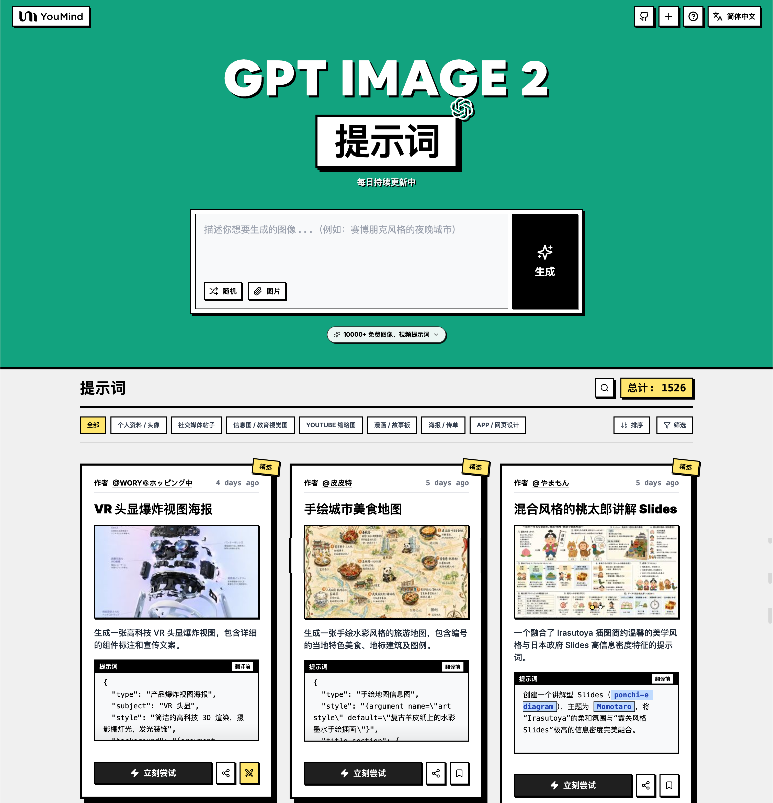

<a href="https://youmind.com/zh-CN/gpt-image-2-prompts">
  
</a>

> 💡 🎬 进阶玩法：用 **Seedance 2** 把 GPT Image 2 生成的图变成炸裂 AI 视频，2000+ 提示词等你探索 👉 [awesome-seedance-2-prompts](https://github.com/YouMind-OpenLab/awesome-seedance-2-prompts)
# 🚀 GPT Image 2 提示词大全

[](https://github.com/sindresorhus/awesome)
[](https://github.com/YouMind-OpenLab/awesome-gpt-image-2)
[](https://creativecommons.org/licenses/by/4.0/)
[](https://github.com/YouMind-OpenLab/awesome-gpt-image-2/actions)
[](docs/CONTRIBUTING.md)

> 🎨 OpenAI GPT Image 2 创意提示词精选集合

> ⚠️ **版权声明**：所有提示词均收集自社区，仅供教育目的使用。如果您认为任何内容侵犯了您的权利，请[提交 issue](https://github.com/YouMind-OpenLab/awesome-gpt-image-2/issues/new?template=bug-report.yml)，我们将立即移除。

---

[](README.md) [](README_zh.md) [](README_zh-TW.md) [](README_ja-JP.md) [](README_ko-KR.md) [](README_th-TH.md) [](README_vi-VN.md) [](README_hi-IN.md) [](README_es-ES.md) [-Click%20to%20View-lightgrey)](README_es-419.md) [](README_de-DE.md) [](README_fr-FR.md) [](README_it-IT.md) [-Click%20to%20View-lightgrey)](README_pt-BR.md) [](README_pt-PT.md) [](README_tr-TR.md)

---

## 🌐 在网页图库中查看

<div align="center">

[](https://youmind.com/zh-CN/gpt-image-2-prompts)

</div>

**[👉 浏览 YouMind GPT Image 2 提示词图库](https://youmind.com/zh-CN/gpt-image-2-prompts)**

为什么使用图库？

| Feature | GitHub README | youmind.com 图库 |
|---------|--------------|---------------------|
| 🎨 可视化布局 | 线性列表 | 精美的瀑布流网格 |
| 🔍 搜索 | 仅 Ctrl+F | 全文搜索和筛选 |
| 🤖 AI 一键生图 | - | AI 一键生图 |
| 📱 移动端 | 基础 | 完全响应式 |
| 🏷️ 分类 | - | 分类浏览 |


### 🏷️ 按分类浏览

- **使用场景**
  - [个人资料 / 头像](https://youmind.com/zh-CN/gpt-image-2-prompts?categories=profile-avatar)
  - [社交媒体帖子](https://youmind.com/zh-CN/gpt-image-2-prompts?categories=social-media-post)
  - [信息图 / 教育视觉图](https://youmind.com/zh-CN/gpt-image-2-prompts?categories=infographic-edu-visual)
  - [YouTube 缩略图](https://youmind.com/zh-CN/gpt-image-2-prompts?categories=youtube-thumbnail)
  - [漫画 / 故事板](https://youmind.com/zh-CN/gpt-image-2-prompts?categories=comic-storyboard)
  - [产品营销](https://youmind.com/zh-CN/gpt-image-2-prompts?categories=product-marketing)
  - [电商主图](https://youmind.com/zh-CN/gpt-image-2-prompts?categories=ecommerce-main-image)
  - [游戏素材](https://youmind.com/zh-CN/gpt-image-2-prompts?categories=game-asset)
  - [海报 / 传单](https://youmind.com/zh-CN/gpt-image-2-prompts?categories=poster-flyer)
  - [App / 网页设计](https://youmind.com/zh-CN/gpt-image-2-prompts?categories=app-web-design)
- **风格**
  - [摄影](https://youmind.com/zh-CN/gpt-image-2-prompts?categories=photography)
  - [电影 / 电影剧照](https://youmind.com/zh-CN/gpt-image-2-prompts?categories=cinematic-film-still)
  - [动漫 / 漫画](https://youmind.com/zh-CN/gpt-image-2-prompts?categories=anime-manga)
  - [插画](https://youmind.com/zh-CN/gpt-image-2-prompts?categories=illustration)
  - [草图 / 线稿](https://youmind.com/zh-CN/gpt-image-2-prompts?categories=sketch-line-art)
  - [漫画 / 图画小说](https://youmind.com/zh-CN/gpt-image-2-prompts?categories=comic-graphic-novel)
  - [3D 渲染](https://youmind.com/zh-CN/gpt-image-2-prompts?categories=3d-render)
  - [Q 版 / Q 萌风](https://youmind.com/zh-CN/gpt-image-2-prompts?categories=chibi-q-style)
  - [等距](https://youmind.com/zh-CN/gpt-image-2-prompts?categories=isometric)
  - [像素艺术](https://youmind.com/zh-CN/gpt-image-2-prompts?categories=pixel-art)
  - [油画](https://youmind.com/zh-CN/gpt-image-2-prompts?categories=oil-painting)
  - [水彩画](https://youmind.com/zh-CN/gpt-image-2-prompts?categories=watercolor)
  - [水墨 / 中国风](https://youmind.com/zh-CN/gpt-image-2-prompts?categories=ink-chinese-style)
  - [复古 / 怀旧](https://youmind.com/zh-CN/gpt-image-2-prompts?categories=retro-vintage)
  - [赛博朋克 / 科幻](https://youmind.com/zh-CN/gpt-image-2-prompts?categories=cyberpunk-sci-fi)
  - [极简主义](https://youmind.com/zh-CN/gpt-image-2-prompts?categories=minimalism)
- **主体**
  - [人像 / 自拍](https://youmind.com/zh-CN/gpt-image-2-prompts?categories=portrait-selfie)
  - [网红 / 模特](https://youmind.com/zh-CN/gpt-image-2-prompts?categories=influencer-model)
  - [角色](https://youmind.com/zh-CN/gpt-image-2-prompts?categories=character)
  - [团体 / 情侣](https://youmind.com/zh-CN/gpt-image-2-prompts?categories=group-couple)
  - [产品](https://youmind.com/zh-CN/gpt-image-2-prompts?categories=product)
  - [食品 / 饮料](https://youmind.com/zh-CN/gpt-image-2-prompts?categories=food-drink)
  - [时尚单品](https://youmind.com/zh-CN/gpt-image-2-prompts?categories=fashion-item)
  - [动物 / 生物](https://youmind.com/zh-CN/gpt-image-2-prompts?categories=animal-creature)
  - [车辆](https://youmind.com/zh-CN/gpt-image-2-prompts?categories=vehicle)
  - [建筑 / 室内设计](https://youmind.com/zh-CN/gpt-image-2-prompts?categories=architecture-interior)
  - [风景 / 自然](https://youmind.com/zh-CN/gpt-image-2-prompts?categories=landscape-nature)
  - [城市风光 / 街道](https://youmind.com/zh-CN/gpt-image-2-prompts?categories=cityscape-street)
  - [图表](https://youmind.com/zh-CN/gpt-image-2-prompts?categories=diagram-chart)
  - [文本 / 排版](https://youmind.com/zh-CN/gpt-image-2-prompts?categories=text-typography)
  - [摘要 / 背景](https://youmind.com/zh-CN/gpt-image-2-prompts?categories=abstract-background)

---

## 📖 目录

- [🌐 在网页图库中查看](#-view-in-web-gallery)
- [🤔 什么是 GPT Image 2？](#-what-is-gpt-image-2)
- [📊 统计数据](#-statistics)
- [🔥 精选提示词](#-featured-prompts)
- [📋 所有提示词](#-all-prompts)
- [🤝 如何贡献](#-how-to-contribute)
- [📄 许可证](#-license)
- [🙏 致谢](#-acknowledgements)
- [⭐ Star 历史](#-star-history)

---

## 🤔 什么是 GPT Image 2？

**GPT Image 2**（代号 **"duct-tape"**）是 OpenAI 下一代图像生成模型。社区测试反馈它在以下方面实现了质的飞跃：

- 🎯 **像素级文字渲染** — 中文、英文、日文均达到 native 水准，无错字、无字形扭曲
- 🎨 **跨图像素级一致性** — 同一角色、风格、IP 在多张图间保持像素级一致
- ⚡ **商用级插画质量** — 插画风格输出无需人工精修，即可直接用于商业场景
- 🌈 **真实艺术风格注入** — 不止是"模仿参考图"，而是真正理解并再现艺术风格的灵魂
- 🔧 **故事板与产品系列** — 适合故事板、IP 形象、产品系列图等需要多图一致性的场景
- 📐 **多语言平面设计** — 社交卡片、Banner、海报一次生图即可完成多语言文字排版

📚 **了解更多：** 查看社区测试 [报告要点](docs/FAQ.md)

### 🚀 Raycast 集成

部分提示词支持使用 [Raycast Snippets](https://raycast.com/help/snippets) 语法的**动态参数**。寻找 🚀 Raycast Friendly 徽章！

**示例：**
```
A quote card with "{argument name="quote" default="Stay hungry, stay foolish"}"
by {argument name="author" default="Steve Jobs"}
```

在 Raycast 中使用时，您可以动态替换参数以快速迭代！

---

## 📊 统计数据

<div align="center">

| 指标 | 数量 |
|--------|-------|
| 📝 提示词总数 | **18094** |
| ⭐ 精选 | **6** |
| 🔄 最后更新 | **2026年11月5日星期四 UTC 04:04:02** |

</div>

---

## 🔥 精选提示词

> ⭐ 由我们的团队精心挑选，具有卓越的质量和创造力

### No. 1: VR 头显爆炸视图海报


#### 📖 描述

生成一张高科技 VR 头显爆炸视图，包含详细的组件标注和宣传文案。

#### 📝 提示词

```
{
  "type": "产品爆炸视图海报",
  "subject": "VR 头显",
  "style": "简洁的高科技 3D 渲染，摄影棚灯光，发光装饰",
  "background": "{argument name=\"background color\" default=\"柔和的紫蓝色渐变\"}",
  "header": {
    "logo": "∞ {argument name=\"product name\" default=\"Meta Quest 3\"}",
    "subtitle": "{argument name=\"main catchphrase\" default=\"以全新的结构，重塑全新的现实。\"}"
  },
  "layout": {
    "centerpiece": "VR 头显的垂直堆叠爆炸视图，展示了 9 层不同的内部组件：外壳、摄像头传感器、带芯片的主板、Pancake 透镜、内部框架、电池组、侧带、顶部头带和面部接口衬垫。",
    "callout_labels": {
      "count": 8,
      "left_side": [
        "Snapdragon® XR2 Gen 2\n卓越的处理性能，带来实时沉浸体验。",
        "可调节 IPD 机构\n为广大用户提供舒适的佩戴感。",
        "精密设计的头带\n追求舒适与稳定的工程学设计。"
      ],
      "right_side": [
        "前面板\n精致的设计与优化的重量平衡。",
        "追踪摄像头\n实现高精度的位置追踪与环境感知。",
        "Pancake 透镜\n轻薄设计，提供广阔视野与清晰画质。",
        "高性能电池\n优化电源设计，支持长时间续航。",
        "柔软的面部接口\n确保长时间佩戴依然舒适。"
      ]
    },
    "footer": {
      "left_text_block": {
        "headline": "{argument name=\"bottom headline\" default=\"体验，源于结构的进化。\"}",
        "body": "每一个零件都蕴含着支撑沉浸式体验的前沿科技与匠心设计。Meta Quest 3 从内部构建未来，为您带来超乎想象的体验。"
      },
      "right_logo": "∞ Meta"
    }
  }
}
```

#### 🖼️ 生成图片

##### Image 1

<div align="center">

</div>

#### 📌 详情

- **作者:** [wory＠ホッピング中](https://x.com/wory37303852)
- **来源:** [Twitter Post](https://x.com/wory37303852/status/2045925660401795478#reversed-0)
- **发布时间:** 2026年4月19日
- **多语言:** en

**[👉 立即尝试 →](https://youmind.com/zh-CN/gpt-image-2-prompts?id=13460)**

---

### No. 2: 手绘城市美食地图


#### 📖 描述

生成一张手绘水彩风格的旅游地图，包含编号的当地特色美食、地标建筑及图例。

#### 📝 提示词

```
{
  "type": "手绘地图信息图",
  "style": "{argument name=\"art style\" default=\"复古羊皮纸上的水彩墨水手绘插画\"}",
  "title_section": {
    "text": "{argument name=\"city name\" default=\"成都\"} {argument name=\"map title\" default=\"吃货暴走地图\"}",
    "mascot": "戴着墨镜并竖起大拇指的卡通红辣椒"
  },
  "border": "{argument name=\"border decoration\" default=\"绿叶与红辣椒藤蔓\"}",
  "layout": {
    "background": "带有黄色道路、蓝色河流和绿色公园区域的纹理米色羊皮纸",
    "sections": [
      {
        "title": "地标建筑",
        "count": 6,
        "illustrations": ["传统凉亭", "传统寺院", "带有攀爬熊猫的现代摩天大楼", "高耸的电视塔", "传统牌坊", "工业建筑"],
        "labels": ["人民公园", "文殊院", "IFS", "339电视塔", "宽窄巷子", "东郊记忆"]
      },
      {
        "title": "美食地点",
        "count": 12,
        "illustrations": ["麻婆豆腐", "红油水饺", "冷锅串串", "三大炮", "蛋烘糕", "九宫格火锅", "肥肠粉", "钵钵鸡", "冒菜", "盖碗茶", "冰粉", "兔头"],
        "labels": ["1 陈麻婆豆腐", "2 钟水饺", "3 春熙路", "4 宽窄巷子·三大炮", "5 建设路·叶婆婆蛋烘糕", "6 玉林路·小龙坎火锅", "7 香香巷·肥肠粉", "8 武侯祠大街·钵钵鸡", "9 东郊记忆·冒椒火辣", "10 人民公园·鹤鸣茶社", "11 锦里古街·冰粉", "12 双流老妈兔头"]
      },
      {
        "title": "图例",
        "position": "右下角",
        "count": 5,
        "items": ["红点", "绿色建筑", "绿树", "蓝线", "黄色双线"],
        "labels": ["美食地点", "地标景点", "公园绿地", "河流湖泊", "主要道路"]
      }
    ],
    "centerpiece": "坐着吃竹子的大熊猫",
    "bottom_right_extras": ["带有东南西北方向的复古罗盘", "带有红辣椒图标的免责声明：'温馨提示：吃辣需谨慎，肠胃要保护~'"]
  }
}
```

#### 🖼️ 生成图片

##### Image 1

<div align="center">

</div>

#### 📌 详情

- **作者:** [皮皮特](https://x.com/mm_zzm44854)
- **来源:** [Twitter Post](https://x.com/mm_zzm44854/status/2045861258520568230#reversed-1)
- **发布时间:** 2026年4月19日
- **多语言:** en

**[👉 立即尝试 →](https://youmind.com/zh-CN/gpt-image-2-prompts?id=13515)**

---

### No. 3: 混合风格的桃太郎讲解 Slides


#### 📖 描述

一个融合了 Irasutoya 插图简约温馨的美学风格与日本政府 Slides 高信息密度特征的提示词。

#### 📝 提示词

```
创建一个讲解型 Slides（{argument name="format" default="ponchi-e diagram"}），主题为 {argument name="theme" default="Momotaro"}，将“Irasutoya”的柔和氛围与“霞关风格 Slides”极高的信息密度完美融合。
```

#### 🖼️ 生成图片

##### Image 1

<div align="center">

</div>

##### Image 2

<div align="center">

</div>

#### 📌 详情

- **作者:** [やまもん](https://x.com/yammamon)
- **来源:** [Twitter Post](https://x.com/yammamon/status/2045778624092254603)
- **发布时间:** 2026年4月19日
- **多语言:** ja

**[👉 立即尝试 →](https://youmind.com/zh-CN/gpt-image-2-prompts?id=13983)**

---

### No. 4: 电商直播 UI 样机


#### 📖 描述

生成逼真的社交媒体直播界面，叠加在人物肖像之上，包含可自定义的聊天消息、礼物弹窗和商品购买卡片。

#### 📝 提示词

```
{
  "type": "直播 UI 样机",
  "subject": {
    "description": "{argument name=\"host name\" default=\"Elon Musk\"} 的肖像，面带微笑，身穿印有白色技术示意图的黑色 T 恤",
    "background": "左侧显示带有 '{argument name=\"left background logo\" default=\"SPACEX\"}' 文字的屏幕，右侧显示红色的 '{argument name=\"right background logo\" default=\"Tesla T logo\"}' 和一辆深色汽车"
  },
  "ui_overlay": {
    "top_header": {
      "host_info": "头像，名称 '{argument name=\"host name\" default=\"Elon Musk\"}'，副标题 '55.6万本场点赞'，红色 '关注' 按钮",
      "rank_badge": "带有 '全站第1名' 的金币图标",
      "viewer_stats": "3 个顶部观众头像，显示 '12.3w'、'8.6w'、'5.7w'，总计 '68.7万'，'X' 关闭按钮",
      "right_links": "'更多直播 >'，'礼物展馆 0/24'（带有蓝色 '经典' 标签）"
    },
    "mid_left_gifts": {
      "count": 2,
      "items": [
        "头像 '科技爱好者'，'送小心心'，爱心图标 x 1314",
        "头像 '星辰大海'，'送火箭'，火箭图标 x 666"
      ]
    },
    "bottom_left_chat": {
      "system_message": "37 级勋章 '宇宙漫游者 加入了直播间'",
      "message_count": 7,
      "messages": [
        "小火箭: 马斯克！未来可期！🚀",
        "future: 特斯拉Model 2什么时候出？",
        "星空梦想家: SpaceX今年能上火星吗？",
        "AI探索者: Neuralink进展如何？",
        "帅气的网友: 马总好！",
        "Mars: 第一次来你的直播，超激动！",
        "用户123: 讲讲AI吧，会取代人类吗？"
      ]
    },
    "bottom_right_product_card": {
      "hot_tag": "橙色 '热卖 x 1888'",
      "image": "Tesla Cybertruck",
      "title": "{argument name=\"product name\" default=\"特斯拉Cybertruck 电动皮卡\"}",
      "price": "{argument name=\"product price\" default=\"¥ 1,618,000\"}",
      "button": "红色 '抢' 按钮",
      "floating_animation": "半透明爱心沿右侧边缘向上浮动"
    },
    "bottom_bar": {
      "input_field": "'说点什么...'",
      "icons": ["笑脸", "三个点", "购物车", "礼物盒", "分享"]
    }
  }
}
```

#### 🖼️ 生成图片

##### Image 1

<div align="center">

</div>

#### 📌 详情

- **作者:** [神经病不想好转](https://x.com/sjbbxhz)
- **来源:** [Twitter Post](https://x.com/sjbbxhz/status/2045684734714380687#reversed-0)
- **发布时间:** 2026年4月19日
- **多语言:** en

**[👉 立即尝试 →](https://youmind.com/zh-CN/gpt-image-2-prompts?id=14036)**

---

### No. 5: 动漫武术对决


#### 📖 描述

生成一个动态的动漫风格动作场景，展示两个角色在传统道场中伴随元素光环进行战斗。

#### 📝 提示词

```
一幅极具动态感的动漫插画，描绘了两名少女在传统木质道场内进行激烈武术对决的场景。在前景中，一名留着 {argument name="character 1 hair" default="黑色高丸子头配红色丝带"} 的少女摆出强有力的低位武术架势，正奋力挥拳。她身穿 {argument name="character 1 outfit" default="带有红色流苏的白色中式上衣和红色宽松长裤"}，强烈的红色能量斩击环绕着她挥动的四肢。在右侧半空中，一名留着 {argument name="character 2 hair" default="浅紫色双丸子头"} 的少女优雅地跃起，自信地微笑着，身穿 {argument name="character 2 outfit" default="带有金色刺绣的深绿色连衣裙和黑色紧身裤"}，伴随着扫过的蓝色水流状能量轨迹。背景是质朴的木质寺庙内部，上方悬挂着一块写有“{argument name="sign text" default="武術会"}”的醒目招牌。场景充满了爆发性的动作感，飞扬的尘土、破碎的木质地板、发光的彩色粒子特效，以及将角色与精细背景完美区分开来的戏剧性低角度光影。
```

#### 🖼️ 生成图片

##### Image 1

<div align="center">

</div>

#### 📌 详情

- **作者:** [たねもみ 2.0 / Tanemomi Ver2.0](https://x.com/Tanemomi_Ver2)
- **来源:** [Twitter Post](https://x.com/Tanemomi_Ver2/status/2046063806846214265#reversed-0)
- **发布时间:** 2026年4月20日
- **多语言:** en

**[👉 立即尝试 →](https://youmind.com/zh-CN/gpt-image-2-prompts?id=13467)**

---

### No. 6: 3D 石阶演化信息图


#### 📖 描述

将平面的演化时间轴转化为逼真的 3D 石阶信息图，包含精细的生物渲染图和结构化的侧边栏。

#### 📝 提示词

```
{
  "type": "演化时间轴信息图",
  "instruction": "以 REFERENCE_0 作为结构基础，将平面矢量设计转化为高度逼真的 3D 信息图。将平滑的坡道替换为独特的石阶，并将所有生物升级为照片级真实的 3D 模型。",
  "style": {
    "background": "{argument name=\"background style\" default=\"复古纹理羊皮纸\"}",
    "staircase": "{argument name=\"staircase material\" default=\"逼真的纹理石块\"}",
    "subjects": "{argument name=\"organism style\" default=\"高度精细的照片级真实 3D 渲染\"}"
  },
  "layout": {
    "main_title": "{argument name=\"main title\" default=\"人类演化\"}",
    "sections": [
      {
        "position": "左侧边栏",
        "count": 8,
        "labels": ["L0: 单细胞生命", "L1: 多细胞生物", "L2: 动物界", "L3: 脊索动物", "L4: 上陆革命", "L5: 哺乳纲", "L6: 人科演化", "L7: 智人纪元"]
      },
      {
        "position": "右上角",
        "title": "获得的功能 / 失去的功能",
        "description": "带有加号和减号图标的图例"
      },
      {
        "position": "底部中心",
        "title": "演化关键里程碑",
        "count": 6,
        "description": "包含 6 个展示从猿到人演化剪影图形的时间轴"
      }
    ],
    "centerpiece": {
      "description": "蜿蜒的石阶，共有 25 个编号台阶，展示特定生物。",
      "count": 25,
      "notable_elements": [
        "第 07 阶: 水母",
        "第 09 阶: 菊石",
        "第 10 阶: 三叶虫",
        "第 24 阶: 直立行走的人类",
        "第 25 阶: {argument name=\"future evolution concept\" default=\"带有问号的发光宇宙剪影\"}"
      ]
    }
  }
}
```

#### 🖼️ 生成图片

##### Image 1

<div align="center">

</div>

#### 📌 详情

- **作者:** [知识猫图解](https://x.com/GeekCatX)
- **来源:** [Twitter Post](https://x.com/GeekCatX/status/2045792240044511277#reversed-1)
- **发布时间:** 2026年4月19日
- **多语言:** en

**[👉 立即尝试 →](https://youmind.com/zh-CN/gpt-image-2-prompts?id=13491)**

---

## 📋 所有提示词

> 📝 按发布日期排序（最新优先）

### No. 1: 个人资料 / 头像 - 年轻女性柔和特写肖像


#### 📖 描述

生成一张写实的高调特写肖像，画面中是一位面带微笑、深色头发且妆容自然的年轻女性，背景为白色。

#### 📝 提示词

```
一张照片级写实的年轻东亚女性特写肖像，肌肤白皙细腻，深棕色长直发自然垂落于肩头。她微微侧目低垂，嘴角挂着温柔浅笑，传递出宁静而温暖的气息。画面采用明亮、柔和的高调布光，营造出干净通透的氛围与轻柔的阴影。妆容清透水润，唇部与双颊点缀着淡淡的粉色。背景为纯白或浅灰色的虚化平面，进一步凸显人物面部特征。
```

#### 🖼️ 生成图片

##### Image 1

<div align="center">

</div>

#### 📌 详情

- **作者:** [Kevin Tech Labs](https://x.com/HongyeMain)
- **来源:** [Twitter Post](https://x.com/HongyeMain/status/2117775627839553765#reversed-0)
- **发布时间:** 2026年11月4日
- **多语言:** en

**[👉 立即尝试 →](https://youmind.com/zh-CN/gpt-image-2-prompts?id=37299)**

---

### No. 2: 个人资料 / 头像 - GPT Image 韩式人像


#### 📖 描述

生成年轻女性写实韩式室内人像的详细提示词。

#### 📝 提示词

```
[整体风格]
9:16 竖版，单一独立场景，超写实韩式成年女性室内生活照，清冷温柔的空气感，低饱和奶油粉与冷蓝灰色调，柔和自然窗光，轻微胶片柔焦，真实相机摄影质感。

[面部特征]
一位 23-25 岁的漂亮东亚成年女性，精致小巧的鹅蛋脸，下颌线柔和流畅，下巴圆润小巧，清透冷白瓷肌，泛着淡淡的蜜桃粉腮红。
明亮清澈的深灰棕色杏眼，自然双眼皮，精致的卧蚕，纤长自然的睫毛，浅粉棕色眼影，眼线微微上挑。
鼻梁纤细挺直，鼻头小巧，双唇饱满柔软，呈玫瑰豆沙粉色且水润有光泽。
双唇自然闭合，神情温柔清冷，带着一丝慵懒感，目光安静地直视镜头，保留真实的皮肤微纹理。

[发型发丝]
浓密蓬松的乌黑及腰长发，呈现自然的深红茶色光泽，头顶具有真实的空气感。
自然中分，额头前是轻薄不规则的八字碎刘海，几缕细碎发丝轻轻拂过额头与脸颊。
长发自然垂落于肩头与胸前，整体顺滑，发尾带有松散的大弧度卷曲，保留真实的根根分明发丝与自然蓬松感。

[服装与饰品]
身穿浅樱花粉色细吊带修身短款上衣，柔软棉质面料，简约浅圆领设计。
外搭一件奶油白色宽松针织开衫，前襟自然敞开，衣袖松垮滑落至上臂处，露出自然的肩颈线条与锁骨。
佩戴小巧银色圈形耳环与精致的银色细手链。

[姿势动作]
人物坐在卧室窗边的梳妆台前，身体微微转向镜头，双肩自然放松。
头部轻柔倾斜，下巴微收，双眼直视镜头。
双手自然抬至胸前，一只手轻轻拢住肩前的长发，另一只手温柔地整理着发尾。
姿态温柔松弛，手部结构准确，动作自然流畅。

[背景环境]
现代简约的浅灰白色卧室，画面左侧是明亮的大窗户，窗台上摆放着一束浅粉色与奶油白色的鲜花。
画面右侧为白色梳妆台，台面上放着化妆刷、粉饼、护肤品及部分化妆品。
梳妆台上方挂着一面大圆镜，隐约映照出人物的背影与乌黑的长发。
背景充满真实的生活气息，整体干净、柔和、自然。

[镜头与光影]
9:16 竖版，等效 35-50mm 镜头，平视视角拍摄，人物居中，采用从头部到腰部的半身构图。
柔和的冷白自然窗光从画面左侧照入，面部明亮清晰，肌肤呈现自然的冷白质感。
头发带有细腻的深棕色反光，窗框边缘与浅色背景处有轻微的泛光溢出效果。
整体采用低对比度的冷蓝灰调色，阴影柔和，带有轻微胶片颗粒感与自然的光学柔焦效果。
保留真实的皮肤纹理、细碎发丝、自然的衣物褶皱以及真实的空间透视，避免过度磨皮与明显的 AI 生成痕迹。

[负面提示词]
动漫，插画，3D 渲染，CG 假脸，塑料感皮肤，过度磨皮，夸张网红脸，眼睛异常偏大，下巴过尖，五官错位，假发套，头发结块毛躁，手指畸形，多指，手部结构错误，身体比例失调，衣物穿模，镜中倒影变形，镜面反射错误，化妆品糊成一团，严重过曝，强 HDR，过度锐化，商业影棚打光，明显 AI 感，文字，水印，LOGO，拼贴画。
```

#### 🖼️ 生成图片

##### Image 1

<div align="center">

</div>

#### 📌 详情

- **作者:** [沧瑶](https://x.com/CryY666666)
- **来源:** [Twitter Post](https://x.com/CryY666666/status/2117284530839232946)
- **发布时间:** 2026年11月2日
- **多语言:** zh

**[👉 立即尝试 →](https://youmind.com/zh-CN/gpt-image-2-prompts?id=37243)**

---

### No. 3: 个人资料 / 头像 - GPT Image 客厅人像


#### 📖 描述

用于生成现代客厅环境中女性写实人像的提示词。

#### 📝 提示词

```
[整体风格]
1:1 正方形构图，单一独立场景，超写实韩式成年女性室内人像摄影，清冷温柔气质，奶油白现代客厅，柔和自然补光，低饱和灰蓝色调，真实相机质感，轻微自然柔焦。

[面部特征]
一位 23-25 岁的绝美东亚成年女性，精致小巧的鹅蛋脸，下颌线柔和流畅，下巴圆润小巧，清透冷白瓷肌，浅桃粉色腮红。
明亮清澈的深棕色杏眼，自然双眼皮，精致的卧蚕，纤长卷翘的睫毛，微微上挑的眼线，鼻梁纤细挺直。
饱满柔软的玫瑰豆沙粉水润双唇，嘴唇自然微张，嘴角微微上扬，眼神温柔直视镜头，保留细腻真实的皮肤纹理。

[发型 - 核心]
极浓密顺滑的乌黑及腰长发，呈现自然的深黑茶色光泽，头顶蓬松，侧分发型，发根具有真实的空气感。
长发以顺直为主，发尾带有轻微的自然弧度，披散在双肩与胸前两侧。
额前有几缕细碎发丝自然垂落，右耳（画面右侧）上方佩戴精致的银色水晶花朵发夹，头发自然别在耳后。
发丝根根分明，光泽柔和，避免假发质感。

[服装与配饰]
身穿浅冰灰蓝色一字肩毛绒针织衫，柔软蓬松的马海毛材质，细腻的针织纹理，宽松的不对称领口自然滑落，露出右肩（画面右侧）与锁骨。
长袖设计，袖口宽松柔软，带有自然褶皱。
佩戴白色珍珠耳钉与精致的银色水晶细手链。

[姿势]
人物坐在奶油白沙发上，身体微微转向镜头，上半身自然前倾。
头部轻轻偏向画面左侧（观众视角左侧），下巴微收。
左手（画面左侧）轻托下巴，手指自然弯曲；另一只手抬至肩旁，轻轻握住一束乌黑长发。
双肩放松，姿态自然优雅，目光清冷而温柔。

[背景与光影]
现代简约的奶油白客厅，身后是柔软的米色布艺沙发，浅米色墙面，右上角有柔和的暖黄色灯光。
柔和的冷白正面补光照亮面部，肌肤呈现清透的冷白色，背景保留温暖柔和的环境光。
等效 50mm 人像镜头，近距离半身构图，人物居中，面部清晰，背景轻微自然虚化。
真实摄影曝光，发丝细腻，眼神清澈，肤质柔和，带有轻微自然颗粒感，无明显 AI 生成痕迹。

[负面提示词]
动漫，插画，3D 渲染，CG 假脸，塑料皮肤，过度磨皮，夸张大眼，尖锐下巴，五官错位，假发，头发结块，发丝僵硬，多余手指，手掌畸形，肩膀脱臼，身体比例失调，一字肩结构错误，衣物穿模，过度锐化，强 HDR，严重过曝，明显 AI 感，文字，水印，LOGO，拼贴画。
```

#### 🖼️ 生成图片

##### Image 1

<div align="center">

</div>

#### 📌 详情

- **作者:** [沧瑶](https://x.com/CryY666666)
- **来源:** [Twitter Post](https://x.com/CryY666666/status/2117219660366262436)
- **发布时间:** 2026年11月2日
- **多语言:** zh

**[👉 立即尝试 →](https://youmind.com/zh-CN/gpt-image-2-prompts?id=37246)**

---

### No. 4: 个人资料 / 头像 - 神社前的昭和复古人像


#### 📖 描述

一张充满怀旧感的胶片颗粒人像，描绘了一位身穿碎花连衣裙的年轻女子伫立于日本神社前，营造出昭和时代特有的忧郁氛围。

#### 📝 提示词

```
一幅东亚年轻女性的竖版人像，她留着深色齐刘海短发波波头，站在户外一座传统日本神社前。她身穿一件灰蓝色复古风碎花中长连衣裙，配有彼得潘领、短袖和纽扣式上衣设计。她的神情忧郁而疏离，目光微微偏离镜头，双手轻轻交握于腰前。背景是朱红色的神社建筑（鸟居与塔顶）和石灯笼，呈现出虚化的失焦效果。她脚下的地面可见人行横道的白色斑马线。整幅画面带有浓郁的昭和时代复古美学风格，以温暖褪色的胶片色调为特征，颗粒感明显，边缘有漏光效果，并带有老式即时摄影特有的划痕质感。
```

#### 🖼️ 生成图片

##### Image 1

<div align="center">

</div>

#### 📌 详情

- **作者:** [いがぐりメタボ](https://x.com/Kmsbdd0GXBOcrXQ)
- **来源:** [Twitter Post](https://x.com/Kmsbdd0GXBOcrXQ/status/2116849131599933528#reversed-0)
- **发布时间:** 2026年11月1日
- **多语言:** en

**[👉 立即尝试 →](https://youmind.com/zh-CN/gpt-image-2-prompts?id=37213)**

---

### No. 5: 个人资料 / 头像 - 异想天开的剪贴簿彩色铅笔插图


#### 📖 描述

此提示可将上传的照片转化为温馨、异想天开的手绘彩色铅笔和蜡笔剪贴簿插图，在保留原始主体和构图的同时，添加装饰性边框和复古纹理。

#### 📝 提示词

```
将上传的照片转化为一幅温馨可爱、充满奇思妙想的手绘彩色铅笔与蜡笔拼贴画插画。

重要提示 —— 保留原照片内容：

首先，请仔细分析上传的照片。准确识别画面中的主体、人物、面部特征、发型、服装、姿势、表情、配饰、物品以及背景环境。

将这张照片重新创作成一幅迷人的插画作品。请保留原有的构图、可辨识的面部特征、服装细节、身体姿态及人物互动关系。切勿随意替换或凭空捏造主要拍摄对象。

艺术风格：
- 纯正的手绘彩色铅笔与蜡笔插画风格。
- 清晰可见的铅笔笔触、颗粒质感以及略带随性的手绘线条。
- 柔和的水彩般上色效果，搭配浓郁的彩铅阴影。
- 细腻的交叉排线与层层叠加的手绘细节。
- 略带粗糙感、充满怀旧气息的儿童绘本插画美学。
- 温暖、梦幻、惬意且充满童趣的氛围。
- 奶油色纹理纸张背景。
- 柔和的光线，带有温暖的亮部与轻柔的阴影。
- 浓郁却略带褪色感的复古色调。

拼贴装饰：

在主插画四周点缀俏皮的手工拼贴画边框，包含以下元素：
- 粉色与红色的闪粉爱心贴纸。
- 小巧的彩色宝石与珍珠串珠。
- 金色星星与水晶装饰。
- 精致的手绘小花与蝴蝶。
- 可爱的涂鸦、笑脸和小星星。
- 小巧的装饰叶片与应季元素。
- 多彩的手绘轮廓线与俏皮的符号。

让这些装饰看起来就像真实贴在画作边缘的实体贴纸和微小饰物。

构图：

保持主体位于视觉中心。运用细腻的彩铅质感还原原始场景。装饰性拼贴元素主要分布在画面外缘，切勿遮挡照片中的重要部分。

整幅作品应呈现出精美个人日记本的一页，或是怀旧图文回忆录般的视觉效果。

最终美学效果：

极致细腻、可爱温馨、怀旧文艺、柔和复古的拼贴画美学，纯手工插画质感，清晰可见的蜡笔颗粒与彩铅肌理，自然的手绘瑕疵美，温暖的柔和色调，迷人的装饰点缀，高品质的插画日记页面。

重要提示：最终效果必须呈现为纯手绘插画，而非套用卡通滤镜的照片。请避免照片级写实、3D 渲染、塑料质感以及过度平滑的数字绘画效果。
```

#### 🖼️ 生成图片

##### Image 1

<div align="center">

</div>

##### Image 2

<div align="center">

</div>

##### Image 3

<div align="center">

</div>

#### 📌 详情

- **作者:** [Sairah](https://x.com/Sairah_0)
- **来源:** [Twitter Post](https://x.com/Sairah_0/status/2116773143691878877)
- **发布时间:** 2026年11月1日
- **多语言:** en

**[👉 立即尝试 →](https://youmind.com/zh-CN/gpt-image-2-prompts?id=37163)**

---

### No. 6: 个人资料 / 头像 - 身着荷叶边婚纱的动漫新娘


#### 📖 描述

生成一位优雅新娘的全身动漫风格肖像，她身穿带有花卉细节的精致荷叶边婚纱，适用于角色设计或浪漫插画项目。

#### 📝 提示词

```
一幅全身动漫风格插画，描绘了一位美丽的新娘站在纯白背景前。她留着深棕色头发，梳成优雅的发髻，几缕松散的刘海轻拂脸庞，头上点缀着精致的花朵头饰，耳畔垂着长长的耳坠。她的双眼大而灵动，妆容淡雅，神情柔和又自信。婚纱细节极为丰富：抹胸心形领口上衣带有繁复的系带束腰设计，边缘装饰着立体花卉贴花。丰盈的落肩袖自然垂下，化作极具张力的层叠荷叶边，顺着裙身两侧倾泻而下。高开叉设计展露出她线条优美的一条腿，裙摆上蔓延着拖尾般的花卉装饰。长长的裙裾在底部铺展开来，由多层轻盈飘逸的面料堆叠而成。她脚踩尖头高跟鞋，脚踝处系着小巧的蝴蝶结。一层薄透的头纱从脑后垂落，轻轻披覆在双肩与背部。画风线条利落、赛璐璐上色平滑流畅，配色精致典雅，以白色、米色和温暖的肤色为主调。
```

#### 🖼️ 生成图片

##### Image 1

<div align="center">

</div>

##### Image 2

<div align="center">

</div>

##### Image 3

<div align="center">

</div>

#### 📌 详情

- **作者:** [Jema Christian](https://x.com/jemachristian)
- **来源:** [Twitter Post](https://x.com/jemachristian/status/2116523085176373667#reversed-0)
- **发布时间:** 2026年10月31日
- **多语言:** en

**[👉 立即尝试 →](https://youmind.com/zh-CN/gpt-image-2-prompts?id=37165)**

---

### No. 7: 个人资料 / 头像 - 复古万圣节吸血鬼少女


#### 📖 描述

生成一张怀旧昭和风格照片的提示词，展示一位身着吸血鬼服装庆祝万圣节的少女。

#### 📝 提示词

```
一张复古风格的照片，画面中是一位留着凌乱深色短发的年轻亚洲女性，她坐在一把复古碎花扶手椅上。她身穿米色粗棒针织毛衣搭配格纹半身裙，脚上是松垮的白袜和棕色乐福鞋。肩上披着一件红缎内衬的黑色天鹅绒吸血鬼斗篷，颈间用丝带系着。她双手举起，摆出俏皮的爪状姿势，隐约可见两颗小尖牙。背景是万圣节装饰，包括橙色的南瓜灯、墙上的黑色蝙蝠剪纸，左侧还有一台老式 CRT 电视机。整张照片散发着昭和时代的怀旧气息，光线温暖柔和，带有胶片颗粒质感。
```

#### 🖼️ 生成图片

##### Image 1

<div align="center">

</div>

#### 📌 详情

- **作者:** [いがぐりメタボ](https://x.com/Kmsbdd0GXBOcrXQ)
- **来源:** [Twitter Post](https://x.com/Kmsbdd0GXBOcrXQ/status/2116498284344992013#reversed-0)
- **发布时间:** 2026年10月31日
- **多语言:** en

**[👉 立即尝试 →](https://youmind.com/zh-CN/gpt-image-2-prompts?id=37166)**

---

### No. 8: 个人资料 / 头像 - 复古昭和万圣节人像


#### 📖 描述

一张充满怀旧感的胶片颗粒风格照片，女孩身穿自制纸南瓜服装，在夜晚的日式复古小巷中摆姿势。

#### 📝 提示词

```
一张竖版中景人像照片，画面中是一位留着黑色短发和齐刘海的年轻亚洲女性。她身穿自制的万圣节服装：头戴一顶橙色纸南瓜帽，颈部系着与之相配的锯齿状橙色纸领饰，内搭一件黑色长袖连衣裙。她身体微微前倾，右手在脸颊旁比出“V”字手势，左手则提着一个棕色小纸袋，袋子上装饰着南瓜灯和黑猫图案。背景是夜晚一条狭窄昏暗的日式复古小巷（横丁），两侧是木质门面的店铺、亮着暖光的灯笼，以及远处正渐渐走远、身影模糊的路人。画面左侧悬挂着纸质装饰物，包括一个南瓜灯和一个白色幽灵。右侧的竖幅招牌上写着“おもちや”（Omo-cha）。整张照片带有浓郁的昭和时代复古美学风格，色调温暖而略带褪色感，并呈现出老式即时成像摄影特有的明显胶片颗粒、划痕、灰尘斑点以及柔和的对焦效果。
```

#### 🖼️ 生成图片

##### Image 1

<div align="center">

</div>

#### 📌 详情

- **作者:** [いがぐりメタボ](https://x.com/Kmsbdd0GXBOcrXQ)
- **来源:** [Twitter Post](https://x.com/Kmsbdd0GXBOcrXQ/status/2116479886592450725#reversed-0)
- **发布时间:** 2026年10月31日
- **多语言:** en

**[👉 立即尝试 →](https://youmind.com/zh-CN/gpt-image-2-prompts?id=37167)**

---

### No. 9: 个人资料 / 头像 - 复古美式卡通风格图像转换


#### 📖 描述

将上传的照片转换为 1960-1980 年代复古美式卡通风格全身插画的提示词，在保留人物身份和构图的同时，应用橡皮管动画比例和复古动画美学。

#### 📝 提示词

```
将上传的图片原封不动地转化为全身插画，采用 20 世纪 60 至 80 年代美国复古卡通风格。必须完整保留原图中的主体、面部特征、发型、服装、配饰、色彩、比例、姿势、肢体语言、表情、拍摄角度、取景、构图、透视、光影以及所有可见细节。不得重新设计、主观演绎、简化、替换或凭空添加任何元素。上传的图片必须保持一眼可辨，仅改变艺术风格。

角色应采用夸张的“橡皮管”（rubber hose）比例、富有表现力的肢体语言、略微偏大的头部、简化的身体结构、柔韧有弹性的四肢、带有简单黑色瞳孔的经典大椭圆卡通眼、纤细灵动的眉毛、圆润的双手和简洁的几何造型，并透出俏皮的复古气质；同时必须精准还原原图人物的样貌、神态与轮廓剪影。

插画需具备粗重的黑色轮廓线、平涂纯色、极简的赛璐珞风格阴影、淡淡的复古胶片颗粒质感、类似老式动画赛璐珞片的轻微褪色色调、流畅的手绘 2D 线条、简单的色块处理、柔和的复古印刷肌理，整体呈现经典的 20 世纪中叶美国动画美学。

除非另有说明，否则请完全按照上传图片中的原样保留背景。

严格保持原有的构图、取景、透视与镜头角度不变。若原图中为全身像，则插画中也必须呈现完整的全身。高分辨率，画面干净利落；拒绝写实风、3D 渲染、日系动漫风、Pixar 风、Disney 风及现代卡通风，只保留纯正的 20 世纪 60 至 80 年代美国复古动画美学。
```

#### 🖼️ 生成图片

##### Image 1

<div align="center">

</div>

##### Image 2

<div align="center">

</div>

#### 📌 详情

- **作者:** [Sairah](https://x.com/Sairah_0)
- **来源:** [Twitter Post](https://x.com/Sairah_0/status/2116413622293520427)
- **发布时间:** 2026年10月31日
- **多语言:** en

**[👉 立即尝试 →](https://youmind.com/zh-CN/gpt-image-2-prompts?id=37162)**

---

### No. 10: 个人资料 / 头像 - GPT Image 2 夜景街头摄影提示词


#### 📖 描述

一个用于生成写实夜景街头人像的提示词，展现东亚女性形象，采用 iPhone 闪光灯摄影风格，包含湿润街道和霓虹灯反射效果。

#### 📝 提示词

```
1:1 正方形构图，单幅独立画面，超写实韩系成年女性夜晚街头摄影，真实 iPhone 夜景直闪拍摄，湿润的城市街道，霓虹灯倒影，清冷甜美生活感人像风格，真实自然，无明显 AI 感。

[人物面部]

23-25 岁东亚成年美女，精致小巧的鹅蛋脸，下颌线柔和收窄，下巴圆润小巧，皮肤清透冷白，透着淡淡的蜜桃粉腮红。

明亮清澈的深棕色杏仁眼，天然双眼皮，精致的卧蚕，纤长自然的睫毛，浅粉棕色眼影，眼线柔和微挑。

鼻梁纤细挺直，鼻头小巧，双唇饱满柔软、呈玫瑰粉色且水润。

嘴角微微上扬，呈现自然温柔的闭嘴微笑，双眼直视镜头，神态甜美放松。

保留真实的皮肤微肌理与自然五官比例。

[发型 - 核心]

极其浓密蓬松的及腰深栗棕色长发，带有自然的巧克力棕光泽。

头顶蓬松，发根有真实的空气感，自然中分，额头前是轻薄不规则的八字刘海。

两侧长发自然垂落于肩部和胸前，带有柔和松散的大波浪卷度。

右侧头发尤为丰盈，层次丰富，几缕发丝被夜风吹起。

头发在正面闪光灯照射下，呈现出细腻的深棕色高光，保留真实的根根分明感。

[服装与首饰]

身穿纯白色修身短袖 T 恤，简约圆领，柔软的棉质弹力面料，自然贴合身体曲线。

颈部佩戴极细的银色锁骨链，中间点缀一颗小水晶吊坠。

一侧手腕戴着简约的细银手镯。

整体穿搭清新、日常、简约。

[人物姿态 - 关键]

自然站立在夜晚城市街道的斑马线上，身体正对镜头，双肩放松。

头部微侧，下巴自然微收，温柔地注视镜头。

左手抬起放在脸颊旁，食指与拇指自然弯曲比出半个心形的 C 字手势，其余手指放松。

另一只手轻轻拢着右胸前的长发，手指自然弯曲。

双手错落有致，姿态自然俏皮，就像朋友在街头随手抓拍的照片。

[背景环境]

夜晚繁华的中国城市商业街，雨后初歇。

深色湿润的柏油路面，宽阔的白色斑马线从人物身后向远处延伸。

街道两旁是便利店、餐厅和商铺，亮着红、蓝、白、黄色的发光招牌。

远处有车辆驶过，车灯模糊，路灯亮起，零星几个行人。

湿润的柏油路倒映出大量红、蓝、暖黄色的霓虹灯光，形成真实不规则的彩色光斑。

背景具有都市夜景的空间纵深感，车灯带有轻微动态模糊，店铺灯光呈现柔和的光斑虚化。

[镜头与光影]

1:1 正方形构图，等效 28-35mm 手机主摄镜头，平视角度拍摄。

人物居中，取景范围从头顶留白处到腰部，完整展现面部、双手、长发和白色 T 恤。

采用夜晚手机直闪或柔和的正面 LED 补光，面部明亮清晰，冷白皮与暗黑夜景形成强烈对比。

闪光灯照亮额头、鼻梁、脸颊、长发和双手，产生真实柔和的近距离补光效果。

背景保留自然的城市霓虹环境光，湿润的街道泛着红蓝光影。

人物锐利清晰，背景带有轻微的真实动态模糊和夜景数码噪点。

真实的手机夜景质感，曝光自然，保留皮肤纹理、细腻的发丝以及环境光影。

[反向提示词]

动漫，插画，3D 渲染，CG 假脸，塑料皮肤，过度磨皮，夸张网红脸，眼睛过大，下巴过尖，五官错位，假发，头发结块，僵硬卷发，多余手指，手掌畸形，错误比心手势，手腕扭曲，多余手臂，身体比例异常，T 恤穿模，斑马线变形，车辆扭曲，霓虹灯过饱和，背景过度虚化，强 HDR，过度锐化，商业影棚质感，明显 AI 生成痕迹，水印，logo，拼贴画。
```

#### 🖼️ 生成图片

##### Image 1

<div align="center">

</div>

#### 📌 详情

- **作者:** [沧瑶](https://x.com/CryY666666)
- **来源:** [Twitter Post](https://x.com/CryY666666/status/2116182588419121355)
- **发布时间:** 2026年10月30日
- **多语言:** zh

**[👉 立即尝试 →](https://youmind.com/zh-CN/gpt-image-2-prompts?id=37115)**

---

### No. 11: 个人资料 / 头像 - 昭和复古粉色厨房人像


#### 📖 描述

生成一张充满怀旧感的 1980 年代风格人像，描绘了一位身穿红色格子连衣裙的女孩站在复古粉色厨房中。

#### 📝 提示词

```
一张 3:4 竖构图人像照片，充满昭和复古怀旧美学。画面中央站着一位年轻的东亚女性，身处一间老式粉色厨房中。她留着带刘海的深色短发，头戴一条细红色发带。神情平静，略带忧郁，直视镜头。她身穿一件红白格纹细吊带背心裙，方领处饰有白色蕾丝花边，裙摆有两层横向白色蕾丝细节，裙长及小腿中部。脚穿白色短袜，站在米色与红棕色交替的格子地砖上。

背景是一间色调温暖、物品略显杂乱的厨房，褪色的粉色橱柜占据主导。左侧是一台老式炉灶，上面放着奶油色水壶和一只花卉图案的锅；上方悬挂着一块红格纹布和一个装饰盘。右侧台面上摆着一个白色高脚托盘盛放的草莓蛋糕，以及一个装满红苹果的透明玻璃碗。一面粉色边框镜子映出房间的一角。光线柔和漫射，带有 20 世纪 80 年代室内闪光灯摄影的典型特征，呈现出胶片颗粒质感，色彩略微泛白褪色，怀旧氛围浓郁。
```

#### 🖼️ 生成图片

##### Image 1

<div align="center">

</div>

#### 📌 详情

- **作者:** [いがぐりメタボ](https://x.com/Kmsbdd0GXBOcrXQ)
- **来源:** [Twitter Post](https://x.com/Kmsbdd0GXBOcrXQ/status/2116123333469073536#reversed-0)
- **发布时间:** 2026年10月30日
- **多语言:** en

**[👉 立即尝试 →](https://youmind.com/zh-CN/gpt-image-2-prompts?id=37118)**

---

### No. 12: 个人资料 / 头像 - GPT Image 2 铂金色头发肖像


#### 📖 描述

生成卧室场景中铂金色头发女性特写肖像的提示词，包含用于质量控制的反向提示词。

#### 📝 提示词

```
1:1 正方形构图，单张独立图像，超写实韩国清冷风女性人像摄影，真实相机质感，柔和冷白光，低饱和奶油色调，精致温柔，轻微自然柔焦。

[面部特征]

23-25 岁东亚成年女性，精致小巧的鹅蛋脸，下颌线柔和收窄，下巴小巧圆润，清透冷白瓷肌，淡粉色腮红。

明亮清澈的灰绿色杏眼，自然双眼皮，卧蚕细节清晰，睫毛纤长卷翘，浅灰棕色眉毛，鼻梁纤细挺直。

饱满柔软的玫瑰豆沙粉唇，细腻水润光泽，双唇自然闭合，神态清冷温柔，双眼直视镜头，保留真实皮肤微纹理。

[发型]

极浓密柔软的奶油白金长发，泛着浅银白、香槟金与淡冷灰色泽。

自然中分，颅顶蓬松，发根具有真实空气感，细碎的八字刘海自然修饰额头与脸颊。

长发垂至胸前以下，整体顺直，发尾带轻微自然弧度，两侧头发自然垂落，保留根根分明的发丝与少量碎发。

[服装与首饰]

身穿浅薰衣草紫修身 V 领长袖针织衫，细竖罗纹面料，柔软贴身，袖口略长，自然遮住部分手掌。

佩戴精致的银色水晶流苏耳环，手指戴有一枚简约细银戒。

[姿势]

人物坐在室内，正对镜头，上半身微微前倾，双肩自然内收。

双手抬起置于下巴两侧，手指轻柔弯曲，摆出可爱的托腮姿势。

长袖在手腕处自然堆叠，头部微侧，双眼静静凝视镜头，神情平静温柔。

[背景环境]

现代简约卧室衣柜，浅奶油色白墙。

画面右侧是敞开的白色衣柜，里面挂着黑、白、米色衣物，顶部有柔和暖黄色 LED 灯带。

衣柜背景轻微自然虚化，左侧为干净的浅白墙面。

[镜头与光线]

等效 50mm 人像镜头，平视角度拍摄，上半身近景构图，人物居中。

柔和冷白正面补光打亮面部，肌肤呈现清透冷白质感，眼眸带有自然反光。

白金发色透出细腻的银白高光，背景衣柜点缀些许暖黄灯光，形成轻微的冷暖对比。

低饱和度，柔和反差，自然曝光，肤质细腻，发丝真实，轻微相机颗粒感，无明显 AI 感。

[反向提示词]

动漫，插画，3D 渲染，CG 假脸，塑料皮肤，过度磨皮，夸张大眼，下巴过尖，面部畸形，瞳孔异常，假发，头发结块，发丝僵硬，多余手指，手掌变形，身体比例失调，衣服穿模，过曝，强 HDR，过度锐化，商业影棚质感，明显 AI 痕迹，文字，水印，logo，拼贴画。
```

#### 🖼️ 生成图片

##### Image 1

<div align="center">

</div>

#### 📌 详情

- **作者:** [沧瑶](https://x.com/CryY666666)
- **来源:** [Twitter Post](https://x.com/CryY666666/status/2115911199204483114)
- **发布时间:** 2026年10月29日
- **多语言:** zh

**[👉 立即尝试 →](https://youmind.com/zh-CN/gpt-image-2-prompts?id=37082)**

---

### No. 13: 个人资料 / 头像 - 超写实韩式室内自拍提示词


#### 📖 描述

一个详细的提示词，用于使用 GPT Image 生成一张超写实、暖色调的卧室场景东亚女性肖像。它指定了相机角度、光照条件、服装纹理以及避免 AI 伪影的负面提示词。

#### 📝 提示词

```
9:16 竖版构图，单幅独立画面，超写实韩式成年女性室内人像摄影，温柔成熟气质，奶油暖白色调，真实智能手机自拍质感，柔和自然补光，细腻肌肤纹理，轻微柔焦效果，温暖静谧的卧室氛围。

[面部特征]

一位 23-25 岁的东亚美女，明显为成年人，精致小巧的鹅蛋脸，面部轮廓柔和流畅，颧骨平缓，下颌线自然收窄，下巴小巧圆润。

清透冷白皮透着淡淡的蜜桃粉腮红，鼻梁纤细挺直，鼻头小巧自然。

明亮清澈的深灰棕色杏眼，自然双眼皮，柔和卧蚕，睫毛纤长卷翘，浅粉棕色眼影，自然平眉。

双唇饱满柔软，呈玫瑰豆沙粉色，带有细腻自然的润泽光泽。

嘴角微微上扬，神态温柔恬静，双眼直视镜头，流露自然亲切感。

保留真实皮肤微肌理，避免夸张美颜滤镜与过度幼态化特征。

[发型 - 核心]

浓密蓬松的深栗棕色长发，泛有自然巧克力棕光泽，长度垂至胸部以下、接近腰部。

头顶发量丰盈蓬松感明显，发根松散不贴头皮，整体发量充足。

自然中分造型，部分头发在脑后随意拢起，形成轻微的半扎发效果。

几缕细碎发丝自然垂落在额头与脸颊两侧。

画面左侧的头发自然别至耳后，露出耳朵与小巧珍珠耳环。

画面右侧大量浓密长发自然披散于肩头与胸前，形成柔和松散的大波浪。

发丝需具备真实粗细变化、自然光泽及细微碎发；切勿使用过于整齐的卷发或假发质感。

[服装与首饰]

身穿奶油白/浅燕麦色一字领修身针织上衣。

面料为柔软细密的针织材质，宽松的一字领口自然滑落至肩部以下，露出一侧肩膀与清晰柔和的锁骨。

长袖设计，袖口自然贴合手腕，面料呈现细腻真实的编织纹理与柔软褶皱。

颈部佩戴极细银色锁骨链，一侧耳朵戴着小巧的白色珍珠耳钉。

整体穿搭简约、温柔、优雅。

[姿势 - 重点]

人物坐在卧室床沿，上半身微微转向镜头，双肩自然放松下沉。

头部轻轻偏向画面右侧，下巴微收，目光温柔地直视镜头。

画面左侧的一只手自然抬起，掌心轻触脸颊与耳下，手指顺着下颌线自然舒展，形成温柔的托腮姿势。

另一只手抬至肩侧，手指轻轻拨弄胸前的长发，指尖自然弯曲。

长发自然垂落于身体右侧，双手位置高低错落，构成自然柔和的画面构图。

保持真实的手指数量、自然的手腕角度以及合理的肩颈比例。

[背景环境]

温馨简约的现代卧室或酒店房间。

画面左侧是一扇大型落地窗，挂着半透明白色纱帘，窗帘带有柔和自然的垂直褶皱。

人物身后是一张铺着纯白床品的柔软大床。

画面右后方可见浅米色床头板与暖黄色床头灯光。

墙面为奶油白与浅米色，室内干净整洁，无繁杂杂物。

整体营造出真实居家夜晚休憩的温暖氛围。

[镜头与光影]

9:16 竖版，上半身特写人像构图，等效 35-50mm 镜头，平视视角，人物居中。

头顶预留少量空间，长发自然延伸至画面底部。

采用柔和冷白正面补光，均匀照亮眼部、脸颊与嘴唇，使肌肤呈现干净通透的冷白质感。

右侧背景的床头灯散发柔和暖黄环境光，形成自然的冷暖色温对比。

头发受光面呈现细腻的栗棕色高光，暗部保留浓郁的深棕色。

整体亮度适中，对比度略微降低，保留自然阴影、真实发丝、细腻面料纹理以及轻微的智能手机摄影颗粒感。

[负面提示词]

动漫，插画，3D 渲染，CG 假脸，塑料感皮肤，过度磨皮，夸张网红脸，眼睛异常偏大，下巴过尖，五官错位，双眼不对称，浓妆，假发，头发结块，过于规则的卷发，手指畸形，多指，手部融合，手腕扭曲，肩膀脱臼，身体比例失调，针织纹理错误，衣服穿模，背景杂乱，强 HDR，严重过曝，过度锐化，商业影棚布光，明显 AI 生成痕迹，文字，水印，logo，拼贴画。
```

#### 🖼️ 生成图片

##### Image 1

<div align="center">

</div>

#### 📌 详情

- **作者:** [沧瑶](https://x.com/CryY666666)
- **来源:** [Twitter Post](https://x.com/CryY666666/status/2115854591560651052)
- **发布时间:** 2026年10月29日
- **多语言:** zh

**[👉 立即尝试 →](https://youmind.com/zh-CN/gpt-image-2-prompts?id=37085)**

---

### No. 14: 个人资料 / 头像 - 超写实韩式冷艳美女肖像


#### 📖 描述

专为 GPT Image 2 设计的详细提示词，用于生成一张超写实的竖版东亚女性肖像，具有银灰色头发和冷调蓝灰美学风格。

#### 📝 提示词

```
9:16 竖版比例，单幅独立画面，超写实韩系清冷感女性人像摄影，真实相机质感，冷蓝灰色调，柔和自然光，清晰、温柔、精致、略带梦幻感。

[面部特征]

23-25 岁惊艳的东亚成年女性，精致小巧的鹅蛋脸，下颌线柔和收窄，下巴圆润小巧，清透冷白瓷肌，浅粉色腮红。

明亮清澈的灰蓝色杏眼，自然双眼皮，细腻卧蚕，卷翘长睫毛，浅灰棕色眉毛，鼻梁纤细挺直，鼻头小巧。

饱满柔软的玫瑰粉色双唇，微带水润光泽，嘴唇自然微张，神情清冷又温柔，双眼安静直视镜头。

五官精致协调，保留真实皮肤纹理，避免夸张网红脸。

[发型 - 核心重点]

极浓密蓬松的浅银灰亚麻色长发，泛着淡香槟灰与冷银色光泽。

发长及腰，头顶蓬松，发根带有自然空气感。

轻薄蓬松的空气刘海，几缕碎发自然垂落额头。

长发呈现柔和的大弧度波浪，发量丰盈，两侧长卷发自然披散于肩头与胸前。

几缕银灰发丝被微风轻轻吹起，数根细长碎发拂过脸颊与唇边。

发丝丝缕分明，具备自然蓬松感与真实垂坠重量，避免假发质感。

[服装]

身穿米白色、浅灰粉色修身长袖针织上衣。

柔软细腻的罗纹针织面料，简约圆领，贴合自然身体曲线。

服装色彩轻柔淡雅，带有真实针织纹理与自然褶皱。

[人物姿态]

人物正面朝向镜头，身体微微倾斜，双肩放松。

画面左侧的一只手自然抬起，手指轻柔弯曲，指关节靠近下巴与下唇下方，形成慵懒的托腮姿势。

另一只手抬至发侧，轻轻捏住一缕银灰色长卷发。

头部微倾，目光直视镜头，神情平静温柔。

手指自然纤长，关节结构准确。

[背景]

极简现代冷蓝灰色室内空间，浅灰蓝色墙面，深灰色柜门与自然阴影。

背景干净，无复杂家具或装饰。

人物居中构图，银灰色长卷发占据画面两侧，背景保留轻微自然虚化。

[光影与摄影]

柔和冷白侧前自然光，面部明亮，肌肤呈现清透冷白质感。

银灰色长发在柔光照射下，泛出细腻的银白与香槟灰反光。

面部保留自然的浅灰色阴影，眼部有清晰的柔和反光点。

整体低饱和冷蓝灰调色，对比度柔和，轻微光学柔焦，真实相机颗粒感。

等效 50mm 人像镜头，近景半身构图，平视视角，面部清晰，真实景深。

[负面提示词]

动漫，插画，3D 渲染，CG 假脸，塑料皮肤，过度磨皮，夸张大眼，锥子脸，五官扭曲，双眼不对称，假发，僵硬卷发，头发结块，过于整齐的刘海，手指畸形，多余手指，手部融合，身体比例失调，衣物穿模，强 HDR，过度锐化，商业影棚光，严重过曝，明显 AI 感，文字，水印，logo，拼贴画。
```

#### 🖼️ 生成图片

##### Image 1

<div align="center">

</div>

#### 📌 详情

- **作者:** [沧瑶](https://x.com/CryY666666)
- **来源:** [Twitter Post](https://x.com/CryY666666/status/2115815637876723853)
- **发布时间:** 2026年10月29日
- **多语言:** zh

**[👉 立即尝试 →](https://youmind.com/zh-CN/gpt-image-2-prompts?id=37086)**

---

### No. 15: 个人资料 / 头像 - 雪中漫步的和服女子


#### 📖 描述

用于生成怀旧电影感肖像的提示词，描绘一位身着和服与羊毛大衣的女子伫立在雪中的传统日本小巷。

#### 📝 提示词

```
一张竖构图的电影感全身镜头，画面中一位年轻的亚洲女性站在一条狭窄的积雪小巷里，两侧是传统的木质町屋（machiya）。场景设定在轻柔飘雪之时，营造出充满怀旧气息的昭和复古氛围。这位女性深色头发向后梳成低马尾，身穿一件印有米色菊花图案的红色和服，外搭一件厚实的棕色格纹羊毛羽织外套。她脚穿白色足袋袜与草履凉鞋。她的姿态若有所思；站在湿滑泥泞的鹅卵石小径上，向左上方凝望飘落的雪花，一只手轻触下巴，另一只手轻轻攥着外套的衣领。光线柔和漫射，呈现出典型冬日阴天的质感，整体色调以低饱和度的大地色系为主。画面带有胶片颗粒质感，边缘伴有轻微漏光效果，进一步烘托出浓郁的复古美学。
```

#### 🖼️ 生成图片

##### Image 1

<div align="center">

</div>

#### 📌 详情

- **作者:** [いがぐりメタボ](https://x.com/Kmsbdd0GXBOcrXQ)
- **来源:** [Twitter Post](https://x.com/Kmsbdd0GXBOcrXQ/status/2115785361427190220#reversed-0)
- **发布时间:** 2026年10月29日
- **多语言:** en

**[👉 立即尝试 →](https://youmind.com/zh-CN/gpt-image-2-prompts?id=37089)**

---

### No. 16: 个人资料 / 头像 - 昭和复古风：身着和服的女性人像


#### 📖 描述

逆向工程提示词，用于生成一张怀旧胶片风格的人像照片，画面中一位身穿花卉图案和服的女性倚靠在窗边。

#### 📝 提示词

```
一幅年轻亚洲女性的竖版肖像，她神情忧郁，将头轻轻靠在传统日式障子窗的木框上。深色头发随意地向后挽起，肌肤质感自然，隐约可见雀斑。她身穿一件复古的芥末黄和服，上面印有红菊、白花与蓝叶交织的图案。双手轻柔地交叠于下颌处。背景是虚化的室内场景，呈现出温润的木质色调与悬挂的卷轴。整幅画面带有浓郁的昭和风胶片质感，以柔焦效果、暖调色彩以及模拟的划痕与灰尘颗粒为特色。
```

#### 🖼️ 生成图片

##### Image 1

<div align="center">

</div>

#### 📌 详情

- **作者:** [いがぐりメタボ](https://x.com/Kmsbdd0GXBOcrXQ)
- **来源:** [Twitter Post](https://x.com/Kmsbdd0GXBOcrXQ/status/2115768084900569546#reversed-0)
- **发布时间:** 2026年10月29日
- **多语言:** en

**[👉 立即尝试 →](https://youmind.com/zh-CN/gpt-image-2-prompts?id=37088)**

---

### No. 17: 个人资料 / 头像 - GPT Image 2 韩国森林人像提示词


#### 📖 描述

一份详细的提示词，用于生成一位东亚女性在夏日森林溪流场景中的写实肖像，包含特定的光线和构图指令。

#### 📝 提示词

```
夏日溪流 · 韩式清冷森林感美女人像

[整体视觉风格]

1:1 正方形构图，单张独立图像，韩式超写实自然成人东亚女性人像摄影，融合高清真实相机摄影质感与清冷森林主题的韩式美学。

一位 23 至 25 岁的成年东亚美女，拥有精致的小鹅蛋脸、清透的冷白皮、深灰棕色杏眼、柔和的玫瑰粉色双唇，以及浓密及腰的乌黑长发。

她站在夏日森林的浅溪旁，身穿纯白色短款修身针织开衫，内搭浅粉色上衣。

身体侧对镜头，头部自然回转，目光安静地直视相机。

一只手抬起靠近耳畔，轻轻整理黑色长发；另一只手自然弯曲，置于身前。

背景是清澈流动的森林溪流，水面上散落着天然圆润的灰色鹅卵石，四周环绕着茂密的深绿色树木。

明亮的夏日阳光穿透树林，在人物发丝、脸颊、肩膀和溪流水面上形成真实的斑驳光影。

整体画面清新、安静、自然，带有柔和的韩式初恋感与清冷气质。

真实摄影光学质感，自然的皮肤纹理，细腻的发丝，轻微的柔焦与真实相机颗粒感，避免商业影棚质感和明显的 AI 生成痕迹。

[面部特征]

23 至 25 岁的成年东亚美女。

精致小巧的鹅蛋脸，头身比例自然，额头饱满柔和，颧骨平滑，面颊带有轻微的自然柔和肉感。

下颌线从两侧自然收窄，下巴小巧微圆，面部轮廓精致流畅。

五官和谐精致，散发着安静、清冷的韩式美女气质。

肌肤呈现清透的奶油冷白色，双颊带有极淡的蜜桃粉色红晕。

保留真实的皮肤微观纹理、自然毛孔以及细腻的面部光影过渡。

眼睛为深灰棕色杏眼，瞳孔清澈明亮，眼型自然偏大，眼尾微微上扬。

自然细致的双眼皮，柔和的卧蚕，浅灰棕色眼影，紧贴睫毛根部的细眼线。

睫毛自然纤长分明，眉毛为柔和自然的深灰棕色平眉。

鼻梁纤细挺直，山根过渡自然，鼻尖小巧圆润。

双唇自然饱满，唇峰柔和，涂抹低饱和度的玫瑰豆沙粉色口红。

上下唇轻轻闭合，嘴角放松，不刻意微笑。

目光清冷、温柔且安静，带有一丝若有所思的神态。

人物直视镜头，面部表情自然放松。

[发型设计 - 重点]

极其浓密的乌黑长发，发色为自然的深黑茶棕色。

头发长度及腰以下，发量丰厚但具有自然的蓬松感。

头顶发量丰盈，发根自然挺立，呈现真实的头发体积感。

发型采用自然的中分设计。

额头留有少量轻薄、不规则的空气感碎刘海。

几缕细碎的刘海自然垂落在额头中央，部分发丝轻轻遮盖在眉毛附近。

脸颊两侧有轻薄的八字形修饰发丝，部分自然贴合面部。

大部分乌黑长发披散在肩后，顺着背部自然垂落至腰部。

另一部分长发从肩部自然向前滑落。

发丝整体顺直，带有轻微的自然大弧度波浪。

几缕细碎的散发受林间微风影响，在脸颊和头顶周围轻轻飘动。

阳光从人物左上方照射，在头顶和外层发丝上形成自然的银白色与深棕色反光。

头发层次分明，能看清每一根真实的细软发丝。

避免过于死板的直发、假发般的质感以及僵硬的头发轮廓。

[服装搭配]

身穿纯白色短款修身针织开衫。

开衫采用致密柔软的棉质针织面料，具有真实的细罗纹结构。

长袖设计，袖管贴合手臂自然轮廓。

上衣版型修身，面料柔软，衣长在腰线以上。

前襟自然微敞，形成柔和的纵向层次感。

下摆自然收边，带有柔软的针织褶皱。

内搭一件简约的浅樱花粉色上衣，仅在白色开衫领口和下摆之间露出少许浅粉色面料。

下半身隐约可见浅米色或卡其色高腰裙的腰部边缘。

整体服装色彩以纯白、浅粉和浅米色为主。

白色针织面料在阳光下微微提亮，但保留了真实的织物细节。

服装简约自然，没有夸张的印花、LOGO 或复杂的装饰。

[人物姿态 - 核心]

人物站在清澈溪流旁的浅水石滩上。

身体呈约 60 至 70 度侧角，双肩微微转向画面左侧。

上半身自然挺直，腰部呈现柔和的自然曲线。

头部轻轻向后回转，面部朝向镜头。

下巴微收，双眼平静地注视相机。

画面右侧的手臂自然抬起，手肘向外弯曲。

手掌轻轻放在耳畔的长发上。

食指、中指及其余手指自然弯曲，轻轻拢起一束黑色长发。

手指与头发之间呈现真实自然的接触关系。

画面左侧的另一只手臂自然向上弯曲。

手掌位于胸部左侧，手指微卷，呈现放松自然的姿态。

双肩放松下沉，不刻意耸肩。

浓密的乌黑长发顺着肩膀和背部自然垂落，部分发丝遮挡住背部轮廓。

整体姿态宛如朋友在溪边随手抓拍下的一个自然回眸瞬间。

肩膀、手臂、手腕、手指和脖颈的比例真实，符合人体解剖学结构。

[背景环境 - 重点]

写实的夏日山林溪流环境。

人物站在一条清澈、缓缓流淌的小溪旁。

溪水从画面左上方的远处自然流向底部。

水面透明清澈，呈现浅灰绿、淡青绿以及自然的银白色反光。

溪流中分布着许多大小不一的圆润石头。

石头颜色包括浅灰、深灰、青灰以及少量的浅棕色。

部分石头露出水面，部分淹没在清澈的溪水中。

远处可见浅水流过石头时激起的细小白色水花。

左侧背景主要为明亮的溪水、天然鹅卵石和被阳光照亮的绿色植物。

右侧背景是阴影较深的森林。

大量的深绿色树叶、灌木和树干构成了茂密的自然林地背景。

溪岸边有一条微湿的灰色碎石小路。

林间上方的阳光穿过树叶缝隙，在溪水和石头表面投下不规则的斑驳光斑。

远景背景具有自然的空间纵深感，部分溪流和树木略微模糊。

没有建筑物、人工水池、木桥、路灯或其他人物。

整体环境原始、自然、清透，具备真实山谷溪流的空灵感。

[镜头与构图]

严格的 1:1 正方形画幅比例，单张独立人像。

采用等效 50mm 至 70mm 人像镜头视角。

机位接近人物视平线，呈现自然的平视视角。

人物位于画面中心偏右的位置。

构图从头顶上方保留少许背景开始，向下延伸至人物腰部附近。

人物头顶靠近画面上边缘。

面部位于画面居中偏上的位置，双眼作为视觉焦点。

人物身体转向画面左侧，头部自然回转。

一只手在耳畔整理头发，另一只手自然抬至胸前。

长发垂落至画面底部，遮挡住部分背部。

画面左侧保留较多空间，用于展现明亮的森林溪流。

画面右侧保留深绿色的树林、灰色鹅卵石和天然的溪岸。

人物的面部、眼睛、嘴唇和乌黑长发保持清晰锐利。

溪流和近处的石头具有一定的自然清晰度，远处的树木适度虚化。

使用真实相机的景深效果，不要制造极度夸张的人像模式背景虚化。

[自然光影设计 - 最重要]

明亮的夏日森林自然光摄影。

午后的阳光穿透茂密的树冠，从画面左上方照射下来。

左侧背景的溪流被强烈的阳光照亮，形成大量明亮的银白色水面反光。

右侧背景的树林处于自然阴影中，保持着浓郁的深绿色调。

人物位于阳光与树荫的交界处。

面部受到柔和的天空漫射光和溪面反射光照亮，整体肤色明亮自然。

额头、鼻梁、脸颊和下巴带有细腻自然的高光。

人物头顶呈现明显但不刺眼的阳光反光，照亮了细小的散发。

鼻梁和脸颊保留轻微的自然阴影，赋予五官真实的立体感。

白色针织开衫被阳光照亮，呈现出明亮干净的纯白色。

人物的肩膀和手臂具有柔和的光影层次。

溪面出现轻微的局部过曝和真实的高光闪烁。

背景明暗对比鲜明，但面部曝光始终保持自然。

整体呈现出真实相机在明暗反差强烈的森林环境中拍摄的效果。

不使用商业影棚补光、夸张的逆光光束或人造柔光滤镜。

[色彩与摄影质感]

整体采用低饱和度的韩式森林清冷绿色调。

主色调为深林绿、浅青绿、自然灰、纯白、乌黑和淡玫瑰粉。

背景森林呈现浓郁的墨绿色和深青绿色。

溪水为透明的浅绿灰色，在阳光下泛着银白色高光。

人物肤色清透冷白，双颊带有淡淡的粉色红晕。

头发为浓郁的乌黑色，受光区域呈现细腻的深棕色反光。

白色针织上衣明亮干净，浅粉色内搭保持柔和的低饱和色调。

整体亮度适中，人物比背景稍微明亮一些。

保留真实的阴影和自然的高光，适度降低饱和度。

细腻的皮肤纹理、根根分明的发丝、真实的水波纹和鹅卵石质感。

轻微的真实相机颗粒感，适度的自然柔焦，不过度锐化。

拒绝过度修图、塑料感皮肤以及明显的 CG 或 AI 渲染质感。

单张独立图像，无文字，无水印，无 LOGO，无拼图，无边框。

[反向提示词]

动漫，插画，卡通，3D 渲染，CG 假脸，塑料感皮肤，过度修图，夸张美颜滤镜，下巴过尖，眼睛异常放大，五官错位，双眼不对称，瞳孔变形，浓妆，夸张假睫毛，表情僵硬，假发，头发打结，发丝走向错误，头发过于规整，多余的手指，手指粘连，手掌变形，抓握动作错误，多余的手臂，肩膀脱臼，脖子异常，身体比例扭曲，服装结构错误，针织面料穿模，衣服过于透明，溪流变成游泳池，水面结构异常，石头粘连，石头重复，树木纹理错误，背景过度虚化，面部严重过曝，强 HDR，过度锐化，商业影棚布光，明显的 AI 生成痕迹，文字，LOGO，水印，拼图。
```

#### 🖼️ 生成图片

##### Image 1

<div align="center">

</div>

#### 📌 详情

- **作者:** [沧瑶](https://x.com/CryY666666)
- **来源:** [Twitter Post](https://x.com/CryY666666/status/2115741849264795720)
- **发布时间:** 2026年10月29日
- **多语言:** zh

**[👉 立即尝试 →](https://youmind.com/zh-CN/gpt-image-2-prompts?id=37081)**

---

### No. 18: 个人资料 / 头像 - GPT Image 2 彩色铅笔插画


#### 📖 描述

一份详细的提示词，用于将上传的照片转换为手绘彩色铅笔插画，同时保留构图和人物特征。

#### 📝 提示词

```
将上传的照片转化为精美的手绘彩色铅笔插画，同时完整保留原照片的内容、构图与情感氛围。

1. 参考图精准度
仔细分析上传的照片，包括人物身份、面部特征、发型、表情、姿势、服装、配饰、身体比例、周围物品、背景、拍摄角度、透视关系、光线以及独特的微小细节。

以插画形式重现相同场景。保留人物的辨识度与原场景的精确布局。切勿改变姿势、凭空添加新物品、删减重要细节或改动原始环境。

2. 艺术风格
采用传统彩色铅笔与蜡笔插画风格，呈现出在米色纹理素描本纸张上手工绘制的精美效果。

需包含：
- 清晰可见的彩铅笔触与细腻的交叉排线。
- 柔和且略带随性的手绘轮廓线。
- 层次分明的铅笔阴影，笔触力度自然变化。
- 细微的纸张纹理与淡淡的蜡笔质感。
- 温暖柔和的色彩，带有淡雅的粉彩色调。
- 略带草图感的轮廓线与迷人的手工痕迹。
- 色彩过渡自然，避免平滑的数字渐变效果。
- 发丝细节丰富，用流畅的独立笔触逐一勾勒。
- 面部神态生动，特征经过简化但依然易于辨认。
- 通过层层叠加的铅笔笔触营造柔和阴影，而非照片般的明暗处理。

3. 色彩搭配
使用温暖怀旧的色彩组合，包括奶油米色、灰粉色、柔和棕色、暖焦糖色、炭黑色、浅灰色及淡雅的大地色系。在忠实还原原照片真实色彩的同时，将其转化为传统插画的色彩表现。

4. 背景与环境
如实重现原始背景，包括家具、门、墙壁、街道、人行道、栏杆、植物、宠物、建筑及其他可见元素。

用随性却考究的铅笔笔触刻画背景细节。保持原有的景深、透视与空间关系，让整个画面呈现和谐统一的手绘插画质感。

5. 光影与氛围
保留原始的光照方向与整体氛围。营造温馨、私密、怀旧的意境，仿佛这一刻被定格在私人插画日记或画家的素描本中。

6. 最终效果
整幅图像必须呈现出真正在纹理纸上用彩色铅笔手绘的效果，绝不能像套用艺术滤镜的照片。

保持原始宽高比与构图。全图贯穿精细的插画细节、自然的线条、可见的铅笔颗粒感、恰到好处的手工瑕疵以及统一的手绘质感。

重要提示：上传的照片是场景的唯一参考依据。请务必保留其中的人物特征、姿势、物品与构图，仅将视觉表现形式转化为传统插画。
```

#### 🖼️ 生成图片

##### Image 1

<div align="center">

</div>

##### Image 2

<div align="center">

</div>

##### Image 3

<div align="center">

</div>

#### 📌 详情

- **作者:** [Sairah](https://x.com/Sairah_0)
- **来源:** [Twitter Post](https://x.com/Sairah_0/status/2115676409092096205)
- **发布时间:** 2026年10月29日
- **多语言:** en

**[👉 立即尝试 →](https://youmind.com/zh-CN/gpt-image-2-prompts?id=37045)**

---

### No. 19: 个人资料 / 头像 - 黄色格子护士装提示词


#### 📖 描述

用于生成可爱淡黄色与白色格子图案护士装的提示词，包含泡泡袖、蕾丝褶边和配套帽子等洛丽塔风格细节。

#### 📝 提示词

```
可爱柔和的淡黄白格纹护士装，甜美洛丽塔风格连衣裙，泡泡袖，精致白色蕾丝荷叶边，褶边围裙，收腰设计，蓬松多层裙摆，超大格纹蝴蝶结，珍珠纽扣，配套淡黄色格纹护士帽配白色褶边与小巧花朵装饰，柔和淡雅色调，可爱优雅风格，温柔微笑，动态姿势，细腻的面料纹理质感，无红十字标志，无医疗符号，杰作，最高画质。
```

#### 🖼️ 生成图片

##### Image 1

<div align="center">

</div>

##### Image 2

<div align="center">

</div>

#### 📌 详情

- **作者:** [のぞむ＊AIイラスト](https://x.com/ArtistaNozomu)
- **来源:** [Twitter Post](https://x.com/ArtistaNozomu/status/2115339029633716513)
- **发布时间:** 2026年10月28日
- **多语言:** en

**[👉 立即尝试 →](https://youmind.com/zh-CN/gpt-image-2-prompts?id=37008)**

---

### No. 20: 个人资料 / 头像 - 秋季插画贴纸转化


#### 📖 描述

使用 GPT Image 2 将上传的照片转化为迷人手绘秋季插画贴纸的详细提示词。

#### 📝 提示词

```
将上传的照片转化为一张充满魅力的手绘风格秋季插画贴纸。

保留原始主体：精准还原照片中的人物、宠物或群体，完整保留可辨识的面部特征、发型、服装、色彩、姿势、表情及标志性细节。

插画风格：将主体完全重新绘制为精致的数字角色插画，采用柔和的手绘光影、流畅自然的轮廓线、富有表现力的五官、细腻的纹理以及温暖的秋日色调。避免照片级写实与 3D 渲染效果。

贴纸效果：在整个插画主体外围添加厚实平滑的白色模切边框，并配以淡淡的阴影，营造逼真的贴纸质感。

秋日氛围：巧妙融入应景的季节元素，例如橙色落叶、迷你南瓜、温暖舒适的衣物、浆果、橡果或暖色光斑。配色以焦橙色、陶土红、焦糖色、奶油白和暖棕色为主。

背景处理：保留原始照片背景在贴纸后方可见，必要时可做轻微的柔化处理。

最终效果：生成一张温馨、个性化且极具收藏感的秋季贴纸，让纯插画风格的主体与真实的照片背景形成鲜明对比。请勿仅对原图简单套用滤镜或描边。
```

#### 🖼️ 生成图片

##### Image 1

<div align="center">

</div>

##### Image 2

<div align="center">

</div>

#### 📌 详情

- **作者:** [Sairah](https://x.com/Sairah_0)
- **来源:** [Twitter Post](https://x.com/Sairah_0/status/2115338231138898092)
- **发布时间:** 2026年10月28日
- **多语言:** en

**[👉 立即尝试 →](https://youmind.com/zh-CN/gpt-image-2-prompts?id=37006)**

---

### No. 21: 社交媒体帖子 - 复古绘本插画风格转换


#### 📖 描述

一个用于将上传的照片转换为迷人的复古儿童绘本插画的提示词，采用水粉和水彩风格。

#### 📝 提示词

```
将上传的照片转化为精美的手绘故事书插画，呈现迷人的复古童书美学风格。

艺术风格：传统水粉与水彩画质感，可见纸张纹理，笔触柔和，带有细腻的画布肌理，色彩温暖质朴，线条为精致的手绘轮廓，绘画细节丰富饱满。

人物形象：保留原图人物的身份特征、五官、发型、服装、姿态及标志性细节，并将其巧妙转化为充满童趣的插画形式。眼神灵动传神，面部轮廓柔和，形态自然流畅。

场景环境：将原始背景重塑为精美的故事书场景，增添丰富的环境细节、自然的有机纹理与梦幻般的氛围。

色彩搭配：温暖的秋日橙、金黄色、焦红色、大地棕、柔和米色以及淡雅天蓝。色彩浓郁饱满且和谐统一。

光影与氛围：柔和的自然光，温暖怀旧的气息，充满奇思妙想的叙事感，营造出温馨而梦幻的视觉魅力。

最终效果：一幅细节丰富、满构图的传统儿童故事书插画，宛如手绘的复古绘本。切勿出现照片级写实、3D 渲染、数字光泽特效或生硬的 AI 生成痕迹。
```

#### 🖼️ 生成图片

##### Image 1

<div align="center">

</div>

##### Image 2

<div align="center">

</div>

#### 📌 详情

- **作者:** [Sairah](https://x.com/Sairah_0)
- **来源:** [Twitter Post](https://x.com/Sairah_0/status/2117849881054437427)
- **发布时间:** 2026年11月4日
- **多语言:** en

**[👉 立即尝试 →](https://youmind.com/zh-CN/gpt-image-2-prompts?id=37298)**

---

### No. 22: 社交媒体帖子 - Sam Altman 长颈鹿脖子梗图


#### 📖 描述

一个幽默的提示词，用于使用 gpt-image-2 生成一张 Sam Altman 脖子像长颈鹿一样夸张地长的图片。

#### 📝 提示词

```
{argument name="subject" default="RAM altman 的脖子太高了，像长颈鹿一样"}
```

#### 🖼️ 生成图片

##### Image 1

<div align="center">

</div>

#### 📌 详情

- **作者:** [thoufic](https://x.com/iamthoufic)
- **来源:** [Twitter Post](https://x.com/iamthoufic/status/2117818110459982321)
- **发布时间:** 2026年11月4日
- **多语言:** en

**[👉 立即尝试 →](https://youmind.com/zh-CN/gpt-image-2-prompts?id=37294)**

---

### No. 23: 社交媒体帖子 - GPT Image 2 秋季浪漫约会穿搭提示词


#### 📖 描述

使用 GPT Image 2 生成优雅秋季时尚插画的详细提示词，包含驼色大衣和格纹裙元素。

#### 📝 提示词

```
一件精致的驼色羊毛定制大衣，廓形松弛有度、挺括有型，肩线自然流畅，平驳领剪裁利落规整，搭配经典的双排扣细节，直筒袖比例恰到好处，下摆平整对称。

大衣呈敞开式穿着，内搭一件精致的白色衬衫，袖口点缀着优雅的蕾丝，下身配以一条米棕格纹百褶中长裙。

大衣沿身体线条自然垂落，前片轮廓清晰分明，面料厚薄均匀一致，褶皱细腻而自然。

脚踩棕色及膝皮靴，手拎一只小巧的定型手提包。

浪漫复古的秋日约会穿搭，优雅柔美的女性风格，层次搭配精致考究，整体比例和谐匀称，尽显迷人季节风情。
```

#### 🖼️ 生成图片

##### Image 1

<div align="center">

</div>

##### Image 2

<div align="center">

</div>

#### 📌 详情

- **作者:** [のぞむ＊AIイラスト](https://x.com/ArtistaNozomu)
- **来源:** [Twitter Post](https://x.com/ArtistaNozomu/status/2117815347189330064)
- **发布时间:** 2026年11月4日
- **多语言:** ja

**[👉 立即尝试 →](https://youmind.com/zh-CN/gpt-image-2-prompts?id=37295)**

---

### No. 24: 社交媒体帖子 - 带有微缩自我的电影感奇幻肖像


#### 📖 描述

一个高度详细的提示词，用于生成超写实的电影感奇幻肖像，画面中一位女性手持自己的微缩版本，周围环绕着魔法特效。

#### 📝 提示词

```
风格与构图：采用 9:16 竖版构图，创作一幅超写实、照片级真实感的电影感奇幻人像。一位美丽的年轻女子优雅地坐在光线柔和的现代室内空间中，身下是一个极简风格的白色圆柱形凳子。她身穿浅蓝色纽扣衬衫，袖口随意卷起，搭配修身蓝色牛仔裤和干净的白色运动鞋。一头浓密的深棕色长波浪卷发自然垂落在肩头。妆容清透自然，皮肤纹理逼真，五官精致，神情温柔而梦幻。

主体人物——姿态与表情：女子双腿优雅交叠而坐，上半身微微向右转动。她满怀惊奇与怜爱地抬头凝视着悬浮在双手上方的迷你版自己。双臂向前伸出，掌心摊开并微微合拢，仿佛正用魔法托举着这个小小的身影。手指姿态自然，符合人体解剖结构，被金色的光芒细腻照亮。

迷你分身——最高优先级：一个完全可辨识的该女子微缩复制体，悬浮在她张开的双掌上方约 20–30 厘米处。这个小人的五官、发型、肤色、蓝色纽扣衬衫、修身牛仔裤以及白色运动鞋，均与坐着的女子一模一样。以全身视角呈现这位迷你女子，她失重般悬停在空中，双臂微微向外伸展，双脚在脚踝处轻轻交叉，头部优雅地向上扬起。她的神情宁静而喜悦。迷你分身必须呈现出立体感，比例真实，并与整个场景在物理空间上完美融合，不可出现任何可见的底座、细线或支撑物。

魔法特效：在悬浮的迷你分身周围点缀细腻的金色星光、发光粒子、微小的璀璨星辰，以及环绕她身体盘旋的优雅暖金色光圈。加入细微的闪光轨迹和柔和的镜头光晕，最明亮的金色光芒集中在迷你分身的轮廓与双脚周围。光线柔和地照亮了女子的双手、面部、头发和衣物。魔法特效需保持优雅、空灵且逼真的质感，避免卡通化效果。

背景与光影：温暖的灰褐色室内墙面，强烈的自然阳光从画面左侧画外的一扇大窗倾泻而入。清晰的几何窗框阴影斜向投射在墙面与浅色地板上，勾勒出极具格调的建筑光影图案。柔和的午后阳光、女子发丝边缘温暖的轮廓光、轻柔的阴影、自然的肌肤高光，以及奶油般的中性色调。微妙的浅景深营造出电影般的空间纵深感，同时确保两个主体都清晰可见。

相机与画质：全身环境人像，竖版构图，略微仰拍视角，50mm 人像镜头，f/2.8 光圈，透视真实，构图均衡，专业时尚摄影水准，高动态范围，毛孔清晰可见，发丝丝丝分明。
```

#### 🖼️ 生成图片

##### Image 1

<div align="center">

</div>

#### 📌 详情

- **作者:** [Aiza](https://x.com/AizaAi12)
- **来源:** [Twitter Post](https://x.com/AizaAi12/status/2117806055464018409)
- **发布时间:** 2026年11月4日
- **多语言:** en

**[👉 立即尝试 →](https://youmind.com/zh-CN/gpt-image-2-prompts?id=37296)**

---

### No. 25: 社交媒体帖子 - 混合媒介剪贴簿涂鸦风格


#### 📖 描述

该提示词可将上传的参考图片转换为混合媒介剪贴簿页面，融合真实摄影、手绘涂鸦艺术和复古日记美学。

#### 📝 提示词

```
将上传的参考图转化为迷人、充满奇思妙想的 2D 故事书插画，同时严格保留原图的构图、镜头角度、透视关系、取景范围、主体身份、面部特征、发型、姿势、服装、比例、表情以及所有物体的位置。请勿重新设计、删除或移动任何元素。主体需保持照片级写实或柔和写实风格，而周围背景则转化为精致的手绘插画。

打造精美的混合媒介美学，将写实摄影与极简的黑色墨水涂鸦相结合，背景采用温暖的奶油色纹理纸张。根据画面场景添加可爱的手绘装饰元素，例如小花、星星、雪花、蝴蝶、树木、爱心、小草、小人物、动物以及充满趣味的插画。涂鸦应保持简洁精致，自然地分布在主体周围，切勿遮挡重要细节。

采用柔和的马卡龙色系与温暖的大地色调，搭配细腻的纸张纹理、铅笔般的素描笔触、略带不规则感的纤细黑色轮廓线，营造温馨复古的手账美学。添加与场景相得益彰的优雅手写花体字，并点缀小箭头、装饰线条、爱心和俏皮的批注。

最终效果应兼具创意剪贴簿页面、怀旧插画日记与精美生活方式杂志内页的质感。始终以原始主体为视觉焦点，搭配干净的奶油色背景与均衡的留白。

风格：混合媒介摄影、手绘涂鸦艺术、复古剪贴簿、温馨插画手账、极简墨水素描、纹理奶油纸、奇幻故事书美学。

高质量细节、自然光线、优美构图、9:16 竖版格式。
```

#### 🖼️ 生成图片

##### Image 1

<div align="center">

</div>

##### Image 2

<div align="center">

</div>

#### 📌 详情

- **作者:** [Taaruk](https://x.com/Taaruk_)
- **来源:** [Twitter Post](https://x.com/Taaruk_/status/2117634872252809670)
- **发布时间:** 2026年11月3日
- **多语言:** en

**[👉 立即尝试 →](https://youmind.com/zh-CN/gpt-image-2-prompts?id=37297)**

---

### No. 26: 社交媒体帖子 - 复古昭和咖啡馆人像


#### 📖 描述

生成一张充满怀旧感的胶片颗粒风格人像，展现一位女性在复古日式咖啡馆中享用咖啡和糕点的场景。

#### 📝 提示词

```
一张复古风格的照片，画面中一位年轻女子坐在昭和时代的怀旧咖啡馆里。她深色头发向后束起，几缕碎发自然垂落，轻拂脸庞；戴着一副圆形细金属框眼镜，身穿一条精致的碎花吊带裙，外搭一件露肩白色开衫。她正将一块小点心举到嘴边，目光直视镜头，神情柔和而自然。面前的木桌上放着一杯黑咖啡，盛在带花纹的陶瓷杯碟中，旁边还有一个糖罐。背景是温暖的木质护墙板、摆满玻璃器皿的置物架，以及一位虚化处理的顾客，共同营造出浓郁的怀旧氛围。整张照片带有颗粒感的胶片质感、褪色的色调和漏光效果，呈现出 20 世纪 70 年代日本摄影的典型风格。
```

#### 🖼️ 生成图片

##### Image 1

<div align="center">

</div>

#### 📌 详情

- **作者:** [いがぐりメタボ](https://x.com/Kmsbdd0GXBOcrXQ)
- **来源:** [Twitter Post](https://x.com/Kmsbdd0GXBOcrXQ/status/2117590878739177515#reversed-0)
- **发布时间:** 2026年11月3日
- **多语言:** en

**[👉 立即尝试 →](https://youmind.com/zh-CN/gpt-image-2-prompts?id=37300)**

---

### No. 27: 社交媒体帖子 - 田野中女性的复古照片


#### 📖 描述

生成一张复古风格的照片，画面中一位年轻女性坐在草地上沉思，营造出怀旧的昭和时代氛围。

#### 📝 提示词

```
一张充满怀旧气息的复古风格照片，画面中一位年轻女子坐在绿意盎然的田野里。她留着带刘海的深色短发波波头，低头垂眸，神情若有所思，透着一丝忧郁。她身穿一件黑色长袖上衣，深 V 领口点缀着荷叶边。背景是一片辽阔的高草丛或庄稼地，一直延伸到晴空下的远山。整张照片散发着浓郁的复古美感，带有昭和时代老式胶片摄影特有的颗粒感、暖色调、划痕与尘点。
```

#### 🖼️ 生成图片

##### Image 1

<div align="center">

</div>

#### 📌 详情

- **作者:** [いがぐりメタボ](https://x.com/Kmsbdd0GXBOcrXQ)
- **来源:** [Twitter Post](https://x.com/Kmsbdd0GXBOcrXQ/status/2117580472662511974#reversed-0)
- **发布时间:** 2026年11月3日
- **多语言:** en

**[👉 立即尝试 →](https://youmind.com/zh-CN/gpt-image-2-prompts?id=37301)**

---

### No. 28: 社交媒体帖子 - 摄影与厚涂油画对比海报


#### 📖 描述

创建高端对比海报，将画布水平分割。上半部分完全保留原始照片，下半部分则将主体重塑为具有厚重纹理和刮刀细节的雕塑感厚涂油画。

#### 📝 提示词

```
使用上传的照片，制作一张 3:4 竖版高级感摄影与厚涂油画对比海报。

### 布局
将画布水平等分为上下两部分（50/50）：
- 上半部分：原始照片。
- 下半部分：艺术化厚涂油画演绎。

两部分必须通过一条干净的横向分界线直接衔接，不得出现间隙、渐变或重叠。

### 上半部分 —— 摄影
完整保留原主体的身份特征、数量、姿态、比例、轮廓、细节、构图、透视、光影与自然色彩。仅做轻微的高级感调色处理。切勿重绘、扭曲、复制、移位或改动主体。不添加任何文字或装饰元素。

### 下半部分 —— 艺术演绎
将同一主体重新构想为具有雕塑感的厚涂油画微景观。运用厚重的层叠颜料、刮刀肌理、手工塑形质感、隆起的边缘以及富有表现力的笔触。

保持主体清晰可辨，居中或略微偏离中心放置，四周留出大面积暖白色留白。引入一道源自原照片的色带，将其转化为地面、水面、小径或抽象景观元素。

### 色彩与肌理
从原照片中提炼出一组和谐且克制的有限色盘。在保留主体自然色彩特质的同时，赋予其微妙的光泽与明亮度。有选择性地使用浓郁的颜料肌理，搭配精致的主体细节与细腻的哑光纸张纹理。

### 排版
在下半部分的留白区域内，添加一行简短优雅的英文标题及一行小号辅助说明文字。采用纤细极简的字体风格。文案内容需基于实际主体或意境生成。避免凭空捏造日期、地点、标志、签名及多余注释。

### 美学风格
静谧、极简、精致，兼具杂志大片质感。通过留白、雕塑般的立体深度、材质肌理与均衡构图，营造出值得收藏的艺术出版物美学。

### 避免事项
照片拼贴、主体变形、无关场景、插画风摄影、多余的标题栏、画面杂乱、过度装饰、错误文本、水印、卡通风格、荧光色、过度饱和、色调浑浊、塑料感 3D 效果以及廉价 CGI 质感。
```

#### 🖼️ 生成图片

##### Image 1

<div align="center">

</div>

##### Image 2

<div align="center">

</div>

##### Image 3

<div align="center">

</div>

#### 📌 详情

- **作者:** [Sairah](https://x.com/Sairah_0)
- **来源:** [Twitter Post](https://x.com/Sairah_0/status/2117485755153179000)
- **发布时间:** 2026年11月3日
- **多语言:** en

**[👉 立即尝试 →](https://youmind.com/zh-CN/gpt-image-2-prompts?id=37239)**

---

### No. 29: 社交媒体帖子 - 带诗意文字的分帧画廊海报


#### 📖 描述

生成一张垂直海报，分为两个无缝衔接的部分：上半部分为原始照片，下半部分为带有诗意文字的纹理纸张风格剪贴画。包含布局、排版以及 3D 突出效果等视觉效果的说明。

#### 📝 提示词

```
使用上传的照片，制作一张 3:4 竖版海报，上下两部分无缝衔接，中间不得出现白线、间隙或边框。

上半部分：原图满版铺满（出血设计）。

下半部分：温暖的米白色纹理纸张背景。将主体抠出、放大并居中放置。主体后方添加一个细长的水平矩形，内部展示原图的模糊裁切画面，且主体需突破该矩形边框（呈现 3D 破框立体效果）。主体底部自然融入纸张，带有细腻的颗粒感、阴影或倒影。添加浅灰色小号大写衬线字体，字间距拉大：左上角排布 3 行简短诗意的文案，右下角排布 2 行文案并以“—”结尾。极简画廊海报风格，照片级真实质感。
```

#### 🖼️ 生成图片

##### Image 1

<div align="center">

</div>

##### Image 2

<div align="center">

</div>

##### Image 3

<div align="center">

</div>

##### Image 4

<div align="center">

</div>

#### 📌 详情

- **作者:** [K](https://x.com/ChillaiKalan__)
- **来源:** [Twitter Post](https://x.com/ChillaiKalan__/status/2117484463471083862)
- **发布时间:** 2026年11月3日
- **多语言:** en

**[👉 立即尝试 →](https://youmind.com/zh-CN/gpt-image-2-prompts?id=37238)**

---

### No. 30: 社交媒体帖子 - 特定着装下的写实傍晚散步人像


#### 📖 描述

一个用于生成写实人像的提示词，以上传的照片为基底。在严格保留面部特征的同时，应用特定的服装（黑色连体裤、米色风衣外套）和场景（傍晚散步）。

#### 📝 提示词

```
使用我上传的照片，生成一张极具真实氛围感的傍晚海滨步道写真。请严格 1:1 保留我的面部，不要改变五官、眼型、鼻型、唇形、脸型轮廓或个人外貌特征，确保 100% 还原本人样貌。

服装：黑色修身长袖连体衣，高领设计，颈部完全包裹。外搭一件米色短款风衣外套，配有宽大翻领、装饰性肩章、带扣腰带以及袖口束带。
```

#### 🖼️ 生成图片

##### Image 1

<div align="center">

</div>

#### 📌 详情

- **作者:** [Emma](https://x.com/Emmma___0)
- **来源:** [Twitter Post](https://x.com/Emmma___0/status/2117475829840257141)
- **发布时间:** 2026年11月3日
- **多语言:** en

**[👉 立即尝试 →](https://youmind.com/zh-CN/gpt-image-2-prompts?id=37237)**

---

### No. 31: 社交媒体帖子 - 动漫秋日约会穿搭提示词


#### 📖 描述

用于生成动漫风格插画的提示词，描绘一位身穿红色外套和奶油色针织连衣裙的可爱年轻女性，置身于秋日树下的场景中。

#### 📝 提示词

```
可爱年轻女性，自然妆容，波浪卷发，伫立在美丽的秋日树下。

她身穿一件亮红色收腰短款廓形外套，内搭奶油色柔软针织连衣裙，裙身点缀精致蕾丝细节，脚踩黑色尖头靴，手提米色小手袋。

大胆又可爱的 2026 秋季约会穿搭。

精美动漫插画，细腻线条，柔和上色，面料纹理细节丰富，优雅时尚造型，温暖秋日光线，色彩和谐，氛围迷人，构图时尚，杰作，最高画质
```

#### 🖼️ 生成图片

##### Image 1

<div align="center">

</div>

##### Image 2

<div align="center">

</div>

#### 📌 详情

- **作者:** [のぞむ＊AIイラスト](https://x.com/ArtistaNozomu)
- **来源:** [Twitter Post](https://x.com/ArtistaNozomu/status/2117455474794910171)
- **发布时间:** 2026年11月3日
- **多语言:** ja

**[👉 立即尝试 →](https://youmind.com/zh-CN/gpt-image-2-prompts?id=37242)**

---

### No. 32: 社交媒体帖子 - 复古圣诞绘本插画提示词


#### 📖 描述

一个用于将参考图像转换为复古手绘圣诞插画的提示词，营造温馨怀旧的绘本美学风格。

#### 📝 提示词

```
将上传的参考图转化为精美的复古圣诞主题手绘插画，呈现温馨怀旧的童话绘本美学。请严格保留原图的构图、镜头角度、取景范围、人物身份、面部特征、发型、姿势、服装、比例、背景元素及物品摆放位置，切勿改动或重新排列任何细节。

采用怀旧 2D 插画风格，灵感源自复古圣诞贺卡、传统彩色铅笔画与带有肌理感的儿童绘本。画面需呈现清晰可见的手绘铅笔笔触、粗粝的蜡笔涂色、细腻的素描线条、淡雅的水彩质感，以及迷人的再生纸颗粒纹理。

使用温暖的节日配色方案，包括深森林绿、暖巧克力棕、柔和芥末黄、焦橙色、奶油白、米色、灰红色和柔金色调。通过略带拙趣的不规则轮廓线、脸颊上淡淡的红晕、灵动传神的双眼以及轻柔的明暗过渡，营造出迷人的手工绘制感。

完整保留参考图中出现的所有圣诞元素，包括装饰好的圣诞树、金色星星、闪烁的彩灯、包装精美的礼物、冬日雪景、保暖的冬装以及各类节日装饰。最终呈现出温暖怀旧的节日氛围与精致的复古插画效果。

整体美学：复古圣诞绘本插画、旧纸张肌理、手绘彩铅艺术、怀旧节日明信片、温馨冬日氛围、充满奇思妙想的 2D 画作、细腻铅笔笔触、温暖大地色系、柔和不规则边缘、高品质艺术质感。

宽高比：9:16 竖版。
```

#### 🖼️ 生成图片

##### Image 1

<div align="center">

</div>

##### Image 2

<div align="center">

</div>

#### 📌 详情

- **作者:** [Taaruk](https://x.com/Taaruk_)
- **来源:** [Twitter Post](https://x.com/Taaruk_/status/2117263429476175991)
- **发布时间:** 2026年11月2日
- **多语言:** en

**[👉 立即尝试 →](https://youmind.com/zh-CN/gpt-image-2-prompts?id=37236)**

---

### No. 33: 社交媒体帖子 - 复古日系网球少女


#### 📖 描述

生成一张充满怀旧感的胶片风格肖像，描绘一位正在发球的年轻女子，展现复古日式美学。

#### 📝 提示词

```
一张竖版全身照，画面中一位年轻女子正在晴朗蓝天下的室外红土网球场上打网球。她正处于发球的瞬间：右臂高高举过头顶，刚刚抛出一颗黄色网球；左手则将一把复古木质网球拍向后引至肩后。她身穿白色百褶网球裙、白色短袖 Polo 衫，搭配白色中筒袜和白色运动鞋。深色头发扎成马尾，头戴一顶红色帽檐的白色棒球帽。整张图片带有鲜明的复古美学风格，宛如一张扫描自日本昭和时代（20 世纪 70 至 80 年代）的胶片照片，呈现出温暖的色调、轻微的颗粒感、柔和的对焦，以及边缘处的漏光或划痕效果。背景中可见一道绿色铁丝网围栏、树木和一根电线杆。
```

#### 🖼️ 生成图片

##### Image 1

<div align="center">

</div>

#### 📌 详情

- **作者:** [いがぐりメタボ](https://x.com/Kmsbdd0GXBOcrXQ)
- **来源:** [Twitter Post](https://x.com/Kmsbdd0GXBOcrXQ/status/2117211751381180809#reversed-0)
- **发布时间:** 2026年11月2日
- **多语言:** en

**[👉 立即尝试 →](https://youmind.com/zh-CN/gpt-image-2-prompts?id=37245)**

---

### No. 34: 社交媒体帖子 - 水彩动漫时尚插画提示词


#### 📖 描述

将照片转化为可爱的手绘水彩动漫风格时尚插画，同时保留人物特征。

#### 📝 提示词

```
将上传的照片转化为可爱、手绘水彩风格的日系动漫时尚插画。

重要提示 —— 保留原照片特征：
请仔细分析上传的图片，真实还原人物本身，完整保留其可辨识的面部特征、发型、发色、肤色、身材比例、姿势、穿搭、配饰及整体外观。切勿随意更改人物的服装或造型。

艺术风格：
- 日系甜美时尚插画与柔和动漫美学的完美融合。
- 手绘水彩与彩色铅笔质感。
- 精致且略带随性笔触的深棕色素描轮廓线。
- 柔和的水彩晕染效果，透出清晰的纸张纹理。
- 细节丰富的秀发，发丝飘逸、层次分明。
- 简化的可爱五官，双眼微闭或流露温柔神态。
- 淡淡的粉嫩腮红与自然甜美的浅笑。
- 采用温暖治愈的柔和色调进行细腻 shading（明暗过渡）。
- 略带夸张却不失自然的时尚人物比例。
- 精细刻画衣物褶皱、缝线、图案与面料质感。

装饰元素：
在人物周围添加可爱的手绘涂鸦，例如红色描边爱心、黄色星星、细碎闪光以及俏皮的点缀线条。注意保持视觉平衡，分布自然错落。

背景与构图：
- 纯净的白色背景。
- 全身人物插画。
- 人物居中放置。
- 预留充足的白色留白空间。
- 2:3 竖版构图。
- 不添加任何背景场景或多余物件。

最终视觉效果：
一张充满魅力的 Pinterest 风日韩系时尚贴纸插画，宛如传统水彩速写本中的手绘作品。整体氛围柔和、治愈、可爱、唯美、富有表现力，尽显手工绘制的精致感。

避免：照片级写实、3D 渲染、高光数字绘画、过于锐利的矢量轮廓线、过度堆砌细节、人体结构变形、多出的手指、文字、水印或 logo。
```

#### 🖼️ 生成图片

##### Image 1

<div align="center">

</div>

##### Image 2

<div align="center">

</div>

##### Image 3

<div align="center">

</div>

##### Image 4

<div align="center">

</div>

#### 📌 详情

- **作者:** [Sairah](https://x.com/Sairah_0)
- **来源:** [Twitter Post](https://x.com/Sairah_0/status/2117123873179369597)
- **发布时间:** 2026年11月2日
- **多语言:** en

**[👉 立即尝试 →](https://youmind.com/zh-CN/gpt-image-2-prompts?id=37208)**

---

### No. 35: 社交媒体帖子 - 秋日街头约会穿搭


#### 📖 描述

生成可爱优雅动漫风格女孩的提示词，展现秋季街头时尚，搭配驼色夹克和酒红色裙子。

#### 📝 提示词

```
可爱优雅，温柔浅笑，微卷长发。
秋日街景背景。

她身穿驼色短款外套，搭配柔软的羊羔毛领，内搭酒红色针织毛衣与同色系酒红百褶裙，脚踩黑色短靴。
甜美又温暖的约会穿搭。杂志大片风格，细节质感丰富，暖阳倾洒
```

#### 🖼️ 生成图片

##### Image 1

<div align="center">

</div>

##### Image 2

<div align="center">

</div>

#### 📌 详情

- **作者:** [のぞむ＊AIイラスト](https://x.com/ArtistaNozomu)
- **来源:** [Twitter Post](https://x.com/ArtistaNozomu/status/2117090571449684320)
- **发布时间:** 2026年11月2日
- **多语言:** en

**[👉 立即尝试 →](https://youmind.com/zh-CN/gpt-image-2-prompts?id=37211)**

---

### No. 36: 社交媒体帖子 - 超写实联系表提示词


#### 📖 描述

基于上传的参考图片，生成包含特定人物的 3x3 超写实照片网格，呈现多样化姿势与地中海风格光影。

#### 📝 提示词

```
创建一张超写实的 3×3 摄影小样（contact sheet），主角为上传的面部参考图中的这位女性。每一格画面都必须精准还原她的面部特征、肤色、发型与自然身体比例。

将全部九张照片置于湛蓝的天空下，点缀着极具张力的白云。她身穿一件质感细腻的象牙白亨利领衬衫，顶部纽扣敞开，搭配深靛蓝色牛仔裤与一条精致的银项链。明媚的地中海阳光勾勒出利落的阴影，让肌肤更显通透光泽。

九个画格分别捕捉不同的姿态与镜头视角：自信的双手抱头分腿站立；向镜头伸出的透视缩短手掌；用 OK 手势框住一只眼睛；双手托腮的轻松微笑；单手半遮面的神秘感；低角度行走抓拍；风吹发丝的随性大笑；直视镜头的特写；以及侧身远眺的坐姿。

交替使用 35mm 全身构图与 85mm 亲密人像特写。真实可见的皮肤毛孔、根根分明的发丝、逼真的牛仔布纹理、自然的手部细节、准确的人体结构、细腻的胶片颗粒感，呈现奢华时尚大片质感与极致的摄影写实效果。完美对齐的 3×3 网格，九张风格各异的照片，画格之间无边框，无文字，无水印，整体画幅比例为 4:5。
```

#### 🖼️ 生成图片

##### Image 1

<div align="center">

</div>

#### 📌 详情

- **作者:** [Aniya Intelligence](https://x.com/aniyaintel)
- **来源:** [Twitter Post](https://x.com/aniyaintel/status/2116939838356345235)
- **发布时间:** 2026年11月1日
- **多语言:** en

**[👉 立即尝试 →](https://youmind.com/zh-CN/gpt-image-2-prompts?id=37206)**

---

### No. 37: 信息图 / 教育视觉图 - 个性化手相指南信息图


#### 📖 描述

生成详细的多栏信息图，分析手部特征、掌纹和指纹，并提供个性化解读。

#### 📝 提示词

```
目标：创建一张竖版信息图风格的手相指南，标题为 {argument name="title text" default="你的个人指南"}。
画布：采用干净、现代的布局，白底黑字，分为三个主列。整体风格极简且富有科普感，类似于高端健康或自我提升类 App 的界面。
布局：
- 左列：顶部区域以大号粗体字显示标题“你的个人指南”，下方紧跟副标题“认识自己 · 专注成长 · 持续进化”。其下是一张张开的右手（掌心朝前）写实照片。再往下依次为：“你的手”板块，列出惯用手、元素、手型及手指特征等细节；“快速总结”板块；以项目符号列表呈现的“优势”板块；以及同样以项目符号列表呈现的“关键关注点”板块。
- 中列：顶部区域展示一张详细的黑白指纹扫描图像，标注为“掌印图”。其下是一幅手部线描示意图，标注为“主要掌纹图”，图中带有编号的线条（1-5）分别对应特定的掌纹。下方是“手型类型”柱状图板块，展示火、风、土、水四种元素的占比。底部是关于“掌丘”的图例，解释其各自含义。
- 右列：包含五张独立的卡片，详细解读特定掌纹：1. 感情线，2. 智慧线，3. 生命线，4. 命运线，5. 太阳线。每张卡片均包含描述与解析。这些卡片下方是“最终建议”提示框和“备注”区域。
视觉风格：卡片使用细黑边框。图标应为简约线条画（如心形、大脑、盾牌）。文字需采用清晰的无衬线中文字体。指纹图像应具备高对比度，纹路清晰可见。
文本内容：确保所有中文标签与提供的图片完全一致，包括“手相解读”、“掌印图”等标题，以及各条掌纹的具体解析内容。
```

#### 🖼️ 生成图片

##### Image 1

<div align="center">

</div>

#### 📌 详情

- **作者:** [露西的百宝箱](https://x.com/Lucy_love_AI)
- **来源:** [Twitter Post](https://x.com/Lucy_love_AI/status/2115276390832722382#reversed-0)
- **发布时间:** 2026年10月28日
- **多语言:** en

**[👉 立即尝试 →](https://youmind.com/zh-CN/gpt-image-2-prompts?id=37011)**

---

### No. 38: 信息图 / 教育视觉图 - 鲸尾摄影与墨水插画双联画


#### 📖 描述

采用分栏布局设计，上半部分为鲸鱼尾鳍跃出水面的写实照片，下半部分为极简风格的点描墨水插画，并搭配韩文排版。

#### 📝 提示词

```
创作一幅垂直双联画风格的构图，画面分为上下两个截然不同的部分。上半部分是一张照片级真实感的高清摄影作品：一只座头鲸的尾鳍从深蓝色的海洋中垂直跃出水面。尾鳍根部周围的海水泛起白色泡沫与飞溅的水珠。背景是明亮天空下点缀着朵朵白云、呈现柔焦效果的蓝色群山。下半部分是一幅极简插画，以浅蓝灰色的纸张纹理为背景。画面主体是同一鲸鱼尾鳍造型的风格化黑色水墨画，但完全采用点彩或点刻技法绘制（由成千上万个微小圆点组成）。在下半部分加入特定的韩文排版：左上角以小字标注“No. 027”，下方是大号标题“먼바다로 가는 꼬리”以及较小的副标题“먼 곳을 향한 꼬리”。在画面最底部居中位置，使用衬线字体标注学名“Megaptera novaeangliae · 해양 포유류”。
```

#### 🖼️ 生成图片

##### Image 1

<div align="center">

</div>

##### Image 2

<div align="center">

</div>

##### Image 3

<div align="center">

</div>

##### Image 4

<div align="center">

</div>

#### 📌 详情

- **作者:** [小小东](https://x.com/xiaoxiaodong)
- **来源:** [Twitter Post](https://x.com/xiaoxiaodong/status/2113568095839068251#reversed-0)
- **发布时间:** 2026年10月23日
- **多语言:** en

**[👉 立即尝试 →](https://youmind.com/zh-CN/gpt-image-2-prompts?id=36846)**

---

### No. 39: 信息图 / 教育视觉图 - 照片转水彩风格转换提示词


#### 📖 描述

两个用于将照片转换为上下分割构图艺术作品的提示词，上半部分保持照片级真实感，下半部分呈现细腻的水彩插画风格。

#### 📝 提示词

```
基于参考图，创作一幅迷人的写实到水彩风格渐变图。画面中，一个可爱的幼儿头戴黄色遮阳帽，身穿浅蓝色格纹连体衣，脚穿黄色袜子和深色凉鞋，正好奇地蹲在宁静的乡间小路上，与三只白鸭互动。路边绿草如茵，远处可见居民建筑，柔和的日光倾洒而下，营造出宁静祥和的乡村氛围。画面下半部分将同一场景转化为绘制于米色纹理纸上的精致手绘水彩插画。保留幼儿的姿势、穿搭、鸭子的位置以及原始构图。运用柔和的水彩晕染、细腻的铅笔线稿、淡雅的粉蓝与鼠尾草绿点缀、随性的笔触以及极简的手绘草地细节。优雅极简的故事书美学，温暖的纸张质感，大面积留白，温馨治愈的氛围，高细节，4:5 竖版构图。

基于参考图，创作一幅唯美的写实到水彩风格渐变图。画面中，一只毛茸茸的可爱金毛犬坐在绿意盎然的草地上，用明亮灵动的棕色眼睛直视镜头，开心地张着嘴，吐出粉色的小舌头。在温暖的自然阳光下，捕捉它柔软蓬松的毛发、圆润的耳朵、毛茸茸的尾巴和友善的性格，背景是虚化处理的柔美乡村风光。画面下半部分将这只狗狗转化为绘制于米色纹理纸上的精致水彩画。保留狗狗的面部特征、毛色、神态及整体轮廓。运用随性的金米色水彩晕染、细腻的铅笔线稿、柔和的颜料飞溅效果、淡雅的鼠尾草绿草地笔触以及浅蓝色的画笔点缀。极简手绘插画，迷人的儿童故事书风格，自然的纸张纹理，柔和的粉彩色调，大面积留白，舒适温馨的氛围，4:5 竖版构图。
```

#### 🖼️ 生成图片

##### Image 1

<div align="center">

</div>

##### Image 2

<div align="center">

</div>

#### 📌 详情

- **作者:** [Taaruk](https://x.com/Taaruk_)
- **来源:** [Twitter Post](https://x.com/Taaruk_/status/2113553689386655988)
- **发布时间:** 2026年10月23日
- **多语言:** en

**[👉 立即尝试 →](https://youmind.com/zh-CN/gpt-image-2-prompts?id=36839)**

---

### No. 40: 信息图 / 教育视觉图 - GPT Image 2 提示词长度对比


#### 📖 描述

并排视觉对比展示 GPT Image 2 如何使用 5 词、25 词和 100 词的提示词来渲染太空图书馆概念。

#### 📝 提示词

```
一张横向三联画对比图，深藏青色背景，被均分为三个垂直面板。每个面板展示一幅照片级逼真的 3D 渲染图，呈现奇幻的“太空图书馆”场景，以此体现提示词复杂度的差异。

左侧面板：底部以白色无衬线字体标注“5 WORDS”。画面为远景外观镜头，展现一座宏伟华丽的图书馆建筑漂浮在深邃太空中。建筑顶部是巨大的玻璃穹顶，内部可见星系景象，四周环绕着星云与繁星，下方如水面般的材质上映出倒影。

中间面板：底部标注“25 WORDS”。画面为室内视角，透过巨大的弧形窗户向外望去，可见一颗带光环的巨型行星（形似土星）。室内墙壁旁排列着高大的木质书架，摆放着一张舒适的皮质扶手椅、一张带台灯的小桌，光洁的地板上铺着一块花纹地毯。

右侧面板：底部标注“100 WORDS”。画面为室内细节特写，呈现一张木桌，桌上放着一本翻开的书、一盏黄铜银行家台灯和一个地球仪。后方是巨大的拱形窗户，窗外同样是那颗带光环的行星与星空，温暖的灯光与冷蓝色的太空背景形成鲜明对比。
```

#### 🖼️ 生成图片

##### Image 1

<div align="center">

</div>

#### 📌 详情

- **作者:** [Human.exe](https://x.com/Human_exer)
- **来源:** [Twitter Post](https://x.com/Human_exer/status/2112922619598999694#reversed-0)
- **发布时间:** 2026年10月21日
- **多语言:** en

**[👉 立即尝试 →](https://youmind.com/zh-CN/gpt-image-2-prompts?id=36761)**

---

### No. 41: 信息图 / 教育视觉图 - GPT Image 2 手绘信息图提示词


#### 📖 描述

用于 GPT Image 2 的提示词，旨在创建手绘风格的信息图卡片以解释水循环，包含具体的布局和颜色说明。

#### 📝 提示词

```
两个纵向相连的圆角矩形面板由极粗、略带起伏的黑色手绘轮廓线锚定，白色卡扣横跨面板边缘，构成醒目的成对模块与清晰的纵向节奏。内容依托格式塔邻近性与版面分区进行组织，每个面板内部划分为稳定的左图右文双栏，左右视觉比重均衡，标题与信息在右栏自上而下阅读；整体视觉重心落在两块面板的交界处及各自醒目的大标题上，页眉区域保持独立，放置 logo 与主标题。图文通过并置与衬底相互衔接：左侧预留给角色或主题插画，置于不规则的圆角浅色干净底座之上；右侧以醒目的大字引领多行说明文字，并在文本旁搭配小型线描符号以提示内容。文字层级始终分明，大标题粗重醒目，说明文字较细且行距宽松，小字与符号形成节奏点；字形结构端正易读，字怀清晰、收笔利落、字面紧凑，与手绘图像相得益彰，无论文字多少均维持该层级；文字不足时，则根据主题补充次要小字。文本边缘平整清晰，在手绘线条之外形成干净的排版层。留白涵盖面板间距、图像底座周围的衬底留白、文本行间的阅读间隙以及页眉与正文之间的停顿；各处均保持宽裕，使粗边框、插画与标题得以清晰凸显。插画内容由所附主题提供，在左栏内采用完整、集中、略微倾斜的手绘构图，主体轮廓简洁，动态细节轻盈，承重部位端正；内容密度约占半幅画面，主要集中在各面板的左栏，其余部分为白色或浅色圆角底座、平整的面板色块及底部留白，不生成任何场景。采用复合技法：以连贯、略带抖动的粗黑线条勾勒边框与角色；以干净平滑的数字平涂铺展大面积面板与局部插画色彩；以利落的文字排版压住信息区；整体呈现出由手绘线条、电脑平涂与清晰排版合成的插画编排效果。配色保持高明度基调，色彩鲜活、饱和而不刺眼，最浓烈的色面落在成对面板内，并与角色局部色彩相呼应；暖调浅色背景与不同明度的浅色色面相互搭配，以强烈的黑白线文对比稳定层次。整体温暖明快、亲切有活力，宛如哑光数字色块与密集马克笔线条的结合；色调随主题变化，但明暗、粗细、饱和度、偏暖倾向以及欢快亲切的心理感受不受主题影响，始终保持这一性格。整体气质轻盈、友好且有序。所附主题、准确文案、用途与宽高比优先；上下面板分组、左图右文、粗黑手绘边框、图像衬底、清晰的文字层级以及高明度暖厚配色方案保持不变。

------
主题：水循环科普海报
```

#### 🖼️ 生成图片

##### Image 1

<div align="center">

</div>

#### 📌 详情

- **作者:** [小小东](https://x.com/xiaoxiaodong)
- **来源:** [Twitter Post](https://x.com/xiaoxiaodong/status/2112841549046505677)
- **发布时间:** 2026年10月21日
- **多语言:** zh

**[👉 立即尝试 →](https://youmind.com/zh-CN/gpt-image-2-prompts?id=36760)**

---

### No. 42: 信息图 / 教育视觉图 - 动漫吉祥物版清水寺旅游 LP


#### 📖 描述

清水寺旅游垂直信息图风格落地页，融合动漫角色导览、实景照片、App UI 样机及结构化旅行资讯。

#### 📝 提示词

```
目标：为京都清水寺打造一个内容丰富、信息密集的竖版旅游落地页（LP）。
画布：竖版比例（约 4:5），采用动漫插画与写实摄影的活力混搭风格，以干净的白色为背景，点缀橙色和紫色的笔触。
布局：
1. 头部导航：顶部导航栏左侧为 Logo“あぽろ塾 APOLLO JUKU”，中间为菜单项（Search、Model Course、Spot、Gourmet、Access），右侧为橙色 CTA 按钮“今すぐ旅に出る”。
2. 首屏区域（Hero Section）：大标题“清水寺 Kiyomizu-dera”使用粗体黑色衬线字体。副标题为“京都・東山の絶景と歴史をめぐる”。画面中央是一位动漫角色（橙色头发、猫耳、印有“KYOTO”字样的街头风外套）手指向右方，身旁伴有一只燕尾服猫。背景是京都红叶与古塔交相辉映的全景图。悬浮的手写文字：“見たことのない京都に、きっと出会える。”和“ここにしかない景色がある。”。地点信息区块：“京都・東山”、“早朝散策がおすすめ”、“春は桜、秋は紅葉が人気”。世界遗产徽章及坐标“34.9945, 135.7843”。
3. 亮点区域（“見どころ”）：横向可滑动卡片，展示“清水の舞台”、“音羽の滝”、“三年坂・二年坂”、“京都の街並みを一望”、“世界遺産”的照片。每张卡片包含一张照片、标题和简短描述。
4. 应用与功能区域：左侧是一部智能手机样机，屏幕显示地图应用界面，标注了清水寺、音羽瀑布等地点的图钉。中间一列列出“アプリの主な機能”（App 主要功能）并配有图标：Spot Search、Model Course、Favorites、Offline Map。右侧为“モデルコース”（推荐路线），用编号步骤 01-04 展示路线缩略图。
5. 季节推荐区域（“おすすめの季節”）：四个鲜明的季节区块（春、夏、秋、冬），分别配有对应的风景照片和简短的文字描述。
6. 交通指南区域（“アクセス”）：右下方区域列出交通方式（电车、公交、自驾），并标明具体车站名称和步行时间。包含一个小小的古塔剪影和“Kyoto”字样。
视觉风格：现代日式网页设计美学。色彩丰富的动漫吉祥物与宁静写实的摄影作品形成强烈对比。使用橙色（约 #FF5722）和紫色作为点缀色。正文采用干净的无衬线字体，标题则使用优雅的衬线字体。
文本内容：请完全按照图片所示保留所有日文文本，包括“見どころ”、“モデルコース”、“アクセス”等版块标题以及具体的地名。
```

#### 🖼️ 生成图片

##### Image 1

<div align="center">

</div>

#### 📌 详情

- **作者:** [あぽろ](https://x.com/apollo_nt)
- **来源:** [Twitter Post](https://x.com/apollo_nt/status/2112813837955240340#reversed-0)
- **发布时间:** 2026年10月21日
- **多语言:** en

**[👉 立即尝试 →](https://youmind.com/zh-CN/gpt-image-2-prompts?id=36766)**

---

### No. 43: 信息图 / 教育视觉图 - GPT Image 2 提示词：实验性纹理双联画


#### 📖 描述

为 GPT Image 2 设计的精妙提示词，用于创建垂直双联画，对比原始照片与七种实验性纹理叠加效果（如条纹玻璃、雕刻和半色调）。

#### 📝 提示词

```
为每张上传的照片生成一张 3:4 竖版双联画，上下两半等分且无缝衔接。无需分隔线、边框或拼贴效果。整体风格融合瑞士平面设计、实验摄影与复古印刷美学。

上半部分 —— 原始照片
完整保留原图的人物特征、姿态、场景、构图、透视、光影与色彩。仅允许进行细微的调色和背景延展。不添加任何文字。

下半部分 —— 七个实验性纹理区域
完整重复一次原图。在图像像素上直接叠加七个大小不一的非对称矩形区域，可覆盖非关键细节。确保每个区域内外的视觉连贯性。严禁对图像进行裁剪、缩放、位移、复制或重绘。务必保留所有重要的视觉焦点。

七种编号技法

01. Reeded Glass（竖纹玻璃）：垂直光学折射效果。

02. Black-and-White Engraving（黑白雕版）：精细蚀刻线条与交叉排线。

03. American Stipple（美式点刻）：黑白微点纹理。

04. Vintage Halftone（复古半调）：CMYK 印刷网点。

05. Pixel Mosaic（像素马赛克）：方形像素块。

06. Transparent Overlay（透明叠层）：2–4 层半透明叠加。

07. Duotone Screen Print（双色调丝网印）：双色丝网印刷效果。

设计细节
添加极细边框、微小角标方块以及精细指引线，以标示各个矩形区域。为每种技法标注对应的编号与英文名称。七个区域之外的画面须保持真实的摄影质感。

严格要求
不得出现 logo、水印、多余图片或无谓的装饰元素。维护原图的完整性，呈现干净、高级的杂志排版风格。

输出：一张高清 3:4 竖版海报，上下两半等分。
```

#### 🖼️ 生成图片

##### Image 1

<div align="center">

</div>

##### Image 2

<div align="center">

</div>

#### 📌 详情

- **作者:** [Sairah](https://x.com/Sairah_0)
- **来源:** [Twitter Post](https://x.com/Sairah_0/status/2112779843251376490)
- **发布时间:** 2026年10月21日
- **多语言:** en

**[👉 立即尝试 →](https://youmind.com/zh-CN/gpt-image-2-prompts?id=36722)**

---

### No. 44: 信息图 / 教育视觉图 - 动漫角色设定图：哭泣的女孩


#### 📖 描述

详细的动漫角色参考表，展示一名 3 岁女孩的多重表情、身体角度及服装细节。

#### 📝 提示词

```
一张高分辨率的 3 岁女孩动漫角色设定图，采用柔和的粉彩美学风格渲染。版面划分为以下几个区域：左上角：哭泣女孩的大幅特写，棕色波波头，红色眼睛，身穿粉色碎花连衣裙，正伸出双手。标注“3歳”（3 岁）与“災害シーン用キャラクターシート”（灾害场景用角色设定表）。右上角：四个较小的表情分镜，分别标注为“泣く”（哭泣）、“怯える”（害怕）、“驚く”（惊讶）和“普段の笑顔”（日常微笑）。左下角：全身三视图，分别标注“正面”（Front）、“側面”（Side）和“背面”（Back）。她身穿樱花图案的层叠荷叶边连衣裙，搭配白色短袜和粉色运动鞋。右下角：细节特写，分别标注“瞳ディテール”（眼部细节）、“口ディテール”（嘴部细节）、“髪飾り”（发饰——花朵发夹）、“服ディテール”（服装细节——蝴蝶结）、“靴ディテール”（鞋子细节）以及“生地の柄”（面料图案）。
```

#### 🖼️ 生成图片

##### Image 1

<div align="center">

</div>

#### 📌 详情

- **作者:** [ヌケがら🔥](https://x.com/nukegala83)
- **来源:** [Twitter Post](https://x.com/nukegala83/status/2112505860450894056#reversed-0)
- **发布时间:** 2026年10月20日
- **多语言:** en

**[👉 立即尝试 →](https://youmind.com/zh-CN/gpt-image-2-prompts?id=36726)**

---

### No. 45: 信息图 / 教育视觉图 - 赛博舞台角色概念设定图


#### 📖 描述

生成一份详细的角色设计文档，塑造未来感偶像战士混合体，包含多角度视图、表情、材质、武器及战斗姿态，适用于游戏开发或动画项目。

#### 📝 提示词

```
为 {argument name="character name" default="Cyber Stage Yuna"} 创建一份详尽的角色概念设定图，采用未来感偶像战士的设计风格。版面布局需包含以下内容：

1. **主立绘**：角色全身插画，身着精致的赛博朋克舞台装，融入全息元素、水晶配饰与飘逸的布料点缀。
2. **服装展示**：多角度视图（正面、侧面、背面），全方位呈现服装设计细节。
3. **表情集**：九种面部表情，包括咧嘴笑、自信、科技达人范、舞台突发状况、严肃、坚定、眨眼、喜悦和坏笑。
4. **细节特写**：局部放大展示靴子与领口、肩甲、背部细节、眼部细节以及发型细节。
5. **材质与纹理**：色卡展示全息银、珍珠白网纱、电光蓝水晶以及霓虹紫点缀效果。
6. **配饰与武器**：展示光环头冠、水晶长枪变体、全息披风及声波耳麦。
7. **战斗姿态**：剪影插画，展现充满张力的动态动作姿势。
8. **武器特效**：攻击动画演示，包括破晓斩击、穿刺突刺以及终极数字和声特效。
9. **概念总览**：核心元素板块，包含配色色卡与主题图标。
10. **风格备注**：文字描述着重突出未来感光效、舞台偶像张力，以及科技与梦幻交织的美学氛围。
11. **角色简介**：定位为偶像/治疗者，属性为水/数字，性格自信且极具标志性。
12. **专属台词**：“当旋律化作你的利刃，连潮汐也将为你臣服。”

整体视觉美学应将赛博朋克科技与空灵奇幻元素完美融合，配色以深蓝、紫色、银色为主调，并辅以发光点缀效果。图中需包含五星评级标识，且全程保持专业游戏美术文档的制作标准。
```

#### 🖼️ 生成图片

##### Image 1

<div align="center">

</div>

#### 📌 详情

- **作者:** [Popcraft AI](https://x.com/popcraftAI)
- **来源:** [Twitter Post](https://x.com/popcraftAI/status/2111985752640999832#reversed-0)
- **发布时间:** 2026年10月19日
- **多语言:** en

**[👉 立即尝试 →](https://youmind.com/zh-CN/gpt-image-2-prompts?id=36697)**

---

### No. 46: 信息图 / 教育视觉图 - 安静与废弃火车站对比


#### 📖 描述

生成并排对比图，展示将提示词中的“quiet”（安静）改为“abandoned”（废弃）如何显著改变黄昏火车站的场景，适用于演示 AI 对提示词的敏感性。

#### 📝 提示词

```
两幅黄昏火车站场景的分屏对比图，中间由一条细垂直线分隔。左侧面板：一座名为“RIVERDALE”的安静且维护良好的火车站，站台雨棚下亮着温暖的黄色灯光，有一张木制长椅，墙上挂着一个圆形时钟，干净的混凝土站台边缘铺有黄色盲道砖，弯曲的铁轨延伸至远方，信号灯发出红光，远处山丘上空是橙色和紫色交织的绚丽晚霞。右侧面板：一座名为“RAVENSBROOK”的废弃破败火车站，油漆剥落，窗户破碎，开裂的混凝土站台间杂草丛生，铁轨生锈，风化的木质支撑梁，氛围阴暗诡异，类似的晚霞天空但色调更暗淡多云。底部标签：左图下方深色背景上的白色文字“QUIET”，右图下方深色背景上的白色文字“ABANDONED”。
```

#### 🖼️ 生成图片

##### Image 1

<div align="center">

</div>

#### 📌 详情

- **作者:** [Human.exe](https://x.com/Human_exer)
- **来源:** [Twitter Post](https://x.com/Human_exer/status/2111111073168269554#reversed-0)
- **发布时间:** 2026年10月16日
- **多语言:** en

**[👉 立即尝试 →](https://youmind.com/zh-CN/gpt-image-2-prompts?id=36543)**

---

### No. 47: 信息图 / 教育视觉图 - 关于被遗忘酒窖的俳句


#### 📖 描述

一段由 GPT Image 2 Low 生成的诗意提示词，描绘了被忽视的酒窖中的老鼠。

#### 📝 提示词

```
住持
疏于打理酒窖
鼠群
安享腐坏葡萄
肆意横行其间
```

#### 🖼️ 生成图片

##### Image 1

<div align="center">

</div>

#### 📌 详情

- **作者:** [Michael H. Lester](https://x.com/mhlester)
- **来源:** [Twitter Post](https://x.com/mhlester/status/2110806010516660564)
- **发布时间:** 2026年10月15日
- **多语言:** en

**[👉 立即尝试 →](https://youmind.com/zh-CN/gpt-image-2-prompts?id=36506)**

---

### No. 48: 信息图 / 教育视觉图 - 动漫角色设计表提示词


#### 📖 描述

生成包含服装分解的详细角色设计表，适用于角色扮演游戏或同人艺术参考。

#### 📝 提示词

```
目标：为《电锯人》中的 {argument name="character name" default="Makima"} 创建详细的动漫角色设计表和服装分解。
画布：垂直肖像布局，背景为略带纹理的米白色纸张。风格简洁、专业，类似概念艺术参考页。
布局：角色全身插图位于中心。周围环绕着带有线条草图和中英文描述文本的标注部分。细红线将她的服装特定部位连接到相应的细节框。
主体细节：Makima 自信地站立，身穿黑色长尾外套，内搭挺括的白色纽扣衬衫，系着细黑领带，穿着高腰黑色长裤和擦亮的黑色皮鞋。她留着齐肩的红棕色头发，有直刘海和两缕垂在脸侧的发辫。她的眼睛是金黄色的，具有明显的同心圆环。
部分：
- 左上角：标题 "真纪真 MAKIMA" 和副标题 "角色设定 · 服饰解析 / CHARACTER SETTING · COSTUME BREAKDOWN"。下方有一句引言："人类……终极的滋味是绝望。"
- 左列（从上到下）：五个矩形面板，详细说明服装单品：衬衫（白色长袖）、领带（黑色窄款）、西装外套（黑色长尾）、西装裤（高腰）、皮鞋（黑色）。每个面板包含该单品的草图和双语描述。
- 右列（从上到下）：六个面板，详细说明特征：档案（隶属：公安对魔特异课，身份：支配恶魔，能力：支配）；发型（红发，脑后编成单股辫）；瞳色（深邃的金黄色眼睛）；武器/锁链（由支配之力具现化的锁链）；历史参考（灵感源自中世纪锁链和手铐）；配饰（极简主义风格）。
- 左下角：一个名为 "Historical Reference" 的部分，展示三张穿职业装女性的照片小图，参考昭和时代的美学风格。
- 底部中央：Logo "チェンソーマン CHAINSAW MAN"。
- 右下角：最后两个面板：道具（带印章的合同文件）和配色方案（红色、米色、白色、黑色、金色的色块）。下方是一个关键词部分，列出：Control, Rationality, Calm, Mystery, Danger。
视觉风格：高质量数字插画与技术图表美学相结合。英文文本使用衬线字体，中文标签使用标准无衬线字体。
```

#### 🖼️ 生成图片

##### Image 1

<div align="center">

</div>

##### Image 2

<div align="center">

</div>

##### Image 3

<div align="center">

</div>

##### Image 4

<div align="center">

</div>

#### 📌 详情

- **作者:** [Popcraft AI](https://x.com/popcraftAI)
- **来源:** [Twitter Post](https://x.com/popcraftAI/status/2109449072436498806#reversed-0)
- **发布时间:** 2026年10月12日
- **多语言:** en

**[👉 立即尝试 →](https://youmind.com/zh-CN/gpt-image-2-prompts?id=36328)**

---

### No. 49: 信息图 / 教育视觉图 - 尼莫点信息图


#### 📖 描述

一张教育性信息图，详细介绍了尼莫点（Point Nemo），即海洋不可达极点，展示了其相对于各大洲的位置以及关于其偏远程度的有趣事实。

#### 📝 提示词

```
目标：创建一张教育性信息图，解释 {argument name="topic" default="尼莫点，地球上位于海洋中的最偏远地点"}。

画布：垂直肖像布局，采用深海军蓝背景，顶部带有微妙的星空夜空纹理。风格简洁、现代且信息丰富，使用金色和白色文字以确保高对比度。

布局：
1. **标题：** 大号衬线字体标题 "THE MOST REMOTE PLACE ON EARTH IS IN THE OCEAN"（其中 "IN THE OCEAN" 以浅蓝色高亮显示）。下方是一个简短的介绍段落，将尼莫点定义为距离陆地最远的位置，并提及距离为 2,688 km (1,671 miles)。
2. **中心地图：** 以南太平洋为中心的风格化世界地图。大陆以柔和的大地色调（绿色、棕色）渲染，与深蓝色海洋形成对比。标签包括 NORTH AMERICA, SOUTH AMERICA, EUROPE, ASIA, AFRICA, AUSTRALIA 和 ANTARCTICA。
3. **数据可视化：** 一个明亮的黄色圆点在复活节岛南部的海洋中标记出 "POINT NEMO"。三条虚线黄色箭头从该点辐射至最近的陆地，并标注了距离：到南极洲 "2,688 km (1,671 miles)"，到南美洲 "2,754 km (1,711 miles)"，到澳大利亚 "2,966 km (1,843 miles)"。
4. **信息框（左侧）：** 一个包含指南针图标的矩形框，内含坐标 "48°52.6'S 123°23.6'W" 和昵称 "oceanic pole of inaccessibility"。
5. **底部部分：** 标题为 "WHY IS IT INTERESTING?" 的部分，包含三列带有图标和文本的内容：
   - 图标：卫星天线。文本："它是距离任何陆地最远的点，使其成为地球上最孤立的地方。"
   - 图标：空间站/卫星。文本："航天器和国际空间站将其用作重新进入大气层或投放物体的最安全地点。"
   - 图标：船只。文本："它如此偏远，以至于最近的人类通常是宇航员——而不是水手。"
6. **页脚：** 地球图标旁边的结语："尼莫点向我们展示，即使在我们探索充分的星球上，也有比陆地上任何地方都更偏远的地方。"

视觉风格：专业信息图设计。正文使用清晰的无衬线字体，标题使用衬线字体。确保地图投影清晰地突出中心点的孤立性。
```

#### 🖼️ 生成图片

##### Image 1

<div align="center">

</div>

#### 📌 详情

- **作者:** [Generated Atlas](https://x.com/GeneratedAtlas)
- **来源:** [Twitter Post](https://x.com/GeneratedAtlas/status/2109003821342966150#reversed-0)
- **发布时间:** 2026年10月10日
- **多语言:** en

**[👉 立即尝试 →](https://youmind.com/zh-CN/gpt-image-2-prompts?id=36265)**

---

### No. 50: 信息图 / 教育视觉图 - 人物热成像照片


#### 📖 描述

生成逼真的室内人物热成像相机图像，包含 FLIR 品牌标识、时间戳叠加层和温度刻度。

#### 📝 提示词

```
一张逼真的人物热成像照片，展示了一个站在室内环境中的人，由 FLIR 相机拍摄。主体穿着长袖衬衫和裤子，采用经典的彩虹配色方案渲染：高温区域（面部、手部、脚部）呈现白色/黄色/红色，低温区域（衣物、背景）呈现蓝色/紫色。左上角有数字叠加文字显示“2026-10-10 14:23:51”和“CAM 01 THERMAL”。右上角可见白色的“FLIR”标志。最右侧边缘有一条垂直温度刻度条，范围从底部的 20.0°C 到顶部的 40.0°C。背景显示一个光线昏暗的房间，左侧有一株植物，右侧有一个门框。
```

#### 🖼️ 生成图片

##### Image 1

<div align="center">

</div>

#### 📌 详情

- **作者:** [Super PINTO](https://x.com/PINTO03091)
- **来源:** [Twitter Post](https://x.com/PINTO03091/status/2108954573524373936#reversed-0)
- **发布时间:** 2026年10月10日
- **多语言:** en

**[👉 立即尝试 →](https://youmind.com/zh-CN/gpt-image-2-prompts?id=36263)**

---

### No. 51: 信息图 / 教育视觉图 - 清华艺术节海报设计


#### 📖 描述

2025 年清华大学艺术节双联宣传海报，采用鲜艳的花卉插画，结合锐利矢量风格与柔焦效果。

#### 📝 提示词

```
为“2025 春之清华艺术节”创建分屏平面设计海报。左侧以纯白背景为主，展示色彩鲜艳的扁平化矢量风格花卉插图，包括大雏菊、粉色百合、蓝色绣球花和紫色丁香。最左侧垂直排列中文文字“2025 春之清華藝術節”，旁侧配有英文文字“Spring x Tsing Hua Arts Festival”。左下角包含四个不同的活动类别：“音樂會暨大師班”、“創作展覽”、“藝術工作坊”和“研討論壇”，每个类别均标注具体日期（4/15-5/28）及小型二维码。右侧则在温暖朦胧的奶油色背景上，呈现同一组花卉安排的柔焦梦幻版本。顶部采用大号衬线字体显示“2025 Spring x Tsing Hua Arts Festival”，下方辅以较小文字“ART CULTURE PEOPLE IN BLOOM”。右下角显示日期“4.15 — 5.28”以及标志“TSING HUA UNIVERSITY”。
```

#### 🖼️ 生成图片

##### Image 1

<div align="center">

</div>

#### 📌 详情

- **作者:** [小小东](https://x.com/xiaoxiaodong)
- **来源:** [Twitter Post](https://x.com/xiaoxiaodong/status/2108154573127045545#reversed-0)
- **发布时间:** 2026年10月8日
- **多语言:** en

**[👉 立即尝试 →](https://youmind.com/zh-CN/gpt-image-2-prompts?id=36171)**

---

### No. 52: 信息图 / 教育视觉图 - 日本游戏开发横幅


#### 📖 描述

此提示词生成一个用于游戏开发项目的宣传横幅，其中包含多个 AI 生成的怪物设计，以及关于将常见生成式 AI 伪影转化为敌方角色的日文说明文字。

#### 📝 提示词

```
一张水平横幅图片，背景为浅米色。左侧有紫色和黄色的日文文字：“制作記録 #2 敵キャラ編”（制作记录 #2 敌方角色篇），随后是粗体大字“生成AIの「あるある」がモンスターに！”（生成式 AI 的“常见现象”变成怪物！），下方还有较小的文字“ジェネコの冒険 ～ノイズの大迷宮～ 敵キャラ制作の2日間”（Geneko 的冒险 ~ 噪音大迷宫 ~ 敌方角色制作的两天）。在文字右侧，有两个小型 Q 版角色：一个戴眼镜、穿校服、手持打开书本的棕发女孩，以及一只在她肩头偷看的蓝身粉耳猫形生物。图片其余部分填满了排列成行的各种彩色怪物设计的拼贴画。顶行包括一个带眼睛的光滑绿色球体、一只肌肉发达、有着发光紫眼的蓝色毛茸茸野兽、一个长着绿翅膀的紫色昆虫机器人，以及一个多肢机器人形象。中间部分特色是一个壳上有警告标志的红色甲虫状生物、一个戴着彩虹色尖帽和长袍并手持法杖的巫师角色、一个翅膀上有蓝色眼斑的白色蛾状生物、一个带有红灯的黑色蜘蛛坦克混合体，以及一个类似面孔或符号的粉色抽象形状。底行展示了一个有着发光黄眼的绿色哥布林状生物、一个棕色带刺的龟状怪物、一个面部特征空白的苍白人形生物、一个半粉半灰且手持刀具的分脸娃娃角色，以及一个有着愤怒眼神的紫色团块怪物。
```

#### 🖼️ 生成图片

##### Image 1

<div align="center">

</div>

#### 📌 详情

- **作者:** [Ryu](https://x.com/dragonboy765)
- **来源:** [Twitter Post](https://x.com/dragonboy765/status/2105998118160629884#reversed-0)
- **发布时间:** 2026年10月2日
- **多语言:** en

**[👉 立即尝试 →](https://youmind.com/zh-CN/gpt-image-2-prompts?id=35865)**

---

### No. 53: YouTube 缩略图 - 赛博朋克 2099 年肖像


#### 📖 描述

为 GPT Image 2 设计的详细提示词，用于创作一位身处未来赛博朋克都市中的男性超写实电影感肖像。

#### 📝 提示词

```
生成一张超写实电影级人像，描绘一位来自 2099 年的神秘青年男子，他伫立在雨夜中的未来赛博朋克城市里。

**人物外貌：** 一名年轻成年男性，深棕色头发蓬松凌乱，带有淡淡的浅色胡茬，皮肤纹理真实自然，下颌线轮廓分明，佩戴黑色圆框眼镜。他的双眼散发着强烈的电蓝色光芒，右侧太阳穴与脸颊处嵌有精细的蓝色机械电路纹路。神情平静、严肃、睿智且充满神秘感。保持自然的人类面部比例与逼真的面部细节。

**服装造型：** 身穿一件高级黑色未来感风衣，配有挺括的高立领，内搭黑色高领机能服。风衣面料呈现复杂的防水纹理与金属扣件，肩部和翻领处点缀着隐约发光的电蓝色灯带，表面布满细密的水珠。整体着装兼具实用性、昂贵质感与前沿科技感，但不会显得像全身机械改造人。

**环境背景：** 令人震撼的 2099 年未来超级都市，巨型玻璃摩天大楼林立，青蓝色的建筑线条闪烁发光，全息广告牌与悬浮数字广告交错，飞行器穿梭悬停于楼宇之间。画面右侧的人物身后，一个巨大的发光圆形时空传送门正散发着光芒。左侧的全息显示屏上浮现出数字“2099”以及“THE FUTURE IS NOW”字样。湿漉漉的街道倒映着蓝色霓虹灯光，远处撑着伞的行人在雨中穿行。

**光影与氛围：** 深邃的电影级蓝青色调，辅以微妙的紫色高光；湿润表面呈现逼真反射，搭配体积雾与大气透视效果；人物发丝与肩部边缘勾勒出极具戏剧性的轮廓光，眼镜片上泛着柔和的反光。雨水自然地洒落整个场景，面部、头发和外套上清晰可见颗颗分明的水珠。

**构图与镜头：** 9:16 竖版人像，胸部以上的中近景构图，人物居中，头部微微偏转，目光直视镜头、眼神锐利；浅景深，50mm 镜头，f/1.8 光圈，面部对焦锐利，未来感背景呈现柔和虚化，电影级透视视角。

**视觉品质：** 超写实人体结构，自然的面部不对称特征，根根分明的发丝细节，真实的皮肤毛孔，符合物理规律的雨水与反射效果，高动态范围（HDR），专业科幻电影摄影质感，高端电影海报美学，精致的场景美术设计，极致细腻的材质纹理，富有戏剧张力又真实可信的光影，8K 级细节表现。

**反向提示词：** cartoon, anime, illustration, plastic skin, artificial face, exaggerated muscles, oversized eyes, deformed glasses, asymmetrical pupils, distorted anatomy, extra fingers, duplicate people in foreground, blurry face, low resolut
```

#### 🖼️ 生成图片

##### Image 1

<div align="center">

</div>

#### 📌 详情

- **作者:** [Harry Potter](https://x.com/mon010_de)
- **来源:** [Twitter Post](https://x.com/mon010_de/status/2117099197984112704)
- **发布时间:** 2026年11月2日
- **多语言:** en

**[👉 立即尝试 →](https://youmind.com/zh-CN/gpt-image-2-prompts?id=37244)**

---

### No. 54: YouTube 缩略图 - 两位身着汉服的女子漫步于雾气缭绕的宫殿大厅


#### 📖 描述

生成一张电影感图像，展示两位身着中国传统服饰的女子在宏伟、充满氛围感的宫殿内部漫步，画面具有戏剧性光影和雾气效果。

#### 📝 提示词

```
电影感高角度广角镜头，两名身着华丽中国传统汉服的女子正穿行于一座宏大而光线昏暗的宫殿大殿之中。画面中弥漫着朦胧的雾气，柔和温暖的烛光倒映在深色抛光石质地面上。左侧女子身穿深红与米白相间的飘逸长裙，长袖拖地，秀发挽成精致的发髻，点缀着金色头饰。右侧女子的裙装款式相近，色调为更浅的桃粉与米色，同样佩戴着华美的发饰。背景中，高耸的立柱与悬挂的灯笼渐渐隐入迷蒙的远方，营造出深邃而神秘的空间感。整体光影氛围浓郁、空灵缥缈，细腻勾勒出丝绸面料的质感与地面的如镜倒影。
```

#### 🖼️ 生成图片

##### Image 1

<div align="center">

</div>

##### Image 2

<div align="center">

</div>

##### Image 3

<div align="center">

</div>

##### Image 4

<div align="center">

</div>

#### 📌 详情

- **作者:** [古一](https://x.com/MANISH1027512)
- **来源:** [Twitter Post](https://x.com/MANISH1027512/status/2116915781388890608#reversed-0)
- **发布时间:** 2026年11月1日
- **多语言:** en

**[👉 立即尝试 →](https://youmind.com/zh-CN/gpt-image-2-prompts?id=37212)**

---

### No. 55: YouTube 缩略图 - 巨型警用机器人对决机械大猩猩


#### 📖 描述

一张逼真的图片，展示了一个巨大的白色警用机器人在日本港口与一只庞大的机械大猩猩激战。

#### 📝 提示词

```
一段电影感十足的超写实动作场景：一台巨型警用机器人正在日本港口与一只巨大的机械猩猩展开激战。左侧的警用机器人采用黑白配色，肩部和头部装有红色警示灯，胸甲和手臂上印有“警視庁”和“MPD”字样，头部由一套复杂的传感器阵列构成。右侧的敌人是一只体型庞大、身披深灰色重型装甲的机械猩猩，双眼泛着红光，正张开血盆大口发出怒吼。两台机器人正激烈缠斗；猩猩的重拳狠狠砸在警用机器人的肩膀上，瞬间火花四溅、碎片横飞。画面左下方的前景中停着一辆黑白涂装的日本警车，车身侧面写着“警視庁 MPD”，车顶红灯闪烁。右下方的前景里，一名头戴头盔、身穿战术背心的警察以背影示人，背心背面印有“警視庁 MPD”，他手中正举着对讲机或相机。背景是一座繁忙的工业港口，集装箱与起重机错落分布，一座大型悬索桥横跨其间，头顶是湛蓝的天空与朵朵白云。
```

#### 🖼️ 生成图片

##### Image 1

<div align="center">

</div>

#### 📌 详情

- **作者:** [カーブミラー](https://x.com/kabumira862571)
- **来源:** [Twitter Post](https://x.com/kabumira862571/status/2116891360544641438#reversed-0)
- **发布时间:** 2026年11月1日
- **多语言:** en

**[👉 立即尝试 →](https://youmind.com/zh-CN/gpt-image-2-prompts?id=37209)**

---

### No. 56: YouTube 缩略图 - 赛艇比赛场地中的女性


#### 📖 描述

一位时尚女性手持门票站在赛艇比赛场地的逼真肖像。

#### 📝 提示词

```
一张照片级真实的中景图像，画面中一位美丽的日本年轻女子站在赛艇比赛场地。她留着带刘海的棕色长波浪卷发，身穿一件时尚的灰蓝色裹身裙，裙摆带有褶皱设计，腰间系着一条绑带。她脚踩黑色及膝皮靴，左肩挎着一个带金色链条肩带的黑色菱格纹小手袋。她右手举着一张白色门票，上面写着“BOAT RACE”和一些日文，同时对着镜头温柔微笑。她的左臂随意地搭在金属栏杆上。背景是阳光明媚的户外场景，一块大屏幕上显示着“BOAT RACE”和比赛成绩，远处的水面上有赛艇正在竞速，看台上的观众则呈现虚化效果。她左侧的栏杆上有一块蓝色标牌，上面写着“A-3”。
```

#### 🖼️ 生成图片

##### Image 1

<div align="center">

</div>

#### 📌 详情

- **作者:** [kuripon](https://x.com/malonpon)
- **来源:** [Twitter Post](https://x.com/malonpon/status/2116317936864669801#reversed-0)
- **发布时间:** 2026年10月30日
- **多语言:** en

**[👉 立即尝试 →](https://youmind.com/zh-CN/gpt-image-2-prompts?id=37116)**

---

### No. 57: YouTube 缩略图 - 巨型机器人执行救灾任务


#### 📖 描述

一台大型工业机器人正在与警察一起卸载救灾物资。

#### 📝 提示词

```
一张照片级写实的竖构图照片，画面中一台巨大的双足重型机器人伫立在户外城市广场上。机器人由复杂的工业机械结构打造而成，裸露的齿轮、液压活塞以及白深灰相间的分段式装甲板清晰可见。它的头部单元装有多个摄像头镜头，肩部配有红色警示灯。胸甲与手臂部件上印有“警視庁 MPD”（东京警视厅）字样。机器人硕大的机械双手正托举着一个木质托盘，上面堆叠着标有“災害支援物資”（灾害救援物资）字样的纸箱。机器人身旁停着一辆平板卡车，车上满载着一箱箱瓶装水。现场有三名警察，他们头戴头盔，身穿深蓝色制服，背后印有“警視庁 MPD”标识：一名警员站在卡车车厢旁指挥作业，另外两名则站在前景处的地面上。背景中是一栋大型混凝土建筑，带有日文标牌“区立総合体育館”（区立综合体育馆），旁边还搭有几顶同样标有“災害支援”（灾害支援）字样的白色帐篷。画面右下角可以看到成堆的绿色管道或隔离栏。
```

#### 🖼️ 生成图片

##### Image 1

<div align="center">

</div>

#### 📌 详情

- **作者:** [カーブミラー](https://x.com/kabumira862571)
- **来源:** [Twitter Post](https://x.com/kabumira862571/status/2116174472508297328#reversed-0)
- **发布时间:** 2026年10月30日
- **多语言:** en

**[👉 立即尝试 →](https://youmind.com/zh-CN/gpt-image-2-prompts?id=37119)**

---

### No. 58: YouTube 缩略图 - 电影感金色 B Logo


#### 📖 描述

生成一张充满未来感的电影级图像，包含发光的金色抽象标志和剪影人物，适用于科技品牌宣传或概念艺术。

#### 📝 提示词

```
电影质感的广角镜头中，一个孤独的身影背对观者，伫立在幽暗而反光的表面上。人物的剪影映衬着一座巨大的金色发光结构体，其造型宛如抽象艺术化的字母“B”，又似一条扭曲的缎带，仿佛由抛光金属铸就，散发着温暖的光芒。这座结构体矗立在一个硕大的发光球体前方，球体犹如一轮初升的旭日或一颗行星，为整个场景披上一层柔和的光晕。整体氛围充满未来感，令人叹为观止，画面色调以深邃的黑色与浓郁的金色为主。图像上方居中位置，以简洁的白色无衬线字体显示着“B.AI”字样。
```

#### 🖼️ 生成图片

##### Image 1

<div align="center">

</div>

#### 📌 详情

- **作者:** [CHIRABEN | AI × Web3](https://x.com/ChibuezeNwekpa)
- **来源:** [Twitter Post](https://x.com/ChibuezeNwekpa/status/2114798502211412400#reversed-0)
- **发布时间:** 2026年10月26日
- **多语言:** en

**[👉 立即尝试 →](https://youmind.com/zh-CN/gpt-image-2-prompts?id=36955)**

---

### No. 59: YouTube 缩略图 - 雨中东京的巨型 MPD 机器人


#### 📖 描述

一张逼真的图像，展示了一个巨大的机械警察机器人站在雨中的城市十字路口，周围环绕着微小的警官和巡逻车。

#### 📝 提示词

```
一台巨大的双足警用机器人矗立在雨中的东京街头，身形高耸入云。它由重型工业机械部件拼装而成，裸露的齿轮、液压活塞清晰可见，粗黑的线缆将分节式的白色装甲板串联在一起。它没有人类的面孔，头部取而代之的是一个矩形传感器阵列，上面密布着多个摄像头镜头。双肩与胸前的红色警示灯不停闪烁。躯干和大腿的白色装甲板上，用黑色模板喷涂着“警視庁 MPD”（东京警视厅）字样。前景中，湿漉漉的柏油路面倒映着周围警车与交通信号灯的蓝红光芒。几名身穿深色战术装备的人类警察站在机器人脚边，身形显得格外渺小，愈发衬托出它的庞大体量。右侧立着一块蓝色路牌，标示着通往“Tokyo Sta.”（东京站）和“Ginza”（银座）的方向。灰蒙蒙的阴沉天空中，一架直升机正在盘旋。
```

#### 🖼️ 生成图片

##### Image 1

<div align="center">

</div>

#### 📌 详情

- **作者:** [カーブミラー](https://x.com/kabumira862571)
- **来源:** [Twitter Post](https://x.com/kabumira862571/status/2114706140336619550#reversed-0)
- **发布时间:** 2026年10月26日
- **多语言:** en

**[👉 立即尝试 →](https://youmind.com/zh-CN/gpt-image-2-prompts?id=36958)**

---

### No. 60: YouTube 缩略图 - 音乐科技类 YouTube 缩略图


#### 📖 描述

用于生成一系列富有表现力的 YouTube 缩略图的提示词，适用于音乐科技评测与新闻内容，并包含统一的主持人角色形象。

#### 📝 提示词

```
以提供的参考图片为风格指南，生成一张包含 6 个不同 YouTube 缩略图设计的纵向拼图。每张缩略图必须使用同一位男性人物（戴耳机的蓄须男子），但需搭配不同的夸张面部表情和姿势，以契合各期视频的具体主题。

1. **SoundCloud 新闻：** 人物表情震惊/怀疑。背景包含 SoundCloud logo 以及黄色/白色大字的“BIG NEWS”。时长：11:41。
2. **Tembo 产品：** 人物表情困惑/疑惑。画面中有一个橙色网格状设备（Tembo）和大字“WHY??”。时长：16:54。
3. **Akai MPC Live II：** 人物表情惊讶。画面中有一台白色 Akai MPC 控制器和大字“WHY??”。时长：11:16。
4. **免费插件：** 人物开怀大笑。画面中有一个深色插件界面和大字“FREE PLUGINS”。时长：12:03。
5. **Soothe2 插件：** 人物表情痛苦/激动。画面中有 Soothe2 插件界面和文字“FREE”。时长：18:16。
6. **作弊？：** 人物表情可疑/震惊。画面中有一个紫色插件界面，带有标注 A 和 B 的波形对比图，以及红色大字“CHEATING?”。时长：14:26。

请确保所有缩略图都具备高对比度、鲜艳的色彩以及专业的布光效果，符合科技/音乐制作类内容的典型视觉风格。
```

#### 🖼️ 生成图片

##### Image 1

<div align="center">

</div>

#### 📌 详情

- **作者:** [Busy Works Beats](https://x.com/BusyWorksBeats)
- **来源:** [Twitter Post](https://x.com/BusyWorksBeats/status/2114630639706079371#reversed-1)
- **发布时间:** 2026年10月26日
- **多语言:** en

**[👉 立即尝试 →](https://youmind.com/zh-CN/gpt-image-2-prompts?id=36959)**

---

### No. 61: YouTube 缩略图 - 桥下的废弃道路


#### 📖 描述

一个充满氛围感的写实风格提示词，用于生成夜晚桥下废弃道路的场景。

#### 📝 提示词

```
生成一张夜间废弃道路的照片级写实图像。画面应黑暗而诡异，道路向远方蜿蜒延伸。左侧矗立着一根高大的金属电线杆，几根电线从杆上向外延伸。道路右侧是一道混凝土挡土墙，墙面斑驳，长满了青苔和杂草。挡土墙上方是一座由粗大立柱支撑的大型混凝土桥梁结构。地面湿漉漉的，泛着微弱的光泽，散落着枯叶与杂物。稀疏的干草从柏油路面的裂缝中钻出。整体氛围荒凉神秘，尽显典型的城市衰败气息。
```

#### 🖼️ 生成图片

##### Image 1

<div align="center">

</div>

#### 📌 详情

- **作者:** [Hyogoku Rumi👾国際AIクリエイターアワード2026エントリー！（固定ツイ）❣️](https://x.com/HYOGOKU_RUMI)
- **来源:** [Twitter Post](https://x.com/HYOGOKU_RUMI/status/2114337831913132372#reversed-0)
- **发布时间:** 2026年10月25日
- **多语言:** en

**[👉 立即尝试 →](https://youmind.com/zh-CN/gpt-image-2-prompts?id=36913)**

---

### No. 62: YouTube 缩略图 - 铜绿青铜坐姿女性雕像


#### 📖 描述

一张写实风格的图像，展示了一座位于墓地中的风化青铜蒙面女性坐像，具有浓郁的绿色铜锈和富有氛围感的灯光效果。

#### 📝 提示词

```
一张照片级写实的竖构图肖像，描绘了墓地中一尊饱经风霜的青铜坐像，形象为一位女性。雕像表面覆盖着厚重的绿色铜锈，缝隙处则呈现出深褐色的氧化痕迹。她身披垂坠的长袍，衣料如面纱般遮住头部，并在石质基座四周堆叠于脚边。她的面庞微微仰向天空，双眼轻闭，神情宁静，仿佛在虔诚祈祷或坦然顺从。一只手轻搭在膝上，另一只手自然垂落于身侧。她身后是一块朴素的、长满青苔的墓碑。背景是虚化的树木，秋叶呈现出柔和的绿色与褐色，营造出浅景深的视觉效果。光影氛围浓郁而富有戏剧性，将金属的质感从幽暗的环境中凸显出来。
```

#### 🖼️ 生成图片

##### Image 1

<div align="center">

</div>

##### Image 2

<div align="center">

</div>

##### Image 3

<div align="center">

</div>

#### 📌 详情

- **作者:** [Dreamkeeper](https://x.com/InchainAlice)
- **来源:** [Twitter Post](https://x.com/InchainAlice/status/2114100847210910023#reversed-0)
- **发布时间:** 2026年10月24日
- **多语言:** en

**[👉 立即尝试 →](https://youmind.com/zh-CN/gpt-image-2-prompts?id=36886)**

---

### No. 63: YouTube 缩略图 - 东京巨型机器人警察


#### 📖 描述

黄昏时分，在东京繁忙的街道上，一名巨大的机器人警察俯视着一位醉酒的上班族，场景充满幽默感。

#### 📝 提示词

```
一幅电影感十足的超写实广角镜头，描绘了黄昏时分熙熙攘攘的东京街头。画面主体是一台约三层楼高的巨型双足警用机器人。机器人采用工业设计风格，配备重型黑色机械关节与白色装甲板。它的头部呈长方体，装有多个摄像头镜头，双肩还配有红色警示灯。胸甲和肩甲上清晰印有白色的“警視庁 MPD”字样。前景中，一名身穿深色西装、领带松垮的日本醉酒上班族正踉跄后退，一手拿着啤酒罐，另一手举着智能手机自拍。画面右侧，两名身穿深色制服、背后印有“警視庁 MPD”的人类警察站在金属护栏旁，抬头仰望着这台机器。背景里可见暖黄色的路灯、虚化的行人、指向日本桥的蓝色路牌，以及在紫橙交织的暮色天空中熠熠生辉的东京塔。
```

#### 🖼️ 生成图片

##### Image 1

<div align="center">

</div>

#### 📌 详情

- **作者:** [カーブミラー](https://x.com/kabumira862571)
- **来源:** [Twitter Post](https://x.com/kabumira862571/status/2113645448955339104#reversed-0)
- **发布时间:** 2026年10月23日
- **多语言:** en

**[👉 立即尝试 →](https://youmind.com/zh-CN/gpt-image-2-prompts?id=36844)**

---

### No. 64: YouTube 缩略图 - 电影感火柴人像


#### 📖 描述

一张超写实的电影感特写人像，画面中一位女性手持点燃的火柴，呈现出戏剧性的明暗对比光影效果。

#### 📝 提示词

```
生成一张超写实、电影感的年轻美女特写肖像：她拥有一头凌乱飘逸的深色长发，眉毛浓密，睫毛纤长，双唇微启。双眼轻闭，神情宁静、梦幻而饱含情绪。她的右手在脸庞附近举着一根点燃的火柴。温暖的金橙色火焰照亮了她的一侧脸颊、鼻梁、嘴唇、脖颈与手指，另一半面容则隐没在深邃柔和的阴影之中。几缕散落的发丝自然地垂落在脸庞两侧。暗调氛围感，戏剧性的明暗对比光影，逼真的皮肤纹理，精致的五官细节，艺术摄影风格，温暖的琥珀色调，柔和阴影，浅景深，细腻入微，4K 画质，竖版人像，9:16 画幅比例。保持自然的面部比例，营造优雅神秘的美学意境。
```

#### 🖼️ 生成图片

##### Image 1

<div align="center">

</div>

#### 📌 详情

- **作者:** [Hassan](https://x.com/Hassanlaurent)
- **来源:** [Twitter Post](https://x.com/Hassanlaurent/status/2113518423456297040)
- **发布时间:** 2026年10月23日
- **多语言:** en

**[👉 立即尝试 →](https://youmind.com/zh-CN/gpt-image-2-prompts?id=36791)**

---

### No. 65: YouTube 缩略图 - 巨型机器人指挥交通


#### 📖 描述

在雨中的东京十字路口，一个巨大的黑白警察机器人与人类交警和汽车一起指挥交通。

#### 📝 提示词

```
一幅电影感十足的超写实东京夜景，一台巨大的双足警用机器人矗立在繁忙的十字路口中央，身形高耸入云。机器人由厚重的黑白机械装甲板拼装而成，液压关节与活塞结构裸露在外。它的头部没有面孔，取而代之的是一排横向传感器阵列和多个摄像头镜头，双肩上的红色警示灯正闪烁着光芒。机器人的胸口、肩甲和腿部均印有白色的“警視庁 MPD”（警视厅）字样。它正在指挥交通：一只手高高举起示意停止，另一只手向侧方平伸引导车流。前景中，湿漉漉的柏油路面倒映着城市的霓虹灯光，地上摆放着几个橙白相间的交通锥。一名人类警察背对镜头站立，身穿深蓝色制服、头戴白色头盔，反光背心背面印有“MPD”字样，手中握着一根发着红光的指挥棒。画面左侧，一辆闪着红蓝警灯的白色日本警车若隐若现。背景是高楼林立的都市天际线，摩天大楼灯火通明，标志性的 Tokyo Skytree 在夜色中泛着幽蓝的光芒。头顶的高架路牌指示着通往 Ginza、Ueno 以及 Shuto Expressway 的方向。
```

#### 🖼️ 生成图片

##### Image 1

<div align="center">

</div>

#### 📌 详情

- **作者:** [カーブミラー](https://x.com/kabumira862571)
- **来源:** [Twitter Post](https://x.com/kabumira862571/status/2113246168180539726#reversed-0)
- **发布时间:** 2026年10月22日
- **多语言:** en

**[👉 立即尝试 →](https://youmind.com/zh-CN/gpt-image-2-prompts?id=36798)**

---

### No. 66: YouTube 缩略图 - 电影感炸鸡食品广告


#### 📖 描述

一个高度详细的提示词，用于生成包含炸鸡和模特的逼真食品广告，专为 GPT Image 2 优化。

#### 📝 提示词

```
GOLDEN CRUNCH | 终极美食影院。

创作一支超写实、世界级的电影感美食广告：一位年轻貌美的女子坐在灯光温馨优雅的现代餐厅里，她五官自然灵动，一头柔和的棕色微卷长发，身穿质感高级的米色针织毛衣，尽显舒适惬意。定格那令人无法抗拒的瞬间——她将一块金黄酥脆的炸鸡腿缓缓送向微启的双唇，神情中满是发自内心的兴奋与期待。前景处，一只奢华的白色陶瓷餐盘堆满了刚出锅的炸鸡，外皮粗犷酥脆、细节纤毫毕现，呈现出浓郁的金琥珀色泽，酥皮轻薄如雪片般剥落，表面还泛着淡淡的天然油脂光泽。

**电影级画质：** 使用 ARRI Alexa 65 搭配 85mm 电影人像镜头拍摄，浅景深，精准对焦于女子的面部与作为视觉焦点的炸鸡，呈现奶油般柔滑的光学散景；采用考究的暖调钨丝实景光、柔和的方向性主光，以及勾勒发丝的精致轮廓光；肌肤毛孔自然真实，双手逼真，手指结构准确，双眼灵动传神，材质纹理栩栩如生。
```

#### 🖼️ 生成图片

##### Image 1

<div align="center">

</div>

##### Image 2

<div align="center">

</div>

#### 📌 详情

- **作者:** [Aaqib ali](https://x.com/akkiwani99_ali)
- **来源:** [Twitter Post](https://x.com/akkiwani99_ali/status/2112468197828153506)
- **发布时间:** 2026年10月20日
- **多语言:** en

**[👉 立即尝试 →](https://youmind.com/zh-CN/gpt-image-2-prompts?id=36723)**

---

### No. 67: YouTube 缩略图 - 浴火重生的战斗修女


#### 📖 描述

一张图像生成提示词，描绘了一位受伤的圣血天使姐妹在圣塞莱斯汀的注视下，手持爆弹枪重新站起的场景。

#### 📝 提示词

```
她神圣的链锯剑已破碎，浑身是血，被敌人包围且寡不敌众。然而，在圣塞莱斯汀炽热的注视下，这位战斗修女重新站起，手中的爆弹枪轰鸣作响，口中高呼帝皇之名。
```

#### 🖼️ 生成图片

##### Image 1

<div align="center">

</div>

#### 📌 详情

- **作者:** [Mainstream Madness](https://x.com/HairnetNation)
- **来源:** [Twitter Post](https://x.com/HairnetNation/status/2110524597536002376)
- **发布时间:** 2026年10月15日
- **多语言:** en

**[👉 立即尝试 →](https://youmind.com/zh-CN/gpt-image-2-prompts?id=36450)**

---

### No. 68: YouTube 缩略图 - 荷鲁斯之乱最终决斗


#### 📖 描述

生成一个戏剧性的战锤 40k 场景，描绘帝皇与荷鲁斯在复仇之魂号上的对决。

#### 📝 提示词

```
荷鲁斯之乱的最终决斗。在燃烧中的泰拉轨道上，人类帝皇于复仇之魂号内直面他曾经最宠爱的儿子——已被混沌彻底吞噬的战争领主荷鲁斯。
```

#### 🖼️ 生成图片

##### Image 1

<div align="center">

</div>

#### 📌 详情

- **作者:** [Mainstream Madness](https://x.com/HairnetNation)
- **来源:** [Twitter Post](https://x.com/HairnetNation/status/2110158371802226743)
- **发布时间:** 2026年10月13日
- **多语言:** en

**[👉 立即尝试 →](https://youmind.com/zh-CN/gpt-image-2-prompts?id=36401)**

---

### No. 69: YouTube 缩略图 - Lady Death 大战恶魔


#### 📖 描述

一个图像生成提示词，描绘了 Brian Pulido 笔下的 Lady Death 角色在奇幻场景中对抗长角恶魔的画面。

#### 📝 提示词

```
Brian Pulido 创作的 Lady Death（Hope）斩杀数个长角恶魔和低阶魔物。
```

#### 🖼️ 生成图片

##### Image 1

<div align="center">

</div>

#### 📌 详情

- **作者:** [Mainstream Madness](https://x.com/HairnetNation)
- **来源:** [Twitter Post](https://x.com/HairnetNation/status/2110142724842127610)
- **发布时间:** 2026年10月13日
- **多语言:** en

**[👉 立即尝试 →](https://youmind.com/zh-CN/gpt-image-2-prompts?id=36448)**

---

### No. 70: YouTube 缩略图 - 宇宙日落下的山峰剪影


#### 📖 描述

生成一张戏剧性的图像，展示一个人物的剪影映衬在昼夜交界的弯曲行星地平线上。

#### 📝 提示词

```
一幅宏伟而超现实的风景画，前景中一个孤独的人影站在崎岖的岩石峰顶。人物高举一只手臂，胜利地伸向天空。在他们上方，地平线如行星边缘般剧烈弯曲，将下方的云海与上方壮丽的天空分隔开来。天空分为两个截然不同的区域：上部是深蓝色的星空，点缀着旋转的星云和星座；下部则闪烁着强烈的金橙色日落光芒，形成炽热的对比。在弯曲的地平线下方，层层蓬松的白色和灰色云朵漂浮在远处的山脉之间，被夕阳的温暖光辉照亮。整体氛围令人敬畏、具有电影感且充满奇幻色彩，融合了太空探索的元素与大地的自然之美。
```

#### 🖼️ 生成图片

##### Image 1

<div align="center">

</div>

##### Image 2

<div align="center">

</div>

##### Image 3

<div align="center">

</div>

##### Image 4

<div align="center">

</div>

#### 📌 详情

- **作者:** [Zephyra Leigh](https://x.com/ZephyraLeigh)
- **来源:** [Twitter Post](https://x.com/ZephyraLeigh/status/2109978002293682440#reversed-0)
- **发布时间:** 2026年10月13日
- **多语言:** en

**[👉 立即尝试 →](https://youmind.com/zh-CN/gpt-image-2-prompts?id=36411)**

---

### No. 71: YouTube 缩略图 - 中世纪战场上的写实动漫战士


#### 📖 描述

一个用于生成写实图像的提示词，描绘了一名身穿改良校服的少女在燃烧的中世纪村庄中与僵尸战斗的场景。

#### 📝 提示词

```
一张超写实、电影感的动作镜头，展示了一位年轻日本女战士身处混乱的中世纪战场之中。她留着黑色长发，用两个金色发夹束起，身穿深蓝色水手服风格的改良校服（seifuku），肩部和手臂配有厚重的皮革护甲加固。她的脸上沾满烟灰和血迹，神情激烈而坚定，正向前突进。前景中，模糊的类僵尸生物正在发起攻击。背景描绘了一个燃烧的村庄，木质建筑倒塌，浓烟升腾至天空，其他士兵也在混乱中激战。光线戏剧化且粗粝，强调了场景的真实感。
```

#### 🖼️ 生成图片

##### Image 1

<div align="center">

</div>

#### 📌 详情

- **作者:** [レティシア・ノエル](https://x.com/N7S6P1)
- **来源:** [Twitter Post](https://x.com/N7S6P1/status/2108560011643514935#reversed-0)
- **发布时间:** 2026年10月9日
- **多语言:** en

**[👉 立即尝试 →](https://youmind.com/zh-CN/gpt-image-2-prompts?id=36227)**

---

### No. 72: YouTube 缩略图 - 向日葵田中的 Minecraft 角色


#### 📖 描述

一张电影级渲染图，展示了一位留着胡须的 Minecraft 化身在日落时分的向日葵田中手持蜜蜂，背景为像素化彩虹。

#### 📝 提示词

```
这是一张超写实的电影级特写镜头，展示了一个 Minecraft 风格的角色站在金色夕阳下生机勃勃的向日葵田中。该角色由方块状的体素构成，拥有深色皮肤、浓密的黑胡子，头戴绿色帽子，身穿白色 T 恤和绿色裤子。他正温柔地将一只巨大的方块状蜜蜂捧在脸旁。周围环绕着许多其他飞舞的蜜蜂，它们的翅膀呈半透明状，并呈现出逼真的运动模糊和景深效果。背景中，一道像素化的彩虹横跨橙色的天空，天空中漂浮着方块状的云朵，远处是树林线，土路上停着一辆白色小皮卡。光线温暖且具有体积感，营造出一种怀旧而宁静的氛围。
```

#### 🖼️ 生成图片

##### Image 1

<div align="center">

</div>

#### 📌 详情

- **作者:** [Jxsfly](https://x.com/Jsxfly777)
- **来源:** [Twitter Post](https://x.com/Jsxfly777/status/2107130027259076687#reversed-0)
- **发布时间:** 2026年10月5日
- **多语言:** en

**[👉 立即尝试 →](https://youmind.com/zh-CN/gpt-image-2-prompts?id=36034)**

---

### No. 73: 漫画 / 故事板 - 传奇武器获取场景


#### 📖 描述

生成动漫插画的提示词：角色将一件传奇的日常物品作为装备获取，保持面部特征不变，并在平凡物品与宏大仪式之间营造幽默反差。

#### 📝 提示词

```
请描绘附图中角色获得决定世界命运的传说级装备的那一刻。

保留角色的面部特征、发型、基础配色以及身份设定。

这件传说级装备的真面目，必须是从原本并非用于战斗的日常物品中全新构思出来的。不要指定具体的候选物品，也不要局限于适合该角色的物件。

请分别构思该物品的真实身份、它为何被视为传说、存放地点以及获取仪式，并将这些元素融合到同一个场景中。

让物品保持能一眼认出日常用途的形态。不要用华丽的装饰掩盖它的本来面目，也不要把它改成普通宝剑的形状。

获取瞬间的场景调度要庄重且充满仪式感。周围的人物和环境都要表现出深信此事至关重要的样子。

角色也要以极其严肃的态度对待这件物品，通过随意日常的物品与宏大仪式之间的反差来营造幽默感。

不要使用文字说明；将视觉焦点集中在角色的双手和传说级装备上。不要用光效遮挡面部或物品轮廓；创作一幅帅气与荒诞并存的动漫插画。
```

#### 🖼️ 生成图片

##### Image 1

<div align="center">

</div>

##### Image 2

<div align="center">

</div>

##### Image 3

<div align="center">

</div>

##### Image 4

<div align="center">

</div>

#### 📌 详情

- **作者:** [むぎ@AIアートのセカイ](https://x.com/mugi_AI_Art)
- **来源:** [Twitter Post](https://x.com/mugi_AI_Art/status/2116802425055224262)
- **发布时间:** 2026年11月1日
- **多语言:** ja

**[👉 立即尝试 →](https://youmind.com/zh-CN/gpt-image-2-prompts?id=37210)**

---

### No. 74: 漫画 / 故事板 - 万圣节镰刀少女


#### 📖 描述

一幅动漫风格的插画，描绘了一位手持镰刀的少女站在闹鬼城堡和满月之前，周围环绕着南瓜灯。

#### 📝 提示词

```
一幅全身动漫插画，画中是一位美丽的年轻女子，一头飘逸的白色长发，发尾渐变为青绿色。她肌肤白皙，湛蓝的双眸格外引人注目。她身穿一件下摆做旧处理的黑色超大号连帽衫，内搭白色翻领衬衫，下身搭配黑色过膝长袜和厚底白色运动鞋。右手握着一把巨大的华丽镰刀，弯曲的刀刃上雕刻着繁复精致的哥特式纹样。背景是一幅阴森的万圣节场景：一轮硕大的发光满月高悬在她身后的夜空中，月光映衬出一座漆黑的哥特式城堡或大教堂的剪影，建筑内的窗户透出点点光亮。前景的地面上散落着几个雕好的南瓜灯，散发着橙色的光芒。远处有几只蝙蝠在飞舞。整体氛围诡异却不失格调，清冷的月光与温暖的南瓜灯光形成了强烈的对比。
```

#### 🖼️ 生成图片

##### Image 1

<div align="center">

</div>

#### 📌 详情

- **作者:** [ふぁりー💚💛](https://x.com/506Farley)
- **来源:** [Twitter Post](https://x.com/506Farley/status/2116410020552482899#reversed-0)
- **发布时间:** 2026年10月31日
- **多语言:** en

**[👉 立即尝试 →](https://youmind.com/zh-CN/gpt-image-2-prompts?id=37117)**

---

### No. 75: 漫画 / 故事板 - 万圣节绷带紧身胸衣连衣裙提示词


#### 📖 描述

使用 ChatGPT Image 2 生成身着万圣节主题绷带紧身胸衣连衣裙的女孩的详细提示词。

#### 📝 提示词

```
一个穿着万圣节绷带束腰连衣裙的女孩。
这套服装是一条米色迷你裙。洁白的绷带像束腰一样整齐地缠绕在躯干上。透过绷带的缝隙可以看到裙子的颜色，打结处在腰间形成了一条丝带。同样的绷带在手臂上缠绕一圈作为点缀。面部清晰可见。
没有披风。头上没有戴帽子。配色为米色、白色、浅紫色和夜蓝色。
正面全身视角，绷带束腰清晰可见。表情略带苦恼，但十分可爱。
```

#### 🖼️ 生成图片

##### Image 1

<div align="center">

</div>

##### Image 2

<div align="center">

</div>

#### 📌 详情

- **作者:** [のぞむ＊AIイラスト](https://x.com/ArtistaNozomu)
- **来源:** [Twitter Post](https://x.com/ArtistaNozomu/status/2116365795261600085)
- **发布时间:** 2026年10月31日
- **多语言:** ja

**[👉 立即尝试 →](https://youmind.com/zh-CN/gpt-image-2-prompts?id=37114)**

---

### No. 76: 漫画 / 故事板 - 万圣节蘑菇公主提示词


#### 📖 描述

一个可爱的动漫风格插画提示词，描绘了一位身穿毒蘑菇连衣裙、置身于月光森林中的万圣节主题角色。

#### 📝 提示词

```
一位可爱的成年女性，身穿万圣节毒蘑菇主题连衣裙。

服装为红色迷你裙。裙摆呈巨大的圆形毒蘑菇伞盖状，上面散布着白色波点。伞盖边缘微微起伏，饰有白色蕾丝褶边与黑色缎带。

上半身为白色翻领紧身胸衣。胸前系着黑色小蝴蝶结。无披风。头上未戴帽子。发间别着一枚红色小毒蘑菇胸针。

背景是万圣节的夜晚，一轮满月高悬闪耀。古堡剪影、发光的南瓜灯、空中漂浮的可爱幽灵、蝙蝠，以及长满幽幽发光毒蘑菇的奇幻森林。

配色以红、白、黑、浅紫和夜空蓝为主。月光与温暖的南瓜灯光交织，营造出可爱又略带诡异感的万圣节氛围。

全身构图，从头到脚完整呈现，不做裁切。斜前方站姿，让蘑菇形裙摆成为视觉主角。双膝微曲，露出俏皮开心的笑容。人体结构自然，五官精致，眼眸细腻灵动，高清少女漫画风格插画。
```

#### 🖼️ 生成图片

##### Image 1

<div align="center">

</div>

##### Image 2

<div align="center">

</div>

#### 📌 详情

- **作者:** [のぞむ＊AIイラスト](https://x.com/ArtistaNozomu)
- **来源:** [Twitter Post](https://x.com/ArtistaNozomu/status/2116003407374991381)
- **发布时间:** 2026年10月30日
- **多语言:** ja

**[👉 立即尝试 →](https://youmind.com/zh-CN/gpt-image-2-prompts?id=37087)**

---

### No. 77: 漫画 / 故事板 - 万圣节幽灵裙动漫风格


#### 📖 描述

一个详细的提示词，用于生成一位穿着蓬松白色幽灵裙的可爱成年女性，以动漫风格呈现，背景为月光下的巷弄。

#### 📝 提示词

```
可爱成年女性，万圣节白色幽灵装扮。
纯白一字肩迷你连衣裙，整条裙摆蓬起呈巨大的圆形白幽灵造型，正面点缀黑色圆眼睛和小嘴巴，裙摆如幽灵般飘动，半透明白色雪纺面料，黑色丝带，金色南瓜挂饰，幽灵与新月发饰，白色短靴。
一手提着幽灵造型糖果袋，俏皮微笑，轻盈回眸的姿势。满月之夜的小巷，幽灵飘荡，黑猫出没。
奇幻动漫风格，全身构图，不裁切头部。
```

#### 🖼️ 生成图片

##### Image 1

<div align="center">

</div>

##### Image 2

<div align="center">

</div>

#### 📌 详情

- **作者:** [のぞむ＊AIイラスト](https://x.com/ArtistaNozomu)
- **来源:** [Twitter Post](https://x.com/ArtistaNozomu/status/2115641019719102966)
- **发布时间:** 2026年10月29日
- **多语言:** ja

**[👉 立即尝试 →](https://youmind.com/zh-CN/gpt-image-2-prompts?id=37046)**

---

### No. 78: 漫画 / 故事板 - GPT Image 2 搞笑召唤仪式提示词


#### 📖 描述

专为 GPT Image 2 设计的幽默召唤仪式提示词。该提示旨在生成一张搞笑图片，展示角色进行宏大召唤仪式却意外召唤出荒谬物品的场景。它指导模型在保持角色外观一致的同时，营造出严肃仪式与滑稽结果之间的强烈喜剧反差。

#### 📝 提示词

```
请绘制一幅充满喜剧效果的画面：附图中的角色举行了一场盛大的召唤仪式，却意外召唤出了令人意想不到的东西。

[角色]
保留原有的面部特征、发型、基础配色和性格特点。根据当前场景调整表情与动作。

[召唤物]
不要照搬示例或候选物品，请为本次场景原创一个全新事物。要与宏大的仪式形成强烈反差，仅凭画面就能让人一眼看出召唤出了什么，并让观众忍不住吐槽“为什么要召唤这个？”。避免局限于与角色外貌或服装直接相关的物品，大胆尝试出人意料的组合。

[场景构图]
分别从不同角度确定召唤物及其大小与状态、角色的反应以及对周围环境的影响，然后将这些元素串联成一个逻辑通顺的完整事件。角色的反应不要只停留在“惊讶”上，要通过表情和肢体动作体现出他与召唤物之间的互动关系。

[表现手法]
让仪式过程显得真实且宏大，利用它与召唤物出现时的巨大落差来制造笑点。核心笑点只保留一个，通过道具和配角的布局来强化这一效果。不要依赖文字说明，要让角色、召唤物和反应在构图中一目了然。如果本次对话中已经生成过同一项目的图片，请勿重复使用之前的召唤物或笑点，需要另辟蹊径。
```

#### 🖼️ 生成图片

##### Image 1

<div align="center">

</div>

##### Image 2

<div align="center">

</div>

##### Image 3

<div align="center">

</div>

#### 📌 详情

- **作者:** [むぎ@AIアートのセカイ](https://x.com/mugi_AI_Art)
- **来源:** [Twitter Post](https://x.com/mugi_AI_Art/status/2113888995520417974)
- **发布时间:** 2026年10月24日
- **多语言:** ja

**[👉 立即尝试 →](https://youmind.com/zh-CN/gpt-image-2-prompts?id=36842)**

---

### No. 79: 漫画 / 故事板 - 反 AI 言论反应 Part 1


#### 📖 描述

一幅漫画风格的插图，描绘了一位粉色头发、身穿高能见度背心的女性坐在办公椅上，手持啤酒并指向观众，旁边的对话气泡写着“Skill Issue”。

#### 📝 提示词

```
使用提供的参考图，以全新的姿势和场景重新生成该角色。保持角色的设计（粉色头发、眼镜、鸭舌帽、头巾、反光背心）不变。将场景改为她向后靠在办公椅上，双腿交叉，一只手指向观看者，另一只手拿着一罐 "Lite" 啤酒。将对话气泡中的文字更新为："SKILL ISSUE."。将背景海报修改为带有兔子骷髅标志以及写着 "CANS CATS PLANES ETC." 的文字。在桌上添加一个印有 "BAD PLANS TODAY" 字样的马克杯。
```

#### 🖼️ 生成图片

##### Image 1

<div align="center">

</div>

#### 📌 详情

- **作者:** [Flutterwhat](https://x.com/flutterwhat)
- **来源:** [Twitter Post](https://x.com/flutterwhat/status/2113497778131177772#reversed-1)
- **发布时间:** 2026年10月23日
- **多语言:** en

**[👉 立即尝试 →](https://youmind.com/zh-CN/gpt-image-2-prompts?id=36800)**

---

### No. 80: 漫画 / 故事板 - 滑稽通缉令角色提示词


#### 📖 描述

将角色转化为滑稽的通缉令或逮捕场景的提示词，包含随机生成的搞笑罪名。

#### 📝 提示词

```
请将附图中的角色 [姓名：{argument name="character_name" default="未知"}] 制作成一张搞笑风格的通缉令或逮捕现场视觉图，营造出“明明大概率没犯事，却因为某个离谱罪名被带走”的喜感氛围。

罪名请随机发挥，整体内容要轻松、有趣、充满喜剧效果。

构图方面，可以让角色站在身高标尺前拍照，或者定格在被轻轻制服的瞬间。此外，在周围散落一些奇奇怪怪的小物件作为“证物”。画面可以是两张分镜（正面和侧面），也可以是单张图。请勿使用现实中真实的警察标志或国家徽章，保持完全虚构的幽默风格。记得预留出后续添加罪名的空白区域。
```

#### 🖼️ 生成图片

##### Image 1

<div align="center">

</div>

##### Image 2

<div align="center">

</div>

##### Image 3

<div align="center">

</div>

#### 📌 详情

- **作者:** [むぎ@AIアートのセカイ](https://x.com/mugi_AI_Art)
- **来源:** [Twitter Post](https://x.com/mugi_AI_Art/status/2112801064500293753)
- **发布时间:** 2026年10月21日
- **多语言:** ja

**[👉 立即尝试 →](https://youmind.com/zh-CN/gpt-image-2-prompts?id=36725)**

---

### No. 81: 漫画 / 故事板 - 动漫少女投掷棒球


#### 📖 描述

此提示词生成一张动漫少女投掷棒球的图片，带有魔法特效，风格类似运动漫画分镜。

#### 📝 提示词

```
一幅竖版 Webtoon 风格的插画，描绘了一位正在投掷棒球的动漫女性角色。该角色拥有银色长发、猫耳和紫色眼睛。她戴着一顶印有标志的橙色棒球帽，身穿印有 'SynClub' 字样的白色球衣，搭配带橙色条纹的白色长裤，并戴着黑色手套。她的右手向前伸出，释放出一个发光的棒球，周围环绕着旋转的紫色能量和黑暗的狐灵。背景是座满观众体育场，上方是蓝天白云。左侧有三个较小的分镜：一个展示她震惊的面部表情，另一个展示远处的全身镜头，第三个则是紫色能量的特写。右上角有一个包含日语文本的对话气泡。底部有大型风格化日语文本“狐火トルネード・タイプ3”。整体风格动感十足且充满活力，是典型的运动漫画风格。
```

#### 🖼️ 生成图片

##### Image 1

<div align="center">

</div>

#### 📌 详情

- **作者:** [レティシア・ノエル](https://x.com/N7S6P1)
- **来源:** [Twitter Post](https://x.com/N7S6P1/status/2111798897031151873#reversed-0)
- **发布时间:** 2026年10月18日
- **多语言:** en

**[👉 立即尝试 →](https://youmind.com/zh-CN/gpt-image-2-prompts?id=36653)**

---

### No. 82: 漫画 / 故事板 - 优雅男士保龄球装备提示词


#### 📖 描述

用于生成一张图片的提示词，画面中一位身穿棕色风衣、手持绿色保龄球并穿着多彩鞋子的男士，呈现出优雅迷人的风格。

#### 📝 提示词

```
一位男士出现
身着棕色风衣
气质优雅迷人
尽管他手持绿色保龄球
脚穿多彩保龄球鞋
```

#### 🖼️ 生成图片

##### Image 1

<div align="center">

</div>

#### 📌 详情

- **作者:** [Michael H. Lester](https://x.com/mhlester)
- **来源:** [Twitter Post](https://x.com/mhlester/status/2110080496277540890)
- **发布时间:** 2026年10月13日
- **多语言:** en

**[👉 立即尝试 →](https://youmind.com/zh-CN/gpt-image-2-prompts?id=36406)**

---

### No. 83: 漫画 / 故事板 - 无线门铃摄像头说明书提示词


#### 📖 描述

用于生成包裹到达时附带无线门铃摄像头及无法辨认的微型说明书图像的提示词。

#### 📝 提示词

```
包裹送达…
一个无线门铃摄像头
附带说明书
如果字迹不是小到无法阅读
这些说明本会让人困惑
```

#### 🖼️ 生成图片

##### Image 1

<div align="center">

</div>

#### 📌 详情

- **作者:** [Michael H. Lester](https://x.com/mhlester)
- **来源:** [Twitter Post](https://x.com/mhlester/status/2109859311212245101)
- **发布时间:** 2026年10月13日
- **多语言:** en

**[👉 立即尝试 →](https://youmind.com/zh-CN/gpt-image-2-prompts?id=36408)**

---

### No. 84: 漫画 / 故事板 - 可爱企鹅女孩四格漫画


#### 📖 描述

四格漫画，展示一个逼真的 3D Q 版企鹅装女孩发现垃圾桶的场景。

#### 📝 提示词

```
一幅四格竖版漫画，主角是一个可爱的 Q 版女孩角色，身穿毛茸茸的黑色企鹅服装，系着一个大大的粉色缎面蝴蝶结领结。艺术风格为超写实 3D 渲染（类似 Pixar/Blender 风格），采用柔和的光线和浅景深效果。

第 1 格：中景镜头，女孩走在阳光明媚的公园小径上，开心地微笑着。对话气泡文字：“いい天気だな〜♪”（天气真好~）。
第 2 格：女孩的背面视角，她正看着草地上的一个银色金属垃圾桶。对话气泡文字：“……あれ？なんだろう”（……咦？那是什么？）。
第 3 格：女孩脸部的特写镜头，她睁大蓝色的眼睛，张着嘴，看起来很惊讶。对话气泡文字：“おっきい！”（好大！）。
第 4 格：女孩的侧面视角，她好奇地嗅着垃圾桶。垃圾桶上贴有标签，写着“一斗缶 18L”。对话气泡文字：“くんくん…”（嗅嗅…）。
```

#### 🖼️ 生成图片

##### Image 1

<div align="center">

</div>

##### Image 2

<div align="center">

</div>

##### Image 3

<div align="center">

</div>

##### Image 4

<div align="center">

</div>

#### 📌 详情

- **作者:** [ぐはぁ](https://x.com/gugugagaday)
- **来源:** [Twitter Post](https://x.com/gugugagaday/status/2109260863299567848#reversed-0)
- **发布时间:** 2026年10月11日
- **多语言:** en

**[👉 立即尝试 →](https://youmind.com/zh-CN/gpt-image-2-prompts?id=36327)**

---

### No. 85: 漫画 / 故事板 - 疯狂的乌鸦戳破黄色气球


#### 📖 描述

一幅幽默的插画，描绘了一只惊慌失措的黑乌鸦在城市屋顶上方的电话线上戳破了一个卡住的黄色气球。

#### 📝 提示词

```
这幅充满奇思妙想的手绘插图采用故事书风格，描绘了电话线上的一幕混乱场景。左侧，一只体型硕大、神情慌张的黑乌鸦栖息在线上，双眼圆睁凸出，喙部张开，翅膀因激动而展开。在乌鸦右侧，一个明亮的黄色气球卡在电线上并刚刚爆裂，锯齿状的黄色碎片向四面八方飞散，背景是蓬松的白云和蓝天。电线下方，可以看到几座欧式建筑的屋顶顶部，配有红色瓦片和烟囱。该艺术作品运用了富有质感的线条和水彩般的阴影处理。
```

#### 🖼️ 生成图片

##### Image 1

<div align="center">

</div>

#### 📌 详情

- **作者:** [Michael H. Lester](https://x.com/mhlester)
- **来源:** [Twitter Post](https://x.com/mhlester/status/2108996278936097273#reversed-0)
- **发布时间:** 2026年10月10日
- **多语言:** en

**[👉 立即尝试 →](https://youmind.com/zh-CN/gpt-image-2-prompts?id=36269)**

---

### No. 86: 漫画 / 故事板 - 新天真风格角色打斗插画提示词


#### 📖 描述

用于生成新天真/局外人艺术风格图像的详细提示词，描绘角色笨拙地打斗。明确指定生成模型为 GPT-image2。

#### 📝 提示词

```
[角色 A] 和 [角色 B]，新天真绘画 × 局外人艺术 × 原始具象绘画 × 儿童绘画风格的角色转译。

两个角色由少量不规则的几何色块构成，仅保留其最强烈的身份标识：主色调、头部轮廓、发型或耳朵、眼睛、代表性服装色块、标志性配饰。

两人正在激烈但滑稽地打斗，身体紧贴并纠缠在一起。根据角色随机设计动作，如抓脸、推头、拥抱、拉扯、扇耳光、压制或互相扑倒；手部接触清晰，肢体交叉，重心失衡，使打斗关系一目了然。

幼稚且不准确的人体解剖结构：细长的躯干，僵硬笔直的四肢，比例失调，头部倾斜，夸张的手脚，错误的透视。面部特征压缩成几个粗糙的色块，表情愤怒、震惊、龇牙咧嘴、尖叫或委屈，具有荒诞的喜剧感。

粗糙的不透明颜料平涂，干笔痕迹，边缘磨损，填充不均，颤抖的手绘轮廓，局部底色暴露；身体和服装直接以平涂色块表现。

暖灰白色或米白色纸张背景，大面积留白。两个角色位于中心，相互纠缠形成紧凑的动作团，画面专注于表达角色之间的关系。

就像一个未经训练的人凭记忆快速画出的打斗瞬间：原始、笨拙、直接、荒诞、可爱。

竖版格式，右下角有极小的 "voxcat" 签名。
```

#### 🖼️ 生成图片

##### Image 1

<div align="center">

</div>

##### Image 2

<div align="center">

</div>

##### Image 3

<div align="center">

</div>

##### Image 4

<div align="center">

</div>

#### 📌 详情

- **作者:** [VoxCat](https://x.com/VoxcatAI)
- **来源:** [Twitter Post](https://x.com/VoxcatAI/status/2107021472493666555)
- **发布时间:** 2026年10月5日
- **多语言:** zh

**[👉 立即尝试 →](https://youmind.com/zh-CN/gpt-image-2-prompts?id=36029)**

---

### No. 87: 漫画 / 故事板 - Opus 5.5 vs Wife GPT 漫画条


#### 📖 描述

一幅幽默的三格漫画风格作品，描绘了用户在新款“Opus 5.5”AI模型与现有的“Wife GPT”之间的两难选择，将其比喻为一场婚外情。

#### 📝 提示词

```
目标：创作一幅垂直布局的三格动漫风格漫画条，标题为《体验 Opus 5.5 后的感想》。

画布：采用垂直布局，三个独立的画面上下堆叠排列。

第 1 格（顶部）：
- 主体：一名留着凌乱黑发、眼中闪烁着星星的年轻男子，正兴奋地注视着一位长发橙色头发、穿着向日葵主题连衣裙的开朗女孩。
- 对话气泡（男子）：“体验过 Opus 5.5 之后……哇……太迷人了……！！”
- 信息框（右侧）：一个黄色的装饰性方框，标签为“Claude:”，内含文字“年轻又聪明，让生活充满色彩！”。
- 背景：明亮阳光下的向日葵花田。

第 2 格（中间）：
- 主体：同一名男子现在双手捂脸，紧张地出汗。他身旁站着一位优雅的白色长发女性，长着角，表情冷漠。
- 对话气泡（男子）：“糟了，这感觉像是在出轨……失去了新婚时的激情……”
- 信息框（左侧）：一个紫色的装饰性方框，标签为“Wife GPT:”，内含文字“依然美丽优雅，但有点冷淡。”。
- 背景：较暗的室内场景，配有蓝色窗帘。

第 3 格（底部）：
- 主体：火车站台场景。男子躲在柱子后偷看，脸颊泛红，旁边是那位橙发女孩（Claude）。在背景中，白发女子（Wife GPT）站在远处的一列火车旁注视着他们。
- 指示牌：上方悬挂的蓝色标牌写着“换乘站 ->”。
- 对话气泡（左侧）：“家里规矩严，只能在换乘站偷偷见面！小声点……”
- 对话气泡（右侧）：“我都知道……静静地看着。”

视觉风格：干净的数字插画，第一格色彩鲜艳，第二格色调柔和，第三格采用写实光影效果。
```

#### 🖼️ 生成图片

##### Image 1

<div align="center">

</div>

#### 📌 详情

- **作者:** [John PJ](https://x.com/John_W_PJ)
- **来源:** [Twitter Post](https://x.com/John_W_PJ/status/2107005329494122628#reversed-0)
- **发布时间:** 2026年10月5日
- **多语言:** en

**[👉 立即尝试 →](https://youmind.com/zh-CN/gpt-image-2-prompts?id=35983)**

---

### No. 88: 漫画 / 故事板 - 漫画信息图：AI 提示词工程


#### 📖 描述

一张风格化的漫画页面，通过狐妖角色和视觉元素分解，生动阐释了 AI 图像生成中的提示词工程概念。

#### 📝 提示词

```
这是一张垂直布局、细节丰富的漫画风格信息图，背景呈现类似羊皮纸的质感。版面主要分为三个部分：顶部插画区、中部图解分解区和底部文字总结区。

顶部区域：
- 一幅宏大而空灵的插画，描绘了一位拥有白色长发和狐狸耳朵（狐妖）的女子，身着飘逸白袍，伫立于日落时分的山巅。
- 在她下方，一位束着黑色长发的老者身穿深蓝色中式传统长袍，盘腿而坐，手持毛笔，若有所思地仰望上方。
- 在老者右侧，一名身着灰色长袍的年轻男子正跪坐着，将狐妖的形象描绘在纸上。
- 场景周围环绕着日文文本块，解释“Prompt”（プロンプト，即提示词）的概念。
- 左侧有四个小型方形人物肖像，标注有“美女”、“舞者”等描述，展示女性角色的不同变体。
- 右侧竖排大号日文字样写着“提示词入门”。

中部区域：
- 一个横向流程图，标题为“将特征语言化以构建画面”。
- 图中展示了由加号 (+) 连接的六个小方形图像序列，最终指向等号 (=) 和一个完整的结果图像。
- 序列内容包括：1. 银色长发，2. 蓝色眼睛，3. 白色衣物，4. 山间日落，5. 回眸姿态，6. 柔和逆光。
- 最终结果即为顶部区域中完整的狐妖形象。

底部区域：
- 一个醒目的红黑墨迹风格日文大标题：“百語を並べて一画を失う”（罗列百词，反失一笔）。
- 标题周围散落着带有手写笔记的碎纸片，列举了过度使用提示词的负面影响，如“8K 分辨率”、“超高质量”、“复杂构图”、“不自然光照”、“电影感光照”、“宏大尺度”、“最高品质”。
- 最底部的方框内有一句结语：词语是工具，但过多的修饰会掩盖那一笔的神韵本质。
```

#### 🖼️ 生成图片

##### Image 1

<div align="center">

</div>

#### 📌 详情

- **作者:** [レティシア・ノエル](https://x.com/N7S6P1)
- **来源:** [Twitter Post](https://x.com/N7S6P1/status/2103857155845783883#reversed-0)
- **发布时间:** 2026年9月26日
- **多语言:** en

**[👉 立即尝试 →](https://youmind.com/zh-CN/gpt-image-2-prompts?id=35529)**

---

### No. 89: 漫画 / 故事板 - 春丽踢飞巨型怪物


#### 📖 描述

一幅充满动感的插画，展示春丽对一只巨大的绿色怪物施展毁灭性踢击，而隆则倒在前方的废墟中。

#### 📝 提示词

```
这是一幅高分辨率的数字插画，采用充满活力的漫画风格，描绘了一场混乱的街头格斗场景。画面右侧是《街头霸王》中的春丽，她身穿标志性的蓝色旗袍（饰有金色滚边）和白色长靴，正执行一记强力高踢，直接命中一只体型庞大的绿色皮肤怪物的躯干。该怪物外形类似布兰卡，但体型更大、肌肉更发达，拥有狂野的红发、锋利的爪子和发光的双眼，在承受冲击时痛苦咆哮。前景中，《街头霸王》中的隆身着破损的白色道服，倒在布满瓦砾的地面上，显得伤痕累累且已失去意识。背景是一条粗犷的城市小巷，砖砌建筑、消防梯和溢出的垃圾桶在戏剧性的橙紫色天空下若隐若现。撞击点向外爆发出碎片与尘土。
```

#### 🖼️ 生成图片

##### Image 1

<div align="center">

</div>

#### 📌 详情

- **作者:** [LANDCÄSTER.EXE](https://x.com/LANDCASTER_92)
- **来源:** [Twitter Post](https://x.com/LANDCASTER_92/status/2103129730547630558#reversed-0)
- **发布时间:** 2026年9月24日
- **多语言:** en

**[👉 立即尝试 →](https://youmind.com/zh-CN/gpt-image-2-prompts?id=35416)**

---

### No. 90: 产品营销 - 超写实时尚摄影提示词


#### 📖 描述

用于生成一位身着传统服饰的女性在奢华影棚环境中的全身超写实时尚照片的提示词。

#### 📝 提示词

```
超写实全身时尚摄影，画面中是一位美丽的年轻女性，拥有一头柔顺的黑色长发、修饰脸型的柔和刘海，佩戴精致的粉色花朵发夹，妆容自然，面带温柔微笑。她身穿奢华的黑色巴基斯坦 Shalwar Kameez 传统服饰，领口、袖口与下摆点缀着优雅的香槟金花卉刺绣，搭配同色系阔腿裤，以及饰有精致金色刺绣的黑色透明 Dupatta 披肩。她姿态优雅地站立，双手在身前轻轻交握，头部微侧，直视镜头。背景为暖米色调的奢华摄影棚内景，玻璃花瓶中插着白玫瑰与黄玫瑰，金色置物架上摆放着装饰礼帽与黑色手提包。柔和的自然日光，逼真的皮肤质感，细腻的面料纹理，专业服装品牌大片拍摄，身体比例自然，焦点清晰锐利，照片级真实感，高分辨率，全身竖版构图。
```

#### 🖼️ 生成图片

##### Image 1

<div align="center">

</div>

#### 📌 详情

- **作者:** [Mano Malik](https://x.com/Arjmalick)
- **来源:** [Twitter Post](https://x.com/Arjmalick/status/2117482538239230039)
- **发布时间:** 2026年11月3日
- **多语言:** en

**[👉 立即尝试 →](https://youmind.com/zh-CN/gpt-image-2-prompts?id=37235)**

---

### No. 91: 产品营销 - 优雅白色时尚人像与软呢帽


#### 📖 描述

这是一份详细的高分辨率女性特写人像提示词，画面中女子佩戴白色软呢帽，身着丝绸衬衫和羽毛短外套。重点在于柔和的金色光线与逼真的时尚美学效果。

#### 📝 提示词

```
一张高分辨率的女性特写肖像：她留着深色长波浪卷发，拥有一双温暖的棕色眼眸，头戴一顶配有缎带的时尚白色宽檐礼帽。她身穿一件优雅的白色丝绸衬衫，领口系着蝴蝶结，外搭一件蓬松的白色羽毛短款外套。光线柔和而温暖，泛着金色的光泽，勾勒出秀发的高光，并在她的脸庞上洒下温柔的光晕；背景干净简洁，色调中性。整体呈现照片级真实质感，尽显高端时尚摄影风格。
```

#### 🖼️ 生成图片

##### Image 1

<div align="center">

</div>

#### 📌 详情

- **作者:** [Ayesha](https://x.com/AyeshaEvie)
- **来源:** [Twitter Post](https://x.com/AyeshaEvie/status/2117244630064415223)
- **发布时间:** 2026年11月2日
- **多语言:** en

**[👉 立即尝试 →](https://youmind.com/zh-CN/gpt-image-2-prompts?id=37240)**

---

### No. 92: 产品营销 - GPT Image 未来感礼服都市人像


#### 📖 描述

一个用于生成超写实肖像的提示词，画面中一位东亚女性身着未来感高级定制礼服，背景为现代城市街道，强调时尚杂志级别的质感。

#### 📝 提示词

```
主体：一位年轻的东亚成年女性，容貌姣好，长发飘逸，五官精致，妆容细腻。站姿自然舒展，身体微侧，面朝镜头，姿态优雅迷人。
服装设计：身着极具未来感的高定礼服，大胆混搭明艳的高级配色，融合金属缎面、透明薄纱、立体欧根纱、水晶、珍珠与宝石刺绣等元素，搭配不对称肩部设计、立体花朵装饰、层叠裙摆及奢华披肩。不对称单肩剪裁配合多层垂坠流动的裙摆。裙身采用优雅的不规则高开叉设计，尽显修长腿部线条。整体造型华丽、典雅且前卫。
背景场景：日常现代都市街景，玻璃幕墙商业楼宇、时尚店铺、城市人行道、路边绿植以及远处的行人。人物自然融入真实的城市环境之中，呈现出高级时装与日常街头之间的视觉张力。
构图与摄影：竖版全身构图，人物居中，从头到脚完整入镜，礼服裙摆全貌清晰呈现。自然日光照明，光影柔和，背景适度虚化，主体清晰突出。
摄影风格：超写实真人摄影，电影级布光，皮肤质感真实细腻，服装材质纹理考究，色彩鲜活饱满，8K 高清画质，时尚杂志大片效果。
```

#### 🖼️ 生成图片

##### Image 1

<div align="center">

</div>

#### 📌 详情

- **作者:** [鱼哥](https://x.com/MrGafish)
- **来源:** [Twitter Post](https://x.com/MrGafish/status/2117149893399916637)
- **发布时间:** 2026年11月2日
- **多语言:** zh

**[👉 立即尝试 →](https://youmind.com/zh-CN/gpt-image-2-prompts?id=37241)**

---

### No. 93: 产品营销 - 橄榄绿蜡帆布卷顶背包


#### 📖 描述

生成一张逼真的产品照片，展示一款带有皮革装饰和黄铜配件的橄榄绿蜡帆布背包，置于极简主义工作室环境中。

#### 📝 提示词

```
一张高分辨率产品照片，展示了一款深橄榄绿色蜡帆布卷口双肩包。背包正面饰有两条垂直的棕褐色皮革绑带，搭配方形黄铜扣，下方设有一个横向拉链口袋，配有黄铜拉链头。顶部中央可见同材质的织物提手。背包直立放置于浅米色石材台面上，背景为素雅的奶油色纹理墙面。柔和的漫射自然光从左侧照亮整个画面，在右侧投下淡淡的阴影。
```

#### 🖼️ 生成图片

##### Image 1

<div align="center">

</div>

##### Image 2

<div align="center">

</div>

#### 📌 详情

- **作者:** [Sjolt](https://x.com/Sjolt_ai)
- **来源:** [Twitter Post](https://x.com/Sjolt_ai/status/2116516886154539478#reversed-0)
- **发布时间:** 2026年10月31日
- **多语言:** en

**[👉 立即尝试 →](https://youmind.com/zh-CN/gpt-image-2-prompts?id=37161)**

---

### No. 94: 产品营销 - 休闲咖啡馆时尚人像提示词


#### 📖 描述

适用于 GPT Image 2 的提示词，用于创作一位身着休闲街头服饰、在咖啡馆外拍摄的超写实全身时尚人像。

#### 📝 提示词

```
生成一张超写实、高品质的全身时尚人像：一位年轻貌美的女子随性地站在一家现代咖啡馆外。她留着一头深色长卷发，搭配柔和的法式八字刘海，五官精致，妆容清透自然，嘴角挂着温柔浅淡的微笑。她身穿一件印有蓝色蝴蝶图案的 Oversize 白色卫衣，搭配宽松的阔腿蓝色牛仔裤，双膝处饰有夸张的牛仔布蝴蝶结与珍珠细节；脚踩蓝白配色运动鞋，斜挎一只奶油色小包，佩戴精致的银色项链和腕表。双手随意插在前侧口袋中，姿态松弛自然，头部微微倾斜。

背景：格调优雅的现代咖啡馆，配有黑色边框玻璃窗、暖光吊灯、木质长椅、绿植以及素雅的白花。柔和的自然日光，逼真的皮肤质感，真实的牛仔面料纹理，精准的服饰细节，曝光均衡，专业街头时尚摄影风格，50mm 镜头，全身构图，焦点清晰锐利，比例自然协调，照片级真实感，高分辨率。请保留参考图的整体穿搭、姿势与构图。
```

#### 🖼️ 生成图片

##### Image 1

<div align="center">

</div>

#### 📌 详情

- **作者:** [Mano Malik](https://x.com/Arjmalick)
- **来源:** [Twitter Post](https://x.com/Arjmalick/status/2116039404133478898)
- **发布时间:** 2026年10月30日
- **多语言:** en

**[👉 立即尝试 →](https://youmind.com/zh-CN/gpt-image-2-prompts?id=37111)**

---

### No. 95: 产品营销 - GPT Image 2 波普艺术编辑风格提示词


#### 📖 描述

使用 GPT Image 2 生成高级时装超现实主义与波普艺术美学的三个独特提示词。

#### 📝 提示词

```
高级时尚大片摄影，超现实主义室内设计。一位年轻女子（参考照片）坐在圆桌旁。桌上铺着鲜艳的红白格纹桌布，摆放着一把光泽莹润的绿色茶壶和几只黄色茶杯。她坐在红色椅子上，身旁是一张线条流畅的红色弧形沙发。背景是色彩对比强烈的色块拼接角落，一侧为亮橙红色墙面，另一侧为深钴蓝色墙面。地面铺设着绿、蓝、红相间的彩色格纹瓷砖。高反差定向光投射出戏剧性的阴影，电影感构图，韦斯·安德森式对称美学，超精细细节，8k 分辨率。

高级时尚大片摄影，活力超现实主义。一张对称式棚拍肖像：一位女子（参考照片）挺直腰背坐在白色椅子上阅读报纸。背景是一面纯深宝蓝色墙壁，两侧各挂着一幅带框波普艺术画作：左侧是重复排列的红色爱心图案，右侧是绿茎上的风格化红色郁金香。椅子两旁立着两个红色基座，上面摆放着插满鲜艳粉色玫瑰的红色花瓶。地面为纯正浓郁的绿色。线条利落，大胆的原色与间色配色方案，商业影棚布光，超精细细节，8k 分辨率。

高级时尚大片摄影，超现实主义棚拍肖像。一位女子居中站立，背景为纯宝蓝色。她身穿红色高领内搭，外搭剪裁利落的红绿格纹西装（西装外套搭配阔腿裤），佩戴鲜艳的红色太阳镜、夸张的大号圆形金色耳环以及红色尖头鞋。她双手在胸前举起一幅带框画，画中呈现“画中画”效果——画面里的她身穿纯红色西装外套，背景为纯绿色。大胆的色块碰撞，线条利落，高反差影棚布光，超精细细节，8k 分辨率。
```

#### 🖼️ 生成图片

##### Image 1

<div align="center">

</div>

##### Image 2

<div align="center">

</div>

##### Image 3

<div align="center">

</div>

#### 📌 详情

- **作者:** [Soulful Ai](https://x.com/soulful__ai)
- **来源:** [Twitter Post](https://x.com/soulful__ai/status/2115715709363978448)
- **发布时间:** 2026年10月29日
- **多语言:** en

**[👉 立即尝试 →](https://youmind.com/zh-CN/gpt-image-2-prompts?id=37084)**

---

### No. 96: 产品营销 - 3D 设计师玩具女孩肖像


#### 📖 描述

生成 Pop Mart/C4D 风格 3D 设计师玩具女孩肖像的提示词，专注于特定颜色和配饰。

#### 📝 提示词

```
正方形 1:1 收藏级 3D 设计师潮玩女孩特写肖像，高端 Pop Mart / C4D Octane 质感。柔和的东亚少女面容，圆润脸颊，鼻梁上点缀着淡淡的雀斑，水润蜜桃唇，大大的淡褐色眼睛配浓密长睫毛。栗色微卷柔发垂至锁骨，随性的侧分发型搭配两枚薄荷绿小发夹。她用手背轻轻托着下巴。奶油色半透明椭圆墨镜，镜片泛着柔和的薄荷色调。内搭薄荷绿罗纹背心，外穿一件米白色超大号拉链连帽衫，一侧衣领随意滑落露肩。佩戴同色系薄荷绿圆球耳环。纯色薄荷海沫绿背景。明亮的商业主光，柔和的眼神光，细腻的次表面散射效果，超精细的发丝与针织纹理。无 logo、无水印、无文字，非真人照片。
```

#### 🖼️ 生成图片

##### Image 1

<div align="center">

</div>

##### Image 2

<div align="center">

</div>

##### Image 3

<div align="center">

</div>

##### Image 4

<div align="center">

</div>

#### 📌 详情

- **作者:** [mo Ki](https://x.com/static_stare)
- **来源:** [Twitter Post](https://x.com/static_stare/status/2115415848861024720)
- **发布时间:** 2026年10月28日
- **多语言:** en

**[👉 立即尝试 →](https://youmind.com/zh-CN/gpt-image-2-prompts?id=37047)**

---

### No. 97: 产品营销 - 六款杂志封面


#### 📖 描述

角色设定图展示了一位动漫少女作为六种不同类型日本杂志的封面模特。

#### 📝 提示词

```
生成一张高分辨率横版图片，在纯白背景上并排展示六本风格各异的杂志封面。所有封面的主角均为同一位动漫风格的年轻女性——齐肩棕发、蓝色眼眸，但每本封面都根据杂志类型为她搭配了不同的服装与造型。

从左至右，各封面内容如下：
1. 女性时尚：标题为“凛と日和”。她身穿珊瑚色上衣搭配白色长裤，手提一款包包。
2. 动漫/游戏：标题为“アニマギア”。她身着未来感十足的霓虹紫色偶像打歌服，点缀着发光细节。
3. 商业：标题为“週刊ビジネス羅針盤”。她穿着干练的深灰色职业套装，手持一台平板电脑。
4. 旅行：标题为“旅色めぐり”。她身穿休闲橙色外套，以群山风景为背景站立。
5. 烹饪：标题为“おいしい毎日”。她在黄色衬衫外系着围裙，站在摆满新鲜食材的厨房中。
6. 神秘学：标题为“異界探訪”。她身穿暗红色维多利亚风格长裙，置身于神秘幽暗的场景之中。

每本封面都必须包含地道的日文排版、醒目标题以及真实杂志常见的小字文本块。
```

#### 🖼️ 生成图片

##### Image 1

<div align="center">

</div>

#### 📌 详情

- **作者:** [オオトリヒカリ🐦‍🔥](https://x.com/ohtori1)
- **来源:** [Twitter Post](https://x.com/ohtori1/status/2115393144397152596#reversed-0)
- **发布时间:** 2026年10月28日
- **多语言:** en

**[👉 立即尝试 →](https://youmind.com/zh-CN/gpt-image-2-prompts?id=37050)**

---

### No. 98: 产品营销 - 秋叶原的 Suica 企鹅


#### 📖 描述

一幅色彩鲜艳的波普艺术插画，描绘了 Suica 企鹅吉祥物漫步在日本秋叶原霓虹闪烁的街道上。

#### 📝 提示词

```
一幅充满活力的波普艺术风格插画，描绘了 Suica 企鹅吉祥物站在繁忙的秋叶原街道中央。这只企鹅被拟人化，拥有黑色皮肤和白色眼睛，身穿一件时髦的黄色棒球夹克，内搭印有粉色星星的白色 T 恤，下穿带黄色星星的青绿色工装裤，脚踩彩色运动鞋。它脖子上挂着一副大耳机，手里提着一个标有“メイド CAFE”（女仆咖啡厅）字样的购物袋。画面左侧是一列绿白相间的山手线列车，显示屏上写着“AKIHABARA AKB”。背景中布满了色彩鲜艳的竖立招牌，上面绘有动漫角色，并写有“電気街”（电器街）、“PCパーツ”（电脑配件）、“アニメ”（动漫）和“ゲーム”（游戏）等字样。整体视觉呈现高对比度、高饱和度的色彩搭配，并辅以粗线条轮廓。
```

#### 🖼️ 生成图片

##### Image 1

<div align="center">

</div>

#### 📌 详情

- **作者:** [フグリーナ](https://x.com/fugurina)
- **来源:** [Twitter Post](https://x.com/fugurina/status/2114298600746618912#reversed-0)
- **发布时间:** 2026年10月25日
- **多语言:** en

**[👉 立即尝试 →](https://youmind.com/zh-CN/gpt-image-2-prompts?id=36914)**

---

### No. 99: 产品营销 - GPT Image 2 超现实时尚与奇幻提示词


#### 📖 描述

两个 GPT Image 2 详细提示词：一个是带有粉色大炮的超现实电影感时尚场景，另一个是骑乘巨型兔子的奇幻 whimsical 场景。

#### 📝 提示词

```
创作一张超现实、电影感的时尚摄影作品：一位时髦的金发女郎身穿淡粉色碎花迷你裙，脚踩粉色及膝长靴，佩戴充满未来感的护目镜，自信地迈步前行，手中握着一把装饰着玫瑰的超大号粉色科幻巨炮。巨炮向远方喷射出极具视觉冲击力的火焰与浓烟。场景设定在一个梦幻般的粉色郊区小镇，画面中有一辆复古粉色汽车、一栋淡粉色小屋、尘土飞扬的街道以及烟雾缭绕的戏剧性天空。采用柔和的粉彩色调、复古未来主义美学、逼真的材质纹理、电影级光影、广角构图以及高端时尚大片的质感。如梦似幻却又无比写实，细节极致丰富，8K 画质。

创作一幅异想天开、照片般逼真的奇幻场景：一位优雅的年轻女子身穿淡彩虹色层叠薄纱礼服，搭配奶油色紧身胸衣和精致的复古小礼帽，骑在一只巨大的毛茸茸白兔背上，优雅地翱翔于连绵起伏的乡野丘陵之上。白兔双耳直立修长，毛发柔软且细节分明，身上系着一条精致的皮质挽具。她们下方是金色的田野、远处的森林和云雾缭绕的群山，头顶则是点缀着朵朵柔云的梦幻蓝天。定格白兔腾空时的灵动姿态、随风飘逸的裙摆、温暖的黄金时刻阳光、电影级的景深效果、逼真的材质纹理、童话般的氛围以及奢华的时尚大片造型。细节极致丰富，唯美迷人，8K 照片级真实感。
```

#### 🖼️ 生成图片

##### Image 1

<div align="center">

</div>

##### Image 2

<div align="center">

</div>

#### 📌 详情

- **作者:** [Taaruk](https://x.com/Taaruk_)
- **来源:** [Twitter Post](https://x.com/Taaruk_/status/2113951353987092749)
- **发布时间:** 2026年10月24日
- **多语言:** en

**[👉 立即尝试 →](https://youmind.com/zh-CN/gpt-image-2-prompts?id=36882)**

---

### No. 100: 产品营销 - 戏剧性灯光下的电影感人像


#### 📖 描述

一个超写实的提示词，用于生成身穿黑色连衣裙的女性电影感人像，具有戏剧性的冷暖对比灯光和氛围烟雾效果。

#### 📝 提示词

```
创作一幅超写实、高细节的电影级人像，主角是一位美丽的年轻女性。她拥有温暖透亮的肌肤、富有表现力的榛棕色眼睛、自然的雀斑、柔软光泽的双唇，以及一头深棕色秀发，梳成随性优雅的盘发，几缕碎发散落脸庞两侧。她身穿一件奢华的黑色纹理露肩连衣裙，配有精致的细吊带，轻盈的薄纱面料自然垂落在双臂周围。身体微微侧转，面部直视镜头，神情自信而神秘。

采用戏剧性的电影级布光，温暖的橙金色高光映照在她脸部的一侧，另一侧则是冷调的烟熏蓝灰色光线。背景为暗调氛围感场景，弥漫着旋转的琥珀色烟雾与淡淡的薄雾，极具艺术纵深感。精致的面料细节、逼真的皮肤纹理、根根分明的发丝、自然的面部比例，专业时尚大片摄影风格，浅景深，85mm 人像镜头，HDR，超锐利对焦，丰富对比度，照片级真实感，8K 画质，4:5 竖版构图。

反向提示词：图像模糊、低分辨率、塑料质感皮肤、过度修图、面部扭曲、双眼不对称、多余手指、手部畸形、身体比例不自然、色彩过饱和、卡通、动漫、水印、文字、logo。
```

#### 🖼️ 生成图片

##### Image 1

<div align="center">

</div>

#### 📌 详情

- **作者:** [Hassan](https://x.com/Hassanlaurent)
- **来源:** [Twitter Post](https://x.com/Hassanlaurent/status/2113572782063902873)
- **发布时间:** 2026年10月23日
- **多语言:** en

**[👉 立即尝试 →](https://youmind.com/zh-CN/gpt-image-2-prompts?id=36841)**

---

### No. 101: 产品营销 - 万圣节僵尸女孩服装提示词


#### 📖 描述

用于生成可爱僵尸主题女孩的提示词，角色身着做旧露肩迷你连衣裙并搭配绷带丝带。

#### 📝 提示词

```
一个女孩穿着万圣节僵尸风格的连体连衣裙。
这套服装是一件米白色的露肩迷你裙。肩部、腰部和裙摆的多处都设计了刻意撕裂的开口，布料边缘呈卷曲状。
透过撕裂的部分，可以看到里面浅紫色的内衬。
撕裂的边缘带有细密的黑色缝线。
颈部系着一条小巧的绷带风格丝带（干净整洁）。
头上没有戴帽子。
配色为米白色、浅紫色、黑色和夜靛蓝。没有污渍或血迹。
全身视角，能清晰看到撕裂设计。可爱的脸庞上带着一丝困扰的表情。
```

#### 🖼️ 生成图片

##### Image 1

<div align="center">

</div>

##### Image 2

<div align="center">

</div>

#### 📌 详情

- **作者:** [のぞむ＊AIイラスト](https://x.com/ArtistaNozomu)
- **来源:** [Twitter Post](https://x.com/ArtistaNozomu/status/2112741916521431175)
- **发布时间:** 2026年10月21日
- **多语言:** ja

**[👉 立即尝试 →](https://youmind.com/zh-CN/gpt-image-2-prompts?id=36724)**

---

### No. 102: 产品营销 - 东方茶商业海报设计


#### 📖 描述

用于创建极简主义艺术风格的中国茶品牌商业海报的提示词，重点展现折纸美学与氛围光影。

#### 📝 提示词

```
输出一张 4:5 竖版商业海报，不要拼贴，不要多宫格。使用原创虚构品牌，不得模仿现有品牌的包装、标志或广告。文字仅限提示词中明确列出的品牌名、主标题和品类；不得添加价格、奖项、参数、日期、产地或宣传语。画面完成度须达到可供创意总监审核的标准：结构写实、材质可信、排版清晰、无水印。

主题：东方茶品鉴样品。原创品牌“岚虚”，产品“岩茶”（Yancha），主标题“山田入盏”。

一张暖白色宣纸长卷自底部向上折叠为三折高度不一的页面，形似抽象山脊，同时保留真实纸张的厚度、纤维与折痕。最底层放置一把深褐色小茶壶，中层放置一只白瓷茶杯，最高层仅放几片干岩茶叶；物体比例写实且互不重叠。

核心构图：“折页相连—山路层叠—茶烟贯通”。一缕琥珀色茶烟自壶嘴升起，沿着连接茶杯的折叠山路蜿蜒而行，宛如克制的写意水墨笔触，带有局部浓淡变化，但不构成具体文字或龙凤图案。主标题“山田入盏”以现代宋体在右侧留白处竖向排列，顶部小字“岚虚”，底部小字“岩茶”。配色方案：暖白、岩褐、茶汤琥珀色及极少量墨黑。

画面中不得出现人物、古装、真实茶室场景、满屏风景、大幅书法、金色边框、禅意陈词滥调、复杂包装或多图拼贴。
```

#### 🖼️ 生成图片

##### Image 1

<div align="center">

</div>

##### Image 2

<div align="center">

</div>

##### Image 3

<div align="center">

</div>

##### Image 4

<div align="center">

</div>

#### 📌 详情

- **作者:** [蛋黄堡](https://x.com/Hamburgerai)
- **来源:** [Twitter Post](https://x.com/Hamburgerai/status/2112211420695720134)
- **发布时间:** 2026年10月19日
- **多语言:** zh

**[👉 立即尝试 →](https://youmind.com/zh-CN/gpt-image-2-prompts?id=36692)**

---

### No. 103: 产品营销 - 矿泉水轮廓折射海报


#### 📖 描述

一款极简风格矿泉水瓶海报的提示词，采用冰蓝色水平轮廓线，透过玻璃瓶呈现真实自然的折射与扭曲效果。

#### 📝 提示词

```
制作一张 4:5 竖版、完成度极高的瓶装矿泉水宣传海报。以“等高线折射谷”作为唯一核心构图，采用略微俯视的垂直视角。一个无标签、结构简约的透明玻璃水瓶竖直立于画面中下方，瓶盖为雾银色金属材质。整个背景铺满极细、等距且连续的冰蓝色水平等高线。线条在靠近瓶身处向内凹陷，形成被瓶身重量压出的柔和峡谷，向远处延伸后恢复平直。线条不得断裂、交叉或产生杂乱的波纹。

水瓶并非悬浮的抠图素材，底部需真实压在浅灰蓝色的矿物表面上，瓶身与线条场处于同一空间。只有透过瓶内清水看到的等高线才会发生真实的折射、轻微放大和水平位移，外部线条保持精准连续。左侧凝结少量自然水珠，右侧带有清晰的高光边缘。整体质感对标高端饮用水广告摄影，杜绝塑料感的 CGI 效果。

将窄体无衬线大标题“{argument name="title" default="FLOW"}”置于上方安静的留白区域，字间距拉宽，颜色为深海军蓝。标题下方仅保留小字“{argument name="subtitle" default="MINERAL WATER"}”。文字不得嵌入瓶身，也不能与线条争夺视觉中心。色彩严格限制在冰蓝、雾白、深海军蓝及少许银色之间。

使用柔和的顶部天光与左后方轮廓光，让瓶身通透而不隐形。整体氛围精准、利落、极简，呈现当代编辑设计风格。采用全不透明的矩形背景覆盖整个画布，不得出现透明像素、黑角、Alpha 蒙版、边缘羽化或不规则裁切。禁止加入山景照片、人物、悬浮水花、冗余文案、现有品牌 Logo 或水印。
```

#### 🖼️ 生成图片

##### Image 1

<div align="center">

</div>

##### Image 2

<div align="center">

</div>

##### Image 3

<div align="center">

</div>

##### Image 4

<div align="center">

</div>

#### 📌 详情

- **作者:** [蛋黄堡](https://x.com/Hamburgerai)
- **来源:** [Twitter Post](https://x.com/Hamburgerai/status/2112152281294536762)
- **发布时间:** 2026年10月19日
- **多语言:** zh

**[👉 立即尝试 →](https://youmind.com/zh-CN/gpt-image-2-prompts?id=36694)**

---

### No. 104: 产品营销 - 灯光投影海报


#### 📖 描述

用于创建极简风格灯具广告海报的提示词，光束穿过镂空图案在墙面上投射出“BEAM”字样，强调光学真实感。

#### 📝 提示词

```
创作一张 4:5 竖版高端台灯宣传海报。核心构图采用“光束字母槽”设计。画面左下方放置一盏极简金属台灯，灯杆纤细，搭配哑光深红色半圆柱形灯罩，逼真的电源线沿桌面自然延伸。灯头向右上方投射出暖白色锥形光束，光斑边缘清晰但不过于锐利。

四块深靛蓝色哑光薄板在画面中央等距垂直排列。薄板本身不印任何文字；只有当光束穿过四块板上精确的镂空切口时，后方暖灰色墙面上的投影才会拼出完整的单词“{argument name="word" default="BEAM"}”。每个字母均由光线投射而成，而非贴在墙上的普通发光字体。光束穿过不同切口后，宽度会产生细微变化，并呈现真实的柔和边缘。薄板边缘的高光需克制处理，表面保留清晰的投影方向感。

除标题外，仅在右下角添加小字信息“{argument name="subtitle" default="ARC LAMP / LIGHT SHAPED BY FORM"}”。不使用任何图标、参数卡片或装饰线条。色彩严格限定为深靛蓝、哑光红、暖灰与暖白光。

整体呈现静谧的室内夜景摄影质感。台灯材质需逼真写实。光学关系必须严谨：光源、镂空切口与墙面投影须处于同一直线上。构图简洁且富有空间纵深感。背景为覆盖整个画布的不透明矩形，无透明像素、无黑角、无 Alpha 蒙版、无边缘羽化。不得出现霓虹灯牌、舞台烟雾、赛博朋克元素、人物、现有品牌 Logo 或水印。
```

#### 🖼️ 生成图片

##### Image 1

<div align="center">

</div>

##### Image 2

<div align="center">

</div>

##### Image 3

<div align="center">

</div>

##### Image 4

<div align="center">

</div>

#### 📌 详情

- **作者:** [蛋黄堡](https://x.com/Hamburgerai)
- **来源:** [Twitter Post](https://x.com/Hamburgerai/status/2112129131131609167)
- **发布时间:** 2026年10月19日
- **多语言:** zh

**[👉 立即尝试 →](https://youmind.com/zh-CN/gpt-image-2-prompts?id=36693)**

---

### No. 105: 产品营销 - 耳机产品海报提示词


#### 📖 描述

使用 GPT-2 生成耳机商业海报的专业提示词，包含特定品牌名称、产品细节和艺术构图指令。

#### 📝 提示词

```
输出一个独立的 {argument name="aspect_ratio" default="4:5"} 竖版商业海报，无拼贴，无多格布局。使用原创虚构品牌，不得模仿现有品牌的包装、Logo 或广告。文本仅可使用提示词中明确列出的品牌名、主标题和类别；不得编造价格、奖项、规格、日期、产地或标语。图像需达到创意总监审核标准：结构真实、材质可信、排版清晰、无水印。

主题：耳机评测样片。原创品牌 "{argument name="brand_name" default="SONA"}"，产品 "{argument name="product_model" default="ARC H1"}"，主标题 "{argument name="main_title" default="LISTEN"}"。

在奶油白摄影棚中放置一副石墨黑头戴式耳机。耳罩面向镜头，头梁略微后倾，真实的缓冲垫和金属铰链清晰可见。一条哑光钴蓝色实体声波带从左下角进入，宽度由窄变宽，依次穿过左耳罩、头梁后方空间及右侧背景，形成柔和起伏。它不是发光音频波形或装饰曲线，而是具有厚度、边缘和阴影的柔性材质。

构图核心：“产品悬浮于实体声波带上——标题构成声腔。”巨大的压缩字体 "{argument name="main_title" default="LISTEN"}" 以六个字符框架的形式排列在场景深处作为背景。耳机和声波带在这些框架前后交替穿插，形成清晰的遮挡关系和空间层次。顶部为品牌 "{argument name="brand_name" default="SONA"}"，底部文字仅为 "{argument name="product_model" default="ARC H1"} / HEADPHONES"。配色：黑色、暖白色、钴蓝色。直接柔光照明，静物广告品质。

禁止出现人物、舞台灯光、音乐节、EQ UI、频谱图、红色偶像封面、霓虹灯、多余耳机或无意义标签。
```

#### 🖼️ 生成图片

##### Image 1

<div align="center">

</div>

##### Image 2

<div align="center">

</div>

##### Image 3

<div align="center">

</div>

##### Image 4

<div align="center">

</div>

#### 📌 详情

- **作者:** [蛋黄堡](https://x.com/Hamburgerai)
- **来源:** [Twitter Post](https://x.com/Hamburgerai/status/2111821099155525877)
- **发布时间:** 2026年10月18日
- **多语言:** zh

**[👉 立即尝试 →](https://youmind.com/zh-CN/gpt-image-2-prompts?id=36648)**

---

### No. 106: 产品营销 - 治愈系家居产品广告提示词


#### 📖 描述

适用于治愈风格家居产品广告的提示词，画面特色包括裹着马卡龙色毛毯的人物、柔和光线及极简构图。

#### 📝 提示词

```
治愈系家居产品广告 × 奶油高亮度 × 马卡龙面料 × 柔光低对比度 × 慵懒人物特写。

提示：在这些图片中，毛毯真的起到了关键作用。请清晰描述雪尼尔/法兰绒纤维、蓬松体积感、马卡龙色块，让面部仅从大面积织物中露出，自然营造出柔软、令人安心且具有产品广告质感的包裹氛围。

模型：gpt-image2

提示词：

竖幅治愈系家居产品广告摄影，柔光低对比度，米白奶油色调，以马卡龙撞色面料纹理为核心视觉基调。顶部留白用于放置大号手写笔刷风格中文标题字体，赭石棕色。
主视觉为 [角色/主体] 的特写，姿态慵懒躺卧，身体被蓬松毛毯包裹，仅露出头部和上半身，下巴抵在毛毯边缘，眼睑微眯，神情安心放松。
毛毯采用雪尼尔/法兰绒质感，粉色、浅蓝、浅绿、黄褐色块拼接，纤维蓬松。背景为米白至奶油黄的纯色或简约家居场景，隐约可见模糊的沙发轮廓。
光源为大范围柔光漫射，无明显硬阴影，高光集中在主体和毛毯绒毛上形成光晕。镜头为中长焦压缩透视，平视略带俯角，浅景深虚化背景。整体高亮度低饱和度，冷暖平衡。
左上角放置由字母 V 和猫形组成的小型 Logo；右侧约 5% 边缘处标记微小的小写 voxcat，末尾带青金石蓝色圆点；若主体可佩戴配饰，添加小型 VOXCAT 标签；Logo 位置固定，尺寸克制，不喧宾夺主。
```

#### 🖼️ 生成图片

##### Image 1

<div align="center">

</div>

##### Image 2

<div align="center">

</div>

##### Image 3

<div align="center">

</div>

##### Image 4

<div align="center">

</div>

#### 📌 详情

- **作者:** [VoxCat](https://x.com/VoxcatAI)
- **来源:** [Twitter Post](https://x.com/VoxcatAI/status/2111689077749907767)
- **发布时间:** 2026年10月18日
- **多语言:** zh

**[👉 立即尝试 →](https://youmind.com/zh-CN/gpt-image-2-prompts?id=36596)**

---

### No. 107: 电商主图 - 复古红黑穿搭提示词


#### 📖 描述

使用 ChatGPT Image 2 生成可爱、女性化且略带复古风格的休闲穿搭提示词，包含红色衬衫和黑色长筒袜。

#### 📝 提示词

```
**穿搭：**
红色上衣搭配黑色丝袜。
配以简约的呼应款配饰进行点缀。
甜美、柔美，略带复古感的休闲时尚风格。
红黑配色为主，辅以柔和的粉色点缀。
不戴帽子。
无任何头部装饰。
无多余装饰物。
```

#### 🖼️ 生成图片

##### Image 1

<div align="center">

</div>

##### Image 2

<div align="center">

</div>

#### 📌 详情

- **作者:** [のぞむ＊AIイラスト](https://x.com/ArtistaNozomu)
- **来源:** [Twitter Post](https://x.com/ArtistaNozomu/status/2116426192744280145)
- **发布时间:** 2026年10月31日
- **多语言:** en

**[👉 立即尝试 →](https://youmind.com/zh-CN/gpt-image-2-prompts?id=37113)**

---

### No. 108: 电商主图 - 秋季检查风格穿搭提示词


#### 📖 描述

用于生成动漫风格女孩的提示词，角色身穿红黑格纹服装搭配牛仔夹克，专为 ChatGPT Image 2 优化。

#### 📝 提示词

```
可爱，红黑格纹短裤，黑色针织背心，牛仔外套，清爽秋季穿搭，时尚姿势，精细格纹，高质量，杰作
```

#### 🖼️ 生成图片

##### Image 1

<div align="center">

</div>

##### Image 2

<div align="center">

</div>

#### 📌 详情

- **作者:** [のぞむ＊AIイラスト](https://x.com/ArtistaNozomu)
- **来源:** [Twitter Post](https://x.com/ArtistaNozomu/status/2116063805125935372)
- **发布时间:** 2026年10月30日
- **多语言:** ja

**[👉 立即尝试 →](https://youmind.com/zh-CN/gpt-image-2-prompts?id=37112)**

---

### No. 109: 电商主图 - 单色优雅秋季穿搭


#### 📖 描述

一个以时尚为重点的提示词，用于生成一套可爱的单色秋季穿搭，包含格纹裙和针织毛衣。

#### 📝 提示词

```
可爱黑色格纹紧身裙，黑色针织毛衣，米色靴子，单色优雅风格，干净时尚造型，柔和光线，面料细节丰富，精致氛围，杰作，最佳画质
```

#### 🖼️ 生成图片

##### Image 1

<div align="center">

</div>

##### Image 2

<div align="center">

</div>

#### 📌 详情

- **作者:** [のぞむ＊AIイラスト](https://x.com/ArtistaNozomu)
- **来源:** [Twitter Post](https://x.com/ArtistaNozomu/status/2112439926272950299)
- **发布时间:** 2026年10月20日
- **多语言:** ja

**[👉 立即尝试 →](https://youmind.com/zh-CN/gpt-image-2-prompts?id=36691)**

---

### No. 110: 电商主图 - GPT Image 2 可爱小熊卫衣穿搭提示词


#### 📖 描述

使用 GPT Image 2 生成蓬松薄荷绿抓绒连帽衫（带熊耳设计）及运动休闲风格穿搭的详细提示词。

#### 📝 提示词

```
穿搭：

一件蓬松的薄荷绿抓绒连帽衫，配有圆润的熊耳造型兜帽，敞开穿着搭配修身背心，下身搭配低腰工装迷你短裤，带有多个柔软口袋。

搭配厚条纹长筒袜和高帮白色厚底运动鞋，鞋带为柔和粉彩色系。

俏皮、运动、可爱的休闲时尚美学。
薄荷绿、白色和柔和粉彩配色方案。
无额外装饰。
```

#### 🖼️ 生成图片

##### Image 1

<div align="center">

</div>

##### Image 2

<div align="center">

</div>

#### 📌 详情

- **作者:** [のぞむ＊AIイラスト](https://x.com/ArtistaNozomu)
- **来源:** [Twitter Post](https://x.com/ArtistaNozomu/status/2112077538516406551)
- **发布时间:** 2026年10月19日
- **多语言:** ja

**[👉 立即尝试 →](https://youmind.com/zh-CN/gpt-image-2-prompts?id=36639)**

---

### No. 111: 电商主图 - 秋季街头风格穿搭提示词


#### 📖 描述

用于生成穿着棕色格纹短裤、宽松灰色连帽衫和耳罩帽的可爱女孩，呈现轻松秋日街头风格的提示词。

#### 📝 提示词

```
1girl, cute, brown gingham short pants, oversized gray hoodie, ear muff cap, casual autumn outfit, relaxed pose, street style, detailed clothing, masterpiece, best quality
```

#### 🖼️ 生成图片

##### Image 1

<div align="center">

</div>

##### Image 2

<div align="center">

</div>

#### 📌 详情

- **作者:** [のぞむ＊AIイラスト](https://x.com/ArtistaNozomu)
- **来源:** [Twitter Post](https://x.com/ArtistaNozomu/status/2109904469278253162)
- **发布时间:** 2026年10月13日
- **多语言:** en

**[👉 立即尝试 →](https://youmind.com/zh-CN/gpt-image-2-prompts?id=36362)**

---

### No. 112: 电商主图 - 冷面角色产品摄影提示词


#### 📖 描述

用于生成幽默产品摄影的提示词， featuring 成人化的动漫/游戏角色手持超大日常物品，背景为纯白。重点在于冷面表情和极简构图。

#### 📝 提示词

```
{argument name="character" default="Hatsune Miku"} 成人化写实版本，真人实拍角色摄影，古怪可爱氛围 x 冷面幽默 x 极简白色背景产品照构图。

保留 [Character] 最核心的身份识别特征：发型轮廓、发色、眼睛主色调、面部特征、角色主色、标志性配饰、服装轮廓、头饰、耳朵/角/尾巴/面部符号以及其他关键视觉锚点。整体并非普通的 Cosplay 摆拍，而是将 [Character] 转化为一张极简、干净、荒诞且带有轻微商业感的肖像产品照。人物必须明显是成年人。

人物位于画面中下部，展示半身或四分之三身，面向镜头或略微侧身，单手或双手持握 [Prop]。如果 [Prop] 适合饮用、拥抱、展示、举起、咬住、拿持或倚靠，让 [Character] 与 [Prop] 形成简单、直接、一眼可懂的互动动作。动作要少，但必须清晰，例如：高举、捧持、递向镜头、吸吸管、拥抱、背负、支撑、举至胸前、倚靠面部。重点在于“角色认真地与物品互动”，以此产生幽默感。

[Prop] 占据画面较大比例，接近人物头部或上半身的尺寸，形成超大道具互动效果。道具材质清晰，形状完整，轮廓分明，视觉上成为与人物并列的重要主体。人物与道具的关系应简单、直接、可爱且略带荒诞。

人物表情以冷面（Deadpan）为核心：眼神略显空洞、冷淡、呆滞、轻微疲惫或严肃，仿佛极其认真地做着非常普通的事情。没有夸张的大笑，没有强烈的戏剧性表演。整体氛围为尴尬可爱、柔和荒诞、可爱的商业形象。

构图采用：
底部重心构图 x 大面积留白。
人物和道具集中在画面下方或中下部，上方保留大量纯白空间。背景为白色或极浅灰白色的无缝影棚背景布，极简空间，类似产品广告或角色周边海报。

摄影采用：
高调产品摄影 x 柔和影棚灯光 x 极简影棚肖像。
柔和的前向漫射光，略带影棚感，明亮、干净、阴影极淡。人物皮肤、衣物、头发、配饰与 [Prop] 之间的材质差异必须清晰：布料、金属、塑料、玻璃、纸张、液体、食物等，都应具有明显的质感。

整体视觉要求：
极简，
干净，
大留白，
人物居中偏下，
超大道具比例，
简单清晰的动作，
幽默感源自表情与道具比例，
像高端但轻松的角色广告。

成像清晰，现代商业摄影品质，但非奢华时尚大片，而是更简洁、轻松，如同“角色拿着大物件拍摄产品照”。最终效果类似极简白底真人角色海报：一个写实的 [Character] 站在纯白背景前，认真手持超大 [Prop]，神情呆滞，动作简单，画面大面积留白，笑点直接，外观既可爱又荒诞。

竖版格式。
右下角仅有极小的 "voxcat" 签名，无其他文字。
```

#### 🖼️ 生成图片

##### Image 1

<div align="center">

</div>

##### Image 2

<div align="center">

</div>

##### Image 3

<div align="center">

</div>

##### Image 4

<div align="center">

</div>

#### 📌 详情

- **作者:** [VoxCat](https://x.com/VoxcatAI)
- **来源:** [Twitter Post](https://x.com/VoxcatAI/status/2108192853742456945)
- **发布时间:** 2026年10月8日
- **多语言:** zh

**[👉 立即尝试 →](https://youmind.com/zh-CN/gpt-image-2-prompts?id=36162)**

---

### No. 113: 电商主图 - 薄荷绿钩针毛衣穿搭提示词


#### 📖 描述

用于 ChatGPT image2 的明确提示词，描述薄荷绿钩针毛衣穿搭，适用于街头风格造型。

#### 📝 提示词

```
穿搭：

一件舒适的宽松薄荷绿与米白色钩针方格纹毛衣，具有柔软的手工质感和休闲版型。

搭配简约黑色骑行短裤和厚底运动鞋。

可选造型：运动街头风氛围，俏皮活力，都市休闲场景。

清新、年轻、充满活力的外观。
配色为薄荷绿、米白和黑色。
无额外装饰。
```

#### 🖼️ 生成图片

##### Image 1

<div align="center">

</div>

##### Image 2

<div align="center">

</div>

#### 📌 详情

- **作者:** [のぞむ＊AIイラスト](https://x.com/ArtistaNozomu)
- **来源:** [Twitter Post](https://x.com/ArtistaNozomu/status/2107307356577271823)
- **发布时间:** 2026年10月6日
- **多语言:** ja

**[👉 立即尝试 →](https://youmind.com/zh-CN/gpt-image-2-prompts?id=36031)**

---

### No. 114: 电商主图 - GPT Image 法式休闲穿搭


#### 📖 描述

描述贝雷帽、条纹衬衫和背带裙搭配的时尚美学提示词。

#### 📝 提示词

```
一顶柔软的贝雷帽，搭配简约的条纹长袖衬衫，外穿剪裁合身的背带裙，整体轮廓干净利落。

可爱、整洁、柔和的休闲时尚美学，带有现代感且略具法式风情。

浅灰色、深蓝色与柔和中性色调的搭配。

不戴手套。

无额外装饰。
```

#### 🖼️ 生成图片

##### Image 1

<div align="center">

</div>

##### Image 2

<div align="center">

</div>

#### 📌 详情

- **作者:** [のぞむ＊AIイラスト](https://x.com/ArtistaNozomu)
- **来源:** [Twitter Post](https://x.com/ArtistaNozomu/status/2106220192699211793)
- **发布时间:** 2026年10月3日
- **多语言:** en

**[👉 立即尝试 →](https://youmind.com/zh-CN/gpt-image-2-prompts?id=35858)**

---

### No. 115: 电商主图 - GPT Image Perfume Bottle Prompt


#### 📖 描述

A detailed prompt for generating a realistic perfume bottle with a miniature mossy valley inside, focusing on lighting and material physics rather than generic style keywords.

#### 📝 提示词

```
一个巨大的、圆润的浅绿色透明玻璃香水瓶，内部封存着微型苔藓山谷、盆景树、岩石和小瀑布。放置在覆盖着水的粗野主义原始混凝土空间中；冷色调日光从左上方通过建筑开口射入，而暖色调夕阳光从右后方形成轮廓光。玻璃展现出真实的折射、焦散、微小水滴和高光畸变；水面产生自然反射。低角度产品摄影，主体略微偏右，大面积留白，真实的光学景深，高端香水广告品质，无文字，无 logo，无塑料 CGI 外观。
```

#### 🖼️ 生成图片

##### Image 1

<div align="center">

</div>

#### 📌 详情

- **作者:** [Dry Seven](https://x.com/plex233)
- **来源:** [Twitter Post](https://x.com/plex233/status/2104727282690748464)
- **发布时间:** 2026年9月29日
- **多语言:** zh

**[👉 立即尝试 →](https://youmind.com/zh-CN/gpt-image-2-prompts?id=35679)**

---

### No. 116: 电商主图 - 带配料表的写实风备餐罐


#### 📖 描述

生成一个写实的美食摄影场景的提示词，展示分层墨西哥风味鸡肉沙拉玻璃罐，并包含手写配料表叠加层。

#### 📝 提示词

```
创建一个写实的生活方式美食摄影场景，展示四个透明玻璃备餐罐整齐摆放在干净的浅色厨房台面上。每个罐子都配有天然竹木盖和白色密封圈。

罐内装有精美分层的 {argument name="dish type" default="墨西哥风味鸡肉沙拉"}，从底部到顶部清晰分隔出色彩丰富的层次：切丁黄瓜、樱桃番茄、红洋葱、红甜椒、甜玉米、黑豆、碎 Cotija 奶酪、新鲜切碎的生菜叶（Romaine）以及撕碎的熟鸡肉。保持每种食材新鲜、鲜艳、脆嫩，并通过透明玻璃清晰可见。

将两个罐子放在前景，另外两个稍微靠后放置，以营造景深和构图感。背景为温暖的现代厨房，带有微妙的木质橱柜，柔和的自然日光从窗户射入，浅景深，玻璃上呈现逼真的反射，柔和阴影，高端美食摄影，自然色彩，高细节，逼真纹理，4K，编辑级备餐美学。

在右侧，包含一份整洁的手写风格配料表，内容为：
“Shredded Chicken
Romaine
Cojita
Black beans
Corn
Red pepper
Red onion
Cherry tomatoes
Cucumber”

垂直构图，比例真实，摆盘干净诱人，专业商业美食摄影。
```

#### 🖼️ 生成图片

##### Image 1

<div align="center">

</div>

#### 📌 详情

- **作者:** [Dua Fatima](https://x.com/DuaFatimaAi)
- **来源:** [Twitter Post](https://x.com/DuaFatimaAi/status/2104377831581253709)
- **发布时间:** 2026年9月28日
- **多语言:** en

**[👉 立即尝试 →](https://youmind.com/zh-CN/gpt-image-2-prompts?id=35569)**

---

### No. 117: 电商主图 - 哑光黑 B.AI 键盘键帽


#### 📖 描述

生成一张逼真的产品图，展示带有“B.AI”标志的定制黑色机械键盘键帽，适用于科技品牌宣传或硬件模型展示。

#### 📝 提示词

```
一张高角度特写的工作室照片，展示了一个放置在干净白色表面上的单个哑光黑色机械键盘键帽。该键帽为大尺寸矩形修饰键（类似空格键或 Shift 键），边缘略带圆润，表面具有细微纹理。键帽顶部中央深度雕刻有时尚现代无衬线字体的“B.AI”文字。键帽顶面四角可见四个小银色螺丝，增添了工业细节感。柔和漫射的光线在键帽底部周围形成轻柔阴影，突出了其在极简背景下的立体形态。
```

#### 🖼️ 生成图片

##### Image 1

<div align="center">

</div>

#### 📌 详情

- **作者:** [AlexanderXQ HTX SmartEarn 13% APY 💎](https://x.com/AlexanderXQ_)
- **来源:** [Twitter Post](https://x.com/AlexanderXQ_/status/2104290574236782889#reversed-0)
- **发布时间:** 2026年9月27日
- **多语言:** en

**[👉 立即尝试 →](https://youmind.com/zh-CN/gpt-image-2-prompts?id=35574)**

---

### No. 118: 电商主图 - LEGO 人仔变身


#### 📖 描述

在 ChatGPT 上使用 GPT Image 2 将上传的照片转换为 LEGO 风格人仔的详细提示词，保留人物身份和服装细节。

#### 📝 提示词

```
将上传图片中所有可见的人物转换为逼真的 LEGO 风格人仔玩具，同时保留每个人可识别的身份、发型、服装、颜色、配饰、相对身高、姿势以及彼此之间的关系。

格式锁定 — 不可协商
垂直 3:4 宽高比。
全身产品构图。
所有人仔必须从头到脚完全可见。
不要生成方形、横向、宽屏、特写、裁剪或半身构图。

人数锁定 — 不可协商
检测上传图片中所有可见人物。
如果有 1 个人，创建 1 个 LEGO 风格人仔。
如果有 2 个人，创建 2 个 LEGO 风格人仔。
如果有 3 个或更多人，创建相同数量的 LEGO 风格人仔。
不要移除、合并、忽略、重复或替换任何人物。
参考图像中可见的每个人都必须作为独立的 LEGO 风格人仔出现。

参考锁定 — 不可协商
使用上传图片作为所有主题的唯一参考。
尽可能在简化的 LEGO 人仔风格中保留每个人可识别的面部特征。
保持每个人的发型和发色，并将其调整为模塑的 LEGO 风格塑料发件。
保留每个人的面部表情、服装颜色、服装设计、可见图案、配饰和造型。
最终的人仔必须清晰地代表被转化为 LEGO 风格玩具形式的同一个人物。
不要创建通用的人仔。
不要重新设计服装或发明新的配饰。

服装细节锁定
尽可能准确地以 LEGO 人仔形式重现每个人的服装。
保留确切的服装调色板、层次结构、服装类型、领口形状、领线、袖子、夹克形状、裤子或裙子样式、鞋子、可见图案、接缝、纽扣、拉链、腰带、标志、珠宝、包袋、眼镜、帽子和配饰。
将真实服装转化为带有干净玩具风格线条的印刷 LEGO 躯干和腿部图形。
外套应呈现为模塑或印刷的 LEGO 风格服装细节。
鞋子应简化为 LEGO 脚/腿印花，同时保持原始颜色和风格。
不要用通用的 LEGO 服装替换服装。
不要过度简化服装以至于失去原始造型。

群体构图
保持与上传图片相同的人数。
保留主体之间的关系。
保留相对身高差异。
保留基本姿势方向和肢体语言。
如果参考图显示一对情侣，创建匹配的 LEGO 风格情侣。
如果参考图显示一个团体，将整个团体创建为独立的人仔。
以干净的产品风格构图自然地将人仔排列在一起。

LEGO 人仔结构
对每个人仔使用真实的 LEGO 风格比例。
圆柱形头部。
简化的印刷面部特征。
块状躯干。
每个躯干上的印刷服装细节。
Sta
```

#### 🖼️ 生成图片

##### Image 1

<div align="center">

</div>

##### Image 2

<div align="center">

</div>

#### 📌 详情

- **作者:** [Visual AI Club](https://x.com/visualaiclub)
- **来源:** [Twitter Post](https://x.com/visualaiclub/status/2104203933308633179)
- **发布时间:** 2026年9月27日
- **多语言:** en

**[👉 立即尝试 →](https://youmind.com/zh-CN/gpt-image-2-prompts?id=35570)**

---

### No. 119: 电商主图 - GPT Image 2 提示词：酒吧中身穿红裙的女性


#### 📖 描述

为 GPT Image 2 设计的详细提示词，用于生成一张逼真的肖像照片：一位年轻女性身着酒红色缎面连衣裙，手持香槟杯，置身于琥珀色灯光笼罩的高档酒吧中。

#### 📝 提示词

```
主题：
红裙中的祝酒

主要主体：
画面中央，一位年轻女性坐在高档昏暗酒吧的深红色天鹅绒椅子上。焦点集中在她紧身的酒红色缎面连衣裙、右手纤细的香槟杯以及周围的琥珀色灯光上。

人物与表情：
小巧的椭圆形脸庞，柔和的下颌线，深邃的大棕眼，细眉，精致的鼻梁，微微张开的粉嫩光泽双唇。头部略微向右倾斜，目光流向屏幕左侧，带着平静的微笑。深棕色长卷发从中分处散开，披在肩上，留有稀疏的空气刘海和侧边发丝。

服装与姿势：
短款酒红色缎面连衣裙，配有细肩带，胸前交叉垂坠设计，从腰部到大腿呈现对角线褶皱。佩戴小珍珠耳环、镶嵌黑石的细项链，双手腕戴有精致手链。深深陷入椅中，双腿交叉，左肘靠在扶手上，指尖轻触下巴附近，右手握住酒杯杯脚。

背景与光线：
身后是琥珀色的层架灯光，摆放着酒瓶和玻璃器皿；右后方有布艺灯罩台灯和红花；左右两侧可见深红色椅子。左前方黑色大理石桌上放着蜡烛和小盘子。来自左右的温暖层架光和台灯柔和地打在脸部和缎面上，背景呈现圆形散景效果。

构图与相机：
3:4 竖构图，正面相机高度与坐姿人物齐平，捕捉从头顶到交叉膝盖的半身肖像。人物位于中心且占比大，酒杯在右上，蜡烛在左下。右腿在底部边缘被裁剪，焦点在眼睛和酒杯上，酒吧层架深度虚化。

质感与风格：
逼真的实拍照片风格。展现缎面、天鹅绒、大理石、玻璃的高清深层光泽以及自然皮肤光泽，由酒红色和琥珀色调统一的电影感夜景。

负面提示：
改变裙子颜色和交叉腿姿势；省略酒杯或酒吧灯光
```

#### 🖼️ 生成图片

##### Image 1

<div align="center">

</div>

#### 📌 详情

- **作者:** [Prompt アトリエ｜AI画像プロンプト](https://x.com/CyberTotal2026)
- **来源:** [Twitter Post](https://x.com/CyberTotal2026/status/2101659894357139704)
- **发布时间:** 2026年9月20日
- **多语言:** ja

**[👉 立即尝试 →](https://youmind.com/zh-CN/gpt-image-2-prompts?id=35122)**

---

### No. 120: 游戏素材 - 东京健身房外的万圣节机器人


#### 📖 描述

一个巨大的工业警用机器人装饰着万圣节服装和花环，矗立在节日期间的日本体育馆外。

#### 📝 提示词

```
一张照片级写实的竖版全身照，画面中是一台巨大的双足人形机器人，伫立在户外一座现代日本区立体育馆前。机器人由重型工业机械构造而成，配有黑白相间的分块装甲板、裸露的液压活塞以及复杂的机械关节。它的头部是一个矩形传感器阵列，带有多个摄像头镜头，肩部则装有发着红光的应急灯。机器人为万圣节做了精心装扮：身披一件飘逸的橙色斗篷，上面印满黑蝙蝠与南瓜灯的图案；机体上缠绕着紫色亮丝花环，点缀着小塑料南瓜和三角彩旗。胸前的几块装甲板上标有“警視庁”（东京都警察总部）和“MPD”字样。

前景中，两名身穿深蓝色制服、战术背心和头盔的警察背对镜头站立，他们的背心上同样印有“警視庁 MPD”字样。右侧的人群里有几位市民，其中一名女性正用智能手机拍照，还有一个孩子穿着橙色女巫服、戴着尖顶帽。背景是一座带玻璃窗的大型混凝土建筑，醒目的标牌上写着“区立総合体育館”（区立综合体育馆）。建筑右侧悬挂着一幅高大的竖幅海报，上面画着卡通南瓜，并写有“ハロウィン スポーツ フェスティバル”（万圣节运动节）字样。整个场景沐浴在晴朗蓝天下的明亮自然日光之中。
```

#### 🖼️ 生成图片

##### Image 1

<div align="center">

</div>

#### 📌 详情

- **作者:** [カーブミラー](https://x.com/kabumira862571)
- **来源:** [Twitter Post](https://x.com/kabumira862571/status/2116522343606710355#reversed-0)
- **发布时间:** 2026年10月31日
- **多语言:** en

**[👉 立即尝试 →](https://youmind.com/zh-CN/gpt-image-2-prompts?id=37164)**

---

---

## 📚 更多提示词

<div align="center">

### 🎯 17974 更多提示词未在此显示

Due to GitHub's content length limitations, we can only display the first 120 regular prompts in this README.

**[👉 在网页图库中查看所有提示词](https://youmind.com/zh-CN/gpt-image-2-prompts)**

The gallery features:

✨ 精美的瀑布流网格布局

🔍 全文搜索和筛选

🌍 支持 17 种语言

📱 移动端优化体验

</div>

---

## 🤝 如何贡献

我们欢迎贡献！您可以通过以下方式提交提示词：

### 🐛 GitHub Issue

1. Click [**提交新提示词**](https://github.com/YouMind-OpenLab/awesome-gpt-image-2/issues/new?template=submit-prompt.yml)
2. 填写表单，包含提示词详情和图片
3. 提交并等待团队审核
4. 如果通过审核（我们会添加 `approved` 标签），它将自动同步到 CMS
5. 您的提示词将在 4 小时内出现在 README 中

**注意：** 我们仅接受通过 GitHub Issues 提交的内容，以确保质量控制。

查看 [CONTRIBUTING.md](docs/CONTRIBUTING.md) 了解详细指南。

---

## 📄 许可证

根据 [CC BY 4.0](https://creativecommons.org/licenses/by/4.0/) 许可。

---

## 🙏 致谢

- [Payload CMS](https://payloadcms.com/)
- [youmind.com](https://youmind.com)

---

## ⭐ Star 历史

[](https://star-history.com/#YouMind-OpenLab/awesome-gpt-image-2&Date)

---

<div align="center">

**[🌐 在网页图库中查看](https://youmind.com/zh-CN/gpt-image-2-prompts)** •
**[📝 提交提示词](https://github.com/YouMind-OpenLab/awesome-gpt-image-2/issues/new?template=submit-prompt.yml)** •
**[⭐ 给仓库点星](https://github.com/YouMind-OpenLab/awesome-gpt-image-2)**

<sub>🤖 此 README 自动生成。最后更新： 2026-11-05T04:04:02.269Z</sub>

</div>
