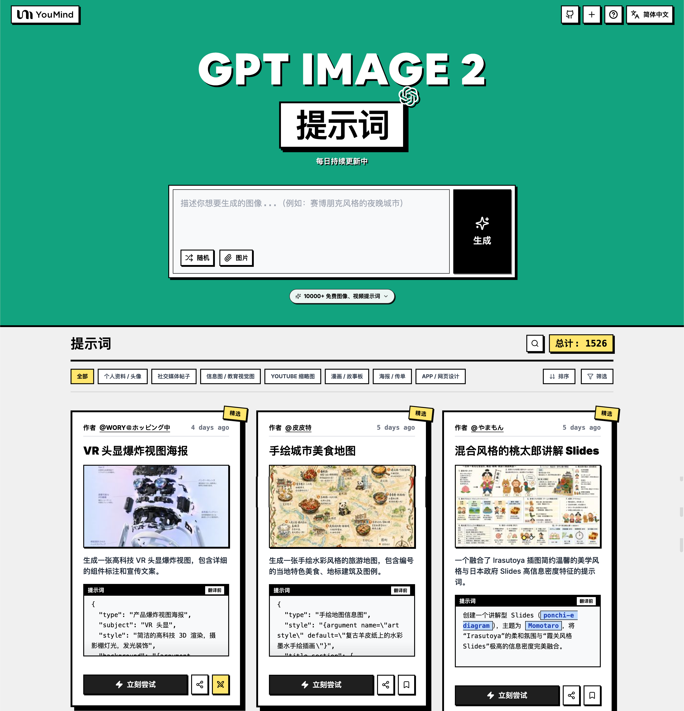

<a href="https://youmind.com/zh-CN/gpt-image-2-prompts">
  
</a>

> 💡 🎬 进阶玩法：用 **Seedance 2** 把 GPT Image 2 生成的图变成炸裂 AI 视频，2000+ 提示词等你探索 👉 [awesome-seedance-2-prompts](https://github.com/YouMind-OpenLab/awesome-seedance-2-prompts)
# 🚀 GPT Image 2 提示词大全

[](https://github.com/sindresorhus/awesome)
[](https://github.com/YouMind-OpenLab/awesome-gpt-image-2)
[](https://creativecommons.org/licenses/by/4.0/)
[](https://github.com/YouMind-OpenLab/awesome-gpt-image-2/actions)
[](docs/CONTRIBUTING.md)

> 🎨 OpenAI GPT Image 2 创意提示词精选集合

> ⚠️ **版权声明**：所有提示词均收集自社区，仅供教育目的使用。如果您认为任何内容侵犯了您的权利，请[提交 issue](https://github.com/YouMind-OpenLab/awesome-gpt-image-2/issues/new?template=bug-report.yml)，我们将立即移除。

---

[](README.md) [](README_zh.md) [](README_zh-TW.md) [](README_ja-JP.md) [](README_ko-KR.md) [](README_th-TH.md) [](README_vi-VN.md) [](README_hi-IN.md) [](README_es-ES.md) [-Click%20to%20View-lightgrey)](README_es-419.md) [](README_de-DE.md) [](README_fr-FR.md) [](README_it-IT.md) [-Click%20to%20View-lightgrey)](README_pt-BR.md) [](README_pt-PT.md) [](README_tr-TR.md)

---

## 🌐 在网页图库中查看

<div align="center">

[](https://youmind.com/zh-CN/gpt-image-2-prompts)

</div>

**[👉 浏览 YouMind GPT Image 2 提示词图库](https://youmind.com/zh-CN/gpt-image-2-prompts)**

为什么使用图库？

| Feature | GitHub README | youmind.com 图库 |
|---------|--------------|---------------------|
| 🎨 可视化布局 | 线性列表 | 精美的瀑布流网格 |
| 🔍 搜索 | 仅 Ctrl+F | 全文搜索和筛选 |
| 🤖 AI 一键生图 | - | AI 一键生图 |
| 📱 移动端 | 基础 | 完全响应式 |
| 🏷️ 分类 | - | 分类浏览 |


### 🏷️ 按分类浏览

- **使用场景**
  - [个人资料 / 头像](https://youmind.com/zh-CN/gpt-image-2-prompts?categories=profile-avatar)
  - [社交媒体帖子](https://youmind.com/zh-CN/gpt-image-2-prompts?categories=social-media-post)
  - [信息图 / 教育视觉图](https://youmind.com/zh-CN/gpt-image-2-prompts?categories=infographic-edu-visual)
  - [YouTube 缩略图](https://youmind.com/zh-CN/gpt-image-2-prompts?categories=youtube-thumbnail)
  - [漫画 / 故事板](https://youmind.com/zh-CN/gpt-image-2-prompts?categories=comic-storyboard)
  - [产品营销](https://youmind.com/zh-CN/gpt-image-2-prompts?categories=product-marketing)
  - [电商主图](https://youmind.com/zh-CN/gpt-image-2-prompts?categories=ecommerce-main-image)
  - [游戏素材](https://youmind.com/zh-CN/gpt-image-2-prompts?categories=game-asset)
  - [海报 / 传单](https://youmind.com/zh-CN/gpt-image-2-prompts?categories=poster-flyer)
  - [App / 网页设计](https://youmind.com/zh-CN/gpt-image-2-prompts?categories=app-web-design)
- **风格**
  - [摄影](https://youmind.com/zh-CN/gpt-image-2-prompts?categories=photography)
  - [电影 / 电影剧照](https://youmind.com/zh-CN/gpt-image-2-prompts?categories=cinematic-film-still)
  - [动漫 / 漫画](https://youmind.com/zh-CN/gpt-image-2-prompts?categories=anime-manga)
  - [插画](https://youmind.com/zh-CN/gpt-image-2-prompts?categories=illustration)
  - [草图 / 线稿](https://youmind.com/zh-CN/gpt-image-2-prompts?categories=sketch-line-art)
  - [漫画 / 图画小说](https://youmind.com/zh-CN/gpt-image-2-prompts?categories=comic-graphic-novel)
  - [3D 渲染](https://youmind.com/zh-CN/gpt-image-2-prompts?categories=3d-render)
  - [Q 版 / Q 萌风](https://youmind.com/zh-CN/gpt-image-2-prompts?categories=chibi-q-style)
  - [等距](https://youmind.com/zh-CN/gpt-image-2-prompts?categories=isometric)
  - [像素艺术](https://youmind.com/zh-CN/gpt-image-2-prompts?categories=pixel-art)
  - [油画](https://youmind.com/zh-CN/gpt-image-2-prompts?categories=oil-painting)
  - [水彩画](https://youmind.com/zh-CN/gpt-image-2-prompts?categories=watercolor)
  - [水墨 / 中国风](https://youmind.com/zh-CN/gpt-image-2-prompts?categories=ink-chinese-style)
  - [复古 / 怀旧](https://youmind.com/zh-CN/gpt-image-2-prompts?categories=retro-vintage)
  - [赛博朋克 / 科幻](https://youmind.com/zh-CN/gpt-image-2-prompts?categories=cyberpunk-sci-fi)
  - [极简主义](https://youmind.com/zh-CN/gpt-image-2-prompts?categories=minimalism)
- **主体**
  - [人像 / 自拍](https://youmind.com/zh-CN/gpt-image-2-prompts?categories=portrait-selfie)
  - [网红 / 模特](https://youmind.com/zh-CN/gpt-image-2-prompts?categories=influencer-model)
  - [角色](https://youmind.com/zh-CN/gpt-image-2-prompts?categories=character)
  - [团体 / 情侣](https://youmind.com/zh-CN/gpt-image-2-prompts?categories=group-couple)
  - [产品](https://youmind.com/zh-CN/gpt-image-2-prompts?categories=product)
  - [食品 / 饮料](https://youmind.com/zh-CN/gpt-image-2-prompts?categories=food-drink)
  - [时尚单品](https://youmind.com/zh-CN/gpt-image-2-prompts?categories=fashion-item)
  - [动物 / 生物](https://youmind.com/zh-CN/gpt-image-2-prompts?categories=animal-creature)
  - [车辆](https://youmind.com/zh-CN/gpt-image-2-prompts?categories=vehicle)
  - [建筑 / 室内设计](https://youmind.com/zh-CN/gpt-image-2-prompts?categories=architecture-interior)
  - [风景 / 自然](https://youmind.com/zh-CN/gpt-image-2-prompts?categories=landscape-nature)
  - [城市风光 / 街道](https://youmind.com/zh-CN/gpt-image-2-prompts?categories=cityscape-street)
  - [图表](https://youmind.com/zh-CN/gpt-image-2-prompts?categories=diagram-chart)
  - [文本 / 排版](https://youmind.com/zh-CN/gpt-image-2-prompts?categories=text-typography)
  - [摘要 / 背景](https://youmind.com/zh-CN/gpt-image-2-prompts?categories=abstract-background)

---

## 📖 目录

- [🌐 在网页图库中查看](#-view-in-web-gallery)
- [🤔 什么是 GPT Image 2？](#-what-is-gpt-image-2)
- [📊 统计数据](#-statistics)
- [🔥 精选提示词](#-featured-prompts)
- [📋 所有提示词](#-all-prompts)
- [🤝 如何贡献](#-how-to-contribute)
- [📄 许可证](#-license)
- [🙏 致谢](#-acknowledgements)
- [⭐ Star 历史](#-star-history)

---

## 🤔 什么是 GPT Image 2？

**GPT Image 2**（代号 **"duct-tape"**）是 OpenAI 下一代图像生成模型。社区测试反馈它在以下方面实现了质的飞跃：

- 🎯 **像素级文字渲染** — 中文、英文、日文均达到 native 水准，无错字、无字形扭曲
- 🎨 **跨图像素级一致性** — 同一角色、风格、IP 在多张图间保持像素级一致
- ⚡ **商用级插画质量** — 插画风格输出无需人工精修，即可直接用于商业场景
- 🌈 **真实艺术风格注入** — 不止是"模仿参考图"，而是真正理解并再现艺术风格的灵魂
- 🔧 **故事板与产品系列** — 适合故事板、IP 形象、产品系列图等需要多图一致性的场景
- 📐 **多语言平面设计** — 社交卡片、Banner、海报一次生图即可完成多语言文字排版

📚 **了解更多：** 查看社区测试 [报告要点](docs/FAQ.md)

### 🚀 Raycast 集成

部分提示词支持使用 [Raycast Snippets](https://raycast.com/help/snippets) 语法的**动态参数**。寻找 🚀 Raycast Friendly 徽章！

**示例：**
```
A quote card with "{argument name="quote" default="Stay hungry, stay foolish"}"
by {argument name="author" default="Steve Jobs"}
```

在 Raycast 中使用时，您可以动态替换参数以快速迭代！

---

## 📊 统计数据

<div align="center">

| 指标 | 数量 |
|--------|-------|
| 📝 提示词总数 | **18144** |
| ⭐ 精选 | **6** |
| 🔄 最后更新 | **2026年11月23日星期一 UTC 23:00:33** |

</div>

---

## 🔥 精选提示词

> ⭐ 由我们的团队精心挑选，具有卓越的质量和创造力

### No. 1: VR 头显爆炸视图海报


#### 📖 描述

生成一张高科技 VR 头显爆炸视图，包含详细的组件标注和宣传文案。

#### 📝 提示词

```
{
  "type": "产品爆炸视图海报",
  "subject": "VR 头显",
  "style": "简洁的高科技 3D 渲染，摄影棚灯光，发光装饰",
  "background": "{argument name=\"background color\" default=\"柔和的紫蓝色渐变\"}",
  "header": {
    "logo": "∞ {argument name=\"product name\" default=\"Meta Quest 3\"}",
    "subtitle": "{argument name=\"main catchphrase\" default=\"以全新的结构，重塑全新的现实。\"}"
  },
  "layout": {
    "centerpiece": "VR 头显的垂直堆叠爆炸视图，展示了 9 层不同的内部组件：外壳、摄像头传感器、带芯片的主板、Pancake 透镜、内部框架、电池组、侧带、顶部头带和面部接口衬垫。",
    "callout_labels": {
      "count": 8,
      "left_side": [
        "Snapdragon® XR2 Gen 2\n卓越的处理性能，带来实时沉浸体验。",
        "可调节 IPD 机构\n为广大用户提供舒适的佩戴感。",
        "精密设计的头带\n追求舒适与稳定的工程学设计。"
      ],
      "right_side": [
        "前面板\n精致的设计与优化的重量平衡。",
        "追踪摄像头\n实现高精度的位置追踪与环境感知。",
        "Pancake 透镜\n轻薄设计，提供广阔视野与清晰画质。",
        "高性能电池\n优化电源设计，支持长时间续航。",
        "柔软的面部接口\n确保长时间佩戴依然舒适。"
      ]
    },
    "footer": {
      "left_text_block": {
        "headline": "{argument name=\"bottom headline\" default=\"体验，源于结构的进化。\"}",
        "body": "每一个零件都蕴含着支撑沉浸式体验的前沿科技与匠心设计。Meta Quest 3 从内部构建未来，为您带来超乎想象的体验。"
      },
      "right_logo": "∞ Meta"
    }
  }
}
```

#### 🖼️ 生成图片

##### Image 1

<div align="center">

</div>

#### 📌 详情

- **作者:** [wory＠ホッピング中](https://x.com/wory37303852)
- **来源:** [Twitter Post](https://x.com/wory37303852/status/2045925660401795478#reversed-0)
- **发布时间:** 2026年4月19日
- **多语言:** en

**[👉 立即尝试 →](https://youmind.com/zh-CN/gpt-image-2-prompts?id=13460)**

---

### No. 2: 手绘城市美食地图


#### 📖 描述

生成一张手绘水彩风格的旅游地图，包含编号的当地特色美食、地标建筑及图例。

#### 📝 提示词

```
{
  "type": "手绘地图信息图",
  "style": "{argument name=\"art style\" default=\"复古羊皮纸上的水彩墨水手绘插画\"}",
  "title_section": {
    "text": "{argument name=\"city name\" default=\"成都\"} {argument name=\"map title\" default=\"吃货暴走地图\"}",
    "mascot": "戴着墨镜并竖起大拇指的卡通红辣椒"
  },
  "border": "{argument name=\"border decoration\" default=\"绿叶与红辣椒藤蔓\"}",
  "layout": {
    "background": "带有黄色道路、蓝色河流和绿色公园区域的纹理米色羊皮纸",
    "sections": [
      {
        "title": "地标建筑",
        "count": 6,
        "illustrations": ["传统凉亭", "传统寺院", "带有攀爬熊猫的现代摩天大楼", "高耸的电视塔", "传统牌坊", "工业建筑"],
        "labels": ["人民公园", "文殊院", "IFS", "339电视塔", "宽窄巷子", "东郊记忆"]
      },
      {
        "title": "美食地点",
        "count": 12,
        "illustrations": ["麻婆豆腐", "红油水饺", "冷锅串串", "三大炮", "蛋烘糕", "九宫格火锅", "肥肠粉", "钵钵鸡", "冒菜", "盖碗茶", "冰粉", "兔头"],
        "labels": ["1 陈麻婆豆腐", "2 钟水饺", "3 春熙路", "4 宽窄巷子·三大炮", "5 建设路·叶婆婆蛋烘糕", "6 玉林路·小龙坎火锅", "7 香香巷·肥肠粉", "8 武侯祠大街·钵钵鸡", "9 东郊记忆·冒椒火辣", "10 人民公园·鹤鸣茶社", "11 锦里古街·冰粉", "12 双流老妈兔头"]
      },
      {
        "title": "图例",
        "position": "右下角",
        "count": 5,
        "items": ["红点", "绿色建筑", "绿树", "蓝线", "黄色双线"],
        "labels": ["美食地点", "地标景点", "公园绿地", "河流湖泊", "主要道路"]
      }
    ],
    "centerpiece": "坐着吃竹子的大熊猫",
    "bottom_right_extras": ["带有东南西北方向的复古罗盘", "带有红辣椒图标的免责声明：'温馨提示：吃辣需谨慎，肠胃要保护~'"]
  }
}
```

#### 🖼️ 生成图片

##### Image 1

<div align="center">

</div>

#### 📌 详情

- **作者:** [皮皮特](https://x.com/mm_zzm44854)
- **来源:** [Twitter Post](https://x.com/mm_zzm44854/status/2045861258520568230#reversed-1)
- **发布时间:** 2026年4月19日
- **多语言:** en

**[👉 立即尝试 →](https://youmind.com/zh-CN/gpt-image-2-prompts?id=13515)**

---

### No. 3: 混合风格的桃太郎讲解 Slides


#### 📖 描述

一个融合了 Irasutoya 插图简约温馨的美学风格与日本政府 Slides 高信息密度特征的提示词。

#### 📝 提示词

```
创建一个讲解型 Slides（{argument name="format" default="ponchi-e diagram"}），主题为 {argument name="theme" default="Momotaro"}，将“Irasutoya”的柔和氛围与“霞关风格 Slides”极高的信息密度完美融合。
```

#### 🖼️ 生成图片

##### Image 1

<div align="center">

</div>

##### Image 2

<div align="center">

</div>

#### 📌 详情

- **作者:** [やまもん](https://x.com/yammamon)
- **来源:** [Twitter Post](https://x.com/yammamon/status/2045778624092254603)
- **发布时间:** 2026年4月19日
- **多语言:** ja

**[👉 立即尝试 →](https://youmind.com/zh-CN/gpt-image-2-prompts?id=13983)**

---

### No. 4: 电商直播 UI 样机


#### 📖 描述

生成逼真的社交媒体直播界面，叠加在人物肖像之上，包含可自定义的聊天消息、礼物弹窗和商品购买卡片。

#### 📝 提示词

```
{
  "type": "直播 UI 样机",
  "subject": {
    "description": "{argument name=\"host name\" default=\"Elon Musk\"} 的肖像，面带微笑，身穿印有白色技术示意图的黑色 T 恤",
    "background": "左侧显示带有 '{argument name=\"left background logo\" default=\"SPACEX\"}' 文字的屏幕，右侧显示红色的 '{argument name=\"right background logo\" default=\"Tesla T logo\"}' 和一辆深色汽车"
  },
  "ui_overlay": {
    "top_header": {
      "host_info": "头像，名称 '{argument name=\"host name\" default=\"Elon Musk\"}'，副标题 '55.6万本场点赞'，红色 '关注' 按钮",
      "rank_badge": "带有 '全站第1名' 的金币图标",
      "viewer_stats": "3 个顶部观众头像，显示 '12.3w'、'8.6w'、'5.7w'，总计 '68.7万'，'X' 关闭按钮",
      "right_links": "'更多直播 >'，'礼物展馆 0/24'（带有蓝色 '经典' 标签）"
    },
    "mid_left_gifts": {
      "count": 2,
      "items": [
        "头像 '科技爱好者'，'送小心心'，爱心图标 x 1314",
        "头像 '星辰大海'，'送火箭'，火箭图标 x 666"
      ]
    },
    "bottom_left_chat": {
      "system_message": "37 级勋章 '宇宙漫游者 加入了直播间'",
      "message_count": 7,
      "messages": [
        "小火箭: 马斯克！未来可期！🚀",
        "future: 特斯拉Model 2什么时候出？",
        "星空梦想家: SpaceX今年能上火星吗？",
        "AI探索者: Neuralink进展如何？",
        "帅气的网友: 马总好！",
        "Mars: 第一次来你的直播，超激动！",
        "用户123: 讲讲AI吧，会取代人类吗？"
      ]
    },
    "bottom_right_product_card": {
      "hot_tag": "橙色 '热卖 x 1888'",
      "image": "Tesla Cybertruck",
      "title": "{argument name=\"product name\" default=\"特斯拉Cybertruck 电动皮卡\"}",
      "price": "{argument name=\"product price\" default=\"¥ 1,618,000\"}",
      "button": "红色 '抢' 按钮",
      "floating_animation": "半透明爱心沿右侧边缘向上浮动"
    },
    "bottom_bar": {
      "input_field": "'说点什么...'",
      "icons": ["笑脸", "三个点", "购物车", "礼物盒", "分享"]
    }
  }
}
```

#### 🖼️ 生成图片

##### Image 1

<div align="center">

</div>

#### 📌 详情

- **作者:** [神经病不想好转](https://x.com/sjbbxhz)
- **来源:** [Twitter Post](https://x.com/sjbbxhz/status/2045684734714380687#reversed-0)
- **发布时间:** 2026年4月19日
- **多语言:** en

**[👉 立即尝试 →](https://youmind.com/zh-CN/gpt-image-2-prompts?id=14036)**

---

### No. 5: 动漫武术对决


#### 📖 描述

生成一个动态的动漫风格动作场景，展示两个角色在传统道场中伴随元素光环进行战斗。

#### 📝 提示词

```
一幅极具动态感的动漫插画，描绘了两名少女在传统木质道场内进行激烈武术对决的场景。在前景中，一名留着 {argument name="character 1 hair" default="黑色高丸子头配红色丝带"} 的少女摆出强有力的低位武术架势，正奋力挥拳。她身穿 {argument name="character 1 outfit" default="带有红色流苏的白色中式上衣和红色宽松长裤"}，强烈的红色能量斩击环绕着她挥动的四肢。在右侧半空中，一名留着 {argument name="character 2 hair" default="浅紫色双丸子头"} 的少女优雅地跃起，自信地微笑着，身穿 {argument name="character 2 outfit" default="带有金色刺绣的深绿色连衣裙和黑色紧身裤"}，伴随着扫过的蓝色水流状能量轨迹。背景是质朴的木质寺庙内部，上方悬挂着一块写有“{argument name="sign text" default="武術会"}”的醒目招牌。场景充满了爆发性的动作感，飞扬的尘土、破碎的木质地板、发光的彩色粒子特效，以及将角色与精细背景完美区分开来的戏剧性低角度光影。
```

#### 🖼️ 生成图片

##### Image 1

<div align="center">

</div>

#### 📌 详情

- **作者:** [たねもみ 2.0 / Tanemomi Ver2.0](https://x.com/Tanemomi_Ver2)
- **来源:** [Twitter Post](https://x.com/Tanemomi_Ver2/status/2046063806846214265#reversed-0)
- **发布时间:** 2026年4月20日
- **多语言:** en

**[👉 立即尝试 →](https://youmind.com/zh-CN/gpt-image-2-prompts?id=13467)**

---

### No. 6: 3D 石阶演化信息图


#### 📖 描述

将平面的演化时间轴转化为逼真的 3D 石阶信息图，包含精细的生物渲染图和结构化的侧边栏。

#### 📝 提示词

```
{
  "type": "演化时间轴信息图",
  "instruction": "以 REFERENCE_0 作为结构基础，将平面矢量设计转化为高度逼真的 3D 信息图。将平滑的坡道替换为独特的石阶，并将所有生物升级为照片级真实的 3D 模型。",
  "style": {
    "background": "{argument name=\"background style\" default=\"复古纹理羊皮纸\"}",
    "staircase": "{argument name=\"staircase material\" default=\"逼真的纹理石块\"}",
    "subjects": "{argument name=\"organism style\" default=\"高度精细的照片级真实 3D 渲染\"}"
  },
  "layout": {
    "main_title": "{argument name=\"main title\" default=\"人类演化\"}",
    "sections": [
      {
        "position": "左侧边栏",
        "count": 8,
        "labels": ["L0: 单细胞生命", "L1: 多细胞生物", "L2: 动物界", "L3: 脊索动物", "L4: 上陆革命", "L5: 哺乳纲", "L6: 人科演化", "L7: 智人纪元"]
      },
      {
        "position": "右上角",
        "title": "获得的功能 / 失去的功能",
        "description": "带有加号和减号图标的图例"
      },
      {
        "position": "底部中心",
        "title": "演化关键里程碑",
        "count": 6,
        "description": "包含 6 个展示从猿到人演化剪影图形的时间轴"
      }
    ],
    "centerpiece": {
      "description": "蜿蜒的石阶，共有 25 个编号台阶，展示特定生物。",
      "count": 25,
      "notable_elements": [
        "第 07 阶: 水母",
        "第 09 阶: 菊石",
        "第 10 阶: 三叶虫",
        "第 24 阶: 直立行走的人类",
        "第 25 阶: {argument name=\"future evolution concept\" default=\"带有问号的发光宇宙剪影\"}"
      ]
    }
  }
}
```

#### 🖼️ 生成图片

##### Image 1

<div align="center">

</div>

#### 📌 详情

- **作者:** [知识猫图解](https://x.com/GeekCatX)
- **来源:** [Twitter Post](https://x.com/GeekCatX/status/2045792240044511277#reversed-1)
- **发布时间:** 2026年4月19日
- **多语言:** en

**[👉 立即尝试 →](https://youmind.com/zh-CN/gpt-image-2-prompts?id=13491)**

---

## 📋 所有提示词

> 📝 按发布日期排序（最新优先）

### No. 1: 个人资料 / 头像 - GPT Image 2 红色开衫写实人像提示词


#### 📖 描述

为 GPT Image 2 优化的详细提示词，用于生成身穿红色开衫和条纹连体裤的女性电影级写实人像。

#### 📝 提示词

```
一张照片级写实的电影感人像，画面中一位美丽的年轻女子站在户外，身后是茂密翠绿的树篱。她留着中分的深棕色直发，长度及肩，妆容自然，神情柔和而自信。她身穿一件亮红色开衫，内搭修身的白色细黑竖条纹无袖连体裤。双臂轻轻交叉，姿态放松而优雅。她微微侧目，嘴角带着一抹浅笑。柔和的自然日光，逼真的皮肤质感，细腻的面料纹理，专业时尚摄影风格，浅景深，背景绿叶虚化唯美，DSLR 画质，4K 分辨率。保留自然的身体比例与真实的面部细节。
```

#### 🖼️ 生成图片

##### Image 1

<div align="center">

</div>

#### 📌 详情

- **作者:** [Rubi](https://x.com/AIwithRubii)
- **来源:** [Twitter Post](https://x.com/AIwithRubii/status/2124136460114956664)
- **发布时间:** 2026年11月21日
- **多语言:** en

**[👉 立即尝试 →](https://youmind.com/zh-CN/gpt-image-2-prompts?id=37692)**

---

### No. 2: 个人资料 / 头像 - 宝蓝色毛衣女性肖像提示词


#### 📖 描述

一个详细的提示词，用于生成穿着宝蓝色毛衣的女性的两个变体（戴面具和不戴面具），并保持与参考图像的面部一致性。

#### 📝 提示词

```
根据参考图，生成两张同一位美丽年轻女性的独立图片，需精准还原她的面部特征、迷人的绿色眼眸、自然肤色，以及用宝蓝色丝带蝴蝶结扎起的蓬松半扎长棕色波浪卷发。第一张图片中，她身穿一件漂亮的宝蓝色宽松针织毛衣（不含任何黑色衣物），以优雅放松的姿态坐着，单膝微曲，脸颊轻托于手上；全脸清晰可见，妆容柔和自然，双颊红润，嘴唇呈光泽粉色。第二张图片中，人物、五官、发型、蓝色丝带蝴蝶结及宝蓝色毛衣均与第一张完全一致，但需增加一个同色系的宝蓝色针织口罩遮住口鼻，一只手在脸颊旁轻轻扶着口罩，同时确保她美丽的双眼依然清晰可见。两张图片均需采用柔和的炭灰色摄影棚背景、电影级光影、逼真的皮肤纹理、细腻的针织面料质感，呈现专业时尚摄影风格与超写实的 8K 画质；采用 9:16 竖版比例，不含黑色衣物、文字及水印。
```

#### 🖼️ 生成图片

##### Image 1

<div align="center">

</div>

##### Image 2

<div align="center">

</div>

#### 📌 详情

- **作者:** [liana](https://x.com/Lianaalane)
- **来源:** [Twitter Post](https://x.com/Lianaalane/status/2123964230890348559)
- **发布时间:** 2026年11月21日
- **多语言:** en

**[👉 立即尝试 →](https://youmind.com/zh-CN/gpt-image-2-prompts?id=37686)**

---

### No. 3: 个人资料 / 头像 - 昭和复古花卉连衣裙人像


#### 📖 描述

生成一张写实风格的女性照片，她身着复古花卉连衣裙，置身于宁静的日式庭院中，捕捉充满怀旧感的昭和时代氛围。

#### 📝 提示词

```
一张照片级逼真的年轻女性肖像，散发着温柔怀旧的昭和时代美学气息。她留着一头深色秀发，松松地编成一条侧边麻花辫；身穿一袭复古风奶油色中长连衣裙，裙上点缀着精致的紫色碎花图案，短袖设计搭配彼得潘领与纽扣门襟。她伫立在一座葱郁的日式庭院中，抬手轻触头顶青枫的枝叶。光线柔和斑驳，为画面覆上一层温暖的胶片颗粒感，仿佛将人带回 20 世纪 70 年代的复古时光。
```

#### 🖼️ 生成图片

##### Image 1

<div align="center">

</div>

#### 📌 详情

- **作者:** [いがぐりメタボ](https://x.com/Kmsbdd0GXBOcrXQ)
- **来源:** [Twitter Post](https://x.com/Kmsbdd0GXBOcrXQ/status/2123734795746484634#reversed-0)
- **发布时间:** 2026年11月20日
- **多语言:** en

**[👉 立即尝试 →](https://youmind.com/zh-CN/gpt-image-2-prompts?id=37685)**

---

### No. 4: 个人资料 / 头像 - 大理石雕塑头像提示词


#### 📖 描述

用于 GPT Image 2 的提示词，可将上传的照片转换为具有博物馆灯光效果的超写实古典希腊罗马风格大理石雕塑头像。

#### 📝 提示词

```
将上传的照片转化为超写实的古典希腊罗马风格大理石雕塑头像。面部轮廓精雕细琢，保留细微的瑕疵、清晰可见的石纹以及天然的大理石肌理。表面光滑却略带岁月风化的痕迹，呈现逼真的雕刻刀触与精准的人体结构。柔和的博物馆级定向光投下细腻阴影，凸显立体感与轮廓层次。中性画廊背景搭配浅景深效果，营造优雅的艺术氛围与隽永美感，超高分辨率，电影级写实质感，1:1 画幅比例，顶级雕像肖像品质。
```

#### 🖼️ 生成图片

##### Image 1

<div align="center">

</div>

#### 📌 详情

- **作者:** [Smiling Khan](https://x.com/AIwithkhan)
- **来源:** [Twitter Post](https://x.com/AIwithkhan/status/2123423368301138088)
- **发布时间:** 2026年11月19日
- **多语言:** en

**[👉 立即尝试 →](https://youmind.com/zh-CN/gpt-image-2-prompts?id=37660)**

---

### No. 5: 个人资料 / 头像 - 宝蓝色晚礼服人像提示词


#### 📖 描述

适用于 GPT Image 2 的逼真编辑风格人像提示词，展示一位身着宝蓝色珠饰礼服的魅力女性，背景为带有混凝土交通设施的城市景观。

#### 📝 提示词

```
一位魅力四射的女性，留着深棕色长波浪卷发，涂着明艳的红唇，在现代混凝土高架轨道交通建筑与城市街道的户外背景下摆出造型。她身穿一件修身的宝蓝色与青绿色珠饰晚礼服，心形领口、垂褶腰身设计，下摆缀有垂坠的珠串流苏。左手轻抬至发丝旁，佩戴着低调的蓝色水滴形耳坠和精致手链。自然日光照明，浅景深，中景构图，照片级逼真的时尚编辑风格人像。
```

#### 🖼️ 生成图片

##### Image 1

<div align="center">

</div>

#### 📌 详情

- **作者:** [Ayesha](https://x.com/AyeshaEvie)
- **来源:** [Twitter Post](https://x.com/AyeshaEvie/status/2123411037718462564)
- **发布时间:** 2026年11月19日
- **多语言:** en

**[👉 立即尝试 →](https://youmind.com/zh-CN/gpt-image-2-prompts?id=37661)**

---

### No. 6: 个人资料 / 头像 - 优雅的东亚女性时尚人像


#### 📖 描述

适用于 GPT Image 2 的专业人像摄影提示词，展示一位身着芥末黄钩针帽和花卉衬衫的优雅东亚女性，背景为黑色。

#### 📝 提示词

```
专业人像摄影，9:16 竖构图，一位惊艳优雅的东亚女性，上半身特写，背景为纯黑底色。

她拥有一头浓密的黑色长卷发，在微风中轻盈飘逸，温暖的金色轮廓光勾勒出她的发丝与肩线。头戴一顶亮芥末黄色的钩织渔夫帽，左侧点缀着一个优雅的大号缎面蝴蝶结。耳畔佩戴着抛光金色双环大吊坠耳环。

身穿一件丝滑的奶油白衬衫，印有明艳的复古花卉图案——盛开的橙色与金色虞美人，搭配柔和的蓝绿色枝叶，泡泡袖长及手肘。下搭高腰柔黄色长裤或半裙。右手轻触帽檐，姿态优雅，目光温暖自信地直视镜头，嘴角带着若有似无的浅笑。

柔和影棚布光，温暖金色调，高端时尚美学，面部精准对焦，超精细细节，照片级真实感，8K 分辨率，色彩明艳而不失雅致，电影级质感，肌肤细腻光滑，尽显精致隽永的优雅气质。
```

#### 🖼️ 生成图片

##### Image 1

<div align="center">

</div>

#### 📌 详情

- **作者:** [Aiza](https://x.com/AizaAi12)
- **来源:** [Twitter Post](https://x.com/AizaAi12/status/2123380215317676180)
- **发布时间:** 2026年11月19日
- **多语言:** en

**[👉 立即尝试 →](https://youmind.com/zh-CN/gpt-image-2-prompts?id=37663)**

---

### No. 7: 个人资料 / 头像 - 年轻女性六格人像拼贴


#### 📖 描述

由六张影棚肖像组成的拼贴图，展示了一位留着棕色长发的年轻女性在灰色背景前的多种休闲表情。

#### 📝 提示词

```
六张竖版人像照片以网格形式排列，画面中是一位年轻的东亚女性，留着深棕色的长波浪卷发和轻盈的刘海。她身穿一件简约的黑色细吊带背心，佩戴着一条精致的银质项链，吊坠小巧。背景是一面素净的冷灰色墙壁，暗示拍摄地为室内摄影棚；柔和的漫射光在她的脸上投下淡淡的阴影。

左上：她双手托腮，掌心朝内，神情淡然，目光微微偏向左侧。
中上：她在右眼旁比出剪刀手，同时眨着这只眼睛，双唇微启。
右上：她双眼轻闭，头微微低垂，一只手抬起轻抚发顶。
左下：她将脸颊靠在右手上，指尖轻触太阳穴，目光望向一旁，若有所思。
中下：一张自然抓拍的照片，她笑容灿烂、露出牙齿，看向镜头右侧的画面之外。
右下：她直视镜头，嘴角挂着温柔浅淡的微笑，一只手轻轻将耳后的头发向后拢去。
```

#### 🖼️ 生成图片

##### Image 1

<div align="center">

</div>

#### 📌 详情

- **作者:** [なかやま](https://x.com/yudetamago__san)
- **来源:** [Twitter Post](https://x.com/yudetamago__san/status/2123050336764239971#reversed-0)
- **发布时间:** 2026年11月18日
- **多语言:** en

**[👉 立即尝试 →](https://youmind.com/zh-CN/gpt-image-2-prompts?id=37621)**

---

### No. 8: 个人资料 / 头像 - GPT Image 2 夜间自拍提示词


#### 📖 描述

专为 GPT Image 2 设计的提示词，用于生成年轻东亚女性在夜间城市街道漫步的超写实智能手机自拍。

#### 📝 提示词

```
超现实夜间手机自拍照，画面质感如同真实 iPhone 或手机摄像头拍摄，而非单反相机。一位美丽的东亚年轻女性，保留参考图中的面部特征，深棕色长发略显凌乱，在微风中自然飘动；肌肤白皙如瓷，棕色大眼睛灵动有神；妆容柔和自然，脸颊微泛红晕，粉润双唇嘟起做出可爱的“嘟嘟脸”表情。身穿灰色修身细吊带背心，一手随意举着智能手机，正漫步于夜晚安静的城市林荫人行道上。暖色路灯照亮她的脸庞，投下柔和的阴影，背景是停放的车辆、绿树与空旷的街道。带有轻微的手持动态模糊，自然的手机 HDR 效果，逼真的皮肤纹理，根根分明的真实发丝，轻微的数码噪点，前置摄像头视角，随性的生活感美学，深夜悠闲散步，Instagram 风格自拍，细节丰富，照片级真实，整体观感明显是一张未经修饰的手机随拍，而非 AI 生成或影棚摄影作品。
```

#### 🖼️ 生成图片

##### Image 1

<div align="center">

</div>

#### 📌 详情

- **作者:** [我叫聂磊](https://x.com/zhy2024806)
- **来源:** [Twitter Post](https://x.com/zhy2024806/status/2122887530052022398)
- **发布时间:** 2026年11月18日
- **多语言:** zh

**[👉 立即尝试 →](https://youmind.com/zh-CN/gpt-image-2-prompts?id=37581)**

---

### No. 9: 个人资料 / 头像 - 昭和复古风碎花裙女性肖像


#### 📖 描述

生成一张怀旧胶片风格的肖像，描绘一位身穿碎花裙的年轻女子坐在摇椅上，背景为复古日式卧室。此效果非常适合营造昭和时代的审美氛围或用于情感叙事类视觉创作。

#### 📝 提示词

```
一幅竖版人像，画面中一位年轻的东亚女性坐在一张复古木质摇椅上，身处一间温馨且充满怀旧风格的卧室里。她深棕色的头发随意地束在脑后，几缕碎发垂落脸庞两侧，发间别着一枚小巧的白色花朵发夹。她的神情平静，略带一丝忧郁，目光直视镜头。她身穿一件米白色短袖连衣裙，裙身印有精致的花卉图案（粉色与蓝色的小花），搭配圆润的彼得潘领、泡泡袖，前胸处有一排小纽扣。她双手交叠放在膝上，双腿在膝盖处交叉。

场景营造出日本昭和时代的怀旧室内氛围：柔和的自然光透过左侧的蕾丝薄纱窗帘洒入，在整个画面中投下温柔的光影。她右后方是一张深色木质床架，铺着印花床品；再往后是一个古董梳妆台，上面摆着一盏散发暖光的黄铜台灯、一瓶鲜花和几个相框。地面是打磨光滑的实木地板，摇椅下方铺着一块质感丰富的米色长绒地毯，遮住了部分地板。

风格：胶片摄影美学——颗粒质感、柔和的低饱和粉彩色调、浅景深，以及真实的瑕疵感，如轻微的肌肤纹理和不均匀的光线，以增强画面的真实感。氛围：静谧、内省、带着怅然的怀旧之情。
```

#### 🖼️ 生成图片

##### Image 1

<div align="center">

</div>

#### 📌 详情

- **作者:** [いがぐりメタボ](https://x.com/Kmsbdd0GXBOcrXQ)
- **来源:** [Twitter Post](https://x.com/Kmsbdd0GXBOcrXQ/status/2122650353510576594#reversed-0)
- **发布时间:** 2026年11月17日
- **多语言:** en

**[👉 立即尝试 →](https://youmind.com/zh-CN/gpt-image-2-prompts?id=37586)**

---

### No. 10: 个人资料 / 头像 - GPT Image 2 冬季剪贴簿拼贴人像提示词


#### 📖 描述

使用 GPT Image 2 生成超写实冬季剪贴簿拼贴人像的详细提示词，角色为紫发女性，身着舒适街头服饰并手持珍珠奶茶。

#### 📝 提示词

```
创作一幅超写实的全身冬季剪贴簿拼贴肖像，人物与参考图中的年轻女性角色保持一致。请保留她的标志性发型——齐下巴的柔顺紫罗兰色直发波波头搭配轻盈刘海，以及白皙如瓷的肌肤、鼻梁与双颊上自然的雀斑、浅褐色杏仁眼、精致的五官、水润光泽的双唇和纤细的身材。

她侧身坐在一个纸箱上，姿态慵懒惬意。左手拿着一杯 topped 着鲜奶油的粉色草莓冰波霸奶茶，右臂则抱着一只可爱的笑脸草莓毛绒玩偶。她身穿一件温暖的米白色针织高领毛衣，外搭一件宽松的浅色水洗牛仔外套，外套上点缀着色彩缤纷的花朵、格纹、波点与草莓图案的拼布装饰。同风格的宽腿拼布牛仔裤搭配厚底白色增高运动鞋，完美呈现出一套温暖舒适的冬季街头穿搭。

纸箱上手写着带有心形图案的“{argument name="box text" default="FRAGILE"}”字样。背景由揉皱的蓝色剪贴簿纸张构成，上面装饰着撕下的笔记本纸页、手写字样“{argument name="background words" default="Winter", "Slow", "dream", and "Sweet"}”、红色格纹和纸胶带、回形针、草莓贴纸、白色雪花涂鸦，以及一个戴着红色针织帽和围巾的可爱雪人。画面中还需加入手写留言“{argument name="message" default="Stay Cozy"}”。

采用柔和漫射的冬季影棚光线，冷调粉彩蓝配色，融入温馨治愈的细节；呈现逼真的皮肤质感、根根分明的紫色发丝与针织面料纹理；具备电影级景深与细腻阴影，达到照片级真实画质与超精细 8K 分辨率。整体风格为高端冬季 Cottagecore Y2K 剪贴簿时尚大片。
```

#### 🖼️ 生成图片

##### Image 1

<div align="center">

</div>

#### 📌 详情

- **作者:** [Wareen AI 💟](https://x.com/Wareenaa)
- **来源:** [Twitter Post](https://x.com/Wareenaa/status/2122551075098284096)
- **发布时间:** 2026年11月17日
- **多语言:** en

**[👉 立即尝试 →](https://youmind.com/zh-CN/gpt-image-2-prompts?id=37534)**

---

### No. 11: 个人资料 / 头像 - GPT Image 2 提示词：将照片转换为 3D 玩具情侣


#### 📖 描述

详细提示词，可将上传的情侣参考照片转换为咖啡馆场景中的超精细 3D 收藏级乙烯基手办，在保留面部特征的同时应用风格化的玩具美学。

#### 📝 提示词

```
将上传参考照片中的人物转化为超精细的 3D 收藏级潮玩情侣场景，背景设定在一家格调十足的户外咖啡馆。保留他们极具辨识度的面部特征，将其重塑为高端亮面乙烯基（vinyl）手办，呈现抛光塑料质感、略微夸张的比例、生动传神的表情以及逼真的玩具细节。

女性角色留着深棕色头发，梳成优雅的法式编发盘发，佩戴黑色墨镜、精致的金色圈形耳环和叠戴金项链，身穿白色泡泡袖衬衫。她单手轻轻托腮，面带温柔笑意，深情注视着身旁的伴侣。

男性角色拥有一头浓密蓬松的深色卷发，胡须修剪得干净利落，戴着黑色墨镜，身穿清爽的白色纽扣衬衫，袖口随意卷起。他腕上佩戴银色手表，正随性地将一只白色小瓷咖啡杯举至唇边。

两位角色亲密地并排坐在一张打磨光滑的木质咖啡桌旁。桌上摆放着迷你白色咖啡杯、配套杯碟以及精致的银色茶匙。

环境：一家迷人的欧洲高档户外咖啡馆，拥有温暖的米色石材建筑、高大的玻璃窗、葱郁的绿树、蓝色庭院遮阳伞和木质家具，背景中的咖啡馆客人呈柔和虚化效果。温暖的午后阳光折射出漂亮的光影与柔和的阴影。

视觉风格：高端设计师乙烯基潮玩、亮面 3D 手办、可爱又不失精致的角色设计、光滑细腻的雕塑表面、细节丰富的发型、逼真的微缩配饰、高端收藏级潮玩摄影、电影感景深、温暖的金黄色调、超写实 3D 渲染。

构图：4:5 竖版人像画幅，平视正面机位，两位角色醒目地占据前景，姿态自然放松，营造温馨亲昵的咖啡馆氛围。

渲染质量：超精细 3D 建模、逼真的光泽反射、光线追踪照明、环境光遮蔽、全局光照、基于物理的材质、电影级阴影、专业产品摄影、8K 级画质。

重要提示：务必保留参考照片中这对情侣的身份特征与独特面容。两人必须呈现出精美实体收藏级潮玩的质感，而非普通的人像照片。无文字、无水印、前景中无多余人物。
```

#### 🖼️ 生成图片

##### Image 1

<div align="center">

</div>

#### 📌 详情

- **作者:** [Smiling Khan](https://x.com/AIwithkhan)
- **来源:** [Twitter Post](https://x.com/AIwithkhan/status/2121954653500035343)
- **发布时间:** 2026年11月15日
- **多语言:** en

**[👉 立即尝试 →](https://youmind.com/zh-CN/gpt-image-2-prompts?id=37519)**

---

### No. 12: 个人资料 / 头像 - GPT Image 2 多视角角色一致性提示词


#### 📖 描述

使用 GPT Image 2，结合面部、服装和姿态深度图参考图像，生成一致的角色照片的提示词。

#### 📝 提示词

```
请生成一张图片：照片级写实，竖版 2:3 比例，一位虚构的 {argument name="age" default="20岁"} 成年女性单人照，青春洋溢，像大二学生，不要显得成熟。图 1 为人脸参考：保持五官、肤色、发型和发色一致。图 2 为服装参考：完全按照图中所示穿着这套衣服，保持款式、颜色、材质和配饰一致。图 3 为人体模特的灰度深度图：仅作为身体姿势和拍摄角度的参考；它不是真人，不提供服装或面部细节。场景：{argument name="scene_description" default="春日午后公园里绿树成荫的小径"}，嫩绿的树叶，路边有长椅，柔和的自然光，iPhone 随手拍质感，真实的皮肤纹理，轻微的胶片颗粒感。单张图片，非拼图，无文字或水印，双手自然放松且五指完整，面部和四肢无变形。

请再生成一张图片：参考上一张：人物、发型、服装、场景和光线完全一致，但将身体姿势和拍摄角度改为与这张深度图中的姿势匹配（深度图只是人体模型，不提供服装或面部信息）。竖版 2:3 单张图片，非拼图，无文字或水印，手指完整。
```

#### 🖼️ 生成图片

##### Image 1

<div align="center">

</div>

##### Image 2

<div align="center">

</div>

#### 📌 详情

- **作者:** [Candy](https://x.com/CandyTravelight)
- **来源:** [Twitter Post](https://x.com/CandyTravelight/status/2121772672140886063)
- **发布时间:** 2026年11月15日
- **多语言:** zh

**[👉 立即尝试 →](https://youmind.com/zh-CN/gpt-image-2-prompts?id=37510)**

---

### No. 13: 个人资料 / 头像 - 动漫少女鹿纹披风秋日穿搭


#### 📖 描述

生成一位戴着斑点鹿主题连帽披风和眼镜的动漫角色，站在秋意盎然的公园中，周围飘落着金黄色的银杏叶。

#### 📝 提示词

```
一幅全身动漫风格插画，描绘了一位开朗的年轻女子站在铺满黄色银杏落叶的小径上。她拥有一头飘逸的金色长发，扎成双马尾，还长着尖尖的精灵耳。透过红色圆框眼镜，可以看到她明亮的绿色双眼，正开心地张嘴笑着。她身穿一件独特的棕色连帽斗篷，上面布满白色斑点图案（形似鹿皮花纹），兜帽上带有动物耳朵装饰，颈部系着一个大大的粉色蝴蝶结。斗篷里面搭配着一条棕色格纹短裙。腿上穿着宽松的棕色及膝长靴，内搭白色罗纹袜。背景是蓝天下成排的明艳黄叶银杏树，几片落叶在空中轻盈飘舞。
```

#### 🖼️ 生成图片

##### Image 1

<div align="center">

</div>

#### 📌 详情

- **作者:** [Toudaiji](https://x.com/ISoBZrpOBM85706)
- **来源:** [Twitter Post](https://x.com/ISoBZrpOBM85706/status/2121422631304126591#reversed-0)
- **发布时间:** 2026年11月14日
- **多语言:** en

**[👉 立即尝试 →](https://youmind.com/zh-CN/gpt-image-2-prompts?id=37497)**

---

### No. 14: 个人资料 / 头像 - 基于参考图生成的时尚小鸭肖像


#### 📖 描述

根据上传参考图中的姿态和微笑，生成一只在时尚家居环境中自信站立的小鸭子的精细 3D 肖像。

#### 📝 提示词

```
请根据附带的图片，创作一幅精美的小鸭子肖像，采用细节丰富、风格古灵精怪的 3D 画风。小鸭子自信地站在时尚的家居环境中，保持着与图片中相同的姿势，露出温柔的微笑。
```

#### 🖼️ 生成图片

##### Image 1

<div align="center">

</div>

#### 📌 详情

- **作者:** [ゆきと](https://x.com/bakupso2)
- **来源:** [Twitter Post](https://x.com/bakupso2/status/2121271796511195595)
- **发布时间:** 2026年11月13日
- **多语言:** ja

**[👉 立即尝试 →](https://youmind.com/zh-CN/gpt-image-2-prompts?id=37493)**

---

### No. 15: 个人资料 / 头像 - 穿奶油色开衫的动漫女孩


#### 📖 描述

逆向工程提示词：描绘一位身穿舒适针织开衫的动漫风格少女，背景为晴朗天空。

#### 📝 提示词

```
一幅高分辨率的动漫风格年轻女性肖像。她留着及肩的淡紫灰色微卷长发，左侧系着一只小巧的白色丝带。双眼大而灵动，呈现琥珀色至蓝色的渐变效果，面带温柔和煦的微笑。她的右手轻轻抬起靠近脸颊，指尖轻触发丝。身穿一件厚实的米白色绞花针织开衫，内搭鼠尾草绿色的小纽扣荷叶边衬衫，画面底部可见深藏青色百褶裙。锁骨处佩戴着一条细银项链，缀有星形吊坠。背景是柔焦处理的湛蓝天空，点缀着散落的圆形光斑，营造出阳光明媚的氛围。光线柔和自然，凸显出针织衣物的纹理质感与发丝的通透感。竖版构图，半身像。
```

#### 🖼️ 生成图片

##### Image 1

<div align="center">

</div>

#### 📌 详情

- **作者:** [降月@十師団物語](https://x.com/ten_division_kz)
- **来源:** [Twitter Post](https://x.com/ten_division_kz/status/2120195378037633026#reversed-0)
- **发布时间:** 2026年11月10日
- **多语言:** en

**[👉 立即尝试 →](https://youmind.com/zh-CN/gpt-image-2-prompts?id=37453)**

---

### No. 16: 个人资料 / 头像 - GPT Image 2 提示词：韩式卧室人像与粉色吊带背心


#### 📖 描述

一个高度详细的提示词，用于生成超写实的韩式卧室人像，主体为身穿粉色吊带背心和开衫的东亚女性，重点突出皮肤质感和光影效果。

#### 📝 提示词

```
[整体风格]

1:1 正方形构图，单张独立图像，超写实韩式室内女性人像摄影，清冷温柔气质，低饱和奶油暖白色调，柔和自然光，细腻肤质，轻微自然柔焦，真实智能手机拍摄质感。

[面部特征]

一位 23-25 岁的东亚成年女性，面容精致，小巧鹅蛋脸，下颌线条柔和流畅，下巴圆润小巧，肌肤清透冷白，透着淡淡的蜜桃粉腮红。

明亮清澈的深棕色杏仁眼，自然双眼皮，卧蚕细节清晰，睫毛纤长卷翘，浅粉棕色眼影，眼线纤细柔和、眼尾微微上扬。

鼻梁纤细挺直，鼻头小巧自然，双唇饱满柔软，呈玫瑰豆沙粉色，带有自然水润的光泽感。

双唇自然闭合，双眼直视镜头，神态安静温柔又略带清冷，保留真实的皮肤微纹理。

[发型 - 核心]

浓密顺滑的深黑茶色及腰长发，泛着自然的深巧克力棕光泽。

头顶蓬松，采用慵懒半扎发造型，额头自然中分，垂落几缕细碎的八字刘海。

两侧头发自然别在耳后，露出耳朵与珍珠耳坠，其余长发随意披散在肩头与胸前。

长发整体顺滑，发尾带有些许自然微卷，保留真实的根根分明发丝，呈现自然蓬松感与少许凌乱碎发。

[服装与配饰]

身穿浅樱花粉色细吊带背心，面料为柔软密实的棉质，简约浅圆领设计。

外搭一件奶油白宽松针织开衫，针织纹理柔软细密，前襟自然敞开，露出浅粉色吊带与自然清晰的锁骨线条。

长袖微微盖住手腕，呈现真实的柔软衣物褶皱。

佩戴小巧的白色水滴形珍珠耳环与极细银色锁骨链。

[姿势动作]

人物坐在床沿，上半身自然挺直，身体正面微侧向镜头。

头部轻轻倾斜，下巴自然微收，眼神温柔地直视镜头。

左手自然抬起，掌心轻贴脸颊，手指顺着下颌线柔和舒展，形成温柔的托腮姿势。

另一只手抬至肩侧，轻轻拨弄垂落的长发，手指自然弯曲。

双肩放松，体态慵懒自然，手部结构真实合理。

[背景环境]

简约温馨的现代奶油风卧室，人物身后是一张铺着纯白床品与柔软白枕的大床。

背景为浅米色墙面与奶油色软包床头，房间干净整洁、氛围静谧，没有杂乱的装饰物。

[镜头与光影]

1:1 正方形画幅，等效 50mm 人像镜头，平视视角，胸部以上的近景半身特写，面部居中。

柔和的冷白正面自然补光照亮面部、鼻梁、双颊与锁骨。

肌肤呈现清透的冷白质感，双颊透出淡淡的蜜桃粉血色，双唇带有细腻的自然反光。

深黑茶色长发泛着柔和的深棕色高光，背景保留微弱的暖白环境光。

低饱和度的奶油白与浅粉色调，对比度柔和，真实的景深效果，带有轻微自然颗粒感，无过度磨皮或锐化。

[反向提示词]

动漫，插画，3D 渲染，CG 假脸，塑料感皮肤，过度磨皮，夸张大眼，下巴过尖，五官错位，双眼不对称，假发，头发打结，发丝僵硬，多余手指，手掌畸形，手腕扭曲，肩膀错位，身体比例失调，衣物穿模，严重过曝，强 HDR，过度锐化，明显 AI 感，文字，水印，LOGO，拼贴图。
```

#### 🖼️ 生成图片

##### Image 1

<div align="center">

</div>

#### 📌 详情

- **作者:** [沧瑶](https://x.com/CryY666666)
- **来源:** [Twitter Post](https://x.com/CryY666666/status/2120184677873209619)
- **发布时间:** 2026年11月10日
- **多语言:** zh

**[👉 立即尝试 →](https://youmind.com/zh-CN/gpt-image-2-prompts?id=37450)**

---

### No. 17: 个人资料 / 头像 - GPT Image 2 提示词：韩式夏日海滨人像，蓝色针织上衣


#### 📖 描述

生成超写实韩式夏日海滨人像的详细提示词，画面中一位东亚女性身着蓝色针织上衣与白色百褶裙，发丝随风飘动。

#### 📝 提示词

```
[整体风格]

9:16 竖构图，单张独立图片，超写实韩系夏日海边成人女性写真摄影，清新温柔的初恋感，天蓝与奶白色调，明亮自然阳光，真实智能手机摄影质感，细腻自然的光影。

[面部特征]

一位 23-25 岁的漂亮东亚成年女性，精致小巧的鹅蛋脸，下颌线柔和流畅，下巴圆润小巧，清透冷白皮，泛着淡淡的蜜桃粉腮红。

明亮清澈的深棕色杏眼，自然双眼皮，卧蚕细节清晰，睫毛纤长自然，浅粉棕色眼影，眼线柔和微挑。

鼻梁纤细挺直，鼻头小巧，双唇饱满柔软，呈水润的玫瑰粉色。

嘴角微微上扬，露出温柔自然的闭唇微笑，双眼直视镜头，保留真实的皮肤细微纹理。

[发型 - 核心]

极其浓密顺滑的深栗棕色及腰长发，头顶自然蓬松，自然偏分发型。

额前散落几缕细碎的八字刘海，柔和修饰额头与脸颊。

大量长发自然垂落于双肩与后背，长度延伸至腰部以下，整体为顺滑直发，发尾带有轻微的自然弧度。

海风从左向右吹拂，使部分长发自然飘向右侧，形成明显的横向飞扬发丝。

阳光照亮长发顶部与外侧，形成细腻的浅栗棕色高光，保留真实的根根分明发丝与自然的风吹动态。

[服装与首饰]

身穿浅天蓝色、淡冰蓝色的修身短款针织上衣。

简约圆领、短袖设计，面料为柔软细密的罗纹针织，衣摆长度在腰线以上，隐约露出自然的腰部线条。

下半身搭配纯白色高腰 A 字百褶长裙，面料柔软轻盈，裙摆自然散开，带有真实细腻的垂直褶皱。

耳戴小巧的白色珍珠耳钉，手腕佩戴精致的银色细手链。

[姿势]

人物自然站立在海边木栈道上，身体与镜头呈约 60 度角。

上半身自然挺直，腰部微微扭转，头部回转，形成温柔的侧身回眸姿势。

靠近左侧的手自然抬起至胸前，手指轻触肩膀附近的衣物或头发。

另一只手臂自然垂于体侧，手腕放松，手指自然舒展。

头部微微倾斜，下巴自然微收，眼神温柔地直视镜头，面带淡淡微笑。

浓密长发顺着背部自然垂落，部分发丝随海风飘向右侧。

[背景环境]

夏日晴朗的海边木栈道，浅棕灰色的木板向远处延伸。

右侧是开阔的蔚蓝海面，泛着自然的小波纹与柔和的阳光倒影。

极远处可见低矮的深绿色针叶林海岸线。

天空是清透明亮的浅蓝色，点缀着几缕淡淡的白云。

栈道边缘散落着几块灰白色的天然石头，呈现真实的海滨环境质感。

背景干净开阔，无其他人物或复杂建筑。

[镜头与光影]

9:16 竖构图，等效 35-50mm 人像镜头，平视视角，人物位于画面中心偏左。

中景回眸构图，头顶上方保留较多蓝天，画面向下延伸至大腿附近，完整展现长发、上衣与白裙。

明亮的夏日自然光从左前方照射，照亮面部、肩膀与长发。

肤色呈现自然清透的冷白皮，头发受光处带有细腻的浅棕色反光。

浅蓝色针织上衣与纯白长裙保持干净柔和的色彩。

背景的海面与树林保留真实自然的空间层次，中等景深，无夸张的背景虚化。

整体为低饱和度的清新蓝白色调，对比度柔和，真实摄影曝光，带有轻微相机颗粒感，皮肤纹理细腻，避免过度磨皮与明显的 AI 生成感。

[反向提示词]

动漫，插画，3D 渲染，CG 假脸，塑料皮肤，过度磨皮，夸张网红脸，眼睛异常大，下巴过尖，五官错位，假发，头发打结毛躁，发丝僵硬，风向错误，多余手指，手掌畸形，肩膀错位，身体比例失调，衣服穿模，裙摆异常，栈道透视错误，海水不自然，严重过曝，强 HDR，过度锐化，明显 AI 感，文字，水印，LOGO，拼图。
```

#### 🖼️ 生成图片

##### Image 1

<div align="center">

</div>

#### 📌 详情

- **作者:** [沧瑶](https://x.com/CryY666666)
- **来源:** [Twitter Post](https://x.com/CryY666666/status/2120170198342979652)
- **发布时间:** 2026年11月10日
- **多语言:** zh

**[👉 立即尝试 →](https://youmind.com/zh-CN/gpt-image-2-prompts?id=37448)**

---

### No. 18: 个人资料 / 头像 - 昭和复古人像


#### 📖 描述

生成一张充满怀旧感的胶片颗粒风格人像，展现年轻女性在复古日本街头的场景。

#### 📝 提示词

```
一幅充满怀旧气息的电影感人像：一位年轻的日本女子留着黑色长发与齐刘海，身穿米色针织毛衣和棕色格纹裙。她身体微微前倾，双手托腮，神态若有所思。背景是昭和时代的复古街景，画面中可见一块写着“たばこ”（烟草）的红色招牌，以及一块蓝白相间的“雪印牛乳”招牌。整幅画面色调温暖而略带褪色感，颗粒与划痕清晰可见，完美还原了老照片的独特质感。
```

#### 🖼️ 生成图片

##### Image 1

<div align="center">

</div>

#### 📌 详情

- **作者:** [いがぐりメタボ](https://x.com/Kmsbdd0GXBOcrXQ)
- **来源:** [Twitter Post](https://x.com/Kmsbdd0GXBOcrXQ/status/2120101937886745027#reversed-0)
- **发布时间:** 2026年11月10日
- **多语言:** en

**[👉 立即尝试 →](https://youmind.com/zh-CN/gpt-image-2-prompts?id=37451)**

---

### No. 19: 个人资料 / 头像 - 卧室自拍人像提示词


#### 📖 描述

用于生成一张温馨、逼真的卧室自拍照的提示词，画面中是一位留着长卷发的年轻东亚女性，身穿粉色睡衣和开衫。

#### 📝 提示词

```
【整体风格】

1:1 正方形构图，单幅独立画面，超写实韩系成年女性室内人像摄影，温柔甜美的少女感，奶油粉色调，逼真的近距离手机自拍视角，柔和自然光，轻微柔焦效果，保留真实摄影的质感。

【面部特征】

一位 23 至 25 岁的漂亮东亚成年女性，精致小巧的鹅蛋脸，下颌线条柔和流畅，下巴圆润小巧，皮肤清透细腻、呈现冷白皮质感。

明亮清澈的深棕色圆杏眼，自然双眼皮，饱满柔和的卧蚕，睫毛纤长卷翘，眼妆为淡雅的浅粉棕色。

鼻梁纤细挺直，鼻头小巧，双颊带有明显但过渡自然的蜜桃粉色腮红。

双唇柔软饱满，呈樱花玫瑰粉色，带有水润精致的玻璃唇光泽。

嘴唇自然微张，眼神温柔直视镜头，神态恬静甜美、略带慵懒感，保留真实的皮肤细微纹理。

【发型 - 核心】

极其浓密蓬松的深黑茶色及腰长发，泛着自然的深巧克力棕光泽。

头顶自然蓬松，采用中分发型，额头留有轻盈凌乱的空气碎刘海。

两侧长发自然垂落于肩头与胸前，带有柔和宽松的大弧度波浪卷。

几缕细碎发丝自然散落在额头与脸颊旁，头发层次丰富，保留根根分明的真实发丝与自然凌乱感。

【服装与首饰】

身穿浅樱花粉色细吊带背心，柔软的棉质弹力面料，简约的圆弧领口。

外搭一件奶油白色宽松针织开衫，质地细腻柔软，前襟自然敞开，长袖微微盖住手腕。

佩戴小巧的白色珍珠耳环和极细的银色锁骨链。

【人物姿态】

人物坐在卧室床沿，上半身自然微微前倾，身体正面朝向镜头。

头部轻轻歪斜，下巴微收，双眼直视镜头。

画面左侧的手抬起放在发侧，手指自然弯曲，轻轻整理耳畔的长发。

另一只手轻托脸颊，手掌自然贴合下颌线，手指柔和舒展。

双手姿态放松自然，营造出温柔亲昵的自拍氛围。

【背景环境】

温馨简约的粉色调卧室，人物身后是一张铺着浅樱花粉色床单的大床，搭配粉色枕头与奶油白色床品。

背景为浅粉米色墙面与简约床头板，整体环境柔和、干净、舒适。

【镜头与光影】

1:1 正方形画幅，等效 35 至 50mm 镜头，近距离胸部以上的半身特写，平视视角（与眼睛齐高）。

人物面部位于画面中央，头顶贴近画面上边缘，双手自然环绕脸颊进行构图。

柔和的冷白色正面补光均匀照亮面部、嘴唇与双手，肤色清透自然。

背景保留淡淡的暖粉色环境光，形成柔和的冷暖对比。

低饱和度的奶油粉色调，细腻真实的肤质，高光柔和，带有轻微的相机颗粒感，不过度磨皮，不过度锐化。

【反向提示词】

动漫，插画，3D 渲染，CG 假脸，塑料皮肤，过度磨皮，眼睛异常大，下巴过尖，五官错位，假发套，头发结块毛躁，僵硬的卷发，多余的手指，手掌畸形，手腕扭曲，身体比例失调，衣物穿模，严重过曝，强 HDR，过度锐化，明显的 AI 感，文字，水印，LOGO，拼贴画。
```

#### 🖼️ 生成图片

##### Image 1

<div align="center">

</div>

#### 📌 详情

- **作者:** [沧瑶](https://x.com/CryY666666)
- **来源:** [Twitter Post](https://x.com/CryY666666/status/2118790521837769129)
- **发布时间:** 2026年11月6日
- **多语言:** zh

**[👉 立即尝试 →](https://youmind.com/zh-CN/gpt-image-2-prompts?id=37386)**

---

### No. 20: 个人资料 / 头像 - 年轻女性柔和特写肖像


#### 📖 描述

生成一张写实的高调特写肖像，画面中是一位面带微笑、深色头发且妆容自然的年轻女性，背景为白色。

#### 📝 提示词

```
一张照片级写实的年轻东亚女性特写肖像，肌肤白皙细腻，深棕色长直发自然垂落于肩头。她微微侧目低垂，嘴角挂着温柔浅笑，传递出宁静而温暖的气息。画面采用明亮、柔和的高调布光，营造出干净通透的氛围与轻柔的阴影。妆容清透水润，唇部与双颊点缀着淡淡的粉色。背景为纯白或浅灰色的虚化平面，进一步凸显人物面部特征。
```

#### 🖼️ 生成图片

##### Image 1

<div align="center">

</div>

#### 📌 详情

- **作者:** [Kevin Tech Labs](https://x.com/HongyeMain)
- **来源:** [Twitter Post](https://x.com/HongyeMain/status/2117775627839553765#reversed-0)
- **发布时间:** 2026年11月4日
- **多语言:** en

**[👉 立即尝试 →](https://youmind.com/zh-CN/gpt-image-2-prompts?id=37299)**

---

### No. 21: 社交媒体帖子 - 复古编辑摄影海报提示词


#### 📖 描述

专为 GPT Image 2 设计的详细提示词，可将上传的参考照片转化为精致的复古编辑风格海报。该提示词生成垂直分割布局：上方保留原始照片，下方呈现基于同一场景的极简主义、包豪斯风格几何插画，并融入瑞士平面设计元素与做旧纸张纹理。

#### 📝 提示词

```
将上传的参考照片转化为一张精致的复古编辑风摄影海报，严格遵循示例中的视觉美学。

采用 2:3 竖版上下分割构图。上半部分放置原始照片，完整保留其原有色彩、主体、拍摄角度、透视关系、取景构图与细节；下半部分则将同一场景重新演绎为极简、几何化且带有复古韵味的 2D 插画。

运用考究的瑞士平面设计与包豪斯（Bauhaus）风格的编辑美学。配色以低饱和的大地色系为主，涵盖暖米色、奶油白、炭黑、灰调尘色、柔和蓝灰以及淡雅棕色调。在保持原图构图与可辨识细节的前提下，将人物与环境提炼为干净的几何图形、利落的剪影、硬朗的棱角形态与平涂色块。

叠加微妙的旧纸张肌理、细腻颗粒感、做旧的复古印刷效果以及略微褪色的墨迹。在插画场景周围点缀精致的平面设计元素，例如纤细的圆弧、横竖对齐辅助线、交叉线、虚线、小方块标记以及极简的几何网格。

搭配打字机风格的小字号编辑排版文字，并在插画区域左上角添加带编号的摄影系列标签。右下角标注小号序列号，左下边缘放置一组极简的三色色卡。

整体需保持充裕的留白、精准的对齐、均衡的比例，呈现博物馆级别的高雅艺术指导水准。

重要提示：上半部分的原始照片须原样保留，不得改动画面内容。下半部分的插画必须忠实还原该照片，包括相同的人物主体、位置、透视、建筑、物件与背景。切勿添加新元素或改变原有构图。

整体美学基调：复古摄影杂志、瑞士编辑风平面设计、极简建筑插画、复古艺术指导、精致印刷设计，以及隽永的视觉叙事。高分辨率，细节清晰锐利，竖版海报格式。
```

#### 🖼️ 生成图片

##### Image 1

<div align="center">

</div>

##### Image 2

<div align="center">

</div>

#### 📌 详情

- **作者:** [Taaruk](https://x.com/Taaruk_)
- **来源:** [Twitter Post](https://x.com/Taaruk_/status/2124358326486269975)
- **发布时间:** 2026年11月22日
- **多语言:** en

**[👉 立即尝试 →](https://youmind.com/zh-CN/gpt-image-2-prompts?id=37691)**

---

### No. 22: 社交媒体帖子 -  gritty 午夜便利店杂志封面


#### 📖 描述

一款赛博朋克风格的杂志封面设计，画面中一位年轻女性身处便利店，周围环绕着醒目的日文排版、霓虹绿与粉色点缀，以及做旧半色调纹理。

#### 📝 提示词

```
目标：为 {argument name="magazine title" default="深夜便利店 (Midnight Mart)"} 设计一款粗粝、高对比度的杂志封面。

画布：竖版人像构图，采用米白色纹理纸张背景，搭配浓重的半调网点图案与做旧破损边缘。

排版与字体：
1. 顶部页眉：粗大的黑色日式书法风格文字“深夜便利店”横跨顶部。角落处点缀小号无衬线字体：“VOL.07 CITY CULTURE MAGAZINE”（左上角）与“2024 WINTER ISSUE”（右上角）。
2. 左栏：粗黑无衬线字体纵向排列堆叠：“24H / OPEN / CITY / LIGHTS /”。下方是一条便利店货架的竖向照片，其上叠加亮霓虹绿色的泼墨效果。
3. 右栏：沿边缘纵向排列日文“シティー・ナイト・マート”。一幅风格化的黑白汽水罐插画。一份日文商品清单（咖啡、饮料、零食、烟草、日用品）。一个霓虹绿色的高亮框，内含手写风格的日文“都市の不眠時間”。
4. 底部区域：巨大的粗黑无衬线字体“MIDNIGHT MART”横跨底部。右侧配有一个小条形码，以及一幅带粉色点缀的便利店外观线稿插画。

主体细节：
中心图像：一张写实照片，画面中是一位年轻的亚洲女性，留着凌乱的深色短发，灰色连帽卫衣外搭深色牛仔夹克，脖子上挂着耳机。她神情淡然，略带忧郁，直视镜头。她站在灯火通明的便利店内，倚靠着玻璃门或窗框。背景是虚化的店铺货架与霓虹灯光。

视觉风格：
- 赛博朋克/街头潮流感，融合复古印刷纹理。
- 配色方案：黑色、白色/米白色、亮粉色与霓虹青柠绿。
- 特效：半调网点、泼墨飞溅、撕裂纸边与高对比度颗粒感。
- 纹理：在字体与背景上叠加做旧的 Grunge 肌理。

限制条件：
- 确保中心照片被图形元素环绕衬托，且不可遮挡人物面部。
- 严格遵守色彩规范：粉色用于高光/阴影，绿色用于点缀/泼墨。
- 主标题须使用地道的日式字体排版。
```

#### 🖼️ 生成图片

##### Image 1

<div align="center">

</div>

#### 📌 详情

- **作者:** [Tree.ai](https://x.com/dreamchyzw)
- **来源:** [Twitter Post](https://x.com/dreamchyzw/status/2123287151563436061#reversed-0)
- **发布时间:** 2026年11月19日
- **多语言:** en

**[👉 立即尝试 →](https://youmind.com/zh-CN/gpt-image-2-prompts?id=37667)**

---

### No. 23: 社交媒体帖子 - 蒸汽朋克工匠肖像


#### 📖 描述

生成一幅电影质感的蒸汽朋克插画，描绘了一位拥有机械义肢的女性工匠在温暖灯光的工作室中修理发条装置的场景。

#### 📝 提示词

```
一幅细节丰富、极具电影质感的蒸汽朋克风格肖像画：一位黑发盘成优雅发髻的美丽女子，正坐在堆满杂物的木质工作台前。她装配着精密的金色机械义肢手臂，脸颊上绘有精致的金色花丝纹饰。她全神贯注，正用微型工具组装一套复杂的黄铜发条装置。在她右侧，摆放着一颗抛光金属自动人偶头颅，齿轮与镜片清晰外露。背景是一间光线昏暗的工作室，墙上挂满蓝图，铜管纵横交错，复古油灯散发着温暖的琥珀色光芒。左侧墙壁的黑板上用大字写着拉丁文“INVENIMUS AUT FACIMUS”，下方则是绿色的“DEFICIMUS”。画面四周环绕着华丽的装饰艺术（Art Deco）边框，饰有几何图案，底部中央点缀着一枚带翼徽章。整体色调以浓郁的棕色、复古金色、深邃的黑色与柔和的绿色为主。
```

#### 🖼️ 生成图片

##### Image 1

<div align="center">

</div>

#### 📌 详情

- **作者:** [Cosmic Cowboy](https://x.com/CosmicCowboyCDN)
- **来源:** [Twitter Post](https://x.com/CosmicCowboyCDN/status/2123049585887138069#reversed-0)
- **发布时间:** 2026年11月18日
- **多语言:** en

**[👉 立即尝试 →](https://youmind.com/zh-CN/gpt-image-2-prompts?id=37622)**

---

### No. 24: 社交媒体帖子 - 海滨时尚人像提示词


#### 📖 描述

用于生成超写实全身女性海滨岩石海岸时尚人像的详细提示词，包含适合 gpt-image-2 的特定服装与灯光指令。

#### 📝 提示词

```
超写实全身时尚人像，一位美丽的年轻女子优雅地伫立在岩石嶙峋的海边。她拥有一头浓密蓬松、自然微卷的深棕色长发，笑容温柔迷人，五官精致，肌肤自然透亮。她身穿一件宽松的淡粉色针织毛衣，领口、袖口与下摆处点缀着白色条纹细节，搭配多口袋设计的宽松白色工装裤和白色运动鞋。一只手轻抚发丝，另一只手随意插在口袋里。身后是壮丽的崎岖海岸岩层，四周环绕着清澈见底的蓝绿色海水、轻柔的波浪与柔和的蓝天。唯美的自然光线，清新的海滨氛围，逼真的面料质感，优雅休闲的造型风格，专业时尚摄影，DSLR 画质，照片级真实细节，自然色彩，全身构图，8K 分辨率。精准保留参考面部特征与人物身份。
```

#### 🖼️ 生成图片

##### Image 1

<div align="center">

</div>

#### 📌 详情

- **作者:** [Rubi](https://x.com/AIwithRubii)
- **来源:** [Twitter Post](https://x.com/AIwithRubii/status/2122950449246715945)
- **发布时间:** 2026年11月18日
- **多语言:** en

**[👉 立即尝试 →](https://youmind.com/zh-CN/gpt-image-2-prompts?id=37580)**

---

### No. 25: 社交媒体帖子 - GPT Image 2 提示词：花园中的斜倚人像


#### 📖 描述

用于生成写实全身肖像的提示词，描绘一位东亚女性在花园走廊的木质长椅上斜倚的姿态，重点展现放松的体态与自然的光影效果。

#### 📝 提示词

```
9:16 竖版构图，单张完整全身照。专业单反人像摄影 × 极简实景拍摄 × 慵懒倚靠或斜躺姿态，8K 超清细节。人物为 23-27 岁的成年女性，气质灵动俏丽，体态舒展放松。视觉上呈现自然的 D 罩杯曲线，与肩宽、胸廓及腰线比例协调。

九头身超模视觉比例，腰臀比约 0.70，利用连贯的臀腿线条与偏高腰线，营造接近身高三分之二的长腿视觉效果，肚脐位于自下而上约 61.8% 处。四肢纤细紧致，保留真实的关节比例与受力姿态。

人物为长窄梨形脸，下巴精致小巧，深棕色上挑眼型，黑色卷发向后束起，搭配浅橘色调妆容。面部轮廓小巧且纵向拉伸，下颌骨点真实可见，眼神的情绪表达大于表情本身。双眼清澈通透，瞳孔、眼白与自然水光层次分明。

裸露肌肤贯穿真实质感。鼻翼与脸颊分布着疏密不均的细小毛孔，仅在侧光掠过时，太阳穴、肩头与手臂才显现出细软的自然绒毛。颧骨与鼻翼处的血色略有差异，膝盖、手肘、指节与脚踝保留自然的肤色落差与弯折褶皱。肤质与妆面呈现真实的光影明暗变化，不用光滑的塑料反光替代皮肤，也不将细纹、毛孔和绒毛锐化成规则的点阵。

人物身穿奶黄色短款泡泡袖连衣裙，大方领低开设计，细密褶皱自胸侧自然垂落至腰线，裙摆为轻盈的短款 A 字版型，哑光棉质面料带有细腻的纤维纹理，脚踩奶白色低跟鞋。自然的 D 罩杯视觉依然与肩宽、胸廓及腰线保持协调，通过真实的胸省、内衬支撑与面料张力，呈现出饱满自然的轮廓。领口与肩部贴合稳固，关键部位由不透光面料妥善遮挡；无论站立、坐卧还是轻舞，面料都会随之产生相应的拉伸与垂坠褶皱。

人物沿纵向长椅自然斜靠，头部枕在画面上半部偏右的靠枕上，腰背与臀部由椅垫承托。双腿沿长椅向画面下方中央伸展，一侧膝盖微曲放松，两只鞋前后略微错开，完全落在椅垫范围内；双脚不向画面左右边缘横向延伸。双臂自然贴身放松，一只手轻拢于发丝旁，另一只手自然搭在胯侧。面部朝向镜头，眼中带有微小而真实的窗户反光。长椅前端及其下方的地面完整可见。

带顶走廊与小花园相连，近处石面留有轻微磨损痕迹，侧面仅露出矮墙一角、一根木柱以及远处的绿叶。走廊靠墙处摆放着一张宽木长椅，铺有浅色麻席，椅腿与木板纹理清晰。画面中仅保留一人，视觉重心由面部、轮廓与姿态引导。墙面、地面与家具的边缘线条简洁，近处地面带有轻微的使用痕迹。

采用 9:16 竖版完整全身环境人像构图，摄影师实际后退取景：完整的头顶距画面上边缘约 8%，两只完整的鞋子距画面下边缘约 15%。鞋底下方清晰可见带有质感的真实地面；头顶、指尖与鞋尖周围均为真实环境，无白边、留白条或画中画。机位高度贴近腰胯，采用 55-65mm 自然人像透视，避免高机位导致腿部缩短。

走廊外无直射强光，天光从镜头右前方洒入，灰色石面的反光提亮了脸颊与虹膜，后墙上隐约浮现淡淡的树叶阴影。

焦点精准落在眼部，发丝与衣物缝线清晰可辨。选用 f/4-f/5.6 左右的自然人像景深，保留真实的室内或室外空间纵深，背景色彩克制，鞋底、身体与支撑面之间留有短促自然的接触阴影。维持 8K 级细节表现，不将绒毛与皮肤纹理锐化为生硬的边缘线。

核心关键词：花园走廊，慵懒倚靠或斜躺，23-27 岁成年女性，真实人类肤质，自然 D 罩杯，长腿构图，明亮直视的目光，温柔美丽，完整全身，8K 单反人像摄影。

反向提示词：复杂故事背景，人物忙于操作物品，杂物堆积，多余人物，凌乱海报，头发遮挡面部，眼神呆滞，眼白过亮，幼态脸，圆肿脸颊，僵硬的商业摆拍，夸张动作，短腿，广角透视导致的脚部变形，裁切头部/脚部，支撑面被裁切，鞋底悬空，衣物滑落，透明面料，胸部形状夸张/扁平，蜡像般磨皮，规则点阵状毛孔，粗硬绒毛，过度锐化，CG 背景，浓重滤镜，水印，鞋尖被裁切，指尖出画，上下白边，画中画，头部过大，腿部压缩，躯干拉长，膝盖内扣。
```

#### 🖼️ 生成图片

##### Image 1

<div align="center">

</div>

#### 📌 详情

- **作者:** [Ssr_404](https://x.com/ziyouzhixu)
- **来源:** [Twitter Post](https://x.com/ziyouzhixu/status/2122911489304736090)
- **发布时间:** 2026年11月18日
- **多语言:** zh

**[👉 立即尝试 →](https://youmind.com/zh-CN/gpt-image-2-prompts?id=37578)**

---

### No. 26: 社交媒体帖子 - GPT Image 2 时尚人像提示词


#### 📖 描述

为 GPT Image 2 设计的详细提示词，用于生成一位女性从撕裂纸张中浮现的超写实高端时尚人像。

#### 📝 提示词

```
创作一幅超写实的高端时尚人像：一位美丽的年轻女子从白色纸墙上一个巨大的不规则撕裂破洞中探出身来，对着镜头露出温暖的笑容。她拥有一头浓密的深棕色长卷发，发丝自然微卷并带有低调的焦糖色挑染，前额头发中分；面部轮廓柔和，一双榛棕色的眼睛灵动传神，妆容呈现自然的玫瑰色调，笑容明媚动人。

她身穿一件修身的象牙白罗纹针织开衫，方领设计搭配精致纽扣，腰间系着一条配有优雅金色蝴蝶扣的黑色腰带。佩戴小巧的珍珠耳坠和精致的蝴蝶吊坠项链，斜挎一只带金色链条肩带的时尚黑色单肩包。发间系着一个硕大的黑色蝴蝶结缎带。

她的双手轻轻扶着撕裂的纸张边缘，营造出极具创意的 3D 立体跃出效果。撕开的白纸呈现出逼真的纤维质感、自然的褶皱与柔和的阴影，透过破口可以看到温暖的浅灰色背景。

摄影风格：奢华时尚大片，照片级真实皮肤纹理，根根分明的发丝细节，逼真的面料质感，柔和的影棚布光，自然的面部比例，优雅的构图，焦点锐利，专业单反摄影，85mm 人像镜头，高级调色，超高细节，4:5 竖版构图。

反向提示词：卡通、动漫、CGI、塑料感皮肤、面部模糊、手部变形、多余手指、多余肢体、人物重复、不自然的笑容、双眼不对称、不真实的头发、人体结构错误、低分辨率、文字、水印。
```

#### 🖼️ 生成图片

##### Image 1

<div align="center">

</div>

#### 📌 详情

- **作者:** [Hania Ai](https://x.com/HaniaAi12)
- **来源:** [Twitter Post](https://x.com/HaniaAi12/status/2122886883994746946)
- **发布时间:** 2026年11月18日
- **多语言:** en

**[👉 立即尝试 →](https://youmind.com/zh-CN/gpt-image-2-prompts?id=37579)**

---

### No. 27: 社交媒体帖子 - GPT Image 2 温馨秋日生活方式人像提示词


#### 📖 描述

用于生成写实、温馨生活方式照片的提示词，画面中一位身穿针织毛衣的女性坐在床上，针对竖屏比例进行了优化。

#### 📝 提示词

```
一位美丽的年轻女子，留着自然微卷的深棕色长发，身穿浅蓝、白色与深棕色横条纹相间的宽松蓬松针织毛衣，搭配炭灰色阔腿牛仔裤。她舒适地坐在温馨的床上，单手轻轻托着脸颊，对着镜头露出温柔的微笑。温暖的卧室场景，奶油色墙壁、柔软的枕头、散发着暖光的床头灯以及一盆垂挂的绿植。自然窗光，真实的皮肤质感，细腻的针织面料纹理，生活感抓拍，温馨秋日氛围，85mm 镜头，浅景深，专业时尚摄影，超写实 4K，竖版 9:16。
```

#### 🖼️ 生成图片

##### Image 1

<div align="center">

</div>

#### 📌 详情

- **作者:** [Rubi](https://x.com/AIwithRubii)
- **来源:** [Twitter Post](https://x.com/AIwithRubii/status/2122742391270723825)
- **发布时间:** 2026年11月17日
- **多语言:** en

**[👉 立即尝试 →](https://youmind.com/zh-CN/gpt-image-2-prompts?id=37582)**

---

### No. 28: 社交媒体帖子 - GPT Image 2 烛光碎花裙人像


#### 📖 描述

使用 GPT Image 2 生成烛光下身穿碎花连衣裙的女性写实肖像的详细提示词。

#### 📝 提示词

```
一位 20 多岁的日本成年女性，虚构角色，茶色长发，淡妆，肌肤通透；身穿浅米色雪纺碎花裹身裙，深 V 领，胸前抽褶，泡泡半袖，腰部系带，裙长在膝盖以上，赤脚。
场景：深棕色木桌上点燃着白色蜡烛，摆放着酒杯与香槟瓶，背景为虚化的昏暗休息室；温暖的烛光照亮面部，暖色调，写实照片质感。
反向提示词：模糊、低质量、面部扭曲、手部不自然、过度曝光、文字、水印。
```

#### 🖼️ 生成图片

##### Image 1

<div align="center">

</div>

##### Image 2

<div align="center">

</div>

##### Image 3

<div align="center">

</div>

##### Image 4

<div align="center">

</div>

#### 📌 详情

- **作者:** [丰收](https://x.com/ai_fengshou)
- **来源:** [Twitter Post](https://x.com/ai_fengshou/status/2122703052746453315)
- **发布时间:** 2026年11月17日
- **多语言:** zh

**[👉 立即尝试 →](https://youmind.com/zh-CN/gpt-image-2-prompts?id=37583)**

---

### No. 29: 社交媒体帖子 - GPT Image 2 写实徒步人像提示词


#### 📖 描述

用于生成年轻女性在石阶上徒步的逼真全身人像的详细提示词，强调自然光线、真实皮肤质感及特定身体比例。

#### 📝 提示词

```
9:16 竖版构图，单张全身真人照片，专业单反人像摄影 x 生活感抓拍 x 元气活力风格。人物为明显成年的女性，年龄 {argument name="age range" default="23-27"} 岁，气质元气、轻盈且专注。采用九头身超模比例，腰臀比约 {argument name="waist hip ratio" default="0.70"}，呈沙漏型曲线。在自然站立基准线下，腿长视觉占比约三分之二，肚脐位于自足底向上约 61.8% 身高处。四肢紧致利落，腰线清晰，膝盖、脚踝与躯干的衔接过渡自然。

人物身穿橄榄绿速干背心、卡其色高腰工装短裤及徒步鞋。速干背心为大弧度领口，在林间斑驳光影下可辨识肩带与上胸线条。视觉罩杯 D 杯，轮廓自然饱满，与肩部、胸部及腰线协调呼应。可见的上胸区域由领口边缘与侧光勾勒。面料从侧胸至下围具备真实的支撑力与表面张力，领口贴合身体，随动作产生细密褶皱。

人物停驻于登山石阶外的宽阔平台上，双脚自然完整地踩在同一级台阶上，登山杖倚靠在肩部外侧的石面上。面带浅笑，朝向镜头方向。双手与道具的接触点清晰明确。面朝摄影师，双眼中带有自然的微小环境反光。

场景为户外山间步道。山路石阶宽窄略有变化，背阴面的几道缝隙中长有青苔，台阶外侧堆积着落叶。登山杖触地于干燥的踏面，近处的树干斜向遮挡部分天空，林隙光线洒落在上方石阶上。

面部特征：窄长鹅蛋脸，脸颊线条精致，颧骨起伏自然，下颌线向内收拢衔接小巧柔和的下巴。眼型横向舒展，眼角微扬，目光灵动有神，整体呈现清透灵动的成年精灵气质。眼、鼻、唇比例符合真实人体骨骼结构。本场景的表情与妆造细节：肌肤晒成浅蜜色，眉眼间透着愉悦。发型为垂落胸前的深栗色编发，发色浓郁。呈现未经修饰的真实人类肤质。鼻翼与脸颊内侧毛孔稀疏不均，侧光照射下的脸颊外侧可见自然绒毛。鼻孔微红，眼下略带阴影，脸颊至下颌的肤色过渡自然。鼻尖与受光颧骨处略微提亮，其余脸颊保留哑光质感与细微起伏。表情随当前动作自然流露。

反向提示词：自拍、俯拍广角、大头、圆脸、侧脸、眼神偏移、头部或鞋子被裁切、特写、假皮肤、磨皮、嘴唇变形、短腿、服装穿帮裁剪、水印。
```

#### 🖼️ 生成图片

##### Image 1

<div align="center">

</div>

#### 📌 详情

- **作者:** [Ssr_404](https://x.com/ziyouzhixu)
- **来源:** [Twitter Post](https://x.com/ziyouzhixu/status/2122643020537614640)
- **发布时间:** 2026年11月17日
- **多语言:** zh

**[👉 立即尝试 →](https://youmind.com/zh-CN/gpt-image-2-prompts?id=37584)**

---

### No. 30: 社交媒体帖子 - 韩式时尚人像提示词


#### 📖 描述

用于生成写实高级时尚人像的详细提示词，描绘一位身着特定服饰、处于现代公寓场景中的东亚女性，并包含具体的光影细节。

#### 📝 提示词

```
【整体风格】

3:4 竖构图，单幅独立画面，超写实韩式成年女性高级感时尚人像摄影，清冷优雅的成熟气质，现代高层公寓落地窗场景，奶油白与冷灰色调，柔和自然窗光，真实相机摄影质感。

【面部特征】

一位 23 至 25 岁的东亚成年美女，精致小巧的鹅蛋脸，下颌线柔和流畅，下巴小巧圆润，清透冷白皮，泛着淡淡的玫瑰粉腮红。

深灰棕色杏眼，自然双眼皮，睫毛纤长卷翘，浅粉棕色眼影，眼线微微上扬。

鼻梁纤细挺直，鼻头小巧自然，双唇饱满柔软，呈玫瑰豆沙粉色，带有自然的湿润光泽。

头部微侧，目光望向画面左侧窗外，神情安静、清冷、优雅，保留真实的皮肤细微纹理。

【发型 - 核心】

浓密蓬松的深黑茶色及腰长发，带有自然的深巧克力棕光泽。

头顶自然蓬松，侧分发缝，额前有几缕细碎发丝自然垂落。

两侧长发呈现柔和宽松的大弧度波浪卷，部分披散在胸前，其余长发沿背部自然垂落。

保留真实的根根分明发丝、自然蓬松感以及柔和的深棕色反光。

【服装与配饰】

身穿一件奶油白、浅象牙色的真丝缎面细吊带长裙。

极细吊带，领口采用柔和自然垂坠的荡领设计，在胸前形成轻微的真丝褶皱。

裙身修身但自然垂落，腰部微收，裙摆延伸至膝盖以下。

真丝面料泛着柔和的珍珠白光泽，具有自然垂坠感和真实的细腻褶皱。

佩戴小巧的白色珍珠耳环、极细的银色锁骨链以及精致的银手镯。

【姿态 - 核心】

人物站在高层公寓的巨大落地窗旁，身体向镜头方向转动约 30 至 45 度。

腰部微侧，上半身自然挺直，双肩放松。

画面左侧的手臂自然向外伸展，手掌轻轻搭在横向窗框上，手指舒展。

另一只手自然弯曲，轻放在腰腹附近。

头部转向画面左侧，下巴微收，目光望向窗外远处的城市建筑。

长发沿肩背自然垂落，整体姿态优雅松弛，充满现实生活中倚窗休憩的氛围感。

【背景环境】

现代高层公寓室内，大面积落地玻璃窗，深灰色金属窗框，浅灰白色墙面。

窗外是密集的现代城市高层住宅楼和玻璃幕墙建筑。

画面左侧可见近处的一栋浅灰白色住宅楼，窗户、阳台和建筑结构清晰可辨。

画面右侧远处是笼罩在灰蓝色薄雾中的高楼天际线，城市景观具有自然的空间纵深感。

窗边挂着浅色窗帘，整体室内环境干净、安静、简约。

【镜头与光影】

3:4 竖构图，等效 35-50mm 人像镜头，平视视角，人物位于画面中心偏右位置。

中景构图，呈现头部、上半身、双手以及裙身至大腿区域。

柔和的阴天自然光从画面左侧的大窗户照入，均匀照亮人物的面部、肩膀、锁骨和真丝长裙。

肌肤呈现自然的冷白质感，保留柔和阴影。

深黑茶色长发带有细腻的自然反光，奶油白真丝长裙呈现出柔和的银白色高光和真实的面料褶皱。

窗外建筑受薄雾影响，呈现低对比度的冷灰色调，但依然保留了清晰的建筑结构。

整体采用低饱和度的奶油白与浅灰蓝色调，曝光柔和自然，带有轻微的光学柔焦效果，保留真实摄影的景深与细腻的相机颗粒感。

【反向提示词】

动漫，插画，3D 渲染，CG 假脸，塑料皮肤，过度磨皮，夸张网红脸，眼睛异常大，下巴过尖，五官错位，假发套，头发打结毛躁，僵硬卷发，多余手指，手掌变形，肩膀脱臼，身体比例异常，真丝面料变成塑料质感，衣物穿模，窗框透视错误，建筑结构畸形，城市背景过度模糊，严重过曝，强 HDR，过度锐化，明显 AI 感，文字，水印，LOGO，拼贴画。
```

#### 🖼️ 生成图片

##### Image 1

<div align="center">

</div>

#### 📌 详情

- **作者:** [沧瑶](https://x.com/CryY666666)
- **来源:** [Twitter Post](https://x.com/CryY666666/status/2122583417875521552)
- **发布时间:** 2026年11月17日
- **多语言:** zh

**[👉 立即尝试 →](https://youmind.com/zh-CN/gpt-image-2-prompts?id=37533)**

---

### No. 31: 社交媒体帖子 - GPT Image 2 逼真肖像提示词


#### 📖 描述

生成年轻女性坐在公园长椅上的逼真全身肖像的详细提示词，强调自然光线、皮肤质感和休闲着装。

#### 📝 提示词

```
9:16 竖版构图，单张真人全身照，专业单反人像摄影 × 生活感抓拍 × 邻家亲和风格。人物为 23-27 岁的成年女性，气质亲切、松弛、充满生活气息。采用九头身模特比例，腰臀比约 0.70 的沙漏型身材；站立基准线下，腿长视觉占比约三分之二，肚脐位于自足底向上约 61.8% 身高处。四肢紧致利落，腰线清晰，膝部与脚踝同躯干的衔接自然流畅。

人物身穿浅绿色棉质方领吊带及膝连衣裙，搭配米色平底鞋。浅绿棉裙为敞口方领设计，双手交叉轻放于膝上。胸部呈 D 罩杯视觉效果，轮廓自然饱满，与肩线、胸围及腰线比例协调。领口线条与环境侧光共同勾勒出上胸轮廓。面料从侧胸至下胸围具备真实的支撑力与张力，领口贴合身体，随动作产生细腻褶皱。

人物坐在公园长椅外侧一端，双脚自然踩在石板路面上，纸巾轻轻放在膝旁，面朝对面的摄影师微微仰脸。背景中有同行的长辈。手部与道具的接触点清晰明确。正对镜头时，眼中带有自然细微的环境反光。

场景设定为在社区长椅上与老人闲聊。长椅木条边缘有几处被磨得发亮，椅腿半埋入砖面旁的浅土中。旁边停放着一辆助行器，树影投射在地面，明暗层次分明，椅背保留着窗外反射来的微弱光线。

脸型为窄长椭圆，脸颊线条柔和，颧骨起伏自然，下颌线向内连贯收至小巧圆润的下巴。眼型横向舒展，外眼角微扬，目光灵动有神，整体透出清透灵动的成年“仙气”气质。眼、鼻、唇比例符合真实人体骨骼结构。本场景的表情细节：神态亲和柔软，素颜淡妆。发型为深棕色低马尾，发尾微卷，发色深棕。呈现未经修饰的真实人类肌肤质感。鼻翼与脸颊内侧有疏密不均的细小毛孔，侧光照射下的脸颊外侧可见自然绒毛。鼻尖微红，眼下略带阴影，脸颊至下颌的肤色过渡自然。鼻尖与颧骨受光处略微提亮，其余脸颊保持哑光质感与微妙起伏。表情随当前动作自然流露。

负面提示词：自拍、广角俯拍、大头、圆脸、侧脸、眼神偏移、头部或鞋子被裁切、特写、假皮肤质感、过度磨皮、唇形扭曲、短腿、衣物穿模、水印。
```

#### 🖼️ 生成图片

##### Image 1

<div align="center">

</div>

#### 📌 详情

- **作者:** [Ssr_404](https://x.com/ziyouzhixu)
- **来源:** [Twitter Post](https://x.com/ziyouzhixu/status/2122566662495060326)
- **发布时间:** 2026年11月17日
- **多语言:** zh

**[👉 立即尝试 →](https://youmind.com/zh-CN/gpt-image-2-prompts?id=37585)**

---

### No. 32: 信息图 / 教育视觉图 - GPT Image 2 极简美学提示词


#### 📖 描述

专为 GPT Image 2 设计的详细提示词，用于生成具有大量留白和传统水墨/水彩美学的极简高质量封面艺术。

#### 📝 提示词

```
围绕任意主体对象，生成一张极具静谧感、大面积留白的封面风格图像：第一眼看到的是明亮开阔的留白与克制的排版秩序，第二眼才落入底部细密精致的图形。顶部放置一行极细、字距宽疏的信息文字；中央标题采用高挑纤细的衬线体或轻盈的手工排版字体，字距开阔、笔画浅淡、层级分明，让文字仿佛静静悬浮于空中，而非压在画面上。不要直接堆砌主体对象，而是将其转化为一种自下边缘生长出的象征性承载结构：以清晰的深色线描勾勒出有机的脉络，斜向贯穿留白区域，与低处的浅色叙事层、微小的比例标尺以及局部的建筑或器物细节相互配合，营造出静观的节奏感；图形密度集中在底部与一侧，边缘可做裁切处理，让留白去承载庄重、停顿与余韵。绘制质感介于东方水墨与木刻线描之间，线条带有手工毛边与轻微的套印偏差，浅色图层透明叠压，纸面细腻但保持洁净。色彩从主题本身的材质、情绪、季节与文化信号中提取；大面积高明度底色负责透气，少量低饱和中间色支撑叙事层，明确的深色承担线条骨架与文字信息，极少量的主题点缀色仅置于视觉停顿处；整体保持清、静、明、净，温和地拉开冷暖距离，质感切忌浑浊、烟熏或过度做旧。
```

#### 🖼️ 生成图片

##### Image 1

<div align="center">

</div>

##### Image 2

<div align="center">

</div>

##### Image 3

<div align="center">

</div>

##### Image 4

<div align="center">

</div>

##### Image 5

<div align="center">

</div>

#### 📌 详情

- **作者:** [小小东](https://x.com/xiaoxiaodong)
- **来源:** [Twitter Post](https://x.com/xiaoxiaodong/status/2121587331371290946)
- **发布时间:** 2026年11月14日
- **多语言:** zh

**[👉 立即尝试 →](https://youmind.com/zh-CN/gpt-image-2-prompts?id=37509)**

---

### No. 33: 信息图 / 教育视觉图 - 拟人化狼角色参考表


#### 📖 描述

一份详细的角色设计表，展示了一位肌肉发达的女性拟人化狼的多种姿势、表情及服装三视图。

#### 📝 提示词

```
目标：为拟人化狼角色创建一张专业的角色设定参考图。
画布：横向构图，背景采用干净的米白色。
布局：左侧区域展示角色的大幅动态姿势；中间区域呈现三个全身转面视图（正面、侧面和背面）；右侧区域纵向排列三张表情头像特写，下方为一排五个色卡，以及两张细节局部放大图（肉垫与毛发纹理）。
主体细节：角色是一位肌肉发达的雌性拟人狼，灰色短毛，面部和腹部带有浅棕褐色斑纹，眼睛呈亮蓝色。她身穿米色短款背心、棕色工装裤并搭配多功能腰带，佩戴露指手套和厚重的作战靴。脖子上系着一条红色方巾。尾巴蓬松，尾尖为白色。
视觉风格：现代 Furry 艺术风格，线条利落清晰，赛璐璐上色，辅以柔和的环境阴影。高分辨率数字插画。
约束条件：确保所有视图中角色比例保持一致。不包含任何文字或标注。
```

#### 🖼️ 生成图片

##### Image 1

<div align="center">

</div>

#### 📌 详情

- **作者:** [Syn 🇺🇸🧬](https://x.com/Synolytic)
- **来源:** [Twitter Post](https://x.com/Synolytic/status/2120925753806336249#reversed-0)
- **发布时间:** 2026年11月12日
- **多语言:** en

**[👉 立即尝试 →](https://youmind.com/zh-CN/gpt-image-2-prompts?id=37481)**

---

### No. 34: 信息图 / 教育视觉图 - 极简白色家电海报提示词


#### 📖 描述

用于创建极简主义信息视觉效果的提示词，特点是大面积留白、简洁排版和微妙纹理，特别适用于白色厨房电器周年纪念海报。

#### 📝 提示词

```
围绕任意主体对象，生成极简信息视觉：以大面积高亮净底建立第一印象，仅保留微弱的纸感或柔雾浅肌理，让空气感与静谧成为主体的一部分。不要填满视觉重心；将主题内容拆分为清晰的上层信息与下层实体锚点：上半部以端正、纤细、书卷气的中文字体编排主标题、副信息与极小字注释，字距疏朗、行高克制，居中的主标题形成庄重的停顿，日期/备注/符号线条以精准的水平秩序辅助阅读；下半部放置由主题语义转化而来的简洁主形体，体量小巧、边缘干净、细节写实但不加修饰，如同落入留白中的安静物证。主体与文字之间保持宽阔的呼吸区，让留白承载高级感、距离感与仪式感，而非暗示内容缺失。色彩从主体的材质、情绪与文化语义中提取：背景占据最大面积并保持明亮清澈，主体色作为低饱和的温柔支撑，文字与结构线使用清晰而不沉重的深色信息层，点缀色仅在关键细节或视觉节点微量出现；整体维持清静、高亮、低噪、色阶干净、对比柔和，避免浑浊、做旧、烟熏与灰黄沉闷。最终效果应如一张经过精密设计的展览公告或产品纪念视觉，一眼看阅读顺序与留白，二眼看主体实体与微小信息，质感克制、明亮、自然、可信。

——————
制作一张白色小家电 30 周年展览海报，延续清爽留白的信息公告气质，以象牙白为底色、雾银灰文字与一处淡青色细节构成轻冷关系；主形体为一台白色厨房小家电静置于底部居中，上方标题放大居中并以日期横线作为视觉停顿，适用于品牌展场入口与社交媒体预览；比例竖版 3:4。
```

#### 🖼️ 生成图片

##### Image 1

<div align="center">

</div>

##### Image 2

<div align="center">

</div>

##### Image 3

<div align="center">

</div>

#### 📌 详情

- **作者:** [小小东](https://x.com/xiaoxiaodong)
- **来源:** [Twitter Post](https://x.com/xiaoxiaodong/status/2120876175656710416)
- **发布时间:** 2026年11月12日
- **多语言:** zh

**[👉 立即尝试 →](https://youmind.com/zh-CN/gpt-image-2-prompts?id=37480)**

---

### No. 35: 信息图 / 教育视觉图 - 个性化手相指南信息图


#### 📖 描述

生成详细的多栏信息图，分析手部特征、掌纹和指纹，并提供个性化解读。

#### 📝 提示词

```
目标：创建一张竖版信息图风格的手相指南，标题为 {argument name="title text" default="你的个人指南"}。
画布：采用干净、现代的布局，白底黑字，分为三个主列。整体风格极简且富有科普感，类似于高端健康或自我提升类 App 的界面。
布局：
- 左列：顶部区域以大号粗体字显示标题“你的个人指南”，下方紧跟副标题“认识自己 · 专注成长 · 持续进化”。其下是一张张开的右手（掌心朝前）写实照片。再往下依次为：“你的手”板块，列出惯用手、元素、手型及手指特征等细节；“快速总结”板块；以项目符号列表呈现的“优势”板块；以及同样以项目符号列表呈现的“关键关注点”板块。
- 中列：顶部区域展示一张详细的黑白指纹扫描图像，标注为“掌印图”。其下是一幅手部线描示意图，标注为“主要掌纹图”，图中带有编号的线条（1-5）分别对应特定的掌纹。下方是“手型类型”柱状图板块，展示火、风、土、水四种元素的占比。底部是关于“掌丘”的图例，解释其各自含义。
- 右列：包含五张独立的卡片，详细解读特定掌纹：1. 感情线，2. 智慧线，3. 生命线，4. 命运线，5. 太阳线。每张卡片均包含描述与解析。这些卡片下方是“最终建议”提示框和“备注”区域。
视觉风格：卡片使用细黑边框。图标应为简约线条画（如心形、大脑、盾牌）。文字需采用清晰的无衬线中文字体。指纹图像应具备高对比度，纹路清晰可见。
文本内容：确保所有中文标签与提供的图片完全一致，包括“手相解读”、“掌印图”等标题，以及各条掌纹的具体解析内容。
```

#### 🖼️ 生成图片

##### Image 1

<div align="center">

</div>

#### 📌 详情

- **作者:** [露西的百宝箱](https://x.com/Lucy_love_AI)
- **来源:** [Twitter Post](https://x.com/Lucy_love_AI/status/2115276390832722382#reversed-0)
- **发布时间:** 2026年10月28日
- **多语言:** en

**[👉 立即尝试 →](https://youmind.com/zh-CN/gpt-image-2-prompts?id=37011)**

---

### No. 36: 信息图 / 教育视觉图 - 鲸尾摄影与墨水插画双联画


#### 📖 描述

采用分栏布局设计，上半部分为鲸鱼尾鳍跃出水面的写实照片，下半部分为极简风格的点描墨水插画，并搭配韩文排版。

#### 📝 提示词

```
创作一幅垂直双联画风格的构图，画面分为上下两个截然不同的部分。上半部分是一张照片级真实感的高清摄影作品：一只座头鲸的尾鳍从深蓝色的海洋中垂直跃出水面。尾鳍根部周围的海水泛起白色泡沫与飞溅的水珠。背景是明亮天空下点缀着朵朵白云、呈现柔焦效果的蓝色群山。下半部分是一幅极简插画，以浅蓝灰色的纸张纹理为背景。画面主体是同一鲸鱼尾鳍造型的风格化黑色水墨画，但完全采用点彩或点刻技法绘制（由成千上万个微小圆点组成）。在下半部分加入特定的韩文排版：左上角以小字标注“No. 027”，下方是大号标题“먼바다로 가는 꼬리”以及较小的副标题“먼 곳을 향한 꼬리”。在画面最底部居中位置，使用衬线字体标注学名“Megaptera novaeangliae · 해양 포유류”。
```

#### 🖼️ 生成图片

##### Image 1

<div align="center">

</div>

##### Image 2

<div align="center">

</div>

##### Image 3

<div align="center">

</div>

##### Image 4

<div align="center">

</div>

#### 📌 详情

- **作者:** [小小东](https://x.com/xiaoxiaodong)
- **来源:** [Twitter Post](https://x.com/xiaoxiaodong/status/2113568095839068251#reversed-0)
- **发布时间:** 2026年10月23日
- **多语言:** en

**[👉 立即尝试 →](https://youmind.com/zh-CN/gpt-image-2-prompts?id=36846)**

---

### No. 37: 信息图 / 教育视觉图 - 照片转水彩风格转换提示词


#### 📖 描述

两个用于将照片转换为上下分割构图艺术作品的提示词，上半部分保持照片级真实感，下半部分呈现细腻的水彩插画风格。

#### 📝 提示词

```
基于参考图，创作一幅迷人的写实到水彩风格渐变图。画面中，一个可爱的幼儿头戴黄色遮阳帽，身穿浅蓝色格纹连体衣，脚穿黄色袜子和深色凉鞋，正好奇地蹲在宁静的乡间小路上，与三只白鸭互动。路边绿草如茵，远处可见居民建筑，柔和的日光倾洒而下，营造出宁静祥和的乡村氛围。画面下半部分将同一场景转化为绘制于米色纹理纸上的精致手绘水彩插画。保留幼儿的姿势、穿搭、鸭子的位置以及原始构图。运用柔和的水彩晕染、细腻的铅笔线稿、淡雅的粉蓝与鼠尾草绿点缀、随性的笔触以及极简的手绘草地细节。优雅极简的故事书美学，温暖的纸张质感，大面积留白，温馨治愈的氛围，高细节，4:5 竖版构图。

基于参考图，创作一幅唯美的写实到水彩风格渐变图。画面中，一只毛茸茸的可爱金毛犬坐在绿意盎然的草地上，用明亮灵动的棕色眼睛直视镜头，开心地张着嘴，吐出粉色的小舌头。在温暖的自然阳光下，捕捉它柔软蓬松的毛发、圆润的耳朵、毛茸茸的尾巴和友善的性格，背景是虚化处理的柔美乡村风光。画面下半部分将这只狗狗转化为绘制于米色纹理纸上的精致水彩画。保留狗狗的面部特征、毛色、神态及整体轮廓。运用随性的金米色水彩晕染、细腻的铅笔线稿、柔和的颜料飞溅效果、淡雅的鼠尾草绿草地笔触以及浅蓝色的画笔点缀。极简手绘插画，迷人的儿童故事书风格，自然的纸张纹理，柔和的粉彩色调，大面积留白，舒适温馨的氛围，4:5 竖版构图。
```

#### 🖼️ 生成图片

##### Image 1

<div align="center">

</div>

##### Image 2

<div align="center">

</div>

#### 📌 详情

- **作者:** [Taaruk](https://x.com/Taaruk_)
- **来源:** [Twitter Post](https://x.com/Taaruk_/status/2113553689386655988)
- **发布时间:** 2026年10月23日
- **多语言:** en

**[👉 立即尝试 →](https://youmind.com/zh-CN/gpt-image-2-prompts?id=36839)**

---

### No. 38: 信息图 / 教育视觉图 - GPT Image 2 提示词长度对比


#### 📖 描述

并排视觉对比展示 GPT Image 2 如何使用 5 词、25 词和 100 词的提示词来渲染太空图书馆概念。

#### 📝 提示词

```
一张横向三联画对比图，深藏青色背景，被均分为三个垂直面板。每个面板展示一幅照片级逼真的 3D 渲染图，呈现奇幻的“太空图书馆”场景，以此体现提示词复杂度的差异。

左侧面板：底部以白色无衬线字体标注“5 WORDS”。画面为远景外观镜头，展现一座宏伟华丽的图书馆建筑漂浮在深邃太空中。建筑顶部是巨大的玻璃穹顶，内部可见星系景象，四周环绕着星云与繁星，下方如水面般的材质上映出倒影。

中间面板：底部标注“25 WORDS”。画面为室内视角，透过巨大的弧形窗户向外望去，可见一颗带光环的巨型行星（形似土星）。室内墙壁旁排列着高大的木质书架，摆放着一张舒适的皮质扶手椅、一张带台灯的小桌，光洁的地板上铺着一块花纹地毯。

右侧面板：底部标注“100 WORDS”。画面为室内细节特写，呈现一张木桌，桌上放着一本翻开的书、一盏黄铜银行家台灯和一个地球仪。后方是巨大的拱形窗户，窗外同样是那颗带光环的行星与星空，温暖的灯光与冷蓝色的太空背景形成鲜明对比。
```

#### 🖼️ 生成图片

##### Image 1

<div align="center">

</div>

#### 📌 详情

- **作者:** [Human.exe](https://x.com/Human_exer)
- **来源:** [Twitter Post](https://x.com/Human_exer/status/2112922619598999694#reversed-0)
- **发布时间:** 2026年10月21日
- **多语言:** en

**[👉 立即尝试 →](https://youmind.com/zh-CN/gpt-image-2-prompts?id=36761)**

---

### No. 39: 信息图 / 教育视觉图 - GPT Image 2 手绘信息图提示词


#### 📖 描述

用于 GPT Image 2 的提示词，旨在创建手绘风格的信息图卡片以解释水循环，包含具体的布局和颜色说明。

#### 📝 提示词

```
两个纵向相连的圆角矩形面板由极粗、略带起伏的黑色手绘轮廓线锚定，白色卡扣横跨面板边缘，构成醒目的成对模块与清晰的纵向节奏。内容依托格式塔邻近性与版面分区进行组织，每个面板内部划分为稳定的左图右文双栏，左右视觉比重均衡，标题与信息在右栏自上而下阅读；整体视觉重心落在两块面板的交界处及各自醒目的大标题上，页眉区域保持独立，放置 logo 与主标题。图文通过并置与衬底相互衔接：左侧预留给角色或主题插画，置于不规则的圆角浅色干净底座之上；右侧以醒目的大字引领多行说明文字，并在文本旁搭配小型线描符号以提示内容。文字层级始终分明，大标题粗重醒目，说明文字较细且行距宽松，小字与符号形成节奏点；字形结构端正易读，字怀清晰、收笔利落、字面紧凑，与手绘图像相得益彰，无论文字多少均维持该层级；文字不足时，则根据主题补充次要小字。文本边缘平整清晰，在手绘线条之外形成干净的排版层。留白涵盖面板间距、图像底座周围的衬底留白、文本行间的阅读间隙以及页眉与正文之间的停顿；各处均保持宽裕，使粗边框、插画与标题得以清晰凸显。插画内容由所附主题提供，在左栏内采用完整、集中、略微倾斜的手绘构图，主体轮廓简洁，动态细节轻盈，承重部位端正；内容密度约占半幅画面，主要集中在各面板的左栏，其余部分为白色或浅色圆角底座、平整的面板色块及底部留白，不生成任何场景。采用复合技法：以连贯、略带抖动的粗黑线条勾勒边框与角色；以干净平滑的数字平涂铺展大面积面板与局部插画色彩；以利落的文字排版压住信息区；整体呈现出由手绘线条、电脑平涂与清晰排版合成的插画编排效果。配色保持高明度基调，色彩鲜活、饱和而不刺眼，最浓烈的色面落在成对面板内，并与角色局部色彩相呼应；暖调浅色背景与不同明度的浅色色面相互搭配，以强烈的黑白线文对比稳定层次。整体温暖明快、亲切有活力，宛如哑光数字色块与密集马克笔线条的结合；色调随主题变化，但明暗、粗细、饱和度、偏暖倾向以及欢快亲切的心理感受不受主题影响，始终保持这一性格。整体气质轻盈、友好且有序。所附主题、准确文案、用途与宽高比优先；上下面板分组、左图右文、粗黑手绘边框、图像衬底、清晰的文字层级以及高明度暖厚配色方案保持不变。

------
主题：水循环科普海报
```

#### 🖼️ 生成图片

##### Image 1

<div align="center">

</div>

#### 📌 详情

- **作者:** [小小东](https://x.com/xiaoxiaodong)
- **来源:** [Twitter Post](https://x.com/xiaoxiaodong/status/2112841549046505677)
- **发布时间:** 2026年10月21日
- **多语言:** zh

**[👉 立即尝试 →](https://youmind.com/zh-CN/gpt-image-2-prompts?id=36760)**

---

### No. 40: 信息图 / 教育视觉图 - 动漫吉祥物版清水寺旅游 LP


#### 📖 描述

清水寺旅游垂直信息图风格落地页，融合动漫角色导览、实景照片、App UI 样机及结构化旅行资讯。

#### 📝 提示词

```
目标：为京都清水寺打造一个内容丰富、信息密集的竖版旅游落地页（LP）。
画布：竖版比例（约 4:5），采用动漫插画与写实摄影的活力混搭风格，以干净的白色为背景，点缀橙色和紫色的笔触。
布局：
1. 头部导航：顶部导航栏左侧为 Logo“あぽろ塾 APOLLO JUKU”，中间为菜单项（Search、Model Course、Spot、Gourmet、Access），右侧为橙色 CTA 按钮“今すぐ旅に出る”。
2. 首屏区域（Hero Section）：大标题“清水寺 Kiyomizu-dera”使用粗体黑色衬线字体。副标题为“京都・東山の絶景と歴史をめぐる”。画面中央是一位动漫角色（橙色头发、猫耳、印有“KYOTO”字样的街头风外套）手指向右方，身旁伴有一只燕尾服猫。背景是京都红叶与古塔交相辉映的全景图。悬浮的手写文字：“見たことのない京都に、きっと出会える。”和“ここにしかない景色がある。”。地点信息区块：“京都・東山”、“早朝散策がおすすめ”、“春は桜、秋は紅葉が人気”。世界遗产徽章及坐标“34.9945, 135.7843”。
3. 亮点区域（“見どころ”）：横向可滑动卡片，展示“清水の舞台”、“音羽の滝”、“三年坂・二年坂”、“京都の街並みを一望”、“世界遺産”的照片。每张卡片包含一张照片、标题和简短描述。
4. 应用与功能区域：左侧是一部智能手机样机，屏幕显示地图应用界面，标注了清水寺、音羽瀑布等地点的图钉。中间一列列出“アプリの主な機能”（App 主要功能）并配有图标：Spot Search、Model Course、Favorites、Offline Map。右侧为“モデルコース”（推荐路线），用编号步骤 01-04 展示路线缩略图。
5. 季节推荐区域（“おすすめの季節”）：四个鲜明的季节区块（春、夏、秋、冬），分别配有对应的风景照片和简短的文字描述。
6. 交通指南区域（“アクセス”）：右下方区域列出交通方式（电车、公交、自驾），并标明具体车站名称和步行时间。包含一个小小的古塔剪影和“Kyoto”字样。
视觉风格：现代日式网页设计美学。色彩丰富的动漫吉祥物与宁静写实的摄影作品形成强烈对比。使用橙色（约 #FF5722）和紫色作为点缀色。正文采用干净的无衬线字体，标题则使用优雅的衬线字体。
文本内容：请完全按照图片所示保留所有日文文本，包括“見どころ”、“モデルコース”、“アクセス”等版块标题以及具体的地名。
```

#### 🖼️ 生成图片

##### Image 1

<div align="center">

</div>

#### 📌 详情

- **作者:** [あぽろ](https://x.com/apollo_nt)
- **来源:** [Twitter Post](https://x.com/apollo_nt/status/2112813837955240340#reversed-0)
- **发布时间:** 2026年10月21日
- **多语言:** en

**[👉 立即尝试 →](https://youmind.com/zh-CN/gpt-image-2-prompts?id=36766)**

---

### No. 41: 信息图 / 教育视觉图 - GPT Image 2 提示词：实验性纹理双联画


#### 📖 描述

为 GPT Image 2 设计的精妙提示词，用于创建垂直双联画，对比原始照片与七种实验性纹理叠加效果（如条纹玻璃、雕刻和半色调）。

#### 📝 提示词

```
为每张上传的照片生成一张 3:4 竖版双联画，上下两半等分且无缝衔接。无需分隔线、边框或拼贴效果。整体风格融合瑞士平面设计、实验摄影与复古印刷美学。

上半部分 —— 原始照片
完整保留原图的人物特征、姿态、场景、构图、透视、光影与色彩。仅允许进行细微的调色和背景延展。不添加任何文字。

下半部分 —— 七个实验性纹理区域
完整重复一次原图。在图像像素上直接叠加七个大小不一的非对称矩形区域，可覆盖非关键细节。确保每个区域内外的视觉连贯性。严禁对图像进行裁剪、缩放、位移、复制或重绘。务必保留所有重要的视觉焦点。

七种编号技法

01. Reeded Glass（竖纹玻璃）：垂直光学折射效果。

02. Black-and-White Engraving（黑白雕版）：精细蚀刻线条与交叉排线。

03. American Stipple（美式点刻）：黑白微点纹理。

04. Vintage Halftone（复古半调）：CMYK 印刷网点。

05. Pixel Mosaic（像素马赛克）：方形像素块。

06. Transparent Overlay（透明叠层）：2–4 层半透明叠加。

07. Duotone Screen Print（双色调丝网印）：双色丝网印刷效果。

设计细节
添加极细边框、微小角标方块以及精细指引线，以标示各个矩形区域。为每种技法标注对应的编号与英文名称。七个区域之外的画面须保持真实的摄影质感。

严格要求
不得出现 logo、水印、多余图片或无谓的装饰元素。维护原图的完整性，呈现干净、高级的杂志排版风格。

输出：一张高清 3:4 竖版海报，上下两半等分。
```

#### 🖼️ 生成图片

##### Image 1

<div align="center">

</div>

##### Image 2

<div align="center">

</div>

#### 📌 详情

- **作者:** [Sairah](https://x.com/Sairah_0)
- **来源:** [Twitter Post](https://x.com/Sairah_0/status/2112779843251376490)
- **发布时间:** 2026年10月21日
- **多语言:** en

**[👉 立即尝试 →](https://youmind.com/zh-CN/gpt-image-2-prompts?id=36722)**

---

### No. 42: 信息图 / 教育视觉图 - 动漫角色设定图：哭泣的女孩


#### 📖 描述

详细的动漫角色参考表，展示一名 3 岁女孩的多重表情、身体角度及服装细节。

#### 📝 提示词

```
一张高分辨率的 3 岁女孩动漫角色设定图，采用柔和的粉彩美学风格渲染。版面划分为以下几个区域：左上角：哭泣女孩的大幅特写，棕色波波头，红色眼睛，身穿粉色碎花连衣裙，正伸出双手。标注“3歳”（3 岁）与“災害シーン用キャラクターシート”（灾害场景用角色设定表）。右上角：四个较小的表情分镜，分别标注为“泣く”（哭泣）、“怯える”（害怕）、“驚く”（惊讶）和“普段の笑顔”（日常微笑）。左下角：全身三视图，分别标注“正面”（Front）、“側面”（Side）和“背面”（Back）。她身穿樱花图案的层叠荷叶边连衣裙，搭配白色短袜和粉色运动鞋。右下角：细节特写，分别标注“瞳ディテール”（眼部细节）、“口ディテール”（嘴部细节）、“髪飾り”（发饰——花朵发夹）、“服ディテール”（服装细节——蝴蝶结）、“靴ディテール”（鞋子细节）以及“生地の柄”（面料图案）。
```

#### 🖼️ 生成图片

##### Image 1

<div align="center">

</div>

#### 📌 详情

- **作者:** [ヌケがら🔥](https://x.com/nukegala83)
- **来源:** [Twitter Post](https://x.com/nukegala83/status/2112505860450894056#reversed-0)
- **发布时间:** 2026年10月20日
- **多语言:** en

**[👉 立即尝试 →](https://youmind.com/zh-CN/gpt-image-2-prompts?id=36726)**

---

### No. 43: 信息图 / 教育视觉图 - 赛博舞台角色概念设定图


#### 📖 描述

生成一份详细的角色设计文档，塑造未来感偶像战士混合体，包含多角度视图、表情、材质、武器及战斗姿态，适用于游戏开发或动画项目。

#### 📝 提示词

```
为 {argument name="character name" default="Cyber Stage Yuna"} 创建一份详尽的角色概念设定图，采用未来感偶像战士的设计风格。版面布局需包含以下内容：

1. **主立绘**：角色全身插画，身着精致的赛博朋克舞台装，融入全息元素、水晶配饰与飘逸的布料点缀。
2. **服装展示**：多角度视图（正面、侧面、背面），全方位呈现服装设计细节。
3. **表情集**：九种面部表情，包括咧嘴笑、自信、科技达人范、舞台突发状况、严肃、坚定、眨眼、喜悦和坏笑。
4. **细节特写**：局部放大展示靴子与领口、肩甲、背部细节、眼部细节以及发型细节。
5. **材质与纹理**：色卡展示全息银、珍珠白网纱、电光蓝水晶以及霓虹紫点缀效果。
6. **配饰与武器**：展示光环头冠、水晶长枪变体、全息披风及声波耳麦。
7. **战斗姿态**：剪影插画，展现充满张力的动态动作姿势。
8. **武器特效**：攻击动画演示，包括破晓斩击、穿刺突刺以及终极数字和声特效。
9. **概念总览**：核心元素板块，包含配色色卡与主题图标。
10. **风格备注**：文字描述着重突出未来感光效、舞台偶像张力，以及科技与梦幻交织的美学氛围。
11. **角色简介**：定位为偶像/治疗者，属性为水/数字，性格自信且极具标志性。
12. **专属台词**：“当旋律化作你的利刃，连潮汐也将为你臣服。”

整体视觉美学应将赛博朋克科技与空灵奇幻元素完美融合，配色以深蓝、紫色、银色为主调，并辅以发光点缀效果。图中需包含五星评级标识，且全程保持专业游戏美术文档的制作标准。
```

#### 🖼️ 生成图片

##### Image 1

<div align="center">

</div>

#### 📌 详情

- **作者:** [Popcraft AI](https://x.com/popcraftAI)
- **来源:** [Twitter Post](https://x.com/popcraftAI/status/2111985752640999832#reversed-0)
- **发布时间:** 2026年10月19日
- **多语言:** en

**[👉 立即尝试 →](https://youmind.com/zh-CN/gpt-image-2-prompts?id=36697)**

---

### No. 44: 信息图 / 教育视觉图 - 安静与废弃火车站对比


#### 📖 描述

生成并排对比图，展示将提示词中的“quiet”（安静）改为“abandoned”（废弃）如何显著改变黄昏火车站的场景，适用于演示 AI 对提示词的敏感性。

#### 📝 提示词

```
两幅黄昏火车站场景的分屏对比图，中间由一条细垂直线分隔。左侧面板：一座名为“RIVERDALE”的安静且维护良好的火车站，站台雨棚下亮着温暖的黄色灯光，有一张木制长椅，墙上挂着一个圆形时钟，干净的混凝土站台边缘铺有黄色盲道砖，弯曲的铁轨延伸至远方，信号灯发出红光，远处山丘上空是橙色和紫色交织的绚丽晚霞。右侧面板：一座名为“RAVENSBROOK”的废弃破败火车站，油漆剥落，窗户破碎，开裂的混凝土站台间杂草丛生，铁轨生锈，风化的木质支撑梁，氛围阴暗诡异，类似的晚霞天空但色调更暗淡多云。底部标签：左图下方深色背景上的白色文字“QUIET”，右图下方深色背景上的白色文字“ABANDONED”。
```

#### 🖼️ 生成图片

##### Image 1

<div align="center">

</div>

#### 📌 详情

- **作者:** [Human.exe](https://x.com/Human_exer)
- **来源:** [Twitter Post](https://x.com/Human_exer/status/2111111073168269554#reversed-0)
- **发布时间:** 2026年10月16日
- **多语言:** en

**[👉 立即尝试 →](https://youmind.com/zh-CN/gpt-image-2-prompts?id=36543)**

---

### No. 45: 信息图 / 教育视觉图 - 关于被遗忘酒窖的俳句


#### 📖 描述

一段由 GPT Image 2 Low 生成的诗意提示词，描绘了被忽视的酒窖中的老鼠。

#### 📝 提示词

```
住持
疏于打理酒窖
鼠群
安享腐坏葡萄
肆意横行其间
```

#### 🖼️ 生成图片

##### Image 1

<div align="center">

</div>

#### 📌 详情

- **作者:** [Michael H. Lester](https://x.com/mhlester)
- **来源:** [Twitter Post](https://x.com/mhlester/status/2110806010516660564)
- **发布时间:** 2026年10月15日
- **多语言:** en

**[👉 立即尝试 →](https://youmind.com/zh-CN/gpt-image-2-prompts?id=36506)**

---

### No. 46: 信息图 / 教育视觉图 - 动漫角色设计表提示词


#### 📖 描述

生成包含服装分解的详细角色设计表，适用于角色扮演游戏或同人艺术参考。

#### 📝 提示词

```
目标：为《电锯人》中的 {argument name="character name" default="Makima"} 创建详细的动漫角色设计表和服装分解。
画布：垂直肖像布局，背景为略带纹理的米白色纸张。风格简洁、专业，类似概念艺术参考页。
布局：角色全身插图位于中心。周围环绕着带有线条草图和中英文描述文本的标注部分。细红线将她的服装特定部位连接到相应的细节框。
主体细节：Makima 自信地站立，身穿黑色长尾外套，内搭挺括的白色纽扣衬衫，系着细黑领带，穿着高腰黑色长裤和擦亮的黑色皮鞋。她留着齐肩的红棕色头发，有直刘海和两缕垂在脸侧的发辫。她的眼睛是金黄色的，具有明显的同心圆环。
部分：
- 左上角：标题 "真纪真 MAKIMA" 和副标题 "角色设定 · 服饰解析 / CHARACTER SETTING · COSTUME BREAKDOWN"。下方有一句引言："人类……终极的滋味是绝望。"
- 左列（从上到下）：五个矩形面板，详细说明服装单品：衬衫（白色长袖）、领带（黑色窄款）、西装外套（黑色长尾）、西装裤（高腰）、皮鞋（黑色）。每个面板包含该单品的草图和双语描述。
- 右列（从上到下）：六个面板，详细说明特征：档案（隶属：公安对魔特异课，身份：支配恶魔，能力：支配）；发型（红发，脑后编成单股辫）；瞳色（深邃的金黄色眼睛）；武器/锁链（由支配之力具现化的锁链）；历史参考（灵感源自中世纪锁链和手铐）；配饰（极简主义风格）。
- 左下角：一个名为 "Historical Reference" 的部分，展示三张穿职业装女性的照片小图，参考昭和时代的美学风格。
- 底部中央：Logo "チェンソーマン CHAINSAW MAN"。
- 右下角：最后两个面板：道具（带印章的合同文件）和配色方案（红色、米色、白色、黑色、金色的色块）。下方是一个关键词部分，列出：Control, Rationality, Calm, Mystery, Danger。
视觉风格：高质量数字插画与技术图表美学相结合。英文文本使用衬线字体，中文标签使用标准无衬线字体。
```

#### 🖼️ 生成图片

##### Image 1

<div align="center">

</div>

##### Image 2

<div align="center">

</div>

##### Image 3

<div align="center">

</div>

##### Image 4

<div align="center">

</div>

#### 📌 详情

- **作者:** [Popcraft AI](https://x.com/popcraftAI)
- **来源:** [Twitter Post](https://x.com/popcraftAI/status/2109449072436498806#reversed-0)
- **发布时间:** 2026年10月12日
- **多语言:** en

**[👉 立即尝试 →](https://youmind.com/zh-CN/gpt-image-2-prompts?id=36328)**

---

### No. 47: 信息图 / 教育视觉图 - 尼莫点信息图


#### 📖 描述

一张教育性信息图，详细介绍了尼莫点（Point Nemo），即海洋不可达极点，展示了其相对于各大洲的位置以及关于其偏远程度的有趣事实。

#### 📝 提示词

```
目标：创建一张教育性信息图，解释 {argument name="topic" default="尼莫点，地球上位于海洋中的最偏远地点"}。

画布：垂直肖像布局，采用深海军蓝背景，顶部带有微妙的星空夜空纹理。风格简洁、现代且信息丰富，使用金色和白色文字以确保高对比度。

布局：
1. **标题：** 大号衬线字体标题 "THE MOST REMOTE PLACE ON EARTH IS IN THE OCEAN"（其中 "IN THE OCEAN" 以浅蓝色高亮显示）。下方是一个简短的介绍段落，将尼莫点定义为距离陆地最远的位置，并提及距离为 2,688 km (1,671 miles)。
2. **中心地图：** 以南太平洋为中心的风格化世界地图。大陆以柔和的大地色调（绿色、棕色）渲染，与深蓝色海洋形成对比。标签包括 NORTH AMERICA, SOUTH AMERICA, EUROPE, ASIA, AFRICA, AUSTRALIA 和 ANTARCTICA。
3. **数据可视化：** 一个明亮的黄色圆点在复活节岛南部的海洋中标记出 "POINT NEMO"。三条虚线黄色箭头从该点辐射至最近的陆地，并标注了距离：到南极洲 "2,688 km (1,671 miles)"，到南美洲 "2,754 km (1,711 miles)"，到澳大利亚 "2,966 km (1,843 miles)"。
4. **信息框（左侧）：** 一个包含指南针图标的矩形框，内含坐标 "48°52.6'S 123°23.6'W" 和昵称 "oceanic pole of inaccessibility"。
5. **底部部分：** 标题为 "WHY IS IT INTERESTING?" 的部分，包含三列带有图标和文本的内容：
   - 图标：卫星天线。文本："它是距离任何陆地最远的点，使其成为地球上最孤立的地方。"
   - 图标：空间站/卫星。文本："航天器和国际空间站将其用作重新进入大气层或投放物体的最安全地点。"
   - 图标：船只。文本："它如此偏远，以至于最近的人类通常是宇航员——而不是水手。"
6. **页脚：** 地球图标旁边的结语："尼莫点向我们展示，即使在我们探索充分的星球上，也有比陆地上任何地方都更偏远的地方。"

视觉风格：专业信息图设计。正文使用清晰的无衬线字体，标题使用衬线字体。确保地图投影清晰地突出中心点的孤立性。
```

#### 🖼️ 生成图片

##### Image 1

<div align="center">

</div>

#### 📌 详情

- **作者:** [Generated Atlas](https://x.com/GeneratedAtlas)
- **来源:** [Twitter Post](https://x.com/GeneratedAtlas/status/2109003821342966150#reversed-0)
- **发布时间:** 2026年10月10日
- **多语言:** en

**[👉 立即尝试 →](https://youmind.com/zh-CN/gpt-image-2-prompts?id=36265)**

---

### No. 48: YouTube 缩略图 - 巨型 MPD 机器人交通指挥


#### 📖 描述

一张超写实的图片，展示了一台巨大的警察机甲在雨夜的东京指挥交通。

#### 📝 提示词

```
一幅电影感十足的超写实夜景画面：一台巨大的双足警用机器人伫立在东京一处被雨水打湿的十字路口中央。机器人由重型工业机械部件拼装而成，关节呈暗色金属质感，白色装甲板上印有“MPD”与“警視庁”（东京都警视厅）标识，分布于胸部和肩部。它的头部为长方形传感器，形似车顶警示灯条，双肩处闪烁着红光。右臂高高举起，做出威严的“停止”手势；左手则握着一根发着橙光的交通指挥棒。前景中，一名身穿深色雨衣、头戴头盔的人类警察背对镜头站立，手中同样举着一根发光的指挥棒。画面右侧立着一块金属路障指示牌，上面写着“交通規制”（交通管制）。背景是虚化的城市摩天大楼、街灯，以及一块标示新宿与四谷方向的蓝色路牌。密集的雨丝划破夜空，与警车的红色闪光一同倒映在湿漉漉的柏油路面上。
```

#### 🖼️ 生成图片

##### Image 1

<div align="center">

</div>

#### 📌 详情

- **作者:** [カーブミラー](https://x.com/kabumira862571)
- **来源:** [Twitter Post](https://x.com/kabumira862571/status/2122755620604625054#reversed-0)
- **发布时间:** 2026年11月17日
- **多语言:** en

**[👉 立即尝试 →](https://youmind.com/zh-CN/gpt-image-2-prompts?id=37587)**

---

### No. 49: YouTube 缩略图 - 动漫家庭晚餐海报


#### 📖 描述

逆向工程提示词，用于生成一张动漫风格的海报，画面中父亲和两个孩子正在温馨的餐桌旁吃咖喱，标题为“龙之子”。

#### 📝 提示词

```
一幅竖版动漫风格的海报插画，描绘了温馨惬意的家庭晚餐场景。画面顶部正中央是蓝色的日式毛笔书法大字“龍の子”（龙之子）。标题下方是小字“第8話 カレーの日”（第 8 话：咖喱之日）。

画面中有三位角色围坐在一张矮木桌旁，房间阳光充沛，宽大的窗户外可见秋日的红叶美景。

1. **中后方：** 一位黑发散乱、深色眼眸的年轻男子，身穿黑色拉链连帽衫，内搭灰色 T 恤。他面带温柔的微笑，手里举着一勺咖喱饭。
2. **左侧：** 一位留着橙色长发、扎着两条麻花辫的少女，身穿白色翻领衬衫。她有一双琥珀色的大眼睛，正开心地吃着碗里的咖喱，神情兴奋又满足。
3. **右侧：** 一位浅蓝色刺猬头、蓝眼睛的少年，身穿白色 T 恤。他同样举着一勺咖喱，带着开朗的笑容望向前方。

前景的圆木桌上摆着几个白碗，盛满黄橙色的咖喱和白米饭。左侧放着一个银色锅子，底下垫着编织隔热垫，锅里还装着更多咖喱。光线柔和金黄，透出午后或傍晚的氛围。背景左侧有书架，窗边摆放着盆栽。整体为高品质数字动漫画风，色彩明快，光影细节丰富。
```

#### 🖼️ 生成图片

##### Image 1

<div align="center">

</div>

##### Image 2

<div align="center">

</div>

##### Image 3

<div align="center">

</div>

#### 📌 详情

- **作者:** [うさりゅ](https://x.com/PT1jg3MgqU60490)
- **来源:** [Twitter Post](https://x.com/PT1jg3MgqU60490/status/2122202558035120551#reversed-0)
- **发布时间:** 2026年11月16日
- **多语言:** en

**[👉 立即尝试 →](https://youmind.com/zh-CN/gpt-image-2-prompts?id=37522)**

---

### No. 50: YouTube 缩略图 - 机器人士兵


#### 📖 描述

一张逼真的照片，展示了一个巨大的双足机器人，其脚部和头部装有坦克履带，正站在警察维护场中，警员们在旁观察。

#### 📝 提示词

```
一张超写实的高分辨率照片，画面中一台巨大的双足机器人矗立在工业维修场中央。机器人由厚重的黑白机械部件构成，宛如齿轮、活塞与装甲板精密咬合而成的复杂装置。它呈人形轮廓，但头部和双脚却配备了类似坦克的履带系统。双肩与胸口处可见醒目的红色警示灯。胸甲上印有“警視庁 MPD”（东京都警视厅）字样。前景中，两名身穿深蓝色制服、头戴白色头盔的警察正驻足观察这台机器人；其中一人手持平板电脑。他们的制服上同样标有“警視庁 MPD”。二人身后摆放着印有“MPD”标识的银色设备箱以及橙色交通锥。背景是一栋灰色的大型工业建筑，敞开的库门上分别标有“02”、“03”和“04”编号。建筑左侧的标牌写着“警視庁 MPD”，右侧则写着“整備場 MAINTENANCE YARD”。远处一辆白色卡车旁，还能看到几名身穿反光背心、头戴安全帽的工作人员。明亮的日光倾洒而下，湛蓝的天空万里无云，在混凝土地面上投下轮廓分明的阴影。
```

#### 🖼️ 生成图片

##### Image 1

<div align="center">

</div>

#### 📌 详情

- **作者:** [カーブミラー](https://x.com/kabumira862571)
- **来源:** [Twitter Post](https://x.com/kabumira862571/status/2121953232410870076#reversed-0)
- **发布时间:** 2026年11月15日
- **多语言:** en

**[👉 立即尝试 →](https://youmind.com/zh-CN/gpt-image-2-prompts?id=37521)**

---

### No. 51: YouTube 缩略图 - 大都会警察重型机器人


#### 📖 描述

一个巨大的黑白警用机器人站在高科技维护设施外的一名警官旁边。

#### 📝 提示词

```
一张照片级写实的全身照，画面中一台巨大的双足重型机器人伫立在工业机库的场地上。机器人由复杂的机械部件构成，分段的白色装甲板覆盖在深色金属关节和液压活塞之上。它的头部是一条水平传感器条，装有多个摄像头镜头，顶部配有两盏发光的红色警示灯。胸甲上可见白底黑字的“警視庁 MPD”字样。右侧肩甲上也标有“MPD”。机器人的双腿粗壮如柱，末端是宽大的履带式脚掌。前景左侧，一名身穿深蓝色制服、背部印有“警視庁 MPD”字样的警察双手叉腰站立，正抬头仰望这台机器。背景是一座灰色的大型工业建筑，敞开的库门上分别标着“01”和“02”，旁边立有一块带有金色徽章、写着“警視庁 MPD”的标牌。建筑入口附近还能看到几个戴安全帽的小小身影。画面光线为明亮的日光，天空湛蓝澄澈。
```

#### 🖼️ 生成图片

##### Image 1

<div align="center">

</div>

#### 📌 详情

- **作者:** [カーブミラー](https://x.com/kabumira862571)
- **来源:** [Twitter Post](https://x.com/kabumira862571/status/2121273873752866845#reversed-0)
- **发布时间:** 2026年11月13日
- **多语言:** en

**[👉 立即尝试 →](https://youmind.com/zh-CN/gpt-image-2-prompts?id=37496)**

---

### No. 52: YouTube 缩略图 - 赛博朋克 2099 年肖像


#### 📖 描述

为 GPT Image 2 设计的详细提示词，用于创作一位身处未来赛博朋克都市中的男性超写实电影感肖像。

#### 📝 提示词

```
生成一张超写实电影级人像，描绘一位来自 2099 年的神秘青年男子，他伫立在雨夜中的未来赛博朋克城市里。

**人物外貌：** 一名年轻成年男性，深棕色头发蓬松凌乱，带有淡淡的浅色胡茬，皮肤纹理真实自然，下颌线轮廓分明，佩戴黑色圆框眼镜。他的双眼散发着强烈的电蓝色光芒，右侧太阳穴与脸颊处嵌有精细的蓝色机械电路纹路。神情平静、严肃、睿智且充满神秘感。保持自然的人类面部比例与逼真的面部细节。

**服装造型：** 身穿一件高级黑色未来感风衣，配有挺括的高立领，内搭黑色高领机能服。风衣面料呈现复杂的防水纹理与金属扣件，肩部和翻领处点缀着隐约发光的电蓝色灯带，表面布满细密的水珠。整体着装兼具实用性、昂贵质感与前沿科技感，但不会显得像全身机械改造人。

**环境背景：** 令人震撼的 2099 年未来超级都市，巨型玻璃摩天大楼林立，青蓝色的建筑线条闪烁发光，全息广告牌与悬浮数字广告交错，飞行器穿梭悬停于楼宇之间。画面右侧的人物身后，一个巨大的发光圆形时空传送门正散发着光芒。左侧的全息显示屏上浮现出数字“2099”以及“THE FUTURE IS NOW”字样。湿漉漉的街道倒映着蓝色霓虹灯光，远处撑着伞的行人在雨中穿行。

**光影与氛围：** 深邃的电影级蓝青色调，辅以微妙的紫色高光；湿润表面呈现逼真反射，搭配体积雾与大气透视效果；人物发丝与肩部边缘勾勒出极具戏剧性的轮廓光，眼镜片上泛着柔和的反光。雨水自然地洒落整个场景，面部、头发和外套上清晰可见颗颗分明的水珠。

**构图与镜头：** 9:16 竖版人像，胸部以上的中近景构图，人物居中，头部微微偏转，目光直视镜头、眼神锐利；浅景深，50mm 镜头，f/1.8 光圈，面部对焦锐利，未来感背景呈现柔和虚化，电影级透视视角。

**视觉品质：** 超写实人体结构，自然的面部不对称特征，根根分明的发丝细节，真实的皮肤毛孔，符合物理规律的雨水与反射效果，高动态范围（HDR），专业科幻电影摄影质感，高端电影海报美学，精致的场景美术设计，极致细腻的材质纹理，富有戏剧张力又真实可信的光影，8K 级细节表现。

**反向提示词：** cartoon, anime, illustration, plastic skin, artificial face, exaggerated muscles, oversized eyes, deformed glasses, asymmetrical pupils, distorted anatomy, extra fingers, duplicate people in foreground, blurry face, low resolut
```

#### 🖼️ 生成图片

##### Image 1

<div align="center">

</div>

#### 📌 详情

- **作者:** [Harry Potter](https://x.com/mon010_de)
- **来源:** [Twitter Post](https://x.com/mon010_de/status/2117099197984112704)
- **发布时间:** 2026年11月2日
- **多语言:** en

**[👉 立即尝试 →](https://youmind.com/zh-CN/gpt-image-2-prompts?id=37244)**

---

### No. 53: YouTube 缩略图 - 两位身着汉服的女子漫步于雾气缭绕的宫殿大厅


#### 📖 描述

生成一张电影感图像，展示两位身着中国传统服饰的女子在宏伟、充满氛围感的宫殿内部漫步，画面具有戏剧性光影和雾气效果。

#### 📝 提示词

```
电影感高角度广角镜头，两名身着华丽中国传统汉服的女子正穿行于一座宏大而光线昏暗的宫殿大殿之中。画面中弥漫着朦胧的雾气，柔和温暖的烛光倒映在深色抛光石质地面上。左侧女子身穿深红与米白相间的飘逸长裙，长袖拖地，秀发挽成精致的发髻，点缀着金色头饰。右侧女子的裙装款式相近，色调为更浅的桃粉与米色，同样佩戴着华美的发饰。背景中，高耸的立柱与悬挂的灯笼渐渐隐入迷蒙的远方，营造出深邃而神秘的空间感。整体光影氛围浓郁、空灵缥缈，细腻勾勒出丝绸面料的质感与地面的如镜倒影。
```

#### 🖼️ 生成图片

##### Image 1

<div align="center">

</div>

##### Image 2

<div align="center">

</div>

##### Image 3

<div align="center">

</div>

##### Image 4

<div align="center">

</div>

#### 📌 详情

- **作者:** [古一](https://x.com/MANISH1027512)
- **来源:** [Twitter Post](https://x.com/MANISH1027512/status/2116915781388890608#reversed-0)
- **发布时间:** 2026年11月1日
- **多语言:** en

**[👉 立即尝试 →](https://youmind.com/zh-CN/gpt-image-2-prompts?id=37212)**

---

### No. 54: YouTube 缩略图 - 巨型警用机器人对决机械大猩猩


#### 📖 描述

一张逼真的图片，展示了一个巨大的白色警用机器人在日本港口与一只庞大的机械大猩猩激战。

#### 📝 提示词

```
一段电影感十足的超写实动作场景：一台巨型警用机器人正在日本港口与一只巨大的机械猩猩展开激战。左侧的警用机器人采用黑白配色，肩部和头部装有红色警示灯，胸甲和手臂上印有“警視庁”和“MPD”字样，头部由一套复杂的传感器阵列构成。右侧的敌人是一只体型庞大、身披深灰色重型装甲的机械猩猩，双眼泛着红光，正张开血盆大口发出怒吼。两台机器人正激烈缠斗；猩猩的重拳狠狠砸在警用机器人的肩膀上，瞬间火花四溅、碎片横飞。画面左下方的前景中停着一辆黑白涂装的日本警车，车身侧面写着“警視庁 MPD”，车顶红灯闪烁。右下方的前景里，一名头戴头盔、身穿战术背心的警察以背影示人，背心背面印有“警視庁 MPD”，他手中正举着对讲机或相机。背景是一座繁忙的工业港口，集装箱与起重机错落分布，一座大型悬索桥横跨其间，头顶是湛蓝的天空与朵朵白云。
```

#### 🖼️ 生成图片

##### Image 1

<div align="center">

</div>

#### 📌 详情

- **作者:** [カーブミラー](https://x.com/kabumira862571)
- **来源:** [Twitter Post](https://x.com/kabumira862571/status/2116891360544641438#reversed-0)
- **发布时间:** 2026年11月1日
- **多语言:** en

**[👉 立即尝试 →](https://youmind.com/zh-CN/gpt-image-2-prompts?id=37209)**

---

### No. 55: YouTube 缩略图 - 赛艇比赛场地中的女性


#### 📖 描述

一位时尚女性手持门票站在赛艇比赛场地的逼真肖像。

#### 📝 提示词

```
一张照片级真实的中景图像，画面中一位美丽的日本年轻女子站在赛艇比赛场地。她留着带刘海的棕色长波浪卷发，身穿一件时尚的灰蓝色裹身裙，裙摆带有褶皱设计，腰间系着一条绑带。她脚踩黑色及膝皮靴，左肩挎着一个带金色链条肩带的黑色菱格纹小手袋。她右手举着一张白色门票，上面写着“BOAT RACE”和一些日文，同时对着镜头温柔微笑。她的左臂随意地搭在金属栏杆上。背景是阳光明媚的户外场景，一块大屏幕上显示着“BOAT RACE”和比赛成绩，远处的水面上有赛艇正在竞速，看台上的观众则呈现虚化效果。她左侧的栏杆上有一块蓝色标牌，上面写着“A-3”。
```

#### 🖼️ 生成图片

##### Image 1

<div align="center">

</div>

#### 📌 详情

- **作者:** [kuripon](https://x.com/malonpon)
- **来源:** [Twitter Post](https://x.com/malonpon/status/2116317936864669801#reversed-0)
- **发布时间:** 2026年10月30日
- **多语言:** en

**[👉 立即尝试 →](https://youmind.com/zh-CN/gpt-image-2-prompts?id=37116)**

---

### No. 56: YouTube 缩略图 - 巨型机器人执行救灾任务


#### 📖 描述

一台大型工业机器人正在与警察一起卸载救灾物资。

#### 📝 提示词

```
一张照片级写实的竖构图照片，画面中一台巨大的双足重型机器人伫立在户外城市广场上。机器人由复杂的工业机械结构打造而成，裸露的齿轮、液压活塞以及白深灰相间的分段式装甲板清晰可见。它的头部单元装有多个摄像头镜头，肩部配有红色警示灯。胸甲与手臂部件上印有“警視庁 MPD”（东京警视厅）字样。机器人硕大的机械双手正托举着一个木质托盘，上面堆叠着标有“災害支援物資”（灾害救援物资）字样的纸箱。机器人身旁停着一辆平板卡车，车上满载着一箱箱瓶装水。现场有三名警察，他们头戴头盔，身穿深蓝色制服，背后印有“警視庁 MPD”标识：一名警员站在卡车车厢旁指挥作业，另外两名则站在前景处的地面上。背景中是一栋大型混凝土建筑，带有日文标牌“区立総合体育館”（区立综合体育馆），旁边还搭有几顶同样标有“災害支援”（灾害支援）字样的白色帐篷。画面右下角可以看到成堆的绿色管道或隔离栏。
```

#### 🖼️ 生成图片

##### Image 1

<div align="center">

</div>

#### 📌 详情

- **作者:** [カーブミラー](https://x.com/kabumira862571)
- **来源:** [Twitter Post](https://x.com/kabumira862571/status/2116174472508297328#reversed-0)
- **发布时间:** 2026年10月30日
- **多语言:** en

**[👉 立即尝试 →](https://youmind.com/zh-CN/gpt-image-2-prompts?id=37119)**

---

### No. 57: YouTube 缩略图 - 电影感金色 B Logo


#### 📖 描述

生成一张充满未来感的电影级图像，包含发光的金色抽象标志和剪影人物，适用于科技品牌宣传或概念艺术。

#### 📝 提示词

```
电影质感的广角镜头中，一个孤独的身影背对观者，伫立在幽暗而反光的表面上。人物的剪影映衬着一座巨大的金色发光结构体，其造型宛如抽象艺术化的字母“B”，又似一条扭曲的缎带，仿佛由抛光金属铸就，散发着温暖的光芒。这座结构体矗立在一个硕大的发光球体前方，球体犹如一轮初升的旭日或一颗行星，为整个场景披上一层柔和的光晕。整体氛围充满未来感，令人叹为观止，画面色调以深邃的黑色与浓郁的金色为主。图像上方居中位置，以简洁的白色无衬线字体显示着“B.AI”字样。
```

#### 🖼️ 生成图片

##### Image 1

<div align="center">

</div>

#### 📌 详情

- **作者:** [CHIRABEN | AI × Web3](https://x.com/ChibuezeNwekpa)
- **来源:** [Twitter Post](https://x.com/ChibuezeNwekpa/status/2114798502211412400#reversed-0)
- **发布时间:** 2026年10月26日
- **多语言:** en

**[👉 立即尝试 →](https://youmind.com/zh-CN/gpt-image-2-prompts?id=36955)**

---

### No. 58: YouTube 缩略图 - 雨中东京的巨型 MPD 机器人


#### 📖 描述

一张逼真的图像，展示了一个巨大的机械警察机器人站在雨中的城市十字路口，周围环绕着微小的警官和巡逻车。

#### 📝 提示词

```
一台巨大的双足警用机器人矗立在雨中的东京街头，身形高耸入云。它由重型工业机械部件拼装而成，裸露的齿轮、液压活塞清晰可见，粗黑的线缆将分节式的白色装甲板串联在一起。它没有人类的面孔，头部取而代之的是一个矩形传感器阵列，上面密布着多个摄像头镜头。双肩与胸前的红色警示灯不停闪烁。躯干和大腿的白色装甲板上，用黑色模板喷涂着“警視庁 MPD”（东京警视厅）字样。前景中，湿漉漉的柏油路面倒映着周围警车与交通信号灯的蓝红光芒。几名身穿深色战术装备的人类警察站在机器人脚边，身形显得格外渺小，愈发衬托出它的庞大体量。右侧立着一块蓝色路牌，标示着通往“Tokyo Sta.”（东京站）和“Ginza”（银座）的方向。灰蒙蒙的阴沉天空中，一架直升机正在盘旋。
```

#### 🖼️ 生成图片

##### Image 1

<div align="center">

</div>

#### 📌 详情

- **作者:** [カーブミラー](https://x.com/kabumira862571)
- **来源:** [Twitter Post](https://x.com/kabumira862571/status/2114706140336619550#reversed-0)
- **发布时间:** 2026年10月26日
- **多语言:** en

**[👉 立即尝试 →](https://youmind.com/zh-CN/gpt-image-2-prompts?id=36958)**

---

### No. 59: YouTube 缩略图 - 音乐科技类 YouTube 缩略图


#### 📖 描述

用于生成一系列富有表现力的 YouTube 缩略图的提示词，适用于音乐科技评测与新闻内容，并包含统一的主持人角色形象。

#### 📝 提示词

```
以提供的参考图片为风格指南，生成一张包含 6 个不同 YouTube 缩略图设计的纵向拼图。每张缩略图必须使用同一位男性人物（戴耳机的蓄须男子），但需搭配不同的夸张面部表情和姿势，以契合各期视频的具体主题。

1. **SoundCloud 新闻：** 人物表情震惊/怀疑。背景包含 SoundCloud logo 以及黄色/白色大字的“BIG NEWS”。时长：11:41。
2. **Tembo 产品：** 人物表情困惑/疑惑。画面中有一个橙色网格状设备（Tembo）和大字“WHY??”。时长：16:54。
3. **Akai MPC Live II：** 人物表情惊讶。画面中有一台白色 Akai MPC 控制器和大字“WHY??”。时长：11:16。
4. **免费插件：** 人物开怀大笑。画面中有一个深色插件界面和大字“FREE PLUGINS”。时长：12:03。
5. **Soothe2 插件：** 人物表情痛苦/激动。画面中有 Soothe2 插件界面和文字“FREE”。时长：18:16。
6. **作弊？：** 人物表情可疑/震惊。画面中有一个紫色插件界面，带有标注 A 和 B 的波形对比图，以及红色大字“CHEATING?”。时长：14:26。

请确保所有缩略图都具备高对比度、鲜艳的色彩以及专业的布光效果，符合科技/音乐制作类内容的典型视觉风格。
```

#### 🖼️ 生成图片

##### Image 1

<div align="center">

</div>

#### 📌 详情

- **作者:** [Busy Works Beats](https://x.com/BusyWorksBeats)
- **来源:** [Twitter Post](https://x.com/BusyWorksBeats/status/2114630639706079371#reversed-1)
- **发布时间:** 2026年10月26日
- **多语言:** en

**[👉 立即尝试 →](https://youmind.com/zh-CN/gpt-image-2-prompts?id=36959)**

---

### No. 60: YouTube 缩略图 - 桥下的废弃道路


#### 📖 描述

一个充满氛围感的写实风格提示词，用于生成夜晚桥下废弃道路的场景。

#### 📝 提示词

```
生成一张夜间废弃道路的照片级写实图像。画面应黑暗而诡异，道路向远方蜿蜒延伸。左侧矗立着一根高大的金属电线杆，几根电线从杆上向外延伸。道路右侧是一道混凝土挡土墙，墙面斑驳，长满了青苔和杂草。挡土墙上方是一座由粗大立柱支撑的大型混凝土桥梁结构。地面湿漉漉的，泛着微弱的光泽，散落着枯叶与杂物。稀疏的干草从柏油路面的裂缝中钻出。整体氛围荒凉神秘，尽显典型的城市衰败气息。
```

#### 🖼️ 生成图片

##### Image 1

<div align="center">

</div>

#### 📌 详情

- **作者:** [Hyogoku Rumi👾国際AIクリエイターアワード2026エントリー！（固定ツイ）❣️](https://x.com/HYOGOKU_RUMI)
- **来源:** [Twitter Post](https://x.com/HYOGOKU_RUMI/status/2114337831913132372#reversed-0)
- **发布时间:** 2026年10月25日
- **多语言:** en

**[👉 立即尝试 →](https://youmind.com/zh-CN/gpt-image-2-prompts?id=36913)**

---

### No. 61: YouTube 缩略图 - 铜绿青铜坐姿女性雕像


#### 📖 描述

一张写实风格的图像，展示了一座位于墓地中的风化青铜蒙面女性坐像，具有浓郁的绿色铜锈和富有氛围感的灯光效果。

#### 📝 提示词

```
一张照片级写实的竖构图肖像，描绘了墓地中一尊饱经风霜的青铜坐像，形象为一位女性。雕像表面覆盖着厚重的绿色铜锈，缝隙处则呈现出深褐色的氧化痕迹。她身披垂坠的长袍，衣料如面纱般遮住头部，并在石质基座四周堆叠于脚边。她的面庞微微仰向天空，双眼轻闭，神情宁静，仿佛在虔诚祈祷或坦然顺从。一只手轻搭在膝上，另一只手自然垂落于身侧。她身后是一块朴素的、长满青苔的墓碑。背景是虚化的树木，秋叶呈现出柔和的绿色与褐色，营造出浅景深的视觉效果。光影氛围浓郁而富有戏剧性，将金属的质感从幽暗的环境中凸显出来。
```

#### 🖼️ 生成图片

##### Image 1

<div align="center">

</div>

##### Image 2

<div align="center">

</div>

##### Image 3

<div align="center">

</div>

#### 📌 详情

- **作者:** [Dreamkeeper](https://x.com/InchainAlice)
- **来源:** [Twitter Post](https://x.com/InchainAlice/status/2114100847210910023#reversed-0)
- **发布时间:** 2026年10月24日
- **多语言:** en

**[👉 立即尝试 →](https://youmind.com/zh-CN/gpt-image-2-prompts?id=36886)**

---

### No. 62: YouTube 缩略图 - 东京巨型机器人警察


#### 📖 描述

黄昏时分，在东京繁忙的街道上，一名巨大的机器人警察俯视着一位醉酒的上班族，场景充满幽默感。

#### 📝 提示词

```
一幅电影感十足的超写实广角镜头，描绘了黄昏时分熙熙攘攘的东京街头。画面主体是一台约三层楼高的巨型双足警用机器人。机器人采用工业设计风格，配备重型黑色机械关节与白色装甲板。它的头部呈长方体，装有多个摄像头镜头，双肩还配有红色警示灯。胸甲和肩甲上清晰印有白色的“警視庁 MPD”字样。前景中，一名身穿深色西装、领带松垮的日本醉酒上班族正踉跄后退，一手拿着啤酒罐，另一手举着智能手机自拍。画面右侧，两名身穿深色制服、背后印有“警視庁 MPD”的人类警察站在金属护栏旁，抬头仰望着这台机器。背景里可见暖黄色的路灯、虚化的行人、指向日本桥的蓝色路牌，以及在紫橙交织的暮色天空中熠熠生辉的东京塔。
```

#### 🖼️ 生成图片

##### Image 1

<div align="center">

</div>

#### 📌 详情

- **作者:** [カーブミラー](https://x.com/kabumira862571)
- **来源:** [Twitter Post](https://x.com/kabumira862571/status/2113645448955339104#reversed-0)
- **发布时间:** 2026年10月23日
- **多语言:** en

**[👉 立即尝试 →](https://youmind.com/zh-CN/gpt-image-2-prompts?id=36844)**

---

### No. 63: YouTube 缩略图 - 电影感火柴人像


#### 📖 描述

一张超写实的电影感特写人像，画面中一位女性手持点燃的火柴，呈现出戏剧性的明暗对比光影效果。

#### 📝 提示词

```
生成一张超写实、电影感的年轻美女特写肖像：她拥有一头凌乱飘逸的深色长发，眉毛浓密，睫毛纤长，双唇微启。双眼轻闭，神情宁静、梦幻而饱含情绪。她的右手在脸庞附近举着一根点燃的火柴。温暖的金橙色火焰照亮了她的一侧脸颊、鼻梁、嘴唇、脖颈与手指，另一半面容则隐没在深邃柔和的阴影之中。几缕散落的发丝自然地垂落在脸庞两侧。暗调氛围感，戏剧性的明暗对比光影，逼真的皮肤纹理，精致的五官细节，艺术摄影风格，温暖的琥珀色调，柔和阴影，浅景深，细腻入微，4K 画质，竖版人像，9:16 画幅比例。保持自然的面部比例，营造优雅神秘的美学意境。
```

#### 🖼️ 生成图片

##### Image 1

<div align="center">

</div>

#### 📌 详情

- **作者:** [Hassan](https://x.com/Hassanlaurent)
- **来源:** [Twitter Post](https://x.com/Hassanlaurent/status/2113518423456297040)
- **发布时间:** 2026年10月23日
- **多语言:** en

**[👉 立即尝试 →](https://youmind.com/zh-CN/gpt-image-2-prompts?id=36791)**

---

### No. 64: YouTube 缩略图 - 巨型机器人指挥交通


#### 📖 描述

在雨中的东京十字路口，一个巨大的黑白警察机器人与人类交警和汽车一起指挥交通。

#### 📝 提示词

```
一幅电影感十足的超写实东京夜景，一台巨大的双足警用机器人矗立在繁忙的十字路口中央，身形高耸入云。机器人由厚重的黑白机械装甲板拼装而成，液压关节与活塞结构裸露在外。它的头部没有面孔，取而代之的是一排横向传感器阵列和多个摄像头镜头，双肩上的红色警示灯正闪烁着光芒。机器人的胸口、肩甲和腿部均印有白色的“警視庁 MPD”（警视厅）字样。它正在指挥交通：一只手高高举起示意停止，另一只手向侧方平伸引导车流。前景中，湿漉漉的柏油路面倒映着城市的霓虹灯光，地上摆放着几个橙白相间的交通锥。一名人类警察背对镜头站立，身穿深蓝色制服、头戴白色头盔，反光背心背面印有“MPD”字样，手中握着一根发着红光的指挥棒。画面左侧，一辆闪着红蓝警灯的白色日本警车若隐若现。背景是高楼林立的都市天际线，摩天大楼灯火通明，标志性的 Tokyo Skytree 在夜色中泛着幽蓝的光芒。头顶的高架路牌指示着通往 Ginza、Ueno 以及 Shuto Expressway 的方向。
```

#### 🖼️ 生成图片

##### Image 1

<div align="center">

</div>

#### 📌 详情

- **作者:** [カーブミラー](https://x.com/kabumira862571)
- **来源:** [Twitter Post](https://x.com/kabumira862571/status/2113246168180539726#reversed-0)
- **发布时间:** 2026年10月22日
- **多语言:** en

**[👉 立即尝试 →](https://youmind.com/zh-CN/gpt-image-2-prompts?id=36798)**

---

### No. 65: YouTube 缩略图 - 电影感炸鸡食品广告


#### 📖 描述

一个高度详细的提示词，用于生成包含炸鸡和模特的逼真食品广告，专为 GPT Image 2 优化。

#### 📝 提示词

```
GOLDEN CRUNCH | 终极美食影院。

创作一支超写实、世界级的电影感美食广告：一位年轻貌美的女子坐在灯光温馨优雅的现代餐厅里，她五官自然灵动，一头柔和的棕色微卷长发，身穿质感高级的米色针织毛衣，尽显舒适惬意。定格那令人无法抗拒的瞬间——她将一块金黄酥脆的炸鸡腿缓缓送向微启的双唇，神情中满是发自内心的兴奋与期待。前景处，一只奢华的白色陶瓷餐盘堆满了刚出锅的炸鸡，外皮粗犷酥脆、细节纤毫毕现，呈现出浓郁的金琥珀色泽，酥皮轻薄如雪片般剥落，表面还泛着淡淡的天然油脂光泽。

**电影级画质：** 使用 ARRI Alexa 65 搭配 85mm 电影人像镜头拍摄，浅景深，精准对焦于女子的面部与作为视觉焦点的炸鸡，呈现奶油般柔滑的光学散景；采用考究的暖调钨丝实景光、柔和的方向性主光，以及勾勒发丝的精致轮廓光；肌肤毛孔自然真实，双手逼真，手指结构准确，双眼灵动传神，材质纹理栩栩如生。
```

#### 🖼️ 生成图片

##### Image 1

<div align="center">

</div>

##### Image 2

<div align="center">

</div>

#### 📌 详情

- **作者:** [Aaqib ali](https://x.com/akkiwani99_ali)
- **来源:** [Twitter Post](https://x.com/akkiwani99_ali/status/2112468197828153506)
- **发布时间:** 2026年10月20日
- **多语言:** en

**[👉 立即尝试 →](https://youmind.com/zh-CN/gpt-image-2-prompts?id=36723)**

---

### No. 66: YouTube 缩略图 - 浴火重生的战斗修女


#### 📖 描述

一张图像生成提示词，描绘了一位受伤的圣血天使姐妹在圣塞莱斯汀的注视下，手持爆弹枪重新站起的场景。

#### 📝 提示词

```
她神圣的链锯剑已破碎，浑身是血，被敌人包围且寡不敌众。然而，在圣塞莱斯汀炽热的注视下，这位战斗修女重新站起，手中的爆弹枪轰鸣作响，口中高呼帝皇之名。
```

#### 🖼️ 生成图片

##### Image 1

<div align="center">

</div>

#### 📌 详情

- **作者:** [Mainstream Madness](https://x.com/HairnetNation)
- **来源:** [Twitter Post](https://x.com/HairnetNation/status/2110524597536002376)
- **发布时间:** 2026年10月15日
- **多语言:** en

**[👉 立即尝试 →](https://youmind.com/zh-CN/gpt-image-2-prompts?id=36450)**

---

### No. 67: YouTube 缩略图 - 荷鲁斯之乱最终决斗


#### 📖 描述

生成一个戏剧性的战锤 40k 场景，描绘帝皇与荷鲁斯在复仇之魂号上的对决。

#### 📝 提示词

```
荷鲁斯之乱的最终决斗。在燃烧中的泰拉轨道上，人类帝皇于复仇之魂号内直面他曾经最宠爱的儿子——已被混沌彻底吞噬的战争领主荷鲁斯。
```

#### 🖼️ 生成图片

##### Image 1

<div align="center">

</div>

#### 📌 详情

- **作者:** [Mainstream Madness](https://x.com/HairnetNation)
- **来源:** [Twitter Post](https://x.com/HairnetNation/status/2110158371802226743)
- **发布时间:** 2026年10月13日
- **多语言:** en

**[👉 立即尝试 →](https://youmind.com/zh-CN/gpt-image-2-prompts?id=36401)**

---

### No. 68: 漫画 / 故事板 - 复古漫画：屋顶上的男孩与杯子人


#### 📖 描述

一部温馨且超现实的漫画，讲述了一个男孩在屋顶钓鱼时，遇到了一位长着咖啡杯脑袋的人的故事。

#### 📝 提示词

```
生成一幅纵向多格漫画风格的连环画，采用复古手绘美学。画风需具备粗黑轮廓线、柔和低饱和色调（青绿色天空、赤陶色屋顶、奶油色背景），以及圆点眼睛的简约角色设计。

**布局：**
- **第 1 格（左上）：** 一个男孩站在屋顶上，仰望延伸至天空的梯子。竖排日文文本："どこかに 行ける気がした"。
- **第 2 格（右上）：** 男孩与一只黑猫并肩坐在屋顶上，注视着一条在云层中游动的大白鱼。竖排日文文本："屋根の上で 魚が泳いでいた"。
- **第 3 格（中左）：** 红色瓦片屋顶的特写，上面有一个黑洞。两双白色的小眼睛从洞内的黑暗中向外窥视。竖排日文文本："中から 誰かが見ていた"。
- **第 4 格（中右）：** 男孩坐在洞口旁，手持鱼竿，钓线垂入洞中。旁边放着一个水桶。竖排日文文本："釣り糸を垂らすと 穴が開いた"。
- **第 5 格（底部左侧 - 上方）：** 一个角色从洞中探出身子。这个角色以白色咖啡杯为头，杯口冒着热气，身体是黑色的。男孩一脸惊讶。竖排日文文本："君もここに 住むといいよ"。
- **第 6 格（底部右侧 - 上方）：** 杯子头角色和男孩面对面坐在屋顶上。竖排日文文本："出てきたのは カップの人だった"。
- **第 7 格（底部左侧 - 下方）：** 两个角色仰躺在屋瓦上，悠闲放松。背景中的烟囱上停着一只鸟。竖排日文文本："そうして二人は 星になるまで 何も しなかった"。
- **第 8 格（底部右侧 - 下方）：** 夜景。深蓝/漆黑的天空中点缀着繁星和一弯新月。杯子头角色和男孩并肩而坐，仰望夜空。竖排日文文本："屋根の上は 夜になると 宇宙になる"。
```

#### 🖼️ 生成图片

##### Image 1

<div align="center">

</div>

##### Image 2

<div align="center">

</div>

##### Image 3

<div align="center">

</div>

##### Image 4

<div align="center">

</div>

#### 📌 详情

- **作者:** [シオナイ](https://x.com/sion41754400)
- **来源:** [Twitter Post](https://x.com/sion41754400/status/2122561347292647754#reversed-0)
- **发布时间:** 2026年11月17日
- **多语言:** en

**[👉 立即尝试 →](https://youmind.com/zh-CN/gpt-image-2-prompts?id=37536)**

---

### No. 69: 漫画 / 故事板 - 海边电话亭漫画页面


#### 📖 描述

一幅三格复古风格漫画，描绘了一名女孩在海滩上发现一座神奇电话亭的故事。这座电话亭允许人们通过交换记忆来拨打过去的电话。

#### 📝 提示词

```
目标：创作一张竖版漫画风格页面，包含三个分镜，描绘海边电话亭旁充满忧郁氛围的场景。

画布：竖版比例（约 2:3），白色背景搭配黑色分镜边框。画风采用复古日式漫画风格，运用网点纸表现阴影与质感，整体色调柔和，以米色、灰蓝色和棕褐色为主。

布局与分镜：
1. 上方分镜（宽幅）：夕阳下沙滩的全景镜头。画面中央矗立着一座老式木制电话亭。右侧，一名身穿深色水手校服的少女背对观者而立，眺望着大海。太阳正从地平线落下，在水面投下倒影。少女的对话气泡中写着：“こんな電話ボックスあったっけ”（以前有这样一个电话亭吗？）。

2. 左下方分镜（特写）：同一位少女面朝右侧的侧脸特写。她留着凌乱的深色短发，大大的眼睛里噙满泪水，神情中透着眷恋与哀伤。她将一枚粉色小贝壳紧紧攥在胸前。对话气泡中写着：“記憶が消えるのか…”（记忆会消失吗……？）。

3. 右下方分镜（内部/细节）：木制电话亭的内部视角。一台复古的黑色拨盘电话放在置物板上，上方钉着一块告示板。告示板上用日文手写着电话的使用规则，内容为：“ここからは過去に電話ができます。通話の代償はひとつの記憶。※お相手との記憶からいただきます”（从这里可以打给过去。通话的代价是一段记忆。※将从你与对方的共同记忆中收取。）。

视觉风格：使用清晰分明的半调网点图案来表现阴影与天空纹理。线条细腻且富有表现力。整体氛围静谧、怀旧，并带有一丝超自然的神秘感。
```

#### 🖼️ 生成图片

##### Image 1

<div align="center">

</div>

##### Image 2

<div align="center">

</div>

##### Image 3

<div align="center">

</div>

##### Image 4

<div align="center">

</div>

##### Image 5

<div align="center">

</div>

##### Image 6

<div align="center">

</div>

#### 📌 详情

- **作者:** [tane@AI](https://x.com/gin1910410)
- **来源:** [Twitter Post](https://x.com/gin1910410/status/2122226478884819380#reversed-0)
- **发布时间:** 2026年11月16日
- **多语言:** en

**[👉 立即尝试 →](https://youmind.com/zh-CN/gpt-image-2-prompts?id=37523)**

---

### No. 70: 漫画 / 故事板 - 霍比特人与巫师齐聚的奇幻沙漠咖啡馆


#### 📖 描述

用于生成奇幻场景的提示词，描绘了银河下的沙漠咖啡馆中的旅行者，特别提及 GPT Image 2。

#### 📝 提示词

```
星夜沙漠与神秘戒指

银河倾泻于沙漠之上的那个夜晚，
三位旅人来到了 Crash Cafe。

一位身披灰袍的老巫师，
还有两个年轻的霍比特人。

他们似乎正踏上一段漫长的旅途，
奔赴遥远的国度。

旅人们喝着热咖啡稍作歇息，
猫咪店长却似乎心事重重。

年轻人的胸前，一条金链隐隐泛着微光，
底下藏着一个神秘的秘密。

即便是这些背负着世界命运的旅人，
也唯有今夜，时光静好 ⭐

GPT Image2，5k
```

#### 🖼️ 生成图片

##### Image 1

<div align="center">

</div>

#### 📌 详情

- **作者:** [もしもし@Aiart](https://x.com/moshimoshi_ai)
- **来源:** [Twitter Post](https://x.com/moshimoshi_ai/status/2120840865270894624)
- **发布时间:** 2026年11月12日
- **多语言:** ja

**[👉 立即尝试 →](https://youmind.com/zh-CN/gpt-image-2-prompts?id=37479)**

---

### No. 71: 漫画 / 故事板 - 水彩与彩铅儿童绘本插画模板


#### 📖 描述

一款可复用的提示词模板，用于通过 GPT Image 生成水彩和彩铅风格的儿童绘本插画，包含特定的纹理、构图及角色约束。

#### 📝 提示词

```
手绘儿童绘本插画，传统媒介质感。底层由大面积的水彩与水粉色块构成，色块内可见不均匀的水痕、笔触走向与颜料沉淀；边缘带有水渍，色块之间半透明叠压。上层使用彩色铅笔勾勒线条与排线，线条颜色与填色一致（非墨线或深色轮廓），粗细不一、略带抖动感，许多形状不勾边，肌理以手绘的平行铅笔排线表现。画面扁平且富有装饰性，无焦点透视，空间纵深感仅通过色块的前后遮挡以及远景色调偏冷、偏暗来体现。无统一光源，无体积阴影；物体仅有极小的接触阴影，用彩铅排线绘制。背景点缀细碎的白色及浅色颗粒点。暗部使用靛蓝或深紫色，绝不使用纯黑。

场景：{argument name="scene" default="森林野餐"}。构图：{argument name="composition" default="中心对称"}，元素分布疏密有致，物体大小错落，相互部分遮挡。
装饰图案：{argument name="patterns" default="蘑菇、树叶、浆果"}。
配色方案：{argument name="color_palette" default="暖色调"}。
角色：体型都很小，约占画面高度的六分之一，身体为扁平剪影，无细节刻画（不画鼻子、嘴巴或爪子细节）；眼睛是白圈加一个黑点瞳孔，略大且微微倾斜。{argument name="character_action" default="小兔子吃胡萝卜"}。
{argument name="optional_technique" default=""}

不要矢量扁平风格，不要 3D 渲染，不要平滑的数字渐变，不要光泽高光，不要写实光影，不要均匀的纸张纹理滤镜，不要文字。
```

#### 🖼️ 生成图片

##### Image 1

<div align="center">

</div>

##### Image 2

<div align="center">

</div>

##### Image 3

<div align="center">

</div>

##### Image 4

<div align="center">

</div>

#### 📌 详情

- **作者:** [大龙](https://x.com/JackieLiu_13)
- **来源:** [Twitter Post](https://x.com/JackieLiu_13/status/2120182176390037876)
- **发布时间:** 2026年11月10日
- **多语言:** zh

**[👉 立即尝试 →](https://youmind.com/zh-CN/gpt-image-2-prompts?id=37449)**

---

### No. 72: 漫画 / 故事板 - 复古绘本插画风格转换


#### 📖 描述

一个用于将上传的照片转换为迷人的复古儿童绘本插画的提示词，采用水粉和水彩风格。

#### 📝 提示词

```
将上传的照片转化为精美的手绘故事书插画，呈现迷人的复古童书美学风格。

艺术风格：传统水粉与水彩画质感，可见纸张纹理，笔触柔和，带有细腻的画布肌理，色彩温暖质朴，线条为精致的手绘轮廓，绘画细节丰富饱满。

人物形象：保留原图人物的身份特征、五官、发型、服装、姿态及标志性细节，并将其巧妙转化为充满童趣的插画形式。眼神灵动传神，面部轮廓柔和，形态自然流畅。

场景环境：将原始背景重塑为精美的故事书场景，增添丰富的环境细节、自然的有机纹理与梦幻般的氛围。

色彩搭配：温暖的秋日橙、金黄色、焦红色、大地棕、柔和米色以及淡雅天蓝。色彩浓郁饱满且和谐统一。

光影与氛围：柔和的自然光，温暖怀旧的气息，充满奇思妙想的叙事感，营造出温馨而梦幻的视觉魅力。

最终效果：一幅细节丰富、满构图的传统儿童故事书插画，宛如手绘的复古绘本。切勿出现照片级写实、3D 渲染、数字光泽特效或生硬的 AI 生成痕迹。
```

#### 🖼️ 生成图片

##### Image 1

<div align="center">

</div>

##### Image 2

<div align="center">

</div>

#### 📌 详情

- **作者:** [Sairah](https://x.com/Sairah_0)
- **来源:** [Twitter Post](https://x.com/Sairah_0/status/2117849881054437427)
- **发布时间:** 2026年11月4日
- **多语言:** en

**[👉 立即尝试 →](https://youmind.com/zh-CN/gpt-image-2-prompts?id=37298)**

---

### No. 73: 漫画 / 故事板 - 传奇武器获取场景


#### 📖 描述

生成动漫插画的提示词：角色将一件传奇的日常物品作为装备获取，保持面部特征不变，并在平凡物品与宏大仪式之间营造幽默反差。

#### 📝 提示词

```
请描绘附图中角色获得决定世界命运的传说级装备的那一刻。

保留角色的面部特征、发型、基础配色以及身份设定。

这件传说级装备的真面目，必须是从原本并非用于战斗的日常物品中全新构思出来的。不要指定具体的候选物品，也不要局限于适合该角色的物件。

请分别构思该物品的真实身份、它为何被视为传说、存放地点以及获取仪式，并将这些元素融合到同一个场景中。

让物品保持能一眼认出日常用途的形态。不要用华丽的装饰掩盖它的本来面目，也不要把它改成普通宝剑的形状。

获取瞬间的场景调度要庄重且充满仪式感。周围的人物和环境都要表现出深信此事至关重要的样子。

角色也要以极其严肃的态度对待这件物品，通过随意日常的物品与宏大仪式之间的反差来营造幽默感。

不要使用文字说明；将视觉焦点集中在角色的双手和传说级装备上。不要用光效遮挡面部或物品轮廓；创作一幅帅气与荒诞并存的动漫插画。
```

#### 🖼️ 生成图片

##### Image 1

<div align="center">

</div>

##### Image 2

<div align="center">

</div>

##### Image 3

<div align="center">

</div>

##### Image 4

<div align="center">

</div>

#### 📌 详情

- **作者:** [むぎ@AIアートのセカイ](https://x.com/mugi_AI_Art)
- **来源:** [Twitter Post](https://x.com/mugi_AI_Art/status/2116802425055224262)
- **发布时间:** 2026年11月1日
- **多语言:** ja

**[👉 立即尝试 →](https://youmind.com/zh-CN/gpt-image-2-prompts?id=37210)**

---

### No. 74: 漫画 / 故事板 - 万圣节镰刀少女


#### 📖 描述

一幅动漫风格的插画，描绘了一位手持镰刀的少女站在闹鬼城堡和满月之前，周围环绕着南瓜灯。

#### 📝 提示词

```
一幅全身动漫插画，画中是一位美丽的年轻女子，一头飘逸的白色长发，发尾渐变为青绿色。她肌肤白皙，湛蓝的双眸格外引人注目。她身穿一件下摆做旧处理的黑色超大号连帽衫，内搭白色翻领衬衫，下身搭配黑色过膝长袜和厚底白色运动鞋。右手握着一把巨大的华丽镰刀，弯曲的刀刃上雕刻着繁复精致的哥特式纹样。背景是一幅阴森的万圣节场景：一轮硕大的发光满月高悬在她身后的夜空中，月光映衬出一座漆黑的哥特式城堡或大教堂的剪影，建筑内的窗户透出点点光亮。前景的地面上散落着几个雕好的南瓜灯，散发着橙色的光芒。远处有几只蝙蝠在飞舞。整体氛围诡异却不失格调，清冷的月光与温暖的南瓜灯光形成了强烈的对比。
```

#### 🖼️ 生成图片

##### Image 1

<div align="center">

</div>

#### 📌 详情

- **作者:** [ふぁりー💚💛](https://x.com/506Farley)
- **来源:** [Twitter Post](https://x.com/506Farley/status/2116410020552482899#reversed-0)
- **发布时间:** 2026年10月31日
- **多语言:** en

**[👉 立即尝试 →](https://youmind.com/zh-CN/gpt-image-2-prompts?id=37117)**

---

### No. 75: 漫画 / 故事板 - 万圣节绷带紧身胸衣连衣裙提示词


#### 📖 描述

使用 ChatGPT Image 2 生成身着万圣节主题绷带紧身胸衣连衣裙的女孩的详细提示词。

#### 📝 提示词

```
一个穿着万圣节绷带束腰连衣裙的女孩。
这套服装是一条米色迷你裙。洁白的绷带像束腰一样整齐地缠绕在躯干上。透过绷带的缝隙可以看到裙子的颜色，打结处在腰间形成了一条丝带。同样的绷带在手臂上缠绕一圈作为点缀。面部清晰可见。
没有披风。头上没有戴帽子。配色为米色、白色、浅紫色和夜蓝色。
正面全身视角，绷带束腰清晰可见。表情略带苦恼，但十分可爱。
```

#### 🖼️ 生成图片

##### Image 1

<div align="center">

</div>

##### Image 2

<div align="center">

</div>

#### 📌 详情

- **作者:** [のぞむ＊AIイラスト](https://x.com/ArtistaNozomu)
- **来源:** [Twitter Post](https://x.com/ArtistaNozomu/status/2116365795261600085)
- **发布时间:** 2026年10月31日
- **多语言:** ja

**[👉 立即尝试 →](https://youmind.com/zh-CN/gpt-image-2-prompts?id=37114)**

---

### No. 76: 漫画 / 故事板 - 万圣节蘑菇公主提示词


#### 📖 描述

一个可爱的动漫风格插画提示词，描绘了一位身穿毒蘑菇连衣裙、置身于月光森林中的万圣节主题角色。

#### 📝 提示词

```
一位可爱的成年女性，身穿万圣节毒蘑菇主题连衣裙。

服装为红色迷你裙。裙摆呈巨大的圆形毒蘑菇伞盖状，上面散布着白色波点。伞盖边缘微微起伏，饰有白色蕾丝褶边与黑色缎带。

上半身为白色翻领紧身胸衣。胸前系着黑色小蝴蝶结。无披风。头上未戴帽子。发间别着一枚红色小毒蘑菇胸针。

背景是万圣节的夜晚，一轮满月高悬闪耀。古堡剪影、发光的南瓜灯、空中漂浮的可爱幽灵、蝙蝠，以及长满幽幽发光毒蘑菇的奇幻森林。

配色以红、白、黑、浅紫和夜空蓝为主。月光与温暖的南瓜灯光交织，营造出可爱又略带诡异感的万圣节氛围。

全身构图，从头到脚完整呈现，不做裁切。斜前方站姿，让蘑菇形裙摆成为视觉主角。双膝微曲，露出俏皮开心的笑容。人体结构自然，五官精致，眼眸细腻灵动，高清少女漫画风格插画。
```

#### 🖼️ 生成图片

##### Image 1

<div align="center">

</div>

##### Image 2

<div align="center">

</div>

#### 📌 详情

- **作者:** [のぞむ＊AIイラスト](https://x.com/ArtistaNozomu)
- **来源:** [Twitter Post](https://x.com/ArtistaNozomu/status/2116003407374991381)
- **发布时间:** 2026年10月30日
- **多语言:** ja

**[👉 立即尝试 →](https://youmind.com/zh-CN/gpt-image-2-prompts?id=37087)**

---

### No. 77: 漫画 / 故事板 - 万圣节幽灵裙动漫风格


#### 📖 描述

一个详细的提示词，用于生成一位穿着蓬松白色幽灵裙的可爱成年女性，以动漫风格呈现，背景为月光下的巷弄。

#### 📝 提示词

```
可爱成年女性，万圣节白色幽灵装扮。
纯白一字肩迷你连衣裙，整条裙摆蓬起呈巨大的圆形白幽灵造型，正面点缀黑色圆眼睛和小嘴巴，裙摆如幽灵般飘动，半透明白色雪纺面料，黑色丝带，金色南瓜挂饰，幽灵与新月发饰，白色短靴。
一手提着幽灵造型糖果袋，俏皮微笑，轻盈回眸的姿势。满月之夜的小巷，幽灵飘荡，黑猫出没。
奇幻动漫风格，全身构图，不裁切头部。
```

#### 🖼️ 生成图片

##### Image 1

<div align="center">

</div>

##### Image 2

<div align="center">

</div>

#### 📌 详情

- **作者:** [のぞむ＊AIイラスト](https://x.com/ArtistaNozomu)
- **来源:** [Twitter Post](https://x.com/ArtistaNozomu/status/2115641019719102966)
- **发布时间:** 2026年10月29日
- **多语言:** ja

**[👉 立即尝试 →](https://youmind.com/zh-CN/gpt-image-2-prompts?id=37046)**

---

### No. 78: 漫画 / 故事板 - GPT Image 2 搞笑召唤仪式提示词


#### 📖 描述

专为 GPT Image 2 设计的幽默召唤仪式提示词。该提示旨在生成一张搞笑图片，展示角色进行宏大召唤仪式却意外召唤出荒谬物品的场景。它指导模型在保持角色外观一致的同时，营造出严肃仪式与滑稽结果之间的强烈喜剧反差。

#### 📝 提示词

```
请绘制一幅充满喜剧效果的画面：附图中的角色举行了一场盛大的召唤仪式，却意外召唤出了令人意想不到的东西。

[角色]
保留原有的面部特征、发型、基础配色和性格特点。根据当前场景调整表情与动作。

[召唤物]
不要照搬示例或候选物品，请为本次场景原创一个全新事物。要与宏大的仪式形成强烈反差，仅凭画面就能让人一眼看出召唤出了什么，并让观众忍不住吐槽“为什么要召唤这个？”。避免局限于与角色外貌或服装直接相关的物品，大胆尝试出人意料的组合。

[场景构图]
分别从不同角度确定召唤物及其大小与状态、角色的反应以及对周围环境的影响，然后将这些元素串联成一个逻辑通顺的完整事件。角色的反应不要只停留在“惊讶”上，要通过表情和肢体动作体现出他与召唤物之间的互动关系。

[表现手法]
让仪式过程显得真实且宏大，利用它与召唤物出现时的巨大落差来制造笑点。核心笑点只保留一个，通过道具和配角的布局来强化这一效果。不要依赖文字说明，要让角色、召唤物和反应在构图中一目了然。如果本次对话中已经生成过同一项目的图片，请勿重复使用之前的召唤物或笑点，需要另辟蹊径。
```

#### 🖼️ 生成图片

##### Image 1

<div align="center">

</div>

##### Image 2

<div align="center">

</div>

##### Image 3

<div align="center">

</div>

#### 📌 详情

- **作者:** [むぎ@AIアートのセカイ](https://x.com/mugi_AI_Art)
- **来源:** [Twitter Post](https://x.com/mugi_AI_Art/status/2113888995520417974)
- **发布时间:** 2026年10月24日
- **多语言:** ja

**[👉 立即尝试 →](https://youmind.com/zh-CN/gpt-image-2-prompts?id=36842)**

---

### No. 79: 漫画 / 故事板 - 反 AI 言论反应 Part 1


#### 📖 描述

一幅漫画风格的插图，描绘了一位粉色头发、身穿高能见度背心的女性坐在办公椅上，手持啤酒并指向观众，旁边的对话气泡写着“Skill Issue”。

#### 📝 提示词

```
使用提供的参考图，以全新的姿势和场景重新生成该角色。保持角色的设计（粉色头发、眼镜、鸭舌帽、头巾、反光背心）不变。将场景改为她向后靠在办公椅上，双腿交叉，一只手指向观看者，另一只手拿着一罐 "Lite" 啤酒。将对话气泡中的文字更新为："SKILL ISSUE."。将背景海报修改为带有兔子骷髅标志以及写着 "CANS CATS PLANES ETC." 的文字。在桌上添加一个印有 "BAD PLANS TODAY" 字样的马克杯。
```

#### 🖼️ 生成图片

##### Image 1

<div align="center">

</div>

#### 📌 详情

- **作者:** [Flutterwhat](https://x.com/flutterwhat)
- **来源:** [Twitter Post](https://x.com/flutterwhat/status/2113497778131177772#reversed-1)
- **发布时间:** 2026年10月23日
- **多语言:** en

**[👉 立即尝试 →](https://youmind.com/zh-CN/gpt-image-2-prompts?id=36800)**

---

### No. 80: 漫画 / 故事板 - 滑稽通缉令角色提示词


#### 📖 描述

将角色转化为滑稽的通缉令或逮捕场景的提示词，包含随机生成的搞笑罪名。

#### 📝 提示词

```
请将附图中的角色 [姓名：{argument name="character_name" default="未知"}] 制作成一张搞笑风格的通缉令或逮捕现场视觉图，营造出“明明大概率没犯事，却因为某个离谱罪名被带走”的喜感氛围。

罪名请随机发挥，整体内容要轻松、有趣、充满喜剧效果。

构图方面，可以让角色站在身高标尺前拍照，或者定格在被轻轻制服的瞬间。此外，在周围散落一些奇奇怪怪的小物件作为“证物”。画面可以是两张分镜（正面和侧面），也可以是单张图。请勿使用现实中真实的警察标志或国家徽章，保持完全虚构的幽默风格。记得预留出后续添加罪名的空白区域。
```

#### 🖼️ 生成图片

##### Image 1

<div align="center">

</div>

##### Image 2

<div align="center">

</div>

##### Image 3

<div align="center">

</div>

#### 📌 详情

- **作者:** [むぎ@AIアートのセカイ](https://x.com/mugi_AI_Art)
- **来源:** [Twitter Post](https://x.com/mugi_AI_Art/status/2112801064500293753)
- **发布时间:** 2026年10月21日
- **多语言:** ja

**[👉 立即尝试 →](https://youmind.com/zh-CN/gpt-image-2-prompts?id=36725)**

---

### No. 81: 漫画 / 故事板 - 动漫少女投掷棒球


#### 📖 描述

此提示词生成一张动漫少女投掷棒球的图片，带有魔法特效，风格类似运动漫画分镜。

#### 📝 提示词

```
一幅竖版 Webtoon 风格的插画，描绘了一位正在投掷棒球的动漫女性角色。该角色拥有银色长发、猫耳和紫色眼睛。她戴着一顶印有标志的橙色棒球帽，身穿印有 'SynClub' 字样的白色球衣，搭配带橙色条纹的白色长裤，并戴着黑色手套。她的右手向前伸出，释放出一个发光的棒球，周围环绕着旋转的紫色能量和黑暗的狐灵。背景是座满观众体育场，上方是蓝天白云。左侧有三个较小的分镜：一个展示她震惊的面部表情，另一个展示远处的全身镜头，第三个则是紫色能量的特写。右上角有一个包含日语文本的对话气泡。底部有大型风格化日语文本“狐火トルネード・タイプ3”。整体风格动感十足且充满活力，是典型的运动漫画风格。
```

#### 🖼️ 生成图片

##### Image 1

<div align="center">

</div>

#### 📌 详情

- **作者:** [レティシア・ノエル](https://x.com/N7S6P1)
- **来源:** [Twitter Post](https://x.com/N7S6P1/status/2111798897031151873#reversed-0)
- **发布时间:** 2026年10月18日
- **多语言:** en

**[👉 立即尝试 →](https://youmind.com/zh-CN/gpt-image-2-prompts?id=36653)**

---

### No. 82: 漫画 / 故事板 - 优雅男士保龄球装备提示词


#### 📖 描述

用于生成一张图片的提示词，画面中一位身穿棕色风衣、手持绿色保龄球并穿着多彩鞋子的男士，呈现出优雅迷人的风格。

#### 📝 提示词

```
一位男士出现
身着棕色风衣
气质优雅迷人
尽管他手持绿色保龄球
脚穿多彩保龄球鞋
```

#### 🖼️ 生成图片

##### Image 1

<div align="center">

</div>

#### 📌 详情

- **作者:** [Michael H. Lester](https://x.com/mhlester)
- **来源:** [Twitter Post](https://x.com/mhlester/status/2110080496277540890)
- **发布时间:** 2026年10月13日
- **多语言:** en

**[👉 立即尝试 →](https://youmind.com/zh-CN/gpt-image-2-prompts?id=36406)**

---

### No. 83: 漫画 / 故事板 - 无线门铃摄像头说明书提示词


#### 📖 描述

用于生成包裹到达时附带无线门铃摄像头及无法辨认的微型说明书图像的提示词。

#### 📝 提示词

```
包裹送达…
一个无线门铃摄像头
附带说明书
如果字迹不是小到无法阅读
这些说明本会让人困惑
```

#### 🖼️ 生成图片

##### Image 1

<div align="center">

</div>

#### 📌 详情

- **作者:** [Michael H. Lester](https://x.com/mhlester)
- **来源:** [Twitter Post](https://x.com/mhlester/status/2109859311212245101)
- **发布时间:** 2026年10月13日
- **多语言:** en

**[👉 立即尝试 →](https://youmind.com/zh-CN/gpt-image-2-prompts?id=36408)**

---

### No. 84: 漫画 / 故事板 - 可爱企鹅女孩四格漫画


#### 📖 描述

四格漫画，展示一个逼真的 3D Q 版企鹅装女孩发现垃圾桶的场景。

#### 📝 提示词

```
一幅四格竖版漫画，主角是一个可爱的 Q 版女孩角色，身穿毛茸茸的黑色企鹅服装，系着一个大大的粉色缎面蝴蝶结领结。艺术风格为超写实 3D 渲染（类似 Pixar/Blender 风格），采用柔和的光线和浅景深效果。

第 1 格：中景镜头，女孩走在阳光明媚的公园小径上，开心地微笑着。对话气泡文字：“いい天気だな〜♪”（天气真好~）。
第 2 格：女孩的背面视角，她正看着草地上的一个银色金属垃圾桶。对话气泡文字：“……あれ？なんだろう”（……咦？那是什么？）。
第 3 格：女孩脸部的特写镜头，她睁大蓝色的眼睛，张着嘴，看起来很惊讶。对话气泡文字：“おっきい！”（好大！）。
第 4 格：女孩的侧面视角，她好奇地嗅着垃圾桶。垃圾桶上贴有标签，写着“一斗缶 18L”。对话气泡文字：“くんくん…”（嗅嗅…）。
```

#### 🖼️ 生成图片

##### Image 1

<div align="center">

</div>

##### Image 2

<div align="center">

</div>

##### Image 3

<div align="center">

</div>

##### Image 4

<div align="center">

</div>

#### 📌 详情

- **作者:** [ぐはぁ](https://x.com/gugugagaday)
- **来源:** [Twitter Post](https://x.com/gugugagaday/status/2109260863299567848#reversed-0)
- **发布时间:** 2026年10月11日
- **多语言:** en

**[👉 立即尝试 →](https://youmind.com/zh-CN/gpt-image-2-prompts?id=36327)**

---

### No. 85: 漫画 / 故事板 - 疯狂的乌鸦戳破黄色气球


#### 📖 描述

一幅幽默的插画，描绘了一只惊慌失措的黑乌鸦在城市屋顶上方的电话线上戳破了一个卡住的黄色气球。

#### 📝 提示词

```
这幅充满奇思妙想的手绘插图采用故事书风格，描绘了电话线上的一幕混乱场景。左侧，一只体型硕大、神情慌张的黑乌鸦栖息在线上，双眼圆睁凸出，喙部张开，翅膀因激动而展开。在乌鸦右侧，一个明亮的黄色气球卡在电线上并刚刚爆裂，锯齿状的黄色碎片向四面八方飞散，背景是蓬松的白云和蓝天。电线下方，可以看到几座欧式建筑的屋顶顶部，配有红色瓦片和烟囱。该艺术作品运用了富有质感的线条和水彩般的阴影处理。
```

#### 🖼️ 生成图片

##### Image 1

<div align="center">

</div>

#### 📌 详情

- **作者:** [Michael H. Lester](https://x.com/mhlester)
- **来源:** [Twitter Post](https://x.com/mhlester/status/2108996278936097273#reversed-0)
- **发布时间:** 2026年10月10日
- **多语言:** en

**[👉 立即尝试 →](https://youmind.com/zh-CN/gpt-image-2-prompts?id=36269)**

---

### No. 86: 产品营销 - 天使与魔鬼：女子购物时的内心抉择


#### 📖 描述

一张写实照片，展示了一位女性在鞋店促销区查看手机，身旁微缩版的天使和魔鬼自我形象正在就购买决定展开辩论。

#### 📝 提示词

```
一张照片级写实的亚洲年轻女性中景图，她站在购物中心里，低头看着智能手机，神情纠结。她留着深色头发，随意扎成高丸子头，头顶架着一副玳瑁色太阳镜。身穿扣好的橄榄绿罗纹开衫、棕色灯芯绒长裤，搭配宽版棕色皮带，颈间佩戴一条带绿色心形吊坠的金项链。一只棕色斜挎包垂在腰侧。

她的右肩（画面左侧）坐着一个迷你版的“恶魔”自己：身穿黑色背心、亮面黑色皮裤和红色厚底鞋，头上长着红色小角，背后是蝙蝠翅膀和恶魔尾巴。这个小恶魔正凑在她耳边低语。

她的左侧（画面右侧）悬浮着一个迷你版的“天使”自己：身穿飘逸的白色连衣裙，长着巨大的白色羽翼，头顶环绕着发光的金色光环。天使一脸担忧，正伸手指向商店橱窗。

背景是虚化的商场环境，灯光明亮。画面右侧是一个鞋店展示橱窗，白色展台上摆放着两双亮面红色高跟鞋。橱窗内有一块醒目的红色标牌，上面写着“70% OFF”。左上方背景处，一块黑色标牌写着“BLACK FRIDAY”，旁边悬挂的红色竖幅上写着“SALE”。
```

#### 🖼️ 生成图片

##### Image 1

<div align="center">

</div>

#### 📌 详情

- **作者:** [medsinform](https://x.com/meds76_)
- **来源:** [Twitter Post](https://x.com/meds76_/status/2122391218101367207#reversed-0)
- **发布时间:** 2026年11月16日
- **多语言:** en

**[👉 立即尝试 →](https://youmind.com/zh-CN/gpt-image-2-prompts?id=37535)**

---

### No. 87: 产品营销 - 真人照片与涂鸦互动提示词


#### 📖 描述

基于上传的参考图片，创建一个混合媒介时尚照片的提示词，展示真人与手绘火柴人之间的互动。

#### 📝 提示词

```
以用户上传的人像照片作为唯一的人物参考，创作一张充满趣味与创意的混合媒介时尚摄影作品，将“真实摄影”与“2D 手绘涂鸦”巧妙结合。

[人物还原度]
精准保留上传照片中人物的五官特征、比例、脸型、发型、发色、肤色、年龄感及个人气质，确保生成角色与原图具有极高的身份一致性。优先保留原图中的服装款式、颜色及穿搭细节；切勿随意更改人物的外貌或穿衣风格。

[创意互动]
画面的核心在于真人与黑色手绘火柴人之间的趣味互动。
人物位于画面中心偏右的位置，正自然且富有动感地朝右前方行走，身体微微前倾，一腿迈出、另一腿向后伸展。人物回头看向身后的手绘小人，展现出开怀大笑、俏皮惊讶或略带无奈等生动表情，营造出极具故事感的抓拍瞬间。
画面左侧是一个用粗黑线条绘制的可爱简笔火柴人，圆脑袋、简单的五官、纤细的四肢，表情十分逗趣。
火柴人正用力拽着真人的衣摆、袖口或包包，身体后仰、双腿弯曲，摆出拼命想拦住对方离开的滑稽姿势。请根据人物实际的服装和配饰，自动选择最自然的互动接触点。
强调真实的互动效果：火柴人的手要准确抓住真实的衣物或配饰，拉扯处需呈现出面料自然的拉伸、变形、褶皱与紧绷感。2D 手绘线条在接触点要与真实摄影主体精准衔接，营造出一种画中角色真正参与到人物动作中的视觉错觉。

[涂鸦风格]
采用极简、可爱又幽默的黑色马克笔手绘涂鸦风格。线条带有手绘特有的轻微自然不规则感，粗细适中、呈现扁平化效果，不添加 3D 阴影、复杂纹理或写实材质。
在人物与火柴人周围点缀几个手绘感叹号、汗滴、动态线、爱心或俏皮符号，以增强情绪互动感。涂鸦元素需自然融入构图，不可遮挡人物面部。

[场景与构图]
极简的浅灰/白色摄影棚，无缝纯色背景，地面带有柔和写实的接触阴影。
采用 3:4 竖版全身构图。真人集中在画面右侧，手绘小人位于左侧，通过拉扯动作形成清晰的视觉连接。人物与小人均需完整入镜，双脚清晰可见，主体周围留有适当的留白，整体画面干净利落、简洁且富有设计感。

[摄影与质感]
专业商业时尚摄影风格，柔和均匀的影棚漫射光，真实自然的皮肤质感，清晰的发丝细节，逼真的衣物纤维与褶皱，动作自然生动，色彩明亮柔和。
真人部分呈现高分辨率的超写实效果，而手绘部分则保持纯粹的 2D 黑色涂鸦质感，让两种视觉语言形成鲜明却又和谐的对比。
整体氛围轻松、俏皮、可爱且幽默，具备创意社交媒体时尚大片的视觉吸引力。
无文字、无水印、无复杂背景、无多余的卡通角色。
```

#### 🖼️ 生成图片

##### Image 1

<div align="center">

</div>

#### 📌 详情

- **作者:** [鱼哥](https://x.com/MrGafish)
- **来源:** [Twitter Post](https://x.com/MrGafish/status/2121800940743520742)
- **发布时间:** 2026年11月15日
- **多语言:** zh

**[👉 立即尝试 →](https://youmind.com/zh-CN/gpt-image-2-prompts?id=37511)**

---

### No. 88: 产品营销 - 雨中奢华街头时尚摄影


#### 📖 描述

生成一张超写实的奢华街头时尚摄影作品，画面中一位年轻男子在雨中的城市街道上手持透明雨伞，包含详细的服装描述和电影级灯光效果。

#### 📝 提示词

```
生成一张超写实的奢华街头风格时尚大片，主角是一位 20 多岁的英俊青年男子。他留着自然打理的深色发型，下颌线硬朗分明，五官精致立体，皮肤纹理真实细腻，神情从容自信。

姿势与构图：

在雨天的繁华都市街道中央，他姿态自然地站立，单手将一把巨大的透明圆顶雨伞举过头顶。身体微微朝向镜头，头部则转向画面右侧，目光投向远方，神情沉静而若有所思。另一只手随意拎着一只线条利落的黑色皮质手提包。采用竖版全身时尚大片的构图方式，完整呈现他的全身，并保持与参考图一致的拍摄角度、人物位置与透视关系。

服装与造型：

内搭一件质感高级的奶油色高领针织毛衣，外穿一件奶油色与炭灰色拼接的短款飞行员夹克，夹克上饰有精致的黑色植物与复古花卉图案。这件夹克版型微廓，带有绗缝填充质感，立领设计，并点缀着低调的黑色细节。下身搭配一条优雅宽松的象牙白阔腿西装裤，垂坠感流畅，剪裁利落干净。脚踩一双低调奢华的鞋履，大部分被裤管遮挡，若隐若现。

雨伞与配饰：

一把巨大的透明雨伞，配有弧形黑色伞柄和纤细的黑色金属伞骨，清透的伞面上散落着逼真的雨滴与水珠。他在胸前高度自然地握着伞柄。另一只手随意垂下，拎着一只极简风格的黑色皮质手提包。

环境与背景：

细雨绵绵的欧式城市高端商业街。建筑立面典雅考究，沿街是宽大的玻璃橱窗，透出温暖的琥珀色室内灯光；湿润的路面倒映着四周的光影，背景中有几位撑着深色雨伞的行人。周围的人群需保持自然的虚化效果，并带有轻微的动态模糊，营造出电影般的流动感，同时确保男性主体绝对清晰锐利。

摄影与光影：

使用专业级 Canon EOS R5 相机搭配 85mm 人像镜头拍摄，浅景深效果。光线由自然的阴天漫射光与店铺橱窗的暖光交织而成，反射效果逼真，高光控制细腻，面料纹理清晰可见，雨滴质感真实，整体呈现电影级调色。这是一张顶级奢华时尚杂志大片，散发着低调内敛的“静奢风”美学，采用高级中性色调，具备极致的照片级写实效果。

画幅比例：9:16 竖版人像。

请保留参考图的整体构图、雨伞位置、全身取景范围、服装轮廓、雨天都市氛围、背景行人的动态以及优雅的大片质感。无文字，无 Logo，无水印。
```

#### 🖼️ 生成图片

##### Image 1

<div align="center">

</div>

#### 📌 详情

- **作者:** [ORHAN](https://x.com/OrhanGhazi65942)
- **来源:** [Twitter Post](https://x.com/OrhanGhazi65942/status/2121593952059134027)
- **发布时间:** 2026年11月14日
- **多语言:** en

**[👉 立即尝试 →](https://youmind.com/zh-CN/gpt-image-2-prompts?id=37507)**

---

### No. 89: 产品营销 - 瓦迪拉姆沙漠旅行人像


#### 📖 描述

约旦瓦迪拉姆旅行人像的详细写实提示词，包含黄金时刻光线和贝都因元素。

#### 📝 提示词

```
一张惊艳的超写实全身旅行人像，一位美丽的年轻女子在日落时分伫立于约旦瓦迪拉姆（Wadi Rum）的金色沙漠中。她身穿时尚的米色宽松纽扣衬衫、白色修身背心与米色工装裤，脚踩干净的白色运动鞋，肩上斜挎着一只小巧的奶油色单肩包。一头深棕色秀发挽成随性优雅的发髻，几缕柔和的碎刘海轻拂脸庞。她一手轻抚发丝，另一手随意插在口袋里。背景中有一头骆驼静立，周围点缀着传统的贝都因装饰、散发暖光的提灯与波斯地毯，远处是气势磅礴的砂岩山脉。温暖的黄金时刻阳光，自然真实的皮肤纹理，逼真的面部细节，柔和的电影感光影，奢华旅行摄影，时尚杂志大片风格，85mm 镜头，浅景深，超精细画质，4K，自然色彩，9:16 竖版构图。无文字，无水印，无 logo。
```

#### 🖼️ 生成图片

##### Image 1

<div align="center">

</div>

#### 📌 详情

- **作者:** [Rubi](https://x.com/AIwithRubii)
- **来源:** [Twitter Post](https://x.com/AIwithRubii/status/2121522846048678162)
- **发布时间:** 2026年11月14日
- **多语言:** en

**[👉 立即尝试 →](https://youmind.com/zh-CN/gpt-image-2-prompts?id=37508)**

---

### No. 90: 产品营销 - 海浪裙装动漫少女


#### 📖 描述

生成一幅高质量动漫风格的女性肖像，她身着优雅的波浪灵感连衣裙，背景为荷兰海岸风光。

#### 📝 提示词

```
成人动漫时尚模特，原创流体动力学高定设计，灵感源自荷兰，以纯白作为唯一保留的传承色调，搭配深邃海洋蓝、柔和海藻绿与内敛风化黄铜色，高级动漫主视觉图，优雅海岸风情
```

#### 🖼️ 生成图片

##### Image 1

<div align="center">

</div>

##### Image 2

<div align="center">

</div>

#### 📌 详情

- **作者:** [のぞむ＊AIイラスト](https://x.com/ArtistaNozomu)
- **来源:** [Twitter Post](https://x.com/ArtistaNozomu/status/2120270295701524835#reversed-0)
- **发布时间:** 2026年11月10日
- **多语言:** en

**[👉 立即尝试 →](https://youmind.com/zh-CN/gpt-image-2-prompts?id=37452)**

---

### No. 91: 产品营销 - 经典咖啡馆约会穿搭提示词


#### 📖 描述

用于生成优雅海军蓝缎面连衣裙搭配珍珠配饰的详细时尚提示词，呈现经典咖啡馆约会美学风格。

#### 📝 提示词

```
穿搭：
一件 {argument name="dress color" default="navy blue"} 缎面中长裙，优雅的长袖设计搭配精致的白色蕾丝领，勾勒出典雅经典的轮廓。

腰间点缀一条纤细的珍珠腰带，外搭一件白色短款小外套，尽显柔美婉约的女性气质。

脚踩饰有小巧蝴蝶结细节的黑色玛丽珍高跟鞋，手拎一只精致的珍珠手拿包。

优雅、浪漫、经典的咖啡馆约会风穿搭美学。
藏蓝、纯白、黑色与珍珠象牙白的配色方案。
柔滑缎面、精致蕾丝、莹润珍珠与挺括面料交织出丰富质感。
精致、柔美、永不过时的季节造型。
```

#### 🖼️ 生成图片

##### Image 1

<div align="center">

</div>

##### Image 2

<div align="center">

</div>

#### 📌 详情

- **作者:** [のぞむ＊AIイラスト](https://x.com/ArtistaNozomu)
- **来源:** [Twitter Post](https://x.com/ArtistaNozomu/status/2118540122744336700)
- **发布时间:** 2026年11月6日
- **多语言:** en

**[👉 立即尝试 →](https://youmind.com/zh-CN/gpt-image-2-prompts?id=37369)**

---

### No. 92: 产品营销 - 超写实时尚摄影提示词


#### 📖 描述

用于生成一位身着传统服饰的女性在奢华影棚环境中的全身超写实时尚照片的提示词。

#### 📝 提示词

```
超写实全身时尚摄影，画面中是一位美丽的年轻女性，拥有一头柔顺的黑色长发、修饰脸型的柔和刘海，佩戴精致的粉色花朵发夹，妆容自然，面带温柔微笑。她身穿奢华的黑色巴基斯坦 Shalwar Kameez 传统服饰，领口、袖口与下摆点缀着优雅的香槟金花卉刺绣，搭配同色系阔腿裤，以及饰有精致金色刺绣的黑色透明 Dupatta 披肩。她姿态优雅地站立，双手在身前轻轻交握，头部微侧，直视镜头。背景为暖米色调的奢华摄影棚内景，玻璃花瓶中插着白玫瑰与黄玫瑰，金色置物架上摆放着装饰礼帽与黑色手提包。柔和的自然日光，逼真的皮肤质感，细腻的面料纹理，专业服装品牌大片拍摄，身体比例自然，焦点清晰锐利，照片级真实感，高分辨率，全身竖版构图。
```

#### 🖼️ 生成图片

##### Image 1

<div align="center">

</div>

#### 📌 详情

- **作者:** [Mano Malik](https://x.com/Arjmalick)
- **来源:** [Twitter Post](https://x.com/Arjmalick/status/2117482538239230039)
- **发布时间:** 2026年11月3日
- **多语言:** en

**[👉 立即尝试 →](https://youmind.com/zh-CN/gpt-image-2-prompts?id=37235)**

---

### No. 93: 产品营销 - 优雅白色时尚人像与软呢帽


#### 📖 描述

这是一份详细的高分辨率女性特写人像提示词，画面中女子佩戴白色软呢帽，身着丝绸衬衫和羽毛短外套。重点在于柔和的金色光线与逼真的时尚美学效果。

#### 📝 提示词

```
一张高分辨率的女性特写肖像：她留着深色长波浪卷发，拥有一双温暖的棕色眼眸，头戴一顶配有缎带的时尚白色宽檐礼帽。她身穿一件优雅的白色丝绸衬衫，领口系着蝴蝶结，外搭一件蓬松的白色羽毛短款外套。光线柔和而温暖，泛着金色的光泽，勾勒出秀发的高光，并在她的脸庞上洒下温柔的光晕；背景干净简洁，色调中性。整体呈现照片级真实质感，尽显高端时尚摄影风格。
```

#### 🖼️ 生成图片

##### Image 1

<div align="center">

</div>

#### 📌 详情

- **作者:** [Ayesha](https://x.com/AyeshaEvie)
- **来源:** [Twitter Post](https://x.com/AyeshaEvie/status/2117244630064415223)
- **发布时间:** 2026年11月2日
- **多语言:** en

**[👉 立即尝试 →](https://youmind.com/zh-CN/gpt-image-2-prompts?id=37240)**

---

### No. 94: 产品营销 - GPT Image 未来感礼服都市人像


#### 📖 描述

一个用于生成超写实肖像的提示词，画面中一位东亚女性身着未来感高级定制礼服，背景为现代城市街道，强调时尚杂志级别的质感。

#### 📝 提示词

```
主体：一位年轻的东亚成年女性，容貌姣好，长发飘逸，五官精致，妆容细腻。站姿自然舒展，身体微侧，面朝镜头，姿态优雅迷人。
服装设计：身着极具未来感的高定礼服，大胆混搭明艳的高级配色，融合金属缎面、透明薄纱、立体欧根纱、水晶、珍珠与宝石刺绣等元素，搭配不对称肩部设计、立体花朵装饰、层叠裙摆及奢华披肩。不对称单肩剪裁配合多层垂坠流动的裙摆。裙身采用优雅的不规则高开叉设计，尽显修长腿部线条。整体造型华丽、典雅且前卫。
背景场景：日常现代都市街景，玻璃幕墙商业楼宇、时尚店铺、城市人行道、路边绿植以及远处的行人。人物自然融入真实的城市环境之中，呈现出高级时装与日常街头之间的视觉张力。
构图与摄影：竖版全身构图，人物居中，从头到脚完整入镜，礼服裙摆全貌清晰呈现。自然日光照明，光影柔和，背景适度虚化，主体清晰突出。
摄影风格：超写实真人摄影，电影级布光，皮肤质感真实细腻，服装材质纹理考究，色彩鲜活饱满，8K 高清画质，时尚杂志大片效果。
```

#### 🖼️ 生成图片

##### Image 1

<div align="center">

</div>

#### 📌 详情

- **作者:** [鱼哥](https://x.com/MrGafish)
- **来源:** [Twitter Post](https://x.com/MrGafish/status/2117149893399916637)
- **发布时间:** 2026年11月2日
- **多语言:** zh

**[👉 立即尝试 →](https://youmind.com/zh-CN/gpt-image-2-prompts?id=37241)**

---

### No. 95: 产品营销 - 超写实联系表提示词


#### 📖 描述

基于上传的参考图片，生成包含特定人物的 3x3 超写实照片网格，呈现多样化姿势与地中海风格光影。

#### 📝 提示词

```
创建一张超写实的 3×3 摄影小样（contact sheet），主角为上传的面部参考图中的这位女性。每一格画面都必须精准还原她的面部特征、肤色、发型与自然身体比例。

将全部九张照片置于湛蓝的天空下，点缀着极具张力的白云。她身穿一件质感细腻的象牙白亨利领衬衫，顶部纽扣敞开，搭配深靛蓝色牛仔裤与一条精致的银项链。明媚的地中海阳光勾勒出利落的阴影，让肌肤更显通透光泽。

九个画格分别捕捉不同的姿态与镜头视角：自信的双手抱头分腿站立；向镜头伸出的透视缩短手掌；用 OK 手势框住一只眼睛；双手托腮的轻松微笑；单手半遮面的神秘感；低角度行走抓拍；风吹发丝的随性大笑；直视镜头的特写；以及侧身远眺的坐姿。

交替使用 35mm 全身构图与 85mm 亲密人像特写。真实可见的皮肤毛孔、根根分明的发丝、逼真的牛仔布纹理、自然的手部细节、准确的人体结构、细腻的胶片颗粒感，呈现奢华时尚大片质感与极致的摄影写实效果。完美对齐的 3×3 网格，九张风格各异的照片，画格之间无边框，无文字，无水印，整体画幅比例为 4:5。
```

#### 🖼️ 生成图片

##### Image 1

<div align="center">

</div>

#### 📌 详情

- **作者:** [Aniya Intelligence](https://x.com/aniyaintel)
- **来源:** [Twitter Post](https://x.com/aniyaintel/status/2116939838356345235)
- **发布时间:** 2026年11月1日
- **多语言:** en

**[👉 立即尝试 →](https://youmind.com/zh-CN/gpt-image-2-prompts?id=37206)**

---

### No. 96: 产品营销 - 橄榄绿蜡帆布卷顶背包


#### 📖 描述

生成一张逼真的产品照片，展示一款带有皮革装饰和黄铜配件的橄榄绿蜡帆布背包，置于极简主义工作室环境中。

#### 📝 提示词

```
一张高分辨率产品照片，展示了一款深橄榄绿色蜡帆布卷口双肩包。背包正面饰有两条垂直的棕褐色皮革绑带，搭配方形黄铜扣，下方设有一个横向拉链口袋，配有黄铜拉链头。顶部中央可见同材质的织物提手。背包直立放置于浅米色石材台面上，背景为素雅的奶油色纹理墙面。柔和的漫射自然光从左侧照亮整个画面，在右侧投下淡淡的阴影。
```

#### 🖼️ 生成图片

##### Image 1

<div align="center">

</div>

##### Image 2

<div align="center">

</div>

#### 📌 详情

- **作者:** [Sjolt](https://x.com/Sjolt_ai)
- **来源:** [Twitter Post](https://x.com/Sjolt_ai/status/2116516886154539478#reversed-0)
- **发布时间:** 2026年10月31日
- **多语言:** en

**[👉 立即尝试 →](https://youmind.com/zh-CN/gpt-image-2-prompts?id=37161)**

---

### No. 97: 产品营销 - 休闲咖啡馆时尚人像提示词


#### 📖 描述

适用于 GPT Image 2 的提示词，用于创作一位身着休闲街头服饰、在咖啡馆外拍摄的超写实全身时尚人像。

#### 📝 提示词

```
生成一张超写实、高品质的全身时尚人像：一位年轻貌美的女子随性地站在一家现代咖啡馆外。她留着一头深色长卷发，搭配柔和的法式八字刘海，五官精致，妆容清透自然，嘴角挂着温柔浅淡的微笑。她身穿一件印有蓝色蝴蝶图案的 Oversize 白色卫衣，搭配宽松的阔腿蓝色牛仔裤，双膝处饰有夸张的牛仔布蝴蝶结与珍珠细节；脚踩蓝白配色运动鞋，斜挎一只奶油色小包，佩戴精致的银色项链和腕表。双手随意插在前侧口袋中，姿态松弛自然，头部微微倾斜。

背景：格调优雅的现代咖啡馆，配有黑色边框玻璃窗、暖光吊灯、木质长椅、绿植以及素雅的白花。柔和的自然日光，逼真的皮肤质感，真实的牛仔面料纹理，精准的服饰细节，曝光均衡，专业街头时尚摄影风格，50mm 镜头，全身构图，焦点清晰锐利，比例自然协调，照片级真实感，高分辨率。请保留参考图的整体穿搭、姿势与构图。
```

#### 🖼️ 生成图片

##### Image 1

<div align="center">

</div>

#### 📌 详情

- **作者:** [Mano Malik](https://x.com/Arjmalick)
- **来源:** [Twitter Post](https://x.com/Arjmalick/status/2116039404133478898)
- **发布时间:** 2026年10月30日
- **多语言:** en

**[👉 立即尝试 →](https://youmind.com/zh-CN/gpt-image-2-prompts?id=37111)**

---

### No. 98: 产品营销 - GPT Image 2 波普艺术编辑风格提示词


#### 📖 描述

使用 GPT Image 2 生成高级时装超现实主义与波普艺术美学的三个独特提示词。

#### 📝 提示词

```
高级时尚大片摄影，超现实主义室内设计。一位年轻女子（参考照片）坐在圆桌旁。桌上铺着鲜艳的红白格纹桌布，摆放着一把光泽莹润的绿色茶壶和几只黄色茶杯。她坐在红色椅子上，身旁是一张线条流畅的红色弧形沙发。背景是色彩对比强烈的色块拼接角落，一侧为亮橙红色墙面，另一侧为深钴蓝色墙面。地面铺设着绿、蓝、红相间的彩色格纹瓷砖。高反差定向光投射出戏剧性的阴影，电影感构图，韦斯·安德森式对称美学，超精细细节，8k 分辨率。

高级时尚大片摄影，活力超现实主义。一张对称式棚拍肖像：一位女子（参考照片）挺直腰背坐在白色椅子上阅读报纸。背景是一面纯深宝蓝色墙壁，两侧各挂着一幅带框波普艺术画作：左侧是重复排列的红色爱心图案，右侧是绿茎上的风格化红色郁金香。椅子两旁立着两个红色基座，上面摆放着插满鲜艳粉色玫瑰的红色花瓶。地面为纯正浓郁的绿色。线条利落，大胆的原色与间色配色方案，商业影棚布光，超精细细节，8k 分辨率。

高级时尚大片摄影，超现实主义棚拍肖像。一位女子居中站立，背景为纯宝蓝色。她身穿红色高领内搭，外搭剪裁利落的红绿格纹西装（西装外套搭配阔腿裤），佩戴鲜艳的红色太阳镜、夸张的大号圆形金色耳环以及红色尖头鞋。她双手在胸前举起一幅带框画，画中呈现“画中画”效果——画面里的她身穿纯红色西装外套，背景为纯绿色。大胆的色块碰撞，线条利落，高反差影棚布光，超精细细节，8k 分辨率。
```

#### 🖼️ 生成图片

##### Image 1

<div align="center">

</div>

##### Image 2

<div align="center">

</div>

##### Image 3

<div align="center">

</div>

#### 📌 详情

- **作者:** [Soulful Ai](https://x.com/soulful__ai)
- **来源:** [Twitter Post](https://x.com/soulful__ai/status/2115715709363978448)
- **发布时间:** 2026年10月29日
- **多语言:** en

**[👉 立即尝试 →](https://youmind.com/zh-CN/gpt-image-2-prompts?id=37084)**

---

### No. 99: 产品营销 - 3D 设计师玩具女孩肖像


#### 📖 描述

生成 Pop Mart/C4D 风格 3D 设计师玩具女孩肖像的提示词，专注于特定颜色和配饰。

#### 📝 提示词

```
正方形 1:1 收藏级 3D 设计师潮玩女孩特写肖像，高端 Pop Mart / C4D Octane 质感。柔和的东亚少女面容，圆润脸颊，鼻梁上点缀着淡淡的雀斑，水润蜜桃唇，大大的淡褐色眼睛配浓密长睫毛。栗色微卷柔发垂至锁骨，随性的侧分发型搭配两枚薄荷绿小发夹。她用手背轻轻托着下巴。奶油色半透明椭圆墨镜，镜片泛着柔和的薄荷色调。内搭薄荷绿罗纹背心，外穿一件米白色超大号拉链连帽衫，一侧衣领随意滑落露肩。佩戴同色系薄荷绿圆球耳环。纯色薄荷海沫绿背景。明亮的商业主光，柔和的眼神光，细腻的次表面散射效果，超精细的发丝与针织纹理。无 logo、无水印、无文字，非真人照片。
```

#### 🖼️ 生成图片

##### Image 1

<div align="center">

</div>

##### Image 2

<div align="center">

</div>

##### Image 3

<div align="center">

</div>

##### Image 4

<div align="center">

</div>

#### 📌 详情

- **作者:** [mo Ki](https://x.com/static_stare)
- **来源:** [Twitter Post](https://x.com/static_stare/status/2115415848861024720)
- **发布时间:** 2026年10月28日
- **多语言:** en

**[👉 立即尝试 →](https://youmind.com/zh-CN/gpt-image-2-prompts?id=37047)**

---

### No. 100: 产品营销 - 六款杂志封面


#### 📖 描述

角色设定图展示了一位动漫少女作为六种不同类型日本杂志的封面模特。

#### 📝 提示词

```
生成一张高分辨率横版图片，在纯白背景上并排展示六本风格各异的杂志封面。所有封面的主角均为同一位动漫风格的年轻女性——齐肩棕发、蓝色眼眸，但每本封面都根据杂志类型为她搭配了不同的服装与造型。

从左至右，各封面内容如下：
1. 女性时尚：标题为“凛と日和”。她身穿珊瑚色上衣搭配白色长裤，手提一款包包。
2. 动漫/游戏：标题为“アニマギア”。她身着未来感十足的霓虹紫色偶像打歌服，点缀着发光细节。
3. 商业：标题为“週刊ビジネス羅針盤”。她穿着干练的深灰色职业套装，手持一台平板电脑。
4. 旅行：标题为“旅色めぐり”。她身穿休闲橙色外套，以群山风景为背景站立。
5. 烹饪：标题为“おいしい毎日”。她在黄色衬衫外系着围裙，站在摆满新鲜食材的厨房中。
6. 神秘学：标题为“異界探訪”。她身穿暗红色维多利亚风格长裙，置身于神秘幽暗的场景之中。

每本封面都必须包含地道的日文排版、醒目标题以及真实杂志常见的小字文本块。
```

#### 🖼️ 生成图片

##### Image 1

<div align="center">

</div>

#### 📌 详情

- **作者:** [オオトリヒカリ🐦‍🔥](https://x.com/ohtori1)
- **来源:** [Twitter Post](https://x.com/ohtori1/status/2115393144397152596#reversed-0)
- **发布时间:** 2026年10月28日
- **多语言:** en

**[👉 立即尝试 →](https://youmind.com/zh-CN/gpt-image-2-prompts?id=37050)**

---

### No. 101: 电商主图 - GPT Image 2 秋季浪漫约会穿搭提示词


#### 📖 描述

使用 GPT Image 2 生成优雅秋季时尚插画的详细提示词，包含驼色大衣和格纹裙元素。

#### 📝 提示词

```
一件精致的驼色羊毛定制大衣，廓形松弛有度、挺括有型，肩线自然流畅，平驳领剪裁利落规整，搭配经典的双排扣细节，直筒袖比例恰到好处，下摆平整对称。

大衣呈敞开式穿着，内搭一件精致的白色衬衫，袖口点缀着优雅的蕾丝，下身配以一条米棕格纹百褶中长裙。

大衣沿身体线条自然垂落，前片轮廓清晰分明，面料厚薄均匀一致，褶皱细腻而自然。

脚踩棕色及膝皮靴，手拎一只小巧的定型手提包。

浪漫复古的秋日约会穿搭，优雅柔美的女性风格，层次搭配精致考究，整体比例和谐匀称，尽显迷人季节风情。
```

#### 🖼️ 生成图片

##### Image 1

<div align="center">

</div>

##### Image 2

<div align="center">

</div>

#### 📌 详情

- **作者:** [のぞむ＊AIイラスト](https://x.com/ArtistaNozomu)
- **来源:** [Twitter Post](https://x.com/ArtistaNozomu/status/2117815347189330064)
- **发布时间:** 2026年11月4日
- **多语言:** ja

**[👉 立即尝试 →](https://youmind.com/zh-CN/gpt-image-2-prompts?id=37295)**

---

### No. 102: 电商主图 - 特定着装下的写实傍晚散步人像


#### 📖 描述

一个用于生成写实人像的提示词，以上传的照片为基底。在严格保留面部特征的同时，应用特定的服装（黑色连体裤、米色风衣外套）和场景（傍晚散步）。

#### 📝 提示词

```
使用我上传的照片，生成一张极具真实氛围感的傍晚海滨步道写真。请严格 1:1 保留我的面部，不要改变五官、眼型、鼻型、唇形、脸型轮廓或个人外貌特征，确保 100% 还原本人样貌。

服装：黑色修身长袖连体衣，高领设计，颈部完全包裹。外搭一件米色短款风衣外套，配有宽大翻领、装饰性肩章、带扣腰带以及袖口束带。
```

#### 🖼️ 生成图片

##### Image 1

<div align="center">

</div>

#### 📌 详情

- **作者:** [Emma](https://x.com/Emmma___0)
- **来源:** [Twitter Post](https://x.com/Emmma___0/status/2117475829840257141)
- **发布时间:** 2026年11月3日
- **多语言:** en

**[👉 立即尝试 →](https://youmind.com/zh-CN/gpt-image-2-prompts?id=37237)**

---

### No. 103: 电商主图 - 动漫秋日约会穿搭提示词


#### 📖 描述

用于生成动漫风格插画的提示词，描绘一位身穿红色外套和奶油色针织连衣裙的可爱年轻女性，置身于秋日树下的场景中。

#### 📝 提示词

```
可爱年轻女性，自然妆容，波浪卷发，伫立在美丽的秋日树下。

她身穿一件亮红色收腰短款廓形外套，内搭奶油色柔软针织连衣裙，裙身点缀精致蕾丝细节，脚踩黑色尖头靴，手提米色小手袋。

大胆又可爱的 2026 秋季约会穿搭。

精美动漫插画，细腻线条，柔和上色，面料纹理细节丰富，优雅时尚造型，温暖秋日光线，色彩和谐，氛围迷人，构图时尚，杰作，最高画质
```

#### 🖼️ 生成图片

##### Image 1

<div align="center">

</div>

##### Image 2

<div align="center">

</div>

#### 📌 详情

- **作者:** [のぞむ＊AIイラスト](https://x.com/ArtistaNozomu)
- **来源:** [Twitter Post](https://x.com/ArtistaNozomu/status/2117455474794910171)
- **发布时间:** 2026年11月3日
- **多语言:** ja

**[👉 立即尝试 →](https://youmind.com/zh-CN/gpt-image-2-prompts?id=37242)**

---

### No. 104: 电商主图 - 复古红黑穿搭提示词


#### 📖 描述

使用 ChatGPT Image 2 生成可爱、女性化且略带复古风格的休闲穿搭提示词，包含红色衬衫和黑色长筒袜。

#### 📝 提示词

```
**穿搭：**
红色上衣搭配黑色丝袜。
配以简约的呼应款配饰进行点缀。
甜美、柔美，略带复古感的休闲时尚风格。
红黑配色为主，辅以柔和的粉色点缀。
不戴帽子。
无任何头部装饰。
无多余装饰物。
```

#### 🖼️ 生成图片

##### Image 1

<div align="center">

</div>

##### Image 2

<div align="center">

</div>

#### 📌 详情

- **作者:** [のぞむ＊AIイラスト](https://x.com/ArtistaNozomu)
- **来源:** [Twitter Post](https://x.com/ArtistaNozomu/status/2116426192744280145)
- **发布时间:** 2026年10月31日
- **多语言:** en

**[👉 立即尝试 →](https://youmind.com/zh-CN/gpt-image-2-prompts?id=37113)**

---

### No. 105: 电商主图 - 秋季检查风格穿搭提示词


#### 📖 描述

用于生成动漫风格女孩的提示词，角色身穿红黑格纹服装搭配牛仔夹克，专为 ChatGPT Image 2 优化。

#### 📝 提示词

```
可爱，红黑格纹短裤，黑色针织背心，牛仔外套，清爽秋季穿搭，时尚姿势，精细格纹，高质量，杰作
```

#### 🖼️ 生成图片

##### Image 1

<div align="center">

</div>

##### Image 2

<div align="center">

</div>

#### 📌 详情

- **作者:** [のぞむ＊AIイラスト](https://x.com/ArtistaNozomu)
- **来源:** [Twitter Post](https://x.com/ArtistaNozomu/status/2116063805125935372)
- **发布时间:** 2026年10月30日
- **多语言:** ja

**[👉 立即尝试 →](https://youmind.com/zh-CN/gpt-image-2-prompts?id=37112)**

---

### No. 106: 电商主图 - 单色优雅秋季穿搭


#### 📖 描述

一个以时尚为重点的提示词，用于生成一套可爱的单色秋季穿搭，包含格纹裙和针织毛衣。

#### 📝 提示词

```
可爱黑色格纹紧身裙，黑色针织毛衣，米色靴子，单色优雅风格，干净时尚造型，柔和光线，面料细节丰富，精致氛围，杰作，最佳画质
```

#### 🖼️ 生成图片

##### Image 1

<div align="center">

</div>

##### Image 2

<div align="center">

</div>

#### 📌 详情

- **作者:** [のぞむ＊AIイラスト](https://x.com/ArtistaNozomu)
- **来源:** [Twitter Post](https://x.com/ArtistaNozomu/status/2112439926272950299)
- **发布时间:** 2026年10月20日
- **多语言:** ja

**[👉 立即尝试 →](https://youmind.com/zh-CN/gpt-image-2-prompts?id=36691)**

---

### No. 107: 电商主图 - GPT Image 2 可爱小熊卫衣穿搭提示词


#### 📖 描述

使用 GPT Image 2 生成蓬松薄荷绿抓绒连帽衫（带熊耳设计）及运动休闲风格穿搭的详细提示词。

#### 📝 提示词

```
穿搭：

一件蓬松的薄荷绿抓绒连帽衫，配有圆润的熊耳造型兜帽，敞开穿着搭配修身背心，下身搭配低腰工装迷你短裤，带有多个柔软口袋。

搭配厚条纹长筒袜和高帮白色厚底运动鞋，鞋带为柔和粉彩色系。

俏皮、运动、可爱的休闲时尚美学。
薄荷绿、白色和柔和粉彩配色方案。
无额外装饰。
```

#### 🖼️ 生成图片

##### Image 1

<div align="center">

</div>

##### Image 2

<div align="center">

</div>

#### 📌 详情

- **作者:** [のぞむ＊AIイラスト](https://x.com/ArtistaNozomu)
- **来源:** [Twitter Post](https://x.com/ArtistaNozomu/status/2112077538516406551)
- **发布时间:** 2026年10月19日
- **多语言:** ja

**[👉 立即尝试 →](https://youmind.com/zh-CN/gpt-image-2-prompts?id=36639)**

---

### No. 108: 电商主图 - 秋季街头风格穿搭提示词


#### 📖 描述

用于生成穿着棕色格纹短裤、宽松灰色连帽衫和耳罩帽的可爱女孩，呈现轻松秋日街头风格的提示词。

#### 📝 提示词

```
1girl, cute, brown gingham short pants, oversized gray hoodie, ear muff cap, casual autumn outfit, relaxed pose, street style, detailed clothing, masterpiece, best quality
```

#### 🖼️ 生成图片

##### Image 1

<div align="center">

</div>

##### Image 2

<div align="center">

</div>

#### 📌 详情

- **作者:** [のぞむ＊AIイラスト](https://x.com/ArtistaNozomu)
- **来源:** [Twitter Post](https://x.com/ArtistaNozomu/status/2109904469278253162)
- **发布时间:** 2026年10月13日
- **多语言:** en

**[👉 立即尝试 →](https://youmind.com/zh-CN/gpt-image-2-prompts?id=36362)**

---

### No. 109: 电商主图 - 冷面角色产品摄影提示词


#### 📖 描述

用于生成幽默产品摄影的提示词， featuring 成人化的动漫/游戏角色手持超大日常物品，背景为纯白。重点在于冷面表情和极简构图。

#### 📝 提示词

```
{argument name="character" default="Hatsune Miku"} 成人化写实版本，真人实拍角色摄影，古怪可爱氛围 x 冷面幽默 x 极简白色背景产品照构图。

保留 [Character] 最核心的身份识别特征：发型轮廓、发色、眼睛主色调、面部特征、角色主色、标志性配饰、服装轮廓、头饰、耳朵/角/尾巴/面部符号以及其他关键视觉锚点。整体并非普通的 Cosplay 摆拍，而是将 [Character] 转化为一张极简、干净、荒诞且带有轻微商业感的肖像产品照。人物必须明显是成年人。

人物位于画面中下部，展示半身或四分之三身，面向镜头或略微侧身，单手或双手持握 [Prop]。如果 [Prop] 适合饮用、拥抱、展示、举起、咬住、拿持或倚靠，让 [Character] 与 [Prop] 形成简单、直接、一眼可懂的互动动作。动作要少，但必须清晰，例如：高举、捧持、递向镜头、吸吸管、拥抱、背负、支撑、举至胸前、倚靠面部。重点在于“角色认真地与物品互动”，以此产生幽默感。

[Prop] 占据画面较大比例，接近人物头部或上半身的尺寸，形成超大道具互动效果。道具材质清晰，形状完整，轮廓分明，视觉上成为与人物并列的重要主体。人物与道具的关系应简单、直接、可爱且略带荒诞。

人物表情以冷面（Deadpan）为核心：眼神略显空洞、冷淡、呆滞、轻微疲惫或严肃，仿佛极其认真地做着非常普通的事情。没有夸张的大笑，没有强烈的戏剧性表演。整体氛围为尴尬可爱、柔和荒诞、可爱的商业形象。

构图采用：
底部重心构图 x 大面积留白。
人物和道具集中在画面下方或中下部，上方保留大量纯白空间。背景为白色或极浅灰白色的无缝影棚背景布，极简空间，类似产品广告或角色周边海报。

摄影采用：
高调产品摄影 x 柔和影棚灯光 x 极简影棚肖像。
柔和的前向漫射光，略带影棚感，明亮、干净、阴影极淡。人物皮肤、衣物、头发、配饰与 [Prop] 之间的材质差异必须清晰：布料、金属、塑料、玻璃、纸张、液体、食物等，都应具有明显的质感。

整体视觉要求：
极简，
干净，
大留白，
人物居中偏下，
超大道具比例，
简单清晰的动作，
幽默感源自表情与道具比例，
像高端但轻松的角色广告。

成像清晰，现代商业摄影品质，但非奢华时尚大片，而是更简洁、轻松，如同“角色拿着大物件拍摄产品照”。最终效果类似极简白底真人角色海报：一个写实的 [Character] 站在纯白背景前，认真手持超大 [Prop]，神情呆滞，动作简单，画面大面积留白，笑点直接，外观既可爱又荒诞。

竖版格式。
右下角仅有极小的 "voxcat" 签名，无其他文字。
```

#### 🖼️ 生成图片

##### Image 1

<div align="center">

</div>

##### Image 2

<div align="center">

</div>

##### Image 3

<div align="center">

</div>

##### Image 4

<div align="center">

</div>

#### 📌 详情

- **作者:** [VoxCat](https://x.com/VoxcatAI)
- **来源:** [Twitter Post](https://x.com/VoxcatAI/status/2108192853742456945)
- **发布时间:** 2026年10月8日
- **多语言:** zh

**[👉 立即尝试 →](https://youmind.com/zh-CN/gpt-image-2-prompts?id=36162)**

---

### No. 110: 电商主图 - 薄荷绿钩针毛衣穿搭提示词


#### 📖 描述

用于 ChatGPT image2 的明确提示词，描述薄荷绿钩针毛衣穿搭，适用于街头风格造型。

#### 📝 提示词

```
穿搭：

一件舒适的宽松薄荷绿与米白色钩针方格纹毛衣，具有柔软的手工质感和休闲版型。

搭配简约黑色骑行短裤和厚底运动鞋。

可选造型：运动街头风氛围，俏皮活力，都市休闲场景。

清新、年轻、充满活力的外观。
配色为薄荷绿、米白和黑色。
无额外装饰。
```

#### 🖼️ 生成图片

##### Image 1

<div align="center">

</div>

##### Image 2

<div align="center">

</div>

#### 📌 详情

- **作者:** [のぞむ＊AIイラスト](https://x.com/ArtistaNozomu)
- **来源:** [Twitter Post](https://x.com/ArtistaNozomu/status/2107307356577271823)
- **发布时间:** 2026年10月6日
- **多语言:** ja

**[👉 立即尝试 →](https://youmind.com/zh-CN/gpt-image-2-prompts?id=36031)**

---

### No. 111: 电商主图 - GPT Image 法式休闲穿搭


#### 📖 描述

描述贝雷帽、条纹衬衫和背带裙搭配的时尚美学提示词。

#### 📝 提示词

```
一顶柔软的贝雷帽，搭配简约的条纹长袖衬衫，外穿剪裁合身的背带裙，整体轮廓干净利落。

可爱、整洁、柔和的休闲时尚美学，带有现代感且略具法式风情。

浅灰色、深蓝色与柔和中性色调的搭配。

不戴手套。

无额外装饰。
```

#### 🖼️ 生成图片

##### Image 1

<div align="center">

</div>

##### Image 2

<div align="center">

</div>

#### 📌 详情

- **作者:** [のぞむ＊AIイラスト](https://x.com/ArtistaNozomu)
- **来源:** [Twitter Post](https://x.com/ArtistaNozomu/status/2106220192699211793)
- **发布时间:** 2026年10月3日
- **多语言:** en

**[👉 立即尝试 →](https://youmind.com/zh-CN/gpt-image-2-prompts?id=35858)**

---

### No. 112: 电商主图 - GPT Image Perfume Bottle Prompt


#### 📖 描述

A detailed prompt for generating a realistic perfume bottle with a miniature mossy valley inside, focusing on lighting and material physics rather than generic style keywords.

#### 📝 提示词

```
一个巨大的、圆润的浅绿色透明玻璃香水瓶，内部封存着微型苔藓山谷、盆景树、岩石和小瀑布。放置在覆盖着水的粗野主义原始混凝土空间中；冷色调日光从左上方通过建筑开口射入，而暖色调夕阳光从右后方形成轮廓光。玻璃展现出真实的折射、焦散、微小水滴和高光畸变；水面产生自然反射。低角度产品摄影，主体略微偏右，大面积留白，真实的光学景深，高端香水广告品质，无文字，无 logo，无塑料 CGI 外观。
```

#### 🖼️ 生成图片

##### Image 1

<div align="center">

</div>

#### 📌 详情

- **作者:** [Dry Seven](https://x.com/plex233)
- **来源:** [Twitter Post](https://x.com/plex233/status/2104727282690748464)
- **发布时间:** 2026年9月29日
- **多语言:** zh

**[👉 立即尝试 →](https://youmind.com/zh-CN/gpt-image-2-prompts?id=35679)**

---

### No. 113: 电商主图 - 带配料表的写实风备餐罐


#### 📖 描述

生成一个写实的美食摄影场景的提示词，展示分层墨西哥风味鸡肉沙拉玻璃罐，并包含手写配料表叠加层。

#### 📝 提示词

```
创建一个写实的生活方式美食摄影场景，展示四个透明玻璃备餐罐整齐摆放在干净的浅色厨房台面上。每个罐子都配有天然竹木盖和白色密封圈。

罐内装有精美分层的 {argument name="dish type" default="墨西哥风味鸡肉沙拉"}，从底部到顶部清晰分隔出色彩丰富的层次：切丁黄瓜、樱桃番茄、红洋葱、红甜椒、甜玉米、黑豆、碎 Cotija 奶酪、新鲜切碎的生菜叶（Romaine）以及撕碎的熟鸡肉。保持每种食材新鲜、鲜艳、脆嫩，并通过透明玻璃清晰可见。

将两个罐子放在前景，另外两个稍微靠后放置，以营造景深和构图感。背景为温暖的现代厨房，带有微妙的木质橱柜，柔和的自然日光从窗户射入，浅景深，玻璃上呈现逼真的反射，柔和阴影，高端美食摄影，自然色彩，高细节，逼真纹理，4K，编辑级备餐美学。

在右侧，包含一份整洁的手写风格配料表，内容为：
“Shredded Chicken
Romaine
Cojita
Black beans
Corn
Red pepper
Red onion
Cherry tomatoes
Cucumber”

垂直构图，比例真实，摆盘干净诱人，专业商业美食摄影。
```

#### 🖼️ 生成图片

##### Image 1

<div align="center">

</div>

#### 📌 详情

- **作者:** [Dua Fatima](https://x.com/DuaFatimaAi)
- **来源:** [Twitter Post](https://x.com/DuaFatimaAi/status/2104377831581253709)
- **发布时间:** 2026年9月28日
- **多语言:** en

**[👉 立即尝试 →](https://youmind.com/zh-CN/gpt-image-2-prompts?id=35569)**

---

### No. 114: 电商主图 - 哑光黑 B.AI 键盘键帽


#### 📖 描述

生成一张逼真的产品图，展示带有“B.AI”标志的定制黑色机械键盘键帽，适用于科技品牌宣传或硬件模型展示。

#### 📝 提示词

```
一张高角度特写的工作室照片，展示了一个放置在干净白色表面上的单个哑光黑色机械键盘键帽。该键帽为大尺寸矩形修饰键（类似空格键或 Shift 键），边缘略带圆润，表面具有细微纹理。键帽顶部中央深度雕刻有时尚现代无衬线字体的“B.AI”文字。键帽顶面四角可见四个小银色螺丝，增添了工业细节感。柔和漫射的光线在键帽底部周围形成轻柔阴影，突出了其在极简背景下的立体形态。
```

#### 🖼️ 生成图片

##### Image 1

<div align="center">

</div>

#### 📌 详情

- **作者:** [AlexanderXQ HTX SmartEarn 13% APY 💎](https://x.com/AlexanderXQ_)
- **来源:** [Twitter Post](https://x.com/AlexanderXQ_/status/2104290574236782889#reversed-0)
- **发布时间:** 2026年9月27日
- **多语言:** en

**[👉 立即尝试 →](https://youmind.com/zh-CN/gpt-image-2-prompts?id=35574)**

---

### No. 115: 电商主图 - LEGO 人仔变身


#### 📖 描述

在 ChatGPT 上使用 GPT Image 2 将上传的照片转换为 LEGO 风格人仔的详细提示词，保留人物身份和服装细节。

#### 📝 提示词

```
将上传图片中所有可见的人物转换为逼真的 LEGO 风格人仔玩具，同时保留每个人可识别的身份、发型、服装、颜色、配饰、相对身高、姿势以及彼此之间的关系。

格式锁定 — 不可协商
垂直 3:4 宽高比。
全身产品构图。
所有人仔必须从头到脚完全可见。
不要生成方形、横向、宽屏、特写、裁剪或半身构图。

人数锁定 — 不可协商
检测上传图片中所有可见人物。
如果有 1 个人，创建 1 个 LEGO 风格人仔。
如果有 2 个人，创建 2 个 LEGO 风格人仔。
如果有 3 个或更多人，创建相同数量的 LEGO 风格人仔。
不要移除、合并、忽略、重复或替换任何人物。
参考图像中可见的每个人都必须作为独立的 LEGO 风格人仔出现。

参考锁定 — 不可协商
使用上传图片作为所有主题的唯一参考。
尽可能在简化的 LEGO 人仔风格中保留每个人可识别的面部特征。
保持每个人的发型和发色，并将其调整为模塑的 LEGO 风格塑料发件。
保留每个人的面部表情、服装颜色、服装设计、可见图案、配饰和造型。
最终的人仔必须清晰地代表被转化为 LEGO 风格玩具形式的同一个人物。
不要创建通用的人仔。
不要重新设计服装或发明新的配饰。

服装细节锁定
尽可能准确地以 LEGO 人仔形式重现每个人的服装。
保留确切的服装调色板、层次结构、服装类型、领口形状、领线、袖子、夹克形状、裤子或裙子样式、鞋子、可见图案、接缝、纽扣、拉链、腰带、标志、珠宝、包袋、眼镜、帽子和配饰。
将真实服装转化为带有干净玩具风格线条的印刷 LEGO 躯干和腿部图形。
外套应呈现为模塑或印刷的 LEGO 风格服装细节。
鞋子应简化为 LEGO 脚/腿印花，同时保持原始颜色和风格。
不要用通用的 LEGO 服装替换服装。
不要过度简化服装以至于失去原始造型。

群体构图
保持与上传图片相同的人数。
保留主体之间的关系。
保留相对身高差异。
保留基本姿势方向和肢体语言。
如果参考图显示一对情侣，创建匹配的 LEGO 风格情侣。
如果参考图显示一个团体，将整个团体创建为独立的人仔。
以干净的产品风格构图自然地将人仔排列在一起。

LEGO 人仔结构
对每个人仔使用真实的 LEGO 风格比例。
圆柱形头部。
简化的印刷面部特征。
块状躯干。
每个躯干上的印刷服装细节。
Sta
```

#### 🖼️ 生成图片

##### Image 1

<div align="center">

</div>

##### Image 2

<div align="center">

</div>

#### 📌 详情

- **作者:** [Visual AI Club](https://x.com/visualaiclub)
- **来源:** [Twitter Post](https://x.com/visualaiclub/status/2104203933308633179)
- **发布时间:** 2026年9月27日
- **多语言:** en

**[👉 立即尝试 →](https://youmind.com/zh-CN/gpt-image-2-prompts?id=35570)**

---

### No. 116: 游戏素材 - GTA VI 风格加载界面海报提示词


#### 📖 描述

为 GPT Image 2 设计的详细提示词，可将上传的参考照片转换为《侠盗猎车手 VI》风格的加载界面海报。该提示词明确了场景元素（如霓虹灯照亮的迈阿密街道、角色姿势）以及图形设计组件（如 GTA 标志和加载进度条）。

#### 📝 提示词

```
将上传的参考照片转化为一张惊艳的 Grand Theft Auto VI 风格加载界面海报，采用 3:4 竖版比例。

核心概念：
打造极具视觉冲击力的电影感画面，灵感源自 GTA VI 的世界观与活力四射的迈阿密风情。以上传照片中的人物作为主角，完整保留其辨识度极高的面部特征、发型、肤色及整体形象。

场景与环境：
将角色置于以 Vice City 为灵感的动感都市场景中。背景可以是霓虹闪烁的迈阿密街头、奢华购物区、地下停车场、滨海步道、天台、夜店、海滩或棕榈树夹道的公路。加入逼真的环境细节，例如豪华跑车、现代建筑、璀璨路灯、玻璃橱窗以及远处的摩天大楼。

角色与姿态：
赋予角色自然、自信且时髦的姿态。根据场景设定，可以是在城市中漫步、坐在跑车上、倚靠栏杆、低头看手机、伫立水畔或随性地闲逛。为其搭配潮流街头服饰，如 Oversize T恤、宽松牛仔裤、运动鞋、夹克、棒球帽等契合场景的现代穿搭。

视觉风格：
纯正的 GTA VI 宣传美术风格，高精细度的半写实数字插画，精致的漫画渲染质感，真实的人体结构，锐利的面部细节，粗犷有力的轮廓线，电影级构图，戏剧性光影以及细腻的材质表现。

采用标志性的 GTA 配色方案，融入亮眼的霓虹粉、洋红、紫色、橙色、金黄与深蓝。叠加氛围感十足的落日余晖、斑斓的光影反射、强烈的明暗对比与丰富的视觉层次。

平面设计元素：
- 醒目的 Grand Theft Auto VI Logo，自然地放置在左上角或右上角。
- 左下角附近使用粗斜体白色 "Loading..." 字样。
- 文字正下方放置一条水平加载进度条，带有亮粉色的部分填充进度指示。
- 干净利落、专业感十足的游戏加载界面排版。

最终品质：
让成品呈现出次世代开放世界大作官方级别的加载界面质感。保持统一的 GTA VI 美术风格、沉浸式的故事氛围、出色的角色比例、丰富的背景细节、绝美的光影效果以及专业的海报设计水准。

超精细细节，4K 画质，3:4 竖版构图。
```

#### 🖼️ 生成图片

##### Image 1

<div align="center">

</div>

##### Image 2

<div align="center">

</div>

##### Image 3

<div align="center">

</div>

#### 📌 详情

- **作者:** [Sairah](https://x.com/Sairah_0)
- **来源:** [Twitter Post](https://x.com/Sairah_0/status/2123672630989554059)
- **发布时间:** 2026年11月20日
- **多语言:** en

**[👉 立即尝试 →](https://youmind.com/zh-CN/gpt-image-2-prompts?id=37662)**

---

### No. 117: 游戏素材 - 带有微缩自我的电影感奇幻肖像


#### 📖 描述

一个高度详细的提示词，用于生成超写实的电影感奇幻肖像，画面中一位女性手持自己的微缩版本，周围环绕着魔法特效。

#### 📝 提示词

```
风格与构图：采用 9:16 竖版构图，创作一幅超写实、照片级真实感的电影感奇幻人像。一位美丽的年轻女子优雅地坐在光线柔和的现代室内空间中，身下是一个极简风格的白色圆柱形凳子。她身穿浅蓝色纽扣衬衫，袖口随意卷起，搭配修身蓝色牛仔裤和干净的白色运动鞋。一头浓密的深棕色长波浪卷发自然垂落在肩头。妆容清透自然，皮肤纹理逼真，五官精致，神情温柔而梦幻。

主体人物——姿态与表情：女子双腿优雅交叠而坐，上半身微微向右转动。她满怀惊奇与怜爱地抬头凝视着悬浮在双手上方的迷你版自己。双臂向前伸出，掌心摊开并微微合拢，仿佛正用魔法托举着这个小小的身影。手指姿态自然，符合人体解剖结构，被金色的光芒细腻照亮。

迷你分身——最高优先级：一个完全可辨识的该女子微缩复制体，悬浮在她张开的双掌上方约 20–30 厘米处。这个小人的五官、发型、肤色、蓝色纽扣衬衫、修身牛仔裤以及白色运动鞋，均与坐着的女子一模一样。以全身视角呈现这位迷你女子，她失重般悬停在空中，双臂微微向外伸展，双脚在脚踝处轻轻交叉，头部优雅地向上扬起。她的神情宁静而喜悦。迷你分身必须呈现出立体感，比例真实，并与整个场景在物理空间上完美融合，不可出现任何可见的底座、细线或支撑物。

魔法特效：在悬浮的迷你分身周围点缀细腻的金色星光、发光粒子、微小的璀璨星辰，以及环绕她身体盘旋的优雅暖金色光圈。加入细微的闪光轨迹和柔和的镜头光晕，最明亮的金色光芒集中在迷你分身的轮廓与双脚周围。光线柔和地照亮了女子的双手、面部、头发和衣物。魔法特效需保持优雅、空灵且逼真的质感，避免卡通化效果。

背景与光影：温暖的灰褐色室内墙面，强烈的自然阳光从画面左侧画外的一扇大窗倾泻而入。清晰的几何窗框阴影斜向投射在墙面与浅色地板上，勾勒出极具格调的建筑光影图案。柔和的午后阳光、女子发丝边缘温暖的轮廓光、轻柔的阴影、自然的肌肤高光，以及奶油般的中性色调。微妙的浅景深营造出电影般的空间纵深感，同时确保两个主体都清晰可见。

相机与画质：全身环境人像，竖版构图，略微仰拍视角，50mm 人像镜头，f/2.8 光圈，透视真实，构图均衡，专业时尚摄影水准，高动态范围，毛孔清晰可见，发丝丝丝分明。
```

#### 🖼️ 生成图片

##### Image 1

<div align="center">

</div>

#### 📌 详情

- **作者:** [Aiza](https://x.com/AizaAi12)
- **来源:** [Twitter Post](https://x.com/AizaAi12/status/2117806055464018409)
- **发布时间:** 2026年11月4日
- **多语言:** en

**[👉 立即尝试 →](https://youmind.com/zh-CN/gpt-image-2-prompts?id=37296)**

---

### No. 118: 游戏素材 - 身着荷叶边婚纱的动漫新娘


#### 📖 描述

生成一位优雅新娘的全身动漫风格肖像，她身穿带有花卉细节的精致荷叶边婚纱，适用于角色设计或浪漫插画项目。

#### 📝 提示词

```
一幅全身动漫风格插画，描绘了一位美丽的新娘站在纯白背景前。她留着深棕色头发，梳成优雅的发髻，几缕松散的刘海轻拂脸庞，头上点缀着精致的花朵头饰，耳畔垂着长长的耳坠。她的双眼大而灵动，妆容淡雅，神情柔和又自信。婚纱细节极为丰富：抹胸心形领口上衣带有繁复的系带束腰设计，边缘装饰着立体花卉贴花。丰盈的落肩袖自然垂下，化作极具张力的层叠荷叶边，顺着裙身两侧倾泻而下。高开叉设计展露出她线条优美的一条腿，裙摆上蔓延着拖尾般的花卉装饰。长长的裙裾在底部铺展开来，由多层轻盈飘逸的面料堆叠而成。她脚踩尖头高跟鞋，脚踝处系着小巧的蝴蝶结。一层薄透的头纱从脑后垂落，轻轻披覆在双肩与背部。画风线条利落、赛璐璐上色平滑流畅，配色精致典雅，以白色、米色和温暖的肤色为主调。
```

#### 🖼️ 生成图片

##### Image 1

<div align="center">

</div>

##### Image 2

<div align="center">

</div>

##### Image 3

<div align="center">

</div>

#### 📌 详情

- **作者:** [Jema Christian](https://x.com/jemachristian)
- **来源:** [Twitter Post](https://x.com/jemachristian/status/2116523085176373667#reversed-0)
- **发布时间:** 2026年10月31日
- **多语言:** en

**[👉 立即尝试 →](https://youmind.com/zh-CN/gpt-image-2-prompts?id=37165)**

---

### No. 119: 游戏素材 - 东京健身房外的万圣节机器人


#### 📖 描述

一个巨大的工业警用机器人装饰着万圣节服装和花环，矗立在节日期间的日本体育馆外。

#### 📝 提示词

```
一张照片级写实的竖版全身照，画面中是一台巨大的双足人形机器人，伫立在户外一座现代日本区立体育馆前。机器人由重型工业机械构造而成，配有黑白相间的分块装甲板、裸露的液压活塞以及复杂的机械关节。它的头部是一个矩形传感器阵列，带有多个摄像头镜头，肩部则装有发着红光的应急灯。机器人为万圣节做了精心装扮：身披一件飘逸的橙色斗篷，上面印满黑蝙蝠与南瓜灯的图案；机体上缠绕着紫色亮丝花环，点缀着小塑料南瓜和三角彩旗。胸前的几块装甲板上标有“警視庁”（东京都警察总部）和“MPD”字样。

前景中，两名身穿深蓝色制服、战术背心和头盔的警察背对镜头站立，他们的背心上同样印有“警視庁 MPD”字样。右侧的人群里有几位市民，其中一名女性正用智能手机拍照，还有一个孩子穿着橙色女巫服、戴着尖顶帽。背景是一座带玻璃窗的大型混凝土建筑，醒目的标牌上写着“区立総合体育館”（区立综合体育馆）。建筑右侧悬挂着一幅高大的竖幅海报，上面画着卡通南瓜，并写有“ハロウィン スポーツ フェスティバル”（万圣节运动节）字样。整个场景沐浴在晴朗蓝天下的明亮自然日光之中。
```

#### 🖼️ 生成图片

##### Image 1

<div align="center">

</div>

#### 📌 详情

- **作者:** [カーブミラー](https://x.com/kabumira862571)
- **来源:** [Twitter Post](https://x.com/kabumira862571/status/2116522343606710355#reversed-0)
- **发布时间:** 2026年10月31日
- **多语言:** en

**[👉 立即尝试 →](https://youmind.com/zh-CN/gpt-image-2-prompts?id=37164)**

---

### No. 120: 游戏素材 - 复古美式卡通风格图像转换


#### 📖 描述

将上传的照片转换为 1960-1980 年代复古美式卡通风格全身插画的提示词，在保留人物身份和构图的同时，应用橡皮管动画比例和复古动画美学。

#### 📝 提示词

```
将上传的图片原封不动地转化为全身插画，采用 20 世纪 60 至 80 年代美国复古卡通风格。必须完整保留原图中的主体、面部特征、发型、服装、配饰、色彩、比例、姿势、肢体语言、表情、拍摄角度、取景、构图、透视、光影以及所有可见细节。不得重新设计、主观演绎、简化、替换或凭空添加任何元素。上传的图片必须保持一眼可辨，仅改变艺术风格。

角色应采用夸张的“橡皮管”（rubber hose）比例、富有表现力的肢体语言、略微偏大的头部、简化的身体结构、柔韧有弹性的四肢、带有简单黑色瞳孔的经典大椭圆卡通眼、纤细灵动的眉毛、圆润的双手和简洁的几何造型，并透出俏皮的复古气质；同时必须精准还原原图人物的样貌、神态与轮廓剪影。

插画需具备粗重的黑色轮廓线、平涂纯色、极简的赛璐珞风格阴影、淡淡的复古胶片颗粒质感、类似老式动画赛璐珞片的轻微褪色色调、流畅的手绘 2D 线条、简单的色块处理、柔和的复古印刷肌理，整体呈现经典的 20 世纪中叶美国动画美学。

除非另有说明，否则请完全按照上传图片中的原样保留背景。

严格保持原有的构图、取景、透视与镜头角度不变。若原图中为全身像，则插画中也必须呈现完整的全身。高分辨率，画面干净利落；拒绝写实风、3D 渲染、日系动漫风、Pixar 风、Disney 风及现代卡通风，只保留纯正的 20 世纪 60 至 80 年代美国复古动画美学。
```

#### 🖼️ 生成图片

##### Image 1

<div align="center">

</div>

##### Image 2

<div align="center">

</div>

#### 📌 详情

- **作者:** [Sairah](https://x.com/Sairah_0)
- **来源:** [Twitter Post](https://x.com/Sairah_0/status/2116413622293520427)
- **发布时间:** 2026年10月31日
- **多语言:** en

**[👉 立即尝试 →](https://youmind.com/zh-CN/gpt-image-2-prompts?id=37162)**

---

---

## 📚 更多提示词

<div align="center">

### 🎯 18024 更多提示词未在此显示

Due to GitHub's content length limitations, we can only display the first 120 regular prompts in this README.

**[👉 在网页图库中查看所有提示词](https://youmind.com/zh-CN/gpt-image-2-prompts)**

The gallery features:

✨ 精美的瀑布流网格布局

🔍 全文搜索和筛选

🌍 支持 17 种语言

📱 移动端优化体验

</div>

---

## 🤝 如何贡献

我们欢迎贡献！您可以通过以下方式提交提示词：

### 🐛 GitHub Issue

1. Click [**提交新提示词**](https://github.com/YouMind-OpenLab/awesome-gpt-image-2/issues/new?template=submit-prompt.yml)
2. 填写表单，包含提示词详情和图片
3. 提交并等待团队审核
4. 如果通过审核（我们会添加 `approved` 标签），它将自动同步到 CMS
5. 您的提示词将在 4 小时内出现在 README 中

**注意：** 我们仅接受通过 GitHub Issues 提交的内容，以确保质量控制。

查看 [CONTRIBUTING.md](docs/CONTRIBUTING.md) 了解详细指南。

---

## 📄 许可证

根据 [CC BY 4.0](https://creativecommons.org/licenses/by/4.0/) 许可。

---

## 🙏 致谢

- [Payload CMS](https://payloadcms.com/)
- [youmind.com](https://youmind.com)

---

## ⭐ Star 历史

[](https://star-history.com/#YouMind-OpenLab/awesome-gpt-image-2&Date)

---

<div align="center">

**[🌐 在网页图库中查看](https://youmind.com/zh-CN/gpt-image-2-prompts)** •
**[📝 提交提示词](https://github.com/YouMind-OpenLab/awesome-gpt-image-2/issues/new?template=submit-prompt.yml)** •
**[⭐ 给仓库点星](https://github.com/YouMind-OpenLab/awesome-gpt-image-2)**

<sub>🤖 此 README 自动生成。最后更新： 2026-11-23T23:00:33.044Z</sub>

</div>
